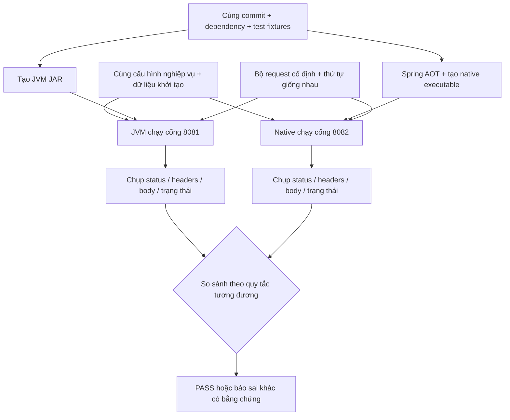
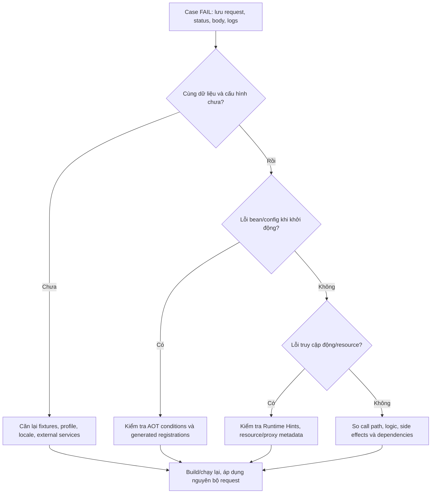

# So sánh chức năng với bản JVM bằng cùng bộ yêu cầu

Sau khi biên dịch ứng dụng Spring Boot thành **GraalVM Native Image** bằng Spring AOT, việc native executable khởi động thành công chưa đủ để kết luận ứng dụng tương thích. Một route có thể trả về đúng dữ liệu trên JVM nhưng lỗi khi chạy native do thiếu metadata reflection, resource không được đóng gói, một bean bị loại trong quá trình AOT, hoặc cấu hình runtime khác với lúc build.

Trong chương **Ứng dụng đầu tiên** của mô-đun `SPRING_BOOT_NATIVE_IMAGE`, ta sẽ thiết kế **cùng một bộ yêu cầu (request suite)** để gửi cho bản JVM và bản native, thu lại kết quả và chỉ ra cách xác định tính tương đương chức năng. Bài học tập trung vào **đúng/sai về hành vi**, trước khi đo riêng lợi ích về thời gian khởi động và bộ nhớ hoặc đóng gói container.

## 1. "Cùng bộ yêu cầu" nghĩa là gì?

Không chỉ gửi một request `GET /health` rồi nhìn thấy HTTP 200. Cần giữ ổn định những đầu vào có ảnh hưởng đến đáp ứng:

- **Cùng mã nguồn và phiên bản dependency:** JVM JAR và native binary được tạo từ cùng commit, cùng chức năng nghiệp vụ; ghi nhận các profile/property dùng tại bước Spring AOT.
- **Cùng dữ liệu ban đầu:** cơ sở dữ liệu, seed, cache và trạng thái ứng dụng giống nhau trước mỗi lượt; tránh hai tiến trình cùng ghi vào một bảng dùng chung rồi gây sai lệch cho lượt kia.
- **Cùng cấu hình nghiệp vụ tại runtime:** timezone, locale, feature flags, URL dịch vụ, rule, khóa cấu hình và dữ liệu tham chiếu; chỉ các thiết lập kỹ thuật cần thiết như `server.port` được phép khác.
- **Cùng chuỗi HTTP:** method, path, query parameter, headers có ý nghĩa nghiệp vụ, body, thứ tự request và các tình huống lỗi đều giống nhau.
- **Cùng cách đánh giá:** so sánh status, headers ổn định, nội dung JSON/text, dữ liệu sau thao tác và lỗi nghiệp vụ theo cùng tiêu chí.



Điểm cần phân biệt: **tương đương chức năng** không yêu cầu body phải giống từng byte trong mọi trường hợp. JSON có thể khác thứ tự key; header `Date`, request ID và timestamp có thể thay đổi. Ta cần đối chiếu **giá trị có ý nghĩa** và kiểm soát hoặc chuẩn hóa phần không ổn định. Ngược lại, không được bỏ qua sai khác ở mã HTTP, số tiền, mã lỗi, định dạng ngày tháng hoặc tác dụng phụ chỉ để làm phép so sánh thành công.

## 2. Chuẩn bị một ứng dụng REST có thể quan sát

Ví dụ dùng Spring Boot 3.x trên Java 17+, với `spring-boot-starter-web` và `spring-boot-starter-validation`. Dự án native cần cấu hình Spring Boot Maven/Gradle plugin và GraalVM Native Build Tools tương ứng; ví dụ này tập trung vào logic dùng chung cho cả hai bản.

Cấu trúc tối thiểu:

```text
src/main/
├── java/com/example/parity/
│   ├── NativeParityApplication.java
│   └── ParityController.java
└── resources/
    └── banner.txt
```

### 2.1. Entry point

```java
package com.example.parity;

import org.springframework.boot.SpringApplication;
import org.springframework.boot.autoconfigure.SpringBootApplication;

@SpringBootApplication
public class NativeParityApplication {
    public static void main(String[] args) {
        SpringApplication.run(NativeParityApplication.class, args);
    }
}
```

### 2.2. API tạo và đọc đơn hàng

Để bài thực hành tự chứa, ví dụ lưu dữ liệu trong bộ nhớ tiến trình; ứng dụng thực tế thường dùng database riêng cho mỗi lần test. Mỗi tiến trình bắt đầu từ ID `1`, vì vậy **phải khởi động hai tiến trình sạch** trước khi chạy bộ request.

```java
package com.example.parity;

import java.io.IOException;
import java.net.URI;
import java.nio.charset.StandardCharsets;
import java.util.Map;
import java.util.concurrent.ConcurrentHashMap;
import java.util.concurrent.atomic.AtomicLong;

import jakarta.validation.Valid;
import jakarta.validation.constraints.Min;
import jakarta.validation.constraints.NotBlank;

import org.springframework.beans.factory.annotation.Value;
import org.springframework.core.io.ClassPathResource;
import org.springframework.http.MediaType;
import org.springframework.http.ResponseEntity;
import org.springframework.web.bind.annotation.*;

@RestController
@RequestMapping("/api")
class ParityController {
    private final AtomicLong nextId = new AtomicLong();
    private final Map<Long, OrderResponse> orders = new ConcurrentHashMap<>();
    private final String appLabel;

    ParityController(@Value("${app.label:parity}") String appLabel) {
        this.appLabel = appLabel;
    }

    @PostMapping("/orders")
    ResponseEntity<OrderResponse> create(
            @Valid @RequestBody CreateOrderRequest request) {
        long id = nextId.incrementAndGet();
        OrderResponse result = new OrderResponse(id, request.sku(), request.quantity());
        orders.put(id, result);

        return ResponseEntity.created(URI.create("/api/orders/" + id)).body(result);
    }

    @GetMapping("/orders/{id}")
    ResponseEntity<OrderResponse> find(@PathVariable long id) {
        OrderResponse result = orders.get(id);
        return result == null
                ? ResponseEntity.notFound().build()
                : ResponseEntity.ok(result);
    }

    @GetMapping("/label")
    Map<String, String> label() {
        return Map.of("label", appLabel);
    }

    @GetMapping(value = "/banner", produces = MediaType.TEXT_PLAIN_VALUE)
    String banner() throws IOException {
        try (var input = new ClassPathResource("banner.txt").getInputStream()) {
            return new String(input.readAllBytes(), StandardCharsets.UTF_8)
                    .stripTrailing();
        }
    }
}

record CreateOrderRequest(@NotBlank String sku, @Min(1) int quantity) {}

record OrderResponse(long id, String sku, int quantity) {}
```

Nội dung của `src/main/resources/banner.txt` (lưu UTF-8):

```text
Chào mừng đến cửa hàng Việt
```

Năm nhóm hành vi cần kiểm tra từ ví dụ:

| Hành vi | Điểm nhạy cảm khi chuyển native | Điều cần xác minh |
| --- | --- | --- |
| POST JSON chứa Unicode | Jackson binding và metadata reflection/serialization liên quan | JSON được deserialize, validate và serialize đúng. |
| GET đơn hàng vừa tạo | Bean, logic lưu trạng thái và đường mapping | ID, số lượng, SKU và status giống bản JVM. |
| POST dữ liệu không hợp lệ | Jakarta Bean Validation, chuyển đổi request và xử lý lỗi | HTTP 400, không tạo đơn hàng ngoài ý muốn. |
| Đọc `banner.txt` | Resource phải có mặt trong native image | Nội dung UTF-8 giống nhau, không lỗi thiếu classpath resource. |
| Đọc `app.label` | Cấu hình được inject tại runtime | Cùng property cho cùng output; thay property cho lần chạy khác vẫn hợp lệ nếu không làm thay đổi bean graph. |

**Giới hạn của ví dụ:** bản lưu trong memory không bền vững qua restart và không chứng minh tính tương thích của JPA/JDBC. Với ứng dụng có database, cần bổ sung kiểm tra transaction, truy vấn, schema, driver, migrations, connection pool và tác dụng phụ thực tế.

## 3. Xây dựng JVM JAR và native executable từ cùng nguồn

Ví dụ trên dùng Maven với Maven Wrapper (tên artifact do dự án quyết định):

```bash
# Tạo bản JVM thông thường, dùng để làm baseline.
./mvnw -DskipTests package

# Tạo native executable với native profile/toolchain đã được cấu hình.
./mvnw -Pnative native:compile
```

Nếu dự án dùng Gradle và đã áp dụng plugin GraalVM Native Build Tools:

```bash
./gradlew bootJar
./gradlew nativeCompile
```

Lệnh build chỉ có thể thành công nếu Java/GraalVM toolchain và plugin đã được cài đặt đúng. Đường dẫn thường gặp là `target/` (Maven) hoặc `build/libs/` và `build/native/nativeCompile/` (Gradle); **hãy xác nhận tên file được build thực tế** thay vì mặc định sao chép tên ví dụ.

Ghi nhận thông tin dùng để truy vết:

| Thông tin | Mục đích |
| --- | --- |
| Commit Git và phiên bản Spring Boot | Bảo đảm cả hai triển khai cùng logic/framework. |
| Phiên bản Java, GraalVM và plugin native build | Có thể giải thích khác biệt từ compiler/toolchain. |
| Build command và AOT profiles/properties | Một số điều kiện tạo bean được xử lý trong bước Spring AOT. |
| Dependency, resource và cấu hình bên ngoài | Khác biệt thư viện/tài nguyên có thể làm tính năng chỉ lỗi trên native. |
| Kiểu OS/CPU/kiến trúc và container base image | Native binary phụ thuộc target platform. |

Không đưa secret thật vào log hoặc tài liệu kiểm thử. Khi so sánh, dùng giá trị giả hoặc cùng nguồn secret được quản lý an toàn ở môi trường chạy.

## 4. Chạy song song hai bản trong môi trường có kiểm soát

Mỗi dòng sau được chạy trong **terminal riêng**. Tên JAR và native executable là placeholder cần thay theo artifact thực tế:

```bash
# Terminal 1 — JVM:
java -jar target/native-parity-0.0.1-SNAPSHOT.jar --server.port=8081 --app.label=parity

# Terminal 2 — native executable (Linux/macOS, cùng target platform):
./target/native-parity --server.port=8082 --app.label=parity
```

Trên Windows dùng đường dẫn và tên thực thi tương ứng, ví dụ `mvnw.cmd` hoặc binary `.exe` dành cho Windows. Nếu sử dụng Gradle, trỏ tới output của `bootJar` và `nativeCompile`.

Hai tiến trình có cùng `app.label=parity`, cùng dữ liệu khởi tạo và route; cổng `8081`/`8082` khác nhau để tránh xung đột. Trước khi test, kiểm tra log cho biết ứng dụng đã khởi động thành công, không có lỗi tạo bean hoặc thiếu resource. Nếu dùng endpoint readiness, chỉ bắt đầu gửi request khi cả hai bản đã sẵn sàng.

**Không chạy hai bản cùng lúc trên một cơ sở dữ liệu dùng chung** nếu bộ test ghi dữ liệu hoặc đánh số thứ tự dựa trên database. Một lượt có thể thay đổi trạng thái của lượt khác. Hãy tạo hai database/snapshot giống nhau, hoặc chạy tuần tự với bước reset dữ liệu rõ ràng.

## 5. Định nghĩa một ma trận request dùng lại nguyên vẹn

Với ứng dụng mẫu, chạy các case đúng thứ tự sau **trên một tiến trình mới của mỗi bản**:

| ID | Request | Kỳ vọng | Ý nghĩa |
| --- | --- | --- | --- |
| R01 | `POST /api/orders` với `{"sku":"CÀ-PHÊ","quantity":2}` | `201`, body `{"id":1,"sku":"CÀ-PHÊ","quantity":2}`, header `Location: /api/orders/1` | JSON Unicode, validation hợp lệ, state mutation. |
| R02 | `GET /api/orders/1` | `200`, cùng JSON với R01 | Đọc dữ liệu sau thao tác ghi. |
| R03 | `POST /api/orders` với `{"sku":"CÀ-PHÊ","quantity":0}` | `400`, không tạo đơn mới | Kiểm tra `@Min(1)` và tác dụng phụ khi validation lỗi. |
| R04 | `GET /api/orders/999` | `404` | Không tìm thấy tài nguyên. |
| R05 | `POST /api/orders` với body `{bad-json` | `400` | JSON parser và lỗi request. |
| R06 | `GET /api/label` | `200`, `{"label":"parity"}` | Inject property lúc khởi động. |
| R07 | `GET /api/banner` | `200`, chuỗi `Chào mừng đến cửa hàng Việt` | Resource classpath, UTF-8. |

Ở R03/R05, body lỗi mặc định của Spring Boot có thể chứa thông tin khác nhau theo phiên bản/config và có trường động. Bài thực hành so sánh **status và tính chất lỗi**; nếu dự án có hợp đồng lỗi riêng (ví dụ `{"code":"INVALID_ORDER", ...}`), phải so sánh thêm `code` và các trường ổn định theo hợp đồng đó.

Hai lần chạy trên hai tiến trình mới và không có request bên ngoài xen vào sẽ tạo ID `1` cho R01. Nếu đã gửi request kiểm tra thủ công trước đó, hãy restart cả hai tiến trình để tránh sai lệch ID.

## 6. Tự động gửi cùng request và đối chiếu kết quả

Có thể dùng `curl` và `jq` (và `diff`) trên Bash/Linux/macOS hoặc môi trường shell có công cụ tương đương. Script dưới đây là **mẫu chạy trên máy người học**, không được thực thi sẵn trong bài.

Lưu ví dụ thành `compare-parity.sh` trong dự án thực hành của bạn:

```bash
#!/usr/bin/env bash
set -euo pipefail

# Chạy khi cả hai tiến trình vừa khởi động sạch và đang lắng nghe.
# Yêu cầu curl, jq, diff và Bash.
OUT="parity-results"
mkdir -p "$OUT/jvm" "$OUT/native"

capture() {
  local implementation="$1"
  local port="$2"
  local case_id="$3"
  local method="$4"
  local route="$5"
  local payload="${6-}"
  local prefix="$OUT/$implementation/$case_id"

  local -a options=(
    --silent --show-error
    --output "$prefix.body"
    --dump-header "$prefix.headers"
    --write-out "%{http_code}"
  )
  if [[ "$method" == "POST" ]]; then
    options+=(--request POST --header "Content-Type: application/json")
    options+=(--data "$payload")
  fi
  curl "${options[@]}" "http://127.0.0.1:$port$route" > "$prefix.status"
}

run_suite() {
  local implementation="$1"
  local port="$2"

  capture "$implementation" "$port" R01 POST /api/orders '{"sku":"CÀ-PHÊ","quantity":2}'
  capture "$implementation" "$port" R02 GET /api/orders/1
  capture "$implementation" "$port" R03 POST /api/orders '{"sku":"CÀ-PHÊ","quantity":0}'
  capture "$implementation" "$port" R04 GET /api/orders/999
  capture "$implementation" "$port" R05 POST /api/orders '{bad-json'
  capture "$implementation" "$port" R06 GET /api/label
  capture "$implementation" "$port" R07 GET /api/banner
}

run_suite jvm 8081
run_suite native 8082

assert_case() {
  local case_id="$1"
  local expected="$2"
  local actual_jvm
  local actual_native

  actual_jvm="$(cat "$OUT/jvm/$case_id.status")"
  actual_native="$(cat "$OUT/native/$case_id.status")"
  [[ "$actual_jvm" == "$expected" ]] || {
    echo "FAIL $case_id: JVM=$actual_jvm, expected=$expected"
    exit 1
  }
  [[ "$actual_native" == "$expected" ]] || {
    echo "FAIL $case_id: native=$actual_native, expected=$expected"
    exit 1
  }

  # Chỉ so body với những case có body ổn định theo contract.
  case "$case_id" in
    R01|R02|R06)
      jq -eS . "$OUT/jvm/$case_id.body" > "$OUT/jvm/$case_id.canonical.json"
      jq -eS . "$OUT/native/$case_id.body" > "$OUT/native/$case_id.canonical.json"
      diff -u "$OUT/jvm/$case_id.canonical.json" "$OUT/native/$case_id.canonical.json"
      ;;
    R07)
      diff -u "$OUT/jvm/$case_id.body" "$OUT/native/$case_id.body"
      ;;
  esac

  echo "PASS $case_id (HTTP $expected)"
}

assert_case R01 201
assert_case R02 200
assert_case R03 400
assert_case R04 404
assert_case R05 400
assert_case R06 200
assert_case R07 200

# Kiểm tra độc lập giá trị nghiệp vụ, tránh trường hợp cả hai cùng sai.
jq -e '.id == 1 and .sku == "CÀ-PHÊ" and .quantity == 2' "$OUT/jvm/R01.body" > /dev/null
jq -e '.label == "parity"' "$OUT/native/R06.body" > /dev/null

echo "Functional parity: all seven sample cases passed."
```

Script lưu response body, status code và headers theo từng case:

```text
parity-results/
├── jvm/
│   ├── R01.status
│   ├── R01.headers
│   ├── R01.body
│   └── ...
└── native/
    ├── R01.status
    ├── R01.headers
    ├── R01.body
    └── ...
```

Với R01/R02/R06, `jq -S` chuẩn hóa **thứ tự key JSON**, giúp tránh báo sai khác chỉ vì thứ tự serialization. Với R07, so sánh text trực tiếp. Với các request lỗi, script bắt buộc cả hai trả đúng mã HTTP; nếu ứng dụng có chuẩn mã lỗi hoặc error response ổn định, hãy bổ sung kiểm tra các trường đó.

**Bổ sung bắt buộc khi dùng trong CI thực tế:** kiểm tra `Content-Type` (ví dụ `application/json`, `text/plain`), `Location` của R01, body/contract lỗi chuẩn hóa và trạng thái database sau từng case. Ví dụ trên giữ phần script ngắn để làm rõ kỹ thuật so sánh, chưa thay thế một bộ integration test đầy đủ.

### 6.1. Vì sao không so sánh nguyên response HTTP?

Một response có thể chứa:

- `Date`, `Server`, `Connection`, `Transfer-Encoding` hoặc thứ tự header thay đổi;
- ID ngẫu nhiên, timestamp tạo tại runtime, token hoặc trace ID;
- JSON object với thứ tự key khác nhau (thứ tự key không mang ý nghĩa theo mô hình dữ liệu JSON);
- nội dung lỗi mặc định chứa trường động hoặc thông điệp thay đổi theo framework.

Khi những trường này không thuộc hợp đồng nghiệp vụ, chuẩn hóa hoặc loại khỏi phép so sánh **theo danh sách được thống nhất trước**. Nếu ID/timestamp là dữ liệu nghiệp vụ, phải kiểm tra ràng buộc phù hợp: ví dụ ID hợp lệ và dùng nhất quán giữa POST/GET, thời gian ở đúng timezone/độ chính xác, sự kiện audit được ghi đúng số lần. Không được bỏ qua những lỗi thực sự chỉ vì chúng “khó ổn định”.

### 6.2. Trường hợp response có thứ tự mảng hoặc số thập phân

`jq -S` chỉ sắp xếp key của object; **không sắp xếp array**. Với API trả danh sách, nếu hợp đồng quy định sort theo giá/thời gian thì phải giữ và kiểm tra đúng thứ tự. Nếu hợp đồng coi thứ tự là không quan trọng, hãy chọn khóa duy nhất và sort mảng trước khi so.

Với tiền tệ hoặc số đo, không nên tự ý làm tròn mọi giá trị. Ví dụ `12.30` và `12.3` có thể tương đương về giá trị JSON number nhưng không nhất thiết tương đương nếu API bắt buộc định dạng hiển thị. Nếu cần sai số cho phép (dữ liệu đo đạc), đặt ngưỡng rõ ràng theo nghiệp vụ; không áp dụng chung cho số lượng, thuế hoặc số tiền yêu cầu chính xác.

## 7. Xác nhận tác dụng phụ, không chỉ phản hồi

Một API có thể trả cùng HTTP 201 nhưng ghi sai database hoặc phát message hai lần trên native. Với hệ thống có trạng thái, cần kiểm tra **postcondition** sau request.

| Kịch bản | Kiểm tra phản hồi | Kiểm tra tác dụng phụ |
| --- | --- | --- |
| Tạo đơn thành công | 201, id/sku/quantity chính xác | Có đúng một bản ghi hoặc event; giá trị giống response. |
| Validation lỗi | 400 và mã lỗi phù hợp | Không sinh đơn, không phát event tạo đơn. |
| Truy vấn thiếu ID | 404 | Không sửa/xóa dữ liệu. |
| Gọi lại request theo quy tắc idempotency | Status và response theo hợp đồng | Không tạo bản sao ngoài ý muốn. |
| Giao dịch có lỗi ở giữa | Mã lỗi/response đúng | Rollback hoặc trạng thái cuối đúng quy tắc. |

Với chương trình mẫu, R02 là phép xác nhận tối thiểu rằng đơn từ R01 đã được lưu trong memory. Một test mở rộng có thể thêm endpoint đọc danh sách/số lượng đơn để khẳng định R03 không làm thay đổi dữ liệu. Với hệ thống production, **nên xác minh trực tiếp database/event/queue hoặc qua API truy vấn đã thiết kế**; không thêm endpoint quản trị kém an toàn chỉ để phục vụ kiểm thử.

Khi chạy cạnh tranh, ID hoặc thứ tự event có thể khác nhau vì scheduler. Hãy thiết kế assertion theo tính chất nghiệp vụ (đủ bản ghi, không trùng, dữ liệu toàn vẹn) thay vì đòi ID/ordering giống tuyệt đối giữa hai tiến trình, trừ khi thứ tự ấy là yêu cầu chức năng.

## 8. Sai khác nào gợi ý vấn đề Spring AOT hoặc GraalVM?

| Hiện tượng khi so sánh | Khả năng cần điều tra | Cách khoanh vùng |
| --- | --- | --- |
| JVM chạy, native lỗi khi deserialize JSON | Reflection metadata, Jackson customization hoặc kiểu DTO đặc biệt | Xem stack trace, đường mapping, Runtime Hints và kiểu được deserialize. |
| Một bean/service có trên JVM nhưng không có trong native | `@Profile`, `@ConditionalOnProperty` hoặc điều kiện được xử lý khi AOT | So cấu hình lúc `processAot`, generated bean registration và cấu hình runtime. |
| JVM đọc template, native báo không tìm thấy | Resource chưa được include hoặc đường dẫn classpath sai | Xem cách đọc `ClassPathResource`/`getResourceAsStream` và native resource hints. |
| Native lỗi lúc tạo proxy hoặc gọi động | JDK proxy, reflection, framework-generated class | Kiểm tra Runtime Hints, cấu hình AOP, các interface/proxy và lỗi thực tế. |
| Cùng request nhưng timezone/date khác | `TZ`, locale, clock, serialization hoặc initialization | Ghi lại timezone/locale của hai tiến trình, cấp clock cố định trong test nếu cần. |
| Bản native gọi sai endpoint ngoài | Cấu hình khác, DNS/TLS/truststore hoặc resource chứng chỉ | So properties và mạng/TLS của container, không kết luận ngay là lỗi business logic. |
| Cùng body nhưng status hoặc header khác | Exception handler, HTTP converters, content negotiation | So `Accept`, `Content-Type`, config MVC và stack trace. |
| Native xử lý khác khi bật tính năng sau build | Điều kiện hoặc mã chỉ được quyết định ở AOT/build time | Xác định feature chọn bean graph hay chỉ thay giá trị trong bean luôn hiện diện. |

Quy trình khắc phục có thể lần theo:



Khi phát hiện lỗi chỉ xuất hiện trên native, **không chỉnh sửa mã hoặc bỏ case cho đến khi nhìn thấy bằng chứng**. Hãy lưu request chính xác, stack trace, cấu hình dùng khi build/runtime, đoạn generated source/hint liên quan và kết quả trước/sau khi sửa. Nếu sửa một Runtime Hint, resource hay điều kiện AOT, cần **build lại native executable** và chạy lại toàn bộ suite. Nếu chỉ sửa cấu hình runtime không ảnh hưởng bean graph, thường có thể restart với cấu hình mới mà không rebuild.

## 9. Mở rộng từ ví dụ đơn giản sang ứng dụng có database và tích hợp

Bảy case ở trên đủ để học cách so sánh. Trước khi đánh giá một dịch vụ Spring Boot native thật, hãy bổ sung các nhóm sau dựa trên tính năng mà ứng dụng dùng:

1. **REST contract:** GET/POST/PUT/PATCH/DELETE, query/path parameter, status 2xx/4xx/5xx dự kiến, content negotiation, Unicode, body lớn, malformed JSON, null và trường thiếu.
2. **Validation & serialization:** annotation validation, custom validators, Java records, `LocalDateTime`/`Instant`, enum, polymorphic DTO, generic collections, cấu hình Jackson.
3. **Persistence:** CRUD, paging/sorting, optimistic lock, transaction commit/rollback, migration, mapping JPA, native query, lỗi kết nối/timeout.
4. **Security & TLS:** xác thực, phân quyền, cookie, CORS, chứng chỉ, redirect và lỗi unauthorized/forbidden; dùng token/secret test tương ứng.
5. **Resources & dynamic access:** template, `messages*.properties`, schema JSON, reflection, proxy, JNI, serializer và resource do framework nạp động.
6. **Event-driven / async:** message broker, retry, duplicate delivery, ordering theo contract, scheduler, timeout và idempotency.
7. **Vận hành:** readiness/liveness, graceful shutdown, signal handling, logging và cấu hình qua environment/volume trong container native.

Với mỗi nhóm, xác định **ít nhất một case thành công, một case lỗi và một kiểm tra tác dụng phụ** nếu hệ thống có state. Không có nghĩa phải test mọi implementation detail: trọng tâm là đường sử dụng thực tế mà người dùng hoặc dịch vụ khác phụ thuộc.

### 9.1. Cách chuẩn bị fixtures cho hai bản

Có ba cách phổ biến:

- **Hai cơ sở dữ liệu độc lập từ cùng một snapshot/seed:** phù hợp khi muốn chạy song song JVM và native.
- **Một cơ sở dữ liệu nhưng chạy tuần tự và reset có kiểm soát:** phù hợp khi không đủ tài nguyên, miễn là reset không để sót message/cache hoặc thay đổi sequence.
- **Mock/stub các dịch vụ ngoài theo cùng kịch bản:** phù hợp khi cần kiểm soát timeout, HTTP status, response của đối tác và tái hiện lỗi ổn định.

Tránh sử dụng API production, hàng đợi thật hoặc dữ liệu khách hàng thực trong thử nghiệm có thao tác ghi. Với API tính phí, thanh toán hoặc gửi notification, dùng sandbox/stub và kiểm tra side effects bằng dữ liệu test.

### 9.2. Dùng bộ request cho container native

Khi đóng gói bản native vào container, có thêm biến số như image base, CA certificates, DNS, timezone, network policy, volume resource, biến môi trường và cổng publish. Hãy giữ nguyên bộ request và chạy lại với endpoint container, đồng thời ghi nhận cấu hình container.

Một kết quả khác giữa native chạy trực tiếp và native trong container **không tự chứng minh lỗi Native Image**. Nó có thể phản ánh thay đổi môi trường vận hành. Dùng cùng bộ case ở ba môi trường JVM, native local và native container sẽ giúp xác định vấn đề xuất hiện ở lớp nào.

## 10. Sau khi tương đương chức năng, mới so hiệu năng

Mô-đun Spring Boot Native Image còn đánh giá **cold start** và **bộ nhớ**. Các số đo ấy nên được thực hiện sau khi ứng dụng vượt qua bộ kiểm thử chức năng:

| Phép đo | Cách giữ công bằng |
| --- | --- |
| Thời gian khởi động đến lúc sẵn sàng nhận request | Cùng readiness criteria, cùng dependency/DB và tài nguyên máy; đo nhiều lần. |
| RSS/bộ nhớ tiến trình | So đúng chỉ số ở trạng thái idle và khi chịu tải; không lấy `-Xmx` của JVM làm tương đương RSS. |
| Latency/throughput | Cùng request mix, concurrency, payload, warm-up và thời lượng đo; báo phân vị, không chỉ average. |
| CPU, kích thước artifact, thời gian build | Ghi riêng các đánh đổi của native build và runtime; không trộn cùng chỉ số chức năng. |

Native có thể khởi động nhanh hơn hoặc tiêu thụ ít bộ nhớ hơn trong một số workload, nhưng không có mức cải thiện cố định cho mọi hệ thống. Nếu một bản thiếu tính năng hoặc bỏ bớt bước xử lý, kết quả performance dù tốt hơn cũng **không phải so sánh tương đương**.

## 11. Checklist nghiệm thu tính tương đương

- [ ] Cùng commit mã nguồn, cùng phiên bản dependency và ghi nhận native toolchain.
- [ ] AOT build properties/profile và cấu hình runtime đã được xác định, nhất là những điều kiện ảnh hưởng bean graph.
- [ ] Dữ liệu ban đầu giống nhau, không có request ngoài làm thay đổi state giữa hai lượt.
- [ ] Bộ request có case thành công, lỗi input, not found, resource, Unicode và cấu hình runtime.
- [ ] So status với kỳ vọng độc lập, sau đó so body theo hợp đồng; không chỉ kiểm tra “JVM giống native”.
- [ ] So các header quan trọng như `Content-Type`, `Location` và behavior của cookie/auth nếu có.
- [ ] Không bỏ qua sai khác nghiệp vụ khi chuẩn hóa timestamp, ID hoặc thứ tự JSON.
- [ ] Tác dụng phụ database/event/cache đã được kiểm tra đối với các API ghi dữ liệu.
- [ ] Mọi case FAIL có request, log, cấu hình, version và nguyên nhân đủ để tái hiện.
- [ ] Sau khi sửa lỗi native/AOT, build lại và chạy nguyên bộ suite trước khi đo hiệu năng hoặc phát hành container.

### Câu hỏi tự kiểm tra

1. Vì sao hai bản trả HTTP 200 ở endpoint health vẫn chưa đủ chứng minh tính tương đương?
2. Khi so JSON, trường nào có thể chuẩn hóa và trường nào bắt buộc phải giữ nguyên theo hợp đồng?
3. Vì sao không nên chạy hai bản với cùng một database đang bị thao tác ghi đồng thời?
4. Nếu native trả HTTP 500 khi đọc classpath template còn JVM trả 200, bạn sẽ kiểm tra những gì?
5. Nếu JVM và native đều trả sai một giá trị nghiệp vụ như nhau, một script chỉ so sánh hai body có phát hiện lỗi không? Cần thêm loại assertion nào?
6. Tại sao phải so sánh chức năng trước khi kết luận native tiết kiệm thời gian khởi động hoặc bộ nhớ?

**Kết quả cần đạt:** một bộ request được định nghĩa một lần, chạy lại cho cả JVM và Native Image với điều kiện tương đương, cho ra báo cáo PASS/FAIL có thể truy vết. Cách làm này biến câu khẳng định “bản native hoạt động như bản JVM” thành **bằng chứng kiểm thử có thể tái hiện**, đồng thời tạo nền tảng đáng tin cậy cho việc tối ưu, đóng gói và vận hành ứng dụng Spring Boot native.
