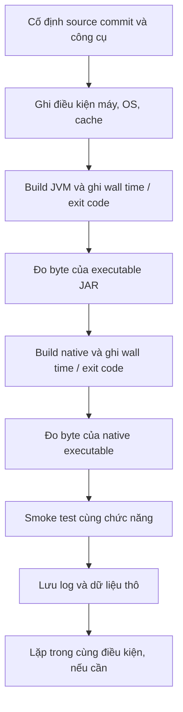

# Ghi lại thời gian build, kích thước sản phẩm và điều kiện đo ban đầu

## 1. Mục tiêu: tạo baseline cho ứng dụng Spring Boot đầu tiên

Sau khi biên dịch ứng dụng Spring Boot thành GraalVM Native Image, người học thường quan sát thấy bản native khởi động nhanh, trong khi bước build có thể lâu hơn bản JVM. Để kết luận có căn cứ, phải ghi rõ **đo điều gì, đo trên máy nào và đo bằng lệnh nào**.

Bài học thuộc chương **Ứng dụng đầu tiên** của module **SPRING_BOOT_NATIVE_IMAGE**. Xuyên suốt module, người học sử dụng **Spring AOT** và **GraalVM Native Image**, thực hành Maven/Gradle, reflection/resource, kiểm thử tương thích, đóng gói container và vận hành bản native. Ở lần build đầu tiên, chúng ta xây dựng một **baseline** để có dữ liệu đối chiếu khi tối ưu hóa, thay phiên bản công cụ hoặc đo startup và bộ nhớ sau này.

Sau bài học, bạn có thể:

- Xác định ranh giới đo thời gian của lệnh build JVM và native.
- Ghi kích thước **đúng artifact** bằng số byte nguyên gốc.
- Ghi môi trường máy, toolchain, cache và flags để người khác tái hiện phép đo.
- Lập bảng kết quả theo từng lượt, kiểm tra điều kiện hợp lệ và diễn giải đúng chênh lệch.
- Phân biệt kích thước JAR, native executable và container image với chỉ số vận hành runtime.

**Phạm vi:** bài này đo **chi phí tạo ra sản phẩm**. Thời gian startup và RAM của ứng dụng là phép đo runtime khác, cần cách xác định thời điểm bắt đầu/kết thúc và cách lấy mẫu riêng.

## 2. Định nghĩa các chỉ số trước khi đo

| Trường | Ý nghĩa | Đơn vị |
|---|---|---|
| `build_variant` | Phương án `jvm` hay `native` | Văn bản |
| `build_wall_seconds` | Thời gian thực trôi qua từ trước khi gọi command đến lúc command kết thúc | Giây |
| `build_exit_code` | Mã thoát của command; thông thường `0` là thành công | Số nguyên |
| `artifact_kind` | Loại sản phẩm: `boot-jar`, `native-executable` hoặc `container-image` | Văn bản |
| `artifact_path` | Đường dẫn chính xác của file đầu ra được kiểm tra | Đường dẫn |
| `artifact_bytes` | Kích thước file đầu ra từ filesystem | Byte |
| `cache_state` | Trạng thái dependency/cache, build output và daemon | Văn bản |
| `repeat_index` | Số thứ tự lượt đo trong cùng điều kiện | Số nguyên |

**Wall-clock time** phản ánh thời gian người dùng chờ. Nó khác tổng CPU time của các luồng biên dịch. GraalVM Native Image có thể chạy các tác vụ song song, nên tổng thời gian CPU có thể cao hơn thời gian đồng hồ.

Số byte nên được giữ ở dạng nguyên gốc. Khi hiển thị MiB:

```text
MiB = artifact_bytes / (1024 * 1024)
MB  = artifact_bytes / (1000 * 1000)
```

Phải ghi rõ dùng MB hay MiB, vì công cụ khác nhau có thể hiển thị giá trị làm tròn theo hệ cơ số khác nhau.

### Đang đo loại sản phẩm nào?

| Đối tượng | Gồm những gì? | Lưu ý khi so sánh |
|---|---|---|
| Spring Boot executable JAR | Mã ứng dụng và dependency được đóng gói; thường có nén | Vẫn cần môi trường Java ngoài JAR |
| GraalVM native executable | Mã đã biên dịch AOT và các thành phần runtime cần thiết trong binary | Có thể còn phụ thuộc thư viện hệ thống |
| Container image | Các filesystem layer, base image, artifact và thư viện liên quan | Cách tính image size khác kích thước file hoặc dung lượng push/pull |
| Artifact trong registry | Những layer được tải lên/tải về, có thể nén | Không dùng số byte này thay cho executable size |

Một JAR nhỏ hơn binary native **không tự động** có nghĩa toàn bộ bản triển khai JVM chiếm ít dung lượng hơn: JAR có thể dùng JRE/JDK bên ngoài hoặc container base image lớn. Ngược lại, native binary nhỏ hơn cũng không bảo đảm mức RAM lúc chạy thấp hơn. Cần xác định đúng ranh giới so sánh.

## 3. Kiểm soát biến trong thí nghiệm



Để phép so sánh có ý nghĩa:

1. Dùng **cùng một source commit**, cùng dependency và cùng chức năng ứng dụng; chỉ thay các bước cần thiết để bật native.
2. Dùng **cùng chính sách test**. Ví dụ, bỏ qua test trong cả hai command đo thời gian, sau đó chạy test/smoke test riêng. Không so JVM build có test với native build không test mà bỏ qua khác biệt đó.
3. Giữ ổn định CPU/RAM, giới hạn tài nguyên CI, thiết bị lưu trữ và những ứng dụng khác chạy trên máy.
4. Ghi flags native, JVM build, Gradle daemon và trạng thái cache. Native build có thể đổi đáng kể khi thay mức tối ưu hoặc giới hạn bộ nhớ.
5. Kiểm tra exit code **ngay sau mỗi command**. Command lỗi không được ghi là một build hoàn tất.
6. Đo kích thước artifact **ngay sau build tương ứng**. Một command `clean` tiếp theo có thể xóa file của lượt trước.
7. Nếu đo nhiều lượt, ghi thứ tự và thời điểm; tránh kết luận từ một lượt có mạng chậm hoặc máy đang tải nặng.

### Warm và cold khác nhau thế nào?

- **Warm dependencies + clean project output:** dependency và toolchain đã được chuẩn bị; trước mỗi lượt xóa đầu ra build trong dự án. Cách này phù hợp với thí nghiệm ban đầu nhằm đo công đoạn tạo artifact khi môi trường sẵn sàng.
- **Cold end-to-end:** khởi tạo từ môi trường sạch theo một định nghĩa rõ ràng, có thể bao gồm tải dependency, builder image hoặc cài toolchain. Phép đo này thường phản ánh tổng thời gian dựng môi trường CI mới.

`mvn clean` và `gradle clean` không tự xóa Maven local repository, Gradle dependency caches, Gradle daemon hay mọi filesystem cache. Vì vậy, **không gọi một lần build là cold chỉ vì đã chạy clean**.

Đối với ứng dụng đầu tiên, nên dùng **warm dependencies + clean project output** và ghi rõ chính sách để dễ tái hiện. Việc chuẩn bị môi trường được thực hiện trước thời điểm bắt đầu đo.

## 4. Bộ metadata cần ghi cùng kết quả

| Nhóm | Giá trị tối thiểu cần lưu |
|---|---|
| Source | Tên ứng dụng, Git commit, branch/tag hoặc mã phiên bản |
| Spring | Spring Boot version, Spring AOT profile và cấu hình liên quan |
| Java | Java major, vendor/distribution, version thực tế |
| Native toolchain | Output `native-image --version`, GraalVM distribution/JDK major |
| Build tool | Maven/Gradle wrapper, Spring Boot plugin, GraalVM Native Build Tools version |
| OS và CPU | Hệ điều hành, version, kiến trúc x86_64/ARM64, model CPU, số lõi |
| RAM và disk | RAM khả dụng/giới hạn RAM, SSD/HDD hoặc đặc tính lưu trữ |
| Môi trường | Local/CI/container, virtualization, CPU quota và memory limit |
| Trạng thái đo | Cache state, clean policy, Gradle daemon policy, network download |
| Command | Toàn bộ command, profile, test policy, flags và biến môi trường liên quan |
| Kết quả | Time, exit code, output file, artifact bytes, build log và smoke test |

Không ghi token, mật khẩu hoặc giá trị bí mật vào log xuất bản. Chỉ lưu thông tin môi trường cần để tái hiện, sau khi lược bỏ dữ liệu nhạy cảm.

Ví dụ kiểm tra công cụ trên Linux/macOS:

```bash
java -version
javac -version
native-image --version
./mvnw --version       # Chỉ khi dùng Maven
./gradlew --version    # Chỉ khi dùng Gradle
```

Ví dụ tương ứng trên Windows PowerShell:

```powershell
java -version
javac -version
native-image --version
.\mvnw.cmd --version
.\gradlew.bat --version
```

`java -version` trong terminal chưa chắc phản ánh JDK mà Maven/Gradle Java toolchain hoặc native plugin thực sự chọn. Đọc cả log build và cấu hình toolchain khi kiểm chứng.

## 5. Đo thời gian build Maven trên Linux

Giả sử project đã được cấu hình Spring Boot Maven Plugin và GraalVM Native Build Tools, có profile `native` hợp lệ. Nếu chưa có profile đó, cần cấu hình theo tài liệu của đúng release Spring Boot đang dùng; không mặc định `-Pnative` hoạt động trong mọi POM.

Đầu tiên chuẩn bị dependency và xác minh JVM build hoạt động **ngoài thời gian baseline**:

```bash
java -version
native-image --version
./mvnw --version
./mvnw -DskipTests package
```

Lần native đầu có thể tải thêm dependency/plugin mặc dù đã chuẩn bị JVM; cần ghi chú nếu log cho thấy download trong khoảng đo. Trong thí nghiệm này ta đo **toàn command clean + build** và dùng `-DskipTests` ở cả hai biến thể.

Trên Linux có GNU `/usr/bin/time`:

```bash
mkdir -p measurements

/usr/bin/time \
  -f 'wall_seconds=%e\nuser_cpu_seconds=%U\nsystem_cpu_seconds=%S' \
  -o measurements/maven-jvm.time \
  ./mvnw -DskipTests clean package \
  > measurements/maven-jvm-build.log 2>&1

echo "jvm_exit_code=$?"

/usr/bin/time \
  -f 'wall_seconds=%e\nuser_cpu_seconds=%U\nsystem_cpu_seconds=%S' \
  -o measurements/maven-native.time \
  ./mvnw -Pnative -DskipTests clean native:compile \
  > measurements/maven-native-build.log 2>&1

echo "native_exit_code=$?"
```

**Cần thao tác theo trình tự:** chạy build JVM, kiểm tra exit code, xác định và **lưu kích thước JAR** trước khi chạy lệnh `clean` tiếp theo. Sau đó mới đo native. Đo cả hai command liên tục như khối ví dụ trên sẽ không tự lưu kích thước JAR giữa hai lượt.

Các ký hiệu `%e`, `%U`, `%S` và cú pháp `-f` là của GNU time trên Linux. Trên macOS/BSD, `/usr/bin/time` có tùy chọn khác. Ví dụ `echo` để hiển thị trạng thái sau command; trong script tự động, hãy lưu exit code ngay sau lệnh và **dừng** khi mã khác `0`. Nếu native build lỗi, không dùng binary cũ làm kết quả của lượt mới.

### Kích thước sản phẩm trên Linux

Tên và vị trí artifact phụ thuộc `artifactId`, `version`, cấu hình plugin. Hãy liệt kê ứng viên và **chọn đúng file**:

```bash
find target -maxdepth 2 -type f -name '*.jar'
find target -maxdepth 2 -type f -perm -111

# Thay bằng đường dẫn thực tế của artifact vừa build.
stat -c '%n,%s' target/native-demo-0.0.1-SNAPSHOT.jar
stat -c '%n,%s' target/native-demo
```

`stat -c '%n,%s'` trên GNU/Linux in tên file và kích thước **byte**. Không cộng tất cả `*.jar` dưới `target`: có thể có JAR gốc, test JAR hoặc file từ build khác. Không lấy nhầm file `original-*.jar` làm Spring Boot executable JAR. Nếu lệnh native vừa chạy với `clean`, JAR của lượt JVM trước có thể đã bị xóa: lưu số byte của nó trước khi chuyển biến thể.

## 6. Đo thời gian build Gradle trên Linux

Giả sử project đã áp dụng Spring Boot Gradle Plugin và `org.graalvm.buildtools.native` với phiên bản tương thích. Gradle có cơ chế daemon, incremental build và cache cần được ghi nhận rõ.

Kiểm tra và chuẩn bị:

```bash
java -version
native-image --version
./gradlew --version
./gradlew -q javaToolchains
./gradlew --no-daemon bootJar -x test
```

Lệnh chuẩn bị giúp tải dependency và phát hiện lỗi trước khi bắt đầu đo. Trong ví dụ, chọn `--no-daemon` và `-x test` nhất quán cho các lượt; nếu muốn đo Gradle daemon warm thì thiết kế phép đo riêng và ghi rõ.

```bash
mkdir -p measurements

/usr/bin/time -f 'wall_seconds=%e' \
  -o measurements/gradle-jvm.time \
  ./gradlew --no-daemon clean bootJar -x test \
  > measurements/gradle-jvm-build.log 2>&1

echo "jvm_exit_code=$?"

# Ghi kích thước bootJar ngay sau JVM build, trước lượt clean kế tiếp.

/usr/bin/time -f 'wall_seconds=%e' \
  -o measurements/gradle-native.time \
  ./gradlew --no-daemon clean nativeCompile -x test \
  > measurements/gradle-native-build.log 2>&1

echo "native_exit_code=$?"
```

Kiểm tra file do task thực sự tạo ra trước khi lấy kích thước:

```bash
find build/libs -maxdepth 1 -type f -name '*.jar'
find build/native/nativeCompile -maxdepth 1 -type f

# Thay bằng đường dẫn thực tế của dự án.
stat -c '%n,%s' build/libs/native-demo-0.0.1-SNAPSHOT.jar
stat -c '%n,%s' build/native/nativeCompile/native-demo
```

`bootJar` thường nằm trong `build/libs/`; native binary thường nằm trong `build/native/nativeCompile/`, nhưng tên và output có thể cấu hình lại. `gradle clean` dọn output dự án, không tự xóa dependency cache hay mọi Gradle build cache. Nếu project bật `org.gradle.caching` hoặc dùng `--build-cache`, cần ghi rõ và giữ ổn định. `--no-daemon` cũng có thể khiến Gradle khởi chạy tiến trình dùng một lần theo cấu hình môi trường.

## 7. Đo trên Windows PowerShell

Trên Windows có thể dùng `System.Diagnostics.Stopwatch` để đo elapsed wall time. Ví dụ sau đo Maven native build; Maven Wrapper và profile `native` phải được thiết lập đúng trong project.

```powershell
New-Item -ItemType Directory -Force -Path .\measurements | Out-Null

$watch = [System.Diagnostics.Stopwatch]::StartNew()
& .\mvnw.cmd -Pnative -DskipTests clean native:compile *> .\measurements\maven-native-build.log
$buildExitCode = $LASTEXITCODE
$watch.Stop()

[PSCustomObject]@{
    variant      = "native"
    wall_seconds = [Math]::Round($watch.Elapsed.TotalSeconds, 3)
    exit_code    = $buildExitCode
} | Export-Csv .\measurements\maven-native-result.csv -NoTypeInformation -Encoding UTF8

if ($buildExitCode -ne 0) {
    throw "Native build failed; see measurements\maven-native-build.log"
}
```

PowerShell đo **toàn bộ** lệnh `clean native:compile`. Lệnh `*>` ghi output của build vào file log. `$LASTEXITCODE` được lưu ngay sau lệnh native và kiểm tra trước khi dùng dữ liệu. Đo JVM tương tự, thay command bằng `.\mvnw.cmd -DskipTests clean package` và đổi tên log/CSV. Với Gradle, lệnh đo có thể là `.\gradlew.bat --no-daemon clean nativeCompile -x test`.

Lấy byte size bằng:

```powershell
# Thay đường dẫn theo artifact thực tế.
(Get-Item .\target\native-demo-0.0.1-SNAPSHOT.jar).Length
(Get-Item .\target\native-demo.exe).Length
```

`Get-Item.Length` trả số byte của file. Hãy đo JAR **trước** khi một lệnh clean native xóa nó. Native Image trên Windows còn cần toolchain C/C++ và SDK phù hợp; build lỗi do thiếu công cụ không đại diện cho thời gian biên dịch native thành công.

## 8. Mẫu ghi baseline có thể tái sử dụng

Một bộ kết quả nên gồm **metadata môi trường** và **bảng kết quả từng build**.

### 8.1. Mẫu metadata

```yaml
measurement_id: spring-native-first-app-001
measurement_date: "<YYYY-MM-DD>"
source_commit: "<git-commit>"
project_name: "<tên ứng dụng>"
spring_boot_version: "<version>"
java_version: "<version + vendor>"
graalvm_native_image_version: "<native-image --version>"
build_tool: "<Maven hoặc Gradle wrapper + version>"
native_build_tools_plugin_version: "<plugin version>"
build_os: "<OS + release>"
build_architecture: "<x86_64 / aarch64 / ...>"
cpu: "<CPU model + logical cores>"
ram_gib: "<RAM hoặc memory limit>"
disk: "<SSD/HDD và cấu hình I/O>"
environment: "<local / CI / container>"
cache_state: warm_dependencies_clean_project_output
test_policy: skip_in_measured_build_test_separately
timing_scope: entire_clean_and_build_command
notes: "<đặc điểm khác có ảnh hưởng đến phép đo>"
```

Các giá trị trong dấu `<...>` là chỗ phải **điền từ môi trường thực tế**, không phải dữ liệu đã đo. Không cần ghi mọi biến môi trường; chỉ các yếu tố ảnh hưởng đến tính tái hiện.

### 8.2. Bảng kết quả

| Lượt | Biến thể | Lệnh build | Exit code | Wall time (s) | Artifact path | Artifact bytes |
|---|---|---|---|---:|---|---:|
| 1 | JVM | `./mvnw -DskipTests clean package` | _điền_ | _điền_ | _JAR thực tế_ | _điền_ |
| 1 | Native | `./mvnw -Pnative -DskipTests clean native:compile` | _điền_ | _điền_ | _binary thực tế_ | _điền_ |
| 2 | JVM | _cùng command và cache policy_ | _điền_ | _điền_ | _JAR thực tế_ | _điền_ |
| 2 | Native | _cùng command và cache policy_ | _điền_ | _điền_ | _binary thực tế_ | _điền_ |

Nên giữ dữ liệu thô dạng CSV để phân tích. Header tối giản:

```csv
measurement_id,repeat_index,variant,build_command,exit_code,wall_seconds,artifact_kind,artifact_path,artifact_bytes,cache_state
```

Nếu `build_command` chứa dấu phẩy hoặc nháy kép, cần escape theo chuẩn CSV. Giữ số giây và byte ở dạng số, không trộn giá trị đã kèm đơn vị như `45s` hay `1.2GB` trong cột dùng cho tính toán.

### 8.3. Lưu bằng chứng

Cùng bảng kết quả, nên giữ log build đã loại bỏ secret, output phiên bản công cụ, OS/CPU/RAM, đúng đường dẫn artifact, exit code, bằng chứng smoke test và Git commit. SHA-256 có thể giúp kiểm tra artifact chuyển sang máy khác có đúng file đã đo hay không; checksum không thay thế kích thước hoặc test chức năng.

## 9. Chạy thử sản phẩm trước khi nhận kết quả

Exit code `0` cho thấy command kết thúc thành công, nhưng **chưa chứng minh** bản native tương thích đầy đủ với ứng dụng. Tối thiểu cần:

1. Chạy đúng JAR bằng `java -jar <đường-dẫn-jar>` trên Java runtime phù hợp.
2. Chạy trực tiếp native executable trên đúng OS/architecture và môi trường thư viện.
3. Dùng cùng input và profile để smoke test endpoint hoặc tác vụ nghiệp vụ quan trọng.
4. Nếu ứng dụng có reflection, JSON serialization, resource, proxy, JNI, hãy gọi những nhánh đó trên native; lỗi có thể chỉ xuất hiện lúc chạy.
5. Kiểm tra file được test chính là file đã ghi đường dẫn, byte size và checksum; nếu rebuild, cập nhật metadata.

Ví dụ với ứng dụng đã khởi động và có endpoint `/hello`:

```bash
curl --fail --silent --show-error http://localhost:8080/hello
```

Thời gian `curl` khi ứng dụng đã chạy **không phải startup time**. Khi đo startup sau này cần định nghĩa mốc bắt đầu process, mốc readiness và phương pháp quan sát giống nhau cho JVM/native. Bộ nhớ runtime cũng phải được đo theo RSS/working set hoặc chỉ số đã định nghĩa, tại cùng tải và thời điểm; không lấy bộ nhớ của compiler ở build time để kết luận RAM vận hành.

## 10. Lặp phép đo và tổng hợp kết quả

Một lần build dễ bị ảnh hưởng bởi download, đĩa bận, nhiệt độ CPU, các tiến trình khác hoặc tình trạng daemon. Nếu có đủ tài nguyên, nên chạy **ít nhất ba lần thành công cho mỗi biến thể** trong cùng chính sách chuẩn bị. Với thí nghiệm nghiêm túc, tăng số lượt, kiểm soát thứ tự và báo độ dao động.

Lưu từng kết quả thô. Trình bày thêm **trung vị (median)** và min/max để giảm ảnh hưởng của một lượt chậm bất thường.

Ví dụ hoàn toàn **giả định** để minh họa cách tính, không phải benchmark Spring Boot:

```text
Các thời gian giả định:      121 s, 130 s, 124 s
Sắp xếp tăng dần:           121 s, 124 s, 130 s
Trung vị:                   124 s
Khoảng min-max:             121-130 s
```

Khi đã đo được `T_native` và `T_jvm` theo **cùng định nghĩa** và cùng điều kiện:

```text
build_time_ratio    = median_native_wall_seconds / median_jvm_wall_seconds
artifact_size_ratio = native_executable_bytes / executable_jar_bytes
```

Nếu `build_time_ratio > 1`, native build mất nhiều wall time hơn **trong phép đo đó**. Không suy ra mọi ứng dụng đều như vậy hoặc runtime chậm hơn. `artifact_size_ratio` chỉ so kích thước **hai file được chọn**, không đại diện cho tổng disk footprint của hai phương án triển khai.

Không dùng các số giả định ở trên như kết quả đo. Nếu build lỗi, để trống chỉ số thành công và ghi nguyên nhân.

## 11. Nếu build bằng container hoặc Cloud Native Buildpacks

`spring-boot:build-image` và `bootBuildImage` có thể bao gồm AOT, Native Image compilation, đóng layer, tải builder/run images và tương tác Docker daemon. Do đó, **wall time toàn lệnh build-image** khác thời gian chỉ chạy `nativeCompile`.

Cần ghi:

- Builder/run image theo tag/digest; GraalVM/JDK thực tế trong builder.
- OS/CPU architecture, libc và các thư viện runtime.
- Có tải builder/layer qua mạng hay đã sẵn trong cache.
- Lệnh đo chính xác, phạm vi wall time và tên/digest image đầu ra.
- Bằng chứng container chứa **native executable** và chạy được ứng dụng.

Ví dụ kiểm tra số byte Docker báo:

```bash
docker image inspect my-native-app:local --format '{{.Size}}'
```

Trường `.Size` là kích thước theo cách Docker biểu diễn, không phải số byte native executable, kích thước nén khi push/pull hay RAM container đang dùng. Lưu nó ở cột riêng, ví dụ `docker_image_reported_bytes`. Khi so JVM container và native container, dùng cùng Docker CLI và ghi rõ base image/runtime khác nhau.

## 12. Sai lầm thường gặp

| Hiện tượng | Vì sao sai | Cách khắc phục |
|---|---|---|
| Một bên `clean`, một bên incremental build | Không cùng lượng công việc | Thống nhất chính sách clean/cache |
| Lần đầu tải dependency, lần sau dùng cache | Chỉ một phía tính thời gian tải mạng | Tách cold/warm và chuẩn bị dependency |
| Dùng `ls -lh` làm nguồn byte gốc | Dung lượng được làm tròn | Dùng `stat` hoặc `Get-Item.Length` |
| Lấy peak RAM của compiler làm RAM ứng dụng | Nhầm build-time với runtime | Đo RSS/working set runtime riêng |
| Native build lỗi nhưng vẫn lấy binary cũ | Artifact không thuộc lượt đo | Kiểm tra exit code, timestamp và đúng file |
| Chạy `clean` native trước khi ghi JAR size | JAR của build JVM có thể bị xóa | Ghi số byte ngay sau JVM build |
| Test policy không nhất quán | Hai command chạy các bước khác nhau | Giữ chung test flags hoặc ghi rõ |
| Chỉ so JAR với binary để suy ra footprint | JAR dùng JRE/JDK ngoài file | Đo thêm runtime/container nếu cần |
| Docker image size trộn với executable size | Khác loại đối tượng đo | Dùng chỉ số và cột riêng |
| JVM đo trên laptop, native đo trên CI | Phần cứng và giới hạn tài nguyên khác | Ghi môi trường hoặc đo lại cùng máy |
| Thay Java/GraalVM giữa các lượt | Thay đổi công cụ có thể ảnh hưởng kết quả | Pin version và tạo baseline mới |
| Gọi build có `clean` là cold cache | Dependency/cache khác vẫn tồn tại | Định nghĩa cold/warm đúng |

## 13. Bài tập thực hành

### Bài tập A — Baseline của ứng dụng đầu tiên

1. Ghi Git commit, Spring Boot, Java, GraalVM, plugin và wrapper.
2. Ghi OS/CPU/RAM, môi trường CI/local và chính sách cache.
3. Build JVM và native với cùng quy tắc test/clean.
4. Lưu mỗi command, exit code, wall time và file size (byte).
5. Smoke test cả hai artifact bằng cùng input; ghi kết quả.
6. Điền số liệu thực vào bảng mục 8 và đính kèm log.

**Hoàn thành:** có ít nhất một cặp JVM/native build thành công, đo đúng file và có bằng chứng smoke test.

### Bài tập B — Kiểm tra độ ổn định

Thực hiện ba lượt cho mỗi biến thể trong chính sách warm dependencies + clean project output. Tính trung vị và khoảng min/max. Nếu lượt đầu chậm hơn, kiểm tra log download, daemon, filesystem cache và tải hệ thống trước khi kết luận.

### Bài tập C — Kích thước triển khai

Đo JAR và native executable trước, sau đó đo thêm JVM container image và native container image (nếu có). Trả lời: **vì sao JAR có thể nhỏ hơn native executable nhưng JVM container có thể lớn hơn native container?** Gợi ý: JAR cần Java runtime ở nơi khác; native binary và base image đóng gói những thành phần khác nhau. Phải dựa trên số byte đã đo, không mặc định kết quả.

## 14. Checklist bàn giao baseline

- [ ] Đã khóa source commit, Spring Boot, Java, GraalVM, plugin và wrapper.
- [ ] Đã ghi OS/CPU/RAM, môi trường CI/local/container và trạng thái cache.
- [ ] Đã lưu nguyên command, test policy và phạm vi đo wall-clock.
- [ ] Đã lưu exit code, wall time và log của mỗi lượt build.
- [ ] Đã đo đúng JAR/native executable bằng byte nguyên gốc.
- [ ] Đã phân biệt container image size với artifact file size.
- [ ] Đã smoke test JVM/native với cùng nghiệp vụ.
- [ ] Đã lưu dữ liệu thô để so sánh lại khi nâng công cụ hoặc thay cấu hình.

## Kết luận

Một baseline có giá trị phải ghi **kết quả cùng hoàn cảnh tạo ra kết quả**. Thời gian build, kích thước JAR, native executable và container image là những thước đo khác nhau; thời gian khởi động và bộ nhớ runtime cần phép đo riêng. Khi giữ ổn định source, Spring Boot, GraalVM, Maven/Gradle, cache và phần cứng, ta mới có thể đánh giá có căn cứ những lợi ích và chi phí của Spring AOT/GraalVM Native Image trong các bước kiểm thử, đóng gói và vận hành tiếp theo.
