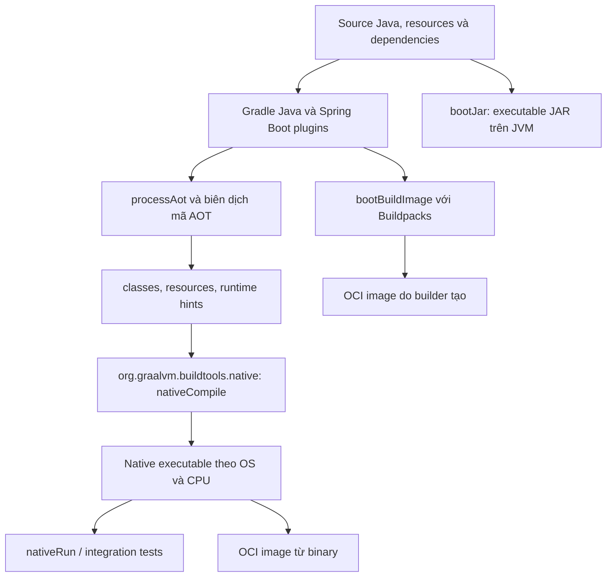

# Tích hợp Spring Boot Gradle plugin với org.graalvm.buildtools.native

## 1. Mục tiêu và bối cảnh

Trong module **SPRING_BOOT_NATIVE_IMAGE**, chúng ta dùng **Spring AOT** để chuẩn bị ứng dụng Spring Boot cho việc biên dịch trước thời điểm chạy (ahead-of-time), sau đó dùng **GraalVM Native Image** để tạo tệp thực thi native. Mục tiêu cuối cùng là kiểm tra tính tương thích, đo thời gian khởi động và bộ nhớ so với bản JVM, đồng thời đóng gói và vận hành ứng dụng trong container.

Bài thuộc chương **Gradle** này tập trung vào **cách phối hợp hai Gradle plugin**:

- `org.springframework.boot`: cung cấp các task Spring Boot như `bootJar`, `bootRun`, `processAot`, `bootBuildImage`; nhận biết quá trình AOT của Spring.
- `org.graalvm.buildtools.native`: cấu hình và chạy Native Image thông qua các task như `nativeCompile`, `nativeRun`, `nativeTest`, đồng thời chọn GraalVM/toolchain tương thích.

Khi được áp dụng chung trong một dự án Spring Boot được hỗ trợ, **Spring Boot Gradle plugin tích hợp quá trình AOT với Native Build Tools**, để các lớp và metadata được sinh bởi AOT trở thành đầu vào cho quá trình native compilation. Người học không cần tự viết một chuỗi copy classpath và chạy `native-image` bằng tay để đạt tích hợp thông thường.

Sau bài này, bạn có thể:

1. Cấu hình một dự án Gradle (Kotlin DSL hoặc Groovy DSL) sử dụng cả Spring Boot plugin và GraalVM Native Build Tools.
2. Giải thích vai trò, quan hệ phụ thuộc và đầu ra của các task JVM, AOT và native.
3. Phân biệt JDK chạy Gradle, Java toolchain được Gradle chọn, và GraalVM Native Image thực sự dùng khi build.
4. Biên dịch, chạy, kiểm thử và đóng gói ứng dụng native; ghi nhận lỗi reflection/resource để xử lý đúng chỗ.
5. Có bộ bằng chứng để so sánh bản JVM/native và xác nhận image chạy trên nền tảng đích.

> **Giới hạn kỳ vọng:** một lần `nativeCompile` thành công chỉ chứng minh đã tạo được executable. Còn phải chạy integration tests, xác minh thư viện tương thích, đo hiệu năng trên cùng điều kiện và thử container trong môi trường đích.

## 2. Kiến trúc tích hợp: ai tạo gì?

`org.springframework.boot` chịu trách nhiệm xử lý mô hình Spring: phát hiện cấu hình, bean, các auto-configuration liên quan và sinh mã/hints AOT. `org.graalvm.buildtools.native` lấy các đầu ra cần thiết để gọi GraalVM Native Image và tạo binary cho OS/CPU phù hợp.



Sơ đồ mô tả hai hướng container: **đóng gói binary đã build** và **để Cloud Native Buildpacks tạo image**. `bootBuildImage` không nhất thiết sử dụng chính file ở `build/native/nativeCompile/`; builder có thể thực hiện một quá trình build riêng.

| Thành phần | Đầu vào chính | Đầu ra hoặc công việc |
| --- | --- | --- |
| Gradle Java plugin | Java source, dependencies, Java toolchain | Biên dịch Java và chạy kiểm thử thông thường. |
| Spring Boot Gradle plugin | Spring application, cấu hình build | `bootJar`, `bootRun`, Spring AOT và các task liên quan. |
| Spring AOT | Spring application context tại build time | Mã hỗ trợ bootstrap, metadata/hints cho các cơ chế cần biết trước. |
| GraalVM Native Build Tools | Đầu ra Java/AOT, classpath, GraalVM, cấu hình binary | `nativeCompile`, `nativeRun`, `nativeTest` (tùy phiên bản/tập test). |
| GraalVM Native Image | Bytecode và metadata/hints được cung cấp | File thực thi native tương ứng platform. |
| Spring Boot Buildpacks | Source artifact, builder và buildpacks | OCI image; có thể build native khi được cấu hình phù hợp. |

Điểm quan trọng: **Spring AOT không phải compiler mã máy**; GraalVM Native Image **không tự suy ra mọi reflection hoặc resource được truy cập động**. Khi AOT không tự đăng ký đầy đủ hints, người phát triển cần bổ sung cấu hình có căn cứ.

## 3. Kiểm tra điều kiện trước khi cấu hình

Cần chuẩn bị:

- Một ứng dụng **Spring Boot có hỗ trợ AOT/native**, phiên bản Java và Gradle tương thích với phiên bản Spring Boot đã chọn.
- Một bản **GraalVM JDK có Native Image** và C toolchain/linker phù hợp khi build native tại máy. Đối với Buildpacks, môi trường build bên trong builder có thể cung cấp các thành phần này.
- Gradle Wrapper (`gradlew` / `gradlew.bat`) có phiên bản thỏa yêu cầu của Spring Boot Gradle plugin và Native Build Tools.
- Kiến thức cơ bản về `build.gradle.kts` hoặc `build.gradle`, task Gradle, Spring beans, dependency resolution và kiểm thử ứng dụng.

Không có một ma trận version duy nhất dùng được cho mọi giai đoạn phát hành. Trước khi chọn số phiên bản, kiểm tra tài liệu chính thức tương ứng với **release cụ thể** của Spring Boot, Gradle, GraalVM và Native Build Tools. Tối thiểu phải đối chiếu các cặp: **Spring Boot–Java–Gradle**, **Native Build Tools–Gradle–GraalVM** và **GraalVM–OS/architecture/C toolchain**.

Ở thư mục gốc dự án, kiểm tra môi trường:

```bash
java -version
javac -version
./gradlew --version
./gradlew -q javaToolchains
native-image --version
```

Trên Windows, sử dụng `gradlew.bat` và công cụ shell tương ứng. Nếu `native-image --version` không tìm thấy lệnh trên máy nhưng dự án chỉ build qua Cloud Native Buildpacks, đây chưa chắc là lỗi: hãy kiểm tra GraalVM trong **builder image**. Nếu build trực tiếp bằng `nativeCompile`, cần xác nhận công cụ Native Image mà plugin thực sự chọn.

### Ba JDK có thể khác nhau

| Nguồn lựa chọn | Công dụng | Cách kiểm tra |
| --- | --- | --- |
| `java` trên `PATH` | Chạy lệnh Java gõ từ terminal. | `java -version` và đường dẫn lệnh. |
| JVM chạy Gradle/daemon | Chạy tiến trình Gradle. | `./gradlew --version`, cấu hình daemon và log. |
| Java toolchain/Native Image plugin chọn | Biên dịch Java và tạo executable native. | `javaToolchains`, cấu hình plugin, log `compileJava`/`nativeCompile --info`. |

Yêu cầu `languageVersion = 21` trong Java toolchain **chỉ yêu cầu Java 21**, không tự đảm bảo Gradle dùng GraalVM nếu máy có nhiều JDK 21. Với native build, đọc log của **task thực tế** để xác minh đường dẫn GraalVM, đặc biệt khi `JAVA_HOME` và `PATH` khác nhau.

## 4. Tạo cấu hình Kotlin DSL (`build.gradle.kts`)

Sau đây là bộ khung cho ứng dụng REST tối thiểu. Các chuỗi có dạng `<..._VERSION>` là **vị trí điền phiên bản**, cần thay bằng phiên bản thực tế đã xác nhận tương thích **trước khi chạy Gradle**. Để ví dụ dễ nhìn, chúng ta chọn **Java 21**; dự án có thể chọn Java khác khi release Spring Boot/GraalVM hỗ trợ.

```kotlin
plugins {
    java
    id("org.springframework.boot") version "<SPRING_BOOT_VERSION>"
    id("io.spring.dependency-management") version "<DEPENDENCY_MANAGEMENT_VERSION>"
    id("org.graalvm.buildtools.native") version "<NATIVE_BUILD_TOOLS_VERSION>"
}

group = "com.example"
version = "0.0.1-SNAPSHOT"

java {
    toolchain {
        languageVersion.set(JavaLanguageVersion.of(21))
    }
}

repositories {
    mavenCentral()
}

dependencies {
    implementation("org.springframework.boot:spring-boot-starter-web")
    testImplementation("org.springframework.boot:spring-boot-starter-test")
    testRuntimeOnly("org.junit.platform:junit-platform-launcher")
}

tasks.withType<Test>().configureEach {
    useJUnitPlatform()
}

graalvmNative {
    binaries {
        named("main") {
            imageName.set("native-gradle-demo")
        }
    }
}
```

**Giải thích từng lựa chọn:**

- `java` cung cấp Java compilation, test task và Java toolchains.
- `org.springframework.boot` tạo các task Spring Boot và biết cách gắn đầu ra AOT vào quá trình native khi phối hợp đúng plugin.
- `io.spring.dependency-management` là một **cách** nhập version dependency/BOM cho Spring Boot. Đây không phải plugin Native Image và không phải lựa chọn bắt buộc duy nhất: có thể dùng `platform(...)`/Gradle BOM theo cấu hình dự án. Nếu bỏ plugin này, phải quản lý dependency versions bằng cơ chế khác.
- `org.graalvm.buildtools.native` là **plugin Gradle**, nằm trong `plugins { ... }`, không khai báo thành dependency ứng dụng bằng `implementation(...)`.
- `graalvmNative.binaries.named("main")` chỉnh tên executable của main application. Không cần cấu hình `mainClass` nếu Gradle/Spring Boot đã nhận diện chính xác entry point; nếu có nhiều entry point, cần khai báo rõ.
- `useJUnitPlatform()` là cấu hình kiểm thử JUnit Platform thông thường; kiểm thử native còn cần cấu hình/phạm vi test tương thích.

**Không hard-code version từ một blog cũ.** Trong một repository có version catalog hoặc plugin management ở `settings.gradle.kts`, nên giữ version ở **một nguồn cấu hình thống nhất**, tránh hai nơi khai báo không khớp. Những ví dụ ở đây trình bày cấu hình plugin trực tiếp để minh họa.

### 4.1. Entry point rõ ràng

Nếu Gradle không xác định được main class do nhiều entry point, cấu hình Spring Boot plugin để lựa chọn đúng lớp chứa `main`:

```kotlin
springBoot {
    mainClass.set("com.example.NativeGradleDemoApplication")
}
```

Trong ứng dụng mẫu, lớp đó có thể là:

```java
package com.example;

import org.springframework.boot.SpringApplication;
import org.springframework.boot.autoconfigure.SpringBootApplication;
import org.springframework.web.bind.annotation.GetMapping;
import org.springframework.web.bind.annotation.RestController;

@SpringBootApplication
public class NativeGradleDemoApplication {
    public static void main(String[] args) {
        SpringApplication.run(NativeGradleDemoApplication.class, args);
    }
}

@RestController
class HelloController {
    @GetMapping("/api/hello")
    Greeting hello() {
        return new Greeting("Spring Boot Native Gradle");
    }
}

record Greeting(String message) {}
```

Đặt file dưới `src/main/java/com/example/NativeGradleDemoApplication.java`. Khi dùng ví dụ khác, thay package và main class cho khớp; file Java ở trên là **ví dụ ứng dụng**, độc lập với cấu hình plugin.

### 4.2. Nếu dự án dùng Groovy DSL (`build.gradle`)

Đây là cấu hình cùng ý nghĩa bằng cú pháp Groovy. Chọn **một trong hai DSL** để chỉnh sửa file build chính; không ghép trực tiếp hai đoạn vào cùng dự án.

```groovy
plugins {
    id 'java'
    id 'org.springframework.boot' version '<SPRING_BOOT_VERSION>'
    id 'io.spring.dependency-management' version '<DEPENDENCY_MANAGEMENT_VERSION>'
    id 'org.graalvm.buildtools.native' version '<NATIVE_BUILD_TOOLS_VERSION>'
}

group = 'com.example'
version = '0.0.1-SNAPSHOT'

java {
    toolchain {
        languageVersion = JavaLanguageVersion.of(21)
    }
}

repositories {
    mavenCentral()
}

dependencies {
    implementation 'org.springframework.boot:spring-boot-starter-web'
    testImplementation 'org.springframework.boot:spring-boot-starter-test'
    testRuntimeOnly 'org.junit.platform:junit-platform-launcher'
}

tasks.withType(Test).configureEach {
    useJUnitPlatform()
}

graalvmNative {
    binaries {
        main {
            imageName = 'native-gradle-demo'
        }
    }
}
```

Kotlin DSL dùng `imageName.set(...)` còn Groovy DSL thường dùng gán `imageName = ...`. Các tùy chọn chi tiết có thể thay đổi theo version Native Build Tools; với tên binary khác nhau hãy đối chiếu extension `graalvmNative` được plugin version đang dùng cung cấp.

## 5. Chứng minh AOT đã được nối vào native task graph

Đọc task graph là bước quan trọng nhất để xác định **tích hợp thực sự hoạt động**. Trước tiên, liệt kê các task trong dự án (lệnh không build native):

```bash
./gradlew tasks --all

# Chỉ lập kế hoạch task; chưa thực thi compile native:
./gradlew nativeCompile --dry-run
```

Trong dự án có cấu hình plugin đầy đủ, bạn thường thấy các task như:

| Task | Vai trò | Kỳ vọng |
| --- | --- | --- |
| `compileJava`, `processResources`, `classes` | Biên dịch Java/resources thông thường. | Phục vụ cả JVM build và các bước phụ thuộc. |
| `bootJar` | Đóng gói executable Spring Boot JAR. | Chạy trên JVM, không phải native binary. |
| `bootRun` | Chạy ứng dụng trên JVM từ classpath dự án. | Dùng làm đối chứng chức năng. |
| `processAot` | Chạy Spring AOT để phân tích context và sinh mã/metadata. | Đầu vào cho các task AOT/native tiếp theo. |
| `compileAotJava`, `processAotResources` | Biên dịch/xử lý các đầu ra AOT ở những phiên bản hỗ trợ. | Là các mắt xích trong native task graph. |
| `nativeCompile` | Gọi GraalVM Native Image tạo executable. | Phụ thuộc đầu ra mã/resources/hints cần thiết. |
| `nativeRun` | Chạy executable từ quy trình native tương ứng. | Thử startup và endpoint. |
| `nativeTest` | Biên dịch/chạy bài kiểm thử native khi được hỗ trợ/cấu hình. | Bổ sung kiểm thử so với JVM. |
| `bootBuildImage` | Tạo OCI image qua Buildpacks. | Có thể tạo JVM hoặc native image tùy cấu hình builder. |

**Cách xác nhận đúng:** trong `nativeCompile --dry-run` hoặc log `nativeCompile --info`, kiểm tra sự tham gia của `processAot` và các task AOT liên quan. Chi tiết tên task và thứ tự phụ thuộc có thể khác giữa các bản plugin; đừng viết phụ thuộc thủ công chỉ vì log không khớp tên task trên một bài hướng dẫn cũ.

Luồng dự kiến:

```text
Java source/resources
    -> Spring AOT (processAot, compile/process generated outputs)
    -> classpath + runtime hints
    -> GraalVM Native Build Tools (nativeCompile)
    -> build/native/nativeCompile/<executable-name>
```

Đường dẫn trên là **cấu trúc đầu ra thường gặp**, có thể khác theo cấu hình binary, Gradle/plugin version và OS. Trên Windows, executable thường có đuôi `.exe`; cách chính xác nhất là đọc log build.

### Không ép native task chạy trên `bootJar` thủ công

`bootJar` và `nativeCompile` là **hai kiểu artifact khác nhau**. Spring Boot plugin đã cung cấp integration AOT cho native task, nên việc tự thêm `dependsOn("bootJar")` hay dùng nguyên executable JAR làm classpath Native Image có thể tạo graph thừa, lệch input hoặc che lỗi AOT. Chỉ can thiệp dependency/task inputs nếu có yêu cầu đặc biệt và đã hiểu cơ chế plugin của version đang dùng.

## 6. Quy trình từ JVM đến executable native

### Chặng 1 — Chạy JVM làm mốc

```bash
./gradlew clean test bootJar
./gradlew bootRun
```

Ở terminal khác:

```bash
curl -i http://localhost:8080/api/hello
```

Với mã mẫu, kỳ vọng HTTP 200 và JSON `{"message":"Spring Boot Native Gradle"}`. Nếu `bootRun` hoặc test JVM đã lỗi, hãy sửa trước khi chuyển sang native. Cần ghi lại kết quả request và kiểm thử để so sánh cùng hợp đồng API.

### Chặng 2 — Kiểm tra Spring AOT riêng

```bash
./gradlew processAot --info
```

Tác vụ này có thể làm lộ lỗi trong tạo application context, bean condition, cấu hình profile, thư viện không hỗ trợ AOT hoặc annotation processing. Đầu ra AOT được Gradle tạo trong thư mục build; **không chỉnh sửa trực tiếp generated sources**, bởi lần build kế tiếp có thể ghi đè.

Một số điều kiện bean được Spring AOT phân tích trong giai đoạn build, vì vậy cần xác nhận cấu hình và profile tác động đến bean graph. Chú ý phân biệt các thuộc tính runtime vẫn được đọc khi chạy với các quyết định cấu trúc context đã được đưa vào kết quả AOT.

### Chặng 3 — Biên dịch native

```bash
./gradlew nativeCompile

# Khi cần truy vết Gradle/GraalVM đã chọn:
./gradlew nativeCompile --info
```

`nativeCompile` thường tiêu thụ CPU/RAM đáng kể và có thể chạy lâu hơn `bootJar`. Nếu quá trình thất bại, tìm lỗi đầu tiên có ý nghĩa trong log: thiếu toolchain, lỗi linker/header, reflection/resource, lỗi AOT hoặc dependency không tương thích. Không nhầm cảnh báo xuất hiện sau cùng với nguyên nhân gốc.

Đối với mẫu đặt `imageName` là `native-gradle-demo`, đường dẫn trên Linux/macOS thường có dạng:

```bash
./build/native/nativeCompile/native-gradle-demo
```

Chỉ dùng lệnh trên sau khi xác nhận executable thực sự được tạo ở đường dẫn đó. Trong Windows cần dùng executable `.exe` tương ứng.

### Chặng 4 — Chạy và kiểm tra bản native

```bash
./gradlew nativeRun
```

Mở terminal khác và gọi lại API:

```bash
curl -i http://localhost:8080/api/hello
```

Không chạy đồng thời `bootRun` và `nativeRun` trên cùng port 8080; nên dừng bản trước rồi chạy bản sau hoặc đổi port một cách có kiểm soát. Nếu `nativeRun` không phù hợp với cơ chế chạy của dự án, có thể chạy trực tiếp binary ở đường dẫn thực tế được `nativeCompile` tạo ra.

Sau khi có bản native hoạt động, chạy kiểm tra rộng hơn: JSON serialization, validation, authentication, database, TLS, resource file, proxy/transaction, log, profile, timezone và điều kiện khởi động thất bại.

### Chặng 5 — Kiểm thử trong native mode

```bash
./gradlew test
./gradlew nativeTest
```

`test` chạy JVM tests thông thường; `nativeTest` dùng khả năng kiểm thử native của plugin với tập test và framework được hỗ trợ. Tùy phiên bản plugin và cấu hình test source set, `nativeTest` có thể mất nhiều thời gian và cần metadata AOT cho test. **Không giả định mọi integration test JVM đều được tự động chạy đúng trong native mode**: xác minh số lượng test được thực thi và chạy bổ sung test hệ thống qua executable/container.

## 7. Cấu hình Native Build Tools có chủ đích

Plugin cung cấp extension `graalvmNative` để cấu hình binary và các lựa chọn native. Ví dụ Kotlin DSL:

```kotlin
graalvmNative {
    binaries {
        named("main") {
            imageName.set("native-gradle-demo")
            buildArgs.add("--verbose")
        }
    }
}
```

`--verbose` dùng để quan sát thêm thông tin khi cần chẩn đoán; không cần bật cho mọi lần build. Không sao chép các `buildArgs` cũ một cách máy móc: một số flag có thể đổi tên, bị loại bỏ hoặc làm ảnh hưởng tính đúng đắn/hiệu năng theo phiên bản GraalVM.

Đối với một dự án có nhiều loại ứng dụng hoặc test source set, hãy cấu hình đúng binary (`main`, `test` hoặc cấu hình tương ứng với plugin version) và entry point. Trong ứng dụng Spring Boot, nên để plugin sử dụng đường đi AOT mặc định trừ khi có nguyên nhân cụ thể phải tùy chỉnh.

### 7.1. Toolchain detection và vấn đề JVM khác GraalVM

Gradle có thể dùng một JDK để chạy daemon và một JDK khác để compile. Bản JDK có `javac` hợp lệ chưa chắc chứa `native-image`. Khi gặp lỗi không tìm thấy GraalVM hoặc plugin chọn nhầm JDK:

1. Chạy `./gradlew --version` và `./gradlew -q javaToolchains` để xem runtime và JDK Gradle phát hiện.
2. Kiểm tra `JAVA_HOME`, đường dẫn lệnh `java` và `native-image` trong **đúng shell chạy Gradle**.
3. Đọc `./gradlew nativeCompile --info` để biết **Native Image thực tế được task gọi**.
4. Đối chiếu Java toolchain của project, version của GraalVM và khả năng nhận diện toolchain của Native Build Tools.
5. Nếu build ở CI hoặc trong container, thực hiện các bước xác minh **bên trong runner/builder**, vì kết quả host có thể khác.

Một số phiên bản Native Build Tools cho phép điều chỉnh cơ chế phát hiện Java toolchain qua `graalvmNative.toolchainDetection`. Chỉ thay đổi cờ này sau khi đã xác định nguyên nhân và đọc tài liệu cho đúng version plugin; tắt cơ chế phát hiện mà không chứng minh executable được chọn có thể chỉ chuyển lỗi sang một JDK khác.

### 7.2. Runtime hints cho reflection/resource

Ví dụ ứng dụng đọc một mẫu từ `src/main/resources/templates/welcome.txt` bằng tên file động. Nếu tài nguyên không được Spring hoặc thư viện tự đăng ký cho native, có thể khai báo:

```java
package com.example;

import org.springframework.aot.hint.RuntimeHints;
import org.springframework.aot.hint.RuntimeHintsRegistrar;
import org.springframework.context.annotation.Configuration;
import org.springframework.context.annotation.ImportRuntimeHints;

@Configuration(proxyBeanMethods = false)
@ImportRuntimeHints(TemplateResourceHints.class)
class NativeHintsConfig {}

final class TemplateResourceHints implements RuntimeHintsRegistrar {
    @Override
    public void registerHints(RuntimeHints hints, ClassLoader classLoader) {
        hints.resources().registerPattern("templates/*.txt");
    }
}
```

Đặt ví dụ vào một file Java tương ứng trong package `com.example`; chỉ đăng ký tài nguyên thực sự được ứng dụng sử dụng. Với reflection động để gọi constructor/method của class không thể suy ra từ code, đăng ký đúng type và member qua `hints.reflection()` hoặc annotation Spring phù hợp. Không cần khai báo reflection hàng loạt: Spring AOT và các thư viện đã hỗ trợ native có thể sinh một phần lớn metadata tự động. Sau thay đổi hints, **build lại native** và chạy đúng luồng từng gây lỗi.

## 8. Tạo container native với Gradle Buildpacks

Có hai con đường phổ biến:

1. **`nativeCompile` → binary → Dockerfile/OCI image:** kiểm soát binary và base image, phải tự đảm bảo runtime library, kiến trúc và quyền chạy.
2. **`bootBuildImage` + Buildpacks:** để builder tạo image. Khi bật native mode và builder hỗ trợ, buildpack có thể tạo binary trong quá trình build của container.

Ví dụ cấu hình Kotlin DSL dùng `BootBuildImage`:

```kotlin
import org.springframework.boot.gradle.tasks.bundling.BootBuildImage

tasks.named<BootBuildImage>("bootBuildImage") {
    imageName.set("example/native-gradle-demo:local")
    environment.put("BP_NATIVE_IMAGE", "true")
}
```

Sau đó chạy:

```bash
./gradlew bootBuildImage
docker image inspect example/native-gradle-demo:local
docker run --rm -p 8080:8080 example/native-gradle-demo:local
```

Yêu cầu Docker daemon hoặc container runtime/builder hỗ trợ cách triển khai tương ứng. `BP_NATIVE_IMAGE=true` yêu cầu builder hỗ trợ Native Image; đây không phải lời đảm bảo rằng **mọi** builder đều có đầy đủ toolchain. Đọc log buildpack để xác nhận GraalVM và quá trình tạo native executable, kiểm tra loại binary trong image, rồi gọi API/health của container.

**Lưu ý về Kotlin DSL:** nếu dùng đoạn `import` trên, đặt nó ở đầu file `build.gradle.kts` theo quy tắc Kotlin. Nếu dự án cấu hình task bằng cú pháp khác, vẫn phải đảm bảo `bootBuildImage` nhận đúng environment và imageName. Ví dụ Groovy tương ứng:

```groovy
tasks.named('bootBuildImage') {
    imageName = 'example/native-gradle-demo:local'
    environment = ['BP_NATIVE_IMAGE': 'true']
}
```

Một dự án có thể chạy `nativeCompile` thành công trên máy nhưng `bootBuildImage` thất bại vì builder/container có CPU architecture, platform hoặc version dependency khác. Hai cách build phải được xác minh độc lập.

## 9. Chẩn đoán các lỗi tích hợp thường gặp

| Dấu hiệu | Giải thích thường gặp | Hướng kiểm tra |
| --- | --- | --- |
| `Plugin ... not found` | Sai plugin ID/version, Gradle Plugin Portal/repository không truy cập được hoặc bản Gradle không tương thích. | Kiểm tra `plugins`, `pluginManagement`, mạng/repository và tài liệu plugin version. |
| Không có task `nativeCompile` | Chưa áp dụng `org.graalvm.buildtools.native` vào đúng project hoặc plugin apply thất bại. | `./gradlew tasks --all`, cấu hình multi-project và log plugin resolution. |
| Không có task `processAot` | Chưa áp dụng đúng Spring Boot plugin, version không hỗ trợ hoặc đang nhìn vào subproject khác. | Kiểm tra project có Spring Boot application và task graph. |
| `nativeCompile` không nhận đầu ra AOT | Phiên bản plugin xung đột, không đúng project/source set hoặc đã tùy biến task graph sai. | `nativeCompile --dry-run`, log `--info`, loại bỏ wiring tùy chỉnh không cần thiết. |
| Build báo không tìm được GraalVM Native Image | JDK thường được chọn thay vì GraalVM hoặc Native Image chưa sẵn sàng. | `JAVA_HOME`, `javaToolchains`, `native-image --version` và executable trong log task. |
| Native Image lỗi C compiler, headers, linker | Toolchain OS chưa đầy đủ hoặc architecture sai. | Compiler/linker/SDK thực tế và error log của GraalVM. |
| AOT báo lỗi khởi tạo bean hoặc condition | Bean graph hoặc cấu hình Spring được phân tích trong build khác kỳ vọng runtime. | Profile/property/build environment, dependencies và log `processAot`. |
| Native báo thiếu class/member/resource | Reflection, proxy hoặc resource động chưa có hints. | Tái hiện luồng lỗi, viết runtime hints tối thiểu, chạy lại test native. |
| `nativeRun` chạy khác `bootRun` | Hai artifact dùng cách khởi tạo khác, cấu hình/profiles hoặc thư viện động không tương thích. | So sánh môi trường, JSON, database, TLS, logging và test kết thúc. |
| `nativeTest` ít test hơn `test` | Test config/source set/native support không giống nhau. | Kiểm tra test report, task configuration và test filters. |
| `bootBuildImage` vẫn tạo JVM image | Chưa cấu hình native builder/environment, hoặc builder không hỗ trợ/native setting chưa được áp dụng. | Log buildpack, `BP_NATIVE_IMAGE`, image metadata, startup process. |
| Native khởi động nhanh nhưng lỗi production | Chưa thử integration, security, data serialization và kết nối ngoài. | Chạy contract test + smoke test trên image đích. |

Đặc biệt trong **multi-project Gradle**, plugin native cần được áp dụng cho **subproject Spring Boot application** phù hợp. Nếu cấu hình plugin chỉ với `apply false` ở root, project chưa áp dụng plugin sẽ không có task native; cần áp dụng đúng tại module chứa ứng dụng, đồng thời kiểm tra dependencies và entry point của module đó.

## 10. Bài thực hành: kiểm chứng hai bản build từ một Gradle project

**Bối cảnh:** đội phát triển có REST API trả JSON tại `/api/hello` và cần kiểm tra việc thêm Native Build Tools không thay đổi hợp đồng ứng dụng, đồng thời tạo được native container để đo startup/bộ nhớ.

### Các bước thực hiện

1. Chọn đúng phiên bản Gradle Wrapper, Spring Boot, Java, Native Build Tools và GraalVM dựa trên tài liệu của release; ghi chúng vào báo cáo.
2. Thêm hai plugin Spring Boot và GraalVM Native Build Tools vào `build.gradle.kts`/`build.gradle` cùng cơ chế dependency management phù hợp.
3. Chạy `./gradlew test bootJar` và `./gradlew bootRun`; lưu response đối chứng.
4. Chạy `./gradlew nativeCompile --dry-run` để nhận diện AOT task graph; ghi các task có liên quan.
5. Chạy `./gradlew processAot`, sau đó `./gradlew nativeCompile`; lưu path và phiên bản Native Image từ log.
6. Chạy `./gradlew nativeRun`, gọi lại API; chạy `nativeTest` nếu bộ test/plugin hỗ trợ và kiểm tra số test thực sự chạy.
7. Kiểm thử reflection, resource, JSON và integration quan trọng; thêm runtime hints khi có bằng chứng cụ thể.
8. Chạy `bootBuildImage` với builder hỗ trợ native, kiểm tra image và smoke test qua container.
9. Đo startup-to-ready, RSS và khi cần latency/throughput của cả hai bản trên **cùng điều kiện**; ghi số lần chạy và cấu hình.

### Biên bản kết quả gợi ý

| Nội dung cần lưu | JVM | Native |
| --- | --- | --- |
| Lệnh build và artifact | `bootJar` + JAR | `nativeCompile` + executable; `bootBuildImage` nếu dùng |
| Java/GraalVM/Gradle/plugin versions | *Ghi thực tế* | *Ghi thực tế* |
| Test JVM và native | *Pass/fail + số test* | *Pass/fail + số test* |
| HTTP response / error cases | *Ghi kết quả* | *So sánh cùng test* |
| Startup-to-ready (median của nhiều lần) | *ms thực đo* | *ms thực đo* |
| RSS dưới điều kiện đã định | *MiB thực đo* | *MiB thực đo* |
| Các hạn chế/metadata bổ sung | *Nếu có* | *Hints và lý do* |
| Container OS/architecture | *Nếu có* | *OS/architecture + builder/tag/digest* |

Không ghi số đo ví dụ thay cho kết quả thực nghiệm. Với startup, chọn một dấu mốc **readiness** nhất quán (ví dụ endpoint readiness đã được bật và cấu hình đúng), vì log “Started ...” có thể xuất hiện trước khi phụ thuộc ngoài thực sự sẵn sàng. Với bộ nhớ, nêu rõ RSS/working set hay heap; kết quả sẽ khác nhau theo giới hạn container và tải.

### Tiêu chí hoàn tất

- [ ] Gradle tải được cả Spring Boot plugin và GraalVM Native Build Tools từ nguồn được cấu hình đúng.
- [ ] Task graph `nativeCompile` có bước Spring AOT liên quan; AOT sinh mã thành công.
- [ ] Plugin chọn đúng GraalVM, Java toolchain và compiler/linker của nền tảng đích.
- [ ] Bản JVM và native trả cùng hợp đồng API, bao gồm đường đi lỗi quan trọng.
- [ ] `test`, kiểm thử native được hỗ trợ và smoke/integration tests đều có báo cáo có thể đối chiếu.
- [ ] Container native được xác nhận đúng loại artifact và OS/architecture.
- [ ] Có báo cáo so sánh startup, bộ nhớ và đánh đổi về thời gian build hoặc thông lượng theo điều kiện lặp lại.

Nếu một cổng chưa đạt, ghi **vấn đề còn mở** và bằng chứng đã thu thập; không kết luận native sẵn sàng chỉ vì executable được sinh thành công.

## 11. Câu hỏi tự kiểm tra

1. Vì sao một dự án chỉ áp dụng `org.graalvm.buildtools.native` mà không có Spring Boot AOT integration có thể gặp khác biệt khi chạy native?
2. `bootJar`, `nativeCompile` và `bootBuildImage` sinh ra loại artifact nào, có liên hệ đầu vào/đầu ra như thế nào?
3. `java.toolchain.languageVersion` có đủ để đảm bảo Native Image là GraalVM dự định sử dụng không? Cần log gì?
4. Tại sao chạy `nativeCompile --dry-run` hữu ích trước khi thực sự biên dịch và điều gì vẫn cần kiểm chứng sau đó?
5. Khi native thiếu một template ở runtime, nên kiểm tra resource trong project, Spring AOT hay cấu hình Gradle nào trước khi thêm hints?
6. Vì sao `nativeTest` và integration test chạy trên container vẫn cần thiết sau khi `nativeCompile` đã thành công?
7. Có thể xem native image do `bootBuildImage` tạo giống hệt binary từ `nativeCompile` trên host không? Vì sao?

## 12. Tài liệu chính thức

API DSL, cơ chế phát hiện JDK, task graph và khả năng hỗ trợ của Buildpacks khác nhau theo phiên bản. Khi áp dụng vào một dự án cụ thể, đối chiếu tài liệu theo **đúng version đang dùng**:

- [Spring Boot Gradle Plugin Reference](https://docs.spring.io/spring-boot/gradle-plugin/index.html): Gradle plugin, Java toolchains, task và packaging.
- [Spring Boot — GraalVM Native Image](https://docs.spring.io/spring-boot/reference/packaging/native-image/index.html): build native với Gradle/Maven, AOT và Buildpacks.
- [GraalVM Native Build Tools](https://graalvm.github.io/native-build-tools/latest/): `org.graalvm.buildtools.native`, `nativeCompile`, `nativeTest` và cấu hình binaries.
- [Gradle — Toolchains for JVM projects](https://docs.gradle.org/current/userguide/toolchains.html): cách Gradle chọn JDK để compile, JVM của Gradle và toolchain discovery.
- [Spring Framework — Ahead-of-Time Processing](https://docs.spring.io/spring-framework/reference/core/aot.html): Spring AOT và runtime hints.
- [GraalVM Native Image](https://www.graalvm.org/latest/reference-manual/native-image/): yêu cầu toolchain, biên dịch và chẩn đoán tương thích.

**Điều cần nhớ:** kết hợp Spring Boot Gradle plugin với `org.graalvm.buildtools.native` giúp Gradle đưa mã Spring AOT vào quy trình biên dịch GraalVM. Một tích hợp đạt yêu cầu có **task graph rõ ràng, toolchain đúng, executable chạy đúng, kiểm thử chức năng đầy đủ và bằng chứng hiệu năng/container tái lập được**.
