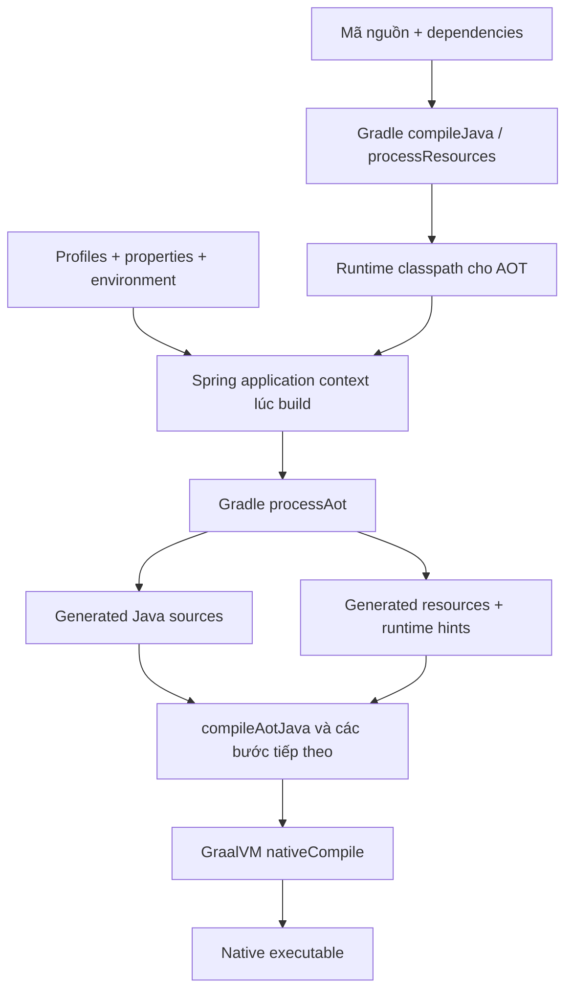

# processAot và đầu vào cấu hình của quá trình phân tích ứng dụng

## 1. Vì sao cần hiểu đầu vào của `processAot`?

Trong module **SPRING_BOOT_NATIVE_IMAGE**, chúng ta biên dịch Spring Boot thành **GraalVM Native Image** bằng **Spring AOT**, thực hành build Gradle/Maven, cấu hình reflection và resource, kiểm thử tương thích, đóng gói container rồi đánh giá thời gian khởi động và bộ nhớ. Với dự án Gradle, tác vụ **`processAot`** là một mốc quan trọng: nó khởi động xử lý Spring application context ở build time, tạo source/resource hỗ trợ runtime tối ưu và đăng ký metadata cho bước Native Image.

Điểm dễ nhầm là `processAot` không phân tích một ứng dụng hoàn toàn tách khỏi cấu hình. Nó phải chạy với **classpath, profile, property, biến môi trường và điều kiện cấu hình thích hợp** để Spring xác định các bean và hành vi cần chuẩn bị. Thay đổi các đầu vào có thể dẫn tới khác biệt trong mã AOT sinh ra, và đôi khi làm build thất bại ngay tại giai đoạn này.



**Phân biệt:** `processAot` thành công chứng minh tác vụ Spring AOT hoàn tất với **bộ đầu vào tại thời điểm đó**. Nó không đồng nghĩa với `nativeCompile` thành công hay mọi profile/tính năng chạy đúng sau triển khai.

## 2. Tác vụ `processAot` nằm ở đâu trong Gradle?

Trong ứng dụng dùng Spring Boot Gradle Plugin hỗ trợ AOT, Gradle cung cấp các tác vụ xử lý AOT và biên dịch đầu ra được sinh. Khi tích hợp GraalVM Native Build Tools, pipeline native sẽ sử dụng những kết quả này.

Các lệnh thường dùng (chạy tại thư mục project có Gradle Wrapper):

```bash
./gradlew tasks --all
./gradlew processAot
./gradlew nativeCompile
```

Trên Windows, dùng `gradlew.bat`. Lệnh `tasks --all` giúp xác nhận tên tác vụ trong chính phiên bản plugin đang dùng, bởi tích hợp và cách tổ chức task có thể thay đổi theo phiên bản Spring Boot/Gradle.

| Tác vụ hoặc giai đoạn | Vai trò chính | Kết quả cần kiểm tra |
|---|---|---|
| `compileJava`, `processResources` | Chuẩn bị bytecode và resource của ứng dụng | Classes/resources phù hợp với source hiện tại |
| `processAot` | Xử lý Spring application context trong chế độ AOT | Java source, resource và metadata sinh ra |
| `compileAotJava` và các tác vụ liên quan | Biên dịch mã AOT đã sinh | Class files cho AOT |
| `nativeCompile` | Dùng GraalVM Native Image để tạo executable | File native cho OS/kiến trúc đích |
| `nativeTest` (khi được cấu hình) | Kiểm thử qua executable native của test | Kết quả kiểm thử native |

Thư mục output thường nằm dưới `build/generated/aotSources`, `build/generated/aotResources` hoặc những đường dẫn tương ứng được plugin cấu hình. Không dựa cứng vào tên folder nếu dự án dùng phiên bản hoặc convention khác; đọc log và Gradle task configuration để nhận diện chính xác.

## 3. Những loại đầu vào chi phối phân tích AOT

### 3.1. Source, dependency và classpath

Spring AOT có thể phát hiện bean từ annotation, configuration class, auto-configuration, component scan và nhiều tích hợp framework khác. Vì vậy:

- Thêm/xóa một `@Configuration`, `@Component`, `@Bean` có thể đổi bean graph.
- Đổi dependency hoặc version có thể thêm/bớt auto-configuration và các class được nhận diện.
- Sự hiện diện của class trên classpath có thể làm thay đổi `@ConditionalOnClass`.
- Cấu hình component scan và package cũng thay đổi những bean được phân tích.

Ví dụ:

```java
@Configuration
class MessagingConfiguration {
    @Bean
    @ConditionalOnClass(name = "com.example.messaging.FastClient")
    MessagingGateway gateway() {
        return new MessagingGateway();
    }
}
```

Nếu class `FastClient` có trên build-time classpath, điều kiện có thể được đánh giá khác với khi không có dependency tương ứng. Tên class trong ví dụ chỉ mang tính minh họa. **Classpath cho `processAot` phải đại diện cho artifact định build**, không phải classpath tùy ý của IDE.

### 3.2. Active profiles

Các bean được khai báo bằng `@Profile` phụ thuộc profile đang được Spring sử dụng trong lần chạy AOT:

```java
@Configuration
class StorageConfiguration {
    @Bean
    @Profile("local")
    StorageClient localClient() {
        return new InMemoryStorageClient();
    }

    @Bean
    @Profile("prod")
    StorageClient productionClient() {
        return new RemoteStorageClient();
    }
}
```

Nếu phân tích AOT với profile `local`, không thể mặc định executable native sau đó đổi sang profile `prod` là Spring sẽ tự động dựng một bean graph hoàn toàn mới. Một số quyết định bean được cố định trong quá trình AOT; các giá trị cấu hình dùng trong logic runtime vẫn có thể đọc lúc chạy, tùy cách ứng dụng thiết kế.

Ví dụ cấu hình profile cho **riêng tác vụ Gradle**:

```groovy
// build.gradle (Groovy DSL)
tasks.named("processAot") {
    args("--spring.profiles.active=prod")
}
```

Hoặc với Kotlin DSL trong dự án có kiểu task phù hợp:

```kotlin
// build.gradle.kts
tasks.named<org.springframework.boot.gradle.tasks.aot.ProcessAot>("processAot") {
    args("--spring.profiles.active=prod")
}
```

Các ví dụ minh họa cách truyền **application arguments** cho Spring AOT. Cấu hình API task có thể thay đổi theo phiên bản Spring Boot; nếu compiler Gradle báo không tìm được kiểu task hoặc method, tra API của plugin đang sử dụng thay vì tự đổi cấu hình không kiểm chứng.

### 3.3. Application properties và biến môi trường

`application.yml`, `application.properties`, file theo profile và các nguồn `PropertySource` đều có thể ảnh hưởng điều kiện tạo bean:

```java
@Configuration
class ExportConfiguration {
    @Bean
    @ConditionalOnProperty(
        prefix = "feature",
        name = "export-enabled",
        havingValue = "true"
    )
    ExportService exportService() {
        return new ExportService();
    }
}
```

Nếu tại AOT `feature.export-enabled=false`, bean có thể không được đưa vào mô hình ứng dụng đã chuẩn bị. Bật giá trị khác ở runtime không có nghĩa mọi điều kiện tạo bean sẽ được đánh giá lại.

Trong `build.gradle`, với phiên bản Gradle/Spring Boot hỗ trợ thiết lập environment cho AOT task, có thể viết ví dụ:

```groovy
tasks.named("processAot") {
    environment("FEATURE_EXPORT_ENABLED", "true")
}
```

Trước khi áp dụng, phải xác minh task triển khai API `environment` và property thực tế được Spring ánh xạ tương ứng; đây là cách cấu hình có chủ đích cho **build-time environment**, không phải biến môi trường đã được nhúng tự động vào binary.

Các thông số như địa chỉ database, password, token, hostname và secret không nên bị đưa vào source AOT hoặc log build. Khi cần tạo bean phụ thuộc cấu hình, dùng giá trị build-time an toàn và tránh thực hiện kết nối bên ngoài không cần thiết trong lúc xử lý AOT.

### 3.4. JVM arguments, system properties và biến điều kiện

Một số thư viện và cấu hình tùy biến đọc trực tiếp `System.getProperty` hoặc `System.getenv`, khiến kết quả AOT khác giữa laptop và CI. Cần phân biệt:

- **Gradle daemon JVM**: process chạy Gradle.
- **Process thực thi `processAot`**: thường là Java process do tác vụ fork với classpath và arguments của ứng dụng.
- **Native executable runtime**: process chạy sau khi build xong.

Ví dụ đặt `-Dfoo=bar` cho Gradle command line không bảo đảm Java process AOT nhận property theo cùng cách như truyền system property trực tiếp cho task. Hãy dùng API `systemProperty`/configuration phù hợp với task và kiểm tra log hoặc test điều kiện cụ thể.

Không đặt quyết định bean dựa trên đồng hồ hiện tại, random, dữ liệu mạng không ổn định hoặc trạng thái máy build; điều này làm đầu ra AOT khó tái lập.

## 4. Phân loại cấu hình: quyết định build-time và giá trị runtime

Một phần quan trọng của Spring AOT là hiểu **thứ gì được quyết định tại build time** và **thứ gì có thể thay đổi lúc chạy**.

| Loại thông tin | Ví dụ | Cách xử lý đúng |
|---|---|---|
| Điều kiện tạo bean | `@Profile`, `@ConditionalOnProperty`, `@ConditionalOnClass` | Xác định cấu hình build đại diện; kiểm thử bean graph |
| Phát hiện component | Component scan, auto-configuration | Giữ classpath và package chuẩn |
| Reflection/resource hints | Loại payload, template, proxy | Đăng ký khi AOT không tự xác định |
| Tham số nghiệp vụ runtime | Giới hạn số request, thông báo hiển thị | Thiết kế để đọc tại runtime nếu cần thay đổi |
| Thông tin môi trường runtime | Secret, endpoint, chứng chỉ, file mount | Cung cấp qua config/secret của môi trường chạy |
| Toolchain | Phiên bản Java, GraalVM, Gradle, plugin | Ghi và cố định bằng build configuration/CI |

Ví dụ một `@ConfigurationProperties` chỉ chứa giá trị threshold mà bean đã tồn tại có thể được bind theo môi trường runtime; điều đó không đồng nghĩa với việc thay đổi threshold sẽ kích hoạt một nhánh `@ConditionalOnProperty` mới mà AOT chưa giữ lại.

**Quy tắc thực hành:** nếu một property quyết định có **tạo bean hay không**, hãy coi nó là đầu vào phân tích AOT cần kiểm chứng. Nếu property chỉ quyết định **hành vi bên trong một bean đã tồn tại**, cân nhắc đọc nó tại runtime và kiểm thử phù hợp.

## 5. Quan sát đầu vào hiệu quả mà không làm lộ bí mật

Trước khi sửa cấu hình, hãy xác định Gradle thực sự chạy task nào:

```bash
./gradlew processAot --info
```

Tùy phiên bản plugin, log có thể cho biết main class, task dependencies, đường dẫn classpath hoặc những tham số được truyền. Không đổ toàn bộ environment vào log CI vì có thể lộ secret. Với nhu cầu xác nhận profile build, nên sử dụng một flag kiểm thử an toàn và đoạn test quan sát bean cụ thể.

Có thể dùng một bài kiểm thử nho nhỏ cho các profile:

```java
@SpringBootTest
@ActiveProfiles("prod")
class ProductionWiringTest {

    @Autowired
    ApplicationContext context;

    @Test
    void hasProductionGateway() {
        assertThat(context.containsBean("productionClient")).isTrue();
    }
}
```

Ví dụ dùng JUnit, Spring Boot Test và AssertJ; bổ sung imports tương ứng trong dự án. Test JVM này xác nhận context theo profile của test, nhưng **không tự chứng minh `processAot` đã chạy với `prod`**. Cần kiểm tra cấu hình Gradle và chạy executable native để xác minh cả hai giai đoạn.

Nếu nghi ngờ AOT dùng sai profile, hãy ghi vào build report **profile được yêu cầu**, tên task và phiên bản plugin. Với test nhỏ, dùng bean/endpoint có hành vi khác nhau giữa các profile để xác nhận output thực tế sau native compile.

## 6. Một tình huống lỗi điển hình

Giả sử ứng dụng có:

```java
@Bean
@ConditionalOnProperty(
    name = "reports.enabled",
    havingValue = "true"
)
ReportGenerator reportGenerator() {
    return new ReportGenerator();
}
```

Trên máy phát triển, `reports.enabled=true` được cấp qua biến môi trường, nên `processAot` đưa `ReportGenerator` vào cấu hình AOT. Trong CI, biến này không có; `processAot` vẫn có thể **BUILD SUCCESS**, nhưng mô hình bean được tạo khác với dự định. Khi deploy native executable rồi bật `reports.enabled=true`, endpoint cần `ReportGenerator` có thể không hoạt động.

Cách điều tra có hệ thống:

1. Kiểm tra điều kiện bean và nguồn property dùng **trong lần AOT**.
2. Xác nhận Gradle task được cấu hình với profile/property nào ở CI, và có dependency/configuration khác máy dev hay không.
3. Build lại từ cấu hình xác định, không dùng artifact native cũ.
4. Chạy native executable với kịch bản nghiệp vụ cần `ReportGenerator`.
5. Nếu tính năng phải bật/tắt linh hoạt ở runtime, cân nhắc luôn đăng ký bean và đặt logic `enabled` trong bean hoặc thiết kế cấu hình tương thích với AOT.

Không cố khắc phục việc thiếu bean do `@ConditionalOnProperty` bằng cách thêm reflection hint vô tội vạ. Reflection metadata giúp truy cập động tới class/member; nó không buộc Spring tạo một bean mà điều kiện AOT đã loại bỏ.

## 7. Chạy AOT trong pipeline Gradle có thể tái lập

Một trình tự thực hành hợp lý:

```bash
./gradlew clean test
./gradlew processAot
./gradlew nativeCompile
```

`clean` nên chạy có chủ đích trên workspace build mà bạn kiểm soát, tránh xoá artifact đang cần giữ để đối chiếu. Trong CI, có thể dùng từng stage khác nhau để dễ quan sát, nhưng khi `nativeCompile` đã phụ thuộc AOT, cần tránh chạy trùng tác vụ gây lãng phí. Gradle sẽ quản lý task graph và incremental build theo cấu hình của project.

Để so sánh hai bộ cấu hình AOT khác nhau, thực hiện build độc lập với tên artifact hoặc thư mục output riêng; ghi lại commit, profile, property không nhạy cảm, dependency lockfile, Gradle wrapper version và GraalVM version. Không chia sẻ một executable khi hai thử nghiệm kỳ vọng bean graph khác nhau.

### Cấu hình ví dụ mang tính định hướng

```groovy
// build.gradle
plugins {
    id 'java'
    id 'org.springframework.boot' version '3.x.y' // Thay bằng phiên bản thực tế tương thích
    id 'io.spring.dependency-management' version '1.x.y'
    id 'org.graalvm.buildtools.native' version '0.x.y'
}

tasks.named('processAot') {
    args('--spring.profiles.active=native')
}
```

Các chuỗi `3.x.y`, `1.x.y`, `0.x.y` là **placeholder**, không phải version dùng để chạy trực tiếp; phải thay bằng phiên bản đã kiểm tra tương thích. Nếu dùng plugin management hoặc Gradle convention, cấu hình plugin có thể ở vị trí khác.

Trong nhiều dự án, bạn nên quản lý profile AOT qua build configuration cố định thay vì để developer tự chọn bằng môi trường shell. Khi cần build nhiều biến thể, đặt tên rõ ràng cho từng variant và lưu dấu cấu hình để người vận hành biết binary nào được tạo cho môi trường nào.

## 8. Đầu vào Gradle ảnh hưởng caching và incremental build

Gradle có cơ chế task input/output và caching; tuy nhiên khả năng tái sử dụng đầu ra `processAot` phụ thuộc cách plugin khai báo đầu vào và phiên bản đang chạy. Nếu AOT đọc dữ liệu động ngoài tập input mà Gradle nhận biết, có nguy cơ người thực hiện hiểu nhầm rằng đổi biến môi trường đã buộc AOT chạy lại.

Khi thay profile/property ảnh hưởng bean graph:

- Kiểm tra log xem task `processAot` thực sự chạy lại hay bị đánh dấu `UP-TO-DATE`/`FROM-CACHE`.
- Chọn cách khai báo đầu vào ổn định trong task/build configuration.
- Khi nghi ngờ cache, thử `--rerun-tasks` cho lượt xác minh riêng để kiểm tra giả thuyết, sau đó sửa cơ chế khai báo input nếu cần.
- Không coi xóa cache là giải pháp dài hạn; cần làm cho đầu vào build được nhận diện đúng.

Ví dụ:

```bash
./gradlew processAot --rerun-tasks --info
```

`--rerun-tasks` có thể tăng thời gian build và không nên bật mặc định trong CI chỉ để che giấu task inputs chưa được thiết kế chuẩn.

## 9. Từ AOT sang native và container

Sau `processAot`, bước `nativeCompile` dùng GraalVM Native Image để phân tích reachability và liên kết executable. Một lỗi ở `nativeCompile` không nhất thiết do profile AOT; nó có thể đến từ thiếu reflection/resource hints, thư viện không tương thích, toolchain native hoặc RAM build.

Khi chạy container, phân biệt hai nhóm cấu hình:

- **Build-time configuration**: classpath, profile và properties quyết định mô hình bean lúc Spring AOT; Gradle/GraalVM và OS/kiến trúc dùng biên dịch.
- **Runtime configuration**: cổng HTTP, datasource URL, secret, certificates, resource mount, bộ nhớ container và các giá trị điều khiển hành vi được thiết kế để thay đổi lúc chạy.

Native executable build cho Windows không chạy trực tiếp trên Linux container; phải build artifact đúng OS/CPU đích. Khi benchmark JAR và native, giữ cùng source, chức năng và khối lượng request; ghi rõ profile sử dụng cho AOT và runtime, vì khác biệt bean graph khiến phép so sánh không công bằng.

## 10. Checklist chẩn đoán `processAot`

| Câu hỏi | Bằng chứng cần kiểm tra |
|---|---|
| Task có thực sự chạy không? | Log `processAot`, trạng thái task và output mới |
| Application context dùng profile gì? | `args`/cấu hình task, test bean theo profile |
| Có thay đổi dependency/classpath? | Dependency versions, plugin versions, classpath của task |
| Property nào quyết định bean? | `@ConditionalOnProperty`, `@Profile`, configuration classes |
| Có đọc secret hoặc kết nối ngoài trong AOT? | Stack trace, logic initializer, nguồn cấu hình an toàn |
| Có cache không phù hợp? | `UP-TO-DATE`, `FROM-CACHE`, khai báo task input |
| AOT xong nhưng native lỗi? | Log lỗi ở `nativeCompile`, native toolchain, hints |
| Native chạy khác kỳ vọng? | Test integration trên executable mới, cấu hình runtime |

## 11. Câu hỏi tự kiểm tra

1. Vì sao kết quả `processAot` có thể khác giữa laptop và CI dù mã nguồn cùng commit?
2. Những loại property nào nên xem là đầu vào quyết định mô hình bean AOT?
3. Vì sao thay `SPRING_PROFILES_ACTIVE` khi chạy executable native chưa chắc làm Spring dựng thêm bean từ `@Profile` khác?
4. `processAot` báo `UP-TO-DATE` sau khi đổi property môi trường có thể gây nghi ngờ điều gì?
5. Khi native executable thiếu một bean bị điều khiển bởi `@ConditionalOnProperty`, vì sao thêm reflection metadata chưa chắc giải quyết?
6. Phân biệt thành công của `processAot`, `nativeCompile` và kiểm thử runtime như thế nào?

**Ghi nhớ:** `processAot` phân tích **một ứng dụng Spring cụ thể với classpath và cấu hình build-time cụ thể**. Giữ profile, property, dependencies và task inputs nhất quán giúp Native Image có bean graph phù hợp; sau đó cần kiểm tra executable trên môi trường chạy thực, trước khi đánh giá startup, bộ nhớ và hiệu năng.
