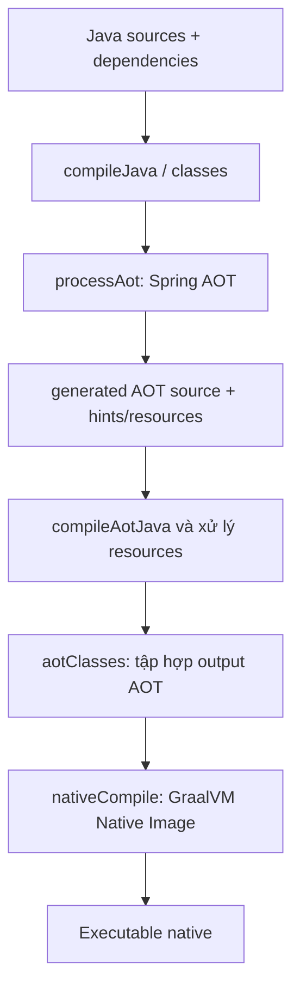

# nativeCompile và quan hệ phụ thuộc với Spring AOT

## 1. Mục tiêu của bài học

Trong module **SPRING_BOOT_NATIVE_IMAGE**, chúng ta dùng Spring AOT và GraalVM Native Image để biến ứng dụng Spring Boot thành chương trình native, sau đó đánh giá thời gian khởi động, mức sử dụng bộ nhớ, tính tương thích và khả năng đóng gói container. Với **Gradle**, một tác vụ trung tâm là `nativeCompile`. Điều cần hiểu là **`nativeCompile` không tự mình thay thế Spring AOT**: Gradle và các plugin phối hợp nhiều tác vụ để cung cấp mã đã xử lý AOT, runtime hints và classpath cho bộ biên dịch GraalVM.

Sau bài học, người đọc cần có thể:

- Giải thích trách nhiệm của `processAot`, `compileAotJava`, `aotClasses` và `nativeCompile`.
- Quan sát task graph thực tế bằng Gradle, xác minh dữ liệu từ Spring AOT đến GraalVM.
- Cấu hình tối thiểu Spring Boot Gradle plugin và GraalVM Native Build Tools plugin.
- Phân biệt lỗi sinh mã Spring AOT, lỗi biên dịch Java và lỗi phân tích/link của Native Image.
- Chạy và kiểm thử executable native để so sánh có cơ sở với bản JVM.

Ví dụ giả định dùng bản Spring Boot hiện đại có hỗ trợ AOT/native, Gradle và JDK GraalVM tương thích. **Tên task hoặc cách plugin nối task có thể thay đổi theo phiên bản**; kiểm tra task graph của dự án là nguồn xác thực cuối cùng.

## 2. Hai tầng AOT có vai trò khác nhau

Từ “AOT” xuất hiện ở cả Spring và GraalVM, nhưng là hai bước khác nhau:

| Công đoạn | Công cụ chủ yếu | Công việc thực hiện | Đầu ra |
|---|---|---|---|
| Phân tích ứng dụng Spring | Spring AOT qua Spring Boot Gradle plugin | Xử lý bean definitions, cấu hình, mã khởi tạo context và runtime hints | Java source, resources và metadata được sinh |
| Biên dịch Java sinh ra | `JavaCompile` và các task Gradle liên quan | Biên dịch mã Spring AOT thành bytecode | AOT `.class` và resources |
| Biên dịch native | GraalVM Native Image qua GraalVM Native Build Tools | Reachability analysis, AOT compilation sang mã máy và linking | Executable native cho OS/CPU mục tiêu |

Spring AOT thường thay thế các thao tác container có thể xác định trước bằng mã sinh. GraalVM Native Image cần **cả mã ứng dụng lẫn đầu ra Spring AOT** để tìm các đường đi runtime và đóng gói thành binary. Metadata reflection, proxy, resource, serialization được Spring AOT và các thư viện cung cấp giúp Native Image biết những thành phần không thể suy ra hoàn toàn từ lời gọi tĩnh.

Do đó, câu nói “chạy `nativeCompile` là Spring AOT” thiếu chính xác: **Spring AOT là một pha chuẩn bị**, còn `nativeCompile` là tác vụ Gradle kích hoạt quá trình biên dịch native.

## 3. Task graph: các bước Gradle liên hệ với nhau thế nào?

Với cấu hình plugin Spring Boot + GraalVM Native Build Tools được hỗ trợ, chuỗi xử lý có thể hình dung như sau:



Sơ đồ chỉ biểu diễn **luồng dữ liệu và quan hệ hợp lý**, không phải bản sao chính xác mọi cạnh trong task graph của tất cả phiên bản Gradle. Tùy plugin, một số tác vụ có thể chạy song song, có thêm bước compile/resources khác hoặc tên task thay đổi.

Những tác vụ đáng nhận biết:

| Tác vụ | Vai trò | Khi cần gọi trực tiếp |
|---|---|---|
| `processAot` | Khởi chạy xử lý Spring AOT và sinh mã/hints cho ứng dụng | Khi cần kiểm tra lỗi AOT hoặc xem mã sinh trước khi tạo binary |
| `compileAotJava` | Biên dịch nguồn Java được AOT tạo ra | Khi phân tích lỗi compile của generated source |
| `processAotResources` (nếu có) | Xử lý resource của source set AOT | Khi kiểm tra tài nguyên/phần output được copy |
| `aotClasses` | Tập hợp class và resource của source set AOT | Khi muốn bảo đảm output AOT sẵn sàng |
| `nativeCompile` | Gọi Native Image để tạo executable | Khi cần tạo chương trình native |
| `nativeTest` | Chạy các test được biên dịch theo cơ chế native, nếu đã cấu hình | Khi xác minh tương thích trong môi trường native |
| `bootJar` | Tạo Spring Boot executable JAR cho JVM | Khi lấy baseline JVM để đối chiếu |

**Quan trọng:** sự tích hợp giữa Spring Boot và GraalVM Native Build Tools có thể tự thiết lập dependency/task classpath phù hợp. Người dùng thường không cần tự viết `nativeCompile.dependsOn(processAot)`. Việc thêm dependency thủ công khi chưa hiểu phiên bản plugin có thể khiến task graph khó bảo trì hoặc tạo đường đi dữ liệu sai. Hãy quan sát task graph trước.

## 4. Cấu hình Gradle tối thiểu

Ví dụ dưới đây là phần logic trong `build.gradle` (Groovy DSL); version của plugin được quản lý trong cấu hình plugin của dự án hoặc thêm phiên bản tương thích ở nơi khai báo plugin. Đây là một **mẫu minh họa cơ chế**, không phải file build độc lập có thể chạy khi chưa cung cấp version và repositories.

```groovy
plugins {
    id 'java'
    id 'org.springframework.boot'
    id 'org.graalvm.buildtools.native'
}

group = 'com.example'
version = '0.0.1-SNAPSHOT'

java {
    toolchain {
        languageVersion = JavaLanguageVersion.of(21)
    }
}

repositories {
    mavenCentral()
}

dependencies {
    implementation 'org.springframework.boot:spring-boot-starter-web'
    testImplementation 'org.springframework.boot:spring-boot-starter-test'
}

tasks.named('test') {
    useJUnitPlatform()
}
```

Trong một dự án có dependency management từ Spring Boot, Spring dependency-management plugin hoặc Gradle platform/BOM tùy cấu hình, dependency version của các starter được quản lý tương ứng. Nếu build báo thiếu version, kiểm tra thiết lập BOM/dependency management của dự án; đừng coi đoạn trích trên là khai báo hoàn chỉnh cho mọi project.

Một dự án tự chứa có thể sử dụng plugin DSL và khai báo version phù hợp với bộ Spring Boot/Gradle/GraalVM đang dùng:

```groovy
plugins {
    id 'org.springframework.boot' version '<spring-boot-plugin-version>'
    id 'org.graalvm.buildtools.native' version '<native-build-tools-version>'
    id 'io.spring.dependency-management' version '<dependency-management-plugin-version>'
    id 'java'
}
```

**Thay các placeholder bằng phiên bản có thật tương thích với dự án**; cú pháp placeholder trong dấu `<...>` không phải version Gradle hợp lệ. Nên dùng Gradle Wrapper (`./gradlew`) để thống nhất phiên bản Gradle và cấu hình plugin trong version catalog/settings nếu dự án có quy ước riêng.

Điều kiện môi trường để chạy native:

- JDK/GraalVM có công cụ `native-image` phù hợp (hoặc toolchain/download mechanism mà plugin hỗ trợ).
- C compiler, linker và thư viện development trên Linux; toolchain tương đương trên macOS/Windows.
- Đủ CPU, RAM và dung lượng đĩa cho phân tích, biên dịch toàn chương trình.
- Dependency ứng dụng có khả năng tương thích AOT/native và metadata cần thiết.

`java -version` chỉ cho biết JDK của shell; kiểm tra `./gradlew -version` và Gradle toolchains vì Gradle daemon/Java toolchain có thể chọn JDK khác.

## 5. Khi chạy nativeCompile, Gradle thực hiện những gì?

Lệnh:

```bash
./gradlew nativeCompile
```

Trong cấu hình đã tích hợp đúng, Gradle trước hết giải quyết dependency và chạy các task chuẩn bị cần thiết. Spring AOT phân tích thông tin application context, tạo nguồn Java/resources và runtime hints. Gradle biên dịch đầu ra AOT, ghép với classpath liên quan, rồi GraalVM Native Image thực hiện phân tích tĩnh và biên dịch thành executable.

Một ví dụ về trình tự khái niệm:

```text
> Task :compileJava
> Task :classes
> Task :processAot
> Task :compileAotJava
> Task :processAotResources
> Task :aotClasses
> Task :nativeCompile
```

Đoạn log chỉ **minh họa tên công đoạn**, không phải khẳng định Gradle luôn in đúng các dòng hoặc thứ tự này. Task graph phụ thuộc Gradle, phiên bản plugin và trạng thái incremental build; có task `UP-TO-DATE` hoặc `FROM-CACHE`.

Chạy Gradle ở chế độ chỉ mô phỏng task graph:

```bash
./gradlew nativeCompile --dry-run
```

Lệnh này hữu ích để xem những task nào được chọn. Nhưng `--dry-run` **không xác nhận đầu ra AOT đã sinh đúng hoặc binary biên dịch được**, vì không thực thi task action.

Để đọc chi tiết khi lỗi:

```bash
./gradlew nativeCompile --info --stacktrace
```

Chỉ bật `--debug` khi thật sự cần và tránh đưa log chứa secret/config nhạy cảm vào báo cáo chia sẻ. Đầu ra cụ thể tùy plugin và môi trường.

## 6. processAot không chỉ là một bước copy file

Spring AOT tạo các thành phần làm giảm nhu cầu xử lý động lúc runtime. Ví dụ ở ứng dụng Spring Boot có controller và service:

```java
@SpringBootApplication
public class DemoApplication {
    public static void main(String[] args) {
        SpringApplication.run(DemoApplication.class, args);
    }
}

@Service
class GreetingService {
    String greet(String name) {
        return "Hello, " + name;
    }
}
```

Khi chạy `processAot`, Spring AOT có thể sinh mã khởi tạo bean, đăng ký bean factory, cấu hình application context và runtime hints phù hợp. Nội dung generated source phụ thuộc phiên bản framework và cấu trúc application context.

Điều đó tạo hai hệ quả:

1. **Điều kiện cấu hình được đánh giá trong bước AOT** có thể ảnh hưởng tập bean/cấu hình xuất hiện trong image. Không giả định thay profile hoặc property runtime có thể thay đổi mọi quyết định đã chốt lúc build.
2. **Truy cập động** có thể cần runtime hints bổ sung nếu Spring AOT hoặc thư viện không tự suy ra đủ thông tin (reflection, dynamic proxies, resource loading, serialization, JNI).

Ví dụ, nếu ứng dụng chọn một class bằng tên biến môi trường runtime và gọi constructor reflectively, Native Image có thể thiếu member tương ứng mặc dù JVM chạy được. Khi đó cần đăng ký hints thích hợp hoặc chuyển sang cơ chế lựa chọn bean được Spring quản lý.

## 7. Quan sát generated sources và metadata

Trước khi compile native toàn bộ, có thể chạy:

```bash
./gradlew processAot
```

Sau đó kiểm tra các thư mục output AOT do plugin cấu hình. Với những bản Spring Boot Gradle plugin thông dụng, output thường nằm dưới `build/generated/aotSources/` hoặc `build/generated/aotResources/`, nhưng **không nên cố định đường dẫn** khi chưa xác nhận phiên bản và task configuration. Một số version dùng tên subfolder và source set khác nhau.

Tìm những loại artifact sau:

- **Java source sinh ra:** code đăng ký bean và khởi tạo application context.
- **Resources/metadata AOT:** thông tin giúp cấu hình runtime và xử lý tài nguyên.
- **Runtime hints cho Native Image:** khai báo reflection/resource/proxy/serialization tùy mức tích hợp.

Không sửa trực tiếp generated source để “chữa cháy”: bước build sau có thể sinh lại và ghi đè. Nếu thiếu hint hoặc bean registration, cập nhật source cấu hình hoặc API Spring AOT tương ứng, rồi chạy lại task.

Có thể hỏi Gradle về task và source sets mà không dựa vào giả định đường dẫn:

```bash
./gradlew tasks --all
./gradlew help --task processAot
```

Lệnh `help --task` cung cấp mô tả/cấu hình cơ bản khi task tồn tại, còn thông tin output có thể cần xem log `--info` hoặc cấu hình plugin trong dự án.

## 8. Mã nguồn và resources nào đến được nativeCompile?

Một executable native cần sự kết hợp có thứ tự của **application classes**, **Spring AOT generated classes**, các dependency và resource cần dùng. Nếu Native Build Tools gọi `native-image` chỉ với classpath bản JVM thông thường, mã sinh AOT có thể không được sử dụng đúng.

Tích hợp plugin Spring Boot với Native Build Tools giải quyết việc phối hợp này trong cấu hình được hỗ trợ. Từ góc nhìn Gradle, cần phân biệt:

| Đầu vào | Ví dụ | Vì sao cần |
|---|---|---|
| Java classes ứng dụng | `DemoApplication.class`, controller, service | Mã nghiệp vụ |
| AOT generated classes | Bean registration/application context initializer đã biên dịch | Mã khởi tạo tối ưu bởi Spring AOT |
| Runtime hints/metadata | Reflection hoặc resource configuration | Phục vụ reachability khi có truy cập động |
| Dependency JARs | Spring Framework, Jackson, driver, thư viện khác | Mã thư viện và metadata |
| Resources | `application.properties`, template, message bundle khi được khai báo | Dữ liệu đọc tại runtime |
| Native toolchain | GraalVM, C compiler/linker, thư viện hệ thống | Biên dịch và liên kết executable |

Khi debug, nên xác định loại đầu vào bị thiếu trước khi thêm dependency Gradle. **Thiếu classpath** có biểu hiện khác **thiếu reflection metadata**, và cả hai khác **lỗi linker**.

## 9. Cấu hình nativeCompile và cách tránh can thiệp sai task graph

Plugin `org.graalvm.buildtools.native` cung cấp DSL cấu hình Native Image. Ví dụ một số tùy chọn thường gặp trong Groovy DSL:

```groovy
graalvmNative {
    binaries {
        main {
            imageName = 'demo-native'
            buildArgs.add('--verbose')
        }
    }
}
```

Đoạn này đặt tên binary và yêu cầu Native Image log nhiều hơn để chẩn đoán. Không cần thêm `--verbose` vĩnh viễn trên CI nếu log quá lớn. Tùy phiên bản plugin, các thuộc tính DSL có thể khác; kiểm tra tài liệu phiên bản đang cài và kết quả `./gradlew help --task nativeCompile`.

Không nên sao chép cấu hình task dependencies từ bài hướng dẫn cũ mà bỏ qua tích hợp hiện tại của Spring Boot. Ví dụ:

```groovy
// Chỉ mang tính cảnh báo; không tự thêm khi plugin đã tích hợp đúng.
// tasks.named('nativeCompile') {
//     dependsOn tasks.named('processAot')
// }
```

Thêm một dependency đơn thuần **không bảo đảm** GraalVM nhận đúng output source set và resource do Spring AOT tạo ra. Một giải pháp thật sự phải bảo đảm cả trình tự chạy lẫn **đầu vào của `native-image`**.

Nếu dự án dùng build logic tùy biến, hãy kiểm tra classpath và plugin integration; thường nên quay về cách tích hợp chuẩn trước khi bổ sung task wiring riêng.

## 10. Chạy và kiểm thử binary native

Sau khi `nativeCompile` hoàn tất, executable thường nằm dưới:

```text
build/native/nativeCompile/<binary-name>
```

Ví dụ chạy trên Linux/macOS:

```bash
./build/native/nativeCompile/demo-native
```

Đường dẫn và phần mở rộng có thể khác theo OS, target và cấu hình `imageName`. Kiểm tra file thực tế trong build output; trên Windows executable thường có đuôi `.exe`.

Kiểm thử cần bao gồm:

1. **Startup:** process khởi động, Spring context hoạt động và web server nhận request.
2. **Contract API:** status, body JSON và error handling giống bản JVM với cùng input.
3. **Truy cập động:** serialization, reflection, proxy, resource, entity mappings và các nhánh ít gặp.
4. **Tích hợp:** kết nối database, SSL, messaging và external service trong môi trường test.
5. **Chỉ số vận hành:** đo readiness, RSS, throughput và latency khi đã có chức năng tương đương.

Nếu plugin và cấu hình dự án hỗ trợ native test, chạy:

```bash
./gradlew nativeTest
```

Không coi `nativeTest` là bản sao tự động của mọi integration test chạy trên process bên ngoài. Nó là một cơ chế test do plugin cung cấp; vẫn cần kiểm thử HTTP black-box trên executable/container thực tế để xác minh đóng gói và runtime environment.

Đối chiếu với bản JVM:

```bash
./gradlew bootJar
java -jar build/libs/<spring-boot-jar>.jar
```

Thay placeholder bằng artifact thực tế. Dùng cùng Spring profile, phiên bản dependency và workload. Không kết luận native “tiết kiệm bộ nhớ” chỉ từ kích thước file executable; đo RSS hoặc memory limit trong môi trường tương đương.

## 11. Những lỗi hay gặp theo công đoạn

| Triệu chứng | Công đoạn đáng kiểm tra | Cách tiếp cận |
|---|---|---|
| `Task 'nativeCompile' not found` | Cấu hình plugin Gradle | Xác nhận `org.graalvm.buildtools.native` được áp dụng ở project đúng |
| `native-image: command not found` hoặc không tìm thấy GraalVM | Native toolchain | Kiểm tra JDK/toolchains, Native Image và cơ chế phát hiện công cụ của plugin |
| `processAot` thất bại khi tạo application context | Spring AOT | Kiểm tra bean configuration, conditional config và dependency cần khởi tạo lúc build |
| `compileAotJava` thất bại | Biên dịch mã sinh | Kiểm tra generated source, Java version và lỗi Spring AOT gốc |
| Native Image báo thiếu reflection/resource | Reachability metadata | Đăng ký `RuntimeHints` hoặc metadata phù hợp, build lại |
| `gcc`/`ld` lỗi hoặc thiếu `zlib` | Toolchain/linking | Cài compiler, headers và development libraries phù hợp môi trường |
| Build thành công nhưng một endpoint native lỗi | Runtime compatibility | Chạy test đúng nhánh, xem stack trace và so với JVM |
| Binary chạy trên builder nhưng lỗi trong container | OS/architecture/libc hoặc tài nguyên runtime | Kiểm tra ELF/shared libraries, CA certificates, quyền file và runtime image |

Khi phát hiện lỗi, ưu tiên thông báo đầu tiên trong task gặp lỗi; một stack trace của Gradle quá dài có thể chỉ phản ánh hậu quả từ lỗi AOT hoặc linker phía trước.

### Tình huống minh họa: build không có task processAot

Nếu `./gradlew nativeCompile --dry-run` không liệt kê `processAot` và dự án cần Spring AOT, cần kiểm tra **phiên bản và cách kết hợp plugin** trước. Chưa thể kết luận lỗi chỉ vì không thấy một dòng task: plugin có thể thiết lập đầu vào hoặc thực hiện tác vụ theo cách khác tùy phiên bản. Hãy xác nhận nguồn sinh AOT thực sự được sử dụng trong Native Image build rồi mới điều chỉnh.

### Tình huống minh họa: processAot chạy nhưng endpoint JSON lỗi

Đây thường là vấn đề metadata/serialization/đường đi nghiệp vụ, không tự động là lỗi dependency giữa các task. Kiểm tra DTO, thành phần chuyển JSON, các loại concrete class được chọn động và runtime hints. Chỉ khi generated classes/resources thực sự không đến được native compiler mới xem xét task wiring.

## 12. Bài thực hành quan sát task graph

**Bối cảnh:** một dự án Spring Boot đơn giản có endpoint `GET /api/hello`, sử dụng Java 21 và Gradle Wrapper, đã khai báo Spring Boot plugin cùng GraalVM Native Build Tools.

**Bước 1 — Xác nhận toolchain**

```bash
./gradlew --version
java -version
native-image --version
```

Kiểm tra JDK thực tế phù hợp plugin/ứng dụng. Trên Linux, xác nhận compiler/linker khi cần.

**Bước 2 — Xem task graph**

```bash
./gradlew nativeCompile --dry-run
```

Ghi những task AOT được chọn; đối chiếu với nhiệm vụ `processAot`, `compileAotJava`, `aotClasses` theo cấu hình hiện tại. Không coi kết quả dry-run là build thành công.

**Bước 3 — Chạy riêng Spring AOT**

```bash
./gradlew processAot --info
```

Quan sát output source/resource thực tế. Kiểm tra mã sinh liên quan ứng dụng và runtime hints nếu có; không sửa file generated.

**Bước 4 — Build Native Image**

```bash
./gradlew nativeCompile --info
```

Theo dõi log Native Image: reachability analysis, compilation, linking và artifact cuối. Ghi lại thời gian build, kiến trúc và cấu hình JVM/toolchain.

**Bước 5 — So sánh hành vi**

Chạy bản JVM `bootJar` và executable native, gọi cùng bộ request hợp lệ/không hợp lệ. Ghi status/body, thời gian tới readiness và RSS ở điều kiện giống nhau.

**Bước 6 — Thử một thay đổi AOT**

Thêm một hành vi reflection hoặc resource loading có phạm vi xác định; chạy lại test native. Nếu thiếu metadata, bổ sung `RuntimeHints` ở source ứng dụng rồi build lại để quan sát vai trò của Spring AOT trong chuỗi Gradle.

Bảng báo cáo mẫu:

| Nội dung | JVM | Native |
|---|---|---|
| Lệnh build | `./gradlew bootJar` | `./gradlew nativeCompile` |
| Artifact | Spring Boot JAR | Executable native |
| Endpoint contract | Điền kết quả thực tế | Điền kết quả thực tế |
| Thời gian tới readiness | Đo nhiều lần | Đo nhiều lần |
| RSS idle/có tải | Đo bằng cùng công cụ | Đo bằng cùng công cụ |
| Lỗi và cách khắc phục | Ghi theo log | Ghi theo log |

## 13. Kết luận

Trong Gradle, `nativeCompile` là tác vụ tạo executable nhờ GraalVM Native Image; **Spring AOT cung cấp mã sinh và runtime hints mà quá trình native cần sử dụng**. Quan hệ phụ thuộc giữa các task giúp bảo đảm AOT chạy đúng lúc, nhưng điều quyết định là **đầu ra Spring AOT được đưa vào input của bộ biên dịch native**. Khi dùng các plugin Spring Boot và GraalVM Native Build Tools tương thích, cơ chế tích hợp thường đã được thiết lập; người phát triển cần hiểu và kiểm tra task graph thay vì tự thêm dependency máy móc.

Nắm được chuỗi này giúp phân loại lỗi theo pha, tránh can thiệp sai vào build và tạo bản native có thể kiểm chứng, đo đạc, đóng gói container và vận hành một cách nhất quán với bản JVM.
