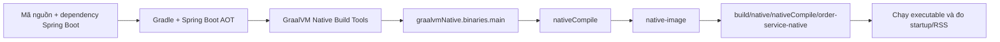
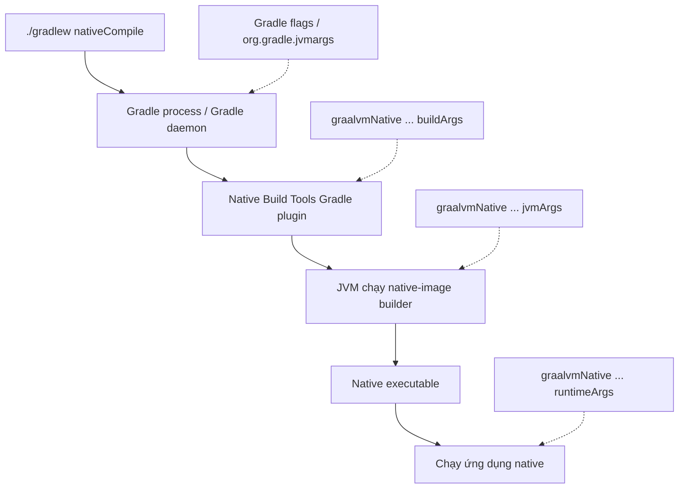

# Cấu hình `graalvmNative`, binary name và build arguments

## 1. Bối cảnh và kết quả cần đạt

Khi dùng **Spring Boot**, **Spring AOT** và **GraalVM Native Image** với **Gradle**, lệnh `nativeCompile` có thể biên dịch ứng dụng thành executable native. Tuy nhiên, một dự án thực tế thường cần kiểm soát thêm tên tệp thực thi, lựa chọn tối ưu hóa, chế độ log, tham số dùng lúc biên dịch và cách cấu hình riêng bản ứng dụng với bản kiểm thử.

Đó là vai trò của **GraalVM Native Build Tools Gradle plugin** và extension `graalvmNative`.

Sau bài này, bạn có thể:

- Hiểu `graalvmNative` và hai cấu hình `binaries.main`, `binaries.test`.
- Đặt tên executable bằng `imageName` và tìm đúng artifact sau `nativeCompile`.
- Truyền tùy chọn cho trình biên dịch `native-image` bằng `buildArgs` trong Groovy DSL hoặc Kotlin DSL.
- Phân biệt `buildArgs`, `jvmArgs`, `runtimeArgs` và các tùy chọn có sẵn như `verbose`, `fallback`, `quickBuild`.
- Chạy build, kiểm thử, kiểm tra lỗi và phân biệt tên **native binary** với tên **container image** của Cloud Native Buildpacks.

**Ví dụ xuyên suốt:** ứng dụng Spring Boot tên dự án Gradle là `order-service`, cần tạo executable có tên `order-service-native`, đồng thời giữ khả năng build container và đo tốc độ khởi động/RSS để so sánh với bản JVM.

> Nội dung giả định dự án Spring Boot và Gradle đã hoạt động, đang dùng phiên bản Spring Boot, Gradle, JDK/GraalVM và GraalVM Native Build Tools **tương thích với nhau**. Các ví dụ chủ yếu minh họa extension của Native Build Tools. Nếu dự án hiện hữu đã có khối `plugins` hoặc `graalvmNative`, hãy bổ sung vào khối đó thay vì tạo cấu hình trùng lặp.

## 2. `graalvmNative` nằm ở đâu trong quy trình Spring Boot AOT?

Gradle có các plugin với trách nhiệm khác nhau:

| Thành phần | Trách nhiệm chính |
|---|---|
| `org.springframework.boot` | Xây dựng ứng dụng Spring Boot, tích hợp các tác vụ AOT khi có Native Build Tools phù hợp |
| `org.graalvm.buildtools.native` | Cung cấp extension `graalvmNative`, `nativeCompile`, `nativeRun`, `nativeTest` và cấu hình cho công cụ `native-image` |
| GraalVM `native-image` | Phân tích mã reachable, biên dịch AOT và liên kết mã máy cho hệ điều hành/CPU đích |
| `bootBuildImage` của Spring Boot | Đóng gói OCI/container image bằng Cloud Native Buildpacks; có cơ chế cấu hình builder riêng |



Sơ đồ giản lược các tác vụ phụ thuộc. Với Spring Boot Gradle plugin hiện đại và Native Build Tools được áp dụng đúng, Gradle cấu hình để Spring AOT được thực hiện trước khi tạo native executable. Bạn thông thường chạy `nativeCompile`, thay vì tự gọi `processAot` và truyền classpath bằng tay.

### 2.1. Khai báo plugin

Trong dự án đã có `org.springframework.boot` và Java plugin, cần có thêm GraalVM Native Build Tools. Ví dụ sau chỉ là **phần thêm vào** khối `plugins` hiện hữu:

```groovy
// build.gradle (Groovy DSL)
plugins {
    id 'org.graalvm.buildtools.native' version '1.1.19'
}
```

```kotlin
// build.gradle.kts (Kotlin DSL)
plugins {
    id("org.graalvm.buildtools.native") version "1.1.19"
}
```

Phiên bản `1.1.19` minh họa cú pháp dựa trên một phiên bản đã được phát hành tại thời điểm viết. Trong dự án thực tế, hãy dùng phiên bản mà ma trận tương thích của Spring Boot, Gradle và GraalVM cho phép; nếu Spring Initializr hoặc dự án đã quản lý version trong plugin catalog thì giữ cách khai báo hiện tại. **Không thay toàn bộ `plugins` block của dự án bằng ví dụ một plugin ở trên.**

Để biên dịch native **trên máy host**, thường cần GraalVM JDK có công cụ `native-image`, cùng native compiler/linker và thư viện hệ thống phù hợp. `bootBuildImage` là đường build container bằng buildpacks, có thể cung cấp toolchain trong builder image và cần môi trường Docker. Hai con đường có cấu hình thực thi riêng.

### 2.2. Kiểm tra plugin đã cung cấp tác vụ

```bash
./gradlew --version
./gradlew tasks --all
```

Trong danh sách nhiệm vụ, tìm `nativeCompile`, `nativeRun`, `nativeTestCompile`, `nativeTest`. Nếu không thấy chúng, trước hết kiểm tra plugin đã được áp dụng đúng module, đúng phiên bản, thay vì sửa option của GraalVM.

## 3. Cấu trúc extension `graalvmNative`

Extension này cho phép điều chỉnh các binary được Native Build Tools quản lý. Hai mục mặc định cần biết là:

- **`binaries.main`**: executable của ứng dụng, được tạo bởi `nativeCompile` và chạy bằng `nativeRun`.
- **`binaries.test`**: executable chứa bộ kiểm thử native, liên quan các tác vụ `nativeTestCompile` và `nativeTest`.

Hình thức cấu hình tổng quát:

```groovy
// build.gradle
graalvmNative {
    binaries {
        main {
            // Chỉ áp dụng cho executable của ứng dụng.
        }
        test {
            // Chỉ áp dụng cho executable dùng để kiểm thử native.
        }
    }
}
```

Với Kotlin DSL, các binary có thể được chọn bằng `named("main")` và `named("test")`:

```kotlin
// build.gradle.kts
graalvmNative {
    binaries {
        named("main") {
            // Cấu hình binary chính.
        }
        named("test") {
            // Cấu hình binary kiểm thử.
        }
    }
}
```

Ngoài ra còn có cấu hình áp dụng cho cả hai binary qua `binaries.all { ... }`. Chỉ đặt một option ở `all` nếu nó thực sự phù hợp với cả việc build ứng dụng lẫn việc build native test.

### 3.1. Những thuộc tính hay dùng

| Tùy chọn trong `binaries.main`/`test` | Ý nghĩa | Khuyến nghị |
|---|---|---|
| `imageName` | Tên executable native sẽ tạo ra | Đặt tên rõ ràng, ổn định cho CI/CD và script chạy |
| `mainClass` | Main class được dùng làm entry point | Chỉ override khi cơ chế tự xác định entry point chưa đúng |
| `verbose` | Bật log chi tiết khi chạy Native Image | Hữu ích để chẩn đoán build |
| `fallback` | Điều khiển chế độ fallback của Native Image | Với artifact native production, thông thường giữ `false` |
| `quickBuild` | Ưu tiên build nhanh hơn trong những điều kiện được hỗ trợ | Phù hợp thử nghiệm; kiểm tra đánh đổi hiệu năng và tối ưu |
| `debug` | Sinh thông tin debug ở những phiên bản/toolchain hỗ trợ | Chỉ bật khi cần debug; có thể tăng thời gian và kích thước build |
| `buildArgs` | Danh sách tùy chọn gửi đến `native-image` | Dùng cho option bổ sung chưa biểu diễn bằng thuộc tính riêng |
| `jvmArgs` | Tùy chọn JVM chạy công cụ build native | Không đồng nghĩa option JVM của executable ở runtime |
| `runtimeArgs` | Tham số ứng dụng dùng khi chạy tác vụ `nativeRun` | Không phải tham số biên dịch |

Những thuộc tính này do **Native Build Tools plugin** xử lý; chúng không phải property tùy ý của Gradle hay `application.yml` Spring Boot.

## 4. Cấu hình mẫu bằng Groovy DSL (`build.gradle`)

Giả sử dự án đã áp dụng Java, Spring Boot và GraalVM Native Build Tools plugin tương thích. Thêm cấu hình:

```groovy
graalvmNative {
    binaries {
        main {
            // Đặt tên executable của ứng dụng, không phải Docker image.
            imageName = 'order-service-native'

            // Hiển thị thông tin biên dịch chi tiết.
            verbose = true

            // Không tạo fallback image thay cho native executable mong muốn.
            fallback = false

            // Ví dụ tùy chọn tối ưu hóa Native Image.
            buildArgs.add('-O2')
        }

        test {
            // Tăng tốc vòng phản hồi khi build native test.
            quickBuild = true
        }
    }
}
```

Ý nghĩa cụ thể:

1. `main` chỉ cấu hình executable ứng dụng. Khi chạy `nativeCompile`, tệp thường nằm trong `build/native/nativeCompile/` và có tên `order-service-native` trên Linux/macOS hoặc `order-service-native.exe` trên Windows.
2. `verbose = true` hỗ trợ quan sát native compiler, nhưng **không làm application log ở runtime tự chuyển sang DEBUG**.
3. `fallback = false` giúp bảo đảm kết quả build không âm thầm chuyển thành executable fallback đòi hỏi JVM. Trong các phiên bản plugin hiện nay, fallback thường đã mặc định `false`; ghi rõ có ích cho người đọc cấu hình.
4. `buildArgs.add('-O2')` truyền một tùy chọn tối ưu hóa tới GraalVM. Tác dụng và các mức `-O` được hỗ trợ phụ thuộc phiên bản Native Image; không mặc định rằng tăng mức tối ưu luôn cải thiện startup, throughput và thời gian build cùng lúc.
5. `quickBuild` của **test** không thay đổi mức tối ưu của **main**. Điều này phù hợp nếu muốn kiểm tra khả năng chạy native của test mà không dùng cùng profile build nặng như bản release.

Nếu trong dự án đã có block `graalvmNative`, hãy **gộp các property vào block hiện hữu**, tránh tạo hai cấu hình khác nhau khiến việc đọc và bảo trì khó khăn.

## 5. Cấu hình tương đương bằng Kotlin DSL (`build.gradle.kts`)

```kotlin
graalvmNative {
    binaries {
        named("main") {
            imageName.set("order-service-native")
            verbose.set(true)
            fallback.set(false)
            buildArgs.add("-O2")
        }

        named("test") {
            quickBuild.set(true)
        }
    }
}
```

Điểm khác chủ yếu giữa hai DSL là cú pháp gán giá trị:

| Ý định | Groovy DSL | Kotlin DSL |
|---|---|---|
| Chọn binary chính | `main { ... }` | `named("main") { ... }` |
| Đặt tên | `imageName = 'order-service-native'` | `imageName.set("order-service-native")` |
| Bật verbose | `verbose = true` | `verbose.set(true)` |
| Thêm build arg | `buildArgs.add('-O2')` | `buildArgs.add("-O2")` |

Native Build Tools dùng các kiểu Gradle `Property<T>` và `ListProperty<String>`; trong Kotlin DSL, `.set(...)`/`.add(...)` giúp thao tác đúng kiểu và tránh việc gán không phù hợp. Nếu một đoạn cấu hình trên Internet dành cho Groovy, không nên sao chép nguyên văn vào `build.gradle.kts`.

## 6. Hiểu đúng `imageName`: tên binary, không phải tên container image

Trong `graalvmNative.binaries.main`, **`imageName` là tên executable native**. Từ “image” ở đây mang nghĩa sản phẩm biên dịch GraalVM, không nhất thiết là Docker/OCI image.

Ví dụ:

```groovy
graalvmNative {
    binaries {
        main {
            imageName = 'billing-native'
        }
    }
}
```

Khi chạy:

```bash
./gradlew nativeCompile

# Linux/macOS: đường dẫn thường gặp
./build/native/nativeCompile/billing-native
```

Trên Windows, thường sử dụng `build\native\nativeCompile\billing-native.exe` và chạy trong PowerShell:

```powershell
.\gradlew.bat nativeCompile
.\build\native\nativeCompile\billing-native.exe
```

**Đường dẫn và phần mở rộng phụ thuộc nền tảng, plugin và cấu hình build**; luôn kiểm tra output thực tế của tác vụ. Giá trị `imageName` không nên chứa cú pháp repository/tag của Docker như `registry.example.com/team/billing:1.0`; tên registry/tag thuộc phạm vi **container image**.

### 6.1. Thay tên binary trong một lần chạy

Gradle Native Build Tools còn cung cấp tùy chọn CLI để override tên binary trong một invocation:

```bash
./gradlew nativeCompile --image-name=billing-native-debug
```

Theo tài liệu plugin, `--image-name` ở đây tác động đến tên đầu ra của Native Build Tools trong lần thực thi. Nó không tương đương với `--imageName` của `bootBuildImage`. Trong CI/CD có yêu cầu tái lập, nên lưu tên mặc định trong DSL và chỉ dùng override CLI khi thực sự cần thử nghiệm.

### 6.2. Nếu cần đổi container image của `bootBuildImage`

Đây là một cấu hình **khác** do Spring Boot Gradle plugin quản lý:

```groovy
// build.gradle, ví dụ riêng cho container image
tasks.named('bootBuildImage') {
    imageName = "registry.example.com/team/order-service:${project.version}"
}
```

Ví dụ Kotlin DSL, khi đã có Spring Boot plugin:

```kotlin
import org.springframework.boot.gradle.tasks.bundling.BootBuildImage

tasks.named<BootBuildImage>("bootBuildImage") {
    imageName.set("registry.example.com/team/order-service:${project.version}")
}
```

**Phân biệt:**

| Nơi cấu hình | Lệnh liên quan | Kết quả |
|---|---|---|
| `graalvmNative.binaries.main.imageName` | `nativeCompile` | Tên tệp executable native trên đĩa |
| `bootBuildImage.imageName` | `bootBuildImage` | Repository và tag của OCI/container image |

Đổi tên native executable **không tự đổi** repository/tag của image buildpacks. Ngược lại, đổi tag OCI **không đổi** cách Gradle đặt tên executable khi chạy `nativeCompile` trực tiếp.

## 7. `buildArgs`: cách truyền tham số tới trình biên dịch GraalVM

### 7.1. Cú pháp cơ bản

`buildArgs` là danh sách các biểu thức tùy chọn truyền cho công cụ `native-image` trong **giai đoạn biên dịch**. Ví dụ:

```groovy
graalvmNative {
    binaries {
        main {
            buildArgs.add('-O2')
            buildArgs.add('--verbose')
        }
    }
}
```

```kotlin
graalvmNative {
    binaries {
        named("main") {
            buildArgs.addAll("-O2", "--verbose")
        }
    }
}
```

Mỗi mục danh sách biểu diễn **một tùy chọn của `native-image`**, không phải toàn bộ lệnh shell. Những option có phần giá trị đi kèm cần giữ đúng định dạng mà công cụ yêu cầu. Chẳng hạn:

```groovy
buildArgs.add('--initialize-at-run-time=com.example.orders.NativeState')
```

Đây chỉ là ví dụ **khi ứng dụng thực sự có** lớp `com.example.orders.NativeState` và có lý do chính đáng để yêu cầu class initialization lúc runtime. Không dùng trực tiếp đường dẫn lớp minh họa trong dự án khác. Với tùy chọn gồm nhiều từ, hãy kiểm tra cách diễn đạt mà plugin/native-image mong đợi; tài liệu Native Build Tools hiện hành có các ví dụ dạng một chuỗi như `--emit build-report`.

### 7.2. Chọn đúng nơi đặt tùy chọn

| Mục tiêu | Công cụ/cấu hình phù hợp | Ví dụ |
|---|---|---|
| Đổi tên executable | `imageName` | `imageName = 'order-service-native'` |
| Bật log native compiler | Thuộc tính `verbose` hoặc arg tương ứng | `verbose = true` |
| Tắt fallback | Thuộc tính `fallback` | `fallback = false` |
| Điều chỉnh tối ưu hóa native | `buildArgs` | `buildArgs.add('-O2')` |
| Điều chỉnh chính sách khởi tạo một lớp | `buildArgs`, sau khi phân tích nguyên nhân | `--initialize-at-run-time=...` |
| Thêm bộ nhớ cho JVM chạy native-image builder | `jvmArgs`, tùy plugin/toolchain | `jvmArgs.add('-Xmx6g')` (chỉ ví dụ) |
| Truyền property cho ứng dụng lúc chạy `nativeRun` | `runtimeArgs` | `runtimeArgs.add('--server.port=9090')` |
| Đưa cấu hình Spring profile vào runtime | Tham số ứng dụng hoặc biến môi trường lúc chạy | `--spring.profiles.active=prod` |

Tránh đưa tham số Spring Boot runtime, chẳng hạn `--server.port=9090`, vào `buildArgs`. Trình biên dịch native không có nhiệm vụ mở cổng web server; đây là tham số dành cho ứng dụng khi chạy.

### 7.3. Phân biệt build time với runtime trong cơ chế khởi tạo lớp

GraalVM phân biệt lớp có thể khởi tạo ở **build time** với lớp phải chờ đến **runtime**. Với những lớp có static initializer phụ thuộc máy chủ đang chạy, nguồn ngẫu nhiên, môi trường hoặc trạng thái runtime, yêu cầu khởi tạo quá sớm có thể gây lỗi hoặc hành vi không mong muốn.

Ví dụ có điều kiện:

```java
package com.example.orders;

public final class NativeState {
    // Chỉ là ví dụ thể hiện trạng thái cần được tính lúc tiến trình chạy.
    private static final long STARTED_AT = System.nanoTime();

    public static long startedAt() {
        return STARTED_AT;
    }

    private NativeState() {}
}
```

Nếu quá trình build cho thấy lớp thực sự cần runtime initialization và chưa được GraalVM/framework xử lý phù hợp, có thể áp dụng option:

```kotlin
graalvmNative {
    binaries {
        named("main") {
            buildArgs.add("--initialize-at-run-time=com.example.orders.NativeState")
        }
    }
}
```

Đây là **ví dụ kỹ thuật**, không phải lời khuyên thêm `--initialize-at-run-time` cho mọi class có `static` field. Thường cần xem log/error native-image, hiểu static initialization và kiểm tra ảnh hưởng tới các dependency liên quan. Cấu hình quá rộng có thể tăng khối lượng công việc startup hoặc gây xung đột với các lớp được framework xử lý sẵn.

### 7.4. Trường hợp reflection và resource

Một lỗi điển hình khi build/chạy native là thư viện truy cập kiểu hoặc resource bằng tên động mà phân tích reachability chưa phát hiện. Điều này **không mặc nhiên giải quyết bằng một `buildArgs` chung**. Trong Spring Boot, ưu tiên dùng Spring AOT và `RuntimeHints` để đăng ký kiểu cần reflection, resource, proxy hoặc serialization.

Ví dụ:

```java
import org.springframework.aot.hint.RuntimeHints;
import org.springframework.aot.hint.RuntimeHintsRegistrar;

class OrderResourceHints implements RuntimeHintsRegistrar {
    @Override
    public void registerHints(RuntimeHints hints, ClassLoader classLoader) {
        hints.resources().registerPattern("templates/orders/*.html");
    }
}
```

Lớp `RuntimeHintsRegistrar` này cần được đăng ký phù hợp trong ứng dụng, ví dụ bằng `@ImportRuntimeHints(OrderResourceHints.class)` trên một lớp cấu hình. Mục đích đoạn ví dụ là phân biệt metadata Spring AOT với tùy chọn của trình biên dịch. Đừng thêm hàng loạt flag reflection/resource không cần thiết khiến kích thước native image tăng và khó chẩn đoán.

## 8. `buildArgs`, `jvmArgs`, `runtimeArgs` và option của Gradle

Tên gần giống nhau nhưng chúng tác động tới **các tiến trình khác nhau**:



Một số ví dụ cần phân biệt:

- **`org.gradle.jvmargs`** trong `gradle.properties` điều chỉnh JVM chạy Gradle daemon, không tự tăng RAM cho mọi native compiler process hoặc builder container.
- **`graalvmNative.binaries.main.jvmArgs`** chuyển JVM options cho quá trình chạy công cụ `native-image`, tùy phiên bản và cấu hình toolchain.
- **`graalvmNative.binaries.main.buildArgs`** chuyển native-image compilation options; dùng cho chiến lược biên dịch và các flag GraalVM.
- **`graalvmNative.binaries.main.runtimeArgs`** là tham số cho lần chạy bằng `nativeRun`; không sửa artifact đã được biên dịch.
- **`application.yml`**, biến môi trường và CLI args như `--server.port=9090` là thông số ứng dụng, được đọc trong quá trình chạy Spring Boot khi phù hợp.

Ví dụ cấu hình chạy ứng dụng sau khi build:

```groovy
graalvmNative {
    binaries {
        main {
            imageName = 'order-service-native'
            runtimeArgs.add('--server.port=9090')
        }
    }
}
```

Khi thực thi `./gradlew nativeRun`, ứng dụng nhận tham số `--server.port=9090`. Nếu chạy trực tiếp tệp executable, tham số có thể được truyền tại lệnh chạy:

```bash
./build/native/nativeCompile/order-service-native --server.port=9090
```

Chú ý: nếu cấu hình này đã được dùng để benchmark, phải giữ cùng cổng, profile, tài nguyên và điều kiện tải khi so sánh bản native với bản JVM.

## 9. Cấu hình riêng cho main và test; kiểm tra output

Trên dự án lớn, không nên mặc định mọi tùy chọn của `main` thích hợp cho native test. Ví dụ, bật tối ưu hóa cao ở main có thể làm tăng thời gian compile native test mà không tăng giá trị phát hiện lỗi.

```groovy
graalvmNative {
    binaries {
        main {
            imageName = 'order-service-native'
            buildArgs.add('-O2')
        }
        test {
            quickBuild = true
            verbose = true
        }
    }
}
```

Gradle tasks liên quan:

```bash
# Biên dịch native executable chính
./gradlew nativeCompile

# Chạy binary chính (và build nếu cần)
./gradlew nativeRun

# Biên dịch executable dùng chạy native test
./gradlew nativeTestCompile

# Chạy test trên môi trường native
./gradlew nativeTest
```

`nativeTest` có thể tốn đáng kể thời gian và bộ nhớ. Kết quả unit test chạy trên JVM không thay thế việc chạy kiểm thử trên native executable, nhất là các luồng dùng reflection, serialization, resource, JNI hoặc code path chỉ xuất hiện ở runtime.

### 9.1. Kiểm tra tên và vị trí file đầu ra

Trên Linux/macOS:

```bash
./gradlew nativeCompile
ls -lah build/native/nativeCompile

# Chạy nếu đã đặt imageName = 'order-service-native'
./build/native/nativeCompile/order-service-native
```

Trên Windows PowerShell:

```powershell
.\gradlew.bat nativeCompile
Get-ChildItem .\build\native\nativeCompile
.\build\native\nativeCompile\order-service-native.exe
```

Nếu không thấy file có tên đã cấu hình, đọc log để xác định task `nativeCompile` có chạy hay chỉ được coi là `UP-TO-DATE`/`SKIPPED`, có lỗi cấu hình ở module khác hay không, và có tham số CLI override `--image-name` hay không.

## 10. Sử dụng build arguments trong CI/CD có kiểm soát

Khi chuyển từ thử nghiệm sang pipeline, mục tiêu là **cùng một cấu hình tạo ra cùng loại artifact**, dễ review thay đổi và dễ truy nguyên nguyên nhân hiệu năng khác nhau.

### 10.1. Những gì nên quản lý trong mã nguồn

- Tên binary ổn định theo module/chức năng.
- Những `buildArgs` đã được kiểm thử, tương thích với GraalVM và có lý do rõ ràng.
- Phiên bản plugin, Gradle wrapper, JDK/GraalVM và native toolchain phù hợp.
- Cấu hình runtime hints hoặc metadata đã được xác minh bởi kiểm thử.
- Quy trình đo startup, RSS, CPU và throughput để phát hiện ảnh hưởng sau mỗi thay đổi option.

### 10.2. Thử nghiệm option trên command line

Native Build Tools hỗ trợ một số tùy chọn command line riêng cho task. Ví dụ:

```bash
# Override tên binary một lần; tránh sửa file build khi đang thử nhanh
./gradlew nativeCompile --image-name=order-service-candidate
```

Theo phiên bản plugin, còn có các option `--build-args` để bổ sung và `--force-build-args` để thay thế danh sách build arguments trong DSL. Do tác động của chúng khác nhau, cần đọc trợ giúp task và xem log trước khi đưa vào CI:

```bash
./gradlew help --task nativeCompile
./gradlew nativeCompile --info
```

Lệnh `--info` giúp quan sát các bước mà Gradle/plugin thực hiện, nhưng output có thể chứa đường dẫn local và chi tiết cấu hình môi trường; cân nhắc trước khi chia sẻ log ra ngoài nhóm. Đối với bản phát hành, nên đưa cấu hình cần thiết vào DSL thay vì phụ thuộc vào một dòng lệnh dài khó tái lập.

### 10.3. Tránh nhầm `nativeCompile` và Cloud Native Buildpacks

`nativeCompile` dùng **GraalVM Native Build Tools chạy trực tiếp**. Trong khi đó, `bootBuildImage` dùng **Spring Boot Cloud Native Buildpacks** để tạo container image. Khi kết hợp với GraalVM Native Build Tools, Spring Boot có thể tạo image chứa executable native, nhưng việc cấu hình arguments cho builder/buildpack là đường riêng.

Ví dụ Paketo Native Image Buildpack có biến cấu hình `BP_NATIVE_IMAGE_BUILD_ARGUMENTS` để truyền tham số tới `native-image` **bên trong buildpack**. Nếu bạn đặt `buildArgs` trong `graalvmNative.binaries.main`, **không nên giả định** mọi option đó tự được truyền nguyên vẹn vào buildpack khi chạy `bootBuildImage`.

Ví dụ cấu hình riêng cho CNB bằng Groovy DSL, **chỉ áp dụng khi builder đang dùng hỗ trợ biến môi trường này**:

```groovy
tasks.named('bootBuildImage') {
    environment.put('BP_NATIVE_IMAGE_BUILD_ARGUMENTS', '-O2')
}
```

Để tránh các khác biệt gây nhiễu benchmark, hãy ghi rõ con đường build (`nativeCompile` hay `bootBuildImage`), builder image, phiên bản GraalVM và tập option thực sự được sử dụng. Container image được tạo bằng buildpack có runtime filesystem, cách liên kết thư viện và bộ công cụ khác với executable build trực tiếp trên host.

## 11. Lỗi cấu hình thường gặp và cách xử lý

| Triệu chứng | Nguyên nhân có thể | Kiểm tra và xử lý |
|---|---|---|
| `Could not find method graalvmNative()` | Chưa áp dụng `org.graalvm.buildtools.native`, cấu hình sai module hoặc plugin lỗi | Kiểm tra `plugins` và danh sách task của module |
| `Task 'nativeCompile' not found` | Plugin chưa được áp dụng đúng nơi | Chạy `./gradlew tasks --all`, xem build script hiện hành |
| `native-image` không được tìm thấy | GraalVM JDK/native toolchain chưa được phát hiện đúng | Kiểm tra GraalVM, `native-image --version`, toolchain của Gradle/plugin |
| Lỗi Groovy/Kotlin DSL về `set` hoặc `imageName` | Dùng sai cú pháp DSL, nhầm thuộc tính `binaries` với task khác | Đối chiếu `build.gradle` và `build.gradle.kts`, API plugin đã chọn |
| Không thấy file tên mong muốn | `imageName` đặt cho `test` thay vì `main`, task chưa chạy, CLI override | Xem `binaries.main`, log và `build/native/nativeCompile/` |
| `Unrecognized option` hoặc lỗi parser | Flag không hỗ trợ ở phiên bản Native Image, sai định dạng arg | Xem output native compiler và tài liệu flags của phiên bản GraalVM đang dùng |
| `Error: Classes that should be initialized at run time got initialized during image building` | Cấu hình class initialization hoặc thư viện không tương thích | Đọc stack trace; đánh giá một runtime-init flag có phạm vi chính xác |
| Native build thành công nhưng request lỗi reflection/resource | Thiếu metadata được GraalVM nhận biết ở runtime | Kiểm thử nhánh lỗi, thêm Spring RuntimeHints hoặc metadata chính xác |
| Native compiler bị OOM | Thiếu RAM cho compiler, Gradle/OS/container có limit | Xem log, peak memory, JVM chạy compiler và giới hạn máy build |
| `bootBuildImage` tạo OCI image không theo tên binary | Nhầm `imageName` của GraalVM với `bootBuildImage.imageName` | Cấu hình task `bootBuildImage` riêng và kiểm tra Docker image tag |
| Chạy được trên máy build nhưng lỗi ở môi trường đích | Sai OS/CPU hoặc thư viện hệ thống | Build đúng target, kiểm tra executable và runtime image phù hợp |

**Mẹo phân loại:** nếu lỗi xuất hiện lúc **Gradle cấu hình project**, nghi DSL hoặc plugin; nếu lỗi lúc **native-image đang chạy**, nghi compiler/flag/resource; nếu lỗi khi **chạy executable**, kiểm tra runtime, reflection, resource và môi trường triển khai.

## 12. Thực hành: tùy biến và kiểm chứng binary `order-service-native`

### Yêu cầu

Dự án Spring Boot có ít nhất một endpoint HTTP và đã áp dụng Spring Boot cùng GraalVM Native Build Tools plugin đúng phiên bản. Máy build có GraalVM và native toolchain hoạt động. Thực hiện một lần build JVM JAR và một lần native để đối chứng; không thay đổi source giữa hai lần build.

### Các bước

**Bước 1: đặt tên executable và option build.** Thêm block `graalvmNative` tương ứng DSL đang sử dụng, đặt `imageName` thành `order-service-native`, bật `verbose`, đặt `fallback = false`, thêm `-O2` cho binary `main`.

**Bước 2: kiểm tra config và build.**

```bash
./gradlew tasks --all
./gradlew bootJar
./gradlew nativeCompile
```

Quan sát log xem Spring AOT đã tham gia quy trình, `native-image` có nhận đúng option và task có hoàn thành thành công hay không.

**Bước 3: chạy ứng dụng native.**

```bash
./build/native/nativeCompile/order-service-native
```

Trên Windows dùng `.exe` tương ứng. Kiểm tra một endpoint nghiệp vụ và readiness nếu ứng dụng đã cấu hình Actuator. Không suy ra tính tương thích chỉ từ trạng thái `BUILD SUCCESS`.

**Bước 4: kiểm tra native test nếu dự án có.**

```bash
./gradlew nativeTest
```

Chú ý các nhánh nghiệp vụ dùng serialization, reflection, resources, database hoặc những thư viện có native/JNI binding.

**Bước 5: đo các biến thể có kiểm soát.** Ghi lại thời gian build, kích thước executable, thời gian từ process start đến readiness, RSS lúc nhàn rỗi và dưới tải, cùng throughput/p95 latency khi ứng dụng ổn định. Lặp các phép đo trên cùng nền tảng và cùng workload để so sánh.

### Phiếu ghi kết quả

| Chỉ số | Spring Boot JVM (`bootJar`) | Native (`nativeCompile`) | Ghi chú |
|---|---|---|---|
| Phiên bản Spring Boot, Java/GraalVM | _(ghi)_ | _(ghi)_ | Cùng source revision |
| Gradle, Native Build Tools version | _(ghi)_ | _(ghi)_ | Cấu hình và plugin |
| Artifact | JAR | `order-service-native` | Kiểm tra tên thực tế |
| Build arguments | Không áp dụng cho native-image | `-O2`, các arg bổ sung | Ghi cả override CLI nếu có |
| Thời gian build | _(đo)_ | _(đo)_ | Native thường tốn tài nguyên build hơn |
| Startup đến readiness (median) | _(đo)_ | _(đo)_ | Nhiều lần cold start |
| RSS nhàn rỗi / peak RSS | _(đo)_ | _(đo)_ | Cùng giới hạn tài nguyên |
| Throughput và p95 latency | _(đo)_ | _(đo)_ | Cùng tải và giai đoạn warm-up phù hợp |
| Smoke/native test | _(kết quả)_ | _(kết quả)_ | Chú ý reflection/resource |

**Tiêu chí hoàn thành:** bạn giải thích được vì sao `imageName` của `graalvmNative` không tạo ra Docker tag, `buildArgs` dùng để làm gì, các option đang dùng tương thích với GraalVM ra sao và bản native có chạy đúng dưới workload thực tế không.

## 13. Câu hỏi tự kiểm tra

**1. Đặt `imageName = 'order-service-native'` ở đâu để đổi tên executable được tạo bởi `nativeCompile`?**

Trong `graalvmNative { binaries { main { ... } } }`. Thay đổi `bootBuildImage.imageName` chỉ tác động tên OCI/container image.

**2. Vì sao không nên đặt `--server.port=9090` vào `buildArgs`?**

Đây là tham số ứng dụng Spring Boot lúc chạy. `buildArgs` dành cho công cụ `native-image` ở lúc biên dịch; dùng `runtimeArgs` cho `nativeRun` hoặc truyền tham số trực tiếp khi chạy binary.

**3. Muốn tăng thông tin chẩn đoán cho native build mà không bật debug log của ứng dụng thì dùng gì?**

Có thể dùng `verbose = true` trong `binaries.main` hoặc tùy chọn tương ứng của Native Image. Log chi tiết khi build khác với cấu hình logging Spring Boot ở runtime.

**4. Một option được cấu hình cho `binaries.main` có mặc định dùng cho `binaries.test` không?**

Không. Mỗi binary có cấu hình riêng. Nếu muốn áp dụng chung, cân nhắc `binaries.all`, nhưng cần kiểm tra option có phù hợp với test hay không.

**5. Có thể dùng `--initialize-at-run-time` để sửa mọi lỗi reflection không?**

Không. Class initialization và reflection metadata là hai vấn đề khác nhau. Cần xác định lỗi cụ thể và ưu tiên cơ chế Spring AOT/RuntimeHints cho truy cập động.

## 14. Ghi nhớ

`graalvmNative` là điểm cấu hình Native Build Tools trong Gradle. **`binaries.main.imageName`** quy định tên executable; **`buildArgs`** bổ sung các tham số của trình biên dịch Native Image; các thuộc tính **`verbose`, `fallback`, `quickBuild`** diễn đạt trực tiếp những lựa chọn thông dụng. Với Kotlin DSL, sử dụng `named("main")` và `Property.set(...)`; với Groovy DSL có thể dùng block `main { ... }` và phép gán thông thường.

Giữ riêng cấu hình executable `nativeCompile` và cấu hình OCI image `bootBuildImage`, kiểm thử bản native sau khi thay đổi option và đo startup/bộ nhớ trên cùng workload. Đó là cách đánh giá được lợi ích và chi phí của GraalVM Native Image thay vì chỉ dựa vào một lần build thành công.

### Tài liệu tham khảo chính thức

- [GraalVM Native Build Tools — Gradle Plugin](https://graalvm.github.io/native-build-tools/latest/gradle-plugin.html)
- [GraalVM Native Build Tools — End-to-End Gradle Guide](https://graalvm.github.io/native-build-tools/latest/end-to-end-gradle-guide.html)
- [Spring Boot — Developing Your First GraalVM Native Application](https://docs.spring.io/spring-boot/how-to/native-image/developing-your-first-application.html)
- [Spring Boot — Gradle Plugin, OCI Image Packaging](https://docs.spring.io/spring-boot/gradle-plugin/packaging-oci-image.html)
- [GraalVM — Native Image Options](https://www.graalvm.org/latest/reference-manual/native-image/overview/Options/)
- [Paketo Native Image Buildpack — Configuration](https://github.com/paketo-buildpacks/native-image)
