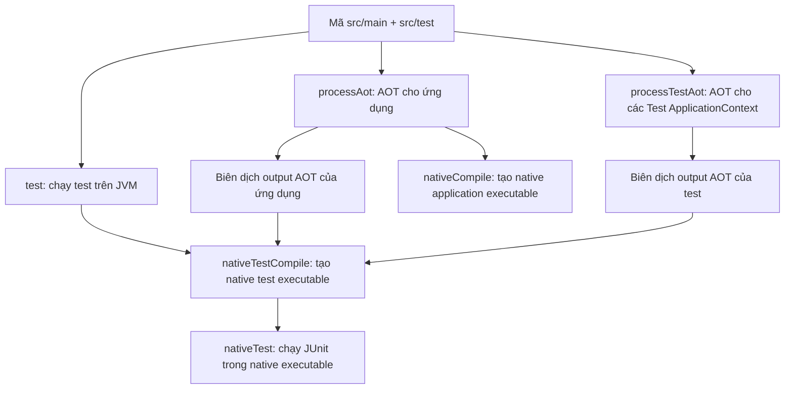
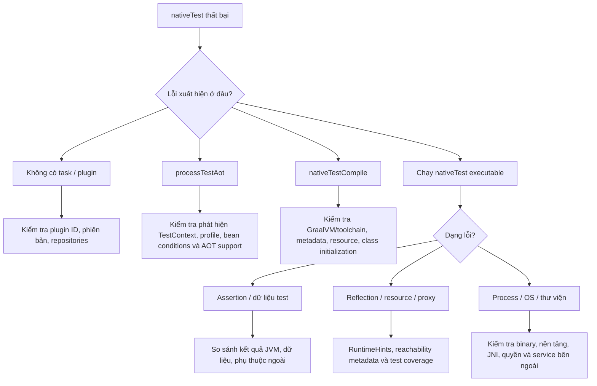

# `processTestAot` và `nativeTest` cho mã kiểm thử trong Gradle

> **Chương: Gradle** — Trong module **SPRING_BOOT_NATIVE_IMAGE**, ứng dụng Spring Boot được xử lý bởi **Spring AOT** rồi biên dịch bằng **GraalVM Native Image**. Ngoài việc build ứng dụng, ta cần xác nhận rằng các bài kiểm thử Spring cũng chạy được với mô hình AOT và môi trường native. Hai task quan trọng là `processTestAot` và `nativeTest`.

## 1. Mục tiêu học tập

Sau bài học, bạn có thể:

1. Phân biệt `test`, `processAot`, `processTestAot`, `nativeTestCompile`, `nativeTest` và `nativeCompile`.
2. Giải thích vì sao Spring cần sinh mã `ApplicationContextInitializer` dành riêng cho các context được dùng trong test.
3. Cấu hình Gradle để chạy JUnit trên JVM, tạo test AOT và thực thi test bằng GraalVM Native Image.
4. Đọc kết quả và xác định lỗi thuộc giai đoạn phát hiện test, xử lý AOT, biên dịch native hay chạy test.
5. Xây dựng chiến lược kiểm thử hợp lý, kết hợp tốc độ của JVM với việc kiểm tra reflection, resource và tính tương thích của bản native.

## 2. Phân biệt task dành cho ứng dụng và task dành cho test

Trên JVM, một bài `@SpringBootTest` thường yêu cầu Spring TestContext Framework dựng `ApplicationContext` khi test chạy. Khi chạy bằng Native Image, các bean, điều kiện cấu hình và metadata cần được phân tích **trước lúc chạy**. Bởi vậy, Spring AOT có một nhánh dành cho ứng dụng và một nhánh dành cho **những ApplicationContext được sử dụng trong bộ test**.

| Gradle task | Nguồn đầu vào và việc thực hiện | Kết quả | Có chạy test native không? |
|---|---|---|---|
| `test` | Chạy các test của source set `test` bằng JVM (thường dùng JUnit Platform) | Kết quả unit/integration test trên JVM | Không |
| `processAot` | Phân tích cấu hình Spring của **ứng dụng chính** | Mã nguồn, resource và hints được tạo cho ứng dụng | Không |
| `processTestAot` | Phân tích các test được Spring TestContext hỗ trợ và những context dùng trong test | Mã khởi tạo context AOT, metadata/hints cho **test** | Không |
| `nativeCompile` | Biên dịch **ứng dụng chính** cùng output AOT | Executable native dùng để chạy ứng dụng | Không |
| `nativeTestCompile` | Biên dịch mã kiểm thử, JUnit test engine cùng output AOT của ứng dụng và test | **Executable native dành cho test** | Chỉ biên dịch |
| `nativeTest` | Đảm bảo binary test đã được tạo và chạy các test trong native executable | Kết quả thực thi test native | **Có** |

Hai nhiệm vụ rất dễ bị nhầm:

- **`processTestAot` không biên dịch Native Image và không xác nhận các assertion đã pass.** Nó chỉ thực hiện giai đoạn Spring AOT cho test.
- **`nativeTest` không phải `nativeCompile`.** Bản thứ nhất xây dựng/chạy chương trình kiểm thử native; bản thứ hai tạo binary ứng dụng. Một chương trình test pass chưa tự chứng minh container image production chạy đúng tất cả endpoint ngoài đời thực.

Từ Spring Boot 3.x/4.x, khi dự án áp dụng đồng thời Spring Boot Gradle plugin và GraalVM Native Build Tools plugin phù hợp, Spring Boot sẽ tự cấu hình AOT task và đưa output của **cả `processAot` lẫn `processTestAot`** vào quá trình build native test. Không cần tự viết một pipeline copy class thủ công khi dùng tích hợp được hỗ trợ.

### Luồng xử lý ở mức ý tưởng



Sơ đồ thể hiện **quan hệ dữ liệu và bước thường có**, không phải thứ tự chính xác của mọi task trong tất cả phiên bản Gradle. Native Build Tools hiện có yêu cầu chạy test trên JVM trước khi thực thi test native; xem task graph thực tế bằng `./gradlew nativeTest --dry-run`.

## 3. Điều kiện để ví dụ hoạt động

Bạn cần:

- Dự án Spring Boot có mã ứng dụng trong `src/main/java` và bài test trong `src/test/java`.
- Spring Boot Gradle plugin, Gradle Java plugin và GraalVM Native Build Tools plugin với các phiên bản tương thích.
- JDK/GraalVM được phiên bản Spring Boot hỗ trợ, executable `native-image`, C compiler/linker và thư viện phát triển cần thiết trên hệ điều hành build.
- JUnit Platform test engine phù hợp, thường là JUnit Jupiter, và bộ test có thể chạy trên JVM.

Ví dụ **Groovy DSL** sau dùng cặp phiên bản được tài liệu Spring Boot **4.2.0** minh họa: `org.springframework.boot` phiên bản `4.2.0` và `org.graalvm.buildtools.native` phiên bản `1.1.18`. Nếu dự án đang dùng Spring Boot 3.x hoặc một phiên bản khác, hãy đọc lại [AOT Processing của đúng nhánh](https://docs.spring.io/spring-boot/4.2/gradle-plugin/aot.html) và điều chỉnh theo ma trận hỗ trợ; không sao chép phiên bản mẫu để thay thế dependency hiện có một cách tùy ý.

```groovy
// build.gradle (Groovy DSL) - cấu hình tối thiểu cho ứng dụng ví dụ
plugins {
    id 'java'
    id 'org.springframework.boot' version '4.2.0'
    id 'org.graalvm.buildtools.native' version '1.1.18'
}

group = 'com.example'
version = '0.0.1-SNAPSHOT'

repositories {
    mavenCentral()
}

dependencies {
    implementation 'org.springframework.boot:spring-boot-starter'
    testImplementation 'org.springframework.boot:spring-boot-starter-test'
    testRuntimeOnly 'org.junit.platform:junit-platform-launcher'
}

tasks.named('test') {
    useJUnitPlatform()
}
```

Đoạn cấu hình minh họa dự án có **Spring Boot application**. Các plugin có thể cần cấu hình repository/pluginManagement riêng trong mạng tổ chức. Bạn cũng cần phiên bản Gradle Wrapper phù hợp và cài GraalVM có `native-image`; plugin không thay thế việc chuẩn bị compiler/toolchain hệ điều hành.

Để xác nhận plugin đăng ký task, chạy:

```bash
./gradlew tasks --all
./gradlew nativeTest --dry-run
java -version
native-image --version
```

Trên Windows PowerShell hoặc Command Prompt dùng `gradlew.bat` thay cho `./gradlew`. Nếu `nativeTest` hoặc `processTestAot` không tồn tại, hãy kiểm tra plugin ID, plugin resolution và version trước khi sửa code test.

## 4. Ví dụ Spring Boot và bài kiểm thử `@SpringBootTest`

Tạo ứng dụng mẫu:

```java
// src/main/java/com/example/demo/DemoApplication.java
package com.example.demo;

import org.springframework.boot.SpringApplication;
import org.springframework.boot.autoconfigure.SpringBootApplication;
import org.springframework.context.annotation.Bean;

@SpringBootApplication
public class DemoApplication {

    @Bean
    GreetingService greetingService() {
        return new GreetingService();
    }

    public static void main(String[] args) {
        SpringApplication.run(DemoApplication.class, args);
    }
}

class GreetingService {
    String greet(String name) {
        return "Hello, " + name;
    }
}
```

Tạo integration test dùng Spring TestContext:

```java
// src/test/java/com/example/demo/GreetingServiceTest.java
package com.example.demo;

import org.junit.jupiter.api.Test;
import org.springframework.beans.factory.annotation.Autowired;
import org.springframework.boot.test.context.SpringBootTest;

import static org.junit.jupiter.api.Assertions.assertEquals;

@SpringBootTest
class GreetingServiceTest {

    @Autowired
    GreetingService greetingService;

    @Test
    void greetsCustomer() {
        assertEquals("Hello, Linh", greetingService.greet("Linh"));
    }
}
```

Trên JVM, `test` sử dụng JUnit để tạo test instance, Spring TestContext dựng context, inject `GreetingService` và chạy assertion. Trong chế độ native, Spring AOT phân tích cấu hình context của `GreetingServiceTest` và sinh mã khởi tạo thích hợp; Native Build Tools đưa mã test cùng JUnit engine vào executable native để chạy cùng assertion đó.

Một test thuần Java không dùng Spring TestContext vẫn có thể nằm trong native test suite nhờ hỗ trợ JUnit của Native Build Tools; tuy nhiên nó **không tạo một ApplicationContext riêng để `processTestAot` phân tích**. Phân biệt điều này khi thấy task `processTestAot` có ít dữ liệu đầu ra dù dự án có nhiều unit test.

## 5. Chạy đúng từng giai đoạn

### 5.1. Bước 1: chạy test trên JVM

```bash
./gradlew test
```

Đây là vòng lặp phản hồi nhanh nhất cho logic ứng dụng. Nếu test đã thất bại trên JVM, hãy xử lý lỗi của test/application trước; thực thi native không giúp khắc phục assertion sai.

### 5.2. Bước 2: chạy `processTestAot`

```bash
./gradlew processTestAot --info
```

Spring AOT quét các bài kiểm thử dùng TestContext, xác định những `ApplicationContext` độc nhất cần dựng, rồi sinh **mã nguồn khởi tạo context**, resource và hints để chuẩn bị cho native. Trong hệ thống lớn, nhiều test cùng cấu hình có thể dùng chung một context; vì vậy số context AOT **không nhất thiết bằng số test class**.

Task này thường phụ thuộc vào các bước compile mã nguồn/test; output nằm trong thư mục sinh mã thuộc `build/`, theo cấu hình và phiên bản Spring Boot Gradle plugin. Bạn có thể xem `--info` và các task `aot`/`aotTest` khi kiểm tra kết quả; không dựa vào một đường dẫn output cố định cho mọi release.

**Giới hạn của bước này:** `processTestAot` chạy xong chỉ chứng minh rằng Spring có thể phân tích/sinh mã cho những test context được phát hiện. Nó chưa xác nhận Native Image có đủ reflection metadata, executable có thể link được, và tất cả test thật sự pass khi chạy.

### 5.3. Bước 3: biên dịch executable kiểm thử native

```bash
./gradlew nativeTestCompile --info
```

Native Build Tools gọi GraalVM Native Image để tạo chương trình chứa bộ test và thành phần JUnit Platform cần thiết. Khi tích hợp với Spring Boot, binary test sử dụng cả output AOT của ứng dụng và test. Việc phân tích reachability, khởi tạo class và link native diễn ra ở đây nên tiêu thụ CPU/RAM đáng kể hơn `processTestAot`.

Chạy riêng `nativeTestCompile` có ích khi cần phân biệt lỗi **biên dịch native** và lỗi **assertion lúc test chạy**. Dù task thành công, nó chưa xác nhận toàn bộ bộ test pass.

### 5.4. Bước 4: chạy test trong Native Image

```bash
./gradlew nativeTest --info
```

Đây là lệnh chính khi muốn chạy kiểm thử native end-to-end. Trong project đã cấu hình đúng, Gradle sẽ kích hoạt các dependency/task cần thiết trước khi chạy binary test. **Không cần chạy bằng tay cả ba lệnh 5.2, 5.3 và 5.4 trên mỗi lượt CI**; chúng được tách ở đây để học và chẩn đoán.

Với phiên bản Native Build Tools được tài liệu hiện tại mô tả, test trên JVM được thực thi trước khi chạy test native. Vì vậy khi xem log, cần phân biệt report của `test` và kết quả native test, không hiểu nhầm hai lần chạy là bị lặp ngoài ý muốn.

Nếu bạn chỉ muốn biên dịch **ứng dụng** để vận hành, dùng `./gradlew nativeCompile`. Lệnh đó không có nghĩa đã chạy `nativeTest`. Ngược lại, `nativeTest` pass vẫn nên được bổ sung bằng smoke test trên **binary ứng dụng production** hoặc container image thực tế.

### Bảng đối chiếu lệnh và mức xác minh

| Lệnh | Điều được xác minh | Điều **chưa** được xác minh |
|---|---|---|
| `./gradlew test` | Test chạy trên JVM | AOT/native compatibility |
| `./gradlew processTestAot` | Spring có thể sinh AOT cho test context | Native compile, chạy test |
| `./gradlew nativeTestCompile` | Native image chứa test biên dịch được | Các assertion đã pass |
| `./gradlew nativeTest` | Test được chọn chạy trong native executable | Production binary/container, hiệu năng dưới tải thực |
| `./gradlew nativeCompile` | Native executable ứng dụng build được | Test native hoặc hành vi runtime ngoài đời |

## 6. Vì sao test AOT có thể khác test JVM?

### 6.1. `ApplicationContext` được chuẩn bị khi build

Spring AOT cố định nhiều quyết định cấu hình context trong quá trình build. Các annotation như `@Profile`, `@ConditionalOnProperty`, `@ConditionalOnClass` và cấu hình test có điều kiện có thể dẫn đến khác biệt nếu môi trường build AOT không khớp môi trường test native.

Ví dụ:

```java
@Configuration
class FeatureConfiguration {

    @Bean
    @ConditionalOnProperty(name = "feature.report.enabled", havingValue = "true")
    ReportService reportService() {
        return new ReportService();
    }
}
```

Nếu tại thời điểm `processTestAot` phân tích context, `feature.report.enabled` được đánh giá là false, bạn không thể giả định chỉ đổi biến môi trường khi chạy native test sẽ làm bean đó tự xuất hiện. Hãy đưa profile/thuộc tính cần thiết vào **cấu hình test và thời điểm AOT** một cách nhất quán, rồi build lại khi thay đổi điều kiện quyết định tập bean.

Đặc biệt, `processTestAot` là một dạng `JavaExec`. Có thể cấu hình system properties hoặc environment của **giai đoạn xử lý AOT**:

```groovy
// build.gradle — chỉ bổ sung khi bài test cần điều kiện AOT cụ thể
tasks.named('processTestAot') {
    systemProperty 'feature.report.enabled', 'true'
}
```

Đây là thuộc tính của **quá trình AOT**, không tự động cam kết cùng giá trị được truyền cho executable test khi chạy. Cách dễ quản lý hơn với nhiều bài Spring test là khai báo profile/thuộc tính ngay tại test (`@ActiveProfiles`, `@TestPropertySource`), bảo đảm tương đồng giữa các giai đoạn và ghi lại biến môi trường/build profile. Nếu cần truyền biến runtime cho `nativeTest`, đối chiếu API cấu hình `graalvmNative.binaries.test`/test executable của phiên bản plugin đang dùng.

### 6.2. Reflection, dynamic proxy, serialization và resource

JVM có thể tìm lớp/method theo chuỗi, đọc resource tại runtime và tạo proxy động. Native Image dựa trên phân tích tĩnh và reachability metadata. Các thao tác được Spring nhận diện qua annotation/configuration thông thường thường đã có hints; mã tự viết hoặc thư viện ngoài có thể cần hints bổ sung.

Ví dụ một test tải `src/test/resources/fixtures/order.json` bằng chuỗi động. Nếu native image không chứa resource, test có thể chạy tốt trên JVM nhưng thất bại ở native runtime. Có thể đăng ký bằng `@ImportRuntimeHints`:

```java
package com.example.demo;

import org.springframework.aot.hint.RuntimeHints;
import org.springframework.aot.hint.RuntimeHintsRegistrar;
import org.springframework.context.annotation.ImportRuntimeHints;

@ImportRuntimeHints(TestResourceHints.class)
class OrderResourceTest {
    // Các phương thức @Test thực tế ở đây.
}

class TestResourceHints implements RuntimeHintsRegistrar {
    @Override
    public void registerHints(RuntimeHints hints, ClassLoader classLoader) {
        hints.resources().registerPattern("fixtures/*.json");
    }
}
```

Ví dụ tập trung vào metadata và **chưa phải một bài test hoàn chỉnh**. Với tệp cần dùng trong native executable, hãy tải bằng `getResourceAsStream()` từ classpath; không mặc định resource luôn nằm tại đường dẫn file hệ điều hành như `src/test/resources/...` khi đã đóng gói.

Nếu lỗi liên quan reflection hoặc serialization, dùng API `RuntimeHints` tương ứng, chẳng hạn `@RegisterReflectionForBinding` với DTO hoặc `RuntimeHintsRegistrar` cho kiểu được truy cập động. Đừng thêm “mở toàn bộ reflection” cho tất cả package khi chỉ một constructor/resource thiếu.

### 6.3. Test framework, extension và TestContext có thể có giới hạn

Native Build Tools chạy test trên **JUnit Platform**; plugin hỗ trợ JUnit Jupiter và Vintage, còn những `TestEngine` khác cần cấu hình tương thích. Spring TestContext Framework hỗ trợ test AOT, nhưng một số thành phần test dựa vào sự linh hoạt runtime không thể hoạt động y hệt JVM.

Những thứ nên rà soát riêng:

- Extension/thư viện tạo bytecode hoặc agent, instrumentation và một số cách mock lớp runtime.
- `@ContextHierarchy` và các `ContextLoader` hoặc `TestExecutionListener` tùy biến chưa có AOT support.
- Test yêu cầu chọn bean/profile động sau khi AOT đã xử lý.
- Test đọc file từ đường dẫn local, tải resource dựa trên input hoặc thực hiện reflection ngoài tầm Spring AOT nhận diện.
- Testcontainers, cơ sở dữ liệu và các dịch vụ ngoài: xác minh Docker/port/hostname, thời điểm khởi tạo tài nguyên và tính sẵn sàng của chúng **khi AOT xử lý** lẫn **khi native test chạy**.

**Giới hạn thay đổi theo phiên bản Spring Framework.** Chẳng hạn tài liệu Spring Framework 7.0 ghi `@ContextHierarchy` chưa được hỗ trợ trong AOT test mode; `@PersistenceContext` và `@PersistenceUnit` không dùng để inject vào chính test class trong AOT mode, trong khi `@Autowired` với `EntityManager`/`EntityManagerFactory` là lựa chọn khả thi từ Framework 7.0. Trước khi thay đổi code, đọc [AOT Support for Tests](https://docs.spring.io/spring-framework/reference/7.0/testing/testcontext-framework/aot.html) tương ứng với phiên bản framework dự án.

### 6.4. Tạm loại trừ bài test không phù hợp AOT

Spring Framework có `@DisabledInAotMode` để bỏ qua class/method trong chế độ AOT/native. Ví dụ:

```java
import org.springframework.test.context.aot.DisabledInAotMode;

@DisabledInAotMode
@SpringBootTest
class UsesRuntimeBytecodeInstrumentationTest {
    // Test này tiếp tục chạy trên JVM, nhưng bị bỏ qua trong AOT/native mode.
}
```

Đây là kỹ thuật **cô lập test chưa tương thích**, không phải giải pháp xác nhận chức năng đó tương thích native. Nếu nhiều test class chia sẻ **cùng cấu hình ApplicationContext**, Spring có thể yêu cầu tất cả class cùng dùng context ấy đều được đánh dấu phù hợp để tránh xung đột; xem [@DisabledInAotMode](https://docs.spring.io/spring-framework/reference/testing/annotations/integration-spring/annotation-disabledinaotmode.html).

Đối với JUnit Jupiter, `@DisabledInNativeImage` chỉ kiểm soát thực thi trong Native Image; khác với `@DisabledInAotMode`, nó không tự truyền đạt ý định bỏ qua xử lý test context AOT. Chỉ dùng annotation có phạm vi phù hợp, ghi rõ test bị loại trừ trong báo cáo coverage.

## 7. Chẩn đoán lỗi theo giai đoạn



| Dấu hiệu trong log | Khả năng | Hành động có ích |
|---|---|---|
| `Task 'processTestAot' not found` hoặc `Task 'nativeTest' not found` | Thiếu plugin Spring Boot/AOT hoặc Native Build Tools, phiên bản khác | `./gradlew tasks --all`; kiểm tra `plugins` và Gradle compatibility |
| AOT không phát hiện test context, hoặc output ít hơn dự đoán | Test không dùng Spring TestContext, bị loại trừ, source set sai hoặc context dùng chung | Xem `test` source set, `@SpringBootTest`/`@ContextConfiguration` và `--info` |
| `BeanCreationException` hoặc missing bean tại `processTestAot` | Profile/property/condition ở build time khác môi trường test mong muốn | Ghi rõ environment của `processTestAot` và các test annotations |
| `UnsupportedFeatureError`, lỗi khởi tạo class trong `nativeTestCompile` | Tính năng không được Native Image hỗ trợ hoặc class initialization sai pha | Xác nhận GraalVM release, stack trace và mã tối giản tái hiện |
| `MissingReflectionRegistrationError`, missing resource | Hint/metadata còn thiếu | Bổ sung `RuntimeHints`, test resource và biên dịch lại |
| Native test chạy nhưng assertion sai | Khác biệt môi trường, dữ liệu/locale/timezone hoặc logic ứng dụng | Chạy so sánh cùng dữ liệu trên JVM; không mặc định đó là lỗi GraalVM |
| Native executable chạy được tại local nhưng lỗi CI | OS/CPU/toolchain, quyền truy cập file, external services khác nhau | So sánh version, runner architecture, process environment và Docker |

Khi điều tra, nên ghi lại phiên bản Java/GraalVM, Spring Boot, Spring Framework, Gradle Wrapper, GraalVM Native Build Tools, task đầu tiên báo lỗi và các tham số profile/thuộc tính. Nếu build native tốn thời gian, **tái hiện trước bằng `./gradlew processTestAot --info`** khi lỗi ở Spring AOT; chỉ build tiếp khi có lý do kiểm tra khả năng Native Image.

### Lưu ý về `spring.test.aot.processing.failOnError`

Spring Framework mặc định làm **fail ngay** giai đoạn xử lý test AOT nếu gặp lỗi. Có thể đặt Java system property `spring.test.aot.processing.failOnError=false` để phân tích tiếp và ghi warning khi đang điều tra nhiều test bị lỗi, nhưng **không nên dùng nó để che lỗi trong pipeline xác nhận native compatibility**. Sau khi sửa lỗi, bật lại cách xử lý fail-fast để CI phát hiện test context không tương thích.

## 8. Tổ chức test để CI vừa nhanh vừa có độ tin cậy

Biên dịch Native Image có thể tốn nhiều phút và nhiều RAM, nên chạy toàn bộ bộ test native ở mọi lần sửa nhỏ thường không hiệu quả. Spring Boot khuyến nghị **phần lớn unit/integration test chạy trên JVM**, sau đó dùng kiểm thử native có mục tiêu để bắt khác biệt AOT, reflection và resource.

Một chiến lược hữu ích:

| Cấp kiểm tra | Lệnh / cách chạy | Khi nào | Mục tiêu |
|---|---|---|---|
| Unit/integration trên JVM | `./gradlew test` | Mỗi commit / pull request | Logic và Spring behavior thông thường |
| Phân tích AOT test | `./gradlew processTestAot` | Pull request có thay đổi bean, test context, profile, hints | Phát hiện lỗi cấu hình lúc build |
| Biên dịch/chạy test native | `./gradlew nativeTest` | Nightly, trước release hoặc theo thay đổi quan trọng | Xác minh compatibility trong test executable |
| Smoke/integration với binary thật | `./gradlew nativeCompile`, chạy binary/container và gửi request thật | Trước triển khai | Kịch bản ứng dụng và cấu hình production |
| Benchmark | So sánh start-to-readiness, RSS và throughput giữa JVM/native | Sau khi chức năng đã pass | Đo lợi ích vận hành của Native Image |

Không nên so sánh **thời gian chạy `nativeTest`** với **thời gian khởi động ứng dụng production**; native test executable còn có JUnit engine, fixture và logic kiểm thử. Để đánh giá startup và bộ nhớ theo mục tiêu module, đo trực tiếp binary ứng dụng do `nativeCompile` tạo ra hoặc image container của nó.

Nếu có integration test tách thành source set riêng, Native Build Tools hỗ trợ đăng ký một **test binary bổ sung** bằng API `registerTestBinary`; task mặc định `nativeTest` tập trung vào source set `test`. Cần kiểm tra task/điều kiện AOT cho từng test suite phụ và tên task được plugin sinh ra; không giả định thêm một task Gradle `integrationTest` sẽ tự động được chạy bằng `nativeTest`.

### Đề xuất ghi kết quả

| Giai đoạn | PASS/FAIL | Thời gian | Bằng chứng/nhận xét |
|---|---|---|---|
| `test` (JVM) | … | … | Số test, assertion fail |
| `processTestAot` | … | … | Các context AOT và warning |
| `nativeTestCompile` | … | … | Native Image log, lỗi metadata nếu có |
| `nativeTest` | … | … | Số test thật sự chạy/pass/skip trong native |
| Production native smoke test | … | … | Endpoint, JSON, DB, resource |
| JVM/native readiness + RSS | … | … | Cùng máy, giới hạn tài nguyên, số lần đo |

Trong báo cáo, liệt kê rõ những bài `@DisabledInAotMode` hoặc `@DisabledInNativeImage` bị bỏ qua để kết luận không vượt quá phạm vi bộ test đã thực thi.

## 9. Bài tập thực hành

**Tình huống A — JVM pass nhưng `processTestAot` lỗi thiếu bean.** Test dùng `@ConditionalOnProperty("payment.mock")` để tạo một bean giả lập. Hãy kiểm tra property nào hiện diện trong **quá trình AOT**, so sánh với test JVM và chỉnh cấu hình sao cho quyết định tạo bean được xác định nhất quán.

**Tình huống B — `processTestAot` pass, `nativeTestCompile` lỗi reflection.** Một JSON test fixture chứa tên lớp được tải qua `Class.forName`. Hãy tìm điểm tạo tên lớp, xác định constructor/method cần gọi, bổ sung metadata đúng phạm vi rồi build lại. Vì sao `processTestAot` pass chưa đủ?

**Tình huống C — `nativeTest` chạy nhưng chỉ một phần test được thực thi.** Có test dùng `@DisabledInAotMode` và một test suite riêng tên `integrationTest`. Hãy kiểm tra test engine, annotations, source set và việc đăng ký test binary bổ sung; ghi lại số test thực sự chạy.

**Tình huống D — Native test pass nhưng REST API trong container lỗi.** Ứng dụng thật cần resource chỉ được truy cập khi nhận một request hiếm. Hãy chạy smoke/integration test trực tiếp trên **application binary/image**, bổ sung resource hints và giải thích vì sao pass ở test executable chưa đủ để xác nhận mọi resource production đã hiện diện.

## 10. Câu hỏi tự kiểm tra

1. `processAot` và `processTestAot` khác nhau ở đối tượng `ApplicationContext` được phân tích như thế nào?
2. Task nào **thực sự chạy assertion trong Native Image**: `processTestAot`, `nativeTestCompile` hay `nativeTest`?
3. Vì sao `./gradlew nativeCompile` thành công không chứng minh `@SpringBootTest` chạy được trong native?
4. Nếu một test thuần JUnit không dùng Spring TestContext, `processTestAot` có cần tạo context cho nó không?
5. Nếu thay profile/runtime property sau khi đã chạy `processTestAot`, điều kiện tạo bean thay đổi có được Spring tự đánh giá lại tùy ý khi chạy native không?
6. Khi nào nên dùng `@DisabledInAotMode`, và cần lưu ý gì nếu nhiều test dùng chung cấu hình context?
7. Vì sao phải ghi số bài test pass/skip thay vì chỉ ghi `nativeTest BUILD SUCCESSFUL`?
8. Tại sao không sử dụng thời gian khởi chạy `nativeTest` để kết luận hiệu năng startup của ứng dụng native production?

## Ghi nhớ

**`processTestAot` chuẩn bị Spring TestContext cho môi trường AOT; `nativeTestCompile` xây dựng test executable; `nativeTest` chạy JUnit trong Native Image.** Spring Boot và GraalVM Native Build Tools tích hợp những giai đoạn đó khi plugin được cấu hình phù hợp. Vòng lặp hiệu quả là kiểm thử đa số chức năng trên JVM, chạy AOT test khi cần, chạy native test tại các mốc CI thích hợp và xác nhận riêng binary ứng dụng production. Chỉ kết luận Native Image tương thích khi đã kiểm tra cả metadata, điều kiện bean và những hành vi thực tế cần vận hành.

## Tài liệu tham khảo chính thức

- [Spring Boot 4.2 — Gradle Plugin: Ahead-of-Time Processing](https://docs.spring.io/spring-boot/4.2/gradle-plugin/aot.html): `processAot`, `processTestAot`, tích hợp với `nativeTest` và cấu hình `JavaExec`.
- [Spring Boot 4.2 — Testing GraalVM Native Images](https://docs.spring.io/spring-boot/4.2/how-to/native-image/testing-native-applications.html): quy trình test AOT/native, lựa chọn test trên JVM, lệnh Gradle.
- [GraalVM Native Build Tools — Gradle Plugin](https://graalvm.github.io/native-build-tools/latest/gradle-plugin): `nativeTestCompile`, `nativeTest`, JUnit Platform và binary `test`.
- [Spring Framework 7.0 — Ahead of Time Support for Tests](https://docs.spring.io/spring-framework/reference/7.0/testing/testcontext-framework/aot.html): TestContext AOT, hints, giới hạn và xử lý lỗi.
- [Spring Framework — `@DisabledInAotMode`](https://docs.spring.io/spring-framework/reference/testing/annotations/integration-spring/annotation-disabledinaotmode.html): khi nào test được loại trừ khỏi AOT/native.
- [Spring Framework — AOT Optimizations](https://docs.spring.io/spring-framework/reference/core/aot.html): giới hạn classpath, `@Profile` và `@Conditional` khi tạo bean.
