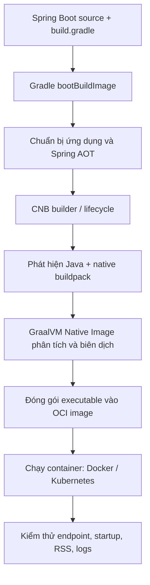

# bootBuildImage để tạo container image native bằng buildpacks

## Mục tiêu bài học

Trong module **Spring Boot Native Image**, chúng ta dùng **Spring AOT** để chuẩn bị phần khởi tạo ứng dụng và dùng **GraalVM Native Image** để biên dịch Java thành mã máy. Với dự án **Gradle**, tác vụ `bootBuildImage` của Spring Boot có thể kết hợp với **Cloud Native Buildpacks** để tạo **OCI container image** chứa ứng dụng native, sẵn sàng chạy qua Docker hoặc nền tảng container tương thích.

Bài này hướng dẫn thực hành một đường build cụ thể: **mã nguồn Spring Boot → Gradle → buildpacks → native executable → container image**. Bạn sẽ hiểu cách cấu hình, kiểm tra build log, chạy container, xác minh đó là bản native và khắc phục những lỗi thường gặp.

Sau bài học, bạn có thể:

- Phân biệt `bootBuildImage`, `bootJar` và `nativeCompile`.
- Chuẩn bị Gradle, Docker/container daemon và builder hỗ trợ Native Image.
- Cấu hình `BP_NATIVE_IMAGE=true` cho một builder tương thích, build image và đặt tên image.
- Đọc các giai đoạn của Cloud Native Buildpacks và GraalVM Native Image trong log.
- Chạy, kiểm thử, đo thời gian khởi động và bộ nhớ của container native.
- Phân biệt lỗi AOT, reflection/resource, native compiler, buildpack và runtime.

> **Chú ý về phiên bản:** Spring Boot, GraalVM Native Build Tools, Paketo buildpacks và builder image có thể thay đổi cơ chế tích hợp, giá trị mặc định và định dạng log theo phiên bản. Lệnh/cấu hình dưới đây dựa trên dự án Spring Boot có plugin phù hợp; khi làm thực tế phải đối chiếu bản plugin/builder đang dùng. Các log và số liệu minh họa không phải kết quả benchmark.

## 1. `bootBuildImage` giải quyết việc gì?

Tác vụ **`bootBuildImage`** do **Spring Boot Gradle plugin** cung cấp. Thay vì yêu cầu lập trình viên tự viết Dockerfile, tác vụ gửi nội dung ứng dụng tới **Cloud Native Buildpacks (CNB)** để builder nhận diện ứng dụng, chọn các buildpack thích hợp, cài những thành phần cần cho quá trình build và tạo ra container image theo chuẩn OCI.

Đường đi khái quát:



**Vai trò từng thành phần:**

| Thành phần | Trách nhiệm |
|---|---|
| Spring Boot Gradle plugin | Cung cấp task `bootBuildImage` và tích hợp build ứng dụng |
| Spring AOT | Sinh mã khởi tạo context/đăng ký bean và runtime hints cần thiết |
| GraalVM Native Build Tools | Tích hợp các task/tùy chọn native và Spring AOT vào Gradle theo cấu hình/phiên bản |
| Cloud Native Buildpacks lifecycle | Điều phối phát hiện, build và xuất container image |
| Java/Native Image buildpack tương thích | Chuẩn bị JDK/native compiler trong môi trường builder và biên dịch ứng dụng |
| Builder image | Chứa lifecycle, tập buildpacks và môi trường build |
| Run image | Cung cấp các thành phần hệ điều hành cần để chạy ứng dụng trong container |
| Image được tạo | Sản phẩm triển khai cuối: OCI image với native executable và metadata/layers phù hợp |

**Điểm khác biệt quan trọng:** `bootBuildImage` không phải một cách viết khác của `nativeCompile`. Native compilation được buildpack thực hiện trong quy trình tạo container image; không cần chạy `nativeCompile` trên máy trước khi dùng `bootBuildImage`.

### 1.1. So sánh ba task Gradle

| Task | Sản phẩm chính | Khi nào dùng? |
|---|---|---|
| `bootJar` | JAR chạy bằng JVM (trong cấu hình mặc định) | Phát hành/chạy ứng dụng JVM, kiểm thử chức năng |
| `nativeCompile` | Executable native ở thư mục build | Chạy trực tiếp trên OS/CPU tương ứng, debug native local |
| `bootBuildImage` | OCI container image, có thể là **JVM hoặc native** | Đóng gói và chạy trong môi trường container |

Chỉ gọi `./gradlew bootBuildImage` **chưa đủ chứng minh** image được tạo là native. Phải có cơ chế cấu hình native tương thích và bằng chứng trong log buildpack rằng Native Image đã thực sự được biên dịch.

## 2. Điều kiện trước khi build

### 2.1. Những thành phần cần thiết

1. **Dự án Spring Boot** phiên bản hỗ trợ Spring AOT/Native Image, Java phù hợp; ví dụ nhiều dự án Spring Boot 3.x dùng Java 17 hoặc mới hơn.
2. **Gradle Wrapper** của dự án hoạt động, Spring Boot Gradle plugin đã được áp dụng.
3. **Tích hợp AOT/native** phù hợp với phiên bản dự án; trong nhiều dự án Spring Boot dùng plugin `org.graalvm.buildtools.native` để Spring Boot tự cấu hình các task liên quan.
4. **Docker daemon hoặc container runtime tương thích** đang chạy và có thể được Gradle kết nối tới.
5. **Builder hỗ trợ native image**, điển hình là dòng builder Paketo tương thích với Java và kiến trúc CPU đích.
6. **Đủ CPU, RAM và dung lượng đĩa** cho native compilation trong container; yêu cầu build thường cao hơn yêu cầu runtime.

Kiểm tra nhanh:

```bash
./gradlew --version
docker version
docker info
./gradlew tasks --all
```

Trên Windows, dùng `.\gradlew.bat` trong PowerShell. Nếu `docker version` chỉ hiển thị thông tin client rồi báo không kết nối được server, Gradle cũng không thể dùng Docker daemon.

**Ưu điểm của buildpacks:** máy phát triển **không nhất thiết** phải cài lệnh `native-image` hoặc native C compiler cục bộ; buildpack có thể cài công cụ cần thiết **trong môi trường builder container**. Máy vẫn cần Java/Gradle để chạy build và Docker/container daemon để tạo image.

### 2.2. Hệ điều hành và kiến trúc

Image tạo bằng Linux builder thường chứa executable **Linux**, không phải tệp `.exe` của Windows. Vì vậy, người học trên Windows có thể tạo image Linux khi Docker Desktop chạy **Linux containers**. Kiến trúc `amd64`/`arm64` phải được builder, buildpack, runtime image và nền tảng triển khai hỗ trợ.

Native compilation thường gắn với OS/CPU đích. Đừng mặc định builder chạy trên một kiến trúc sẽ tự biên dịch executable cho mọi kiến trúc khác. Nếu production khác kiến trúc máy build, cần kiểm tra khả năng hỗ trợ và quy trình build image tương ứng.

## 3. Ứng dụng mẫu để kiểm thử container native

Giả sử dự án Gradle đã có dependency `spring-boot-starter-web`. Tạo ứng dụng đơn giản:

```java
package com.example.nativecontainer;

import org.springframework.boot.SpringApplication;
import org.springframework.boot.autoconfigure.SpringBootApplication;
import org.springframework.web.bind.annotation.GetMapping;
import org.springframework.web.bind.annotation.RestController;

@SpringBootApplication
public class NativeContainerApplication {
    public static void main(String[] args) {
        SpringApplication.run(NativeContainerApplication.class, args);
    }
}

@RestController
class HelloController {
    @GetMapping("/hello")
    String hello() {
        return "Hello from native container";
    }
}
```

Bạn có thể đặt `HelloController` trong cùng tệp `NativeContainerApplication.java` vì class này không khai báo `public`, hoặc tách thành tệp khác trong package được component scan. Với Spring Boot 3.x, đảm bảo cấu hình Java và dependency tương thích.

Chạy trên JVM để có mốc chức năng:

```bash
./gradlew bootRun
```

Ở terminal khác:

```bash
curl -i http://localhost:8080/hello
```

Đầu ra dự kiến là **HTTP 200** với body `Hello from native container`. Dừng `bootRun` trước khi chạy container trên cùng cổng 8080.

## 4. Cấu hình `bootBuildImage` để bật native

### 4.1. Tích hợp Gradle và Spring AOT

Trong `build.gradle` dùng **Groovy DSL**, dự án thường đã có Spring Boot plugin, Java plugin và dependency management. Để làm việc với Native Image, nhiều cấu hình còn áp dụng GraalVM Native Build Tools:

```groovy
plugins {
    id 'java'
    id 'org.springframework.boot' version '<SPRING_BOOT_VERSION>'
    id 'io.spring.dependency-management' version '<DEPENDENCY_MANAGEMENT_VERSION>'
    id 'org.graalvm.buildtools.native' version '<NATIVE_BUILD_TOOLS_VERSION>'
}

repositories {
    mavenCentral()
}

dependencies {
    implementation 'org.springframework.boot:spring-boot-starter-web'
}

java {
    toolchain {
        languageVersion = JavaLanguageVersion.of(21)
    }
}
```

Các chuỗi `<...VERSION>` là **giữ chỗ minh họa**, không phải phiên bản plugin có thể dùng nguyên văn. Thay bằng các phiên bản tương thích của dự án (hoặc giữ nguyên plugin versions do Spring Initializr/template đã tạo). Nếu dự án đã có khối `plugins`, `repositories` hoặc `dependencies`, **bổ sung vào khối hiện hữu**, không tạo khối trùng. Ví dụ sử dụng Java 21; có thể chọn phiên bản khác đáp ứng yêu cầu của Spring Boot và builder.

Trong một số phiên bản Spring Boot, khi plugin GraalVM Native Build Tools được áp dụng, `bootBuildImage` đã có tích hợp cấu hình build native. Ta vẫn kiểm tra log thay vì suy luận từ sự hiện diện của plugin.

### 4.2. Chỉ định native buildpack

Với **Paketo builder có hỗ trợ** biến môi trường `BP_NATIVE_IMAGE`, cấu hình trong `build.gradle`:

```groovy
tasks.named('bootBuildImage') {
    imageName = "native-container-demo:0.1.0"
    environment = ['BP_NATIVE_IMAGE': 'true']
}
```

Ở đây:

- `imageName` đặt tên/tag image được đưa vào Docker local image store sau khi build thành công.
- `environment` là **môi trường build được truyền cho buildpacks**; `BP_NATIVE_IMAGE=true` yêu cầu các buildpack hỗ trợ lựa chọn đường native.
- Tên biến `BP_NATIVE_IMAGE` **không phải** một tùy chọn chung bắt buộc cho mọi builder CNB. Builder khác Paketo có thể dùng cách bật native khác hoặc không hỗ trợ tính năng này.

Nếu đang dùng `build.gradle.kts`, cần viết lại theo Kotlin DSL thay vì sao chép trực tiếp cú pháp Groovy trên. Các API cụ thể của task có thể khác theo phiên bản plugin.

> **Cảnh báo thực hành:** gán `BP_NATIVE_IMAGE=true` vào môi trường shell, ví dụ `BP_NATIVE_IMAGE=true ./gradlew bootBuildImage`, **không bảo đảm** biến này tự được truyền vào build environment của builder. Cách rõ ràng là đặt trong cấu hình `bootBuildImage.environment` (hoặc cơ chế truyền môi trường của task tương ứng), sau đó xác nhận trong build log.

### 4.3. Builder và run image

Theo mặc định, Spring Boot plugin chọn builder phù hợp với phiên bản được sử dụng. Khi cần tùy chỉnh, task có thể chỉ định **`builder`** và **`runImage`** để chọn hệ sinh thái buildpack/runtime. Không nên đặt bừa hai giá trị: run image phải tương thích với builder và stack/lifecycle của nó.

Sơ đồ trách nhiệm:

```text
Builder image (build time)
    |
    +-- CNB lifecycle
    +-- Java / Spring / native buildpacks
    +-- Compiler, JDK va cong cu build
    |
    v
OCI image duoc tao
    |
    +-- Runtime OS libraries / launcher can thiet
    +-- Native executable cua ung dung
    +-- Metadata va layers
```

Container chạy ứng dụng native **không cần JVM để chạy Java bytecode**. Tuy nhiên image vẫn có runtime nền tảng khác và thư viện hệ điều hành cần thiết, nên không thể kết luận image là `scratch` hay không chứa gì ngoài một tệp executable.

## 5. Chạy `bootBuildImage` và đọc log

### 5.1. Lệnh build

Tại thư mục gốc dự án:

```bash
./gradlew bootBuildImage
```

Nếu cần nhiều thông tin hơn khi chẩn đoán:

```bash
./gradlew bootBuildImage --info --stacktrace
```

Trên Windows PowerShell:

```powershell
.\gradlew.bat bootBuildImage
```

Không cần chạy `nativeCompile` trước. Khi `bootBuildImage` chạy theo cấu hình native, native compilation được thực hiện trong builder của Cloud Native Buildpacks.

### 5.2. Thứ tự các lớp log

Log thực tế có thể đan xen nhiều tầng:

```text
Gradle
  |
  +-- compileJava / processAot / compileAotJava / bootJar...
  |       (các task xuất hiện tùy phiên bản và cấu hình)
  |
  +-- bootBuildImage
          |
          +-- CNB lifecycle: DETECTING
          +-- CNB lifecycle: ANALYZING / RESTORING
          +-- CNB lifecycle: BUILDING
          |       |
          |       +-- Java / native buildpack
          |       +-- GraalVM Native Image: analysis / compile / create image
          |
          +-- CNB lifecycle: EXPORTING
          +-- Docker local image store
```

**Đừng đồng nhất `processAot` của Gradle với `ANALYZING` của CNB**:

- `processAot` là tác vụ **Spring AOT**, tạo nguồn/metadata phục vụ bootstrap.
- `ANALYZING` của CNB liên quan đến lifecycle và việc xác định lớp/image metadata phục vụ build/caching.
- `Performing analysis` của **GraalVM Native Image** là phân tích **reachability** của mã Java.

Ba từ có liên quan tới “analysis” nhưng thực hiện ba công việc khác nhau. Cũng không nên bắt buộc mọi log phải in đầy đủ cùng một tập Gradle task: đường tích hợp AOT của plugin và builder có thể thay đổi giữa các phiên bản.

### 5.3. Log build minh họa

Đây là **đoạn log mẫu có lược bỏ và tổng hợp** để luyện cách nhận diện, không phải log thực tế của một bản Gradle/Paketo cụ thể:

```text
> Task :compileJava
> Task :processAot
> Task :compileAotJava
> Task :bootBuildImage

Building image 'docker.io/library/native-container-demo:0.1.0'

[creator] ===> DETECTING
[creator] ... Paketo Java buildpacks ...
[creator] ===> ANALYZING
[creator] ===> RESTORING
[creator] ===> BUILDING
[creator] ... Native Image support enabled ...
[creator] ... GraalVM Native Image ...
[creator] [1/8] Initializing...
[creator] [2/8] Performing analysis...
[creator] ...
[creator] [...] Compiling methods...
[creator] [...] Creating image...
[creator] ... Finished generating native executable ...
[creator] ===> EXPORTING
[creator] ... Image: native-container-demo:0.1.0 ...

BUILD SUCCESSFUL
```

Khi đọc log thật, hãy tìm bằng chứng ở **hai tầng độc lập**:

1. **Native compilation có diễn ra?** Tìm các thông điệp từ Native Image như khởi tạo trình biên dịch, `Performing analysis`, `Compiling methods` và tạo executable. Chỉ nhìn thấy Java buildpack hoặc AOT task chưa đủ.
2. **OCI image có được xuất thành công?** Tìm pha `EXPORTING`, image name/tag và kết quả tác vụ `bootBuildImage`. Native Image biên dịch thành công nhưng export image lỗi vẫn chưa có sản phẩm triển khai hoàn chỉnh.

### 5.4. CNB lifecycle và native compiler khác nhau thế nào?

| Thông báo | Nguồn phát sinh | Bạn nên kiểm tra |
|---|---|---|
| `> Task :bootBuildImage` | Gradle | Task đang tạo image |
| `DETECTING` | CNB lifecycle | Buildpack nào nhận diện ứng dụng, có đường native hỗ trợ không |
| `ANALYZING` / `RESTORING` | CNB lifecycle | Cache và metadata image/layers |
| `BUILDING` | CNB lifecycle | Buildpacks cài toolchain, chạy compilation |
| `Performing analysis` | GraalVM Native Image | Reachable types/methods, reflection metadata, class initialization |
| `Compiling methods` | GraalVM Native Image | CPU/RAM và thời gian biên dịch native |
| `EXPORTING` | CNB lifecycle | Tạo/push image/layers thành công |
| `BUILD SUCCESSFUL` | Gradle | Gradle hoàn thành task graph; cần kiểm tra thêm chạy thực tế |

Không phụ thuộc cứng vào thứ tự `[1/8]` hay đúng tên tất cả các pha GraalVM vì số lượng và định dạng có thể thay đổi theo phiên bản compiler.

## 6. Xác minh OCI image chứa ứng dụng native

### 6.1. Kiểm tra image đã được tạo

Với cấu hình ví dụ:

```bash
docker image ls native-container-demo
docker image inspect native-container-demo:0.1.0 --format '{{.Os}}/{{.Architecture}}'
```

Kiểm tra được tên/tag image và kiến trúc. **`docker image inspect` chỉ xác nhận metadata của image, chưa tự chứng minh chương trình bên trong là native**. Bằng chứng build native vẫn phải dựa trên cấu hình/builder và log Native Image (hoặc kiểm tra executable trong image bằng công cụ phù hợp).

Đôi khi tên đầy đủ sẽ có tiền tố registry như `docker.io/library/...`. Docker có thể hiển thị dạng rút gọn tương đương. Nếu không tìm thấy tên image, xem lại tên/tag đã thực sự xuất hiện trong log `bootBuildImage`.

### 6.2. Chạy container và kiểm tra HTTP

```bash
docker run --rm --name native-container-demo -p 8080:8080 native-container-demo:0.1.0
```

Trong terminal khác:

```bash
curl -i http://localhost:8080/hello
```

Kết quả kỳ vọng:

```text
HTTP/1.1 200
...

Hello from native container
```

HTTP header thực tế sẽ chứa thêm thông tin phụ thuộc web server và phiên bản ứng dụng. Trên PowerShell, bạn có thể dùng:

```powershell
$response = Invoke-WebRequest -Uri 'http://localhost:8080/hello' -UseBasicParsing
$response.StatusCode
$response.Content
```

Dừng container bằng `Ctrl+C` trong terminal đang chạy hoặc `docker stop native-container-demo`. Tùy cấu hình, tiến trình trong image có thể chạy bằng user không phải root và không có shell; đừng giả định có thể `docker exec ... /bin/bash`.

### 6.3. Những dấu hiệu chứng minh native

Để tự tin rằng bạn vừa build **native image**:

1. Task được cấu hình hướng tới **native-capable buildpack**; nếu dùng Paketo, biến `BP_NATIVE_IMAGE` phải thật sự đến môi trường buildpack hoặc tích hợp native tự động của plugin được xác nhận.
2. Trong log có **GraalVM Native Image build** và thông báo đã tạo executable.
3. Image được export thành công với tên/tag dự kiến.
4. Container chạy được, endpoint trả về đúng kết quả.
5. Khi cần xác nhận chặt chẽ, kiểm tra cấu trúc process/executable bằng công cụ quan sát image thích hợp; **không** suy luận chỉ từ việc startup nhanh hoặc image nhỏ.

Ví dụ, nếu log chỉ hiển thị Java/JVM runtime được cài vào image và không có bước Native Image compiler, hãy điều tra cấu hình build trước khi đưa ra kết luận về lợi ích native.

## 7. Thời gian build, tài nguyên và cache

Native compilation có thể dùng đáng kể **CPU, RAM và dung lượng ổ đĩa** trong quá trình tạo image. Điều này **khác** nhu cầu RAM của container chạy thực tế.

Buildpacks tận dụng cơ chế layer/cache để giảm thời gian ở các lần build sau; mức tái sử dụng cache phụ thuộc builder, cấu hình, thay đổi dependency và nội dung ứng dụng. Dù cache giúp tránh tải lại một số thành phần, **native compilation vẫn có thể là phần tốn thời gian nhất** sau khi mã thay đổi.

| Chỉ số | Đo ở đâu? | Ý nghĩa |
|---|---|---|
| Tổng thời gian `bootBuildImage` | Log Gradle/CI | Chi phí build và phản hồi của pipeline |
| Thời gian native compilation | Log GraalVM trong `BUILDING` | Chi phí tạo executable |
| Peak RAM/CPU của builder | Docker Desktop/daemon/CI monitor | Định mức tài nguyên cho máy build |
| Kích thước OCI image | `docker image ls` / registry | Lưu trữ và truyền image |
| RSS/working set container khi chạy | `docker stats` / metric Kubernetes | Cơ sở cân nhắc memory request/limit |
| Thời gian đến readiness | Health probe hoặc công cụ đo từ lúc start container | Lợi ích startup thực tế |

**Không so sánh** RAM của image builder lúc build với RSS của bản JVM lúc chạy; đây là hai loại số liệu khác nhau.

Ví dụ theo dõi tài nguyên của container đang chạy:

```bash
docker stats native-container-demo
```

Khi đánh giá bản native so với JVM, nên chạy cả hai image với **cùng ứng dụng, profile, dữ liệu, giới hạn CPU/RAM, endpoint và mức tải**. Đo nhiều lần; ngoài startup và RAM còn phải so sánh throughput, p95/p99 latency, error rate và chi phí build.

## 8. Những lỗi thường gặp với `bootBuildImage`

| Triệu chứng | Nguyên nhân khả dĩ | Kiểm tra/hướng xử lý |
|---|---|---|
| `Task 'bootBuildImage' not found` | Chưa áp dụng Spring Boot Gradle plugin hoặc sai project con | Kiểm tra `plugins`, `./gradlew tasks --all` và module đang chạy |
| `Cannot connect to Docker daemon` | Docker chưa chạy, sai Docker host/context hoặc thiếu quyền | Kiểm tra `docker version`, `docker info`, Docker Desktop/daemon |
| Builder download lỗi | Registry/network/credential/proxy hoặc image không tồn tại | Kiểm tra tag builder, registry access và proxy |
| Buildpack không chọn native | Builder thiếu hỗ trợ native, `BP_NATIVE_IMAGE` chưa truyền đúng hoặc cấu hình plugin không tương thích | Xem pha `DETECTING`/`BUILDING`, biến build env và log Native Image |
| `UnsupportedClassVersionError` hoặc JDK không phù hợp | Java bytecode khác phiên bản toolchain builder hỗ trợ | Đồng bộ Gradle Java toolchain, target compatibility và builder JDK |
| Lỗi ở Spring AOT processing | Cấu hình bean, annotation processing, conditional bean hoặc code được thực thi lúc AOT | Đọc stack trace gốc; sửa source/config và chạy lại |
| Native compilation hết RAM hoặc bị kill | Docker/CI giới hạn bộ nhớ quá thấp | Tăng tài nguyên builder, giảm dependency không cần thiết, quan sát peak RAM |
| Lỗi reflection/proxy/resource | Thư viện dùng truy cập động chưa được AOT/native metadata bao phủ | Thêm Runtime Hints/metadata đúng thao tác, test lại native |
| `EXPORTING` lỗi sau khi compile thành công | Vấn đề image store, registry, quyền ghi hoặc đĩa | Xem log export/daemon; kiểm tra image có thực sự tồn tại |
| Container khởi động nhưng endpoint không đáp ứng | Sai port/map, sai context path, app lỗi, cấu hình runtime | Đọc `docker logs`, `docker ps`, `curl` và log Spring |
| Image chạy local nhưng lỗi trên cluster | OS/CPU khác, thiếu secret/config/network hoặc hạn mức tài nguyên | Xác minh architecture, biến môi trường, policy, probes và logs trên cluster |

### 8.1. Vì sao Spring AOT có thể build được nhưng native vẫn lỗi?

Spring AOT giúp sinh mã khởi tạo `ApplicationContext` và runtime hints mà framework có thể suy ra, nhưng không thể tự biết mọi tên class hoặc resource chỉ được xác định **tại runtime**. Ví dụ:

```java
String fileName = request.getParameter("template");
var stream = getClass().getResourceAsStream("/templates/" + fileName);
```

Nếu ứng dụng thực sự cần truy cập các resource động trong native executable, có thể khai báo cụ thể:

```java
import org.springframework.aot.hint.RuntimeHints;
import org.springframework.aot.hint.RuntimeHintsRegistrar;
import org.springframework.context.annotation.Configuration;
import org.springframework.context.annotation.ImportRuntimeHints;

final class TemplateResourceHints implements RuntimeHintsRegistrar {
    @Override
    public void registerHints(RuntimeHints hints, ClassLoader classLoader) {
        hints.resources().registerPattern("templates/*.txt");
    }
}

@Configuration(proxyBeanMethods = false)
@ImportRuntimeHints(TemplateResourceHints.class)
class NativeResourceConfiguration {}
```

Đây là ví dụ cho resource `.txt` thực sự có trong `src/main/resources/templates/`. Chọn pattern đủ hẹp theo nghiệp vụ; nếu resource đã được library/framework đăng ký, không cần thêm trùng. Với reflection hoặc JDK proxy, sử dụng các nhóm hints tương ứng.

**Lưu ý:** chỉ dùng tên file từ request sau khi kiểm tra danh sách cho phép, tránh truy cập tài nguyên không mong muốn. Ở đây ví dụ nhằm giải thích cách native compiler biết resource nào cần đưa vào image.

### 8.2. Cấu hình ở build time và runtime

Native image sử dụng thông tin cấu hình khi xử lý AOT để quyết định **tập bean và điều kiện đăng ký bean** trong nhiều trường hợp. Ví dụ `@Profile` hoặc `@ConditionalOnProperty` có thể làm bean graph khác nhau theo cấu hình ở thời điểm build.

Vì vậy, không nên kỳ vọng một container image native sẽ luôn tự tạo thêm bean đã bị loại khỏi AOT build chỉ vì bạn đổi biến môi trường lúc chạy. Hãy phân biệt:

- **Build environment:** điều kiện ảnh hưởng AOT/native compilation và nội dung image.
- **Runtime environment:** giá trị nghiệp vụ được bean đã có đọc khi chạy, địa chỉ DB, credentials và cấu hình triển khai phù hợp.

Không đưa secret production vào cấu hình build image theo thói quen. Secret cần được cấp qua cơ chế secret/config runtime tương ứng; chỉ những gì bắt buộc cho build mới nên có mặt trong builder và phải tuân thủ bảo mật pipeline.

## 9. Đưa image lên môi trường container

Sau khi image được kiểm chứng local, bạn có thể triển khai nó theo cơ chế container thông thường: Docker, Kubernetes hoặc nền tảng hỗ trợ OCI image. Quy trình thực tế thường gồm **tag**, **publish vào registry**, **deploy**, **readiness probe**, **monitoring** và **rollback**.

Với Kubernetes, chú ý:

- **Image architecture:** image và node phải tương thích; không giả định image build trên Linux/amd64 có thể chạy trên mọi node ARM.
- **Startup/readiness probe:** dùng endpoint/kiểm tra thực sự phản ánh khả năng phục vụ. Native thường startup nhanh hơn nhưng kết nối DB, migration hoặc thao tác I/O vẫn có thể chậm.
- **Memory request/limit:** đặt dựa trên RSS ở tải đại diện và peak, tránh OOM kill chỉ vì RSS idle thấp.
- **Autoscaling:** thời gian tạo replica bao gồm scheduling, pull image, startup tiến trình và readiness; Native Image chủ yếu tác động một phần trong chuỗi này.
- **Nguồn gốc artifact:** dùng builder/run image đáng tin cậy, cố định phiên bản khi cần tái lập build và theo dõi các bản cập nhật bảo mật.

Với các ứng dụng chạy lâu, throughput/latency dưới tải quan trọng không kém startup và RAM. Quyết định dùng bản native trong production phải dựa trên **test tương thích và benchmark cùng điều kiện**, không chỉ kích thước image hoặc một lần khởi động.

## 10. Bài thực hành: từ build Gradle tới container native hoạt động

### Bước 1 — Chuẩn bị

Tạo hoặc dùng một dự án Spring Boot có endpoint `GET /hello` và dependency Spring Web. Đảm bảo build JVM chạy ổn, Docker daemon hoạt động và builder hỗ trợ native.

### Bước 2 — Cấu hình

Trong `build.gradle`, áp dụng plugin hỗ trợ Spring AOT/native tương thích rồi thêm cấu hình `bootBuildImage` với `imageName` và `BP_NATIVE_IMAGE=true` như mục 4. Kiểm tra đây là môi trường buildpack được truyền qua task.

### Bước 3 — Build và ghi nhận log

```bash
./gradlew bootBuildImage --info
```

Lưu lại kết quả về: thời gian tổng, các buildpack được chọn, dấu hiệu GraalVM Native Image compiler, pha `EXPORTING` và tên/tag image.

### Bước 4 — Chạy và kiểm thử

```bash
docker run --rm --name native-container-demo -p 8080:8080 native-container-demo:0.1.0
```

Kiểm tra `GET http://localhost:8080/hello`. Ghi lại HTTP status/body, log startup và RSS của container sau khi ổn định.

### Bước 5 — So sánh và giải thích

Chuẩn bị bản JVM container của **cùng source code** bằng quy trình build JVM tương ứng. Chạy cùng môi trường/tải và so sánh startup đến readiness, RSS idle/peak, p95 latency, throughput, kích thước image và thời gian build. Nếu native giảm startup nhưng cần nhiều tài nguyên để build hơn, giải thích điểm đánh đổi.

### Câu hỏi tự kiểm tra

1. Vì sao `bootBuildImage` có thể tạo image JVM nếu chưa cấu hình native đúng?
2. Sự khác nhau giữa `processAot`, `ANALYZING` của buildpacks và `Performing analysis` của GraalVM là gì?
3. Vì sao đặt `BP_NATIVE_IMAGE=true` trong shell chưa chắc đủ để buildpacks nhận biến đó?
4. Nếu có thông báo native compilation thành công nhưng `EXPORTING` thất bại, có thể tuyên bố image đã sẵn sàng triển khai không?
5. Cần những bằng chứng nào để khẳng định image đang chạy là bản native và lợi ích startup/RAM có thực?

**Ghi nhớ:** trong dự án Spring Boot Gradle, `bootBuildImage` điều phối **Cloud Native Buildpacks** tạo container image. Muốn xây dựng **native OCI image**, cần builder hỗ trợ Native Image, cấu hình buildpacks/native phù hợp, dấu hiệu native compiler trong log và bước chạy thử container. Kết quả tốt nhất chỉ được xác nhận bằng **kiểm thử tương thích, thời gian sẵn sàng, bộ nhớ và hiệu năng** trong điều kiện triển khai đại diện.
