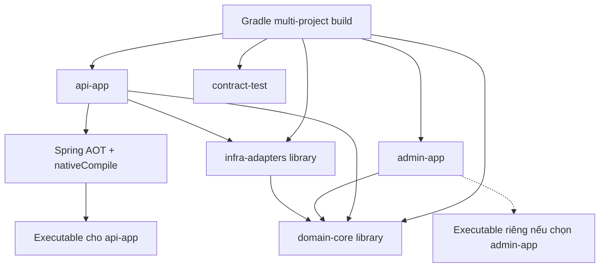

# Dự án nhiều module: chọn đúng ứng dụng, classpath và dependency được đóng gói

## 1. Vì sao dự án nhiều module dễ build nhầm Native Image?

Một repository Gradle nhiều module có thể chứa nhiều ứng dụng Spring Boot, thư viện dùng chung, module kiểm thử và module chỉ cung cấp cấu hình. Khi tạo **GraalVM Native Image** cho Spring Boot, không thể chỉ chạy `nativeCompile` ở thư mục gốc rồi mặc định Gradle biết ứng dụng nào cần đóng gói.

Cần xác định đồng thời ba đối tượng:

1. **Đúng application module**: module chứa entry point Spring Boot, cấu hình plugin và tác vụ native cần build.
2. **Đúng runtime classpath**: tập class và resource mà ứng dụng cần khi chạy, bao gồm output của module phụ thuộc cùng các thư viện runtime.
3. **Đúng dependency đóng gói**: artifact nào được đưa vào ứng dụng cuối, artifact nào chỉ phục vụ compile/test, và artifact native nào phải có mặt trong môi trường đích.

Trong module **SPRING_BOOT_NATIVE_IMAGE**, Spring AOT phân tích ứng dụng tại build time, còn GraalVM Native Image tạo executable theo OS/kiến trúc đích. Nếu chọn nhầm module hoặc classpath, kết quả có thể là build thất bại, thiếu bean/resource, hoặc tệ hơn là tạo được executable nhưng chạy thiếu chức năng.



Mục tiêu là tạo artifact cho **một ứng dụng được chọn**, với toàn bộ dependency runtime cần thiết, chứ không biến mọi module trong repository thành executable độc lập.

## 2. Nhận diện cấu trúc Gradle multi-project

Ví dụ cấu trúc repository:

```text
shop-platform/
  settings.gradle
  build.gradle
  gradle.properties
  api-app/
    build.gradle
    src/main/java/...
  admin-app/
    build.gradle
    src/main/java/...
  domain-core/
    build.gradle
    src/main/java/...
  infra-adapters/
    build.gradle
    src/main/java/...
  contract-test/
    build.gradle
    src/test/java/...
```

File `settings.gradle` khai báo các project con:

```groovy
rootProject.name = 'shop-platform'

include 'api-app'
include 'admin-app'
include 'domain-core'
include 'infra-adapters'
include 'contract-test'
```

Gradle định danh các project con bằng path như `:api-app`, `:domain-core`. Project root có path `:`. Tên folder thường giống project path nhưng có thể được thay đổi trong settings, do đó hãy dùng Gradle project path thay vì đoán từ tên thư mục.

Có thể xem danh sách project bằng:

```bash
./gradlew projects
```

Để xem các task liên quan AOT/native của ứng dụng cụ thể:

```bash
./gradlew :api-app:tasks --all
```

Lệnh trên giúp xác nhận plugin đã được áp dụng cho `:api-app` và các task tương ứng tồn tại. Không phải module thư viện nào cũng có `processAot` hoặc `nativeCompile`; các task này thường gắn với application module đã cấu hình Spring Boot và Native Build Tools.

## 3. Phân biệt root project, application module và library module

| Loại module | Nội dung thường có | Có nên tạo executable native riêng? |
|---|---|---|
| Root project | Quản lý plugin, repository, cấu hình chung, include subprojects | Không, trừ khi root cũng là ứng dụng được cấu hình |
| Spring Boot application | Main class, web endpoints, application config, plugin Spring Boot | Có, nếu đây là ứng dụng mục tiêu |
| Domain/library | Entity, service, interface, logic nghiệp vụ | Thường không; được đóng gói vào ứng dụng phụ thuộc |
| Infrastructure adapter | Repository adapter, client, messaging integration | Thường không; được đóng gói theo runtime dependency |
| Test module | Test fixture, contract/integration tests | Không phải executable production mặc định |

Một library module vẫn có thể chứa class được Spring component scan hoặc import vào application context. Nó không cần tự có `main()` hay native executable để được đưa vào image. Điều quan trọng là application module có dependency runtime đến library đó và AOT nhận diện đúng cấu hình của nó.

Ví dụ `domain-core` không phải ứng dụng độc lập nhưng các class `OrderService`, `OrderPolicy` của nó cần có trong runtime classpath của `:api-app`.

## 4. Khai báo dependency giữa các module

Trong `api-app/build.gradle`:

```groovy
plugins {
    id 'java'
    id 'org.springframework.boot'
    id 'io.spring.dependency-management'
    id 'org.graalvm.buildtools.native'
}

dependencies {
    implementation project(':domain-core')
    implementation project(':infra-adapters')

    testImplementation 'org.springframework.boot:spring-boot-starter-test'
}
```

Đoạn này giả định plugin versions đã được quản lý ở root hoặc `pluginManagement`, và application module dùng phiên bản tương thích. Không cần lặp version trong mỗi module nếu dự án đã có convention plugin.

Các configuration dependency có ý nghĩa khác nhau:

- `implementation`: dependency cần cho compile và runtime của module hiện tại, nhưng không tự động công khai trên compile classpath của consumer.
- `api`: dùng khi áp dụng Java Library plugin và dependency là một phần public API mà consumer cần thấy khi compile.
- `runtimeOnly`: cần lúc chạy nhưng không cần compile trực tiếp mã module hiện tại.
- `compileOnly`: chỉ cần compile, không được đưa vào runtime classpath theo cấu hình thông thường.
- `testImplementation`, `testRuntimeOnly`: chỉ dành cho test source/runtime.

**Native Image sử dụng runtime classpath**, nên một thư viện bắt buộc để chạy ứng dụng mà chỉ khai báo `compileOnly` có thể gây lỗi lúc chạy hoặc native analysis. Ngược lại, dependency chỉ dùng trong test không nên vô tình được đưa vào production artifact.

### Ví dụ dependency runtime

Giả sử `:infra-adapters` sử dụng driver JDBC ở runtime. Nếu driver cần được nạp khi chạy, khai báo ở configuration runtime phù hợp trong module cung cấp adapter, hoặc ở application module theo cách quản lý dependency của dự án. Xác nhận driver thực sự có trong runtime classpath cuối cùng, không chỉ có trên compile classpath.

## 5. Chọn đúng application module khi chạy task

Gradle hỗ trợ chỉ định task bằng project path:

```bash
./gradlew :api-app:processAot
./gradlew :api-app:nativeCompile
```

Trên Windows:

```bat
gradlew.bat :api-app:processAot
gradlew.bat :api-app:nativeCompile
```

Đây là cách rõ ràng để build đúng ứng dụng trong repository có nhiều module. Chạy:

```bash
./gradlew nativeCompile
```

ở root có thể không tìm thấy task, hoặc chạy task ở project được cấu hình tại root, tùy cấu trúc plugin. Không dựa vào current directory để suy luận module đích.

Có thể xem task graph:

```bash
./gradlew :api-app:nativeCompile --dry-run
```

`--dry-run` hiển thị task sẽ được thực thi mà không chạy action của task. Nó hữu ích để kiểm tra task dependencies trước build tốn tài nguyên. Tuy nhiên, nó không xác minh nội dung classpath hoặc chất lượng executable.

## 6. Main class và cấu hình Spring Boot

Mỗi application module cần xác định đúng entry point. Ví dụ:

```java
package com.example.shop.api;

import org.springframework.boot.SpringApplication;
import org.springframework.boot.autoconfigure.SpringBootApplication;

@SpringBootApplication
public class ApiApplication {
    public static void main(String[] args) {
        SpringApplication.run(ApiApplication.class, args);
    }
}
```

Nếu repository có cả `ApiApplication` và `AdminApplication`, cần chắc chắn Gradle/Spring Boot plugin của `:api-app` chọn đúng main class. Có thể cấu hình rõ ràng:

```groovy
springBoot {
    mainClass = 'com.example.shop.api.ApiApplication'
}
```

Cấu hình cụ thể phụ thuộc phiên bản Spring Boot Gradle Plugin. Nếu task báo không tìm thấy main class hoặc chọn nhầm class, kiểm tra plugin configuration và source set của **đúng application project**.

Component scan cũng quan trọng. Nếu main class nằm trong package `com.example.shop.api` còn domain nằm ngoài package con, Spring có thể không tự scan các component đó. Hãy dùng package root hợp lý hoặc cấu hình scan/import rõ ràng. AOT không tự sửa lỗi component scan.

## 7. Runtime classpath: thứ thực sự đi vào ứng dụng

Classpath của ứng dụng bao gồm output của source set main và các dependency runtime. Trong dự án nhiều module, Gradle giải quyết dependency graph và tạo runtime classpath theo configuration của application module.

Có thể xem dependency runtime:

```bash
./gradlew :api-app:dependencies --configuration runtimeClasspath
```

Để truy nguyên một dependency cụ thể:

```bash
./gradlew :api-app:dependencyInsight --dependency domain-core --configuration runtimeClasspath
```

Tên configuration có thể khác nếu project tùy biến source set hoặc plugin. Với Java application chuẩn, `runtimeClasspath` là điểm bắt đầu hợp lý.

Cần kiểm tra:

- Output của `:domain-core` có được đưa vào runtime classpath?
- `:infra-adapters` có dependency runtime tới driver/client cần thiết?
- Thư viện chỉ dùng khi test có bị đưa nhầm vào production?
- Có hai version của cùng thư viện do dependency conflict?
- Resource trong module library có nằm đúng nơi classpath có thể đọc?
- Metadata GraalVM do dependency cung cấp có được giữ trong artifact/dependency graph?

Native Image phân tích classpath đã chọn cùng metadata. Nếu một module không nằm trong runtime dependency graph, không nên kỳ vọng class của nó tự xuất hiện trong executable.

## 8. Dependency đóng gói và artifact Spring Boot

Spring Boot executable JAR thường đóng gói các dependency runtime dưới `BOOT-INF/lib` và application classes dưới `BOOT-INF/classes`. Với Gradle multi-project, dependency project như `:domain-core` thường được đóng gói theo cấu hình runtime của ứng dụng.

Có thể tạo bootJar:

```bash
./gradlew :api-app:bootJar
```

Sau đó kiểm tra nội dung JAR:

```bash
jar tf api-app/build/libs/api-app.jar
```

Tên artifact và đường dẫn có thể thay đổi theo `archiveFileName`, version và cấu hình plugin. Kiểm tra xem các dependency project mong đợi có trong JAR. Đối với Native Image, pipeline plugin có thể dùng classpath và output AOT thay vì trực tiếp coi fat JAR là executable native; `bootJar` là cách hữu ích để kiểm tra gói JVM, không phải thay thế `nativeCompile`.

Đừng suy luận rằng chỉ vì một library xuất hiện trong `bootJar` thì mọi class/resource trong đó chắc chắn được giữ trong native executable. Reachability analysis có thể loại bỏ những phần không thể truy cập và metadata quyết định cách hỗ trợ truy cập động.

## 9. Resource và metadata trong library module

Một module library có thể chứa resource:

```text
infra-adapters/
  src/main/resources/
    templates/
      invoice.txt
    META-INF/
      native-image/
        com.example/
          infra-adapters/
            reachability-metadata.json
```

Khi library được đưa vào runtime classpath, resource và metadata đi kèm có thể hỗ trợ native build. Nhưng cần xác minh:

1. Resource được đóng gói vào JAR của library.
2. Application module có runtime dependency tới library.
3. Code đọc resource dùng classpath/resource loader phù hợp.
4. Metadata đúng schema và phiên bản GraalVM được sử dụng.
5. Kịch bản native thực tế truy cập được resource sau khi build.

Nếu ứng dụng đọc resource bằng tên động hoặc thư viện reflection, cần Spring Runtime Hints hoặc reachability metadata phù hợp. Chỉ thêm module vào dependency graph không tự đảm bảo mọi hành vi động tương thích native.

## 10. AOT trong dự án nhiều module

Thông thường chỉ application module thực hiện `processAot` cho Spring application context. Các library module cung cấp bytecode, resource và có thể metadata/hints để application AOT sử dụng. Không nên chạy AOT riêng trên mọi library chỉ vì chúng có class Spring.

Ví dụ:

```bash
./gradlew :api-app:processAot --info
./gradlew :api-app:nativeCompile --info
```

Khi AOT thất bại, xem context của `:api-app`: component scan, auto-configuration, profile, property và dependency. Nếu native compile thất bại sau AOT, xem lỗi GraalVM analysis, metadata, toolchain, linker hoặc bộ nhớ build.

Đầu ra AOT thường được tạo trong thư mục build của application module. Đường dẫn có thể thay đổi theo plugin/version. Không copy generated sources từ module này sang module khác bằng tay để “sửa” build; sửa dependency hoặc cấu hình của application module rồi để Gradle quản lý task graph.

## 11. Ví dụ cấu hình root và module

Một cấu hình đơn giản dùng plugin version ở root:

```groovy
// settings.gradle
rootProject.name = 'shop-platform'
include 'api-app', 'domain-core', 'infra-adapters'
```

```groovy
// build.gradle (root)
plugins {
    id 'org.springframework.boot' version '3.x.y' apply false
    id 'io.spring.dependency-management' version '1.x.y' apply false
    id 'org.graalvm.buildtools.native' version '0.x.y' apply false
}

allprojects {
    repositories {
        mavenCentral()
    }
}
```

```groovy
// api-app/build.gradle
plugins {
    id 'java'
    id 'org.springframework.boot'
    id 'io.spring.dependency-management'
    id 'org.graalvm.buildtools.native'
}

dependencies {
    implementation project(':domain-core')
    implementation project(':infra-adapters')
}
```

```groovy
// domain-core/build.gradle
plugins {
    id 'java-library'
}

dependencies {
    // Khai báo dependencies nghiệp vụ của domain tại đây.
}
```

`3.x.y`, `1.x.y`, `0.x.y` là placeholder, cần thay bằng phiên bản plugin thực tế tương thích với JDK, Gradle và Spring Boot. Dự án thực có thể dùng convention plugin hoặc version catalog thay vì khai báo tập trung như ví dụ.

## 12. Các lỗi thường gặp

| Triệu chứng | Nguyên nhân có thể | Hướng kiểm tra |
|---|---|---|
| `Task 'nativeCompile' not found` | Plugin không áp dụng ở application module hoặc gọi sai project path | `projects`, `:api-app:tasks --all` |
| Native build tạo nhầm ứng dụng | Chạy task root hoặc chọn sai main class | Gọi `:module:task`, kiểm tra `springBoot.mainClass` |
| Không tìm thấy class từ library | Thiếu `implementation project(...)` hoặc dependency chỉ compileOnly | Kiểm tra `runtimeClasspath` |
| Runtime lỗi thiếu driver | Driver không có trong dependency runtime | `dependencies --configuration runtimeClasspath` |
| AOT thiếu bean | Component scan, profile hoặc conditional property sai | Kiểm tra application context của app module |
| Native thiếu resource | Resource không được đóng gói hoặc thiếu hint | Kiểm tra JAR library, Runtime Hints, native test |
| Conflict version | Nhiều module kéo các version khác nhau | `dependencyInsight` |
| Build native lỗi linker | Toolchain/OS/kiến trúc hoặc thư viện native không phù hợp | Kiểm tra GraalVM, compiler/linker, binary dependency |

Không thêm mọi dependency vào `api` để chữa lỗi classpath. Dùng configuration theo vai trò thật của dependency, rồi kiểm tra compile/runtime graph.

## 13. Kiểm tra end-to-end cho một application module

Một trình tự kiểm tra có thể tái hiện:

```bash
./gradlew projects
./gradlew :api-app:dependencies --configuration runtimeClasspath
./gradlew :api-app:tasks --all
./gradlew :api-app:bootJar
./gradlew :api-app:processAot
./gradlew :api-app:nativeCompile
```

Các bước trên giả định plugin/task đã được cấu hình. Có thể bỏ `bootJar` nếu chỉ cần native pipeline; nó hữu ích khi muốn kiểm tra gói JVM. Với build CI, ghi lại commit, Gradle Wrapper, JDK/GraalVM, plugin version, target OS/architecture và application project path.

Sau khi build, xác minh:

- Đúng executable của `:api-app` được tạo mới.
- Thư viện runtime cần thiết có trong dependency graph.
- Các resource, Runtime Hints và metadata đến từ module phụ thuộc được nhận diện.
- Smoke test HTTP và integration test chạy trên chính native executable.
- Container đóng gói đúng artifact và target OS/CPU.
- Benchmark JAR/native dùng cùng chức năng, profile và workload.

Nếu repository có cả `:api-app` và `:admin-app`, lặp quy trình độc lập cho từng application khi cần tạo hai executable; không giả định một lần `:api-app:nativeCompile` cũng build `:admin-app`.

## 14. Câu hỏi tự kiểm tra

1. Vì sao library module có thể được đóng gói vào native executable dù nó không có `main()`?
2. Khác nhau giữa `implementation`, `runtimeOnly` và `compileOnly` ảnh hưởng thế nào tới runtime classpath?
3. Vì sao gọi `:api-app:nativeCompile` rõ ràng hơn gọi `nativeCompile` tại root?
4. Làm thế nào xác minh dependency từ `:infra-adapters` thực sự có trong runtime classpath của `:api-app`?
5. Nếu JAR có resource nhưng native executable không đọc được resource, cần kiểm tra những bước nào?
6. Vì sao không nên chạy `processAot` riêng trên mọi library module?
7. Nếu repository có hai Spring Boot application, làm thế nào đảm bảo mỗi executable dùng đúng main class và dependency?

**Ghi nhớ:** trong Gradle multi-project, hãy chọn đúng **application project**, kiểm tra **runtime classpath** và xác nhận **dependency/resource/metadata được đóng gói**. Spring AOT và GraalVM Native Image chỉ có thể tạo executable đúng với ứng dụng và dependency graph mà task của application module thực sự sử dụng.
