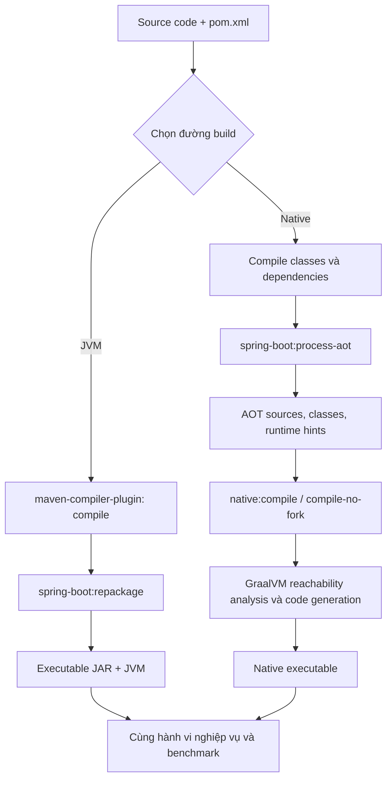

# Spring Boot Maven plugin và GraalVM Native Build Tools Maven plugin

## 1. Hai plugin giải quyết hai phần việc khác nhau

Trong module **SPRING_BOOT_NATIVE_IMAGE**, mục tiêu là biên dịch ứng dụng Spring Boot thành **GraalVM Native Image** thông qua **Spring AOT**, sau đó kiểm tra mức cải thiện về thời gian khởi động, sử dụng bộ nhớ và khả năng tương thích. Với một dự án Maven, hai plugin thường xuất hiện cùng nhau:

- **Spring Boot Maven plugin** (`org.springframework.boot:spring-boot-maven-plugin`) quản lý các tác vụ đặc thù của Spring Boot: chạy ứng dụng, đóng gói executable JAR, xử lý AOT và xây dựng container image bằng buildpacks.
- **GraalVM Native Build Tools Maven plugin** (`org.graalvm.buildtools:native-maven-plugin`) kết nối Maven với công cụ `native-image` của GraalVM, nhận đầu vào sau khi xử lý AOT và biên dịch executable native.

Plugin thứ nhất hiểu cách Spring Boot chuẩn bị `ApplicationContext`, bean và các runtime hint; plugin thứ hai điều phối phần biên dịch của GraalVM. Cần có **đúng cấu hình Maven lifecycle** để hai bước diễn ra theo thứ tự. Thêm dependency Java thông thường không tự động bật toàn bộ quy trình.

### Mục tiêu sau bài học

Bạn sẽ biết cách phân biệt trách nhiệm của từng plugin, cấu hình `pom.xml` với Spring Boot Starter Parent hoặc parent riêng, gọi đúng Maven goal, đọc đầu ra AOT/native, chạy bản JVM và native để so sánh, đồng thời nhận diện lỗi về reflection/resource/proxy và lỗi CI.

## 2. Từ mã nguồn Java đến native executable



Ở nhánh native, Spring AOT phân tích các cấu hình/bean mà nó có thể biết tại build time, sinh code khởi tạo và đóng góp metadata về reflection, Java dynamic proxy, resource, serialization hoặc JNI. GraalVM tiếp tục sử dụng những kết quả đó để phân tích khả năng truy cập (*reachability analysis*) và biên dịch executable cho **hệ điều hành cùng kiến trúc CPU mục tiêu**.

| Thành phần | Đầu vào chính | Kết quả |
| --- | --- | --- |
| `maven-compiler-plugin` | Source Java và classpath | File `.class` |
| `spring-boot:repackage` | JAR và dependency | Executable JAR chạy được với `java -jar` |
| `spring-boot:process-aot` | Bean definitions, cấu hình và classpath ứng dụng | Mã khởi tạo được sinh, runtime hints, dữ liệu AOT |
| `native:compile` | Project Maven và chuỗi build cần thiết | Native executable; goal này **fork** phần Maven lifecycle cần thiết |
| `native:compile-no-fork` | Các đầu vào đã chuẩn bị trong lifecycle hiện hành | Native executable, dùng khi goal đã được ràng buộc vào lifecycle |
| `spring-boot:build-image` | Ứng dụng và builder image phù hợp | OCI container image qua Cloud Native Buildpacks |

**Không nhầm `compile` của Maven với `native:compile`.** `mvn compile` biên dịch Java thành bytecode; `native:compile` là goal của GraalVM Native Build Tools để tạo binary native. Tương tự, `spring-boot:process-aot` chỉ chuẩn bị AOT, **chưa tự tạo executable native**.

## 3. Chuẩn bị công cụ và dự án Maven

### 3.1. Yêu cầu môi trường

Để thực hành, chọn một **bộ phiên bản tương thích** của Spring Boot, Java và GraalVM. Ví dụ bên dưới dùng Spring Boot **3.5.0** và Java **21** làm mốc minh họa; đây không phải khẳng định về phiên bản mới nhất hoặc phiên bản mọi dự án phải dùng. Kiểm tra hướng dẫn tương thích của đúng phiên bản Spring Boot/GraalVM trong môi trường thực tế.

Máy biên dịch cần:

1. JDK/GraalVM với `native-image` có thể gọi được, và cấu hình `JAVA_HOME`/`PATH` nhất quán.
2. Maven hoặc Maven Wrapper của dự án (`mvnw`/`mvnw.cmd`).
3. C/C++ compiler, linker, native library/header mà GraalVM yêu cầu trên hệ điều hành build.
4. CPU, RAM và dung lượng đĩa phù hợp: phân tích và biên dịch Native Image có thể cần nhiều tài nguyên hơn build JAR.

Kiểm tra môi trường trên Linux/macOS:

```bash
java -version
javac -version
native-image --version
./mvnw -version
```

Trên Windows PowerShell, lệnh Maven Wrapper tương ứng là `.\mvnw.cmd -version`. Với Windows, GraalVM Native Image còn yêu cầu bộ công cụ native/linker được phiên bản GraalVM hỗ trợ; với Linux cần compiler và thư viện phát triển tương ứng. Nếu `native-image --version` lỗi, xử lý toolchain trước khi chẩn đoán plugin Maven.

### 3.2. Ứng dụng REST tối thiểu

Các mẫu Maven dưới đây giả định ứng dụng có package `com.example.demo`, artifact `hello-native`, và một endpoint đơn giản:

```java
package com.example.demo;

import java.util.Map;
import org.springframework.boot.SpringApplication;
import org.springframework.boot.autoconfigure.SpringBootApplication;
import org.springframework.web.bind.annotation.GetMapping;
import org.springframework.web.bind.annotation.RestController;

@SpringBootApplication
@RestController
public class DemoApplication {
    public static void main(String[] args) {
        SpringApplication.run(DemoApplication.class, args);
    }

    @GetMapping("/hello")
    public Map<String, String> hello() {
        return Map.of("message", "Hello Native");
    }
}
```

File nằm tại `src/main/java/com/example/demo/DemoApplication.java`. `GET /hello` sẽ là phép kiểm tra chức năng đầu tiên: cả bản JAR/JVM và Native Image phải trả JSON có nội dung tương đương. Đừng thêm database, giao tiếp ngoài hoặc thư viện dùng reflection động vào bài khởi đầu nếu chưa có baseline hoạt động.

## 4. Cấu hình phổ biến: dùng Spring Boot Starter Parent

### 4.1. `pom.xml` minh họa

Trong phần lớn ứng dụng tạo theo mẫu Spring Boot có `spring-boot-starter-parent`, parent cung cấp dependency management, plugin management và các profile build cần thiết cho quy trình chuẩn. Khai báo rõ **cả Spring Boot Maven plugin và Native Build Tools plugin**:

```xml
<?xml version="1.0" encoding="UTF-8"?>
<project xmlns="http://maven.apache.org/POM/4.0.0"
         xmlns:xsi="http://www.w3.org/2001/XMLSchema-instance"
         xsi:schemaLocation="http://maven.apache.org/POM/4.0.0
             https://maven.apache.org/xsd/maven-4.0.0.xsd">
    <modelVersion>4.0.0</modelVersion>

    <parent>
        <groupId>org.springframework.boot</groupId>
        <artifactId>spring-boot-starter-parent</artifactId>
        <version>3.5.0</version>
        <relativePath/>
    </parent>

    <groupId>com.example</groupId>
    <artifactId>hello-native</artifactId>
    <version>0.0.1-SNAPSHOT</version>
    <name>hello-native</name>

    <properties>
        <java.version>21</java.version>
    </properties>

    <dependencies>
        <dependency>
            <groupId>org.springframework.boot</groupId>
            <artifactId>spring-boot-starter-web</artifactId>
        </dependency>
        <dependency>
            <groupId>org.springframework.boot</groupId>
            <artifactId>spring-boot-starter-test</artifactId>
            <scope>test</scope>
        </dependency>
    </dependencies>

    <build>
        <plugins>
            <plugin>
                <groupId>org.springframework.boot</groupId>
                <artifactId>spring-boot-maven-plugin</artifactId>
            </plugin>
            <plugin>
                <groupId>org.graalvm.buildtools</groupId>
                <artifactId>native-maven-plugin</artifactId>
            </plugin>
        </plugins>
    </build>
</project>
```

Trong mẫu này, **không viết version plugin bằng cách đoán**: Spring Boot Starter Parent quản lý các plugin được hỗ trợ trong phiên bản đang dùng. Nếu tổ chức có chính sách khóa phiên bản plugin khác, cần xác minh chúng tương thích và kiểm tra **effective POM** trước khi build.

Maven plugin thực thi khác Maven dependency:

- Plugin phải nằm dưới `<build><plugins>...` để Maven thực thi goal.
- Dependency `spring-boot-starter-web` thuộc `<dependencies>`, cung cấp thư viện runtime/compile cho ứng dụng.
- Khai báo một plugin trong `pluginManagement` chỉ định **cách quản lý plugin**; nếu muốn kích hoạt plugin từ cấu hình đó, vẫn cần bảo đảm plugin được áp dụng và các execution được ràng buộc đúng.
- `<parent>` quy định parent POM trong Maven; `<dependencyManagement>` chỉ kiểm soát phiên bản dependency và **không tự thay thế** các cấu hình plugin/lifecycle từ parent.

### 4.2. Kiểm tra profile native trong effective POM

Với Spring Boot Starter Parent, profile tên `native` được cấu hình để phối hợp xử lý Spring AOT và native compilation. Lệnh kích hoạt Maven profile dùng **chữ hoa `-P`**:

```bash
./mvnw help:active-profiles -Pnative
./mvnw help:effective-pom -Pnative
```

Khi kiểm tra kết quả, hãy xác nhận:

1. Profile `native` thực sự được kích hoạt (không phải một tên profile tự đặt nhưng chưa định nghĩa).
2. Goal `spring-boot:process-aot` xuất hiện trong cấu hình build phù hợp.
3. `native-maven-plugin` có phiên bản hợp lệ và execution/native goal như dự định.
4. Maven dùng đúng JDK/GraalVM và mục tiêu Java được khai báo.

**Lưu ý:** `-Pnative` kích hoạt **Maven profile**, không phải tùy chọn “bật Native Image” chung cho mọi dự án. Với parent riêng, profile này có thể chưa tồn tại, dù một plugin native đã được khai báo.

## 5. Build và chạy: JAR/JVM so với Native Image

### 5.1. Tạo baseline JAR

```bash
./mvnw clean package
java -jar target/hello-native-0.0.1-SNAPSHOT.jar
```

Mở terminal khác để kiểm tra:

```bash
curl -fsS http://localhost:8080/hello
# Dự kiến: {"message":"Hello Native"}
```

Chạy JAR trước giúp tách lỗi ứng dụng Spring Boot thông thường khỏi lỗi chỉ xuất hiện khi biên dịch hoặc chạy native. Nếu JAR chưa hoạt động, cần giải quyết chức năng trước khi chuyển sang Native Image.

### 5.2. Gọi Native Build Tools

Với project kế thừa Starter Parent và đã thêm hai plugin như trên:

```bash
./mvnw -Pnative native:compile
```

Giải thích từng phần:

- `./mvnw` dùng phiên bản Maven được wrapper dự án cấu hình.
- `-Pnative` kích hoạt profile chuẩn của Spring Boot Starter Parent và cấu hình xử lý AOT.
- `native:compile` là goal của GraalVM Native Build Tools; nó phối hợp các đầu vào Maven cần thiết rồi chạy trình biên dịch `native-image`.

Bạn cũng có thể kích hoạt quá trình build theo lifecycle nếu **effective POM** đã ràng buộc native compilation vào phase thích hợp:

```bash
./mvnw -Pnative package
```

Kết quả của `package` phụ thuộc cấu hình execution cụ thể; hãy kiểm tra output và log thay vì khẳng định rằng mọi POM có profile `native` đều tạo native binary bằng lệnh này. Đối với bài thực hành, `-Pnative native:compile` là lệnh dễ hiểu và thường dùng khi cấu hình theo Spring Boot Starter Parent.

Khi build thành công, executable thường được tạo trong `target/`. Tên dựa trên artifact và thiết lập Native Build Tools; ở ví dụ có thể là `target/hello-native` (hoặc `target/hello-native.exe` trên Windows). Tên/đường dẫn thực tế là kết quả trong log build, không nên ghi cứng nếu dự án đã đổi `imageName`.

```bash
# Sau khi đóng tiến trình JVM:
./target/hello-native

# Từ terminal khác:
curl -fsS http://localhost:8080/hello
```

Không chạy hai bản trên cùng port đồng thời. Nếu cần so sánh tự động, cấu hình port khác nhau và đảm bảo request, profile, DB/cache cùng điều kiện. Native executable không cần JVM cài trên máy chạy, nhưng vẫn phụ thuộc các thư viện native và nền tảng OS/CPU phù hợp.

### 5.3. Mục đích của `compile` và `compile-no-fork`

Trong GraalVM Native Build Tools Maven plugin:

| Goal | Khi dùng | Điểm cần chú ý |
| --- | --- | --- |
| `native:compile` | Chạy trực tiếp từ CLI để build native | Có thể fork phần Maven lifecycle cần thiết; dùng trong ví dụ Starter Parent |
| `native:compile-no-fork` | Ràng buộc như execution vào phase `package` trong POM | Không tự fork lifecycle; các phase trước phải đã chuẩn bị AOT/classes đầy đủ |
| `spring-boot:process-aot` | Sinh code và metadata Spring AOT | Chỉ làm bước AOT, chưa tạo binary |
| `spring-boot:repackage` | Đóng gói JAR chạy JVM | Không biên dịch Native Image |

Nếu tự ràng buộc `native:compile` vào một Maven phase rồi nó fork lại lifecycle, có thể xuất hiện các vòng build lặp hoặc chạy goal ngoài ý muốn. Trong execution gắn lifecycle, thông thường dùng **`compile-no-fork`** và đảm bảo `process-aot` chạy trước. Với `native:compile` gọi trực tiếp, hãy để plugin thực hiện phần lifecycle cần thiết theo cấu hình đang dùng.

## 6. Dự án không kế thừa Spring Boot Starter Parent

Nhiều tổ chức dùng parent POM riêng hoặc chỉ import BOM:

```xml
<dependencyManagement>
    <dependencies>
        <dependency>
            <groupId>org.springframework.boot</groupId>
            <artifactId>spring-boot-dependencies</artifactId>
            <version>3.5.0</version>
            <type>pom</type>
            <scope>import</scope>
        </dependency>
    </dependencies>
</dependencyManagement>
```

Import BOM giúp quản lý **dependency versions** nhưng không tự đem toàn bộ **plugin management và native profile** của `spring-boot-starter-parent` vào dự án. Khi không dùng Starter Parent, cần cấu hình rõ `spring-boot-maven-plugin`, `native-maven-plugin`, phiên bản của chúng và execution/lifecycle.

Một cách tổ chức là đặt phần tích hợp AOT/native vào profile chỉ bật khi cần build native. Ví dụ sau là **khung cấu hình cho phần plugin/profile**; ghép vào `pom.xml` có parent riêng và cấu hình đầy đủ Java compiler, dependencies, `spring-boot:repackage` phù hợp ứng dụng:

```xml
<profiles>
    <profile>
        <id>native</id>
        <build>
            <plugins>
                <plugin>
                    <groupId>org.springframework.boot</groupId>
                    <artifactId>spring-boot-maven-plugin</artifactId>
                    <version>3.5.0</version>
                    <executions>
                        <execution>
                            <id>process-aot</id>
                            <phase>process-classes</phase>
                            <goals>
                                <goal>process-aot</goal>
                            </goals>
                        </execution>
                    </executions>
                </plugin>
                <plugin>
                    <groupId>org.graalvm.buildtools</groupId>
                    <artifactId>native-maven-plugin</artifactId>
                    <version>0.10.6</version>
                    <executions>
                        <execution>
                            <id>build-native</id>
                            <phase>package</phase>
                            <goals>
                                <goal>compile-no-fork</goal>
                            </goals>
                        </execution>
                    </executions>
                </plugin>
            </plugins>
        </build>
    </profile>
</profiles>
```

Với kiểu cấu hình này, một lệnh minh họa là:

```bash
./mvnw -Pnative clean package
```

**Cần kiểm tra phiên bản plugin và effective POM** vì parent riêng có thể định nghĩa execution `repackage`, các goal AOT hoặc lifecycle không trùng với ví dụ. Các phiên bản ở trên là mốc minh họa, phải thống nhất với bộ Spring Boot và GraalVM/Native Build Tools thực tế. Khi `process-aot` và `compile-no-fork` chạy trong lifecycle, đừng gọi thêm `native:compile` mà chưa hiểu các goal nào đã được thực thi: có thể biên dịch lặp và gây tốn CI.

Nếu dùng aggregator/multi-module Maven, khai báo plugin ở **module ứng dụng Spring Boot** (module chứa main class và runtime classpath phù hợp). Không tự bật native compilation cho mọi module thư viện. Với nhiều `main` class, cấu hình lựa chọn main class của Spring Boot/Native Build Tools nhất quán trước khi build.

## 7. Quan sát Spring AOT và Native Image output

### 7.1. Generated source và runtime hints

Spring AOT có thể sinh Java source để xây dựng `ApplicationContext` và bean, cùng runtime metadata cho:

- **Reflection:** constructor, method, field được chọn động.
- **JDK dynamic proxy:** tập interface sẽ được hiện thực bởi `java.lang.reflect.Proxy`.
- **Resource:** tệp classpath, resource bundle hoặc resource pattern cần đưa vào binary.
- **Serialization/JNI:** những trường hợp có cơ chế truy cập đặc biệt.

Với Maven, output AOT thường ở những nhánh dưới `target/` như `target/spring-aot/`, tuy đường dẫn và cách phân chia source/resource/classes thay đổi theo phiên bản Spring Boot plugin. Hãy xác minh từ log và nội dung build thực tế. **Không sửa generated source hay metadata trong `target`** vì lần build sau sẽ tạo lại.

Tại sao metadata quan trọng? JVM cho phép nhiều trường hợp tạo proxy, tìm lớp hoặc đọc resource động ở runtime. GraalVM Native Image cần thông tin trước để phân tích và đưa những thành phần liên quan vào executable. AOT giúp lấp khoảng trống này, nhưng không thể tự biết mọi đường đi dựa trên chuỗi runtime hoặc plugin được tải sau khi build.

### 7.2. Ví dụ bổ sung resource và reflection hints

Giả sử ứng dụng đọc `src/main/resources/rules/pricing.json` và dùng reflection gọi constructor của `PricingRule` (cả hai phải thật sự tồn tại trong project). Một `RuntimeHintsRegistrar` có thể khai báo:

```java
package com.example.demo;

import org.springframework.aot.hint.MemberCategory;
import org.springframework.aot.hint.RuntimeHints;
import org.springframework.aot.hint.RuntimeHintsRegistrar;
import org.springframework.context.annotation.Configuration;
import org.springframework.context.annotation.ImportRuntimeHints;

@Configuration(proxyBeanMethods = false)
@ImportRuntimeHints(ExtraNativeHints.class)
class NativeHintsConfiguration {
}

final class ExtraNativeHints implements RuntimeHintsRegistrar {

    @Override
    public void registerHints(RuntimeHints hints, ClassLoader classLoader) {
        hints.resources().registerPattern("rules/pricing.json");
        hints.reflection().registerType(
            PricingRule.class,
            MemberCategory.INVOKE_DECLARED_CONSTRUCTORS
        );
    }
}
```

Với một JDK proxy dùng interface được biết trước, có thể dùng:

```java
hints.proxies().registerJdkProxy(RatePort.class);
```

Đây là ví dụ **cho một interface `RatePort` tồn tại trong ứng dụng**. Không thêm dòng này khi ứng dụng không có interface đó; các thư viện Spring đã tương thích native có thể tự cung cấp hints. Hãy xác định đúng loại lỗi trước khi đăng ký: reflection hint không tự nhúng tệp JSON, resource hint không đăng ký JDK proxy, và JDK proxy hint không đảm bảo một thư viện có thể sinh subclass bytecode tùy ý sau khi native image đã được build.

## 8. Native tests và kiểm chứng tương thích

Một build Native Image thành công chỉ chứng minh executable đã được tạo. Nhiều lỗi xuất hiện **khi thực thi nhánh ít gặp**, chẳng hạn serializer dùng reflection, resource cần đọc ở locale cụ thể hoặc thư viện tạo proxy động.

Quy trình tối thiểu:

1. **Build JVM baseline:** chạy test và `GET /hello` ở JAR trên cùng commit.
2. **Build native:** lưu phiên bản công cụ, thời gian/peak RAM và log build.
3. **Smoke test binary:** chạy `/hello` rồi so status/body JSON với JVM.
4. **Test nhánh động:** endpoint dùng reflection, resource, proxy, transaction, serialization hoặc DB (nếu dự án có).
5. **Test trong môi trường container thật:** kiểm tra OS/kiến trúc, libc, chứng chỉ, biến môi trường và profile.

GraalVM Native Build Tools cung cấp chức năng chạy kiểm thử dưới dạng native executable, nhưng Maven `native:test` và các profile/test execution phải được cấu hình đúng theo dự án. Có thể gặp quy trình có profile `nativeTest`, song **không giả định** Starter Parent hoặc parent tùy biến nào cũng tạo sẵn profile tên đó. Kiểm tra effective POM và mục tiêu test trước khi dùng trong CI.

### So sánh chi phí một cách công bằng

| Phép đo | Chế độ JVM | Chế độ Native Image | Điều kiện giữ giống nhau |
| --- | --- | --- | --- |
| Thời gian build | `clean package` | `-Pnative native:compile` | Cache, test policy, CPU/RAM runner |
| RAM peak lúc build | Maven/JDK build | GraalVM analysis/compiler | Runner/cgroup và công cụ đo |
| Startup đến sẵn sàng | `java -jar` | Native executable | Profile, DB/cache, readiness |
| Bộ nhớ sau startup | RSS/process/container | RSS/process/container | Tải nền, memory limit |
| Độ trễ và throughput | Sau JVM warm-up | Sau native warm-up phù hợp | RPS, concurrency, endpoint, dataset |
| Tương thích | Kết quả nghiệp vụ baseline | Kết quả nghiệp vụ native | Cùng đầu vào và hành vi mong đợi |

Native Image thường có lợi về cold start và có thể giảm memory footprint, nhưng native compilation tốn thêm thời gian, CPU/RAM; ở workload dài, JVM JIT có thể đạt thông lượng tốt hơn. Không rút ra kết luận từ một lần build, một request hoặc một chỉ số RSS đơn lẻ.

## 9. Đóng gói container với Maven: đường build liên quan nhưng riêng biệt

Ngoài goal tạo native executable ngay trên host, **Spring Boot Maven plugin** có goal `spring-boot:build-image` dùng Cloud Native Buildpacks để tạo OCI image. Nếu builder/buildpacks hỗ trợ GraalVM Native Image, có thể yêu cầu native build bằng biến môi trường `BP_NATIVE_IMAGE=true`.

Ví dụ cấu hình bên trong `spring-boot-maven-plugin`:

```xml
<plugin>
    <groupId>org.springframework.boot</groupId>
    <artifactId>spring-boot-maven-plugin</artifactId>
    <configuration>
        <image>
            <name>hello-native:local</name>
            <env>
                <BP_NATIVE_IMAGE>true</BP_NATIVE_IMAGE>
            </env>
        </image>
    </configuration>
</plugin>
```

Với Docker daemon và builder image phù hợp:

```bash
./mvnw spring-boot:build-image
docker run --rm -p 8080:8080 hello-native:local
```

Đây là **một phương án build riêng** với `native:compile`: builder có toolchain và quy trình Native Image của nó. Lưu ý kiểm tra log để bảo đảm image kết quả thực sự chứa native executable. Không coi một image tạo bằng `spring-boot:build-image` mặc định là native khi chưa bật/có hỗ trợ native build.

Nếu dựng Dockerfile đa giai đoạn và copy binary do `native:compile` tạo ra, hãy đối chiếu hệ điều hành/kiến trúc, cách liên kết thư viện và chứng chỉ CA của binary với runtime base image. Native executable không yêu cầu JVM tại runtime nhưng **không chạy tùy ý trên mọi OS, libc hoặc kiến trúc CPU**.

## 10. Khắc phục lỗi Maven Native Build thường gặp

| Hiện tượng | Nguyên nhân cần kiểm tra | Hành động phù hợp |
| --- | --- | --- |
| `No plugin found for prefix 'native'` | Thiếu `native-maven-plugin`, plugin không được phân giải | Kiểm tra plugin declaration, repositories và effective POM |
| `The requested profile "native" could not be activated` | Parent/profile chưa định nghĩa hoặc tên khác | Kiểm tra active profiles; cấu hình profile native rõ ràng |
| `spring-boot:process-aot` không chạy | Goal chưa được ràng buộc hoặc profile chưa bật | Xem effective POM, lifecycle và execution ID |
| Lỗi linker/C compiler | Native toolchain thiếu hoặc sai hệ điều hành | Kiểm tra `native-image --version` và native compiler/linker |
| Native build hết RAM | Reachability analysis/compiler tốn RAM hoặc CI quota nhỏ | Tăng RAM runner, giới hạn job song song, đọc log OOM |
| Class/constructor không truy cập được bằng reflection | Thiếu runtime metadata cho thao tác động | Đăng ký hint đúng member, chạy lại case gây lỗi |
| Classpath resource không tồn tại | Resource chưa được đưa vào image hoặc sai đường dẫn | Kiểm tra `src/main/resources` và resource hint |
| Proxy không được tạo | Thiếu JDK proxy metadata hoặc class-based proxy không hỗ trợ | Phân biệt JDK proxy với subclass proxy, kiểm tra thư viện |
| Native chạy khác JVM theo profile | Bean graph/`@Conditional` đã được xử lý khi build | Đối chiếu build-time và runtime configuration |
| `native:compile` chạy hai lần trong một build | Vừa gắn compile vào lifecycle vừa gọi goal thủ công | Chọn một đường gọi, kiểm tra executions bằng effective POM |
| Nhiều main classes làm build chọn sai | Main class không được cấu hình nhất quán | Xác định Spring Boot main class và native entrypoint |
| Binary lỗi trong container | Khác OS/CPU, libc, thư viện hoặc CA | Build/test trên target tương thích, kiểm tra runtime image |

### Cách đọc lỗi theo đúng giai đoạn

- **Maven model/profile error:** xảy ra trước compile; kiểm tra parent, dependency/plugin management và profile.
- **Spring AOT processing error:** thường liên quan điều kiện bean, bean graph, cấu hình phải biết lúc build.
- **GraalVM analysis/compile error:** kiểm tra metadata, dynamic features, linker và tài nguyên CI.
- **Runtime error của binary:** gọi đúng luồng lỗi; xác định reflection/resource/proxy/serialization và cấu hình môi trường.

Không giải quyết tất cả lỗi native bằng cách mở rộng reflection cho mọi class. Điều đó không sửa lỗi linker, sai profile, thiếu file ngoài filesystem hoặc runtime bytecode generation. Thu hẹp trường hợp lỗi, thêm metadata chính xác và đưa luồng đó vào native integration test.

## 11. Thực hành: tự xác minh vai trò hai Maven plugin

**Yêu cầu:** Tạo ứng dụng `hello-native` hoặc dùng ứng dụng Spring Boot có endpoint đơn giản, cấu hình **hai plugin Maven**, build theo cả đường JVM và native rồi ghi lại bằng chứng.

1. **Kiểm tra công cụ:** ghi `java -version`, `native-image --version` và `./mvnw -version`. Xác định OS/CPU đích.
2. **Đọc effective POM:** xác nhận `spring-boot-maven-plugin`, `native-maven-plugin` và profile `native` thực sự có hiệu lực.
3. **Build JVM:** chạy `./mvnw clean package`; gọi `/hello`, lưu status/response.
4. **Build native:** chạy `./mvnw -Pnative native:compile` với Starter Parent hoặc `./mvnw -Pnative clean package` nếu đã tự ràng buộc `compile-no-fork` đúng lifecycle.
5. **Quan sát AOT:** tìm Java source, resource và metadata được sinh trong build output.
6. **Kiểm thử binary:** chạy executable và gọi cùng endpoint; kiểm tra response, lỗi và thời gian sẵn sàng.
7. **Nếu có tính năng động:** thêm một resource hoặc thao tác reflection thực, khai báo `RuntimeHints` khi cần rồi thử lại trên native.
8. **Đánh giá:** so thời gian build, startup, RSS và p95 trong cùng điều kiện tải; ghi chi phí compatibility/CI thực tế.

| Bằng chứng | Tiêu chí đạt |
| --- | --- |
| `pom.xml` và effective POM | Có đúng hai plugin, profile/goal được cấu hình đúng |
| Build log JVM | JAR chạy được và test cơ bản PASS |
| Build log native | Spring AOT và native-image thực hiện thành công |
| Artifact | Có executable cho OS/CPU đích |
| HTTP smoke test | JAR và native trả cùng kết quả nghiệp vụ |
| Runtime hints (nếu có) | Chỉ bổ sung metadata cho trường hợp được chứng minh cần |
| Bảng đo | Có phương pháp đo, cùng điều kiện và ghi rõ cấu hình |

**Câu hỏi tự kiểm tra:**

- Nếu `native-maven-plugin` đã có trong `pom.xml` nhưng `spring-boot:process-aot` không được gọi, điều gì có thể xảy ra khi Native Image phân tích một ứng dụng Spring?
- Vì sao `-Pnative` có thể hoạt động với Spring Boot Starter Parent nhưng bị bỏ qua trong một dự án chỉ import `spring-boot-dependencies` BOM?
- Khi `native:compile-no-fork` được gắn với `package`, vì sao không nên gọi thêm `native:compile` trong cùng lệnh nếu không kiểm tra executions?
- Tại sao một executable tạo thành công vẫn cần kiểm thử nhánh reflection, resource và proxy thực tế?

## 12. Tổng kết

**Spring Boot Maven plugin** phụ trách các công đoạn Spring Boot như `repackage`, xử lý `process-aot` và `build-image`; **GraalVM Native Build Tools Maven plugin** phụ trách điều phối GraalVM `native-image` thông qua `native:compile` hoặc `native:compile-no-fork`. Khi dùng **Spring Boot Starter Parent**, profile `native` đơn giản hóa việc nối hai plugin. Khi dùng parent riêng, phải định nghĩa phiên bản, profile và execution/lifecycle một cách tường minh, rồi xác minh bằng effective POM.

Kết quả mong muốn là **cùng một ứng dụng chạy đúng trên JVM và native executable**, với log build rõ ràng, test tương thích đầy đủ và phép đo startup/bộ nhớ công bằng. Sự phối hợp đúng giữa hai Maven plugin là nền tảng để tiếp tục cấu hình reflection/resource, kiểm thử native, tạo container image và vận hành ứng dụng Spring Boot bằng GraalVM Native Image.
