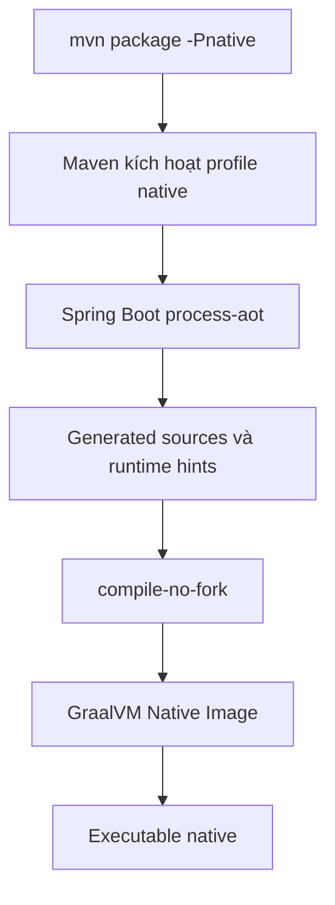

# Profile native khi dùng spring-boot-starter-parent

## 1. Mục tiêu của Maven profile native

Trong module **SPRING_BOOT_NATIVE_IMAGE**, ứng dụng Spring Boot được chuẩn bị bằng Spring AOT rồi biên dịch thành GraalVM Native Image để đánh giá startup, bộ nhớ, tương thích và vận hành. Khi dự án dùng **`spring-boot-starter-parent`**, có thể khai báo một Maven profile tên `native` để gom cấu hình chỉ phục vụ build native.

Maven profile giúp tách các plugin execution, build arguments và thiết lập native khỏi vòng đời build JVM thông thường. Khi profile không được kích hoạt, dự án vẫn có thể build và chạy executable JAR trên JVM. Khi kích hoạt `-Pnative`, Maven chạy thêm pha Spring AOT và GraalVM Native Image theo cấu hình đã khai báo.

Điểm cần nắm:

- **Spring Boot Maven Plugin** chạy goal `process-aot` để phân tích application context và sinh mã/hints AOT.
- **GraalVM Native Build Tools Maven Plugin** chạy goal `compile-no-fork` để gọi Native Image compiler với classpath và output phù hợp.
- **Maven profile `native`** gom các execution này vào một lựa chọn build rõ ràng.
- **`spring-boot-starter-parent`** cung cấp dependency/plugin management và cấu hình mặc định hữu ích; nó không tự cài GraalVM, compiler C hay linker cho máy build.

Tên profile `native` không phải từ khóa bắt buộc của Maven. Đó là ID do dự án đặt; tên khác cũng có thể hoạt động nếu gọi đúng `-P<profile>`.

## 2. Quan hệ giữa parent POM, plugin management và profile

Một dự án Maven Spring Boot thường có cấu trúc:

```text
project
├── pom.xml
├── src/main/java
├── src/main/resources
└── target/
```

Parent POM thường khai báo như sau:

```xml
<parent>
    <groupId>org.springframework.boot</groupId>
    <artifactId>spring-boot-starter-parent</artifactId>
    <version>${spring-boot.version}</version>
    <relativePath/>
</parent>
```

`spring-boot-starter-parent` cung cấp dependency management, plugin management và các thiết lập Maven phổ biến cho Spring Boot. Tuy nhiên cần phân biệt:

| Khái niệm | Ý nghĩa |
|---|---|
| `parent` | Kế thừa cấu hình mặc định từ Spring Boot |
| `dependencyManagement` | Quản lý version dependency mà không nhất thiết tự thêm dependency |
| `pluginManagement` | Quản lý version/cấu hình mặc định của plugin; plugin vẫn cần được khai báo để thực thi |
| `build/plugins` | Khai báo plugin tham gia build |
| `profiles/profile` | Bật/tắt một nhóm cấu hình theo ID profile |

Không nên giả định parent đã quản lý mọi version của GraalVM Native Build Tools ở mọi phiên bản Spring Boot. Kiểm tra effective POM để biết plugin version thực tế và khai báo version rõ ràng nếu dependency/plugin management của dự án không cung cấp.

## 3. Ví dụ cấu hình profile native

Đây là ví dụ minh họa cho dự án dùng Spring Boot parent, Spring Boot Maven Plugin và GraalVM Native Build Tools Maven Plugin. Version Spring Boot, Java và Native Build Tools phải được chọn tương thích với nhau.

```xml
<project>
    <modelVersion>4.0.0</modelVersion>

    <parent>
        <groupId>org.springframework.boot</groupId>
        <artifactId>spring-boot-starter-parent</artifactId>
        <version>${spring-boot.version}</version>
        <relativePath/>
    </parent>

    <groupId>com.example</groupId>
    <artifactId>native-demo</artifactId>
    <version>0.0.1-SNAPSHOT</version>

    <properties>
        <java.version>21</java.version>
        <native-build-tools.version>${native.build.tools.version}</native-build-tools.version>
    </properties>

    <dependencies>
        <dependency>
            <groupId>org.springframework.boot</groupId>
            <artifactId>spring-boot-starter-web</artifactId>
        </dependency>
    </dependencies>

    <build>
        <plugins>
            <plugin>
                <groupId>org.springframework.boot</groupId>
                <artifactId>spring-boot-maven-plugin</artifactId>
            </plugin>
        </plugins>
    </build>

    <profiles>
        <profile>
            <id>native</id>
            <build>
                <plugins>
                    <plugin>
                        <groupId>org.springframework.boot</groupId>
                        <artifactId>spring-boot-maven-plugin</artifactId>
                        <executions>
                            <execution>
                                <id>process-aot</id>
                                <goals>
                                    <goal>process-aot</goal>
                                </goals>
                            </execution>
                        </executions>
                    </plugin>

                    <plugin>
                        <groupId>org.graalvm.buildtools</groupId>
                        <artifactId>native-maven-plugin</artifactId>
                        <version>${native-build-tools.version}</version>
                        <extensions>true</extensions>
                        <executions>
                            <execution>
                                <id>build-native</id>
                                <goals>
                                    <goal>compile-no-fork</goal>
                                </goals>
                            </execution>
                        </executions>
                    </plugin>
                </plugins>
            </build>
        </profile>
    </profiles>
</project>
```

Các property `${spring-boot.version}` và `${native.build.tools.version}` là placeholder để minh họa cách quản lý tập trung; phải thay bằng version hợp lệ hoặc định nghĩa property tương ứng. Không copy nguyên XML nếu chưa chọn version. Ví dụ cũng lược bỏ các dependency test, repository và cấu hình khác của ứng dụng thực tế.

Với các bản Spring Boot/plugin khác nhau, cách cấu hình tích hợp có thể được cập nhật. Hãy đối chiếu tài liệu của **đúng phiên bản Spring Boot và Native Build Tools** trước khi chốt POM. Tránh trộn snippet từ nhiều thế hệ plugin.

## 4. Tại sao cần cả process-aot và compile-no-fork?

Hai goal đảm nhiệm hai pha khác nhau.

### process-aot

Goal `process-aot` của Spring Boot Maven Plugin chuẩn bị ứng dụng Spring. Nó tạo output AOT như mã đăng ký bean/khởi tạo context và runtime hints. Các quyết định cấu hình có thể được đánh giá ở thời điểm build, do đó profile/property sử dụng cho AOT cần phản ánh môi trường cấu hình dự kiến.

### compile-no-fork

Goal `compile-no-fork` của Native Build Tools Maven Plugin gọi Native Image compiler trong Maven lifecycle hiện tại, không fork một Maven build khác. Nó sử dụng output/classpath native đã chuẩn bị để thực hiện reachability analysis, biên dịch mã máy và linking.



Thứ tự thực thi và input thực tế còn phụ thuộc plugin integration/version. Chỉ thêm hai goal vào POM không tự động bảo đảm mọi phiên bản phối hợp đúng; cấu hình mẫu chính thức của phiên bản đang dùng là chuẩn đối chiếu.

## 5. Kích hoạt profile bằng Maven

Sau khi cấu hình GraalVM JDK/Native Image và toolchain hệ điều hành phù hợp, chạy:

```bash
./mvnw -Pnative native:compile
```

Lệnh này kích hoạt profile `native` và gọi goal Native Build Tools. Trong cấu hình có execution gắn với Maven lifecycle, cũng có thể dùng:

```bash
./mvnw -Pnative package
```

Cách thứ hai chạy lifecycle đến `package`, bao gồm các execution đã được gắn vào lifecycle và dependency giữa các plugin. Nếu POM chỉ khai báo goal mà không có execution/phase phù hợp, gọi `package` có thể không chạy native build như kỳ vọng.

Một số cấu hình tích hợp hoặc phiên bản plugin khuyến nghị `native:compile`, `native:compile-no-fork` hoặc `package` theo cách khác nhau. Hãy xem POM và tài liệu phiên bản đang dùng; không hoán đổi goal tùy ý.

Với Maven Wrapper, version Maven được kiểm soát qua wrapper configuration của dự án. Để xác nhận profile được kích hoạt:

```bash
./mvnw help:active-profiles -Pnative
```

Để xem effective POM:

```bash
./mvnw help:effective-pom -Pnative
```

Từ effective POM, kiểm tra plugin, execution, goal, phase và version thực tế sau khi kế thừa parent/profile. Đây là cách tốt để phát hiện cấu hình bị override hoặc plugin không được khai báo ở vị trí mong muốn.

## 6. Giữ riêng build JVM và native

Thông thường có hai cách build chính:

| Mục đích | Lệnh ví dụ | Kết quả |
|---|---|---|
| Build executable JAR | `./mvnw clean package` | JAR chạy bằng JVM |
| Build native qua goal | `./mvnw -Pnative native:compile` | Executable native |
| Build lifecycle package với profile | `./mvnw -Pnative package` | Artifact theo execution/phase trong POM |

Khi so sánh JVM và native, lưu ý build native có thể cũng tạo JAR trung gian hoặc chạy lại các pha Maven thông thường. Điều đó không có nghĩa native executable là JAR; executable là file native cho OS/CPU target.

Để chạy baseline JVM:

```bash
java -jar target/native-demo-0.0.1-SNAPSHOT.jar
```

Tên file phụ thuộc artifactId/version và Spring Boot repackage configuration. Xác định file thực tế trong `target/`, không giả định tên trong ví dụ luôn đúng.

Để chạy executable native, tìm artifact do Native Build Tools tạo (thường ở thư mục output native của dự án, tùy plugin/version):

```bash
./target/native-demo
```

Đường dẫn trên chỉ minh họa. Kiểm tra log build và file thực tế; trên Windows có thể là `.exe`.

## 7. Cấu hình build arguments và môi trường

Native Image compilation thường tiêu tốn CPU/RAM và thời gian hơn build JAR. Khi cần debug, có thể thêm build arguments qua cấu hình plugin Native Build Tools. Ví dụ khái niệm:

```xml
<configuration>
    <buildArgs>
        <buildArg>--verbose</buildArg>
    </buildArgs>
</configuration>
```

Đặt cấu hình vào đúng plugin trong POM và kiểm tra schema của phiên bản Native Build Tools. `--verbose` hữu ích khi điều tra lỗi compiler/linker nhưng không nhất thiết cần bật trong mọi build CI.

Máy build cần GraalVM Native Image và C toolchain phù hợp. Trên Linux thường cần compiler, linker, libc development files và các thư viện phát triển liên quan. Các dependency này thuộc **môi trường build**, còn runtime container cần các shared library mà executable còn liên kết động.

Có thể kiểm tra môi trường:

```bash
java -version
native-image --version
gcc --version
ld --version
./mvnw -version
```

Các lệnh phải được chạy trong cùng môi trường Maven build (host hoặc builder container). Maven có thể dùng JDK khác với shell nếu toolchain hoặc environment cấu hình riêng.

## 8. Profile native và cấu hình Spring theo môi trường

Maven profile quyết định plugin/execution tham gia build; Spring profile quyết định cấu hình ứng dụng. Hai khái niệm có tên giống nhau nhưng khác tầng.

- Maven profile: kích hoạt bằng `-Pnative`.
- Spring profile: thường kích hoạt qua `spring.profiles.active`, environment hoặc cấu hình ứng dụng.
- Property dùng trong Spring AOT có thể ảnh hưởng cấu trúc bean được phân tích và sinh mã tại build time.

Ví dụ dự án có thể truyền profile Spring cho bước AOT thông qua cấu hình plugin hoặc environment mà phiên bản hỗ trợ. Cần bảo đảm cấu hình AOT phù hợp môi trường chạy native. Không mặc định thay `SPRING_PROFILES_ACTIVE` trong container có thể thay đổi mọi bean đã được quyết định trong AOT build.

Nếu một profile Spring làm bật/tắt bean, hãy kiểm thử profile đó trong cả JVM và native. Khi cần nhiều biến thể cấu hình có cấu trúc bean khác nhau, có thể phải tạo các native artifact riêng hoặc thiết kế để khác biệt được xử lý bằng cấu hình runtime mà không thay đổi bean graph.

## 9. Kiểm tra lỗi thường gặp

| Triệu chứng | Nguyên nhân có thể | Hướng kiểm tra |
|---|---|---|
| `Unknown lifecycle phase` hoặc goal không nhận diện | Sai plugin/goal hoặc plugin chưa được khai báo | Kiểm tra plugin coordinates và phiên bản |
| Profile native không active | Sai ID hoặc profile khai báo ở POM khác | Chạy `help:active-profiles` và kiểm tra POM được build |
| `process-aot` không chạy | Execution không được thêm hoặc cấu hình profile không được kích hoạt | Xem effective POM và Maven execution |
| Native goal chạy trước khi có output AOT | Task/lifecycle wiring không đúng hoặc cấu hình plugin khác version | Đối chiếu snippet chính thức và thứ tự execution |
| Không tìm thấy `native-image` | GraalVM/toolchain chưa cài hoặc Maven dùng JDK khác | Kiểm tra `JAVA_HOME`, Maven version output và Native Image |
| Lỗi thiếu GCC/linker/header | Thiếu toolchain hệ điều hành | Cài development packages trong builder |
| Native build thành công nhưng thiếu reflection/resource | Reachability metadata chưa đủ | Thêm runtime hints/metadata, build lại và kiểm thử đường đi |
| Binary chạy trên host nhưng lỗi trong container | Khác architecture/libc hoặc thiếu shared library/resource | Kiểm tra ELF, dependency và runtime image |

Cần phân loại lỗi theo pha: Maven profile/plugin resolution, Spring AOT, Native Image compilation/linking hay runtime. Một lỗi `ClassNotFoundException` trong request native không được giải quyết bằng việc sửa Maven phase nếu nguyên nhân thực là reflection metadata.

## 10. Quy trình chẩn đoán bằng Maven

Khi build không như mong đợi, chạy lần lượt:

```bash
# 1. Xác nhận profile
./mvnw help:active-profiles -Pnative

# 2. Xem cấu hình sau kế thừa
./mvnw help:effective-pom -Pnative

# 3. Quan sát lifecycle/task execution
./mvnw -Pnative -DskipTests package

# 4. Khi cần log chi tiết
./mvnw -Pnative -X native:compile
```

Lệnh ở bước 3 bỏ qua test chỉ nên dùng để cô lập vấn đề build; không dùng kết quả đó làm bằng chứng release. Sau khi build được, phải chạy lại test đầy đủ. Log `-X` có thể chứa thông tin môi trường và property; xem xét trước khi chia sẻ.

Để xác nhận riêng Spring AOT, có thể gọi goal tương ứng khi plugin/version hỗ trợ:

```bash
./mvnw spring-boot:process-aot
```

Nếu goal thành công nhưng native compiler lỗi, tập trung log Native Image và toolchain. Nếu AOT thất bại trước đó, giải quyết lỗi application context/bean configuration trước khi xem xét linker.

## 11. Bài thực hành: tạo profile native cho ứng dụng Spring Boot

**Bối cảnh:** một REST API Spring Boot đã chạy đúng trên JVM. Dự án dùng `spring-boot-starter-parent`, Maven Wrapper và một GraalVM JDK có Native Image.

**Bước 1 — Xác minh baseline JVM**

```bash
./mvnw clean verify
java -jar target/<application-artifact>.jar
```

Gọi endpoint, lưu status/body và thời gian readiness. Thay placeholder bằng artifact thực tế.

**Bước 2 — Thêm profile native**

Khai báo Spring Boot `process-aot` execution và GraalVM Native Build Tools `compile-no-fork` theo version tương thích. Đảm bảo plugin version được quản lý rõ ràng.

**Bước 3 — Kiểm tra Maven model**

```bash
./mvnw help:active-profiles -Pnative
./mvnw help:effective-pom -Pnative
```

Xác nhận profile active và plugin execution đúng.

**Bước 4 — Build native**

```bash
./mvnw -Pnative native:compile
```

Theo dõi AOT output, reachability analysis, compilation và linking. Ghi lại version GraalVM, toolchain, OS/architecture và thời gian build.

**Bước 5 — Chạy native và kiểm thử lại**

Chạy executable native tạo ra, gửi cùng bộ request đã dùng ở JVM. Nếu có lỗi, xác định nó thuộc Spring AOT, metadata, toolchain hay runtime container.

**Bước 6 — Đo hiệu năng**

Đo process startup tới readiness, RSS khi idle và khi có tải, throughput/latency nếu phù hợp. Dùng cùng cấu hình, dữ liệu, giới hạn CPU/RAM và cách đo cho hai chế độ.

Bảng ghi nhận:

| Chỉ số | JVM | Native |
|---|---|---|
| Build command | `./mvnw clean verify` | `./mvnw -Pnative native:compile` |
| Artifact | Executable JAR | Native executable |
| Endpoint contract | Ghi kết quả | Ghi kết quả |
| Startup tới readiness | Đo nhiều lần | Đo nhiều lần |
| RSS idle / có tải | Ghi cách đo | Ghi cách đo |
| Lỗi tương thích | Ghi nếu có | Ghi nếu có |

## 12. Lưu ý về CI và container

Profile native phù hợp để CI chọn rõ job build native:

```bash
./mvnw -B -Pnative native:compile
```

Trong pipeline, pin version Maven Wrapper, JDK/GraalVM, plugin, builder image và hệ điều hành. Native compilation thường tốn nhiều tài nguyên, vì vậy cần phân bổ RAM/CPU phù hợp và có cache dependency/build nếu an toàn. Cache không thay thế việc kiểm thử binary.

Khi đóng gói container, có thể dùng builder image có GraalVM và toolchain, rồi copy executable sang runtime image tương thích. Runtime image không cần mang Maven, compiler hay GraalVM Native Image nếu chỉ chạy executable, nhưng phải chứa các shared libraries, CA certificates, timezone data và resource runtime cần thiết. Kiểm tra kiến trúc và libc trước khi phát hành.

## 13. Kết luận

Khi dùng `spring-boot-starter-parent`, Maven profile `native` là cách tổ chức rõ ràng để bật Spring AOT và GraalVM Native Image cho build native, trong khi giữ đường build JVM quen thuộc. **Spring Boot Maven Plugin với `process-aot` chuẩn bị mã/hints; Native Build Tools với `compile-no-fork` tạo executable native.** Parent POM hỗ trợ quản lý cấu hình nhưng không thay thế GraalVM hay toolchain hệ điều hành.

Hiểu đúng profile, execution và thứ tự pha giúp xác định lỗi nằm ở Maven, Spring AOT hay Native Image; đồng thời tạo quy trình build có thể tái lập để kiểm thử chức năng, đo startup/bộ nhớ và triển khai container an toàn.
