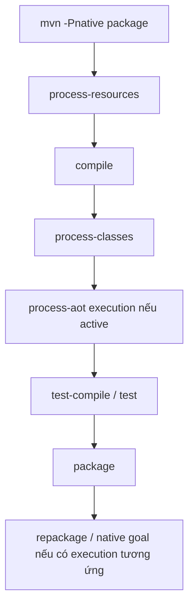

# spring-boot:process-aot và các execution trong vòng đời build

Trong module **SPRING_BOOT_NATIVE_IMAGE**, Maven đảm nhiệm hai nhóm công việc liên quan nhưng không giống nhau: **chuẩn bị ứng dụng Spring Boot để xử lý Ahead-of-Time (AOT)** và **biên dịch thành GraalVM Native Image**. Mấu chốt là hiểu `spring-boot:process-aot` chạy **ở pha nào**, một `execution` đưa goal đó vào vòng đời Maven ra sao, và vì sao chạy goal riêng lẻ có thể khác với chạy một lệnh build hoàn chỉnh.

Bài này tập trung vào **Spring Boot Maven Plugin** và cách kết hợp nó với **GraalVM Native Build Tools**. Sau bài học, bạn sẽ đọc được một `pom.xml`, xác định chính xác công đoạn AOT được kích hoạt, kiểm tra mã sinh ra và chẩn đoán các lỗi khác nhau ở build time và runtime. Ví dụ minh họa áp dụng cho các dự án Spring Boot có hỗ trợ AOT (đặc biệt các dự án Spring Boot 3.x); cấu hình và goal mặc định cần được xác minh với phiên bản Spring Boot/plugin đang sử dụng.

## 1. `spring-boot:process-aot` làm gì?

`process-aot` là một **goal của `spring-boot-maven-plugin`**. Nó gọi bộ xử lý AOT của Spring để phân tích thông tin có thể biết tại build time và sinh thành phần phục vụ khởi tạo application context.

Với ứng dụng Spring Boot điển hình, quá trình này có thể:

- Phân tích mô hình cấu hình và những **bean definitions** được Spring xác định trong pha AOT.
- Sinh mã đăng ký bean, mã hỗ trợ tạo instance, và cấu trúc khởi tạo context.
- Tổng hợp các **runtime hints** cho reflection, resource, proxy hoặc những cơ chế cần metadata của Native Image khi framework/thư viện có hỗ trợ.
- Chuẩn bị mã và tài nguyên sinh ra để các bước compile, package và native-image build tiếp tục sử dụng.

**Điều `process-aot` không làm:** bản thân nó **không** biên dịch ứng dụng thành native executable. Đây là công việc của GraalVM Native Image, thường được Maven gọi qua `org.graalvm.buildtools:native-maven-plugin`. Nó cũng không đồng nghĩa toàn bộ bean nghiệp vụ đã được khởi tạo sẵn và mang từ máy build sang binary.

Ví dụ: AOT có thể biết rằng `InvoiceController` phụ thuộc `InvoiceService` và sinh cách đăng ký, tạo hai bean. Khi tiến trình native chạy, Spring vẫn tạo các **bean instances** cần thiết theo vòng đời thực tế của chúng. Với hành vi reflection mà Spring không nhận biết được từ cấu hình, ứng dụng có thể vẫn cần tự khai báo `RuntimeHints`.


Đường đi trên là **luồng khái niệm**. Chính xác Maven chạy goal nào, chạy bao nhiêu lần, theo thứ tự nào còn phụ thuộc `executions`, profile, `pluginManagement` và các goal có fork lifecycle trong effective POM.

## 2. Phân biệt phase, goal, execution và profile

Maven có những thuật ngữ dễ bị dùng lẫn nhau:

| Khái niệm | Ý nghĩa | Ví dụ |
| --- | --- | --- |
| **Lifecycle** | Chuỗi pha có thứ tự để build một project | `default` |
| **Phase** | Mốc trong một lifecycle; chạy phase thường chạy cả các pha trước nó | `compile`, `process-classes`, `test`, `package` |
| **Goal** | Tác vụ do một Maven plugin cung cấp | `spring-boot:process-aot`, `native:compile` |
| **Execution** | Một cấu hình chạy một hoặc nhiều goal tại phase được chỉ định hoặc phase mặc định của goal | `<execution><id>process-aot</id>...` |
| **Profile** | Bộ cấu hình Maven chỉ kích hoạt khi phù hợp, thường dùng để bật native build | `-Pnative` |
| **Plugin management** | Nơi quản lý version/cấu hình mặc định của plugin; không có nghĩa mọi goal sẽ tự chạy | `<pluginManagement>...` |

**Goal** là “làm việc gì”; **execution** là “khi build thì gọi goal đó như thế nào”; **phase** là “lúc nào trong vòng đời build”; **profile** là “trong cấu hình build nào”.

Ví dụ cú pháp:

```bash
# Gọi trực tiếp một goal bằng prefix của plugin:
./mvnw spring-boot:process-aot

# Gọi các pha trong lifecycle Maven:
./mvnw clean package

# Bật profile native rồi gọi goal Native Build Tools:
./mvnw -Pnative native:compile
```

Hai lệnh đầu **không tương đương**. Gọi `spring-boot:process-aot` trực tiếp yêu cầu Maven thực thi goal đó, trong khi `package` đi qua các phase của lifecycle và chỉ gọi `process-aot` nếu có execution phù hợp được kích hoạt. Việc gọi goal trực tiếp cũng **không bảo đảm** các phase compile trước đó đã chạy; nếu thiếu class đầu vào, AOT có thể thất bại hoặc dùng output cũ.

## 3. Vị trí của `process-aot` trong vòng đời Maven

Trong cấu hình thông dụng của Spring Boot Maven Plugin 3.x, `process-aot` có **default phase là `process-classes`**. Maven có thể suy ra phase này khi bạn cấu hình goal trong một execution mà không ghi `<phase>` tường minh.

Các mốc liên quan trong lifecycle `default`:

| Maven phase | Việc cần quan tâm |
| --- | --- |
| `generate-sources` | Một số plugin có thể sinh source trước compilation |
| `process-resources` | Copy và lọc main resources theo cấu hình |
| `compile` | Biên dịch mã Java nguồn của ứng dụng |
| **`process-classes`** | **Vị trí thường gắn execution `spring-boot:process-aot`** |
| `process-test-resources` / `test-compile` | Chuẩn bị resources và compile mã test |
| `test` | Chạy unit/integration tests theo plugin và cấu hình |
| `package` | Đóng gói artifact; có thể chạy goal repackage và native compile nếu đã bind |
| `verify` | Các kiểm tra cuối của lifecycle khi được cấu hình |

Các phase này **không tự động tương ứng 1:1 với tên plugin goal**. Một plugin có thể có default phase riêng; một execution trong POM có thể ghi đè phase đó. Những goal có khả năng **fork lifecycle** còn có thể kích hoạt thêm một đoạn lifecycle bên trong một lệnh goal trực tiếp.

Có thể hình dung:



Sơ đồ chỉ biểu diễn **các mốc liên quan**, không liệt kê đầy đủ mọi phase và thứ tự các goal trong cùng một phase. Những execution khác trong POM có thể chạy ở các mốc đó.

### Vì sao cần compile trước AOT?

Spring AOT cần thấy mã ứng dụng và dependency phù hợp để tìm main application class, xử lý annotation/configuration và phân tích bean graph. Nếu gọi goal thủ công trên một thư mục chưa được compile, không nên kỳ vọng nó luôn tự dựng đủ toàn bộ đầu vào.

Để **kiểm tra AOT bằng lifecycle** trong một dự án đã bind execution, có thể chạy:

```bash
./mvnw -Pnative clean process-classes
```

Lệnh này đi qua các phase trước `process-classes`, nên class chính đã được biên dịch trước khi execution `process-aot` chạy. Nếu profile chưa chứa execution thì `process-classes` không tự bật AOT; cần cấu hình POM trước.

## 4. Gắn `process-aot` vào một Maven execution

Đoạn POM dưới đây minh họa cách khai báo goal **`process-aot`** trong profile `native`, áp dụng khi dự án chưa có execution tương ứng. Đây là đoạn **bổ sung vào `pom.xml` hiện có** — project vẫn cần dependency Spring Boot, plugin management/version tương thích và cấu hình Native Build Tools.

```xml
<profiles>
    <profile>
        <id>native</id>
        <build>
            <plugins>
                <plugin>
                    <groupId>org.springframework.boot</groupId>
                    <artifactId>spring-boot-maven-plugin</artifactId>
                    <executions>
                        <execution>
                            <id>process-aot</id>
                            <goals>
                                <goal>process-aot</goal>
                            </goals>
                        </execution>
                    </executions>
                </plugin>

                <plugin>
                    <groupId>org.graalvm.buildtools</groupId>
                    <artifactId>native-maven-plugin</artifactId>
                </plugin>
            </plugins>
        </build>
    </profile>
</profiles>
```

Trong cấu hình này:

1. Khi **chưa kích hoạt** `native`, execution nằm trong profile không tham gia build chỉ vì bạn chạy `mvn package`.
2. Khi chạy `-Pnative`, Maven đưa cấu hình profile vào effective POM.
3. Execution `process-aot` gắn goal `process-aot` vào phase mặc định của goal (thường là `process-classes` ở Spring Boot 3.x). Có thể ghi rõ `<phase>process-classes</phase>` nếu muốn tài liệu hóa chủ ý và đã xác nhận phù hợp với phiên bản plugin.
4. Plugin `native-maven-plugin` được khai báo, nhưng **chỉ khai báo plugin chưa bảo đảm native executable sẽ tự được tạo bởi lệnh `mvn package`**. Phải có một execution native compilation bind vào lifecycle hoặc gọi goal native phù hợp.

**Quan trọng:** nhiều project tạo từ Spring Initializr với lựa chọn **GraalVM Native Support** hoặc dùng Spring Boot starter parent đã có cấu hình native sẵn. Không chép đoạn trên vào POM một cách máy móc. Hãy kiểm tra effective POM để tránh đăng ký trùng execution hoặc kích hoạt AOT khi không muốn.

### `id` của execution có vai trò gì?

Trong:

```xml
<execution>
    <id>process-aot</id>
    <goals>
        <goal>process-aot</goal>
    </goals>
</execution>
```

- `<id>process-aot</id>` là **định danh của execution** để Maven quản lý và phối hợp cấu hình kế thừa/merge.
- `<goal>process-aot</goal>` là tên **goal thật** do plugin cung cấp.
- Hai chuỗi có thể giống nhau cho dễ đọc, nhưng bản chất không giống nhau.
- Đổi tên execution id không tạo ra một goal mới; ngược lại, ghi cùng goal ở nhiều execution có thể khiến xử lý AOT chạy nhiều lần trong một build.

Một execution có thể có `<phase>`, `<configuration>` và nhiều `<goal>`. Nếu không ghi `<phase>`, phải xác định **goal có default phase hay không**; không được đoán mặc định chỉ từ tên goal.

## 5. Tại sao `process-aot` và `native:compile` là hai bước khác nhau?

Hai plugin đảm nhiệm những tầng khác nhau:

| Thành phần | Plugin | Đầu vào chính | Đầu ra/mục đích |
| --- | --- | --- | --- |
| **Spring AOT** | `org.springframework.boot:spring-boot-maven-plugin` | Bytecode, Spring configuration, dependencies, property/condition build-time | Generated source, registration code, hints/tài nguyên AOT |
| **GraalVM Native Image** | `org.graalvm.buildtools:native-maven-plugin` | Classes, dependencies, generated AOT code/metadata và toolchain native | Native executable |
| **Spring Boot repackage** | `org.springframework.boot:spring-boot-maven-plugin` | Artifact JAR/WAR và dependencies | Executable Spring Boot archive cho cách đóng gói được hỗ trợ |

Goal `spring-boot:repackage` không phải là `spring-boot:process-aot`: repackage xử lý **artifact**, còn process-aot xử lý **mô hình application và sinh mã**. Native Image compilation là một bước tiếp theo nữa.

### Hai goal native phổ biến

Với GraalVM Native Build Tools Maven Plugin, thường gặp:

- `native:compile`: goal thuận tiện để build native executable và **fork phần lifecycle cần thiết** trước native compilation theo cơ chế của plugin.
- `native:compile-no-fork`: goal phù hợp khi đã chạy các phase chuẩn bị trong lifecycle và không muốn fork thêm lifecycle; thường được bind vào một execution trong `package`.

Vì thế, lệnh phổ biến:

```bash
./mvnw -Pnative native:compile
```

thường kích hoạt chuỗi chuẩn bị (trong đó có `process-aot` nếu profile/execution được cấu hình đúng), rồi chạy native compilation. Nhưng nếu project thiếu execution AOT hoặc native plugin không được cấu hình tương thích, **lệnh có tên đúng vẫn có thể build thiếu AOT hoặc lỗi**. Hãy đọc log và effective POM.

Ngược lại:

```bash
./mvnw -Pnative package
```

chạy `process-aot` nếu execution tương ứng được bind, nhưng việc có **native executable** sau `package` phụ thuộc native compilation goal có được bind vào `package` hay không. Một project chỉ khai báo `native-maven-plugin` mà không bind goal có thể chỉ tạo JAR.

### Bản đồ execution minh họa khi muốn native compile trong `package`

Ví dụ sau thể hiện **ý định bind** của native goal trong một project đã có dependencies, versions và AOT execution:

```xml
<plugin>
    <groupId>org.graalvm.buildtools</groupId>
    <artifactId>native-maven-plugin</artifactId>
    <executions>
        <execution>
            <id>build-native</id>
            <phase>package</phase>
            <goals>
                <goal>compile-no-fork</goal>
            </goals>
        </execution>
    </executions>
</plugin>
```

Khi đoạn plugin nằm trong profile `native` active, `mvn -Pnative package` có thể thực thi native compilation tại phase `package`, **sau** khi công đoạn AOT được bind ở `process-classes`. Trong thực hành cần xem log thứ tự goal và cấu hình plugin của bản Spring Boot đang dùng.

Không cần khai báo đồng thời nhiều execution native có cùng nhiệm vụ nếu parent/plugin đã cấu hình goal đó. Để tập trung vào vòng đời, hãy chọn **một cách kích hoạt native compilation rõ ràng**.

## 6. Dấu vết đầu ra sau `process-aot`

AOT thường sinh mã và metadata dưới thư mục build `target/`. Đối với nhiều phiên bản Spring Boot 3.x, các vị trí hay gặp là:

```text
target/
├── classes/                         # Class đã compile của ứng dụng
├── spring-aot/
│   └── main/
│       ├── sources/                 # Mã Java AOT được sinh
│       ├── resources/               # AOT resources / metadata
│       └── classes/                 # Một phần output phục vụ AOT
└── ...                              # JAR, báo cáo test, native executable...
```

Tên thư mục và cách compiler tích hợp generated outputs có thể thay đổi theo version/plugin, nên **đây là bản đồ định hướng**, không phải cam kết mọi dự án đều có đủ ba subfolder. Generated classes và metadata có thể xuất hiện ở những vị trí đã được tích hợp vào output build.

Dấu hiệu nên tìm:

- Source code do Spring sinh để đăng ký bean hoặc khởi tạo application context.
- Thông tin reflection, resources hoặc proxy nếu framework/thư viện cần và đã cung cấp runtime hints.
- Log của goal `spring-boot:process-aot` cho biết nó đã chạy trong Maven build.
- Đường classpath mà Native Build Tools nhận được có chứa compiled code và output AOT cần thiết.

Một số lệnh có thể dùng để kiểm tra trên Linux/macOS:

```bash
# Chạy tới phase có execution AOT, dùng profile đã cấu hình.
./mvnw -Pnative clean process-classes

# Xem output sinh ra.
find target/spring-aot -type f

# Kiểm tra các vị trí chứa metadata khi chúng tồn tại.
find target -type f -path '*/META-INF/native-image/*'
```

Với PowerShell trên Windows, có thể dùng:

```powershell
.\mvnw.cmd -Pnative clean process-classes
Get-ChildItem -Path target\spring-aot -Recurse -File
Get-ChildItem -Path target -Recurse -File |
    Where-Object { $_.FullName -match 'META-INF[\\/]native-image[\\/]' }
```

Nếu `target/spring-aot` chưa tồn tại, **đầu tiên xác nhận goal đã thực sự chạy**. Không nên vội kết luận Spring AOT không hỗ trợ ứng dụng chỉ vì đường dẫn kiểm tra ở một version khác.

### Không chỉnh tay generated sources

Generated AOT code là **sản phẩm của quá trình build**. Nếu đổi bean definitions, auto-configuration hoặc runtime hints, hãy sửa **source/POM/configuration gốc**, rồi build lại; không sửa generated source trong `target/` vì `clean` sẽ xóa hoặc AOT lần sau sẽ ghi đè.

## 7. Đọc effective POM và xác minh execution nào đang chạy

Khi POM kế thừa từ parent hoặc import cấu hình phức tạp, chỉ nhìn một đoạn `pom.xml` có thể bỏ sót execution được cung cấp từ parent, profile hoặc plugin management.

### Xem POM đã được Maven tổng hợp

```bash
# Cần maven-help-plugin; ghi effective POM để tiện kiểm tra.
./mvnw -Pnative help:effective-pom -Doutput=target/effective-pom.xml

# Xem metadata goal của phiên bản Spring Boot plugin đã resolve.
./mvnw help:describe \
  -Dplugin=org.springframework.boot:spring-boot-maven-plugin \
  -Dgoal=process-aot \
  -Ddetail
```

Trong effective POM, tìm `spring-boot-maven-plugin`, `native-maven-plugin`, các block `<execution>`, `<id>`, `<phase>`, `<goals>` và phần `<configuration>`. Nhớ rằng **execution nằm dưới `pluginManagement`** là cấu hình quản lý; cần kiểm tra nó được kích hoạt vào plugin thực tế như thế nào.

Lệnh `help:describe` hữu ích khi khác phiên bản plugin: nó cho phép xác minh goal có default phase, tham số và yêu cầu dependency như thế nào thay vì áp dụng hướng dẫn một phiên bản cũ.

### Đọc log theo chuỗi goal

Một log build có thể có dạng (minh họa; số phiên bản và thứ tự plugin khác tùy project):

```text
--- maven-resources-plugin:...:resources (...) @ native-baseline ---
--- maven-compiler-plugin:...:compile (...) @ native-baseline ---
--- spring-boot-maven-plugin:...:process-aot (process-aot) @ native-baseline ---
--- maven-compiler-plugin:...:testCompile (...) @ native-baseline ---
--- maven-surefire-plugin:...:test (...) @ native-baseline ---
--- native-maven-plugin:...:compile-no-fork (build-native) @ native-baseline ---
```

Từ dòng `spring-boot-maven-plugin:...:process-aot (process-aot)` có thể suy ra **goal process-aot được Maven thực thi trong execution mang id process-aot**. Tuy nhiên, **log chỉ cho biết goal có chạy**, chưa bảo đảm các nhánh runtime reflection/resource đều đúng. Cần thêm kiểm thử native executable.

### Vì sao cùng một goal có thể chạy hai lần?

Một số nguyên nhân:

1. `process-aot` được khai báo trong parent và được khai báo thêm ở child POM dưới execution khác id.
2. Có nhiều profile cùng active, mỗi profile mang một execution.
3. Một goal được gọi trực tiếp trong khi execution của nó cũng chạy qua lifecycle được fork.
4. Cấu hình merge và thứ tự plugin không như người viết POM dự kiến.

Nếu log cho thấy AOT chạy lặp, kiểm tra execution id, scope profile, effective POM và lệnh gọi trước khi thêm một execution khác để “sửa”.

## 8. `process-test-aot` và native tests: bước riêng với AOT ứng dụng

Spring Boot Maven Plugin cũng cung cấp công cụ AOT dành cho **test context**, thường qua goal `process-test-aot` trong các phiên bản hỗ trợ. Công việc này liên quan đến việc xử lý test configurations, tạo generated code/hints cho những Spring test context đủ điều kiện.

Phân biệt:

| Mục đích | Goal hoặc cơ chế | Phạm vi |
| --- | --- | --- |
| Chuẩn bị application context của ứng dụng | `spring-boot:process-aot` | Main application |
| Chuẩn bị Spring test contexts để kiểm thử native | `spring-boot:process-test-aot` | Các test/context được chọn |
| Chạy các unit/integration tests trên JVM | `mvn test` và test plugins | JVM |
| Build/chạy native tests | GraalVM Native Build Tools và test-plugin integrations tương ứng | Native test executable |

**Đừng suy ra** `process-aot` tự tạo native test executable hay chạy kiểm thử. Tùy phiên bản Spring Boot/Native Build Tools, goal `native:test` và execution liên quan có thể được đưa vào profile native; việc chạy `mvn test` thông thường vẫn cần kiểm tra thực tế những test goal đang active.

Một bài kiểm thử thành công trên JVM không thay thế kiểm thử các đường runtime trên binary native. Khi thêm các trường hợp reflection, serialization hay resource động, cần test chúng trong đúng môi trường native.

## 9. Các lỗi thường gặp và nguyên nhân ở từng pha

| Triệu chứng | Khả năng nguyên nhân | Cách kiểm tra và xử lý |
| --- | --- | --- |
| Chạy `mvn package` nhưng không thấy `process-aot` trong log | Execution không có hoặc profile `native` chưa active | Kiểm tra `-Pnative`, active profiles và effective POM |
| Chạy `spring-boot:process-aot` trực tiếp báo không tìm thấy main class | Source chưa compile, classpath/module config chưa đúng | Chạy qua phase tới `process-classes`; kiểm tra main class và compiler output |
| Lỗi AOT khi đọc configuration/condition | Bean registration phụ thuộc runtime data, processor không hỗ trợ build-time analysis | Rà soát `@Conditional`, dynamic bean registration, build-time properties |
| Có generated AOT code nhưng không có native executable | Chưa gọi native compile hoặc native goal chưa bind vào lifecycle | Kiểm tra native plugin, execution `compile-no-fork` và command đã dùng |
| Native compilation báo thiếu toolchain | GraalVM Native Image/compiler/linker hoặc môi trường chưa phù hợp | Kiểm tra Java/GraalVM version và yêu cầu hệ điều hành |
| Native executable khởi động được nhưng reflection lỗi ở một endpoint | Một type/member chưa được giữ qua metadata | Kiểm tra `RuntimeHintsRegistrar`, hints của thư viện, test nhánh đó |
| Resource đọc được trên JVM nhưng null ở native | Chưa đóng gói/khai báo resource đúng cách | Kiểm tra resource tồn tại lúc build và pattern trong runtime hints |
| Đổi `@Profile` / property tại runtime nhưng bean không xuất hiện | Cấu trúc bean đã bị quyết định trong pha AOT | Rà soát điều kiện được phân tích tại build time; build lại hoặc đổi thiết kế |
| AOT chạy hai lần và gây hiệu ứng phụ | Multiple executions hoặc fork lifecycle; processor không an toàn với build-time | Đọc effective POM, tránh execution trùng và tách side effect |

### Sai lầm: dùng `-DskipTests` để “bỏ qua mọi thứ liên quan đến test”

`-DskipTests` thường yêu cầu plugin test bỏ **thực thi test**, nhưng việc compile test sources, goal xử lý AOT test hoặc các execution khác phụ thuộc plugin, profile và cấu hình. Nó **không đồng nghĩa** bỏ toàn bộ phase `test` hay mọi goal trong build.

Muốn biết chính xác điều gì bị bỏ qua, hãy xem Maven log của project. Đối với pipeline kiểm thử tương thích Native Image, bỏ qua test có thể khiến build thành công nhưng chưa có bằng chứng ứng dụng hoạt động đúng.

### Sai lầm: xử lý lỗi native bằng cách sửa generated code

Sửa generated code có thể khiến bản local “qua được” một lần nhưng không tái lập. Hãy sửa definition, hints hoặc dependency trên mã nguồn và cấu hình gốc. Nếu phần generated code không như kỳ vọng, cần tìm nguyên nhân trong input của AOT.

### Lưu ý về side effect ở build time

Spring AOT phân tích application context và có thể cần khởi tạo **một số bean hạ tầng/processor** phục vụ phân tích, nhưng không phải đang chạy toàn bộ workload nghiệp vụ. Không nên để những component tham gia AOT gọi API production, ghi dữ liệu thật hoặc sử dụng bí mật môi trường vận hành khi build.

Việc thay đổi điều kiện cấu hình/profile ở build time có thể thay đổi tập bean definitions được đưa vào generated context. Để deploy một binary qua nhiều môi trường, cần tách điều kiện **xác định cấu trúc bean** khỏi giá trị runtime như timeout, URL hoặc credentials được đọc khi instance khởi tạo.

## 10. Quy trình thực hành có thể tái lập

Giả sử project Spring Boot REST tên `native-baseline` đã khởi tạo từ Spring Initializr có các dependency Spring Web, Actuator và GraalVM Native Support. Những lệnh dưới đây minh họa **hai mục tiêu học tập riêng**: quan sát AOT và hoàn thành native build.

**Bước 1 — xác nhận môi trường và cấu hình**

```bash
./mvnw --version
java -version
native-image --version
./mvnw -Pnative help:effective-pom -Doutput=target/effective-pom.xml
```

Đảm bảo phiên bản Java, GraalVM và Maven plugin tương thích với Spring Boot đã chọn. Nếu `native-image` không nằm trên `PATH`, Native Build Tools có thể có cơ chế toolchain riêng; xác minh cấu hình thay vì giả định lệnh luôn khả dụng.

**Bước 2 — chạy tới phase chứa AOT execution**

```bash
./mvnw -Pnative clean process-classes
```

Tìm log `spring-boot-maven-plugin:...:process-aot` và kiểm tra generated outputs trong `target/spring-aot` hoặc vị trí build được plugin báo. Nếu goal không chạy, giải quyết cấu hình execution trước khi thử native compilation.

**Bước 3 — build native từ trạng thái đã chuẩn bị**

```bash
./mvnw -Pnative native:compile
```

Goal `native:compile` có thể khởi chạy lại các phase Maven theo cơ chế fork của Native Build Tools; do đó lệnh này là **một build đầy đủ riêng**, không nhất thiết chỉ chạy bước cuối dựa trên output của bước 2. Hãy kiểm tra log để biết chính xác từng goal có chạy bao nhiêu lần.

Tại cuối build thành công, kiểm tra executable trong `target/` (tên và đuôi tùy OS/cấu hình). Chẳng hạn Linux có thể chạy `./target/native-baseline`, Windows có thể là `target\native-baseline.exe`. Tên file thực tế lấy từ output của Maven.

**Bước 4 — kiểm tra hành vi**

```bash
# Chạy native executable (đổi tên theo output thực tế).
./target/native-baseline

# Trong terminal khác:
curl --fail --silent --show-error http://127.0.0.1:8080/actuator/health
curl --fail --silent --show-error http://127.0.0.1:8080/api/greeting?name=Lan
```

Đường API chỉ mang tính minh họa: thay bằng endpoint đúng của ứng dụng đang dùng. Mục tiêu là cả JVM và native cùng trả HTTP status/JSON đúng trước khi tiến hành so sánh **startup time**, **RSS**, kích thước artifact và build duration. Để so thời gian startup, dùng phương pháp đo start-to-ready nhất quán, không chỉ đọc thời gian plugin build.

**Bước 5 — ghi lại bằng chứng**

Lưu trong báo cáo thực nghiệm: phiên bản Spring Boot, Java/GraalVM, Maven, Git commit, profile active, lệnh build, đoạn log goal `process-aot`, đường generated output, đường native executable và kết quả endpoint. Từ đó khi có lỗi reflection/resource hay biến động startup, bạn biết **đầu vào build nào** đã tạo bản binary được đo.

## 11. Bài tập củng cố

Cho một `pom.xml` giả định có cấu hình sau:

```xml
<profiles>
  <profile>
    <id>native</id>
    <build>
      <plugins>
        <plugin>
          <groupId>org.springframework.boot</groupId>
          <artifactId>spring-boot-maven-plugin</artifactId>
          <executions>
            <execution>
              <id>main-aot</id>
              <goals>
                <goal>process-aot</goal>
              </goals>
            </execution>
          </executions>
        </plugin>
      </plugins>
    </build>
  </profile>
</profiles>
```

Giả sử dùng Spring Boot Maven Plugin có default phase `process-classes` cho goal này và phần còn lại của POM không có execution native compile.

1. Khi chạy `./mvnw clean package` **không có `-Pnative`**, goal `process-aot` trong profile trên có chạy không? Vì sao?
2. Khi chạy `./mvnw -Pnative clean process-classes`, những bước chuẩn bị nào phải diễn ra trước AOT? Execution id `main-aot` có làm đổi tên goal không?
3. Chỉ khai báo execution trên có bảo đảm `./mvnw -Pnative package` xuất ra native executable không? Cần thêm cơ chế nào?
4. Nếu gọi `./mvnw spring-boot:process-aot` ngay khi vừa clone dự án mà không compile, có thể gặp vấn đề gì?
5. Khi native executable tạo thành công nhưng gọi một endpoint reflection bị lỗi, đây có nhất thiết là lỗi Maven lifecycle không? Làm thế nào khoanh vùng?
6. Nếu trong parent POM đã có execution `process-aot`, vì sao cần xem effective POM trước khi thêm execution ở child?

### Gợi ý đối chiếu

- **1:** Không; profile chứa execution chưa được kích hoạt.
- **2:** Maven chạy đến `process-classes`, gồm các bước chuẩn bị/compile trước đó; id `main-aot` là định danh execution, goal vẫn tên `process-aot`.
- **3:** Không; cần gọi native compilation goal phù hợp hoặc bind goal đó vào lifecycle với Native Build Tools.
- **4:** AOT có thể thiếu class/dependency output đã compile hoặc dùng kết quả cũ; nên chạy lifecycle có execution đến `process-classes`.
- **5:** Không nhất thiết; kiểm tra behavior native, metadata reflection/resource và đường chạy cụ thể sau khi xác nhận build đã chạy đúng.
- **6:** Để tránh execution trùng/lặp xử lý AOT và kiểm tra cách kế thừa profile/plugin management thực tế.

**Tiêu chí đạt:** giải thích được **goal – execution – phase – profile**, xác định lúc `spring-boot:process-aot` chạy trong Maven, phân biệt nó với `spring-boot:repackage` và `native:compile`, kiểm tra được generated AOT artifacts, đồng thời đọc log/effective POM để chẩn đoán lỗi theo đúng pha của quy trình build.
