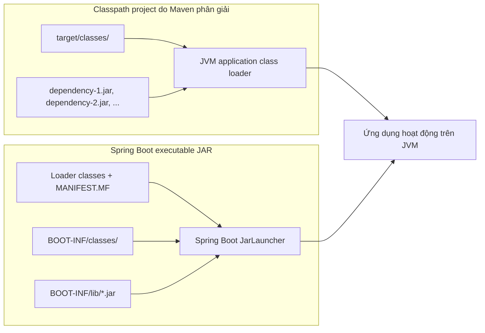
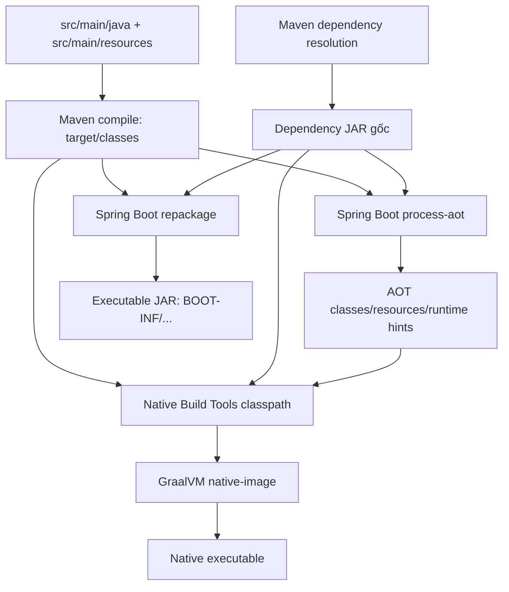

# Classpath gốc khác với cấu trúc Spring Boot executable JAR

## 1. Vấn đề cần hiểu trước khi build native

Trong module **SPRING_BOOT_NATIVE_IMAGE**, chúng ta chuyển ứng dụng Spring Boot từ JVM sang **GraalVM Native Image** với sự hỗ trợ của **Spring AOT**, rồi kiểm thử tương thích, đo thời gian khởi động/bộ nhớ và đóng gói container. Một lỗi cấu hình thường gặp khi thao tác bằng Maven là **nhầm classpath dùng để biên dịch/chạy ứng dụng với cách Spring Boot đóng gói executable JAR**.

Hai cách chạy quen thuộc có thể cùng cho kết quả HTTP giống nhau:

```bash
# Chạy bằng Maven: dùng classpath của project và dependency resolution
./mvnw spring-boot:run

# Chạy từ executable JAR đã được Spring Boot repackage
java -jar target/native-demo-0.0.1-SNAPSHOT.jar
```

Tuy nhiên, đây là **hai cơ chế nạp lớp khác nhau**. Nếu sử dụng ngay executable JAR như một thư viện thông thường trong `java -cp`, hoặc lấy nó làm classpath đầu vào cho `native-image` mà không xét bố cục bên trong, trình nạp lớp hoặc native compiler có thể **không nhìn thấy các lớp và thư viện cần thiết**.

Mục tiêu của bài học:

1. Nhận diện classpath gốc mà Maven cung cấp cho project: `target/classes` và các dependency JAR được phân giải.
2. Đọc cấu trúc executable JAR Spring Boot: `BOOT-INF/classes`, `BOOT-INF/lib`, launcher và manifest.
3. Giải thích vì sao `java -jar` thành công nhưng `java -cp <boot-jar> <app-main>` có thể báo `ClassNotFoundException`.
4. Hiểu vì sao Native Image cần đầu vào có thể phân tích theo classpath thực, mã Spring AOT và runtime hints, thay vì dựa vào cơ chế nested JAR của Boot launcher.
5. Kiểm tra Maven build, phân tích lỗi và bảo đảm bản JVM/native được đối chiếu cùng chức năng.

> **Nguyên tắc:** executable JAR là **định dạng triển khai** được Spring Boot chuẩn bị cho launcher riêng; Maven project classpath là **tập lớp và dependency** để compile/chạy/test. Khi build native, ưu tiên để Spring Boot Maven Plugin và GraalVM Native Build Tools xử lý đúng đầu vào.

## 2. Classpath gốc của Maven gồm những gì?

Giả sử ứng dụng có main class `com.example.demo.NativeDemoApplication` và phụ thuộc vào `spring-boot-starter-web`. Sau khi compile bằng Maven, cấu trúc dự án thường có dạng:

```text
native-demo/
├── pom.xml
├── src/main/java/com/example/demo/NativeDemoApplication.java
├── src/main/resources/application.properties
└── target/
    ├── classes/
    │   ├── com/example/demo/NativeDemoApplication.class
    │   └── application.properties
    └── test-classes/                 # Nếu biên dịch test
```

Khi chạy ứng dụng từ classpath project, JVM cần biết:

- **Gốc lớp ứng dụng:** `target/classes`. Từ gốc này, JVM tìm thấy `com/example/demo/NativeDemoApplication.class`.
- **Dependency JAR:** các tệp JAR đã được Maven phân giải, thường trong Maven local repository (`~/.m2/repository`) hoặc môi trường repository được cấu hình.
- **Resources:** file từ `src/main/resources` thường được copy vào `target/classes` (hoặc những resource roots đã cấu hình khác).
- **Lớp và thư viện test:** `target/test-classes`, test dependencies và classpath riêng khi chạy test; đây **không phải** mặc định là thành phần triển khai production.

Maven xác định tập dependency theo scope, optional/transitive exclusions và dependency management; đường dẫn classpath thực tế còn phụ thuộc mục tiêu build/plugin đang chạy. Ví dụ:

```text
target/classes
~/.m2/repository/org/springframework/boot/spring-boot-...jar
~/.m2/repository/org/springframework/spring-context-...jar
~/.m2/repository/com/fasterxml/jackson/core/jackson-databind-...jar
...
```

Các dấu `...` ở trên chỉ minh họa: **không hard-code tên hoặc version JAR**. Maven sẽ chọn dependency thực tế từ `pom.xml`, BOM và quá trình resolution.

### 2.1. Thế nào là một classpath entry?

Trong Java classpath truyền thống, một entry thường là:

1. **Thư mục gốc package**, chẳng hạn `target/classes`. Khi tìm `com.example.demo.NativeDemoApplication`, class loader nối `com/example/demo/NativeDemoApplication.class` vào thư mục này.
2. **JAR bình thường**, chứa các class/resources dưới những đường dẫn được class loader hiểu là nằm ở root của JAR.

Ví dụ (Linux/macOS; chỉ dùng để minh họa hình dạng classpath):

```bash
java -cp "target/classes:/path/to/spring-context.jar:/path/to/other-library.jar" \
  com.example.demo.NativeDemoApplication
```

Trong thực tế phải có **đầy đủ dependency** chứ không chỉ hai JAR ví dụ. Trên Windows, dấu phân cách classpath thường là dấu chấm phẩy (`;`) thay vì dấu hai chấm (`:`). Vì vậy, lệnh tự viết classpath rất dễ bỏ sót một thư viện hoặc dùng sai dấu phân cách.

Lệnh `./mvnw spring-boot:run` cho phép plugin tính classpath từ project; đây thường là lựa chọn đơn giản để kiểm tra hành vi của ứng dụng trước khi đóng gói.

### 2.2. Nhận diện runtime classpath do Maven phân giải

Từ thư mục chứa `pom.xml` của ứng dụng, có thể chạy:

```bash
./mvnw clean compile
./mvnw dependency:tree

# Ghi danh sách dependency JAR của runtime vào một file chẩn đoán
./mvnw dependency:build-classpath \
  -DincludeScope=runtime \
  -Dmdep.outputFile=target/runtime-classpath.txt
```

`dependency:tree` giúp thấy dependency trực tiếp, transitive và các version được chọn. `dependency:build-classpath` (Maven Dependency Plugin) giúp xuất danh sách dependency theo scope; file sinh ra **không chứa `target/classes` nếu bạn chỉ yêu cầu danh sách dependency**. Khi tự tạo classpath để chạy ứng dụng, phải thêm class directory phù hợp.

Các tên goal và tham số này giả định Maven Dependency Plugin có thể được Maven tải và thực thi trong dự án. File output trong ví dụ là **artifact chẩn đoán**, không phải file cấu hình Native Image cần duy trì lâu dài.

Một cách chạy trực tiếp bằng runtime classpath trên hệ thống POSIX:

```bash
APP_CP="target/classes:$(cat target/runtime-classpath.txt)"
java -cp "$APP_CP" com.example.demo.NativeDemoApplication
```

Ví dụ giả định main class, dependency và tài nguyên đã được build đúng. Lệnh này minh họa **lớp chính nằm dưới `target/classes`**; nó không cần Boot loader. Trong Maven multi-module, cần chạy goal tại module chứa ứng dụng và lưu ý dependency khác module đang ở reactor có thể thay đổi đường dẫn theo cách Maven phân giải.

## 3. Spring Boot executable JAR thay đổi bố cục như thế nào?

Khi dùng `spring-boot-maven-plugin:repackage`, một JAR thường được chuyển thành executable JAR của Spring Boot. Bên trong không đơn giản là “mọi class nằm ở root” như một JAR thư viện bình thường:

```text
native-demo-0.0.1-SNAPSHOT.jar
├── META-INF/
│   └── MANIFEST.MF
├── org/springframework/boot/loader/...
│   └── ... launcher classes ...
└── BOOT-INF/
    ├── classes/
    │   ├── com/example/demo/NativeDemoApplication.class
    │   └── application.properties
    ├── lib/
    │   ├── spring-boot-...jar
    │   ├── spring-context-...jar
    │   ├── jackson-databind-...jar
    │   └── ...
    ├── classpath.idx          # Có thể có
    └── layers.idx             # Có thể có với layered JAR
```

Những điểm cần ghi nhớ:

- **Class ứng dụng** nằm trong `BOOT-INF/classes/`, không ở root JAR.
- **Dependency JAR** được giữ ở dạng **nested JAR** trong `BOOT-INF/lib/`.
- **Spring Boot loader/launcher** có các lớp được đặt ở vị trí phù hợp để JVM khởi động launcher; nó xây dựng cơ chế nạp lớp riêng và sử dụng những lớp, thư viện nằm trong `BOOT-INF`.
- `META-INF/MANIFEST.MF` chỉ tới launcher và main class ứng dụng, thường qua các thuộc tính `Main-Class` và `Start-Class`.
- `BOOT-INF/classpath.idx` và `BOOT-INF/layers.idx` là metadata có thể xuất hiện, tùy version và cách build; chúng không làm các nested JAR trở thành entry có thể dùng trực tiếp bởi một Java classpath loader thông thường.

Đối với một số phiên bản Spring Boot hiện đại, manifest có thể có dạng:

```text
Main-Class: org.springframework.boot.loader.launch.JarLauncher
Start-Class: com.example.demo.NativeDemoApplication
```

Đây là **ví dụ minh họa**. Các phiên bản Boot cũ dùng tên package launcher khác, ví dụ `org.springframework.boot.loader.JarLauncher`. Hãy đọc manifest **của artifact vừa build**, thay vì dựa vào một tên cố định cho mọi release.

### 3.1. Phân biệt `java -jar` và `java -cp`

Khi chạy:

```bash
java -jar target/native-demo-0.0.1-SNAPSHOT.jar
```

JVM đọc `Main-Class` trong manifest và khởi động **Spring Boot launcher**. Launcher thiết lập class loading để ứng dụng và nested dependency JAR chạy được từ định dạng executable JAR.

Ngược lại, khi chạy:

```bash
# Ví dụ cố ý dùng sai cách đối với Boot executable JAR
java -cp target/native-demo-0.0.1-SNAPSHOT.jar \
  com.example.demo.NativeDemoApplication
```

JVM classpath loader thông thường tìm `com/example/demo/NativeDemoApplication.class` **ở root của JAR**, nhưng thực tế tệp nằm tại `BOOT-INF/classes/com/example/demo/NativeDemoApplication.class`. Vì thế lệnh trên thường thất bại với lỗi:

```text
Error: Could not find or load main class com.example.demo.NativeDemoApplication
Caused by: java.lang.ClassNotFoundException: com.example.demo.NativeDemoApplication
```

Lỗi này không có nghĩa class bị mất khỏi artifact; nó cho thấy **đường dẫn class không tương ứng với root classpath đang dùng**. Tương tự, đặt một Boot executable JAR nguyên vẹn vào classpath của chương trình khác **không tự khiến các JAR trong `BOOT-INF/lib` trở thành dependency classpath**.

### 3.2. Sơ đồ so sánh trực quan



Hai luồng có thể tạo **hành vi nghiệp vụ tương đương**, nhưng sơ đồ nạp lớp và định dạng artifact không giống nhau. Khác biệt này trở nên quan trọng khi chuyển sang các công cụ phân tích tĩnh như GraalVM Native Image.

## 4. Đọc và đối chiếu artifact Maven thực tế

### 4.1. Cấu hình tối thiểu trong `pom.xml`

Giả sử project đã dùng một phiên bản Spring Boot hỗ trợ AOT/native, ví dụ khai báo starter và Spring Boot Maven Plugin:

```xml
<dependencies>
    <dependency>
        <groupId>org.springframework.boot</groupId>
        <artifactId>spring-boot-starter-web</artifactId>
    </dependency>
</dependencies>

<build>
    <plugins>
        <plugin>
            <groupId>org.springframework.boot</groupId>
            <artifactId>spring-boot-maven-plugin</artifactId>
        </plugin>
    </plugins>
</build>
```

Đây là **đoạn cấu hình bên trong một POM hoàn chỉnh**, không phải `pom.xml` độc lập. Khi dùng `spring-boot-starter-parent` hoặc dependency management phù hợp, các phiên bản dependency/plugin cần được kiểm soát theo cấu hình của dự án. Nếu không dùng parent và plugin goal chưa bind vào lifecycle, cần cấu hình `repackage` rõ ràng theo tài liệu Spring Boot Maven Plugin của phiên bản đang sử dụng.

Sau đó chạy:

```bash
./mvnw clean package
```

Đường dẫn artifact phụ thuộc `artifactId`, `version`, classifier và final name. Với ví dụ này ta giả sử file là `target/native-demo-0.0.1-SNAPSHOT.jar`.

### 4.2. Xem nội dung executable JAR

Các lệnh sau **chỉ đọc artifact đã tạo**:

```bash
jar tf target/native-demo-0.0.1-SNAPSHOT.jar

# Linux/macOS: chỉ lấy các đường dẫn quan tâm
jar tf target/native-demo-0.0.1-SNAPSHOT.jar \
  | grep -E '^(BOOT-INF/classes/|BOOT-INF/lib/|org/springframework/boot/loader/)'

# Nếu có unzip, đọc manifest mà không giải nén toàn bộ
unzip -p target/native-demo-0.0.1-SNAPSHOT.jar META-INF/MANIFEST.MF
```

Trên PowerShell, có thể lọc listing bằng:

```powershell
jar tf .\target\native-demo-0.0.1-SNAPSHOT.jar |
  Select-String '^(BOOT-INF/classes/|BOOT-INF/lib/|org/springframework/boot/loader/)'
```

Nếu bạn không thấy `BOOT-INF/classes` và `BOOT-INF/lib`, cần xác nhận file đang đọc có thực sự là **Spring Boot executable JAR được repackage** hay chỉ là **JAR thông thường**, hoặc project sử dụng layout/package type đặc biệt. Không suy từ đuôi `.jar` rằng file chắc chắn là Boot executable JAR.

### 4.3. So sánh ba đường chạy

| Cách chạy | Đầu vào chính | Ai thiết lập classpath? | Kết quả kỳ vọng |
| --- | --- | --- | --- |
| `./mvnw spring-boot:run` | Project classes và Maven-resolved dependencies | Spring Boot Maven Plugin | Chạy ứng dụng từ project, thường không dùng JAR đã repackage. |
| `java -jar app.jar` | Spring Boot executable JAR | JVM đọc manifest, Boot launcher xử lý `BOOT-INF` | Chạy ứng dụng từ artifact triển khai. |
| `java -cp app.jar com.example.Main` | Chỉ file JAR như classpath entry bình thường | Standard JVM classpath loader | Có thể thất bại vì class ứng dụng nằm dưới `BOOT-INF/classes`. |
| `java -cp target/classes:<dependencies> com.example.Main` | Classes và dependency JAR gốc | Standard JVM classpath loader | Có thể chạy đúng nếu classpath đủ và cấu hình phù hợp. |

Trong hàng cuối, `<dependencies>` đại diện cho toàn bộ đường dẫn JAR thích hợp, dùng ký hiệu tóm tắt chứ không phải cú pháp dòng lệnh có thể chạy nguyên văn. Trên Windows cần phân cách classpath bằng `;`.

## 5. Tại sao GraalVM Native Image quan tâm đến sự khác nhau này?

GraalVM Native Image xây dựng một executable bằng cách phân tích **classes, dependencies và metadata/hints** tại thời điểm build. Quá trình này không vận hành hoàn toàn như JVM khởi động Boot loader rồi động nạp các nested JAR. Vì vậy **không nên giả định** câu lệnh sau sẽ tương đương với Maven Native Build Tools:

```bash
# Không phải lộ trình native chuẩn cho Spring Boot executable JAR
native-image -jar target/native-demo-0.0.1-SNAPSHOT.jar
```

Lệnh trên có thể không phân tích đúng các ứng dụng/dependency nằm trong `BOOT-INF`, hoặc chỉ nhìn thấy các class loader-related entry và thiếu metadata cần thiết. Ngay cả khi tìm được main class, Spring Boot còn sử dụng cơ chế proxy, reflection, serialization, resource và cấu hình khởi tạo cần hỗ trợ AOT. Một JAR chạy được với `java -jar` **không tự bảo đảm** có thể đưa nguyên dạng vào `native-image`.

Trong mô hình tích hợp thông thường:

1. **Maven** xác định dependency graph, compiled classes và resources của project.
2. **Spring Boot Maven Plugin** chạy `spring-boot:process-aot` để phân tích application context và sinh mã cùng runtime hints phục vụ Native Image.
3. **GraalVM Native Build Tools Maven Plugin** dùng các inputs tương ứng (bao gồm AOT khi được cấu hình đúng) để gọi Native Image với classpath/build arguments phù hợp.
4. **Native Image** xây dựng tệp thực thi theo OS/architecture mục tiêu.



Sơ đồ là mô hình logic: **tên và đường dẫn output AOT, dependency của goal Maven và thứ tự lifecycle có thể khác giữa các phiên bản/plugin configuration**. Không mặc định rằng native plugin lấy `target/classes` đơn thuần rồi bỏ qua AOT; phải xác minh log của build thật.

### 5.1. Vai trò của executable JAR trong native build

Một Spring Boot executable JAR vẫn hữu ích:

- Là **artifact JVM chuẩn** để kiểm thử smoke test và giữ làm bản đối chứng/rollback.
- Là đầu vào cho **Spring Boot Buildpacks** khi cấu hình `spring-boot:build-image`; builder có thể xây dựng image JVM hoặc native tùy chế độ và khả năng của buildpack.
- Là sản phẩm triển khai được vận hành qua `java -jar` hoặc launcher khi phù hợp.

Nhưng nó không nhất thiết là **đầu vào classpath phù hợp cho native compiler**. Native build nên dùng cơ chế tích hợp Maven/AOT thay vì lấy một executable JAR đã repackage, đặt sau `-cp` hoặc giải nén tùy ý rồi hy vọng tất cả các nested JAR tự hoạt động.

### 5.2. Có thể giải nén `BOOT-INF` để tạo classpath không?

Về nguyên lý, có thể trích xuất `BOOT-INF/classes` thành **directory root** và các nested JAR trong `BOOT-INF/lib` thành **các JAR riêng**, rồi xây dựng một classpath hợp lệ. Tuy nhiên, đây là bước thủ công dễ làm lệch dependency order, metadata, resource handling và những generated outputs AOT; nó **không tự động thay thế** quá trình Spring AOT/native integration.

Điều đó khác với việc chỉ thêm `BOOT-INF/classes` vào chuỗi classpath trong một JAR vẫn còn nén: standard classpath loader không coi một đường dẫn con bên trong tệp JAR là directory entry độc lập. Ngay cả khi tách thư mục đúng, vẫn phải có toàn bộ dependency JAR thật ở các đường dẫn độc lập.

Nếu một công cụ ngoài Maven bắt buộc nhận flattened classpath, cần xây dựng classpath từ **compiled project classes + Maven dependency resolution + AOT outputs** theo tài liệu của công cụ, rồi kiểm thử khả năng tương thích. Đừng tự động đổi sang đường đi này chỉ vì `native-image -jar` thất bại.

## 6. Quy trình Maven chuẩn khi chuyển JVM sang native

Trước khi chạy, bảo đảm Java, Spring Boot, GraalVM và Maven Native Build Tools có phiên bản **tương thích**, và Native Image có C compiler/linker cần thiết trong môi trường build. Các lệnh dưới đây áp dụng cho dự án **đã cấu hình đúng các plugin và profile native**; `-Pnative` không tự tạo profile/plugin còn thiếu.

### Bước 1 — Chạy JVM và chốt hợp đồng

```bash
./mvnw clean verify
./mvnw spring-boot:run
```

Trong terminal khác, thử endpoint phù hợp với ứng dụng; ví dụ:

```bash
curl -i http://localhost:8080/api/hello
```

Ghi nhận HTTP status, JSON, behavior của validation và lỗi liên quan. Đây là đường chạy từ project, dùng làm đối chứng cho native.

### Bước 2 — Đóng gói, kiểm tra cấu trúc JAR và chạy lại

```bash
./mvnw clean package
jar tf target/native-demo-0.0.1-SNAPSHOT.jar
java -jar target/native-demo-0.0.1-SNAPSHOT.jar
```

Thay tên file ví dụ bằng tên thật lấy từ output Maven. Nếu `java -jar` chạy tốt nhưng gọi main class bằng `java -cp <boot-jar>` lỗi, sử dụng kết quả `jar tf` để xác định đây là sự khác biệt classpath/packaging, chưa phải dấu hiệu native incompatibility.

### Bước 3 — Kiểm tra AOT riêng

```bash
./mvnw -Pnative spring-boot:process-aot
```

Kiểm tra log về bean graph, dependency, cấu hình profile/condition và các mã, resources, hints được sinh. Bước này **không tạo executable native**; nó chuẩn bị phần Spring AOT. Không sửa trực tiếp generated sources vì build tiếp theo có thể tạo lại.

### Bước 4 — Dùng Native Build Tools để biên dịch

```bash
./mvnw -Pnative native:compile

# Nếu cần log sâu để truy vết plugin, AOT và Native Image:
./mvnw -Pnative native:compile -X
```

Tên goal `native:compile` thuộc GraalVM Native Build Tools Maven Plugin. Tích hợp chuẩn sẽ xử lý các đầu ra AOT qua cấu hình/lifecycle native phù hợp; **hãy kiểm tra log để xác nhận chúng thực sự được đưa vào build**. Nếu chỉ gọi goal riêng trên một POM chưa cấu hình Spring AOT, đừng kết luận binary đã sẵn sàng.

Đường dẫn executable thường ở `target/` với tên phụ thuộc project, cấu hình native plugin và nền tảng; không giả định tên luôn giống tên JAR. Sau khi build, chạy executable thực tế và thử lại các API/cấu hình tương đương JVM.

### Bước 5 — Kiểm thử và benchmark

Chạy cùng bộ kiểm thử chức năng trên JVM và native. Ưu tiên các đường đi có nguy cơ phát sinh vấn đề closed-world analysis: reflection, JSON serialization, template/resource, dynamic proxy, JDBC/driver, TLS, localization, cache và integrations. Dùng native test mode nếu plugin/test framework hỗ trợ; bổ sung smoke test ngoài process/container để xác nhận hành vi thực.

Khi đo startup/memory, xác định rõ dấu mốc **process start → readiness** và loại bộ nhớ đo như RSS hay working set. Chạy lặp lại, dùng cùng dữ liệu/tài nguyên, ghi median và điều kiện đo. Bản native có thể khởi động nhanh hơn và tiêu thụ ít bộ nhớ hơn trong một số workload, nhưng trade-off về build time, CPU hoặc throughput cần đo thực tế.

### Bước 6 — Đóng gói container đúng con đường build

Nếu dùng Cloud Native Buildpacks:

```bash
./mvnw -Pnative spring-boot:build-image \
  -Dspring-boot.build-image.imageName=example/native-demo:local
```

Builder phải hỗ trợ native mode và cấu hình profile/buildpack phù hợp. Đọc log để xác nhận image được tạo ra chứa native executable, thay vì mặc định rằng cứ `-Pnative` là image sẽ native trong mọi dự án. Trường hợp đóng gói executable native trực tiếp bằng Dockerfile cũng cần chọn runtime base image, libc/architecture và permissions tương ứng.

## 7. Những dấu hiệu thường gây chẩn đoán nhầm

| Triệu chứng | Tại sao có thể xảy ra? | Bước kiểm tra |
| --- | --- | --- |
| `java -jar app.jar` chạy, nhưng `java -cp app.jar com.example.Main` lỗi class not found. | Main class nằm trong `BOOT-INF/classes` và cần Boot launcher. | `jar tf`, manifest, `BOOT-INF/classes`. |
| ClassLoader không thấy `org.springframework...` khi tự đặt boot JAR vào classpath. | JAR phụ thuộc nằm **nested** trong `BOOT-INF/lib`, không trở thành entry của standard classpath. | Đối chiếu runtime classpath Maven và nội dung JAR. |
| `native-image -jar boot-app.jar` không nhận ra ứng dụng/dependencies. | Native Image không tự tái tạo toàn bộ Boot nested-JAR loading và AOT inputs. | Sử dụng Maven Native Build Tools, log native classpath, AOT. |
| `jar tf` không thấy `BOOT-INF`. | Đang đọc ordinary JAR, bị bỏ qua repackage hoặc artifact có layout khác. | `spring-boot-maven-plugin`, lifecycle, classifier, finalName, artifact thực. |
| Sau `package` có cả file JAR và file `.original`. | Spring Boot repackage có thể giữ artifact trước khi đóng gói theo cách cấu hình. | Xác định file nào là boot executable JAR qua `jar tf`/manifest. |
| Native build thành công nhưng đọc resource từ `src/main/resources` bị lỗi. | Tài nguyên có thể chưa vào native image hoặc đường dẫn động thiếu resource hints. | Kiểm tra `target/classes`, resource path, AOT hints, native runtime. |
| JVM chạy đúng, native JSON deserialize lỗi. | Reflection/member binding chưa được phân tích hoặc đăng ký đủ. | Tái hiện DTO lỗi, kiểm tra runtime hints và test native. |
| Spring Boot AOT thất bại với bean/condition. | Cấu hình profile/build-time condition hoặc dependency không tương thích AOT. | Log `spring-boot:process-aot` và cấu hình build/run. |
| Maven dependency classpath khác lib trong Boot JAR. | Scope/optional/exclusions, repackage layout, classifier hoặc cấu hình plugin làm thay đổi những gì được đóng gói. | `dependency:tree`, effective POM, `jar tf`; đối chiếu scope. |
| Trên CI image chạy khác máy local. | JDK/GraalVM/OS/architecture, environment variables, Docker builder hoặc resource khác. | Ghi fingerprint và test trên runner/container thật. |

**Phân biệt quan trọng:** `ClassNotFoundException` khi gọi trực tiếp main class bằng classpath sai là **lỗi đóng gói/classpath**. `ClassNotFoundException` chỉ xuất hiện khi native executable chạy có thể đến từ **truy cập class động** chưa được Native Image đưa vào binary, hoặc từ thiết kế không tương thích. Dù giống tên exception, nguyên nhân và cách sửa khác nhau.

### 7.1. Tránh “sửa” bằng cách chép dependency lung tung

Khi native build báo thiếu class, đừng sao chép các JAR trong `BOOT-INF/lib` vào project rồi thêm từng cái vào `-cp` nếu Maven đã quản lý dependencies. Điều này dễ tạo **hai version của một thư viện**, sai thứ tự phân giải hoặc khó tái lập trên CI. Trước hết hãy kiểm tra `pom.xml`, `dependency:tree`, plugin classpath và log AOT/native.

Tương tự, không nên dùng wildcard `BOOT-INF/lib/*` trỏ vào **đường dẫn bên trong JAR đang nén**: đó chưa phải một thư mục filesystem chứa các JAR độc lập. Wildcard của Java classpath chỉ hoạt động trên các entry/path thực mà cơ chế classpath hỗ trợ, không giải nén nested JAR trong Boot archive.

### 7.2. `BOOT-INF` có thể thay đổi theo loại package

Các ví dụ trên mô tả **Spring Boot executable JAR** phổ biến. Executable WAR dùng bố cục khác (ví dụ `WEB-INF/classes`/`WEB-INF/lib`), và layout của plugin có thể được tùy chỉnh. Bài toán cần giải quyết ở đây là JAR executable với `BOOT-INF`; nếu dự án đang tạo WAR hoặc layout đặc biệt, phải đọc artifact thật và tài liệu của launcher tương ứng.

## 8. Bài thực hành: chứng minh hai classpath khác nhau

**Bối cảnh:** dự án Maven có Spring Boot Web và endpoint `GET /api/hello`. Nhóm muốn biên dịch sang GraalVM Native Image nhằm đánh giá startup/bộ nhớ, nhưng một thành viên đã thử `native-image -jar target/app.jar` rồi gặp lỗi class loading.

### Nhiệm vụ

1. Chạy `./mvnw clean compile` và chỉ ra thư mục root của compiled classes/resource.
2. Chạy `./mvnw dependency:tree` và xuất runtime dependency classpath. Ghi ít nhất ba JAR dependency thực tế cùng phiên bản.
3. Chạy `./mvnw package`, tìm file executable JAR, đọc manifest và liệt kê `BOOT-INF/classes`, `BOOT-INF/lib`.
4. Chạy `java -jar <artifact-thật>.jar` và lưu response từ API. Thử gọi main class qua `java -cp <boot-jar>` để ghi lại lỗi class loading dự kiến; chỉ chạy khi đã xác định đúng main class.
5. Dùng Spring Boot AOT và GraalVM Native Build Tools đã cấu hình để build bằng `./mvnw -Pnative native:compile`. Ghi đầu vào classpath/AOT theo log plugin, đường dẫn binary output và phiên bản GraalVM/toolchain thực sự được dùng.
6. Chạy binary native; kiểm tra cùng endpoint, validation, JSON, resource và ngoại lệ quan trọng.
7. Đo startup-to-ready/RSS của JVM và native dưới cùng điều kiện; ghi kết quả thực và cách tái lập.

### Bảng kết quả gợi ý

| Nội dung | Maven classpath/JVM chạy từ project | Spring Boot executable JAR | GraalVM native executable |
| --- | --- | --- | --- |
| Đầu vào chính | `target/classes` + dependency JAR | `BOOT-INF/classes` + nested `BOOT-INF/lib` | Lớp/dependency/AOT/hints do native plugin cung cấp |
| Cơ chế khởi động | Main class với standard classpath / `spring-boot:run` | Spring Boot launcher qua `java -jar` | OS chạy executable native |
| Nơi xác minh | `dependency:tree`, build-classpath, compiler output | `jar tf` và manifest | Native plugin logs, binary artifact |
| Khả năng đọc resource động | JVM classpath rules | Boot loader hỗ trợ nested archive | Phụ thuộc AOT/resource hints và nội dung native image |
| Test/HTTP status | *Đo thực tế* | *Đo thực tế* | *Đo thực tế* |
| Startup/RSS | *Đo thực tế* | *Đo thực tế* | *Đo thực tế* |

Sự phân biệt trong bảng không ngụ ý các bản có chức năng khác nhau: **mục tiêu là chúng tương đương theo hợp đồng API** dù cách đóng gói, nạp lớp và khởi động khác nhau.

### Tiêu chí hoàn thành

- [ ] Giải thích được vì sao `target/classes` là classpath root hợp lệ nhưng `BOOT-INF/classes` nằm **bên trong JAR** không tự là classpath entry độc lập.
- [ ] Chỉ được class/dependency thật trong `BOOT-INF` bằng listing của artifact.
- [ ] Phân biệt được `Main-Class` (Boot launcher) với `Start-Class` (main class ứng dụng), theo manifest phiên bản đang dùng.
- [ ] Có bằng chứng thực nghiệm: `spring-boot:run`, `java -jar` và phép thử `java -cp boot.jar Main` không có cùng cơ chế nạp lớp.
- [ ] Native build sử dụng Maven/Spring AOT/Native Build Tools đúng cấu hình; có log cho classpath/AOT và toolchain đã chọn.
- [ ] Bản native chạy cùng test API/tích hợp quan trọng; kết quả benchmark có nguồn đo rõ ràng.
- [ ] Không khẳng định native tương thích hoặc nhanh hơn chỉ dựa vào `native:compile` thành công.

## 9. Câu hỏi tự đánh giá

1. Vì sao `java -jar` tìm được main class trong Spring Boot executable JAR, nhưng `java -cp app.jar com.example.Main` lại có thể không tìm thấy class?
2. Khi Maven chạy `spring-boot:run`, thư mục nào đóng vai trò classpath root cho code của ứng dụng?
3. `BOOT-INF/lib/example.jar` có thể được coi là một Java classpath entry bình thường khi nó vẫn nằm nested trong một JAR khác không? Vì sao?
4. `spring-boot:repackage` thay đổi điều gì trong cấu trúc JAR, và điều gì không thay đổi đối với dependency graph của project?
5. Tại sao gọi `native-image -jar boot-app.jar` không tương đương với tích hợp Spring AOT + Native Build Tools?
6. Khi runtime native báo thiếu resource, cần đối chiếu những nguồn nào để phân biệt thiếu resource trên JVM classpath với thiếu resource trong native image?
7. Cần thu thập những bằng chứng gì để xác nhận native compiler đã dùng đúng AOT outputs, dependencies và toolchain?

## 10. Nguồn tài liệu chính thức

Cách bố trí launcher, tên package, Maven plugin lifecycle và Native Image flags có thể thay đổi theo release. Đối chiếu với **phiên bản dự án thực tế**:

- [Spring Boot — Executable JAR Format](https://docs.spring.io/spring-boot/specification/executable-jar/index.html): cấu trúc `BOOT-INF`, nested JAR và launcher.
- [Spring Boot Maven Plugin](https://docs.spring.io/spring-boot/maven-plugin/index.html): `repackage`, `spring-boot:run`, AOT và build image.
- [Spring Boot — GraalVM Native Image](https://docs.spring.io/spring-boot/reference/packaging/native-image/index.html): lộ trình Spring AOT/native với Maven và Gradle.
- [GraalVM Native Build Tools](https://graalvm.github.io/native-build-tools/latest/): `native-maven-plugin`, classpath, plugin goals và kiểm thử native.
- [GraalVM Native Image](https://www.graalvm.org/latest/reference-manual/native-image/): phân tích reachability, build options và điều kiện tương thích.
- [Maven Dependency Plugin — build-classpath](https://maven.apache.org/plugins/maven-dependency-plugin/build-classpath-mojo.html): cách xuất dependency classpath phục vụ chẩn đoán.

**Điểm cần ghi nhớ:** **classpath project**, **Spring Boot executable JAR** và **đầu vào Native Image** là ba khái niệm có liên hệ nhưng không đồng nhất. Hiểu đúng `target/classes`, `BOOT-INF/classes`, `BOOT-INF/lib` và Boot launcher giúp tìm chính xác lỗi đóng gói, tránh cấu hình classpath sai và xây dựng được bản native có thể kiểm chứng.
