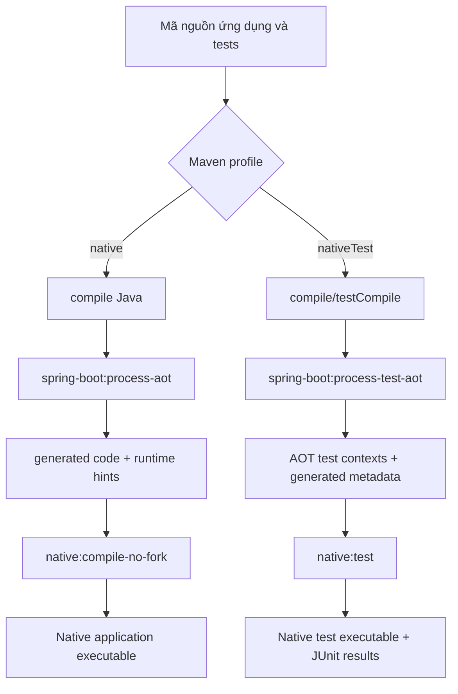
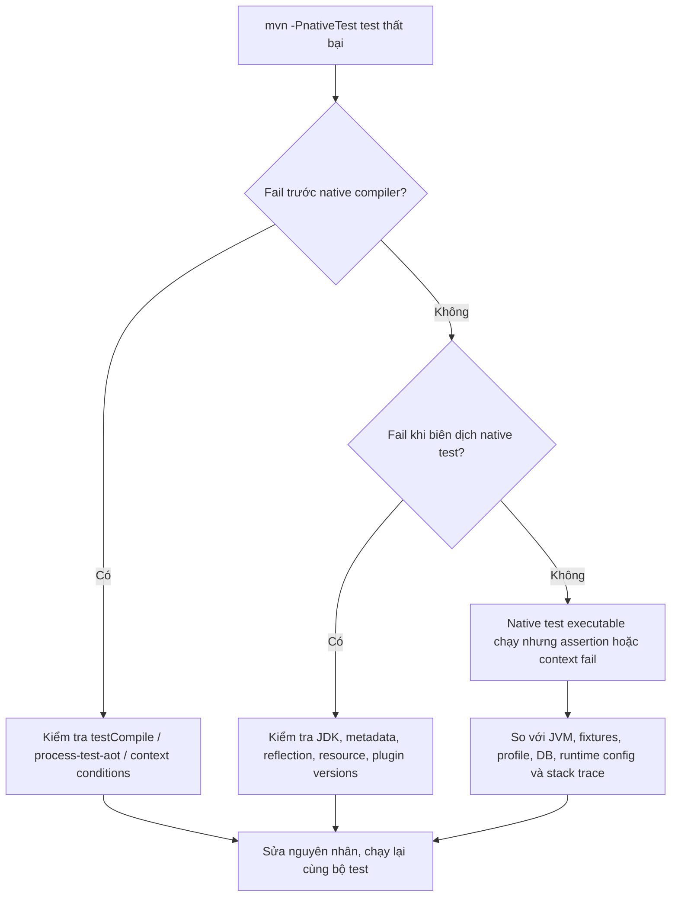

# Cấu hình AOT, native test khi không dùng Spring Boot parent

Một dự án Spring Boot có thể sử dụng Maven mà **không kế thừa** `org.springframework.boot:spring-boot-starter-parent`. Tình huống này thường gặp khi công ty có parent POM riêng, sử dụng Maven nhiều mô-đun hoặc muốn tự kiểm soát phiên bản plugin. Ứng dụng vẫn có thể được biên dịch thành **GraalVM Native Image** bằng Spring AOT và chạy kiểm thử trong native executable, nhưng các cấu hình Maven mà Spring Boot parent thường cung cấp phải được khai báo rõ.

Bài học thuộc chương **Maven** của mô-đun `SPRING_BOOT_NATIVE_IMAGE`. Trọng tâm là phân biệt **AOT cho ứng dụng** với **AOT cho test**, tạo hai Maven profile `native` và `nativeTest` khi không dùng Spring Boot parent, đọc quá trình thực thi và điều tra lỗi. Kết quả này làm nền cho kiểm thử tương thích, đo thời gian khởi động/bộ nhớ và đóng gói container của bản native.

## 1. Vì sao không dùng Spring Boot parent thì phải cấu hình thêm?

`spring-boot-starter-parent` mang theo nhiều mặc định tiện lợi, trong đó có:

- Quản lý phiên bản các dependency của Spring Boot.
- Một số thiết lập compiler, mã hóa UTF-8, metadata tên tham số và phiên bản Maven plugin.
- Execution của `spring-boot:repackage` để tạo executable JAR.
- Profile `native` để xử lý AOT cho ứng dụng và chuẩn bị Native Build Tools.
- Profile `nativeTest` để xử lý AOT cho test và thực thi test bằng Native Image.

Khi dùng một parent POM khác, ta vẫn có thể **import BOM** `spring-boot-dependencies` trong `dependencyManagement`. Tuy nhiên, import BOM chỉ quản lý **phiên bản dependency**, **không kế thừa** `pluginManagement`, plugin executions hay Maven profiles của `spring-boot-starter-parent`.

| Khai báo | Điều nó cung cấp | Điều nó không tự cung cấp |
| --- | --- | --- |
| Import `spring-boot-dependencies` dạng `type=pom, scope=import` | Phiên bản Spring Boot starters và thư viện được BOM quản lý | Phiên bản/mục tiêu thực thi của Spring Boot Maven plugin, profile `nativeTest` |
| `spring-boot-maven-plugin` | Các goal `repackage`, `process-aot`, `process-test-aot` | Execution tự động nếu bạn chỉ thêm plugin nhưng không cấu hình goal tương ứng |
| `native-maven-plugin` | Build native executable, chạy native tests, dùng reachability metadata | Tự suy ra mọi lựa chọn Spring AOT, bean graph hoặc nội dung tài nguyên còn thiếu |
| `maven-compiler-plugin` | Biên dịch Java, giữ metadata tham số khi bật `parameters` | Tự lấy cấu hình compiler như Spring Boot parent |
| `maven-surefire-plugin` | Chạy JUnit test trên JVM | Chạy test trong GraalVM Native Image nếu không có Native Build Tools và cấu hình AOT test |

**Quy tắc Maven quan trọng:** `<pluginManagement>` chỉ cung cấp cấu hình cho những plugin **được sử dụng/khai báo** ở `<build><plugins>`. Một entry chỉ xuất hiện trong `pluginManagement` không tự làm goal chạy. Tương tự, việc bạn tự đặt tên một profile là `nativeTest` không làm Maven tự sinh các execution giống Spring Boot parent.

## 2. Hiểu rõ hai đường build trước khi sửa `pom.xml`



Có ba loại tác vụ cần phân biệt:

1. **`spring-boot:process-aot`:** Spring phân tích ứng dụng, đánh giá các điều kiện bean phù hợp với môi trường build và sinh source/classes/resources/hints để phục vụ Native Image. Đây là bước cho **ứng dụng chính**.
2. **`spring-boot:process-test-aot`:** Spring Test AOT phân tích những `ApplicationContext` cần cho test dựa trên Spring TestContext/JUnit và sinh mã phù hợp. Đây là bước cho **test**, không thay thế hoàn toàn `process-aot` của ứng dụng trong mọi workflow.
3. **`native:test`:** Native Build Tools biên dịch một **native test executable**, bao gồm JUnit Platform engine và tests đã phát hiện, rồi chạy executable ấy. Đây không phải lệnh gửi HTTP request tới binary ứng dụng đã build ở `native`.

Sự tách biệt giúp tránh một ngộ nhận: **`mvn test` chạy trên JVM thành công không chứng minh `native:test` cũng chạy được**, vì reflection, proxies, resources và tập context cần tạo có thể được xử lý khác khi GraalVM phân tích.

## 3. Yêu cầu môi trường và phiên bản dùng trong ví dụ

Bài sử dụng một cấu hình **minh họa cụ thể** để bạn có thể thử trong dự án Maven `jar` nhỏ:

| Thành phần | Giá trị minh họa | Lưu ý |
| --- | --- | --- |
| Spring Boot | `3.5.16` | Ví dụ chọn nhánh Spring Boot 3.5.x; nếu dự án dùng nhánh khác, đồng bộ lại plugin và BOM. |
| Java / GraalVM JDK | `21` | Sử dụng bản GraalVM có `native-image` tương ứng Java 21; bảo đảm `JAVA_HOME` trỏ đúng toolchain. |
| GraalVM Native Build Tools Maven plugin | `0.10.6` | Phiên bản phù hợp trong tài liệu hỗ trợ Spring Boot 3.5.x; không mặc định dùng bản mới nhất của mọi plugin cho mọi nhánh Boot. |
| Maven Compiler Plugin | `3.14.1` | Bật `<release>21</release>` và `<parameters>true</parameters>`. |
| Maven Surefire Plugin | `3.5.4` | Hỗ trợ JUnit Platform; Native Build Tools cần Surefire đủ mới để chạy native tests. |
| Maven | `3.6.3+` cho Spring Boot 3.5.x | Dự án nên dùng `mvnw` để cố định bản Maven theo nhóm. |

Các số phiên bản ở trên minh họa **một bộ cấu hình**, không phải yêu cầu rằng mọi ứng dụng đều phải dùng đúng phiên bản ấy. Khi nâng Spring Boot/GraalVM, hãy xem compatibility matrix và tài liệu chính thức của phiên bản bạn dùng.

Kiểm tra công cụ trước khi build:

```bash
java -version
./mvnw --version
native-image --version
```

Nếu chưa có `native-image`, cài GraalVM phù hợp hoặc dùng phương án Cloud Native Buildpacks (đòi hỏi môi trường container). Trên Windows thay `./mvnw` bằng `mvnw.cmd`; build native trực tiếp còn cần công cụ C/C++ và môi trường hỗ trợ của hệ điều hành.

## 4. Tạo một ứng dụng và test nhỏ để quan sát

Ví dụ giả định cấu trúc:

```text
native-demo/
├── pom.xml
└── src/
    ├── main/java/com/example/nativebuild/
    │   ├── NativeBuildApplication.java
    │   └── HelloController.java
    └── test/java/com/example/nativebuild/
        └── NativeBuildApplicationTests.java
```

File `NativeBuildApplication.java`:

```java
package com.example.nativebuild;

import org.springframework.boot.SpringApplication;
import org.springframework.boot.autoconfigure.SpringBootApplication;

@SpringBootApplication
public class NativeBuildApplication {
    public static void main(String[] args) {
        SpringApplication.run(NativeBuildApplication.class, args);
    }
}
```

File `HelloController.java`:

```java
package com.example.nativebuild;

import java.util.Map;
import org.springframework.web.bind.annotation.GetMapping;
import org.springframework.web.bind.annotation.RestController;

@RestController
class HelloController {
    @GetMapping("/hello")
    Map<String, String> hello() {
        return Map.of("message", "Xin chào Native");
    }
}
```

File `NativeBuildApplicationTests.java`:

```java
package com.example.nativebuild;

import org.junit.jupiter.api.Test;
import org.springframework.beans.factory.annotation.Autowired;
import org.springframework.boot.test.context.SpringBootTest;

import static org.junit.jupiter.api.Assertions.assertEquals;

@SpringBootTest
class NativeBuildApplicationTests {
    @Autowired
    HelloController controller;

    @Test
    void springContextRegistersController() {
        assertEquals("Xin chào Native", controller.hello().get("message"));
    }
}
```

Test dùng `@SpringBootTest` để thật sự tạo Spring context và kiểm tra một bean nghiệp vụ. Đây là một phép **smoke test cho wiring**; kiểm thử hệ thống nên bổ sung các request HTTP, validation, JSON, resource, database và trường hợp lỗi dựa trên tính năng có thật.

## 5. `pom.xml` đầy đủ khi không kế thừa `spring-boot-starter-parent`

Cấu hình bên dưới là ví dụ một ứng dụng Spring Boot **độc lập, packaging JAR**, không có phần `<parent>`. Nếu tổ chức đã dùng parent POM riêng, giữ parent đó rồi **hợp nhất** những mục còn thiếu; tránh sao chép trùng execution/version khi parent công ty đã khai báo sẵn.

```xml
<?xml version="1.0" encoding="UTF-8"?>
<project xmlns="http://maven.apache.org/POM/4.0.0"
         xmlns:xsi="http://www.w3.org/2001/XMLSchema-instance"
         xsi:schemaLocation="http://maven.apache.org/POM/4.0.0
                             https://maven.apache.org/xsd/maven-4.0.0.xsd">
    <modelVersion>4.0.0</modelVersion>

    <groupId>com.example</groupId>
    <artifactId>native-demo</artifactId>
    <version>0.0.1-SNAPSHOT</version>
    <packaging>jar</packaging>

    <properties>
        <java.version>21</java.version>
        <project.build.sourceEncoding>UTF-8</project.build.sourceEncoding>
        <spring-boot.version>3.5.16</spring-boot.version>
        <native.buildtools.version>0.10.6</native.buildtools.version>
    </properties>

    <!-- Import BOM: quản lý dependencies, không mang theo Boot parent profiles. -->
    <dependencyManagement>
        <dependencies>
            <dependency>
                <groupId>org.springframework.boot</groupId>
                <artifactId>spring-boot-dependencies</artifactId>
                <version>${spring-boot.version}</version>
                <type>pom</type>
                <scope>import</scope>
            </dependency>
        </dependencies>
    </dependencyManagement>

    <dependencies>
        <dependency>
            <groupId>org.springframework.boot</groupId>
            <artifactId>spring-boot-starter-web</artifactId>
        </dependency>
        <dependency>
            <groupId>org.springframework.boot</groupId>
            <artifactId>spring-boot-starter-test</artifactId>
            <scope>test</scope>
        </dependency>
    </dependencies>

    <build>
        <plugins>
            <!-- Không có Spring Boot parent nên khai báo compiler rõ ràng. -->
            <plugin>
                <groupId>org.apache.maven.plugins</groupId>
                <artifactId>maven-compiler-plugin</artifactId>
                <version>3.14.1</version>
                <configuration>
                    <release>${java.version}</release>
                    <parameters>true</parameters>
                </configuration>
            </plugin>

            <plugin>
                <groupId>org.apache.maven.plugins</groupId>
                <artifactId>maven-surefire-plugin</artifactId>
                <version>3.5.4</version>
            </plugin>

            <plugin>
                <groupId>org.springframework.boot</groupId>
                <artifactId>spring-boot-maven-plugin</artifactId>
                <version>${spring-boot.version}</version>
                <configuration>
                    <mainClass>com.example.nativebuild.NativeBuildApplication</mainClass>
                </configuration>
                <executions>
                    <execution>
                        <id>repackage</id>
                        <goals>
                            <goal>repackage</goal>
                        </goals>
                    </execution>
                </executions>
            </plugin>
        </plugins>
    </build>

    <profiles>
        <!-- Build native application: mvn -Pnative package -->
        <profile>
            <id>native</id>
            <build>
                <plugins>
                    <plugin>
                        <groupId>org.springframework.boot</groupId>
                        <artifactId>spring-boot-maven-plugin</artifactId>
                        <executions>
                            <execution>
                                <id>process-aot</id>
                                <phase>process-classes</phase>
                                <goals>
                                    <goal>process-aot</goal>
                                </goals>
                            </execution>
                        </executions>
                    </plugin>

                    <plugin>
                        <groupId>org.graalvm.buildtools</groupId>
                        <artifactId>native-maven-plugin</artifactId>
                        <version>${native.buildtools.version}</version>
                        <extensions>true</extensions>
                        <configuration>
                            <!-- Raw compiled classes, không phải Boot repackaged JAR. -->
                            <classesDirectory>${project.build.outputDirectory}</classesDirectory>
                            <mainClass>com.example.nativebuild.NativeBuildApplication</mainClass>
                            <imageName>native-demo</imageName>
                        </configuration>
                        <executions>
                            <execution>
                                <id>reachability-metadata</id>
                                <phase>generate-resources</phase>
                                <goals>
                                    <goal>add-reachability-metadata</goal>
                                </goals>
                            </execution>
                            <execution>
                                <id>compile-native</id>
                                <phase>package</phase>
                                <goals>
                                    <goal>compile-no-fork</goal>
                                </goals>
                            </execution>
                        </executions>
                    </plugin>
                </plugins>
            </build>
        </profile>

        <!-- Native test: mvn -PnativeTest test -->
        <profile>
            <id>nativeTest</id>
            <build>
                <plugins>
                    <plugin>
                        <groupId>org.springframework.boot</groupId>
                        <artifactId>spring-boot-maven-plugin</artifactId>
                        <executions>
                            <execution>
                                <id>process-test-aot</id>
                                <phase>process-test-classes</phase>
                                <goals>
                                    <goal>process-test-aot</goal>
                                </goals>
                            </execution>
                        </executions>
                    </plugin>

                    <plugin>
                        <groupId>org.graalvm.buildtools</groupId>
                        <artifactId>native-maven-plugin</artifactId>
                        <version>${native.buildtools.version}</version>
                        <extensions>true</extensions>
                        <configuration>
                            <classesDirectory>${project.build.outputDirectory}</classesDirectory>
                        </configuration>
                        <executions>
                            <execution>
                                <id>native-test</id>
                                <phase>test</phase>
                                <goals>
                                    <goal>test</goal>
                                </goals>
                            </execution>
                        </executions>
                    </plugin>
                </plugins>
            </build>
        </profile>
    </profiles>
</project>
```

**Giải thích điểm thiết kế:** `repackage`, compiler và Surefire được khai báo ở build chung vì bản JVM cũng cần chúng. Hai profile `native` và `nativeTest` tách biệt để `mvn test` thường không vô tình build native, đồng thời `mvn -PnativeTest test` không phải build full application executable. Các executions trong profile có cùng `groupId:artifactId` với Spring Boot plugin ở build chung sẽ được Maven hợp nhất trong effective POM.

### 5.1. Vì sao cần `<parameters>true</parameters>`?

Spring MVC, constructor binding và nhiều cơ chế injection có thể cần biết **tên tham số**. Spring Boot parent thường giúp compiler tạo metadata tương ứng qua `-parameters`; ở đây ta chủ động bật nó bằng Maven Compiler Plugin. Không nên bỏ mặc default compiler level hoặc plugin version của Maven khi triển khai native.

### 5.2. Vì sao phải chỉ định `mainClass`?

Với dự án có nhiều lớp chứa `main()`, AOT/Boot plugin có thể chọn nhầm hoặc không chọn được entry point. Ở ví dụ này, `mainClass` được đặt rõ cho Boot plugin (lúc `repackage` và `process-aot`) và Native Build Tools (lúc `compile-no-fork`).

### 5.3. Vì sao dùng `classesDirectory`?

Spring Boot `repackage` tạo **executable fat JAR** theo layout riêng. Native Build Tools cần classpath mà compiler hiểu được; khi build native bằng raw compiled classes, ta dùng `${project.build.outputDirectory}` cùng các dependency để tránh xem fat JAR như một JAR phẳng thông thường. Nếu thay cách đóng gói hoặc dùng parent công ty, kiểm tra effective POM, classpath thực tế và output log.

### 5.4. Vai trò của `add-reachability-metadata`

Một số thư viện bên thứ ba cần metadata reflection/resource/proxy. Native Build Tools có thể tải metadata từ **GraalVM Reachability Metadata Repository**. Goal `add-reachability-metadata` hữu ích khi metadata cần được chuẩn bị như resource trong artifact phục vụ quy trình build khác, đặc biệt khi tạo container qua Buildpacks.

Nó **không thay thế** `RuntimeHints` của Spring và cũng không bảo đảm mọi thư viện đều đã tương thích. Với native build trực tiếp, plugin còn có cơ chế tự sử dụng reachability metadata theo cấu hình/version hiện hành. Không nên thêm metadata tràn lan khi chưa có lỗi hoặc chưa xác định thư viện liên quan.

## 6. Cách chạy từng pha và quan sát kết quả

Ở ví dụ dùng Maven Wrapper, chạy trong thư mục chứa `pom.xml`.

### 6.1. Kiểm tra bản JVM trước

```bash
./mvnw clean test
./mvnw package
java -jar target/native-demo-0.0.1-SNAPSHOT.jar
```

Trong terminal khác:

```bash
curl -i http://localhost:8080/hello
```

Kỳ vọng `HTTP 200` và JSON mang thông điệp `Xin chào Native`. Đây là **baseline**; việc JVM chạy đúng không chứng minh mọi native test sẽ pass.

### 6.2. Xem output AOT mà chưa build native

```bash
./mvnw -Pnative -DskipTests process-classes
```

Pha `process-classes` chạy sau compilation và kích hoạt execution `spring-boot:process-aot`. Tùy phiên bản, mã và tài nguyên sinh thường nằm dưới:

```text
target/
└── spring-aot/
    └── main/
        ├── sources/
        ├── resources/
        └── classes/
```

Hãy tìm mã đăng ký bean, lớp `ApplicationContextInitializer` và các resource/hint. Điều kiện `@Profile`, `@ConditionalOnProperty` ảnh hưởng bean graph có thể đã được đánh giá trong bước này; profile lúc build cần được kiểm soát.

### 6.3. Build native application

```bash
./mvnw -Pnative -DskipTests package
```

Với profile của bài này, `package` sẽ đi qua compilation, `process-aot`, `repackage` và `native:compile-no-fork`. Kết quả native thường ở `target/native-demo` trên Linux/macOS hoặc tên executable tương ứng hệ điều hành. Chạy:

```bash
./target/native-demo --server.port=8081
curl -i http://localhost:8081/hello
```

Thông điệp và status phải phù hợp với bản JVM. Không so sánh thời gian khởi động/bộ nhớ trước khi kiểm thử chức năng tương đương trên các endpoint và luồng có thật.

Nếu muốn giữ JVM unit tests khi build, bỏ `-DskipTests`. Flag này được dùng trong ví dụ để tách bước native compilation khỏi bước native test; không nên bật mặc định trong CI nơi test là điều kiện phát hành.

### 6.4. Chạy native tests

```bash
./mvnw -PnativeTest test
```

Đọc log theo ba dấu mốc:

1. `maven-compiler-plugin:testCompile` đã biên dịch test.
2. `spring-boot:process-test-aot` đã phân tích Spring TestContext và sinh mã/hints cho test.
3. `native-maven-plugin:test` đã build native test executable và chạy JUnit Platform trong executable ấy.

Native test có thể mất thời gian build đáng kể so với JVM tests. Test executable và báo cáo do Native Build Tools/Surefire tạo ra có vị trí tùy phiên bản và cấu hình; xem log cùng thư mục `target/` của bản build thay vì mặc định đoán chính xác tên file. Nếu không có test nào được phát hiện, không tính đó là một lần kiểm thử native thành công.

### 6.5. So sánh các lệnh hay bị nhầm

| Lệnh | Điều bạn thực sự kiểm tra/build |
| --- | --- |
| `./mvnw test` | JVM tests dùng Surefire; không chạy native nếu không có goal native được gắn vào phase. |
| `./mvnw -Pnative process-classes` | Biên dịch source và xử lý Spring AOT cho **ứng dụng**; chưa tạo executable. |
| `./mvnw -Pnative package` | Tạo executable native ứng dụng theo profile trong bài. |
| `./mvnw -PnativeTest test` | Xử lý AOT cho **test** và chạy test trong native executable. |
| `./mvnw -PnativeTest -DskipNativeTests test` | Bỏ qua native test; không thể dùng kết quả này để tuyên bố đã kiểm thử native. |
| `./mvnw -Pnative -DskipTests package` | Build native ứng dụng, bỏ JVM tests ở lượt build đó; không thay cho native test. |

Đặc biệt, `mvn -Pnative native:compile` và `mvn -Pnative package` **không hoàn toàn đồng nghĩa** trong mọi POM. Goal `compile` có thể tự fork lifecycle theo plugin, còn `compile-no-fork` được thiết kế gắn vào phase khi Maven đã biên dịch các phần cần thiết. Với cấu hình phía trên, dùng `package` để đi đúng những executions đã khai báo.

## 7. Đảm bảo Spring AOT nhận đúng cấu hình khi build

Spring AOT phân tích ApplicationContext **trước runtime**. Các cấu hình quyết định bean nào tồn tại phải được chọn lúc xử lý AOT, không chỉ truyền khi chạy native executable.

Ví dụ:

```java
@Configuration(proxyBeanMethods = false)
class AuditConfiguration {
    @Bean
    @ConditionalOnProperty(name = "feature.audit.enabled", havingValue = "true")
    AuditWriter auditWriter() {
        return new AuditWriter();
    }
}
```

Nếu `feature.audit.enabled` vắng mặt hoặc sai khi `process-aot` chạy, bean có thể bị loại khỏi generated registrations. Sau đó, việc chạy executable với `--feature.audit.enabled=true` không nhất thiết đưa bean đã bị loại trở lại.

Có thể chỉ định Spring profiles cho `process-aot` trong plugin configuration, ví dụ:

```xml
<plugin>
    <groupId>org.springframework.boot</groupId>
    <artifactId>spring-boot-maven-plugin</artifactId>
    <executions>
        <execution>
            <id>process-aot</id>
            <goals><goal>process-aot</goal></goals>
            <configuration>
                <profiles>
                    <profile>native-build</profile>
                </profiles>
            </configuration>
        </execution>
    </executions>
</plugin>
```

Đây là đoạn minh họa **để tích hợp vào execution sẵn có**, không phải thêm một execution trùng ID/goal vào `pom.xml` mẫu. Một cách khác là truyền các property phù hợp cho quá trình AOT theo tham số mà Spring Boot Maven plugin hỗ trợ. Cần phân biệt `-Pnative` (Maven profile) với `spring.profiles.active` (Spring application profile): chúng không tự là một.

Các giá trị môi trường như port, URL database, timeout hoặc `@Value` của bean đã được đăng ký thường có thể thay đổi giữa các lần chạy, nhưng vẫn cần kiểm tra xem chúng có ảnh hưởng đến lựa chọn bean hay không.

## 8. Native test không giống test chạy trên JVM

Bản test JUnit có thể chạy tốt trên JVM nhưng lỗi trong native mode vì:

- **Test context được dựng khác:** những điều kiện, customizers hay cấu hình chỉ có ở runtime có thể không tương thích với xử lý AOT.
- **Reflection và proxy:** thư viện hoặc test fixture tạo lớp theo tên chuỗi, mock hoặc proxy động mà AOT không dự đoán đủ.
- **Resources và serialization:** fixture JSON, template, file schema, properties hoặc thư viện serialize cần metadata/thông tin đóng gói phù hợp.
- **Dịch vụ bên ngoài:** test phụ thuộc database, container, chứng chỉ hoặc endpoint; có thể lỗi do môi trường, không phải Native Image.
- **Discovery:** native test executable có thể không phát hiện test nếu JUnit Platform/Surefire versions hoặc test naming không phù hợp.

Khi có lỗi, hãy khoanh vùng:



### 8.1. Xem trạng thái profile và execution thực tế

Maven xác định plugin executions từ **effective POM**, bao gồm parent công ty, plugin management, profiles và những khai báo con. Vì vậy, khi goal không chạy, hãy kiểm tra:

```bash
./mvnw help:active-profiles -PnativeTest
./mvnw help:effective-pom -PnativeTest
./mvnw help:effective-pom -Pnative
```

Tìm trong output những execution `process-aot`, `process-test-aot`, `compile-no-fork`, `test` và plugin version. Nếu chỉ thấy plugin trong `<pluginManagement>` mà không có execution đang được kích hoạt, nguyên nhân thường là thiếu cấu hình ở `<build><plugins>` của mô-đun ứng dụng.

Để giảm log lúc xem, có thể dùng `-Doutput=effective-pom.xml` trong **dự án thực hành**; lệnh sẽ ghi file vào nơi bạn chạy. Không đưa file chứa thông tin nhạy cảm của môi trường build vào nguồn kiểm soát phiên bản.

### 8.2. Phân biệt tùy chọn bỏ qua test

| Tùy chọn | Ý nghĩa thực tế |
| --- | --- |
| `-DskipTests` | Bỏ thực thi JVM tests và thường được Native Build Tools tôn trọng để không chạy native tests; vẫn có thể biên dịch test tùy lifecycle. |
| `-Dmaven.test.skip=true` | Bỏ cả compile test theo cấu hình Maven; `process-test-aot` không có dữ liệu test để phân tích. |
| `-DskipNativeTests` | Chỉ bỏ native tests của Native Build Tools, trong khi JVM tests vẫn có thể chạy. |

Đừng đánh dấu CI native-test thành công nếu lệnh có cờ khiến bước native bị skip. Tương tự, test chạy JVM với cờ kích hoạt Spring AOT mode chỉ giúp kiểm tra mã AOT sinh trên JVM; đó không phải phép kiểm tra bằng native executable.

## 9. Lỗi thường gặp khi cấu hình Maven không dùng parent

| Hiện tượng | Nguyên nhân đáng kiểm tra | Hướng xử lý |
| --- | --- | --- |
| `mvn -Pnative package` chỉ tạo JAR | Profile không có hoặc không activate; thiếu execution `compile-no-fork` | Xem `help:active-profiles` và effective POM, gắn goal đúng phase. |
| Không thấy `target/spring-aot/main` | Thiếu `process-aot` hoặc goal bị skip, build chưa tới phase | Kiểm tra log Maven và execution `process-classes`. |
| `Unknown lifecycle phase/native goal` | Nhầm goal, chưa khai báo đúng plugin, typo tên profile | Kiểm tra `groupId/artifactId`, plugin version và cú pháp Maven. |
| `No main manifest attribute` hoặc không tìm được main class | Native plugin nhìn sai JAR hoặc không có entry point rõ ràng | Đặt `mainClass`, dùng raw `classesDirectory`, kiểm tra classpath. |
| Native test không phát hiện test | JUnit Platform/ Surefire quá cũ, test classes không compile, test AOT bị skip | Cập nhật plugin phù hợp, kiểm tra `process-test-aot` và log test discovery. |
| Native compiler báo unsupported reflection/proxy | Thiếu Runtime Hints hoặc third-party metadata | Truy stack trace/đường gọi, thêm hint tối thiểu hoặc cập nhật thư viện tương thích. |
| Resource có ở JVM nhưng native không tìm được | Resource chưa được đóng gói vào native image | Kiểm tra classpath path và `RuntimeHints.resources()`. |
| Bean có ở JVM nhưng mất trên native | `@Profile`/`@ConditionalOnProperty` khác lúc AOT | Đối chiếu cấu hình build và generated bean registrations. |
| Build lỗi trên Windows/Linux container | GraalVM toolchain C/C++, hệ điều hành, kiến trúc hoặc môi trường builder | Kiểm tra `native-image --version`, compiler/linker và target platform. |
| Build nhiều mô-đun bị lỗi ở aggregator `pom` | Native plugin chạy ở mô-đun không có `mainClass` hoặc test | Chỉ kích hoạt executions ở module ứng dụng; dùng pluginManagement ở parent và khai báo plugin tại module đích. |

Khi sửa reflection hay resource, phải build lại native artifact và chạy lại native tests; chỉnh Maven profile hoặc cấu hình AOT có thể thay đổi **cấu trúc ứng dụng đã đóng vào binary**. Tránh giải quyết vấn đề bằng cách bỏ kiểm thử hoặc khai báo reflection cho mọi lớp khi chưa xác định điểm thiếu.

## 10. Trường hợp công ty có parent POM và nhiều mô-đun

Trong Maven multi-module, parent công ty thường có:

```text
company-parent/                 (packaging: pom)
├── pom.xml                     (pluginManagement/dependencyManagement)
├── native-core/                (library module)
└── native-api/                 (Spring Boot application module)
```

Cách tổ chức khuyến nghị:

1. Đặt **phiên bản** Spring Boot, Java, Maven plugins và BOM vào `dependencyManagement`/`pluginManagement` ở nơi tổ chức kiểm soát.
2. Ở module `native-api`, khai báo **plugin thực sự sử dụng** tại `<build><plugins>` và executions cần thiết cho ứng dụng/test.
3. Không gắn `native:compile-no-fork` hoặc `native:test` một cách vô điều kiện cho tất cả module `pom` hoặc library không có entry point/test.
4. Kiểm tra effective POM của **module ứng dụng**, không chỉ POM của aggregator.
5. Khi dùng `-pl :native-api -am`, xác định phạm vi reactor và bảo đảm các module phụ thuộc vẫn được build mà không bị buộc tạo native binary nếu chúng chỉ là library.

Ví dụ gọi Maven từ gốc reactor (chỉ minh họa khi đã cấu hình executions ở module phù hợp):

```bash
./mvnw -pl :native-api -am -Pnative package
./mvnw -pl :native-api -am -PnativeTest test
```

Các lệnh trên có thể chạy qua module phụ thuộc. Nếu profile native được cấu hình ở parent sao cho nó áp dụng đồng loạt, phần `-am` vẫn có thể kích hoạt goal native ở module không mong muốn. Cần rà `effective-pom` và giới hạn scope execution trước khi dùng trong CI.

## 11. Vị trí của native tests trong quy trình phát triển

Native compilation và native test image thường tốn nhiều thời gian và RAM hơn JVM test. Một quy trình hợp lý:

| Giai đoạn | Bước kiểm tra | Mục tiêu |
| --- | --- | --- |
| Khi sửa mã hằng ngày | `mvn test` | Phản hồi nhanh, bao phủ unit/integration tests trên JVM. |
| Trước khi tạo bản native | `mvn -PnativeTest test` | Phát hiện vấn đề Spring Test AOT, reflection/resource/proxy khi chạy test bằng native executable. |
| Trước khi phát hành | `mvn -Pnative package` + chạy request suite | Kiểm tra binary ứng dụng thực sự, HTTP contract và kết nối thực tế. |
| Khi đóng gói container | Build native container + chạy cùng request suite | Xác định các khác biệt do DNS, timezone, TLS, volumes, runtime image. |
| Khi đánh giá hiệu năng | Đo cold start, RSS, CPU và latency sau parity | So sánh JVM/native công bằng, không bỏ qua chức năng. |

Có thể chạy native tests trong CI theo nhịp phù hợp với chi phí của dự án; **không dùng tốc độ build làm lý do bỏ hẳn những case nhạy với native**. Ngoài `@SpringBootTest`, nên ưu tiên những test thật sự chạm vào JSON, template, database driver, reflection, TLS và các framework extension khó suy luận tĩnh.

## 12. Checklist tự xác minh

- [ ] `pom.xml` không có `spring-boot-starter-parent` nhưng có BOM hoặc dependency versions được quản lý rõ.
- [ ] Đã khai báo Spring Boot Maven plugin đúng version, goal `repackage` và `mainClass`.
- [ ] Maven compiler được ghim version, `release` phù hợp và bật `parameters`.
- [ ] Native profile có `process-aot` và Native Build Tools `compile-no-fork` ở phase thích hợp.
- [ ] `classesDirectory` trỏ tới raw compiled classes, tránh nhầm repackaged JAR.
- [ ] NativeTest profile có `process-test-aot` và `native:test`, dùng Surefire tương thích JUnit Platform.
- [ ] `mvn test` trên JVM chạy thành công với test thực sự được phát hiện.
- [ ] `mvn -PnativeTest test` thực sự tạo và chạy native test executable; không bị skip.
- [ ] `mvn -Pnative package` tạo được native application và endpoint `/hello` trả đúng.
- [ ] Biến môi trường/profile tại AOT build phù hợp với bean graph cần có trong binary.
- [ ] Với dự án multi-module, plugin executions chỉ chạy ở module phù hợp.
- [ ] Đã kiểm thử các endpoint và tác dụng phụ nghiệp vụ trước khi so thời gian khởi động/bộ nhớ.

### Câu hỏi tự luyện tập

1. Vì sao chỉ import `spring-boot-dependencies` mà chưa khai báo `spring-boot-maven-plugin` sẽ không tự có `nativeTest`?
2. Điều gì khác nhau giữa `process-aot` và `process-test-aot` về đối tượng được phân tích?
3. Tại sao `mvn test` thành công không đủ chứng minh khả năng chạy test bằng Native Image?
4. Vì sao `native:compile-no-fork` hợp lý khi đã gắn với phase `package`, còn gọi goal trực tiếp cần xem kỹ lifecycle?
5. Lỗi `No main manifest attribute` có liên quan gì đến việc dùng repackaged JAR thay cho raw classpath?
6. Một module có `packaging=pom` không có `mainClass` gặp lỗi trong native build của reactor: bạn cần kiểm tra phần nào trong effective POM?

## Tài liệu tham khảo và cách cập nhật theo phiên bản

- [Spring Boot Maven Plugin — Using the Plugin](https://docs.spring.io/spring-boot/3.5/maven-plugin/using.html): BOM, cấu hình khi không kế thừa parent, main class và plugin executions.
- [Spring Boot Maven Plugin — Ahead-of-Time Processing](https://docs.spring.io/spring-boot/3.5/maven-plugin/aot.html): `process-aot`, `process-test-aot` và mục đích native profiles.
- [Spring Boot — Testing GraalVM Native Images](https://docs.spring.io/spring-boot/3.5/how-to/native-image/testing-native-applications.html): native tests, JVM AOT mode và yêu cầu khi không dùng parent.
- [GraalVM Native Build Tools — Maven Plugin](https://graalvm.github.io/native-build-tools/0.10.6/maven-plugin.html): `compile-no-fork`, `test`, `classesDirectory`, skip flags và reachability metadata.
- [Spring Boot — System Requirements](https://docs.spring.io/spring-boot/3.5/system-requirements.html): phiên bản Java, Maven, GraalVM và Native Build Tools phù hợp với nhánh 3.5.

Các đường dẫn tài liệu được ghim theo nhánh hoặc phiên bản tương ứng với `pom.xml` minh họa. Khi dự án chuyển sang Spring Boot 4.x hoặc Native Build Tools mới hơn, xem lại mục tiêu plugin và phiên bản tương thích trước khi chép các executions.

**Kết quả cần đạt:** khi không sử dụng `spring-boot-starter-parent`, vẫn có một `pom.xml` kiểm soát được hai con đường riêng biệt: **Spring AOT + build native application** và **Spring Test AOT + native tests**. Đọc được effective POM, log từng phase và kết quả trên native executable sẽ giúp phát hiện sai khác chức năng trước khi tiến hành tối ưu cold start, bộ nhớ hoặc phát hành container.
