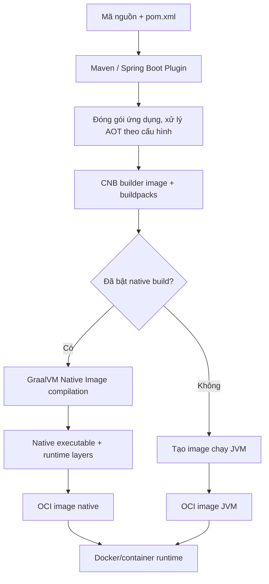
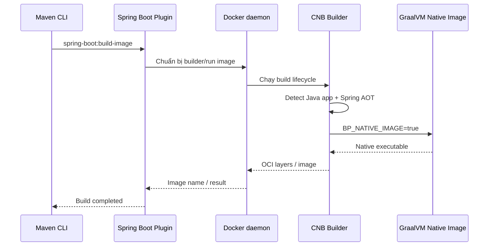
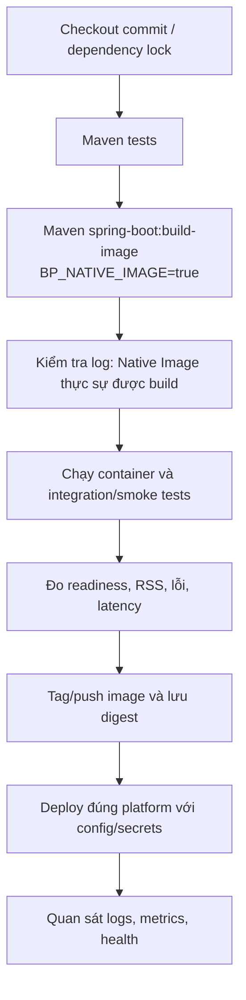

# `spring-boot:build-image` để tạo container image native

Khi triển khai **Spring Boot Native Image**, mục tiêu không chỉ là tạo một tệp thực thi bằng GraalVM mà còn phải đưa tệp đó vào một **container image** có thể chạy trên máy chủ hoặc nền tảng điều phối. Với Maven, goal **`spring-boot:build-image`** của **Spring Boot Maven Plugin** cho phép tạo OCI image bằng **Cloud Native Buildpacks**. Khi được cấu hình đúng để bật native compilation, buildpacks sẽ dùng GraalVM Native Image và Spring AOT để tạo image có ứng dụng chạy dạng native executable.

Điểm quan trọng: **chạy `spring-boot:build-image` một mình không bảo đảm image là native**. Nếu không bật và kiểm chứng đường build native, buildpacks có thể đóng gói ứng dụng **JVM** như bình thường. Bài này hướng dẫn cách cấu hình, build, quan sát log, chạy và xác nhận kết quả thật.

## 1. Mục tiêu học tập

Sau bài học, bạn có thể:

- Giải thích vai trò của Maven goal `spring-boot:build-image`, Cloud Native Buildpacks, builder image và run image.
- Phân biệt `spring-boot:build-image`, `native:compile` và cách đóng gói JAR thông thường.
- Cấu hình **`BP_NATIVE_IMAGE=true`** và native Maven profile phù hợp để build OCI image có native executable.
- Chạy container, kiểm tra cổng, health/readiness, log và những dấu hiệu xác nhận build native.
- Thiết lập tên/tag image, xử lý việc push image và quản lý thông tin phiên bản khi đưa image vào CI/CD.
- Chẩn đoán các lỗi môi trường build, bộ nhớ native compiler, reflection, resource và tương thích nền tảng.
- Đo startup, RSS và kích thước image, so sánh với phiên bản JVM trong điều kiện tương đương.

## 2. `spring-boot:build-image` hoạt động như thế nào?

`spring-boot:build-image` là goal của plugin `org.springframework.boot:spring-boot-maven-plugin`. Nó phối hợp với **Cloud Native Buildpacks (CNB)** để tạo **OCI container image**, thường thông qua một Docker daemon/API tương thích. Người dùng không bắt buộc tự viết `Dockerfile` cho luồng này.

Một quy trình tổng quát:



### Các thành phần tham gia

| Thành phần | Vai trò |
| --- | --- |
| **Maven** | Đọc `pom.xml`, gọi plugin, điều phối các goal và dependencies |
| **Spring Boot Maven Plugin** | Thực hiện goal `build-image`, phối hợp đóng gói và gọi quy trình buildpacks |
| **Builder image** | Môi trường xây dựng có lifecycle và các buildpacks phù hợp |
| **Buildpacks** | Phát hiện ứng dụng, chọn các dependency/toolchain và tạo các lớp image |
| **Spring AOT** | Chuẩn bị mã và metadata cấu hình Spring để hỗ trợ native compilation |
| **GraalVM Native Image** | Phân tích và biên dịch ứng dụng thành executable native |
| **Run image** | Cung cấp các thành phần hệ điều hành/runtime mà application layers cần khi chạy |
| **OCI image** | Artifact đóng gói, gắn tag, có thể chạy bằng Docker hoặc runtime OCI tương thích |

**Builder image và run image khác nhau.** Builder mang công cụ biên dịch, có thể lớn và tốn nhiều RAM khi tạo Native Image. Run image là nền tảng của image kết quả; chỉ cần đủ thành phần vận hành. Vì vậy kích thước builder không phải kích thước image được triển khai và RAM dùng để biên dịch không phải mức RAM của ứng dụng đang phục vụ request.

### Buildpacks không đồng nghĩa với Native Image

Các Java buildpack phổ biến có thể tạo image JVM với JRE và application layers. Để tạo **native image**, cần bật cơ chế native theo phiên bản builder/buildpack đang dùng. Với các Java Native Image buildpack thuộc hệ sinh thái Paketo thường gặp, biến môi trường buildpack **`BP_NATIVE_IMAGE=true`** là một cách bật chế độ native.

Không nên suy ra image là native chỉ từ tên tag, tên goal, việc sử dụng GraalVM ở máy host hoặc vì image được tạo bằng buildpacks. Phải xác nhận rõ **chế độ build và artifact bên trong**.

## 3. Điều kiện tiên quyết

Giả sử dự án là Spring Boot được Maven quản lý và đã hỗ trợ AOT/Native Image. Trước khi chạy `build-image` cần chuẩn bị:

1. **JDK và Maven/Maven Wrapper** tương thích với phiên bản Spring Boot hiện tại để chạy Maven build.
2. **Spring Boot Maven Plugin** trong `pom.xml` và cấu hình native phù hợp với phiên bản Spring Boot/GraalVM đang dùng.
3. **Docker daemon/API tương thích** đang hoạt động, có đủ quyền truy cập từ tiến trình Maven và có thể tải builder/run images.
4. **Mạng và quyền truy cập artifact repositories** cho Maven cũng như các buildpacks cần tải dependency/toolchain.
5. **CPU, RAM và dung lượng đĩa** đủ cho GraalVM Native Image compiler bên trong builder.
6. **OS/CPU architecture mục tiêu** được hỗ trợ bởi builder/run image và môi trường chạy ứng dụng.

Một lợi thế quan trọng của cách build bằng CNB là **máy host không nhất thiết phải cài trực tiếp GraalVM Native Image**; buildpack có thể cung cấp toolchain bên trong builder. Host vẫn cần Java/Maven để thực hiện các bước Maven tương ứng và Docker để chạy builder. Điều kiện cụ thể phụ thuộc cấu hình plugin và các execution được gắn vào Maven lifecycle.

Để kiểm tra nền tảng trước build:

```bash
java -version
./mvnw -version
docker version
docker info
```

`docker version` có thể hiển thị cả client và server. Nếu không kết nối được server/daemon, việc cài Maven plugin thôi chưa đủ để tạo image.

**Lưu ý về phạm vi:** các ví dụ lệnh dùng `./mvnw` trên Linux/macOS; trên Windows có thể dùng `mvnw.cmd`. Tên ứng dụng, cổng và registry trong ví dụ cần thay bằng giá trị của dự án thật.

## 4. Cấu hình Maven để tạo native container image

### 4.1. Cấu hình cơ bản trong `pom.xml`

Ví dụ cấu hình `spring-boot-maven-plugin` cho một ứng dụng minh họa tên `order-service`:

```xml
<build>
    <plugins>
        <plugin>
            <groupId>org.springframework.boot</groupId>
            <artifactId>spring-boot-maven-plugin</artifactId>
            <configuration>
                <image>
                    <name>example/order-service:1.0.0</name>
                    <env>
                        <BP_NATIVE_IMAGE>true</BP_NATIVE_IMAGE>
                    </env>
                </image>
            </configuration>
        </plugin>
    </plugins>
</build>
```

Ý nghĩa:

- `<name>` đặt tên và tag cho OCI image được tạo; ở đây là `example/order-service:1.0.0`.
- `<env>` truyền biến môi trường tới **quá trình buildpacks build image**. `BP_NATIVE_IMAGE=true` yêu cầu buildpack hỗ trợ chế độ Native Image.
- Plugin Spring Boot cần được quản lý phiên bản phù hợp, thường thông qua parent/BOM/plugin management của dự án.

Đây là **đoạn cấu hình plugin**, không phải `pom.xml` đầy đủ. Dự án vẫn cần dependencies, Java version, repository và công cụ build liên quan. Không nên copy một cấu hình plugin phiên bản khác mà không kiểm tra tài liệu của phiên bản Spring Boot/buildpacks đang sử dụng.

Khi `pom.xml` đã cấu hình rõ `BP_NATIVE_IMAGE=true`, goal được gọi như sau:

```bash
./mvnw spring-boot:build-image
```

Nếu dự án cung cấp Maven profile tên `native` cho đường build này, có thể dùng:

```bash
./mvnw -Pnative spring-boot:build-image
```

**`-Pnative` chỉ có ý nghĩa khi profile `native` tồn tại và cấu hình phù hợp trong dự án.** Đây là tên profile thường gặp ở các project Spring Boot hỗ trợ Native Build Tools, không phải một chế độ magic của Maven áp dụng giống nhau cho mọi `pom.xml`. Vì vậy phải hiểu profile đó bật những plugin, goals, AOT options và environment nào.

Đặc biệt, khi muốn Native Image được biên dịch **bên trong buildpacks builder**, hãy kiểm tra profile có vô tình ràng buộc một bước `native:compile` chạy **trên máy host** vào vòng đời `package` hay không. Nếu có, quá trình có thể đòi GraalVM trên host và biên dịch trùng bước.

### 4.2. Đặt tên image từ dòng lệnh

Có thể ghi đè image name bằng thuộc tính plugin Spring Boot:

```bash
./mvnw spring-boot:build-image \
  -Dspring-boot.build-image.imageName=example/order-service:1.0.1
```

Ví dụ này giả định `BP_NATIVE_IMAGE=true` đã nằm trong cấu hình plugin, hoặc có một cấu hình native build tương đương. Đổi tên image **không tự bật native compilation**.

Trong pipeline, thường nên tạo tag từ phiên bản ứng dụng hoặc commit SHA; lưu lại image digest sau khi publish để biết chính xác artifact đã được kiểm thử và triển khai.

### 4.3. Cấu hình builder/run image khi cần

Spring Boot Maven Plugin hỗ trợ tùy chọn `builder` và `runImage`. Ví dụ cấu trúc:

```xml
<configuration>
    <image>
        <name>example/order-service:1.0.0</name>
        <builder>your-compatible-builder-image</builder>
        <runImage>your-compatible-run-image</runImage>
        <env>
            <BP_NATIVE_IMAGE>true</BP_NATIVE_IMAGE>
        </env>
    </image>
</configuration>
```

`your-compatible-builder-image` và `your-compatible-run-image` là **placeholder**, phải thay bằng **tên image thật** thuộc một cặp tương thích. Không chọn tùy tiện builder và run image chỉ vì chúng có kích thước nhỏ. Cần kiểm tra hỗ trợ Java/Native Image, OS, architecture, libc/ABI, lifecycle và các thành phần run image mà executable cần.

Đối với bài thực hành cơ bản, **giữ bộ builder/run image mặc định được plugin hỗ trợ** thường đơn giản hơn. Khi cần tùy chỉnh, nên chốt phiên bản hoặc digest và kiểm thử chính xác final image trên nền tảng đích.

## 5. Thực hành build OCI image native

Giả sử:

- Dự án Spring Boot có một endpoint HTTP tại `/hello`.
- `pom.xml` đã cấu hình plugin ở mục 4 với `BP_NATIVE_IMAGE=true`.
- Docker đang chạy, Maven Wrapper hoạt động và builder hỗ trợ native compilation.
- Image cần tạo là `example/order-service:1.0.0`.

Chạy:

```bash
./mvnw clean spring-boot:build-image
```

Lệnh `clean` xóa output build Maven trước đó để giảm nguy cơ dùng artifact cũ. Quá trình có thể thực hiện các bước tương tự:

1. Maven đọc source/dependencies và tạo artifact Spring Boot theo cấu hình project.
2. Spring Boot plugin kết nối Docker daemon, chọn builder/run image và đưa nội dung ứng dụng vào quy trình CNB.
3. Buildpacks nhận diện Java/Spring Boot application; khi chế độ native được bật, chuẩn bị những phần cần thiết cho Spring AOT và GraalVM Native Image.
4. Native Image compiler phân tích mã có thể truy cập, áp dụng metadata/hints và tạo executable.
5. CNB lifecycle đóng gói executable cùng những runtime layers cần thiết thành OCI image.
6. Image xuất hiện trong image store của Docker daemon được cấu hình, hoặc được publish theo lựa chọn build.

**Tên phase và thứ tự log** có thể khác giữa các phiên bản Spring Boot Plugin, builder và buildpacks. Mấu chốt là theo dõi log có **native-image compilation** thật sự và build kết thúc thành công.



### Nhận diện build native trong log

Các thông điệp chính xác không cố định theo phiên bản, nhưng hãy tìm bằng chứng về **Java Native Image buildpack / native-image toolchain**, các pha phân tích/biên dịch native và việc tạo artifact executable. Ngược lại, nếu log chỉ cho thấy Java runtime/JRE được đóng gói cùng JAR, đó có thể là **image JVM**.

Đừng dùng mỗi dấu hiệu `BUILD SUCCESS` để kết luận native compilation đã được thực hiện. Maven cũng báo thành công khi tạo image JVM hợp lệ.

### Sau khi Maven build xong

Kiểm tra image đã xuất hiện:

```bash
docker image ls example/order-service
docker image inspect example/order-service:1.0.0
```

Lệnh `inspect` cho biết metadata của OCI image, OS/architecture, configuration và các trường cần thiết để chẩn đoán. Nó **không tự xác nhận** toàn bộ ứng dụng bên trong là Native Image: cần kết hợp log build, nội dung/layers và kiểm thử chạy.

## 6. Chạy và xác minh ứng dụng native trong container

Ví dụ Spring Boot lắng nghe cổng 8080:

```bash
docker run --rm --name order-native \
  -p 8080:8080 \
  example/order-service:1.0.0
```

Ở terminal khác:

```bash
curl -fsS http://localhost:8080/hello
```

Nếu ứng dụng cấu hình Spring Boot Actuator và readiness probe:

```bash
curl -fsS http://localhost:8080/actuator/health/readiness
```

Endpoint readiness chỉ hoạt động khi dự án thêm dependency và cấu hình phù hợp. Nếu chưa có, dùng endpoint phù hợp của chính service. Khi cần cấu hình cổng khác, kiểm tra `server.port` và Docker `-p`.

### Kiểm tra metadata, logs và tài nguyên

```bash
# Từ terminal khác khi container vẫn chạy
docker logs order-native
docker stats --no-stream order-native

# Kiểm tra platform của image
docker image inspect \
  --format '{{.Os}}/{{.Architecture}}' \
  example/order-service:1.0.0
```

Một số image buildpacks khởi chạy ứng dụng qua **CNB launcher**. Vì vậy thấy launcher trong metadata `Entrypoint` không đồng nghĩa nó chứa JVM; cần xác định ứng dụng được launcher thực thi là **native executable** hay `java`. Mặt khác, thấy lệnh `java -jar` trong đường chạy sẽ là dấu hiệu image chưa đi theo cách native mong muốn.

**Cách xác minh đủ tin cậy:** lưu log build có Native Image compiler, kiểm tra setting native build và kiểm thử artifact trong image đích. Nếu cần kiểm tra bytecode/binary trực tiếp, có thể dùng công cụ inspection trong môi trường debug tương thích để xem file thực thi mà launcher gọi; image runtime nhỏ có thể không có `sh`, `file` hay `ldd`.

### Startup và bộ nhớ

Giả thuyết cần kiểm chứng là bản native có thể khởi động nhanh và dùng ít bộ nhớ hơn bản JVM trong một số workload. Hãy ghi:

- **Startup đến readiness:** từ lúc tạo container/process đến khi endpoint ứng dụng phục vụ được request.
- **RSS/working set:** bộ nhớ cư trú của tiến trình/container khi idle và khi có tải.
- **Latency p50/p95/p99 và throughput:** chạy cùng kịch bản request, dữ liệu và ngưỡng tài nguyên.
- **Thời gian build và image size:** đo riêng chi phí biên dịch native và chi phí phân phối.

So sánh trên **cùng commit, dependency, cổng, cấu hình và giới hạn CPU/RAM**. Không suy từ cold-start tốt hơn rằng throughput luôn tốt hơn, hoặc lấy mức RAM Native Image compiler ở builder làm mức RAM của service runtime.

## 7. Đưa image lên container registry

Nếu Maven build tạo image trong local Docker daemon, có thể push theo quy trình Docker thông thường:

```bash
# Đăng nhập registry bằng cơ chế quản lý credential phù hợp
docker login registry.example.com

# Gắn tag cho image đã tạo
docker tag example/order-service:1.0.0 \
  registry.example.com/team/order-service:1.0.0

# Push image
docker push registry.example.com/team/order-service:1.0.0
```

`registry.example.com` là tên minh họa, phải thay bằng registry thật. Không viết mật khẩu/token vào `pom.xml`, shell history hoặc build log. Khi chạy CI, dùng credential store, secret provider hoặc phương thức xác thực dành cho CI của registry.

Spring Boot Maven Plugin cũng có tùy chọn **publish image trực tiếp** qua `build-image` trong cấu hình và phiên bản plugin hỗ trợ. Dù dùng phương án nào, nên xác nhận:

1. Image đã build và kiểm thử là đúng bản native.
2. Repo, tag, OS/architecture của image phù hợp registry và môi trường chạy.
3. Digest của artifact đã kiểm thử được giữ nguyên trong quá trình promotion.
4. Registry access và secrets được quản lý bên ngoài source code.

Một tag như `latest` có thể bị thay đổi. Đối với production, định danh bằng commit/tag version cộng với **image digest** giúp truy vết chính xác hơn.

## 8. So sánh `build-image` với `native:compile` và Dockerfile

| Cách làm | Đầu ra chính | Nơi biên dịch | Trách nhiệm đóng gói |
| --- | --- | --- | --- |
| `./mvnw package` | JAR Spring Boot | Maven/JDK trên môi trường build | Chưa có OCI image |
| `./mvnw -Pnative native:compile` | Native executable ở filesystem, khi đã cấu hình plugin | Toolchain GraalVM của môi trường thực hiện goal | Cần cơ chế đóng gói image riêng |
| `./mvnw spring-boot:build-image` với native mode | OCI image chứa Native Image | GraalVM/native compilation do CNB builder cung cấp theo cấu hình | Buildpacks quản lý các layer và runtime image |
| Multi-stage `Dockerfile` | OCI image native | Builder stage do Dockerfile định nghĩa | Người viết Dockerfile chọn runtime base, copy executable, entrypoint |
| `spring-boot:build-image` không bật native | Thường là OCI image chạy JVM | Buildpacks tạo Java runtime + app layers | Vẫn tạo container image nhưng không đạt mục tiêu native |

Nếu mục tiêu là **container image có native executable**, `build-image` giúp giảm lượng Dockerfile/toolchain phải quản lý trực tiếp. Nếu cần kiểm soát từng OS package, native linker option hoặc base image, multi-stage Dockerfile có thể phù hợp hơn. Dù chọn cách nào, vẫn phải kiểm thử binary với các thư viện, reflection/resource và cấu hình của môi trường chạy.

## 9. Troubleshooting khi build hoặc chạy native image

### 9.1. Build thành công nhưng image vẫn chạy JVM

**Triệu chứng:** image chạy được, nhưng log build không có Native Image compilation; runtime có JVM/JAR.

**Nguyên nhân thường gặp:** `BP_NATIVE_IMAGE=true` chưa được truyền tới CNB builder, profile `native` không hoạt động như dự kiến, hoặc builder/buildpack được chọn không hỗ trợ chế độ Native Image.

**Cách xử lý:**

1. Kiểm tra cấu hình `<image><env><BP_NATIVE_IMAGE>true...` trong `pom.xml`.
2. Nếu dùng `-Pnative`, xác nhận profile tồn tại và được kích hoạt.
3. Quan sát log buildpacks xem native-image compiler có chạy hay không.
4. Kiểm tra khả năng hỗ trợ Native Image của builder/buildpacks và version công cụ.
5. Rebuild rồi xác minh image mới, tránh nhầm tag trỏ sang image cũ.

### 9.2. Maven không kết nối được Docker

**Triệu chứng:** báo không thể kết nối Docker daemon/API, không tìm thấy Docker socket hoặc bị từ chối quyền truy cập.

**Cách xử lý:** chạy `docker version`/`docker info` ngay tại môi trường thực hiện Maven; kiểm tra Docker Desktop/service, Docker context, socket và quyền của user/CI. Chạy Maven trong container cũng cần một đường kết nối hợp lệ tới daemon, không mặc định sẵn có Docker API.

### 9.3. Không tải được builder hoặc dependencies

**Triệu chứng:** lỗi pull image, TLS, proxy, DNS, dependency resolution hoặc truy cập artifact registry.

**Cách xử lý:** xác nhận tên builder/run image có thật và hỗ trợ platform; kiểm tra network, proxy, CA certificates, credentials và Maven repositories. Đừng mở rộng quyền registry quá mức chỉ để vượt qua lỗi xác thực.

### 9.4. Native Image compiler hết RAM hoặc build quá lâu

**Triệu chứng:** buildpack chạy native-image rồi lỗi OOM, container build bị kill, hoặc CI bị hết dung lượng.

**Cách xử lý:** tăng giới hạn RAM/CPU/disk cho Docker daemon và builder, điều chỉnh Native Image build options nếu cần, giảm dependencies không cần thiết và theo dõi log build. Native compilation thường nặng hơn đóng gói JAR; đây là **chi phí build**, không phải bằng chứng app runtime cũng cần lượng RAM tương ứng.

### 9.5. Reflection, proxy hoặc resource không hoạt động trên native

**Triệu chứng:** `ClassNotFoundException`/lỗi reflection, JSON binding thất bại, template hoặc file trên classpath không tìm thấy; JVM image chạy bình thường.

Native Image cần biết trước nhiều kiểu truy cập động. Spring AOT cung cấp hints cho các trường hợp phổ biến, nhưng thư viện hoặc code tùy biến vẫn có thể cần bổ sung. Ví dụ:

```java
import org.springframework.aot.hint.RuntimeHints;
import org.springframework.aot.hint.RuntimeHintsRegistrar;
import org.springframework.context.annotation.Configuration;
import org.springframework.context.annotation.ImportRuntimeHints;

class ReportHints implements RuntimeHintsRegistrar {
    @Override
    public void registerHints(RuntimeHints hints, ClassLoader classLoader) {
        hints.resources().registerPattern("templates/report.html");
    }
}

@Configuration(proxyBeanMethods = false)
@ImportRuntimeHints(ReportHints.class)
class ReportNativeConfiguration {
}
```

Ví dụ trên chỉ đăng ký một resource cụ thể; file `templates/report.html` phải thật sự hiện diện trong classpath build. Nếu ứng dụng dùng reflection, serialization, proxy hoặc JNI, cần hints tương ứng cho đúng thao tác. Sau khi thêm hints, build **lại** và kiểm thử chính binary/image native.

### 9.6. Native container khởi động lỗi OS/CPU/libc

**Triệu chứng:** `exec format error`, `No such file or directory` dù executable tồn tại, hoặc `GLIBC_x.y not found`.

**Khả năng:** image được build cho sai OS/CPU, thiếu loader/shared library hoặc builder/run image không tương thích ABI. Native executable cho Linux amd64 không tự chạy được trên Linux arm64 hoặc Windows. Builder và run image cần có hợp đồng nền tảng tương thích.

**Cách xử lý:** kiểm tra `docker image inspect`, kiến trúc node, base image và thông tin build; build lại cho đúng đích. Với container image đa kiến trúc, cần **native artifact riêng** cho từng biến thể, không chỉ gắn nhãn platform.

### 9.7. Đổi profile lúc chạy nhưng bean không xuất hiện

**Triệu chứng:** thêm `SPRING_PROFILES_ACTIVE=prod` lúc `docker run` nhưng một bean được quyết định ở AOT time vẫn vắng mặt.

**Nguyên nhân có thể:** điều kiện `@Profile`, `@ConditionalOnProperty` hoặc classpath đã ảnh hưởng **bean graph tại build time**. Thay đổi cấu hình runtime không bảo đảm có thể phân tích và sinh thêm bean mới.

**Cách xử lý:** kiểm tra profile/property khi chạy Maven AOT/buildpacks, thiết kế graph ổn định hoặc tạo artifact riêng theo cấu hình làm thay đổi cấu trúc bean. Không nhúng secrets vào builder chỉ để làm cho profile dự kiến trông giống production.

## 10. Tích hợp `build-image` vào CI/CD

Một quy trình phát hành có thể gồm:



### Các quyết định nên cố định trong pipeline

| Quyết định | Tại sao cần |
| --- | --- |
| Commit, dependency và Java version | Tái tạo binary khi cần điều tra |
| Spring Boot plugin, buildpacks và builder/run image | Tránh thay đổi bất ngờ của toolchain/ABI |
| Native mode và AOT profiles | Xác nhận image có native executable và bean graph dự kiến |
| OS/CPU architecture | Tránh image không chạy trên node đích |
| Docker daemon resource limits | Native compile có thể dùng nhiều RAM và CPU |
| Integration tests trên image native | Phát hiện lỗi reflection, resource, TLS và hệ thống ngoài |
| Image digest và kiểm tra nguồn gốc | Đảm bảo artifact đã test đúng artifact deploy |
| Secrets và registry credentials | Tránh ghi thông tin nhạy cảm trong source hoặc image |

Nếu CI chỉ chạy `mvn test` trên JVM thì **chưa kiểm thử đủ đường native**. Tối thiểu nên chạy smoke test trực tiếp trong image kết quả; với dịch vụ có nhiều serialization, reflection, dynamic proxy, JDBC hoặc REST clients, cần integration test theo luồng nghiệp vụ thật.

### Vận hành image native

Đường chạy native vẫn cần:

- Runtime config, database, TLS/certificates, DNS/network và mounted filesystem đúng.
- Health/readiness checks và cơ chế dừng tiến trình/graceful shutdown.
- Quan sát CPU, RSS, độ trễ, lỗi và log từ container runtime.
- Giới hạn tài nguyên phù hợp, quản lý tag/digest và kế hoạch rollback.

**Không phải mọi image buildpacks đều có shell hoặc `apt`/`apk`.** Khi cần chẩn đoán, dùng image debug hoặc công cụ quan sát bên ngoài thay vì mặc định có thể mở shell và cài gói trong image production.

## 11. Bài thực hành tổng hợp

**Bối cảnh:** một ứng dụng Spring Boot có endpoint `GET /hello`, dùng Maven, mục tiêu tạo OCI image native tên `example/order-service:1.0.0`.

1. Kiểm tra Docker daemon và Java/Maven Wrapper bằng `docker version`, `java -version`, `./mvnw -version`.
2. Trong `pom.xml`, khai báo `spring-boot-maven-plugin` với `<image><name>example/order-service:1.0.0</name>` và `<env><BP_NATIVE_IMAGE>true</BP_NATIVE_IMAGE></env>`, bảo đảm phiên bản plugin/buildpacks hỗ trợ chế độ native.
3. Chạy `./mvnw clean spring-boot:build-image`. Nếu dùng profile native của project, xác nhận đúng nội dung profile trước khi thêm `-Pnative`.
4. Kiểm tra log và xác nhận đã thực sự chạy GraalVM Native Image compilation.
5. Chạy `docker image ls example/order-service`, `docker image inspect`; xác nhận OS/CPU architecture của image.
6. Chạy `docker run --rm --name order-native -p 8080:8080 example/order-service:1.0.0`, gửi request `GET /hello`, xem log và health.
7. Kiểm thử một nhánh dùng JSON, reflection, resource, database hoặc HTTPS nếu ứng dụng có hỗ trợ; bổ sung hints rồi rebuild khi phát hiện lỗi.
8. Đo startup đến readiness và RSS; nếu muốn so với JVM, build một image JVM cùng commit, cùng resource limits và chạy cùng workload.
9. Push image đã kiểm thử lên registry bằng tag có phiên bản; lưu image digest và triển khai trên platform đã kiểm chứng.

**Câu hỏi tự kiểm tra:** Khi `spring-boot:build-image` báo thành công nhưng container vẫn khởi động bằng Java, cần kiểm tra điều gì? Trước tiên kiểm tra **chế độ native của buildpacks** (`BP_NATIVE_IMAGE`/native profile), log Native Image compilation và nội dung image. Đổi tag hoặc gọi lại cùng goal không làm image tự chuyển thành native.

## 12. Ghi nhớ

- `spring-boot:build-image` tạo **OCI image** bằng Cloud Native Buildpacks. Mục tiêu native chỉ đạt khi builder/buildpacks thực sự biên dịch **GraalVM Native Image**.
- **`BP_NATIVE_IMAGE=true`** là cấu hình thường dùng để bật native mode trong hệ sinh thái Paketo; **`-Pnative`** cần profile Maven tương ứng và phải được kiểm tra nội dung.
- Spring AOT chuẩn bị mã/metadata cho container Spring; GraalVM Native Image biên dịch thành executable; buildpacks đóng gói executable cùng runtime layers.
- Máy host có thể không cần cài GraalVM Native Image trực tiếp khi dùng builder có toolchain, nhưng vẫn cần Maven/JDK phù hợp, Docker daemon và tài nguyên build đủ lớn.
- **Xác minh native bằng log build và kiểm thử artifact**, không chỉ bằng `BUILD SUCCESS`, tên image hoặc việc nó chạy trong Docker.
- Container native vẫn có ràng buộc OS/architecture, libc, reflection/resource và các phụ thuộc vận hành. Đo startup, RSS và tính tương thích ngay trên image dự kiến triển khai.

Khi nắm chắc đường build, bước tiếp theo là dùng cùng dự án Spring Boot để tạo **hai image JVM và native**, kiểm thử chức năng và ghi lại các số đo về startup, bộ nhớ, độ trễ và chi phí build. Dữ liệu đo thực tế mới quyết định việc chuyển sang Native Image có phù hợp với workload của bạn hay không.
