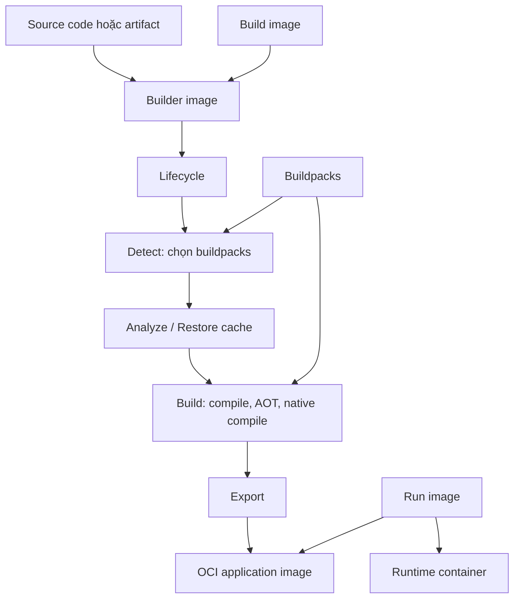

# Cloud Native Buildpacks và vai trò của builder, buildpack, run image

## 1. Cloud Native Buildpacks giải quyết vấn đề gì?

Khi đóng gói ứng dụng Spring Boot thành container, nhóm phát triển cần biến mã nguồn và dependency thành một image có thể chạy ổn định trên môi trường triển khai. Cách viết Dockerfile thủ công cho từng dự án có thể lặp lại nhiều cấu hình: chọn base image, cài JDK, tải dependency, build artifact, tạo user, thiết lập biến môi trường và dọn công cụ build. Nếu các dự án tự làm theo cách khác nhau, việc cập nhật bảo mật và duy trì quy trình cũng trở nên khó khăn.

**Cloud Native Buildpacks (CNB)** là đặc tả và hệ sinh thái công cụ giúp chuyển source code hoặc artifact ứng dụng thành OCI container image thông qua các thành phần có thể tái sử dụng. Buildpacks phát hiện ứng dụng, cung cấp dependency và thực hiện các bước build; builder điều phối quy trình; run image cung cấp nền tảng khi container chạy.

Trong module **SPRING_BOOT_NATIVE_IMAGE**, CNB có thể tích hợp Spring Boot và GraalVM Native Image để tạo container chứa executable native. Điều này giúp chuẩn hóa quy trình đóng gói, nhưng cần phân biệt build image thành công với việc ứng dụng native chạy đúng và đạt mục tiêu startup/bộ nhớ.



CNB có thể sử dụng buildpack từ nhiều nhà cung cấp. Spring Boot Maven/Gradle plugin thường cung cấp cách gọi buildpacks thuận tiện; công cụ `pack` là một lựa chọn để làm việc trực tiếp với lifecycle. Phiên bản plugin, builder và buildpack phải tương thích với nhau.

## 2. Ba thành phần chính: builder, buildpack và run image

### Builder

**Builder image** là môi trường dùng trong giai đoạn tạo image. Một builder thường chứa hoặc tham chiếu:

- CNB lifecycle để điều phối các phase detect, analyze, restore, build, export.
- Buildpacks và metadata để lựa chọn buildpack.
- Build-time dependencies/toolchain mà buildpack cần.
- Cấu hình xác định run image tương thích cho image đầu ra.

Builder là môi trường build, không phải mặc định là image cuối cùng được triển khai. Nó có thể chứa compiler, JDK, GraalVM Native Image, Maven/Gradle hoặc các công cụ chỉ cần trong lúc build.

### Buildpack

**Buildpack** là thành phần cung cấp logic phát hiện và biến đổi ứng dụng. Trong một build, nhiều buildpack có thể cùng tham gia theo thứ tự và điều kiện tương thích.

Ví dụ một chuỗi buildpack có thể:

1. Phát hiện project Java/Spring Boot.
2. Cung cấp JDK hoặc runtime/build dependency.
3. Xử lý Maven/Gradle và tạo artifact.
4. Tích hợp Spring AOT và Native Image khi cấu hình native.
5. Đóng gói launcher, metadata và nội dung ứng dụng vào image layers.

Không phải mọi buildpack đều làm tất cả công việc này. Chức năng cụ thể phụ thuộc buildpack được chọn, builder và cấu hình ứng dụng.

### Run image

**Run image** là nền tảng filesystem và runtime tối thiểu được sử dụng khi container ứng dụng chạy. Nó thường chỉ chứa những thành phần cần cho runtime, chẳng hạn thư viện hệ điều hành và CA certificates theo lựa chọn của nhà cung cấp.

Run image khác builder image: build image có thể chứa toolchain lớn, còn run image hướng tới môi trường chạy nhỏ hơn. Khi dùng native executable, run image vẫn phải có các thư viện hệ điều hành mà executable liên kết động cần.

| Thành phần | Thời điểm sử dụng | Nội dung điển hình | Có phải image triển khai? |
|---|---|---|---|
| Builder image | Build | Lifecycle, buildpacks, compiler, build dependencies | Không |
| Buildpack | Detect/build | Logic chọn và xử lý ứng dụng | Không phải image ứng dụng độc lập |
| Run image | Runtime | Nền tảng hệ điều hành và thư viện cần khi chạy | Là base của application image |
| Application image | Runtime | App artifact/layers, launcher và run image | Có |

## 3. Lifecycle: từ source đến container image

CNB lifecycle chia quy trình thành các phase. Tên và chi tiết phase có thể khác theo phiên bản lifecycle, nhưng mô hình phổ biến gồm:

- **Detect**: kiểm tra buildpack nào nhận diện ứng dụng và nhóm buildpack nào cần chạy.
- **Analyze**: đọc metadata của image trước đó để xác định layer có thể tái sử dụng.
- **Restore**: khôi phục layer từ cache.
- **Build**: buildpack thực hiện công việc như cài dependency, compile, tạo AOT output, native compile và tạo layer.
- **Export**: kết hợp các layer, metadata và run image để tạo OCI image.

Một số lifecycle còn có phase như creator hoặc các bước mở rộng khác tùy phiên bản. Không cần tự gọi từng phase khi dùng Spring Boot plugin; plugin thường điều phối qua buildpacks integration.

Tính năng cache giúp tránh làm lại các bước không thay đổi, nhưng không bảo đảm build native luôn nhanh hoặc ít RAM. GraalVM Native Image có thể tiêu thụ nhiều tài nguyên trong phase build; cache dependency và layer không loại bỏ chi phí phân tích/biên dịch native khi đầu vào cần build lại.

## 4. Builder image và run image liên hệ với nhau ra sao?

Builder được cấu hình để tạo image tương thích với một run image. Khi export, lifecycle kết hợp application layers với run image theo metadata và quy tắc CNB. Không nên tự ý thay base image cuối cùng bằng một image bất kỳ mà không xác nhận tương thích.

Ví dụ về cách hình dung:

```text
Builder image
  - CNB lifecycle
  - Java buildpack
  - Maven / Gradle support
  - GraalVM Native Image toolchain (nếu builder hỗ trợ)
             |
             v
      Build application
             |
             v
Application image
  - Run image layers
  - Native executable
  - Runtime metadata / launcher
```

Một builder có thể hỗ trợ nhiều loại ứng dụng và nhiều run image, nhưng không có nghĩa mọi builder đều có Native Image toolchain hoặc buildpack phiên bản phù hợp. Khi build Spring Boot native, chọn builder có hỗ trợ native compilation theo tài liệu của Spring Boot/GraalVM và kiểm tra log để xác nhận đúng buildpack đã chạy.

## 5. Spring Boot tích hợp Cloud Native Buildpacks

Spring Boot Maven Plugin và Gradle Plugin có thể gọi buildpacks để tạo image. Điều này giúp dự án khai báo build image ngay trong build tool.

### Maven

Với dự án Spring Boot Maven Plugin được cấu hình và có Docker daemon/engine phù hợp:

```bash
./mvnw spring-boot:build-image
```

Lệnh này tạo container image theo cấu hình plugin. Tên image thường được tạo từ project metadata, nhưng có thể tùy chỉnh. Để build theo hướng Native Image, cần cấu hình native build tương ứng theo phiên bản Spring Boot plugin; không giả định `build-image` mặc định luôn tạo native executable.

### Gradle

Với Spring Boot Gradle Plugin:

```bash
./gradlew bootBuildImage
```

Tương tự Maven, task tạo image thông qua CNB. Cần kiểm tra cấu hình builder, environment và buildpack để xác định image là JVM hay native.

### Native image qua buildpacks

Một số cấu hình Spring Boot hỗ trợ yêu cầu build native image qua buildpacks bằng thuộc tính build tương ứng, ví dụ với plugin Maven:

```bash
./mvnw spring-boot:build-image -Pnative
```

Và Gradle:

```bash
./gradlew bootBuildImage -Pnative
```

Cú pháp profile và thuộc tính phụ thuộc cấu hình thực tế của dự án. Với Spring Boot, hướng dẫn build image native thường sử dụng profile/property native do project khai báo. Trước khi chạy, kiểm tra POM/build.gradle và tài liệu phiên bản plugin; tên profile `native` không tự xuất hiện nếu dự án chưa định nghĩa.

## 6. Buildpack nào tham gia vào ứng dụng Spring Boot?

Spring Boot buildpacks thường chọn buildpack theo loại source/artifact và cấu hình. Một pipeline Java có thể bao gồm các vai trò:

| Vai trò buildpack | Ví dụ công việc |
|---|---|
| Paketo/Java buildpack hoặc buildpack Java tương ứng | Nhận diện ứng dụng Java, cấu hình runtime/build dependencies |
| Maven/Gradle buildpack | Chạy build tool khi source được build trong lifecycle |
| Spring Boot buildpack | Xử lý đặc thù Spring Boot và executable archive |
| Native Image buildpack/component | Cung cấp tích hợp Native Image nếu builder hỗ trợ |
| Environment/CA certificates | Cung cấp chứng chỉ và cấu hình runtime thích hợp |

Đây là mô tả vai trò, không phải cam kết mọi builder đều có các buildpack riêng theo đúng tên. Một số khả năng được gộp trong một buildpack hoặc được cung cấp bởi plugin. Đọc log detect/build để biết buildpack ID, version, thứ tự và layer được tạo.

## 7. Cấu hình builder và run image

Spring Boot plugin thường cho phép tùy chỉnh builder và run image. Ví dụ Gradle:

```groovy
tasks.named("bootBuildImage") {
    builder = "paketobuildpacks/builder-jammy-base"
    // runImage = "paketobuildpacks/run-jammy-base"
    imageName = "example/quote-service:1.0.0"
}
```

Đây là cấu hình minh họa; tên builder/run image có thể thay đổi theo thế hệ Paketo và phiên bản Spring Boot. Cần xác nhận image tag tồn tại và builder hỗ trợ target của bạn. Không chọn builder chỉ dựa vào tên `base` hoặc `tiny`; kiểm tra stack, buildpack order, OS, architecture và Native Image support.

Một run image nhỏ hơn có thể giảm dung lượng image, nhưng nếu loại bỏ thư viện mà native executable cần, container có thể không khởi động. Ngược lại, run image lớn hơn chưa chắc làm RSS runtime lớn hơn theo cùng tỷ lệ; dung lượng filesystem và bộ nhớ tiến trình là các đại lượng khác nhau.

## 8. Cấu hình môi trường cho build và runtime

CNB tách environment dành cho buildpack với environment khi ứng dụng chạy. Đây là điểm cần chú ý khi Spring AOT quyết định bean graph theo profile/property.

- **Build-time environment**: điều khiển build tool, AOT, native compiler, proxy, cache và lựa chọn buildpack.
- **Launch-time environment**: điều khiển ứng dụng khi container chạy, như cổng HTTP, profile runtime, datasource endpoint và cấu hình nghiệp vụ được thiết kế để thay đổi lúc chạy.

Không đặt secret thật trong build arguments, Dockerfile, build logs hoặc layer ứng dụng. Dùng cơ chế secret của CI/registry/orchestrator và mount/cấp biến môi trường ở runtime phù hợp chính sách triển khai.

Ví dụ chạy container với profile và port:

```bash
docker run --rm -p 8080:8080 \
  -e SPRING_PROFILES_ACTIVE=prod \
  example/quote-service:1.0.0
```

Lệnh chỉ minh họa; image phải có executable và launcher phù hợp. Profile runtime không thể tự tái tạo những bean đã bị loại khỏi AOT graph do profile build-time khác. Thiết kế cấu hình để phân biệt rõ quyết định cố định khi build và giá trị được phép thay đổi khi chạy.

## 9. Native executable và run image phải tương thích

Native Image không có nghĩa là binary hoàn toàn độc lập với hệ điều hành. Executable có thể liên kết động với glibc hoặc thư viện hệ thống khác. Nếu build trên một môi trường nhưng chạy trong run image thiếu ABI/library cần thiết, container có thể lỗi dù native compilation đã thành công.

Khi chọn builder/run image, kiểm tra:

1. OS family và phiên bản distribution.
2. CPU architecture (amd64/x86_64, arm64/aarch64).
3. libc và các shared libraries mà executable cần.
4. CA certificates, timezone data và thư viện cần cho kết nối TLS/timezone.
5. User, quyền truy cập filesystem, thư mục tạm và cổng ứng dụng.
6. Các file mount/configuration mà ứng dụng cần tại runtime.

Không copy binary Windows `.exe` vào run image Linux. Artifact phải được tạo cho đúng target OS/architecture; nếu production là Linux container, build trên Linux hoặc dùng pipeline cross-compilation được hỗ trợ rõ ràng.

## 10. Cache và layer: tăng tốc build nhưng phải hiểu giới hạn

CNB tạo layer theo buildpack, nhờ vậy có thể tái sử dụng dependency hoặc artifact ít thay đổi. Có hai loại cache thường gặp: cache layer và cache volume/image tùy công cụ. Khi build lại, lifecycle phân tích layer cũ và khôi phục những layer còn hợp lệ.

Lợi ích:

- Giảm tải dependency lặp lại.
- Tái sử dụng một số build artifact.
- Hỗ trợ incremental build giữa các lần tạo image.

Giới hạn:

- Đổi JDK, GraalVM, builder hoặc buildpack version có thể làm invalid cache.
- Đổi source/configuration ảnh hưởng AOT hoặc Native Image sẽ yêu cầu thực hiện lại các bước liên quan.
- Cache không đảm bảo giữ lại executable native cũ nếu đầu vào build thay đổi.
- Cache không nên chứa secret hoặc dữ liệu riêng tư ngoài chủ đích.

Khi build native, giai đoạn GraalVM analysis/compile có thể vẫn là phần tốn thời gian và RAM lớn nhất. Theo dõi log và số đo thực tế thay vì kết luận cache sẽ làm native build nhanh như build JAR.

## 11. Quan sát và chẩn đoán buildpacks

Khi build image thất bại, chia lỗi theo giai đoạn:

| Giai đoạn | Dấu hiệu | Hướng điều tra |
|---|---|---|
| Docker/daemon | Không kết nối được Docker daemon | Kiểm tra Docker Engine, quyền và socket/pipe |
| Detect | Không có buildpack phù hợp | Kiểm tra builder, source layout và buildpack order |
| Build tool | Maven/Gradle resolve dependency lỗi | Kiểm tra wrapper, repository, credentials và network |
| Spring AOT | Bean creation/profile/property lỗi | Kiểm tra build-time configuration và generated outputs |
| Native Image | Reachability, hints, compiler hoặc OOM | Kiểm tra GraalVM, metadata, toolchain, RAM |
| Export | Lỗi tạo image/layer | Kiểm tra registry, quyền, dung lượng và metadata |
| Runtime | Container exit hoặc thiếu thư viện | Kiểm tra run image, binary ABI, launch env và logs |

Dùng log chi tiết của Maven/Gradle plugin hoặc `pack` để tìm buildpack nào nhận diện và phase nào lỗi. Không chỉ nhìn thông báo cuối cùng `build failed`; lỗi gốc thường xuất hiện trước đó.

## 12. So sánh image JVM và native một cách công bằng

Buildpacks có thể tạo image JVM hoặc native. Để đánh giá tác động của Native Image:

- Dùng cùng source commit, application module và tính năng.
- Giữ cấu hình chức năng/profile tương đương, hiểu rõ profile nào được dùng ở build-time AOT.
- Dùng cùng loại run image khi khả thi, hoặc ghi rõ khác biệt base image.
- So sánh dung lượng image, thời gian build, startup đến readiness, RSS khi idle và dưới tải.
- Giữ cùng CPU/memory limits và workload; đo latency/throughput.
- Ghi riêng peak RAM của builder trong giai đoạn build và RSS của container khi chạy.

| Chỉ số | Image JVM | Image Native |
|---|---:|---:|
| Thời gian tạo image | … | … |
| Peak RAM khi build | … | … |
| Dung lượng image | … | … |
| Thời gian đến readiness | … | … |
| RSS khi idle | … | … |
| Peak RSS dưới tải | … | … |
| p95 latency cùng tải | … | … |

Bảng trên là mẫu ghi số liệu, không phải kết quả thực nghiệm. Image nhỏ hơn không nhất thiết có RSS thấp hơn; native khởi động nhanh hơn không bảo đảm throughput cao hơn. Kết luận phải dựa trên workload thực tế.

## 13. Checklist trước khi triển khai

- Builder hỗ trợ đúng loại ứng dụng, phiên bản Spring Boot và native toolchain.
- Buildpack order và version được xác định; log cho thấy các buildpack mong đợi đã chạy.
- Spring AOT và Native Image compile hoàn tất.
- Artifact tạo ra đúng OS/architecture của run image.
- Run image có đủ shared libraries, CA certificates và runtime dependencies.
- Runtime profile, port, datasource, secret và file mount được cấu hình đúng.
- Container chạy bằng user/quyền phù hợp và không cần toolchain build.
- Smoke test và integration test thực hiện trên image vừa tạo.
- Benchmark JVM/native dùng điều kiện tương đương, tách RAM build với RAM runtime.

## 14. Câu hỏi tự kiểm tra

1. Builder image khác run image ở mục đích và nội dung như thế nào?
2. Buildpack tham gia vào lifecycle CNB ở những giai đoạn nào?
3. Vì sao build image thành công chưa chứng minh container native chạy được trong production?
4. Tại sao không nên giả định mọi builder Spring Boot đều hỗ trợ GraalVM Native Image?
5. Khi đổi profile runtime, điều gì có thể không thay đổi do quyết định đã được thực hiện ở Spring AOT?
6. Vì sao native executable vẫn có thể phụ thuộc shared libraries của run image?
7. Khi benchmark image JVM và native, những số liệu build nào cần tách khỏi số liệu runtime?

**Ghi nhớ:** Cloud Native Buildpacks tổ chức quy trình đóng gói qua **builder**, **buildpack**, **lifecycle** và **run image**. Với Spring Boot Native Image, hãy xác nhận builder/buildpack hỗ trợ native, cấu hình AOT đúng, tạo executable cho đúng nền tảng và kiểm thử chính application image trước khi triển khai.
