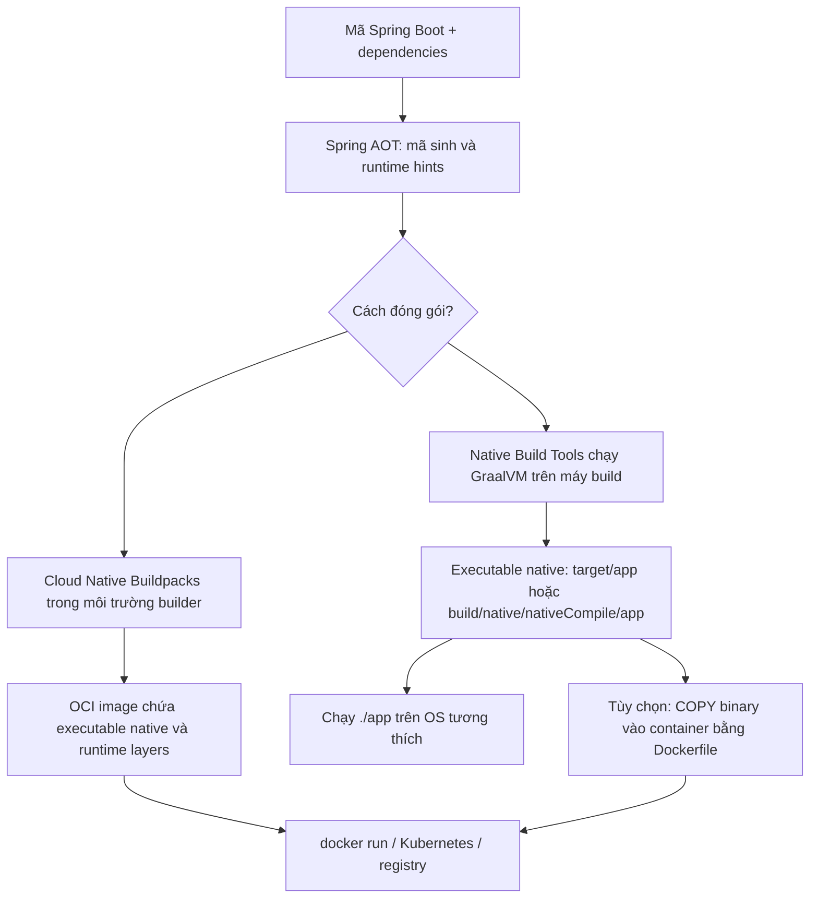
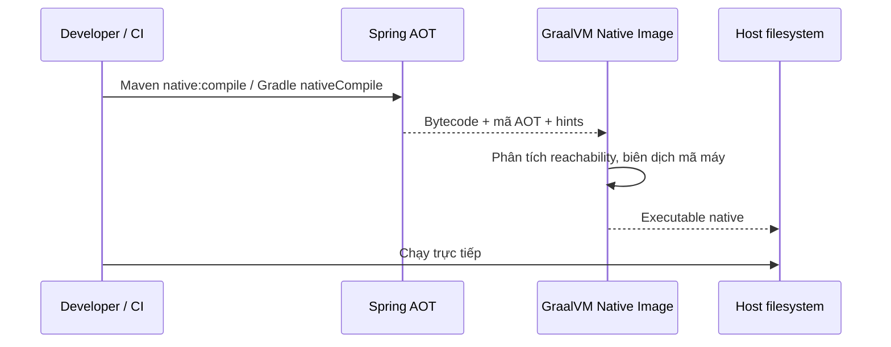
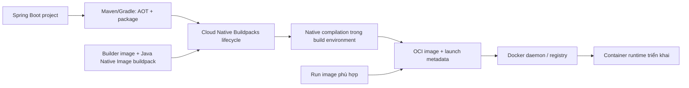

# Phân biệt build executable tại máy với build container image

> **Chương:** Buildpacks  
> **Module:** `SPRING_BOOT_NATIVE_IMAGE`  
> **Mục tiêu học tập:** Hiểu điểm khác nhau giữa việc tạo **native executable trên máy build** bằng GraalVM Native Build Tools và việc tạo **OCI container image** bằng Cloud Native Buildpacks. Thực hành đường build Maven/Gradle tương ứng, nhận biết artifact đầu ra, kiểm tra runtime thật và chọn quy trình phù hợp cho ứng dụng Spring Boot dùng Spring AOT.

## 1. Một ứng dụng, hai loại đầu ra

Sau khi Spring Boot phân tích ứng dụng bằng **Spring AOT**, có hai cách phổ biến để tạo một ứng dụng chạy native:

1. **Build native executable trên máy build:** dùng GraalVM Native Build Tools gọi trình biên dịch Native Image ở môi trường host; nhận được tệp thực thi tương ứng hệ điều hành và CPU.
2. **Build native container image:** dùng tích hợp **Cloud Native Buildpacks (CNB)** của Spring Boot; buildpack chuẩn bị môi trường, gọi trình biên dịch Native Image bên trong quá trình build container và đóng gói kết quả thành một **OCI image** có thể chạy bằng container runtime.

Cả hai có thể dùng **Spring AOT + GraalVM Native Image**. Khác biệt chính là **quy trình build, môi trường build, đầu ra được quản lý và cách triển khai**.

Một lưu ý cơ bản: **“container image” không tự đồng nghĩa “native image”**. Spring Boot có thể tạo OCI image chạy `java -jar` trên JVM, hoặc OCI image chạy executable native. Đầu ra có phải native hay không được quyết định bởi **cấu hình buildpack/plugin**, không phải bởi việc nó có đuôi image hay được lưu trong Docker.



Trong module `SPRING_BOOT_NATIVE_IMAGE`, ta muốn đo lợi ích **thời gian khởi động và bộ nhớ**, đồng thời hiểu thao tác build, các yêu cầu reflection/resource, kiểm thử tương thích và triển khai native trong container. Phân biệt hai đường build giúp tránh so sánh sai artifact hoặc nhầm lỗi môi trường build với lỗi của mã ứng dụng.

## 2. Cùng dùng chữ “image” nhưng nói về những thứ khác nhau

| Thuật ngữ | Bản chất | Ví dụ |
|---|---|---|
| **GraalVM Native Image** | Công nghệ/trình biên dịch tạo mã máy từ ứng dụng Java đã được phân tích trước | Tạo tệp `target/native-demo` |
| **Native executable** | File chương trình chạy trực tiếp trên OS/CPU phù hợp, thường không cần HotSpot JVM | `./native-demo`, `native-demo.exe` |
| **OCI container image** | Artifact phân phối dưới dạng layers, manifest, cấu hình tiến trình, metadata và filesystem | `native-demo:local` |
| **CNB builder image** | Môi trường build chứa lifecycle và các buildpack | Builder Paketo tương thích |
| **Run image** | Các lớp runtime nền được dùng để chạy ứng dụng trong image kết quả | Run image Linux tối giản của Paketo |
| **Buildpack** | Thành phần phát hiện đầu vào, chuẩn bị toolchain, build và đóng gói ứng dụng | Paketo Java Native Image Buildpack |

Hai khái niệm cần phân biệt rõ:

- **Native Image là cách tạo mã chương trình chạy.**
- **Container image là cách đóng gói và phân phối chương trình chạy.**

Vì vậy hoàn toàn có thể **build executable trước rồi đóng gói bằng Dockerfile**, hoặc **để buildpack tạo native executable và đóng gói OCI image trong một quy trình**.

## 3. So sánh trực diện hai đường build

| Khía cạnh | Build executable tại máy | Build OCI container image bằng Buildpacks |
|---|---|---|
| Công cụ chính | GraalVM Native Build Tools: Maven `native:compile`, Gradle `nativeCompile` | Spring Boot Maven `spring-boot:build-image`, Gradle `bootBuildImage` |
| Nơi gọi Native Image compiler | Toolchain GraalVM trong môi trường build của máy/runner | Môi trường buildpack bên trong builder/container |
| Điều kiện tối thiểu | GraalVM với `native-image` và native toolchain phù hợp | Container engine/API phù hợp, builder tương thích; không bắt buộc cài GraalVM Native Image trên host |
| Spring AOT | Được plugin tích hợp vào pipeline native | Được tích hợp để buildpack nhận đầu vào AOT đã chuẩn bị |
| Artifact chính | File executable trên filesystem | OCI image ở image store/daemon hoặc registry |
| Chạy thử | `./target/native-demo` | `docker run native-demo:local` |
| Phụ thuộc OS/CPU | Binary cho platform mà compiler tạo ra | Image thường cho OS/CPU của môi trường builder; cần kiểm tra platform |
| Cách phân phối | Copy file, đóng gói gói cài đặt hoặc tự tạo container | Push image lên registry rồi deploy bằng container runtime |
| Đóng gói runtime/CA/libc | Người triển khai tự bảo đảm | Builder và run image cung cấp runtime layers theo stack |
| Mức tự động hóa đóng gói | Tùy chọn qua Dockerfile/CI | Buildpacks xử lý phần lớn layout và launcher |
| Theo dõi cache/layers | Dựa vào công cụ build và CI riêng | CNB có lớp image và cơ chế cache buildpack |
| Khả năng tùy chỉnh base image | Toàn quyền khi dùng Dockerfile | Bị ràng buộc bởi builder/run image tương thích, có thể cấu hình |
| Artifact có phải native? | **Có**, nếu `nativeCompile` thành công | **Chỉ có**, nếu cấu hình build image là native |

**Tình huống dễ nhầm:** `./mvnw spring-boot:build-image` không kèm cấu hình native có thể tạo **JVM container image**. Muốn OCI image chứa native executable, phải bật đúng profile/plugin/tùy chọn được Spring Boot và builder hỗ trợ.

## 4. Đường A — Build native executable trên máy

### 4.1. Luồng xử lý



Với Spring Boot hiện đại và Native Build Tools được cấu hình phù hợp, bước native compile sẽ dùng đầu ra của Spring AOT. Các RuntimeHints cho reflection, resource, proxy, serialization... giúp compiler hiểu những hành vi vốn khó phát hiện bằng phân tích tĩnh.

Cần có:

- **JDK/GraalVM** tương thích với Spring Boot của dự án; tool `native-image` khả dụng.
- Compiler/linker và thư viện phát triển của hệ điều hành tương ứng.
- Đủ CPU và RAM; Native Image compilation có thể tốn nhiều tài nguyên hơn build JAR.
- Cấu hình Maven/Gradle phù hợp để plugin gọi Spring AOT và Native Build Tools.

**Kiểm tra toolchain (Linux/macOS hoặc môi trường command có cài tools):**

```bash
java -version
native-image --version
```

Nếu `native-image` không tìm thấy hoặc `java` đang trỏ tới JDK khác, cần sửa toolchain trước. Không nên nhầm lỗi cài compiler với lỗi của Spring AOT hay reflection.

### 4.2. Maven

Với dự án có `spring-boot-starter-parent` và plugin `org.graalvm.buildtools:native-maven-plugin`, profile `native` thường cung cấp tích hợp cần thiết:

```bash
./mvnw -Pnative native:compile
```

Maven trên Windows dùng `mvnw.cmd` trong môi trường tương ứng. Ví dụ trên Linux/macOS, artifact thường được tạo dưới `target/`:

```bash
./target/native-demo
```

Tên file thực tế phụ thuộc tên ứng dụng và build configuration. Việc build xong **không tự tạo OCI image**; `docker image ls` không nhất thiết xuất hiện image mới.

Nếu dự án không dùng `spring-boot-starter-parent`, phải cấu hình rõ mục tiêu Spring AOT, native plugin và các bước đóng gói tương ứng. Không nên sao chép lệnh rồi giả định mọi POM đều có profile `native`.

### 4.3. Gradle

Dự án áp dụng Spring Boot Gradle plugin và `org.graalvm.buildtools.native` có thể dùng:

```bash
./gradlew nativeCompile
```

Output thường nằm trong:

```text
build/native/nativeCompile/native-demo
```

Chạy:

```bash
./build/native/nativeCompile/native-demo
```

Khi `nativeCompile` đã chạy, ta có một executable chạy trên platform tương thích. Việc ứng dụng chạy đúng còn phụ thuộc thư viện hệ thống, certificates và mức hỗ trợ native của dependency.

### 4.4. Ưu và hạn chế của đường A

**Thuận lợi:** nhanh gọn cho việc debug binary tại máy, thử tham số CLI, kiểm tra khác biệt startup với JAR, tích hợp với test hay profiler phù hợp và dễ đưa file vào bước đóng gói tùy biến.

**Giới hạn:** phải cài/đảm bảo toolchain native trên build runner; executable phụ thuộc OS/architecture và có thể phụ thuộc libc/dynamic loader; cần tự chuẩn bị quy trình phân phối, quyền execute, CA, tài nguyên ngoài và image nếu muốn chạy trong container.

**Trên Windows:** native executable sinh trong môi trường Windows thường có `.exe`. Docker Linux container **không thể chạy trực tiếp** file Windows executable. Muốn tạo image Linux, hãy biên dịch binary Linux bằng môi trường Linux tương thích hoặc để Linux builder của Buildpacks biên dịch.

## 5. Đường B — Build OCI image bằng Cloud Native Buildpacks

### 5.1. CNB làm gì?

**Cloud Native Buildpacks** là cơ chế build image từ ứng dụng dựa trên **lifecycle và buildpacks**, tránh phải tự viết mọi bước Dockerfile. Builder được chọn quyết định buildpack nào chạy; run image cung cấp các lớp filesystem cần thiết khi container chạy.

Với Spring Boot:

1. Maven/Gradle chuẩn bị artifact ứng dụng cùng kết quả Spring AOT phù hợp.
2. Plugin Spring Boot gọi buildpack lifecycle thông qua container API.
3. Builder Paketo phát hiện ứng dụng Java và kế hoạch native.
4. Java Native Image buildpack cung cấp compiler trong môi trường build, biên dịch executable native.
5. Lifecycle tạo OCI image với executable và runtime layers cần thiết, lưu vào image store/daemon theo tên image được cấu hình.



Đường này **không cần GraalVM/native-image được cài sẵn trên host**, vì compiler có thể được buildpack cung cấp. Tuy nhiên máy hoặc CI vẫn cần **container runtime/build service phù hợp**, network để tải builder/dependencies (hoặc cache/offline được chuẩn bị), và tài nguyên CPU/RAM đủ cho native compilation.

Đặc biệt, image do buildpack tạo ra có thể dùng **run image rất tối giản và không có shell**. Đừng kỳ vọng `docker exec -it <container> sh` luôn hoạt động; việc thiếu shell không chứng minh image lỗi.

### 5.2. Maven: `spring-boot:build-image` ở chế độ native

Với dự án dùng Spring Boot starter parent và native plugin, lệnh tham khảo:

```bash
./mvnw -Pnative spring-boot:build-image \
  -Dspring-boot.build-image.imageName=native-demo:local
```

Ý nghĩa:

- `-Pnative`: kích hoạt profile Maven xây dựng pipeline AOT/native mà dự án hỗ trợ.
- `spring-boot:build-image`: chạy plugin Spring Boot để tạo OCI image bằng CNB.
- `-Dspring-boot.build-image.imageName=native-demo:local`: chỉ rõ tên/tag image kết quả.

Không dùng tên tag này để suy rằng nội dung chắc chắn native; hãy kiểm tra plugin/profile và **log builder** cho thấy native image compiler đã chạy.

**Nếu dùng Maven mà chưa có `native` profile hoặc native plugin**, lệnh trên có thể không tạo kết quả mong đợi. Trước khi thực hành, kiểm tra pom của ứng dụng đã có hai plugin tương ứng và tài liệu Spring Boot của **phiên bản dự án**.

### 5.3. Gradle: `bootBuildImage`

Khi Gradle project dùng Spring Boot plugin **và** plugin `org.graalvm.buildtools.native`, Spring Boot tự tích hợp các task AOT và cấu hình `bootBuildImage` cho đường native (theo tài liệu Spring Boot hiện hành):

```bash
./gradlew bootBuildImage
```

Để kiểm soát tên image, có thể cấu hình trong `build.gradle.kts`:

```kotlin
import org.springframework.boot.gradle.tasks.bundling.BootBuildImage

tasks.named<BootBuildImage>("bootBuildImage") {
    imageName.set("native-demo:local")
}
```

Đoạn Kotlin DSL này giả định các plugin Spring Boot/Gradle đã được áp dụng và phiên bản tương thích. Nếu không áp dụng native plugin, `bootBuildImage` có thể xây **JVM image**. Trạng thái image cần được xác minh bằng log và kết quả test, không chỉ bằng tên task.

### 5.4. Thử chạy OCI image vừa tạo

Sau khi build thành công:

```bash
docker image ls native-demo
docker image inspect native-demo:local
```

Khởi động container:

```bash
docker run --rm \
  --name native-demo \
  -p 8080:8080 \
  -e SPRING_PROFILES_ACTIVE=prod \
  native-demo:local
```

Kiểm tra ở terminal khác:

```bash
curl --fail --show-error http://127.0.0.1:8080/
```

Đường dẫn `/` là ví dụ khi ứng dụng có endpoint tại đó; với ứng dụng riêng, hãy gọi endpoint thực tế hoặc health/readiness endpoint đã được kích hoạt.

Một image buildpack thường mang **launch metadata** và có entrypoint do CNB cung cấp. Lệnh chạy có thể không giống `/app/native-demo` của Dockerfile tự viết; đó là điều bình thường. Không cần chỉnh ENTRYPOINT nếu builder đã nhận diện và cấu hình đúng process type.

## 6. Maven/Gradle: cùng mục tiêu native, khác loại artifact

Nhớ nhóm lệnh theo **đầu ra**, thay vì chỉ nhớ tên tool:

| Mục đích | Maven | Gradle | Đầu ra |
|---|---|---|---|
| **Native executable trên máy** | `./mvnw -Pnative native:compile` | `./gradlew nativeCompile` | File executable trong `target/` hoặc `build/native/nativeCompile/` |
| **Native container image qua Buildpacks** | `./mvnw -Pnative spring-boot:build-image` | `./gradlew bootBuildImage` với native plugin | OCI image ở container engine/image store |
| **JVM executable JAR** | `./mvnw package` | `./gradlew bootJar` | JAR chạy bằng JVM |
| **JVM container image qua Buildpacks** | `./mvnw spring-boot:build-image` khi native chưa bật | `./gradlew bootBuildImage` khi native chưa bật | OCI image chứa JVM + JAR/runtime |

Bảng đưa ra **hành vi điển hình**. Profile/tên task có thể được người phát triển cấu hình lại. Trước khi đưa vào CI/CD, đọc cấu hình Maven/Gradle của chính dự án để biết lệnh thật sự kích hoạt những task nào.

### Vì sao cần kiểm tra AOT cho cả hai luồng?

GraalVM Native Image hạn chế một số dạng khám phá động. Spring AOT cung cấp mã và runtime hints giúp compiler giữ lại reflection, resource, proxy và cấu trúc Spring cần thiết. Nếu thiếu metadata:

- Build có thể lỗi do không phát hiện cấu trúc cần thiết.
- Build cũng có thể **thành công nhưng runtime lỗi ở nhánh tính năng** như JSON binding, reflection, template, TLS hoặc plugin.
- Việc chuyển từ build executable sang build image **không tự sửa** một thư viện chưa tương thích native.

Đó là lý do cùng một bộ smoke/integration test phải chạy được trên **artifact thật** của từng đường build.

## 7. Tùy chọn nâng cao: dùng `pack` để build từ AOT JAR

Khi cần kiểm soát builder hoặc dùng Cloud Native Buildpacks mà không gọi trực tiếp goal của Spring Boot, có thể dùng CLI `pack`.

**Điều kiện quan trọng:** đầu vào phải là executable JAR Spring Boot **đã chứa AOT generated assets và runtime hints cần thiết**. Một JAR JVM thông thường, chưa qua các bước AOT, không được mặc định coi là đủ để chuyển thành native image.

Ví dụ theo hướng dẫn Spring Boot cho builder Paketo tương thích:

```bash
pack build native-demo:local \
  --builder paketobuildpacks/ubuntu-resolute-builder \
  --run-image paketobuildpacks/ubuntu-resolute-run-tiny \
  --path target/native-demo-0.0.1-SNAPSHOT.jar \
  --env BP_NATIVE_IMAGE=true
```

Đây là **ví dụ cho tổ hợp builder/version hiện hành được tài liệu Spring Boot hỗ trợ**. Những dự án cũ hơn có thể dùng builder và JDK khác; cần xác minh phiên bản Spring Boot, JDK/GraalVM và stack trước khi áp dụng.

Biến `BP_NATIVE_IMAGE=true` là **tùy chọn build time của Paketo** yêu cầu biên dịch native. Nó không phải environment variable dùng để ứng dụng quyết định một property Spring Boot khi container chạy.

**Phân biệt prefix môi trường:**

| Ký hiệu | Thời điểm | Ví dụ |
|---|---|---|
| `BP_*` | Giai đoạn buildpack build | `BP_NATIVE_IMAGE=true` |
| `BPL_*` | Cơ chế do buildpack cung cấp khi launch container (tùy buildpack) | Các biến cấu hình runtime của Paketo |
| Spring Boot runtime properties | Khi ứng dụng chạy, trên JVM hoặc native | `SERVER_PORT=9090`, `SPRING_PROFILES_ACTIVE=prod` |

Đừng viết `docker run -e BP_NATIVE_IMAGE=true ...` rồi kỳ vọng một **image JVM đã build** tự biến thành native executable. Compilation đã kết thúc trước khi `docker run` bắt đầu.

## 8. Nếu đã build executable, có còn cần Buildpacks không?

Không bắt buộc. Có thể dùng **Dockerfile** để đóng gói executable native đã tạo trên máy build:

```dockerfile
# Binary native Linux đã build trước, tương thích với run image.
FROM debian:bookworm-slim
WORKDIR /app
COPY target/native-demo /app/native-demo

EXPOSE 8080
ENTRYPOINT ["/app/native-demo"]
```

Build image:

```bash
docker build -t native-demo:manual .
docker run --rm -p 8080:8080 native-demo:manual
```

Dockerfile này chỉ minh họa. Hãy bảo đảm file được copy có quyền execute và **tương thích hệ điều hành, kiến trúc, libc, shared libraries và certificates** trong base image. Native executable không luôn là binary tĩnh hoàn toàn. Nếu container chạy user không có quyền ghi/đọc những đường dẫn bắt buộc, phải điều chỉnh image hoặc cấu hình runtime.

Trong thực tế có **ba mô hình** cần phân biệt:

1. **Local native executable:** `nativeCompile` → chạy binary trên máy.
2. **Local native executable rồi Dockerfile:** `nativeCompile` → `docker build` → OCI image.
3. **Buildpacks native OCI:** `build-image`/`bootBuildImage` → buildpack tự biên dịch native trong builder → OCI image.

Hai mô hình (2) và (3) có cùng **loại đầu ra phân phối** là OCI image, nhưng khác cách quản lý compiler, build environment, image layers, launcher và dependency runtime.

## 9. OS, CPU architecture và vấn đề build đa nền tảng

**GraalVM Native Image nói chung không phải công cụ cross-compiler tùy ý.** Native binary tạo cho platform/toolchain phù hợp không tự chạy trên platform khác.

| Máy hoặc môi trường build | Đầu ra có thể dùng trực tiếp | Điều cần lưu ý |
|---|---|---|
| Windows với native toolchain Windows | Executable Windows, thường có `.exe` | Không copy binary này vào Linux OCI image rồi chạy |
| Linux `amd64` với GraalVM phù hợp | Executable Linux `amd64` | Kiểm tra glibc/musl và dynamic loader |
| Linux `arm64` | Executable Linux `arm64` | Không chạy natively trên `amd64` |
| Docker Desktop trên Windows/macOS dùng Linux builder | Image Linux theo kiến trúc builder được chọn/hỗ trợ | Host OS khác Linux trong container build |
| CI build multi-architecture | Nhiều artifact/image riêng theo platform | Cần build/test từng platform và tạo manifest list/index phù hợp |

Đối với Buildpacks, cần chú ý **builder image, run image, kiến trúc và runtime** phải tương thích. Đặt `--platform` ở lệnh Docker **không tự biến một binary sai kiến trúc thành binary đúng**. Emulation có thể hữu ích nhưng có rủi ro về hiệu năng và mức hỗ trợ của toolchain; ưu tiên build và test trên môi trường khớp đích.

**Ví dụ:** ứng dụng cần deploy Kubernetes Linux `amd64`. Một developer dùng macOS ARM có thể tạo local executable macOS ARM để thử logic, nhưng bản đó không dùng để chạy trong pod Linux `amd64`. Có thể dùng CI runner Linux `amd64` hoặc builder tương ứng để tạo artifact triển khai.

## 10. Chọn đường build theo mục đích

| Nhu cầu | Phương án bắt đầu | Lý do |
|---|---|---|
| Học cơ chế native, chạy thử, debug lỗi reflection/resource | Native executable trên máy | Thấy ngay tệp đầu ra và chạy trực tiếp |
| So sánh startup/RSS của native với JAR trên cùng host | Native executable + JVM baseline | Giảm khác biệt do container networking/filesystem |
| Deploy lên Kubernetes hoặc nền tảng OCI | Buildpacks native OCI image | Có artifact phân phối sẵn cho registry/orchestrator |
| CI không cài sẵn GraalVM nhưng có Docker/build service | Buildpacks | Compiler được cung cấp trong builder |
| Cần chính xác base image, user, package OS và filesystem layout | Build native rồi Dockerfile | Chủ động quy định đóng gói |
| Muốn chuẩn hóa buildpack, cache và cấu trúc image giữa nhiều dịch vụ | Buildpacks | Dùng builder/run image và lifecycle chung |
| Nhiều kiến trúc triển khai | Native build hoặc Buildpacks trên builder/runner tương ứng từng kiến trúc | Đầu ra vẫn phụ thuộc platform, cần kiểm thử mỗi biến thể |

Một phương án không tự tốt hơn phương án còn lại trên mọi chỉ số. Buildpacks có thể tiện vận hành nhưng bước **native compilation vẫn tiêu tốn nhiều CPU/RAM/thời gian**; việc dùng builder không loại bỏ chi phí này. Build native trên máy có thể thuận tiện để thử nghiệm nhưng phân phối file đơn lẻ có thể khó quản lý hơn một OCI image trong Kubernetes.

## 11. Kiểm chứng kết quả đúng loại artifact

### 11.1. Với native executable trên máy

Sau khi chạy `native:compile` hoặc `nativeCompile`:

```bash
# Thay tên/path bằng file thực tế.
ls -lh target/native-demo
file target/native-demo

# Chạy thử và truyền cấu hình runtime.
./target/native-demo --server.port=9090
```

Ở terminal khác, xác minh endpoint/health được phục vụ. Lệnh `file` là công cụ thường có trên Linux/macOS; Windows cần công cụ tương ứng. Đừng chỉ thấy file tồn tại rồi kết luận runtime thành công.

### 11.2. Với OCI image do Buildpacks tạo

```bash
docker image ls native-demo
docker image inspect native-demo:local
docker run --rm -p 9090:8080 native-demo:local
```

Với một ứng dụng web dùng cổng trong container là 8080, kiểm tra `http://127.0.0.1:9090/` hoặc endpoint thật.

Cần phân biệt bằng chứng:

- **Build log:** phải cho thấy Native Image compiler đã thực sự chạy trong builder nếu yêu cầu native.
- **Plugin/build configuration:** phải xác nhận profile/task native và builder phù hợp.
- **Smoke test:** container khởi động và thực thi API cần thiết.
- **Image inspect:** cho thấy OS, architecture, kích thước, labels và entrypoint. **Chỉ tên image hoặc tên entrypoint không đủ chứng minh native**, vì launcher CNB có thể giống nhau giữa JVM và native.

Khi cần kiểm tra library/runtime trong image tối giản, không giả định có `sh` hoặc `bash`. Có thể sử dụng inspection/SBOM/log của buildpack hoặc công cụ chuyên dụng để xem image layers. Run image “tiny” có thể cố ý không có shell.

### 11.3. Những lỗi thuộc pipeline nào?

| Lỗi hoặc triệu chứng | Thường thuộc luồng | Hướng điều tra |
|---|---|---|
| `native-image: command not found` khi chạy `nativeCompile` trên máy | Local executable | Kiểm tra GraalVM/JAVA_HOME/PATH/toolchain |
| Docker daemon không truy cập được khi `build-image` | Buildpacks | Kiểm tra container engine/API, quyền, socket/context |
| Builder không hỗ trợ version JDK/GraalVM | Buildpacks | Kiểm tra tương thích builder, Java version và project |
| Out of memory trong native compile | Cả hai | Kiểm tra RAM/CPU thực tế của host hoặc Docker VM/CI |
| Binary Linux không chạy trên máy Mac hoặc Windows | Local executable | Kiểm tra OS/CPU artifact |
| Run image thiếu dynamic loader/CA certs | OCI image | Kiểm tra run image, thư viện, TLS và certs |
| `docker run` chạy JVM dù muốn native | Buildpacks | Kiểm tra profile/plugin native, `BP_NATIVE_IMAGE` và log |
| `ClassNotFoundException`, reflection/resource lỗi khi gọi API | Cả hai nếu cùng AOT metadata | Sửa RuntimeHints, resource, library compatibility và build lại |
| Image chạy nhưng service chưa ready | Cả hai khi triển khai | Kiểm tra port, dependency startup và readiness probe |

## 12. Thiết kế bài thử so sánh công bằng

Giả sử một dịch vụ Spring Boot REST có cùng mã nguồn và cùng tập tính năng. Hãy tạo ba artifact:

- **JVM baseline:** chạy JAR JVM.
- **Native local:** binary từ `nativeCompile`.
- **Native CNB:** OCI image từ `build-image`/`bootBuildImage` ở chế độ native.

Có thể bổ sung **JVM CNB image** để tách chi phí JVM khỏi khác biệt do container.

### 12.1. Chỉ số cần đo

| Chỉ số | Native local | Native trong OCI image | Lưu ý |
|---|---|---|---|
| Thời gian build | Maven/Gradle + GraalVM trên host | Plugin + builder + native compilation + packaging | Ghi lại thời gian download/cold cache riêng |
| Thời gian tới readiness | Bắt đầu tiến trình → endpoint sẵn sàng | Start container → endpoint sẵn sàng | Container có overhead phụ, nên ghi rõ điểm bắt đầu |
| Bộ nhớ khi idle | RSS/PSS hoặc công cụ OS tương ứng | RSS/PSS/cgroup memory với điều kiện tương đương | Không thay kích thước file bằng memory |
| Bộ nhớ khi chịu tải | Đo sau warm-up/ổn định | Đo cùng concurrency và dữ liệu | Ghi lại cgroup limit và nền tảng |
| Throughput và p95/p99 latency | Load test với cùng kịch bản | Load test như local | Networking/container có thể ảnh hưởng |
| Kích thước phân phối | Kích thước executable | Kích thước OCI image và layers | Đây là hai loại dung lượng khác nhau |
| Độ tương thích | Integration test trên binary | Smoke/integration test trong container | Cần test JSON, TLS, resource, reflection, database |

**Không** so “kích thước binary 60 MB” với “image 100 MB” rồi suy ra phương án này dùng ít RAM hơn. Binary size, image size, startup time, RSS và throughput đều khác nhau.

### 12.2. Giữ điều kiện thử nghiệm ổn định

1. Dùng **cùng commit**, cùng phiên bản Spring Boot, dependency và runtime hints.
2. Ghi rõ JDK/GraalVM/toolchain, builder/run image và OS/CPU architecture. Một số khác biệt đo được có thể do compiler version thay vì cách đóng gói.
3. Dùng cùng properties, port, profile và tài nguyên bên ngoài. Điều kiện Spring AOT ảnh hưởng bean topology phải thống nhất ở thời điểm build.
4. Lặp nhiều lần để tính p50/p95 của startup; tách cold cache khỏi warm cache.
5. Dùng cùng CPU/RAM giới hạn, dữ liệu và số request cho benchmark. Với container, công bố cgroup limit và cấu hình networking.
6. Chạy integration test trên artifact thực tế và ghi riêng **failure do build tool**, **failure do native runtime** và **failure do container**.

Nếu cùng native app được biên dịch bằng **hai phiên bản GraalVM khác nhau**, không nên gán mọi chênh lệch startup/bộ nhớ cho Docker hay Buildpacks. Phải đồng bộ toolchain hoặc công bố khác biệt như một biến thực nghiệm.

### Bảng ghi số đo

| Phương án | Ready p50 (ms) | Ready p95 (ms) | Idle RSS (MiB) | p99 latency (ms) | Throughput (req/s) | Build duration (phút) |
|---|---:|---:|---:|---:|---:|---:|
| JVM JAR | — | — | — | — | — | — |
| Native local | — | — | — | — | — | — |
| Native OCI bằng Buildpacks | — | — | — | — | — | — |
| JVM OCI bằng Buildpacks (tùy chọn) | — | — | — | — | — | — |

Các dấu “—” phải được thay bằng kết quả chạy thực tế; bài học không mặc định Native Image luôn thắng JVM về throughput.

## 13. Thực hành: tạo cả hai loại artifact từ cùng một dự án

Giả sử dự án tên `native-demo` đã tạo từ Spring Initializr hoặc cấu hình tương đương, có Spring Web và GraalVM Native Support. Tất cả các lệnh dưới đây là **mẫu cho dự án đã cấu hình đúng plugin/profile**.

**Bước 1 — Kiểm tra môi trường local:**

```bash
java -version
native-image --version
docker version
```

`docker version` cần thấy kết nối tới engine để chạy Buildpacks. Nếu chỉ định build image, có thể không cần lệnh `native-image` thành công trên máy host; compiler sẽ chạy trong builder. Với Spring Boot mới, cần kiểm tra riêng version matrix của builder và JDK.

**Bước 2 — Build native executable:**

```bash
./mvnw -Pnative native:compile

# Thay native-demo bằng tên thực tế trong target.
./target/native-demo --server.port=8081
```

Gọi endpoint tương ứng, ghi nhận startup tới readiness và idle memory.

**Bước 3 — Build OCI image chứa native executable:**

```bash
./mvnw -Pnative spring-boot:build-image \
  -Dspring-boot.build-image.imageName=native-demo:local
```

Quan sát log để xác nhận native buildpack đã biên dịch, sau đó:

```bash
docker run --rm \
  -p 8082:8080 \
  -e SERVER_PORT=8080 \
  native-demo:local
```

Trên host, gọi endpoint tại cổng `8082` và ghi startup tới readiness. Nếu dự án có cấu hình `server.port` khác 8080, điều chỉnh mapping. Với Gradle, thay hai lệnh build bằng `./gradlew nativeCompile` và `./gradlew bootBuildImage` khi native plugin đã áp dụng.

**Bước 4 — Đối chiếu đầu ra:**

- Kiểm tra `target/native-demo` và metadata của file executable.
- Kiểm tra `docker image inspect native-demo:local` và build log.
- Kiểm tra endpoint chạy cả hai đường, đặc biệt với dữ liệu JSON, template/resource, TLS hoặc API dùng reflection.
- So sánh thống kê startup và RAM, ghi lại OS/CPU, version compiler, tài nguyên Docker/CI và cấu hình runtime.
- Thử lệnh `docker run -e APP_MESSAGE=...` cho property ứng dụng của chính dự án (nếu có). Đừng dùng `BP_NATIVE_IMAGE` ở runtime để đổi loại binary.

**Bước 5 — Nêu kết luận dựa trên bằng chứng:** nếu mục tiêu là **deploy bằng Kubernetes/OCI**, image buildpack thường là đơn vị phân phối phù hợp. Nếu mục tiêu là **gỡ lỗi Native Image và chạy trực tiếp**, executable local dễ kiểm soát hơn. Cả hai đều phải vượt qua kiểm thử native tương thích.

## 14. Các nhầm lẫn cần tránh

**“`build-image` luôn cho native executable.”** Không. Nó có thể tạo JVM image khi native mode chưa bật hoặc dự án chưa cấu hình native tương ứng.

**“Đã chạy `nativeCompile` thì image Docker tự xuất hiện.”** Không. Native Build Tools chủ yếu tạo file executable; muốn OCI image cần thêm bước đóng gói hoặc chọn Buildpacks.

**“Dùng Buildpacks bắt buộc cài GraalVM trên máy.”** Không. Với builder phù hợp, buildpack tự cung cấp compiler trong build environment; nhưng vẫn cần JDK/project configuration và container build service phù hợp.

**“Có container image nghĩa là có thể tải một file Linux và chạy trên mọi OS.”** Không. Image và binary phụ thuộc OS/architecture, còn container cần runtime tương thích.

**“Chuyển sang Buildpacks sẽ tự khắc phục lỗi reflection/resource.”** Không. Thông tin cần cho Native Image phải được khai báo qua Spring AOT/RuntimeHints hoặc cơ chế metadata tương đương, và phải kiểm thử nhánh chức năng thật.

**“Native executable luôn tự chứa mọi thư viện hệ thống.”** Không. Tùy cách liên kết và build, executable có thể cần loader, libc, CA certificates hoặc thư viện động. Điều này ảnh hưởng lựa chọn run image.

**“Build nhanh hơn thì ứng dụng khởi động nhanh hơn.”** Không có suy luận như vậy. Build duration, runtime startup và memory là các đại lượng độc lập.

## 15. Ghi nhớ

Khi chọn đường build cho ứng dụng Spring Boot Native Image, hãy trả lời ba câu hỏi:

1. **Cần nhận đầu ra gì?** Một executable chạy trực tiếp hay một OCI image đưa lên registry?
2. **Có build ở đâu?** GraalVM Native Image trên máy/CI runner hay một Cloud Native Buildpacks builder với toolchain được quản lý?
3. **Chạy đích ở đâu?** Host có OS/CPU phù hợp, Docker runtime hay Kubernetes cần image đúng platform?

**Native executable trên máy** là kết quả biên dịch trực tiếp với Native Build Tools. **Native OCI image từ Buildpacks** là một đơn vị phân phối được tạo trong builder, chứa executable đã biên dịch và runtime layers tương ứng. Cả hai cùng hưởng lợi từ Spring AOT và đều cần kiểm tra reflection/resource, tương thích native, cấu hình runtime, startup và memory dựa trên số đo thật.

### Tài liệu tham khảo

- [Spring Boot — Developing Your First GraalVM Native Application](https://docs.spring.io/spring-boot/how-to/native-image/developing-your-first-application.html)
- [Spring Boot — Advanced Native Images Topics](https://docs.spring.io/spring-boot/reference/packaging/native-image/advanced-topics.html)
- [Spring Boot Maven Plugin — Packaging OCI Images](https://docs.spring.io/spring-boot/maven-plugin/build-image.html)
- [Paketo Buildpacks — Java Buildpack How-to](https://paketo.io/docs/howto/java/)
- [Paketo Native Image Buildpack — Configuration](https://github.com/paketo-buildpacks/native-image)
- [Cloud Native Buildpacks — Documentation](https://buildpacks.io/docs/)
