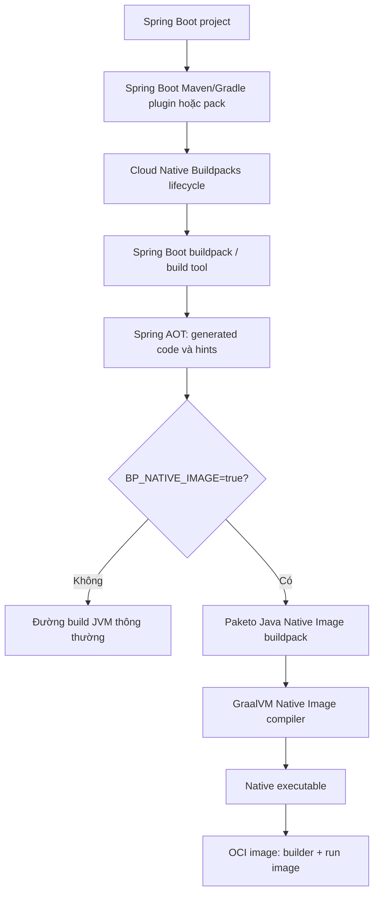
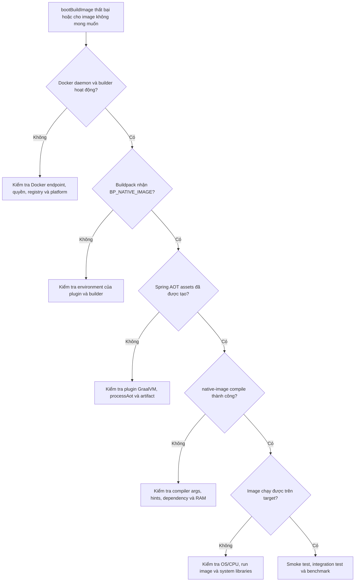

# `BP_NATIVE_IMAGE` và cách tích hợp của Spring Boot build plugin

## 1. Mục tiêu của bài học

Khi đóng gói ứng dụng Spring Boot thành container image bằng **Cloud Native Buildpacks (CNB)**, nhóm buildpack sẽ phát hiện loại ứng dụng, chuẩn bị công cụ và tạo image có thể chạy. Với một ứng dụng Java thông thường, buildpack có thể tạo image chạy trên JVM. Với ứng dụng cần **GraalVM Native Image**, quá trình build phải được yêu cầu chuyển sang tạo executable native.

Biến môi trường **`BP_NATIVE_IMAGE`** là tín hiệu build-time quan trọng để buildpack Java Native Image của Paketo tham gia và biên dịch ứng dụng thành native executable. Spring Boot tích hợp CNB qua Maven/Gradle plugin, do đó người phát triển có thể cấu hình hoặc kích hoạt quy trình này ngay trong build file.

Sau bài học, bạn có thể:

- Giải thích `BP_NATIVE_IMAGE` được đọc ở giai đoạn nào và thay đổi điều gì trong build lifecycle.
- Hiểu mối quan hệ giữa Spring AOT, Spring Boot build plugin, Paketo buildpacks và GraalVM Native Image compiler.
- Cấu hình `bootBuildImage` bằng Gradle Groovy DSL/Kotlin DSL và `spring-boot:build-image` bằng Maven.
- Phân biệt tích hợp tự động của Spring Boot plugin với cấu hình tường minh khi dùng `pack` hoặc buildpack trực tiếp.
- Truyền native-image build arguments, chọn builder phù hợp, kiểm tra image và xử lý các lỗi thường gặp.

Ví dụ xuyên suốt là dịch vụ `order-service`. Mục tiêu là tạo container image `order-service:native` chứa executable native, chạy được endpoint HTTP và sẵn sàng để đo startup/RSS.

## 2. `BP_NATIVE_IMAGE` là gì?

`BP_NATIVE_IMAGE` là biến cấu hình **tại thời điểm build** do Paketo Native Image Buildpack sử dụng để xác định có biên dịch ứng dụng thành GraalVM Native Image hay không. Giá trị phổ biến là:

| Giá trị | Ý nghĩa |
|---|---|
| `true` | Yêu cầu buildpack thực hiện native image build nếu builder có đủ các buildpack và toolchain tương thích |
| `false` hoặc không đặt | Không bật native image build theo biến này; buildpack có thể đi theo đường JVM thông thường tùy build plan và cấu hình |

Ví dụ cơ bản với `pack`:

```bash
pack build order-service:native \
  --path . \
  --env BP_NATIVE_IMAGE=true
```

Đây là ví dụ tổng quát cho source build có cấu hình buildpack phù hợp. Dự án Spring Boot còn phải thực hiện **Spring AOT** và tạo ra các generated assets/metadata cần thiết trước khi GraalVM biên dịch native. Chỉ đặt `BP_NATIVE_IMAGE=true` không tự sửa mọi lỗi AOT, reflection, resource hay dependency.

### 2.1. Biến này được đọc ở đâu?

Trong hệ sinh thái Paketo, Java Native Image Buildpack là một thành phần trong nhóm buildpack Java native. Thành phần `paketo-buildpacks/native-image` tham gia khi `BP_NATIVE_IMAGE` được đặt hoặc khi upstream buildpack yêu cầu native-image trong build plan. Khi tham gia, nó yêu cầu Native Image builder, gọi `native-image` và thay thế bytecode ứng dụng bằng executable native trong image.



Trong flow tích hợp của Spring Boot, plugin có thể điều phối AOT và chuyển biến buildpack phù hợp. Khi sử dụng `pack` hoặc buildpack component trực tiếp, người build cần đảm bảo AOT assets và biến môi trường được thiết lập theo đúng đường build.

### 2.2. Build-time khác runtime

`BP_NATIVE_IMAGE` phải có mặt **khi build image**. Ví dụ cấu hình sau không bật native compilation:

```bash
# Không có tác dụng bật native compilation đã hoàn tất.
# Đây chỉ là biến môi trường lúc container chạy.
docker run --rm -e BP_NATIVE_IMAGE=true order-service:latest
```

Lúc `docker run`, buildpack lifecycle đã kết thúc. Biến môi trường này không thể biến một image JVM đã tạo thành native image. Cần chạy lại quy trình build với biến được truyền vào builder.

## 3. Vai trò của Spring AOT và Spring Boot build plugin

### 3.1. Ba thành phần có trách nhiệm khác nhau

| Thành phần | Vai trò trong native build |
|---|---|
| Spring AOT | Phân tích cấu hình Spring ở build time, sinh mã khởi tạo và metadata/hints cho reflection, resource, serialization, proxy hoặc JNI khi cần |
| Spring Boot Maven/Gradle plugin | Điều phối task AOT, đóng gói ứng dụng và tích hợp Cloud Native Buildpacks |
| Paketo Java Native Image buildpack | Cung cấp/nhận diện native-image toolchain, gọi GraalVM Native Image compiler và tạo image chứa executable native |

Spring AOT không phải là trình biên dịch native. GraalVM Native Image compiler cũng không tự hiểu toàn bộ hành vi động của Spring. Vì vậy, quy trình cần cả dữ liệu AOT do Spring sinh ra lẫn native-image buildpack thực hiện biên dịch.

### 3.2. Tích hợp tự động khi dùng Spring Boot Gradle plugin

Với các phiên bản Spring Boot hỗ trợ native image hiện đại, khi dự án áp dụng GraalVM Native Image Gradle plugin (`org.graalvm.buildtools.native`), Spring Boot Gradle plugin tự cấu hình các task AOT cần thiết. `bootBuildImage` được cấu hình để tạo native image thay vì image chạy JVM.

Điều này có nghĩa là với một dự án đã cấu hình đúng plugin và phiên bản tương thích, thông thường chỉ cần:

```bash
./gradlew bootBuildImage
```

Spring Boot plugin thực hiện phần tích hợp, bao gồm AOT và thiết lập môi trường buildpack cần thiết. Không phải dự án nào cũng cần tự thêm `BP_NATIVE_IMAGE` vào build file; trước tiên hãy kiểm tra plugin native đã được áp dụng hay chưa và xem log của `bootBuildImage`.

Ví dụ khối plugin tối giản để minh họa mối liên hệ:

```groovy
// build.gradle — minh họa, hãy giữ các plugin và version hiện có của dự án.
plugins {
    id 'java'
    id 'org.springframework.boot' version '<spring-boot-version>'
    id 'org.graalvm.buildtools.native' version '<compatible-native-build-tools-version>'
}
```

```kotlin
// build.gradle.kts
plugins {
    java
    id("org.springframework.boot") version "<spring-boot-version>"
    id("org.graalvm.buildtools.native") version "<compatible-native-build-tools-version>"
}
```

Các placeholder version phải được thay bằng phiên bản thực tế tương thích với Gradle wrapper, JDK/GraalVM và Spring Boot đang dùng. Không sao chép version minh họa thành version phát hành.

### 3.3. Khi nào cần cấu hình `BP_NATIVE_IMAGE` tường minh?

Cấu hình tường minh hữu ích khi:

- Dùng `pack build` trực tiếp và cần bật native-image buildpack.
- Dùng builder hoặc pipeline CNB riêng, không có tích hợp tự động của Spring Boot plugin.
- Muốn tài liệu hóa rõ biến môi trường native trong cấu hình `bootBuildImage`.
- Cần xác nhận buildpack đang nhận đúng giá trị khi thay đổi builder hoặc quy trình CI.

Không nên thêm biến một cách máy móc nếu Spring Boot plugin đã tự cấu hình nó. Cần phân biệt **tích hợp tự động** với **tự khai báo để kiểm soát một build flow tùy biến**.

## 4. Cấu hình Gradle với `bootBuildImage`

Spring Boot Gradle plugin cung cấp task `bootBuildImage` để tạo OCI image từ ứng dụng. Task có thuộc tính `environment` để truyền các biến build-time tới builder.

### 4.1. Groovy DSL

Nếu cần khai báo tường minh, cấu hình trong `build.gradle`:

```groovy
tasks.named('bootBuildImage') {
    environment['BP_NATIVE_IMAGE'] = 'true'
}
```

Để đặt thêm builder và tên OCI image:

```groovy
tasks.named('bootBuildImage') {
    builder = 'paketobuildpacks/ubuntu-resolute-builder'
    imageName = "order-service:native"
    environment['BP_NATIVE_IMAGE'] = 'true'
}
```

Tên builder ở đây chỉ là ví dụ. Hãy chọn builder đang được hỗ trợ, có buildpack Java Native Image và phù hợp với hệ điều hành/kiến trúc, phiên bản Java của dự án. Spring Boot có thể tự chọn builder mặc định nếu bạn không khai báo.

### 4.2. Kotlin DSL

Trong `build.gradle.kts`:

```kotlin
import org.springframework.boot.gradle.tasks.bundling.BootBuildImage

tasks.named<BootBuildImage>("bootBuildImage") {
    environment.put("BP_NATIVE_IMAGE", "true")
}
```

Ví dụ đầy đủ hơn:

```kotlin
import org.springframework.boot.gradle.tasks.bundling.BootBuildImage

tasks.named<BootBuildImage>("bootBuildImage") {
    builder.set("paketobuildpacks/ubuntu-resolute-builder")
    imageName.set("order-service:native")
    environment.put("BP_NATIVE_IMAGE", "true")
}
```

Trong Kotlin DSL, `environment` là map property nên dùng `put`. Cú pháp có thể khác nếu dự án dùng phiên bản plugin rất cũ; hãy đối chiếu API của phiên bản Spring Boot hiện tại.

### 4.3. Chạy build và kiểm tra image

```bash
./gradlew bootBuildImage

# Liệt kê image được tạo trong Docker daemon
docker image ls

# Kiểm tra metadata của image
docker image inspect order-service:native

# Chạy thử ứng dụng
docker run --rm -p 8080:8080 order-service:native
```

Sau khi container khởi động, gọi endpoint thực tế của ứng dụng. Ví dụ nếu đã bật Spring Boot Actuator:

```bash
curl -fsS http://localhost:8080/actuator/health
```

Việc `docker image inspect` thành công chỉ xác nhận image tồn tại. Cần kiểm tra build log hoặc process type/entrypoint của image để chắc chắn image chứa native executable chứ không phải JVM application.

## 5. Cấu hình Maven với `spring-boot:build-image`

Spring Boot Maven plugin có thể sử dụng Cloud Native Buildpacks thông qua goal `spring-boot:build-image`. Khi dùng `spring-boot-starter-parent`, profile `native` được cung cấp để điều phối các bước native cần thiết, bao gồm Spring AOT và cấu hình build-image phù hợp.

### 5.1. Sử dụng native profile

Với dự án Maven đã dùng Spring Boot parent và khai báo Native Build Tools plugin phù hợp:

```bash
./mvnw -Pnative spring-boot:build-image
```

Profile `native` trong Spring Boot parent giúp giảm lượng cấu hình thủ công. Trước khi dùng, kiểm tra dự án có khai báo `org.graalvm.buildtools:native-maven-plugin` và các plugin Spring Boot cần thiết.

### 5.2. Truyền `BP_NATIVE_IMAGE` tường minh

Trong `pom.xml`, cấu hình biến trong phần `image.env` của Spring Boot Maven plugin:

```xml
<plugin>
    <groupId>org.springframework.boot</groupId>
    <artifactId>spring-boot-maven-plugin</artifactId>
    <configuration>
        <image>
            <name>order-service:native</name>
            <env>
                <BP_NATIVE_IMAGE>true</BP_NATIVE_IMAGE>
            </env>
        </image>
    </configuration>
</plugin>
```

Nếu profile `native` đã cấu hình biến và các execution cần thiết, không cần lặp lại cấu hình một cách không cần thiết. Đoạn XML trên minh họa cách truyền environment variable vào builder, không thay thế khai báo AOT/native plugin.

### 5.3. Không dùng Spring Boot parent

Nếu dự án không kế thừa `spring-boot-starter-parent`, phải tự cấu hình các execution phù hợp với phiên bản Spring Boot. Với flow native phổ biến, cần đảm bảo goal `process-aot` của Spring Boot plugin được thực hiện trước khi build image và các bước reachability metadata cần thiết được tích hợp theo Native Build Tools.

Ví dụ execution AOT:

```xml
<plugin>
    <groupId>org.springframework.boot</groupId>
    <artifactId>spring-boot-maven-plugin</artifactId>
    <executions>
        <execution>
            <id>process-aot</id>
            <goals>
                <goal>process-aot</goal>
            </goals>
        </execution>
    </executions>
</plugin>
```

Đây là phần minh họa execution, không phải toàn bộ `pom.xml`. Hãy theo tài liệu của đúng phiên bản Spring Boot/Native Build Tools để cấu hình `add-reachability-metadata`, classpath và các plugin cần thiết. Nếu dùng parent native profile thì không nên khai báo trùng execution đã được profile quản lý.

## 6. Dùng `pack` trực tiếp với Spring Boot AOT artifact

Spring Boot plugin không phải nền tảng CNB duy nhất. `pack` CLI cũng có thể chạy buildpack. Cách ít phụ thuộc vào cấu hình build source của builder là tạo executable JAR đã có AOT assets, sau đó dùng `pack` để chuyển JAR đó thành native container image.

### 6.1. Tạo JAR có AOT assets

Với Gradle đã áp dụng GraalVM Native Image plugin và Spring Boot plugin:

```bash
./gradlew bootJar
```

Với Maven dùng Spring Boot parent và native profile, có thể tạo artifact theo pipeline native phù hợp của dự án. Kiểm tra JAR phải chứa các generated classes và metadata AOT/hints trước khi đưa vào buildpack.

### 6.2. Chuyển JAR thành native container image

```bash
pack build order-service:native \
  --builder paketobuildpacks/ubuntu-resolute-builder \
  --run-image paketobuildpacks/ubuntu-resolute-run-tiny \
  --path build/libs/order-service-1.0.0.jar \
  --env BP_NATIVE_IMAGE=true
```

Đổi đường dẫn JAR, tên builder và run image theo artifact và builder thực tế. Builder/run image phải tương thích với nhau và với nền tảng triển khai.

Một số phiên bản/component buildpack hỗ trợ `BP_NATIVE_IMAGE_BUILT_ARTIFACT` để chỉ rõ JAR cần biên dịch khi build từ artifact. Khi sử dụng Java Native Image component trực tiếp hoặc buildpack group không tự xác định artifact, cần đặt biến này theo hướng dẫn của buildpack. Với Spring Boot composite buildpack tích hợp, việc chọn artifact có thể đã được điều phối tự động.

**Điểm cần nhớ:** JAR phải chứa AOT generated assets. Nếu chỉ chạy `bootJar` thông thường mà không có bước AOT tương ứng, `BP_NATIVE_IMAGE=true` không thể tự tạo đầy đủ metadata Spring cần.

## 7. Các biến môi trường native image buildpack thường dùng

Ngoài `BP_NATIVE_IMAGE`, Paketo Native Image Buildpack có một số biến cấu hình hữu ích:

| Biến | Mục đích | Khi nào sử dụng |
|---|---|---|
| `BP_NATIVE_IMAGE` | Bật/tắt native image build | Bật khi muốn image chứa executable native |
| `BP_NATIVE_IMAGE_BUILD_ARGUMENTS` | Truyền arguments trực tiếp cho lệnh `native-image` | Khi cần thêm option GraalVM như mức tối ưu hóa hoặc cấu hình class initialization |
| `BP_NATIVE_IMAGE_BUILD_ARGUMENTS_FILE` | Chỉ tới file chứa arguments theo định dạng Java argument file | Khi danh sách tham số dài hoặc cần quản lý thành file trong source |
| `BP_NATIVE_IMAGE_BUILT_ARTIFACT` | Chỉ rõ application JAR sẽ được biên dịch | Khi build từ JAR và buildpack không tự xác định artifact |
| `BP_BINARY_COMPRESSION_METHOD` | Chọn cách nén executable native nếu buildpack hỗ trợ | Khi cân nhắc `upx` hoặc `gzexe`; phải kiểm thử runtime image và nền tảng |

Các biến trên thuộc buildpack, không phải mọi CNB builder đều hỗ trợ cùng phiên bản hoặc cùng thành phần. Kiểm tra danh sách buildpacks trong builder và reference của phiên bản đang sử dụng.

### 7.1. Truyền build arguments

Ví dụ dùng Gradle `bootBuildImage`:

```groovy
tasks.named('bootBuildImage') {
    environment['BP_NATIVE_IMAGE'] = 'true'
    environment['BP_NATIVE_IMAGE_BUILD_ARGUMENTS'] = '-O2'
}
```

Kotlin DSL:

```kotlin
tasks.named<BootBuildImage>("bootBuildImage") {
    environment.put("BP_NATIVE_IMAGE", "true")
    environment.put("BP_NATIVE_IMAGE_BUILD_ARGUMENTS", "-O2")
}
```

Maven:

```xml
<image>
    <env>
        <BP_NATIVE_IMAGE>true</BP_NATIVE_IMAGE>
        <BP_NATIVE_IMAGE_BUILD_ARGUMENTS>-O2</BP_NATIVE_IMAGE_BUILD_ARGUMENTS>
    </env>
</image>
```

`-O2` là ví dụ về tùy chọn tối ưu hóa; không mặc định mức này luôn là tốt nhất cho mọi ứng dụng. Build native vốn tốn thời gian và tài nguyên; hãy so sánh kết quả startup, throughput, CPU và kích thước binary trước khi chọn option cho production.

### 7.2. Sử dụng arguments file

Khi có nhiều option, có thể lưu file trong source tree, ví dụ `config/native-image.args`:

```text
-O2
--initialize-at-run-time=com.example.orders.RuntimeState
```

Sau đó cấu hình đường dẫn file theo cơ chế buildpack được sử dụng:

```groovy
tasks.named('bootBuildImage') {
    environment['BP_NATIVE_IMAGE'] = 'true'
    environment['BP_NATIVE_IMAGE_BUILD_ARGUMENTS_FILE'] = 'config/native-image.args'
}
```

Đường dẫn file được diễn giải trong workspace mà buildpack nhận được. Hãy xác minh file đã được đưa vào build context và được mount/copy đúng nơi. Không đặt secrets trong file arguments vì nội dung build có thể được ghi lại trong log hoặc metadata.

### 7.3. Không nhầm arguments của Gradle với arguments của native-image

| Biến/cấu hình | Công cụ nhận | Ví dụ |
|---|---|---|
| `BP_GRADLE_BUILD_ARGUMENTS` | Lệnh Gradle do Paketo Gradle Buildpack chạy | `--no-daemon build` |
| `BP_NATIVE_IMAGE_BUILD_ARGUMENTS` | Lệnh GraalVM `native-image` | `-O2` |
| `BP_NATIVE_IMAGE_BUILD_ARGUMENTS_FILE` | File arguments của `native-image` | `config/native-image.args` |
| `BP_NATIVE_IMAGE` | Native Image Buildpack | `true` |
| `BP_JVM_VERSION` | JVM/toolchain được buildpack cài cho build | `25` (nếu builder hỗ trợ) |

Ví dụ, đặt `BP_GRADLE_BUILD_ARGUMENTS=--no-daemon build` không thay thế `BP_NATIVE_IMAGE_BUILD_ARGUMENTS`. Một biến điều khiển việc chạy build tool; biến còn lại điều khiển native compiler.

## 8. Builder, run image và nền tảng native

### 8.1. Builder phải có buildpack phù hợp

CNB builder chứa lifecycle, buildpack và thông tin run image. Không phải builder Java nào cũng có thành phần native-image. Khi build, kiểm tra log detection/build plan để xác nhận Java buildpack và Native Image buildpack tham gia.

Paketo Java Native Image buildpack là composite buildpack gồm các thành phần như GraalVM toolchain và Native Image buildpack. Builder cần cung cấp đúng bộ buildpack và toolchain tương thích với phiên bản Spring Boot/JDK.

### 8.2. Builder image và run image có vai trò khác nhau

| Image | Vai trò |
|---|---|
| Builder image | Chứa CNB lifecycle, buildpacks và toolchain để biên dịch ứng dụng |
| Run image | Nền tảng runtime chứa thư viện hệ thống cần thiết để chạy application image |
| Application image | Image được tạo, chứa executable native cùng các thành phần runtime cần thiết |

Native Image vẫn phụ thuộc hệ điều hành, kiến trúc CPU, ABI và thư viện hệ thống. Chọn builder và run image không tương thích có thể làm build hoặc runtime thất bại. Với image tối giản như `tiny`, cần xác minh CA certificates, timezone data, dynamic libraries và mọi phụ thuộc mà ứng dụng sử dụng.

### 8.3. Kiến trúc CPU

Native executable được tạo cho nền tảng build/target cụ thể. `linux/amd64` và `linux/arm64` cần được kiểm tra riêng. Nếu triển khai cluster đa kiến trúc, hãy build image tương ứng cho từng kiến trúc và phát hành multi-platform manifest khi pipeline đã tạo đủ biến thể.

Không dùng `--platform` để giả định một executable amd64 tự biến thành arm64. Kiểm tra `imagePlatform` của Spring Boot plugin, platform mà builder hỗ trợ và kiến trúc CPU của runner.

## 9. Theo dõi quá trình build và xác nhận native image

### 9.1. Các giai đoạn nên nhận diện trong log

Một lần build native container thường có các giai đoạn:

1. Spring Boot plugin đóng gói hoặc chuẩn bị source/artifact.
2. Docker daemon tải builder/run image và tạo môi trường builder.
3. CNB lifecycle chạy detection và build plan.
4. Build tool/buildpack xử lý ứng dụng, thực hiện Spring AOT nếu flow yêu cầu.
5. Native Image buildpack chuẩn bị GraalVM Native Image toolchain.
6. `native-image` phân tích reachability, áp dụng metadata và biên dịch executable.
7. CNB export application image với run image phù hợp.

Thời gian ở bước 6 có thể chiếm phần lớn build time. Nếu build thất bại, đọc phần log cuối cùng để xác định lỗi ở AOT, dependency, native compiler hay export image.

### 9.2. Kiểm tra image

```bash
docker image inspect order-service:native
docker image ls order-service

# Chạy ứng dụng
docker run --rm -p 8080:8080 order-service:native
```

Kiểm tra startup log, readiness endpoint và request nghiệp vụ. Nếu image có process metadata, có thể xem entrypoint/process type để xác định image chạy executable native.

Đừng chỉ dựa vào tên tag `:native` hoặc sự tồn tại của image. Tag là tên do người build đặt; log buildpack và nội dung thực tế mới chứng minh native compiler đã chạy.

### 9.3. Xác minh phiên bản Native Image compiler

Paketo buildpacks cung cấp Software Bill of Materials (SBOM)/Bill of Materials (BOM) để tra cứu các thành phần được đưa vào build. Dùng cơ chế inspect SBOM của builder/runtime theo phiên bản để xác nhận GraalVM hoặc Native Image Toolkit thực sự đã được sử dụng. Việc này hữu ích khi builder thay đổi version mà cấu hình ứng dụng không đổi.

## 10. Lỗi thường gặp và cách chẩn đoán

| Triệu chứng | Nguyên nhân có thể | Hướng xử lý |
|---|---|---|
| Image được tạo nhưng vẫn chạy JVM | `BP_NATIVE_IMAGE` chưa được truyền lúc build hoặc builder không kích hoạt native buildpack | Kiểm tra environment của `bootBuildImage`, log build plan và các buildpack tham gia |
| `BP_NATIVE_IMAGE` được đặt nhưng không tìm thấy native-image builder | Builder thiếu buildpack/toolchain native hoặc phiên bản không tương thích | Chọn Paketo Java Native Image builder phù hợp và kiểm tra buildpack order |
| `native-image` báo thiếu class/hint/resource | Spring AOT chưa chạy, AOT assets thiếu hoặc thư viện cần runtime hints | Xác nhận process-aot, kiểm tra generated hints và bổ sung RuntimeHints khi cần |
| Buildpack không tìm thấy executable JAR | Artifact path sai, multi-module chọn nhầm module hoặc artifact pattern không khớp | Kiểm tra `BP_GRADLE_BUILT_MODULE`, `BP_GRADLE_BUILT_ARTIFACT` hoặc biến Maven tương ứng |
| Build từ JAR thất bại vì không xác định artifact | Dùng component buildpack trực tiếp mà không khai báo JAR cần biên dịch | Kiểm tra `BP_NATIVE_IMAGE_BUILT_ARTIFACT` theo reference của buildpack |
| `Unrecognized option` | `BP_NATIVE_IMAGE_BUILD_ARGUMENTS` chứa flag không hợp lệ hoặc sai phiên bản compiler | Xóa từng flag, kiểm tra tài liệu Native Image tương ứng và build log |
| Native build bị OOM/exit 137 | Builder container hoặc Docker VM thiếu RAM/CPU | Tăng tài nguyên build runner/Docker, giảm concurrency, theo dõi memory limit |
| Pull builder/run image bị `401`/`denied` | Thiếu quyền registry hoặc sai credentials | Cấu hình `builderRegistry` và kiểm tra quyền pull/push riêng biệt |
| Build thành công nhưng container lỗi lúc start | Run image thiếu thư viện, sai OS/CPU/ABI hoặc quyền filesystem | Kiểm tra run image, ELF interpreter, libc, native libraries và architecture |
| Buildpacks không chạy theo cấu hình mới | Cache hoặc image cũ khiến bạn đang quan sát artifact khác | Xác nhận image tag, build ID và chỉ xóa cache khi cần kiểm tra sạch |

### 10.1. Phân loại lỗi theo giai đoạn



## 11. Bài thực hành: bật native image qua Spring Boot Gradle plugin

### Chuẩn bị

- Một ứng dụng Spring Boot có endpoint HTTP và Actuator health/readiness nếu muốn dùng readiness probe.
- Gradle wrapper, Spring Boot Gradle plugin và GraalVM Native Image plugin phiên bản tương thích.
- Docker daemon hoạt động, đủ RAM/CPU và có thể tải builder/run image.
- Builder chứa Paketo Java Native Image buildpack và toolchain phù hợp.

### Bước 1 — Áp dụng plugin native

Đảm bảo `build.gradle` hoặc `build.gradle.kts` có `org.graalvm.buildtools.native`. Không cần thêm lại nếu dự án đã có.

### Bước 2 — Xem các task AOT và image

```bash
./gradlew tasks --all
```

Tìm `processAot` và `bootBuildImage`. Khi Native Image plugin được áp dụng, Spring Boot plugin sẽ cấu hình các tác vụ AOT liên quan.

### Bước 3 — Build image

```bash
./gradlew bootBuildImage
```

Đọc log để xác nhận buildpack native được kích hoạt. Nếu builder hoặc phiên bản plugin của dự án yêu cầu khai báo tường minh, thêm:

```groovy
tasks.named('bootBuildImage') {
    environment['BP_NATIVE_IMAGE'] = 'true'
}
```

### Bước 4 — Chạy và kiểm tra

```bash
docker image ls
docker run --rm -p 8080:8080 <image-name>:<tag>
```

Trong terminal khác, gọi `/actuator/health` hoặc endpoint thật của ứng dụng. Xác nhận log buildpack cho biết native image đã được tạo.

### Bước 5 — Thử một build argument

Thêm `BP_NATIVE_IMAGE_BUILD_ARGUMENTS=-O2` qua `environment` của `bootBuildImage`, build lại và ghi nhận thời gian build, kích thước image, startup và RSS. So sánh với baseline không có option này trên cùng máy và cùng workload.

### Phiếu ghi kết quả

| Hạng mục | Kết quả cần ghi |
|---|---|
| Spring Boot / Gradle / GraalVM Native Image version | _(ghi)_ |
| Builder image và buildpack versions | _(ghi)_ |
| `BP_NATIVE_IMAGE` | `true` / _(giá trị thực tế)_ |
| Spring AOT | Đã chạy / chưa chạy; log hoặc generated assets |
| `BP_NATIVE_IMAGE_BUILD_ARGUMENTS` | _(ghi)_ |
| Application image name/tag | _(ghi)_ |
| Build result | PASS/FAIL và giai đoạn lỗi |
| Smoke/readiness test | PASS/FAIL |
| Startup đến readiness | _(đo)_ |
| RSS nhàn rỗi / peak RSS | _(đo)_ |

## 12. Những ngộ nhận thường gặp

**`BP_NATIVE_IMAGE=true` là đủ để mọi dự án Spring Boot build native.** Không đúng. Builder cần có native-image buildpack/toolchain; ứng dụng phải có AOT assets, dependency tương thích và cấu hình reflection/resource cần thiết.

**`BP_NATIVE_IMAGE` là biến runtime.** Không đúng. Đây là biến build-time. Đặt nó khi chạy container không thay đổi executable đã được biên dịch.

**Spring AOT và Native Image là cùng một bước.** Không đúng. Spring AOT sinh code/metadata cho Spring; GraalVM Native Image compiler phân tích và tạo mã máy.

**Dùng `bootBuildImage` bắt buộc phải tự khai báo `BP_NATIVE_IMAGE`.** Không phải lúc nào cũng cần. Với Spring Boot Gradle plugin và GraalVM Native Image plugin tương thích, Spring Boot tự cấu hình AOT và native image build. Khai báo tường minh phù hợp với flow tùy biến hoặc `pack` trực tiếp.

**Có thể lấy cấu hình Spring Native cũ và áp dụng nguyên vẹn cho Spring Boot hiện đại.** Không nên. Spring Boot 3 trở lên có hỗ trợ native và Spring AOT tích hợp. Các ví dụ của Spring Native thời Spring Boot 2 có thể dùng plugin, dependency và cách cấu hình khác.

**`BP_NATIVE_IMAGE_BUILD_ARGUMENTS` giống `BP_GRADLE_BUILD_ARGUMENTS`.** Không đúng. Một biến truyền option cho `native-image`, biến còn lại truyền tham số cho Gradle buildpack.

**Build thành công đồng nghĩa image đã sẵn sàng production.** Không đúng. Cần chạy integration test, kiểm tra runtime libraries, architecture, health/readiness, observability và đo hiệu năng trên nền tảng đích.

## 13. Kết luận

`BP_NATIVE_IMAGE` là công tắc build-time để Paketo Java Native Image Buildpack tạo GraalVM Native Image trong container image. Trong quy trình Spring Boot tích hợp, Spring Boot Maven/Gradle plugin điều phối Spring AOT và truyền cấu hình phù hợp tới buildpack. Với Gradle, việc áp dụng `org.graalvm.buildtools.native` giúp Spring Boot plugin tự cấu hình AOT và `bootBuildImage` cho native image. Với Maven, native profile của Spring Boot parent có thể điều phối các execution cần thiết.

Khi tùy biến, cần xác định rõ build đang chạy qua `bootBuildImage`, `spring-boot:build-image` hay `pack`; truyền biến vào **builder ở build time**; chọn builder/run image tương thích; và chỉ thêm `BP_NATIVE_IMAGE_BUILD_ARGUMENTS` khi có lý do kỹ thuật cụ thể. Sau build, xác minh native executable thực sự được tạo, chạy integration test và đo startup/RSS trước khi đưa image vào vận hành.

### Tài liệu tham khảo chính thức

- [Spring Boot — Developing Your First GraalVM Native Application](https://docs.spring.io/spring-boot/how-to/native-image/developing-your-first-application.html)
- [Spring Boot — Advanced Native Images Topics](https://docs.spring.io/spring-boot/reference/packaging/native-image/advanced-topics.html)
- [Spring Boot — Gradle Plugin: Packaging OCI Images](https://docs.spring.io/spring-boot/gradle-plugin/packaging-oci-image.html)
- [Spring Boot — Maven Plugin: Ahead-of-Time Processing](https://docs.spring.io/spring-boot/maven-plugin/aot.html)
- [Paketo — How to Build Java Apps as a GraalVM Native Image](https://paketo.io/docs/howto/java/)
- [Paketo — Java Native Image Buildpack Reference](https://paketo.io/docs/reference/java-native-image-reference/)
- [Paketo Buildpack for Native Image — Configuration](https://github.com/paketo-buildpacks/native-image)
- [Paketo — From deprecation warnings to Spring Boot performance (2026)](https://blog.paketo.io/posts/spring-boot-performance/)
