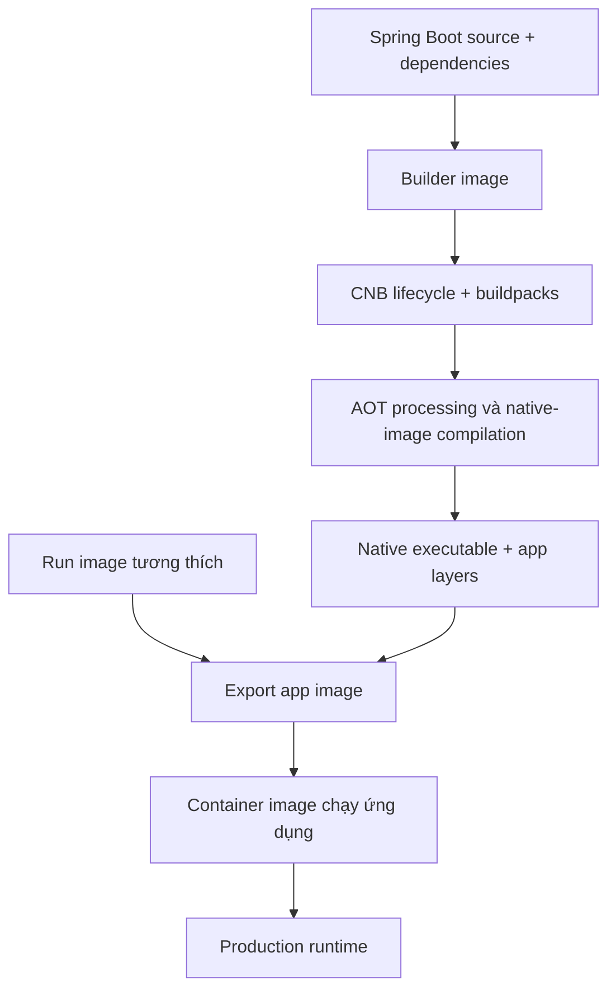

# Chọn builder, run image và phiên bản tương thích thay vì phụ thuộc mặc định

Khi đóng gói Spring Boot bằng **Cloud Native Buildpacks**, ta thường chỉ cần một lệnh như `mvn spring-boot:build-image` hoặc `gradle bootBuildImage`. Tuy nhiên, một lệnh ngắn có thể che đi nhiều quyết định quan trọng: builder nào cung cấp buildpacks và công cụ build, run image nào làm nền cho container cuối, và các phiên bản đó có tương thích với nhau hay không.

Với **GraalVM Native Image**, những quyết định này càng quan trọng. Native executable được tạo trong môi trường build và sẽ chạy trên hệ điều hành, kiến trúc CPU cùng các thư viện runtime cụ thể. Một image mặc định có thể hoạt động hôm nay nhưng thay đổi khi tag mặc định trỏ sang builder mới. Muốn build ổn định, cần **chọn có chủ đích builder, run image và bộ phiên bản**, sau đó ghi lại chúng để có thể tái lập và cập nhật an toàn.

## 1. Builder và run image có vai trò khác nhau

Cloud Native Buildpacks (CNB) chia quá trình tạo container image thành các thành phần. Hai image cần phân biệt là **builder image** và **run image**.

### Builder image: môi trường tạo ứng dụng

Builder là đầu vào cho quá trình buildpacks. Một builder CNB thường cung cấp:

- **Lifecycle:** công cụ điều phối các phase detect, analyze, restore, build và export.
- **Buildpacks:** tập thành phần nhận diện ứng dụng và tạo các layer cần thiết.
- **Build environment/stack:** nền tảng và thư viện dùng trong quá trình build.
- **Thông tin stack và run image:** định danh môi trường runtime tương thích được builder hỗ trợ.

Với Spring Boot native, builder cần có buildpack phù hợp để nhận diện ứng dụng Java, chuẩn bị JDK/GraalVM Native Image toolchain và biên dịch executable. Chẳng hạn, một số builder của Paketo cung cấp hệ sinh thái buildpacks Java có khả năng tạo native image khi được bật bằng biến môi trường tương ứng.

Builder **không phải** là container cuối cùng mà ứng dụng sẽ chạy. Nó có thể chứa compiler, JDK, GraalVM và nhiều công cụ chỉ cần ở build time.

### Run image: nền tảng chạy ứng dụng

Run image là image nền cho các container image được buildpacks xuất ra. Nó cung cấp môi trường tối thiểu mà ứng dụng cần khi chạy, ví dụ:

- Hệ điều hành và các thư viện hệ thống.
- Runtime libraries mà native executable liên kết động cần.
- CA certificates, timezone data và những thành phần nền cần thiết cho ứng dụng.
- User, group và cấu hình filesystem theo thiết kế của run image.

Đối với native executable, run image thường không cần mang theo toàn bộ JDK hoặc GraalVM compiler. Tuy nhiên, native binary vẫn có thể phụ thuộc vào glibc hoặc các thư viện hệ thống khác; do đó **run image nhỏ nhất chưa chắc là run image phù hợp nhất**.

### Luồng build



Builder tham gia tạo ứng dụng; run image cung cấp lớp nền cho image được xuất. Các layer cần cho runtime được chuyển vào app image, còn toolchain build không mặc nhiên đi theo toàn bộ sang môi trường production.

| Câu hỏi | Builder | Run image |
| --- | --- | --- |
| Dùng ở đâu? | Build time | Runtime |
| Chứa lifecycle/buildpacks? | Có | Không |
| Cần compiler/GraalVM? | Có thể có, tùy buildpack | Thông thường không |
| Cung cấp thư viện hệ thống khi chạy? | Là môi trường build | Có, là nền của app image |
| Có ảnh hưởng tới native binary? | Trực tiếp qua toolchain và cấu hình build | Qua ABI và thư viện mà binary cần lúc chạy |

## 2. Stack ID và tính tương thích giữa hai image

Cloud Native Buildpacks sử dụng **stack ID** để nhận diện nền tảng build/run mà một builder hỗ trợ. Builder có thể khai báo run image mặc định và stack ID của nó. Run image được chọn phải tương thích với stack mà builder hỗ trợ; nếu stack ID không khớp, lifecycle có thể từ chối quá trình export image.

Có thể hình dung:

```text
Builder:
  stack ID = <stack-id>
  build image = <build-environment>
  run image mặc định = <compatible-run-image>

Run image được override:
  stack ID phải tương thích với builder
```

Stack ID giống nhau là điều kiện tương thích quan trọng của CNB, nhưng **không phải bằng chứng duy nhất** rằng ứng dụng sẽ chạy đúng. Native executable còn phụ thuộc kiến trúc CPU, ABI, libc và các shared libraries cần thiết.

### Vì sao native executable nhạy cảm với run image?

Native Image biên dịch mã Java thành mã máy cho một môi trường mục tiêu. Nếu executable được liên kết với thư viện C runtime hoặc thư viện hệ thống có trong build environment, container runtime cần cung cấp các thư viện tương thích.

Ví dụ:

- Binary được build cho Linux x86_64 không thể mặc nhiên chạy trên container Linux ARM64.
- Binary phụ thuộc glibc không thể chạy trên run image không có glibc tương thích.
- Binary cần một shared library mà run image đã loại bỏ có thể báo lỗi khi khởi chạy, dù build thành công.
- TLS có thể thất bại nếu runtime image thiếu CA certificates phù hợp.
- Ứng dụng xử lý timezone có thể cho kết quả khác nếu image runtime thiếu timezone data cần thiết.

Vì vậy, khi chọn builder và run image, cần kiểm tra **stack**, **hệ điều hành**, **libc**, **kiến trúc** và **runtime libraries** cùng lúc.

## 3. Chọn builder theo nhu cầu của ứng dụng

Không nên chọn builder chỉ vì tên có chữ `base`, `full` hoặc vì nó là mặc định của một phiên bản Spring Boot. Hãy đánh giá các tiêu chí sau:

| Tiêu chí | Cần xác minh | Lý do |
| --- | --- | --- |
| Java buildpack | Builder có buildpack Java phù hợp không? | Nhận diện Spring Boot artifact và xử lý Java application |
| Native Image support | Có buildpack/toolchain hỗ trợ GraalVM Native Image không? | Cần để tạo native executable trong buildpacks |
| Java/GraalVM version | Có phiên bản JDK và Native Image tương thích không? | Ảnh hưởng API, compiler, flags và khả năng build |
| Stack/OS | Builder sử dụng stack và bản phân phối Linux nào? | Quyết định ABI và khả năng ghép run image |
| Architecture | Builder có hỗ trợ `linux/amd64`, `linux/arm64` hoặc kiến trúc cần triển khai không? | Tránh tạo binary sai kiến trúc |
| Buildpacks release | Các buildpack có còn được duy trì và cập nhật bảo mật không? | Tránh dùng toolchain cũ hoặc buildpack hết hỗ trợ |
| Build environment | Có đủ compiler, headers và thư viện cần cho dependency native không? | Một số dependency cần công cụ hệ thống khi build |
| Khả năng tái lập | Có thể pin builder bằng version/digest không? | Tránh thay đổi ngoài ý muốn giữa hai lần build |

### Builder variant và kích thước

Một hệ sinh thái có thể cung cấp nhiều biến thể builder với tập buildpacks và package khác nhau. Ví dụ, builder dạng `base` thường có tập buildpacks chọn lọc hơn, còn biến thể `full` có thể cung cấp nhiều buildpack hoặc công cụ hơn. Cách phân loại cụ thể phụ thuộc nhà cung cấp và release.

- **Builder lớn hơn không đồng nghĩa app image cuối lớn hơn tương ứng.** Công cụ chỉ cần khi build không nhất thiết được đưa vào runtime image.
- **Builder nhỏ hơn không phải lúc nào cũng tốt hơn.** Nếu thiếu buildpack hoặc compiler cần thiết, build sẽ thất bại hoặc cần tùy biến phức tạp.
- Chọn builder có **đủ thành phần cần thiết**, có hỗ trợ và cập nhật rõ ràng; không chọn theo kích thước đơn lẻ.

Nếu dùng Paketo, hãy xem metadata và danh sách buildpacks của đúng builder release. Tên image dạng `builder-<distro>-<variant>` chỉ là cách đặt tên của một số release, không phải quy tắc chung cho mọi builder CNB.

## 4. Chọn run image theo ứng dụng và môi trường triển khai

Run image cần nhỏ gọn nhưng phải chứa đủ thành phần mà executable và ứng dụng cần. Hãy kiểm tra:

1. **Stack ID:** tương thích với builder đã chọn.
2. **Distro và libc:** phù hợp với binary được tạo trong build environment.
3. **Kiến trúc:** đúng với nền tảng container mục tiêu.
4. **Shared libraries:** có đầy đủ thư viện runtime cần thiết.
5. **Certificates và timezone:** phù hợp với HTTPS, TLS, xử lý ngày giờ.
6. **User và quyền filesystem:** ứng dụng có thể đọc file, ghi thư mục tạm và bind port theo cấu hình.
7. **Security maintenance:** run image được cập nhật bản vá, có quy trình release và thông báo lỗ hổng.
8. **Debuggability:** image quá tối giản có thể thiếu shell hoặc công cụ chẩn đoán; cần có cách quan sát log/metrics từ bên ngoài.

### Chọn image tối giản có kiểm chứng

Một run image nhỏ có thể giảm dung lượng tải và bề mặt tấn công, nhưng phải chạy thử các luồng thực tế. Ví dụ, ứng dụng gọi HTTPS tới API bên ngoài cần CA certificates; ứng dụng dùng timezone theo khu vực cần dữ liệu timezone; ứng dụng ghi file cần quyền filesystem phù hợp.

Không nên thêm công cụ debug vào production image chỉ để tiện thao tác. Có thể dùng ephemeral debug container hoặc công cụ quan sát ở môi trường triển khai, tùy nền tảng.

## 5. Chốt phiên bản theo một ma trận tương thích

Một native build không chỉ có một phiên bản. Bộ thành phần liên quan có thể gồm:

| Thành phần | Thông tin cần ghi | Cách xác minh |
| --- | --- | --- |
| Spring Boot | Version framework | POM/Gradle và dependency report |
| Spring Boot Maven/Gradle plugin | Version plugin | Build file/effective POM |
| Java | Major version và vendor | `java -version` hoặc buildpack logs |
| GraalVM Native Image | Distribution và version | Buildpack logs/toolchain metadata |
| Builder | Tag và digest | Image metadata/registry |
| CNB lifecycle | Version và Platform API | Builder metadata/log |
| Java/native buildpacks | Tên và version từng buildpack | `pack inspect-builder` hoặc build logs |
| Stack | Stack ID và distro release | Builder/run image metadata |
| Run image | Tag và digest | Registry metadata |
| OS/architecture | Ví dụ Linux amd64 hoặc arm64 | Image manifest và môi trường build/deploy |
| Runtime libraries | libc và các shared library cần thiết | Kiểm tra image và chạy native binary |

**Không có một cặp version duy nhất phù hợp với mọi dự án.** Tương thích cần được xác minh theo release của Spring Boot, buildpacks, GraalVM và stack. Khi nâng một thành phần, hãy đọc compatibility notes của nhà cung cấp và build/test lại ứng dụng.

### Tránh dùng tag di động làm cấu hình sản xuất

Ví dụ `paketobuildpacks/builder-jammy-base:latest` hoặc `paketobuildpacks/run-jammy-base:latest` có thể trỏ tới image mới theo thời gian. Build hôm nay và build tuần sau có thể sử dụng lifecycle, buildpack, OS package hoặc toolchain khác dù source code không đổi.

Đối với build cần tái lập, pin **tag phát hành cụ thể** hoặc tốt hơn là **digest**:

```text
paketobuildpacks/builder-jammy-base:<builder-release>@sha256:<builder-digest>
paketobuildpacks/run-jammy-base:<run-release>@sha256:<run-digest>
```

Các chuỗi trên là placeholder minh họa. Hãy thay bằng tag và digest thực tế được xác minh từ registry; không copy nguyên văn vào build file.

Pin digest giúp xác định chính xác image bytes đã sử dụng, nhưng cũng có nghĩa bạn cần **chủ động cập nhật** khi có bản vá bảo mật hoặc release mới. Tái lập và bảo mật phải đi cùng nhau: khóa version để kiểm soát thay đổi, rồi nâng version có kế hoạch và chạy lại kiểm thử.

## 6. Cấu hình builder và run image với Spring Boot Maven Plugin

Spring Boot Maven Plugin hỗ trợ cấu hình image khi chạy goal `spring-boot:build-image`. Hai thuộc tính quan trọng là `builder` và `runImage`.

Ví dụ dưới đây minh họa một cấu hình cho **Paketo builder/run image cùng dòng Ubuntu Jammy**. Các tag chỉ mang tính minh họa; trong dự án thật hãy pin release và digest đã được xác minh.

```xml
<plugin>
    <groupId>org.springframework.boot</groupId>
    <artifactId>spring-boot-maven-plugin</artifactId>
    <configuration>
        <image>
            <builder>
                paketobuildpacks/builder-jammy-base:<builder-release>
            </builder>
            <runImage>
                paketobuildpacks/run-jammy-base:<run-release>
            </runImage>
            <env>
                <BP_NATIVE_IMAGE>true</BP_NATIVE_IMAGE>
            </env>
        </image>
    </configuration>
</plugin>
```

Giải thích:

- `builder` chỉ định builder image mà Spring Boot plugin chuyển cho buildpacks.
- `runImage` ghi đè run image mặc định mà builder cung cấp. Chỉ đặt khi đã xác minh stack ID và compatibility.
- `BP_NATIVE_IMAGE=true` là biến môi trường được Paketo Java Native Image buildpack sử dụng để yêu cầu build native executable. Đây là **hợp đồng của buildpack cụ thể**; builder khác có thể dùng cách cấu hình khác.
- Native buildpack phải được cung cấp trong builder và có toolchain tương thích. Chỉ đặt biến môi trường không thể bổ sung một buildpack còn thiếu.

Với dự án dùng profile `native`, có thể đặt cấu hình image trong profile đó để không vô tình build native ở mọi lần đóng gói. Lệnh ví dụ khi cấu hình profile và AOT phù hợp:

```bash
./mvnw -Pnative spring-boot:build-image
```

Trước khi chạy, kiểm tra project đã cấu hình Spring AOT cho profile native theo phiên bản Spring Boot đang dùng. Đọc log để xác nhận `process-aot` (nếu cấu hình cần chạy) và buildpack native image thực sự được thực thi. `spring-boot:build-image` đóng gói ứng dụng qua buildpacks; nó không tự sửa các runtime hints còn thiếu trong code ứng dụng.

Nếu không override `runImage`, builder có thể cung cấp run image mặc định trong metadata. Đó là lựa chọn hợp lệ khi đã kiểm tra builder release, nhưng với build production cần ghi lại chính xác run image thực tế được chọn trong log và image metadata.

## 7. Cấu hình builder và run image với Gradle

Với Gradle Groovy DSL, có thể cấu hình task `bootBuildImage`:

```groovy
tasks.named("bootBuildImage") {
    builder = "paketobuildpacks/builder-jammy-base:<builder-release>"
    runImage = "paketobuildpacks/run-jammy-base:<run-release>"

    environment = [
        "BP_NATIVE_IMAGE": "true"
    ]
}
```

Đây là ví dụ dùng Groovy DSL. Với Kotlin DSL, cú pháp cấu hình property khác; hãy dùng kiểu task `BootBuildImage` và API property của phiên bản Spring Boot Gradle Plugin đang sử dụng.

Build image:

```bash
./gradlew bootBuildImage
```

Nếu project có cấu hình native profile/task riêng, hãy kích hoạt theo build file của project. Kiểm tra log để xác nhận AOT processing, native-image buildpack và run image đều được chọn đúng. Không nên giả định task `bootBuildImage` trong mọi cấu hình sẽ tự chạy cùng một tập task AOT/native; quan hệ task phụ thuộc phiên bản plugin và cấu hình Gradle.

### Khi nào không nên bật `BP_NATIVE_IMAGE`?

Nếu mục tiêu là tạo image chạy **JVM**, không bật cờ này. Buildpack sẽ tạo image theo cách chạy JVM thông thường. Nếu mục tiêu là image chứa **native executable**, bật native mode theo hướng dẫn của builder và xác minh log cho thấy buildpack native đã chạy. Không nên tạo một image rồi chỉ dựa vào tên tag để kết luận nó chứa binary native.

## 8. Kiểm tra builder, run image và app image trước khi triển khai

Sau khi build thành công, cần xác minh ba thứ riêng biệt:

- Builder thực tế được sử dụng.
- Run image thực tế được dùng để export.
- App image cuối chứa đúng native executable và có thể chạy trên môi trường mục tiêu.

Với Pack CLI, các lệnh kiểm tra thường dùng gồm:

```bash
# Xem metadata và buildpacks của builder.
pack inspect-builder paketobuildpacks/builder-jammy-base:<builder-release>

# Xem metadata của app image đã tạo.
pack inspect-image example.com/native-baseline:1.0.0

# Xem image manifest và platform trên registry.
docker buildx imagetools inspect example.com/native-baseline:1.0.0
```

Cú pháp chi tiết có thể khác theo phiên bản Pack CLI; dùng `pack help inspect-builder` và `pack help inspect-image` để xác minh. Khi cần kiểm tra image local, có thể dùng `docker image inspect`. Đừng giả định lệnh inspect của builder cũng cho biết toàn bộ digest của run image cuối; đối chiếu thêm build logs và metadata của app image.

### Xác minh native executable thật sự chạy

Khởi chạy image bằng cùng cấu hình port, environment và resource limits dự kiến ở production:

```bash
docker run --rm --name native-baseline -p 8080:8080 \
  example.com/native-baseline:1.0.0
```

Từ terminal khác, gọi health endpoint và ít nhất một endpoint nghiệp vụ. Ví dụ:

```bash
curl --fail --silent --show-error \
  http://127.0.0.1:8080/actuator/health

curl --fail --silent --show-error \
  "http://127.0.0.1:8080/api/greeting?name=Lan"
```

Sau đó kiểm tra log, exit code và trạng thái container. Một image build thành công chỉ xác nhận quá trình đóng gói đã hoàn tất; **chạy đúng trên target runtime** mới cung cấp bằng chứng tương thích ở runtime.

## 9. Kiến trúc CPU và khả năng tương thích của binary

Native executable được biên dịch cho một kiến trúc mục tiêu cụ thể. Builder image có manifest đa kiến trúc không có nghĩa binary tạo ra tự động chạy được trên mọi kiến trúc.

Ví dụ:

| Build target | Runtime target | Kết quả mong đợi |
| --- | --- | --- |
| Linux amd64 | Linux amd64 | Phù hợp nếu OS/ABI và thư viện tương thích |
| Linux arm64 | Linux arm64 | Phù hợp nếu OS/ABI và thư viện tương thích |
| Linux amd64 | Linux arm64 | Không thể mặc nhiên chạy binary amd64 trên CPU arm64 |
| Linux/glibc | Linux/musl | Có thể không tương thích nếu binary phụ thuộc glibc |
| Linux | Windows | Không phải binary native cùng nền tảng |

Khi build image đa kiến trúc, cần kiểm tra builder/buildpack hỗ trợ target nào, nền tảng Docker/BuildKit đang sử dụng và cơ chế cross-compilation của toolchain. Nếu không có cross-compilation được hỗ trợ, hãy build trên runner đúng kiến trúc hoặc tạo từng biến thể image riêng.

Ngoài architecture, hãy xác minh dynamic dependencies. Có thể một native executable build thành công nhưng khi chạy trên run image tối giản báo thiếu shared library. Cần đối chiếu thư viện cần thiết với package/runtime của image. Không nên sửa bằng cách đưa toàn bộ builder vào production image; hãy chọn run image tương thích hoặc cấu hình build/link phù hợp.

## 10. Cập nhật phiên bản mà vẫn tái lập được

Pin digest không có nghĩa giữ một image mãi mãi. Quy trình cập nhật có kiểm soát có thể gồm:

1. **Ghi baseline:** Spring Boot, plugin, Java, GraalVM, builder, buildpacks, stack ID, run image, architecture và digest.
2. **Chọn thay đổi nhỏ:** ví dụ nâng builder/run image cùng một release family, hoặc nâng riêng Spring Boot/plugin; tránh đổi đồng thời nhiều yếu tố.
3. **Kiểm tra compatibility notes:** xem buildpack release hỗ trợ Java/GraalVM nào, stack nào, và run image nào.
4. **Build lại từ source commit cố định:** không dùng output cũ để đánh giá ảnh hưởng của builder mới.
5. **Kiểm thử native:** health, endpoint nghiệp vụ, TLS, resource, timezone, file permissions và các nhánh có reflection.
6. **Đo lại:** startup-to-ready, RSS, image size và build duration trong môi trường giống baseline.
7. **Lưu digest mới:** giữ thông tin image cũ để có thể truy lại hoặc rollback.

Nếu một buildpack release có lỗ hổng bảo mật, cần ưu tiên cập nhật theo chính sách tổ chức và chạy kiểm thử hồi quy. Pin digest giúp biết chính xác image nào đã chạy; nó không thay thế việc cập nhật bản vá.

### Ma trận thay đổi và phạm vi cần kiểm thử

| Thay đổi | Kiểm tra tối thiểu |
| --- | --- |
| Chỉ đổi run image | Stack ID, libc/shared libraries, TLS certificates, timezone, permissions, native runtime smoke tests |
| Đổi builder | Buildpack detect, Java/GraalVM version, AOT, native compile, generated metadata, image export |
| Đổi Java/GraalVM buildpack | Compiler compatibility, native flags, binary architecture/ABI, runtime smoke tests |
| Đổi Spring Boot/plugin | AOT task/goal, generated code, runtime hints, buildpack integration, tests |
| Đổi kiến trúc CPU | Builder manifest, native target architecture, runtime image platform, deployment nodes |
| Đổi OS/stack | Stack ID, libc, packages, shared libraries, certificates, timezone, full native test |

## 11. Các lỗi thường gặp

| Triệu chứng | Nguyên nhân có thể | Cách xử lý |
| --- | --- | --- |
| Buildpacks từ chối run image | Stack ID không tương thích với builder | Dùng run image được builder khai báo hoặc chọn cặp builder/run image cùng stack |
| Không tìm thấy buildpack native | Builder không chứa buildpack hỗ trợ Native Image hoặc release không phù hợp | Chọn builder có native support; xác minh metadata và build logs |
| `BP_NATIVE_IMAGE=true` nhưng output vẫn là JVM | Biến môi trường không tới buildpack, buildpack không hỗ trợ hoặc cấu hình profile chưa đúng | Kiểm tra env trong plugin, log detect/build và loại launch process |
| Native build lỗi ở compiler | JDK/GraalVM/toolchain hoặc dependency native không tương thích | Kiểm tra buildpack version, Java version, architecture và compiler logs |
| Executable báo thiếu shared library lúc chạy | Run image thiếu thư viện hoặc ABI không tương thích | Dùng run image đúng stack, bổ sung runtime dependency phù hợp và build lại |
| TLS/HTTPS lỗi trong container | Thiếu hoặc khác CA certificates, proxy/trust configuration | Xác minh certificates trong run image và cấu hình runtime |
| Chạy được local nhưng fail trên node khác | Khác CPU architecture, kernel/OS hoặc giới hạn container | Đối chiếu platform manifest, kiến trúc và runtime limits |
| Build hôm nay khác hôm trước dù source không đổi | Dùng tag di động như `latest`, buildpack/dependency thay đổi | Pin tag/digest và ghi lại toàn bộ build metadata |
| Image cuối quá lớn | Run image hoặc runtime layers chưa tối ưu; thêm package không cần thiết | Kiểm tra layer và chọn run image tối giản đã được kiểm thử |

## 12. Bài thực hành: tạo native image với cặp builder/run image đã pin

Giả sử ứng dụng Spring Boot đã có endpoint health và endpoint nghiệp vụ. Hãy chọn một builder có Java Native Image support và run image tương thích theo metadata của builder release. Không dùng các tag minh họa ở trên nếu chưa xác minh version thực tế.

**Bước 1 — ghi lựa chọn trước khi build**

Tạo bảng ghi chú:

| Thành phần | Giá trị cần điền |
| --- | --- |
| Spring Boot version | Phiên bản project |
| Maven/Gradle plugin version | Phiên bản project |
| Java version | Phiên bản được buildpack/toolchain sử dụng |
| GraalVM Native Image version | Phiên bản trong build logs |
| Builder | Repository, tag, digest |
| Buildpacks | Tên/version buildpack Java và native |
| Stack ID | Giá trị metadata builder |
| Run image | Repository, tag, digest |
| Target platform | Ví dụ `linux/amd64` |
| Native mode | Xác nhận `BP_NATIVE_IMAGE=true` nếu dùng Paketo Java buildpack |

**Bước 2 — cấu hình rõ ràng**

Trong Maven, đặt `builder`, `runImage` và biến native trong cấu hình Spring Boot Maven Plugin. Trong Gradle, đặt các giá trị tương ứng ở task `bootBuildImage`. Dùng cùng cặp image đã chọn cho toàn bộ lần thử.

**Bước 3 — build và đọc log**

Chạy goal/task build image theo cấu hình project. Ghi lại builder, run image, buildpack versions, Java/GraalVM toolchain và xác nhận native-image compilation thực sự xảy ra. Nếu AOT không chạy, kiểm tra profile/task execution trước khi tiếp tục.

**Bước 4 — kiểm tra image**

Dùng Pack hoặc Docker inspect để xác minh metadata app image. Chạy container, gọi health và endpoint nghiệp vụ; kiểm tra log để phát hiện lỗi shared library, TLS, timezone hoặc quyền filesystem.

**Bước 5 — ghi kết quả và thử cập nhật**

Build một lần với cặp image đã pin. Sau đó thử nâng một thành phần có kiểm soát (ví dụ builder và run image sang release tương thích kế tiếp), build/test lại và ghi rõ thay đổi về startup, RSS, image size cùng build duration.

### Câu hỏi tự kiểm tra

1. Builder image chứa những thành phần nào mà run image không cần có?
2. Vì sao một run image có stack ID khác builder có thể bị CNB lifecycle từ chối?
3. Cùng stack ID đã đủ để bảo đảm native executable chạy trên mọi kiến trúc CPU chưa?
4. `BP_NATIVE_IMAGE=true` có thể tự cài thêm buildpack native còn thiếu vào builder không?
5. Vì sao pin digest tăng tính tái lập nhưng vẫn phải có quy trình nâng phiên bản?
6. Nếu native executable build thành công nhưng báo thiếu shared library khi chạy, nên kiểm tra builder hay run image trước?
7. Vì sao builder image lớn hơn không nhất thiết làm app image cuối lớn hơn cùng tỷ lệ?

**Tiêu chí đạt:** giải thích được vai trò khác nhau của builder và run image; chọn được một cặp image có stack/OS/architecture tương thích; pin và ghi lại version/digest; cấu hình Spring Boot buildpacks để tạo native executable; xác minh image cuối bằng kiểm thử runtime; và lập được quy trình cập nhật có kiểm soát thay vì phụ thuộc tag mặc định.
