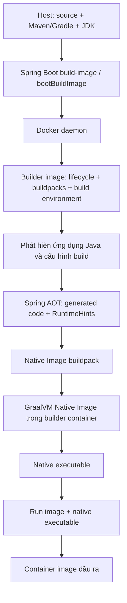

# Build bằng Docker mà không cần cài GraalVM trực tiếp trên máy

## 1. Mục tiêu

Để tạo GraalVM Native Image, thông thường cần JDK/GraalVM có thành phần `native-image` và toolchain biên dịch native phù hợp. Việc cài đặt trực tiếp các công cụ này trên từng máy lập trình viên có thể tốn thời gian và khó đồng bộ giữa Windows, macOS, Linux và CI.

**Cloud Native Buildpacks (CNB)** cho phép đóng gói ứng dụng trong một quy trình chạy bằng container. Với Spring Boot, Maven Plugin hoặc Gradle Plugin kết nối tới Docker daemon, chuyển ứng dụng và cấu hình build vào **builder image**. Các buildpack trong builder chuẩn bị công cụ, thực hiện Spring AOT và Native Image compilation, rồi tạo **container image** có thể chạy ứng dụng.

Vì vậy, máy host không cần cài GraalVM hoặc `native-image` trực tiếp. Máy vẫn cần:

- Docker Engine, Docker Desktop hoặc Docker-compatible daemon đang hoạt động và có quyền truy cập.
- JDK phù hợp để chạy Maven/Gradle và wrapper của dự án.
- Source code, cấu hình Spring Boot và kết nối tới dependency repositories/container registry khi cần.
- Đủ CPU, RAM và dung lượng lưu trữ cho quá trình biên dịch trong builder container.

Trong module **SPRING_BOOT_NATIVE_IMAGE**, cách làm này giúp chuẩn hóa môi trường build, kiểm thử tương thích và tạo image để triển khai. Mục tiêu là xác minh image thực sự chứa **native executable** được biên dịch bởi GraalVM.

Sau bài này, người học có thể:

- Giải thích vai trò của Docker daemon, builder image, buildpack và run image.
- Cấu hình Spring Boot Maven/Gradle Plugin để bật native build bằng buildpacks.
- Tạo container image mà không cài GraalVM trên host.
- Chạy và kiểm tra image, xác nhận quy trình đã biên dịch native.
- Xử lý lỗi thường gặp về Docker daemon, builder, kiến trúc, bộ nhớ và metadata native.

## 2. Buildpacks hoạt động như thế nào?

Docker cung cấp daemon để quản lý image/container. **Buildpacks** là cơ chế phát hiện loại ứng dụng, chuẩn bị dependency/build tool và đóng gói sản phẩm theo quy trình tiêu chuẩn. CNB không đồng nghĩa với một lệnh `docker build` thông thường.

Một quy trình native build bằng Spring Boot và buildpacks:



| Thành phần | Vai trò |
|---|---|
| **Host** | Chứa source, Maven/Gradle wrapper và JDK dùng để chạy build tool; không cần cài GraalVM |
| **Docker daemon** | Tải builder/run image, tạo môi trường build container và lưu image đầu ra |
| **Builder image** | Chứa CNB lifecycle, buildpack và môi trường để phát hiện/biên dịch ứng dụng |
| **Buildpack** | Phân tích ứng dụng, chọn dependency/tool và thực hiện các bước build |
| **Spring AOT** | Phân tích cấu hình Spring, sinh mã hỗ trợ khởi tạo và cung cấp RuntimeHints |
| **Native Image buildpack** | Kích hoạt GraalVM Native Image để biên dịch mã ứng dụng trong builder |
| **Run image** | Cung cấp nền tảng hệ điều hành và thư viện runtime cho container cuối |

Builder image và run image có nhiệm vụ khác nhau. Builder chứa công cụ biên dịch; run image chứa nền tảng cần thiết để chạy sản phẩm. Chúng phải tương thích theo stack mà builder sử dụng.

### Docker có tự biên dịch thành Native Image không?

**Không.** Docker daemon chỉ thực thi các thao tác container/image. Để tạo Native Image, quy trình phải dùng builder có buildpack hỗ trợ GraalVM Native Image và bật chế độ native. Nếu chỉ đóng gói JAR để chạy bằng JRE/JDK, kết quả vẫn là ứng dụng JVM trong container.

Với Spring Boot, hai điểm vào thuận tiện là:

- Maven: goal `spring-boot:build-image`.
- Gradle: task `bootBuildImage`.

Hai tích hợp này điều phối CNB lifecycle qua Docker daemon và tạo image sau quá trình build.

## 3. Điều kiện trên máy host

### 3.1. Kiểm tra Docker daemon

```bash
docker version
docker info
```

`docker version` cần hiển thị cả Client và Server. Nếu chỉ có Client hoặc báo lỗi kết nối, hãy khởi động Docker Engine/Docker Desktop, chọn đúng Docker context và kiểm tra quyền truy cập daemon.

Trên Windows/macOS, Docker Desktop thường cung cấp daemon Linux thông qua môi trường máy ảo. Khi build image Linux, Docker Desktop cần ở chế độ Linux containers và có đủ tài nguyên. Trên Linux, người dùng cần quyền chạy Docker theo chính sách máy chủ.

### 3.2. Kiểm tra JDK và wrapper

Maven/Gradle vẫn chạy trên host, do đó cần JDK tương thích với Spring Boot và build tool:

```bash
java -version
./mvnw --version
./gradlew --version
```

Trên Windows PowerShell dùng `.\mvnw.cmd --version` và `.\gradlew.bat --version`.

JDK host không bắt buộc phải là GraalVM. Builder image sẽ cung cấp toolchain native theo cấu hình và khả năng của builder. Tuy vậy, **Java major version vẫn cần tương thích**: bytecode/AOT assets do host tạo ra phải được Native Image compiler trong builder hỗ trợ. Một số quy trình buildpacks chọn GraalVM Native Image tương ứng với Java version dùng để biên dịch ứng dụng. Vì thế, hãy đối chiếu yêu cầu của đúng Spring Boot release và builder trước khi build; không hiểu “không cần GraalVM trên host” thành “Java version trên host không quan trọng”. Cũng không cần `native-image --version` trên host; hãy đọc log buildpack để xác định GraalVM/Native Image được dùng bên trong container.

### 3.3. Tài nguyên và kết nối

Native compilation tiêu thụ CPU, RAM và I/O đáng kể. Kiểm tra:

- Docker daemon có đủ bộ nhớ, CPU và dung lượng đĩa để tải builder, tạo cache và biên dịch không.
- Máy có thể tải dependency Java và builder/run image cần thiết không.
- Registry có yêu cầu đăng nhập hoặc giới hạn tốc độ không.
- Docker context trỏ tới daemon local hay remote; tài nguyên thực tế thuộc máy chạy daemon.
- Host, builder và target image dùng kiến trúc nào, ví dụ `linux/amd64` hoặc `linux/arm64`.

Không cần cài GraalVM, `native-image`, GCC hoặc linker native trên host cho cách buildpack này. Các công cụ cần thiết cho bước biên dịch được cung cấp bởi môi trường builder phù hợp.

## 4. Chọn builder có hỗ trợ Native Image

Không phải builder image nào cũng chứa Native Image buildpack. Trước khi build, xác nhận:

1. Builder được chọn có Java buildpack và Native Image buildpack phù hợp.
2. Release của buildpack hỗ trợ Java/GraalVM và phiên bản Spring Boot của dự án.
3. Builder có stack và kiến trúc phù hợp với môi trường triển khai.
4. Run image tương thích với builder và có các thư viện hệ thống mà binary native cần.
5. Phiên bản/tag của builder và run image được pin để có thể tái hiện build.

Tên builder thay đổi theo dòng Spring Boot và thế hệ buildpack. Ví dụ trong các hướng dẫn chính thức:

| Dòng tài liệu Spring Boot | Builder minh họa trong hướng dẫn | Ghi chú |
|---|---|---|
| Spring Boot 3.4 | `paketobuildpacks/builder-jammy-java-tiny:latest` | Builder Jammy cho quy trình native image của dòng 3.4 |
| Spring Boot 3.5 | `paketobuildpacks/builder-noble-java-tiny:latest` | Builder Noble theo mặc định tài liệu plugin 3.5 |
| Spring Boot 4.1 native-image guide | `paketobuildpacks/builder-noble-java-tiny:latest` | Tài liệu 4.1 yêu cầu build ứng dụng với ít nhất JDK 25 cho quy trình buildpacks |

Các tên trên là **ví dụ gắn với release tài liệu**, không phải danh sách tương thích cho mọi ứng dụng. Hãy chọn builder theo hướng dẫn đúng release của dự án; không sao chép một tên builder cũ sang major mới. Trong CI, ưu tiên pin tag cụ thể hoặc digest đã kiểm thử thay vì dựa vào tag di động `latest`.

### Builder và run image khác nhau

- Builder image được dùng lúc build; nó có thể chứa GraalVM, compiler, linker và buildpack lifecycle.
- Run image là nền tảng cho container cuối cùng; nó chỉ cần các thành phần runtime cần thiết.
- Builder có GraalVM không có nghĩa container cuối cùng chứa nguyên bộ GraalVM.
- Native executable vẫn có thể phụ thuộc thư viện hệ thống; run image phải đáp ứng các phụ thuộc đó.

Nếu thay builder hoặc run image, hãy build lại, chạy smoke test và đánh giá lại kích thước image.

## 5. Bật Native Image bằng Spring Boot Maven Plugin

Với Maven, project cần dùng `spring-boot-starter-parent` để nhận profile `native` do Spring Boot cung cấp và khai báo `org.graalvm.buildtools:native-maven-plugin` trong `<build><plugins>`. Profile `native` cấu hình các bước AOT và reachability metadata cần thiết. Nếu không dùng Spring Boot parent, phải tự cấu hình các execution tương ứng, bao gồm `process-aot` và `add-reachability-metadata` theo tài liệu của đúng release.

Phần parent có dạng (thay version bằng release Spring Boot mà dự án đã chọn):

```xml
<parent>
    <groupId>org.springframework.boot</groupId>
    <artifactId>spring-boot-starter-parent</artifactId>
    <version>4.1.3</version>
    <relativePath/>
</parent>
```

Khai báo Native Build Tools plugin trong `pom.xml`:

```xml
<build>
    <plugins>
        <plugin>
            <groupId>org.graalvm.buildtools</groupId>
            <artifactId>native-maven-plugin</artifactId>
        </plugin>
    </plugins>
</build>
```

Sau đó cấu hình image trong profile `native` để các build JVM thông thường không vô tình chuyển sang native.

Ví dụ thêm vào `pom.xml`:

```xml
<profiles>
    <profile>
        <id>native</id>
        <build>
            <plugins>
                <plugin>
                    <groupId>org.springframework.boot</groupId>
                    <artifactId>spring-boot-maven-plugin</artifactId>
                    <configuration>
                        <image>
                            <name>example/spring-boot-native:0.0.1</name>
                            <builder>paketobuildpacks/builder-noble-java-tiny:latest</builder>
                            <env>
                                <BP_NATIVE_IMAGE>true</BP_NATIVE_IMAGE>
                            </env>
                        </image>
                    </configuration>
                </plugin>
            </plugins>
        </build>
    </profile>
</profiles>
```

Các điểm quan trọng:

- `image.name` đặt tên image đầu ra theo quy ước dự án.
- `image.builder` chọn builder image dùng để thực hiện buildpacks.
- `image.env` truyền biến môi trường cho buildpack trong thời điểm build.
- `BP_NATIVE_IMAGE=true` yêu cầu buildpack hỗ trợ native image thực hiện biên dịch native.

Nếu Spring Boot Maven Plugin đã được khai báo ở parent hoặc `pluginManagement`, hãy bảo đảm cấu hình profile được áp dụng vào plugin thực sự chạy. Nếu dự án không kế thừa Spring Boot parent, cần khai báo plugin version phù hợp với Spring Boot release theo tài liệu dự án.

Chạy build:

```bash
./mvnw -Pnative spring-boot:build-image
```

Maven chạy trên host, nhưng Native Image compilation được thực hiện trong môi trường builder container. Host không cần cài GraalVM hoặc `native-image`.

### Dùng cấu hình native mặc định

Có thể đặt cấu hình image trực tiếp trong Spring Boot Maven Plugin để mỗi lần chạy goal `spring-boot:build-image` đều dùng native. Với dự án có cả JVM image và native image, profile riêng giúp command và mục đích rõ ràng hơn.

## 6. Bật Native Image bằng Spring Boot Gradle Plugin

Với Gradle, cần áp dụng GraalVM Native Image plugin `org.graalvm.buildtools.native`. Spring Boot Gradle Plugin tự cấu hình các task AOT khi plugin này được áp dụng; task `bootBuildImage` khi đó tạo native image. Khai báo plugin trong `plugins` block, dùng version tương thích với Spring Boot/Gradle wrapper:

```groovy
plugins {
    id 'org.springframework.boot' version '<spring-boot-version>'
    id 'org.graalvm.buildtools.native' version '<native-build-tools-version>'
}
```

Các giá trị trong dấu `<...>` là placeholder, phải thay bằng version đã xác minh. Với Gradle Groovy DSL, cấu hình task `bootBuildImage`:

```groovy
tasks.named("bootBuildImage") {
    imageName = "example/spring-boot-native:0.0.1"
    builder = "paketobuildpacks/builder-noble-java-tiny:latest"
    environment = [
        "BP_NATIVE_IMAGE": "true"
    ]
}
```

Với Kotlin DSL (`build.gradle.kts`), có thể cấu hình task có kiểu rõ ràng:

```kotlin
import org.springframework.boot.gradle.tasks.bundling.BootBuildImage

tasks.named<BootBuildImage>("bootBuildImage") {
    imageName = "example/spring-boot-native:0.0.1"
    builder = "paketobuildpacks/builder-noble-java-tiny:latest"
    environment = mapOf(
        "BP_NATIVE_IMAGE" to "true"
    )
}
```

Tên builder ở ví dụ minh họa cấu hình Noble thường gặp trong hướng dẫn Spring Boot 4.1; hãy thay bằng builder được tài liệu đúng release hỗ trợ và pin tag/digest đã xác minh. Spring Boot Gradle Plugin và GraalVM Native Build Tools plugin phối hợp để tạo AOT assets và bật native buildpack; task `bootBuildImage` dùng buildpacks và Docker daemon, còn task `nativeCompile` thường gọi Native Image toolchain trực tiếp trên môi trường build đã cấu hình. Không nhầm hai con đường này. Khi chỉ chạy `bootBuildImage`, GraalVM compilation diễn ra trong builder; không chạy task `nativeCompile` trên host nếu mục tiêu là không cài GraalVM tại máy đó.

Chạy task:

```bash
./gradlew bootBuildImage
```

Task `bootBuildImage` sử dụng output ứng dụng của Gradle (thường phụ thuộc `bootJar`), sau đó điều phối quá trình build image. Nếu build thất bại, xem log task và log buildpack để xác định bước lỗi.

## 7. BP_NATIVE_IMAGE được truyền ở đâu?

`BP_NATIVE_IMAGE` là biến cấu hình của buildpack, được đọc trong **giai đoạn tạo image**. Trong ví dụ Maven, biến nằm trong `image.env`; trong Gradle, biến nằm trong `environment` của task `bootBuildImage`.

```text
Maven / Gradle host
    |
    | Gửi cấu hình build image
    v
Docker daemon
    |
    v
Builder container
    |
    | BP_NATIVE_IMAGE=true
    v
Native Image buildpack
    |
    v
GraalVM Native Image compilation
    |
    v
Container image chứa native executable
```

Không nên chỉ chạy:

```bash
docker run -e BP_NATIVE_IMAGE=true example/spring-boot-native:0.0.1
```

Lúc `docker run`, image đã được build xong. Biến môi trường lúc chạy container không thể quay lại kích hoạt Native Image compilation. Muốn chuyển JVM image thành native image, phải chạy lại **build image** với cấu hình buildpack phù hợp.

Cần phân biệt:

- **Build-time environment:** biến truyền cho builder/buildpack trong quá trình build, ví dụ `BP_NATIVE_IMAGE`.
- **Runtime environment:** biến ứng dụng đọc khi container chạy, ví dụ cấu hình port hoặc endpoint bên ngoài.
- **Host environment:** biến của shell chạy Maven/Gradle; chỉ có tác dụng nếu plugin chuyển tiếp theo cấu hình.

## 8. Chạy container và kiểm tra kết quả

Sau khi Maven/Gradle build thành công, Docker daemon sẽ có image với tên/tag đã cấu hình. Liệt kê image:

```bash
docker images
```

Kiểm tra metadata image và nền tảng:

```bash
docker image inspect example/spring-boot-native:0.0.1 \
  --format '{{.Os}}/{{.Architecture}} {{.Size}}'
```

Chạy container, ví dụ ứng dụng lắng nghe cổng 8080:

```bash
docker run --rm --name spring-native-demo \
  -p 8080:8080 \
  example/spring-boot-native:0.0.1
```

Từ terminal khác, gọi endpoint:

```bash
curl --fail --silent --show-error http://localhost:8080/hello
```

Thay `/hello` bằng endpoint thực tế của dự án. Kiểm tra log container và response; không chỉ dựa vào việc `docker run` không báo lỗi.

### Xác minh image thực sự là Native Image

Một container chạy được chưa chứng minh nó chứa native executable. Hãy kiểm tra nhiều bằng chứng:

1. Log build có bước Native Image buildpack và quá trình GraalVM compilation thành công.
2. Log có thông tin toolchain Native Image/version được dùng trong builder.
3. `BP_NATIVE_IMAGE=true` được truyền đúng trong cấu hình image, không chỉ trong runtime container.
4. Buildpack báo tạo native executable hoặc chọn process phù hợp với native artifact.
5. Container chạy và xử lý request thành công; các chức năng dùng reflection/resource cũng được kiểm tra nếu ứng dụng có.

Có thể xem command/entrypoint của image để hỗ trợ chẩn đoán:

```bash
docker image inspect example/spring-boot-native:0.0.1 \
  --format '{{.Config.Entrypoint}} {{.Config.Cmd}}'
```

Entrypoint có thể đi qua launcher của buildpacks, nên chỉ nhìn tên command không đủ kết luận. Kết hợp log build và kiểm thử runtime.

## 9. Buildpacks có tự xử lý mọi vấn đề tương thích không?

**Không.** Buildpack cung cấp môi trường build và điều phối các bước biên dịch. Nó không thể tự biến mọi thư viện Java thành thư viện tương thích Native Image.

Ứng dụng vẫn phải đáp ứng giới hạn của AOT và reachability analysis:

- Reflection cần metadata phù hợp nếu đích gọi không thể xác định bằng phân tích tĩnh.
- Resource đọc động theo tên/đường dẫn có thể cần đăng ký để được đưa vào image.
- Dynamic proxy, serialization, JNI và class initialization phải được kiểm tra theo thư viện sử dụng.
- Plugin JAR được nạp tùy ý sau khi build không tự xuất hiện trong native executable.
- Dependency có tính năng không được hỗ trợ trong môi trường native có thể làm build thất bại hoặc lỗi runtime.

Spring AOT và RuntimeHints giúp mô tả các thành phần cần thiết của ứng dụng Spring, nhưng vẫn cần kiểm thử các đường nghiệp vụ thực tế. Khi JVM chạy được mà native lỗi, hãy xem stack trace và xác định thao tác động thiếu metadata; đừng mặc định Docker hoặc builder là nguyên nhân duy nhất.

## 10. Giới hạn nền tảng và kiến trúc

Native executable được biên dịch cho một nền tảng cụ thể. Builder chạy trên Linux ARM64 thường tạo artifact cho Linux ARM64; không mặc nhiên tạo binary Windows hoặc macOS. Với container, cần kiểm tra:

- Builder image hỗ trợ architecture của Docker daemon.
- Run image tương thích với stack và thư viện mà builder sử dụng.
- Image cuối có đúng OS/architecture đích.
- Thư viện native/JNI và ABI (ví dụ glibc/musl) phù hợp.
- Môi trường triển khai có đáp ứng yêu cầu hệ thống của image đã build.

Docker Buildx và QEMU hỗ trợ một số quy trình đa kiến trúc, nhưng không có nghĩa mọi tổ hợp GraalVM Native Image đều cross-compile được. Cách an toàn là build trên runner có kiến trúc đích hoặc dùng cấu hình cross-compilation được GraalVM/buildpack hỗ trợ rõ ràng, rồi kiểm tra image trên môi trường tương ứng.

Kiểm tra kiến trúc image:

```bash
docker image inspect example/spring-boot-native:0.0.1 \
  --format '{{.Os}}/{{.Architecture}}'
```

Đừng đưa image `linux/amd64` vào node `linux/arm64` rồi kỳ vọng Docker tự chuyển đổi binary. Manifest đa kiến trúc cũng cần từng image con được build và xác minh đúng kiến trúc.

## 11. Cache, thời gian build và kích thước image

Buildpacks có thể tái sử dụng cache layer giữa các lần build. Lượt tiếp theo có thể nhanh hơn; kết quả phụ thuộc Docker volume/cache, dependency cache, builder/run image đã có sẵn và những layer không đổi.

Khi đo thời gian, ghi rõ:

- Lần đầu builder/run image được tải hay đã có local.
- Dependency đã có trong cache hay cần tải.
- Buildpack cache có được tái sử dụng không.
- Source, dependency hay cấu hình có thay đổi khiến layer phải chạy lại không.
- Thời gian đang đo là toàn bộ goal `build-image`/`bootBuildImage` hay riêng bước Native Image compile trong log.

Kích thước container image không bằng kích thước executable. Image chứa run image, launcher và các layer khác. Dùng Docker để ghi số liệu:

```bash
docker image inspect example/spring-boot-native:0.0.1 \
  --format '{{.Size}}'
```

Trường `.Size` phản ánh cách Docker biểu diễn kích thước image; không phải file native executable, kích thước nén khi push/pull hay RAM lúc container chạy. Nếu so JVM image và native image, dùng cùng tiêu chí đo, công cụ và ghi rõ builder/run image. Kích thước thực tế phụ thuộc dependency, resource, flags và cách đóng gói.

## 12. Tích hợp trong CI

Một pipeline CI điển hình cần:

1. Checkout đúng commit.
2. Cài JDK và khởi chạy Maven/Gradle wrapper.
3. Cung cấp Docker daemon hoặc remote builder daemon mà job có quyền truy cập.
4. Dùng builder/run image đã pin tag hoặc digest.
5. Kích hoạt `BP_NATIVE_IMAGE=true` trong cấu hình build image.
6. Build image, lưu log và metadata phiên bản.
7. Chạy container smoke test.
8. Chỉ sau khi test pass mới publish image theo quy trình dự án.

Ví dụ các lệnh kiểm tra và build trong job Linux:

```bash
java -version
docker version
docker info

./mvnw -Pnative spring-boot:build-image
docker image inspect example/spring-boot-native:0.0.1
```

Lệnh build chỉ là một phần của pipeline; CI còn cần cấu hình xác thực registry, tag theo commit/release, quản lý cache và chính sách bảo mật. Không ghi password/token registry vào command log. Nếu Docker daemon chạy từ xa, tài nguyên CPU/RAM và cache thuộc máy remote, không phải runner gọi Maven.

Với buildpacks, host CI không cần cài GraalVM, nhưng builder image phải tải được hoặc đã được cache. Nếu tổ chức dùng proxy, mirror hoặc registry nội bộ, hãy cấu hình đường tải image và dependency tương ứng.

## 13. Lỗi thường gặp và cách xử lý

| Triệu chứng | Nguyên nhân có thể | Cách kiểm tra |
|---|---|---|
| `Cannot connect to the Docker daemon` | Docker Engine chưa chạy, context sai hoặc thiếu quyền | `docker version`, `docker info`, kiểm tra Docker context và quyền |
| Không tìm thấy builder image | Tag sai, registry không truy cập được hoặc image chưa được tải | Kiểm tra tên/tag, network và registry credentials |
| Build thành công nhưng chạy như JVM | `BP_NATIVE_IMAGE` không được truyền hoặc builder không có Native Image buildpack | Kiểm tra `image.env`/`environment`, log và buildpack được chọn |
| Native buildpack không được phát hiện | Builder không chứa buildpack phù hợp hoặc release không hỗ trợ | Chọn builder đã xác minh hỗ trợ, kiểm tra buildpack order |
| Maven/Gradle build image thất bại ở AOT | Spring AOT, dependency hoặc cấu hình ứng dụng có lỗi | Chạy JVM build/test trước, đọc log AOT |
| Native compilation hết RAM hoặc bị kill | Docker daemon/builder container thiếu memory/CPU | Tăng resource cho Docker daemon/CI runner, giảm song song nếu phù hợp |
| Reflection/resource lỗi lúc chạy container | RuntimeHints hoặc resource metadata chưa đầy đủ | Tái hiện trên native, đăng ký hints phù hợp và build lại |
| Container không chạy trên node đích | Sai OS/architecture, ABI hoặc thư viện native | Kiểm tra image inspect, builder/run stack và target node |
| Image không có tag mong đợi | Tên image mặc định hoặc cấu hình plugin khác | Kiểm tra `image.name`/`imageName`, log và `docker images` |
| Build lần đầu chậm hơn nhiều | Tải builder, run image, dependency và khởi tạo cache | Tách cold/warm, ghi cache state và log |
| Docker build timeout | Native compilation lâu hoặc runner thiếu tài nguyên | Kiểm tra log buildpack, timeout CI, CPU/RAM và dung lượng đĩa |

Không xử lý mọi lỗi bằng cách đổi builder ngẫu nhiên. Xác định bước thất bại trong log trước, sau đó thay một yếu tố cấu hình và build lại để kiểm chứng.

## 14. Bài tập thực hành

### Bài tập A — Tạo native container image trên máy không cài GraalVM

1. Kiểm tra Docker daemon và JDK host.
2. Xác nhận builder có Native Image buildpack và chọn tag/digest phù hợp.
3. Cấu hình Maven profile hoặc Gradle `bootBuildImage` với `BP_NATIVE_IMAGE=true`.
4. Build image bằng wrapper.
5. Đọc log để xác nhận GraalVM Native Image compilation được thực hiện bên trong builder.
6. Chạy container, gọi endpoint và lưu kết quả.

**Tiêu chí hoàn thành:** không cần cài GraalVM trên host; có image build thành công, log xác nhận native compilation và smoke test pass.

### Bài tập B — So sánh với JVM container

Tạo một JVM image và một native image từ cùng source commit. Ghi builder/run image, cache state, wall time build, image size, architecture và kết quả endpoint. Không gộp thời gian tải builder ở lượt đầu vào thời gian compile native nếu mục tiêu đo riêng compiler; nếu đo toàn bộ pipeline, giữ nguyên phạm vi ở cả hai lượt.

### Bài tập C — Kiểm tra giới hạn kiến trúc

Build image cho một architecture, kiểm tra bằng `docker image inspect`, sau đó xác định architecture của môi trường triển khai. Giải thích vì sao image không tương thích không thể chạy chỉ nhờ đổi biến môi trường lúc `docker run`.

## 15. Checklist trước khi bàn giao image

- [ ] Docker daemon hoạt động và Maven/Gradle kết nối được.
- [ ] JDK host đáp ứng yêu cầu của Spring Boot và build tool.
- [ ] Không cần cài GraalVM/`native-image` trên host.
- [ ] Builder được pin và có Native Image buildpack tương thích.
- [ ] `BP_NATIVE_IMAGE=true` được truyền trong **build-time environment**.
- [ ] Log xác nhận bước GraalVM Native Image compilation.
- [ ] Run image tương thích với builder và thư viện runtime.
- [ ] Image đúng OS/architecture của môi trường đích.
- [ ] Container chạy và xử lý thành công smoke test.
- [ ] Đã lưu tag/digest, log, phiên bản và cache state để tái hiện.

## Tài liệu tham khảo

- [Spring Boot 3.4 — Developing Your First GraalVM Native Application](https://docs.spring.io/spring-boot/3.4/how-to/native-image/developing-your-first-application.html): quy trình native image bằng Cloud Native Buildpacks, builder Jammy và yêu cầu Docker.
- [Spring Boot 4.1 — Developing Your First GraalVM Native Application](https://docs.spring.io/spring-boot/4.1/how-to/native-image/developing-your-first-application.html): builder Noble, điều kiện JDK và cấu hình Maven/Gradle cho native buildpacks.
- [Spring Boot Maven Plugin — Packaging OCI Images](https://docs.spring.io/spring-boot/maven-plugin/build-image.html): cấu hình builder, run image, environment và goal `build-image`.
- [Spring Boot Gradle Plugin — Packaging OCI Images](https://docs.spring.io/spring-boot/gradle-plugin/packaging-oci-image.html): cấu hình task `bootBuildImage` và các thuộc tính image.
- [Spring Boot — Advanced Native Image Topics](https://docs.spring.io/spring-boot/reference/packaging/native-image/advanced-topics.html): chuyển executable JAR đã có AOT assets thành native container image bằng buildpacks.

## Kết luận

Dùng Spring Boot `build-image` hoặc `bootBuildImage` với Cloud Native Buildpacks giúp tạo GraalVM Native Image trong **builder container**, vì vậy máy host không cần cài GraalVM trực tiếp. Host vẫn cần Docker daemon, JDK để chạy build tool và tài nguyên đủ cho native compilation. Điều quyết định kết quả là chọn builder có Native Image buildpack tương thích, truyền `BP_NATIVE_IMAGE=true` ở thời điểm build, bảo đảm run image phù hợp và kiểm tra image bằng log cùng smoke test. Khi chuẩn hóa builder, architecture và cache, nhóm có thể tái tạo native container image trên máy lập trình và CI mà không phải cài GraalVM riêng trên từng host.
