# Cache buildpack, lớp image và ảnh hưởng đến thời gian build

## 1. Vì sao cache và image layers quan trọng?

Trong module **SPRING_BOOT_NATIVE_IMAGE**, ứng dụng Spring Boot được xử lý bằng Spring AOT và biên dịch thành GraalVM Native Image, sau đó đóng gói thành container để triển khai. Khi dùng Cloud Native Buildpacks (CNB), quá trình đóng gói không chỉ tạo một image duy nhất từ Dockerfile do nhóm phát triển viết. Builder và các buildpack phát hiện ứng dụng, cài đặt runtime/build tools, tạo các **layer** và xuất ra OCI image.

Build native thường tốn thời gian đáng kể vì GraalVM phải phân tích reachability, biên dịch nhiều mã thành machine code và liên kết executable. Nếu mỗi lần build đều tải lại dependency, cài lại toolchain hoặc chạy lại các bước không thay đổi, thời gian CI sẽ tăng. **Buildpack cache** và **image layer reuse** giúp tái sử dụng những đầu ra còn hợp lệ giữa các lần build.

Cần phân biệt hai khái niệm:

- **Build cache:** lưu trữ dữ liệu buildpack tạo ra để tái sử dụng trong các lần build sau, thường thông qua volume/cache store hoặc cơ chế cache do nền tảng cung cấp.
- **Image layers:** các lớp filesystem và metadata được đóng gói trong OCI image. Registry/client có thể tái sử dụng layer đã có khi digest không đổi, giúp giảm lượng dữ liệu cần upload/pull.

Cache buildpack có thể giảm thời gian tạo artifact; image layer reuse có thể giảm thời gian export, push, pull và deploy. Hai cơ chế liên quan nhưng không thay thế nhau.

## 2. Buildpacks tạo image như thế nào?

Cloud Native Buildpacks sử dụng builder gồm buildpacks, build image và run image. Lifecycle orchestrator điều phối các pha để biến source hoặc artifact thành image:

```mermaid
flowchart TD
    A[Source / application artifact] --> B[Detect buildpacks]
    B --> C[Analyze previous image metadata]
    C --> D[Restore reusable cache layers]
    D --> E[Build: compile, install, create layers]
    E --> F[Export: assemble OCI image]
    F --> G[Run image]
    D --> H[Build cache store]
    E --> H
    G --> I[Registry / deployment]
```



Tên và chi tiết pha có thể khác theo phiên bản lifecycle, nhưng mô hình khái niệm thường gồm detect, analyze, restore, build, export và launch. Không phải mọi buildpack đều có layer cần cache; lifecycle dùng metadata của buildpack để quyết định layer nào có thể khôi phục hoặc cần tạo lại.

| Thành phần | Vai trò |
|---|---|
| Builder image | Cung cấp lifecycle, buildpacks và môi trường build |
| Buildpack | Phát hiện ứng dụng, cài dependency/công cụ, tạo build hoặc launch layers |
| Build image | Môi trường build, thường có compiler và development tools |
| Run image | Nền tảng runtime tối thiểu để chạy ứng dụng |
| Cache store | Lưu các layer build có thể tái sử dụng |
| OCI image | Artifact cuối gồm filesystem layers, config và metadata |

Một builder có thể chứa nhiều buildpack được nhóm thành buildpack order. Các buildpack phù hợp được detect và tham gia build theo thứ tự. Thay builder hoặc buildpack version có thể làm thay đổi layer, cache key hoặc kết quả build.

## 3. Phân biệt buildpack cache và OCI image layer

| Tiêu chí | Buildpack cache | OCI image layer |
|---|---|---|
| Mục đích | Tránh lặp lại công việc build | Tái sử dụng nội dung image đã đóng gói |
| Vị trí | Cache volume, cache store hoặc cơ chế nền tảng | Image local, registry, container runtime |
| Đối tượng | Dependency đã tải, tool artifacts, layer buildpack được đánh dấu cache | Filesystem diff/layer trong image |
| Thời điểm dùng | Restore trước build, ghi lại sau build | Export, push, pull và tạo container |
| Tác động rõ nhất | Giảm thời gian build | Giảm dữ liệu truyền và công việc phân phối image |
| Vòng đời | Có thể bị invalidated hoặc prune | Tồn tại theo tag/digest và chính sách registry |

Ví dụ: buildpack tải Maven dependency và lưu vào cache. Lần build tiếp theo, cache giúp tránh tải lại các artifact đó. Tuy nhiên, executable native có thể vẫn phải biên dịch lại nếu source hoặc cấu hình ảnh hưởng compilation thay đổi.

Ở chiều ngược lại, nếu image cuối có một layer OS/runtime không đổi, registry có thể đã có layer đó và chỉ cần nhận các layer thay đổi. Việc layer cũ được tái sử dụng không chứng minh native compiler đã dùng lại kết quả biên dịch.

## 4. Các loại layer trong buildpack

Buildpack có thể tạo các layer với metadata mô tả cách dùng và khả năng cache:

- **Build layer:** chỉ cần trong quá trình build, ví dụ compiler/tooling hoặc dependency hỗ trợ compile.
- **Launch layer:** cần khi chạy ứng dụng, ví dụ runtime components hoặc application files.
- **Cache layer:** lưu dữ liệu phục vụ build lần sau, không nhất thiết đưa vào runtime image.

Một layer có thể mang nhiều cờ metadata, ví dụ được dùng ở build và launch, hoặc được cache. Không nên hiểu ba loại này là ba thư mục cố định hay ba lớp luôn tách biệt. Buildpack quyết định layer type và metadata theo API/phiên bản CNB.

Trong ứng dụng native:

- Compiler C, linker và GraalVM Native Image cần ở build environment.
- Executable native và shared libraries cần thiết thuộc runtime image.
- Dependency cache và dữ liệu trung gian có thể thuộc cache/build layers, không cần đưa vào runtime image.

Tách đúng build-only và launch layers giúp runtime image nhỏ hơn, giảm bề mặt tấn công và tránh mang compiler vào production. Cache layer chỉ có tác dụng nếu buildpack khai báo layer đó có thể cache và lifecycle giữ được cache store.

## 5. Cache giúp giảm thời gian build ở bước nào?

Một build native có thể tốn thời gian ở nhiều phần:

1. Resolve và tải dependency Maven/Gradle.
2. Cài đặt hoặc chuẩn bị GraalVM, compiler, linker và development packages.
3. Chạy Spring AOT, sinh mã và runtime hints.
4. Chạy GraalVM Native Image: reachability analysis, compilation và linking.
5. Tạo OCI layers và export image.
6. Push image lên registry.

Cache có thể giúp giảm bước 1, một phần bước 2, và một số bước buildpack khác nếu buildpack hỗ trợ. Cache không tự động làm bước 3/4 biến mất. Native compilation phụ thuộc source, classpath, toolchain, build arguments và cấu hình AOT; khi những đầu vào này thay đổi, kết quả có thể cần tạo lại.

Ví dụ thực tế:

| Thay đổi giữa hai lần build | Cache có thể tái sử dụng | Phần có thể phải chạy lại |
|---|---|---|
| Chỉ thay README không được đóng gói | Dependency và nhiều layer không đổi | Có thể không cần compile native nếu buildpack không xem README là input |
| Thay một Java service class | Dependency không đổi | Spring AOT và native compilation thường phải cập nhật |
| Thay version Spring Boot dependency | Một phần download cache còn dùng được | Compile, AOT và native image thường chạy lại |
| Thay builder/buildpack version | Một số dependency cache có thể còn | Layer do buildpack version thay đổi có thể invalidated |
| Thay target architecture hoặc native compiler flags | Cache chung có thể không phù hợp | Native compilation cần chạy lại cho target mới |

Bảng thể hiện xu hướng; kết quả cụ thể phụ thuộc cache key và metadata buildpack. Không nên hứa hẹn một phần trăm tăng tốc cố định.

## 6. Cache invalidation: khi nào cache không còn dùng được?

Cache chỉ an toàn khi đầu vào liên quan còn tương thích. Một số nguyên nhân khiến cache bị bỏ qua hoặc invalidated:

- Buildpack ID/version hoặc order thay đổi.
- Builder image, build image hay run image đổi.
- Dependency lockfile, version JDK/GraalVM hoặc native toolchain thay đổi.
- Architecture, OS, libc hoặc target ABI khác.
- Build arguments, environment variables hay profile ảnh hưởng đến output thay đổi.
- Cache store bị prune, xóa hoặc không được gắn vào runner hiện tại.
- Layer metadata không còn hợp lệ hoặc checksum không khớp.

Đặc biệt với Native Image, cache không nên được chia sẻ vô điều kiện giữa `linux/amd64` và `linux/arm64`, giữa glibc và musl, hoặc giữa các bộ GraalVM/compiler khác nhau nếu cache chứa artifact phụ thuộc target. Cache key cần phân biệt các đầu vào quan trọng để tránh dùng nhầm object/native artifact.

Cache cũ có thể gây lỗi khó chẩn đoán nếu buildpack hoặc công cụ có bug. Khi cần xác minh, thực hiện một build sạch trong môi trường có kiểm soát và so sánh output. Chỉ xóa cache khi có lý do; xóa thường xuyên làm mất lợi ích hiệu năng và che khuất vấn đề cấu hình cache key.

## 7. Build native image với Spring Boot Buildpacks

Spring Boot Maven/Gradle plugin có thể tích hợp Cloud Native Buildpacks để tạo OCI image. Với Maven, một ví dụ phổ biến là:

```bash
./mvnw spring-boot:build-image
```

Với Gradle:

```bash
./gradlew bootBuildImage
```

Để tạo image native, cấu hình buildpack/Builder và chế độ native theo khả năng phiên bản Spring Boot plugin, hoặc chọn builder hỗ trợ GraalVM Native Image. Trong các phiên bản Spring Boot hỗ trợ thuộc tính tương ứng, có thể kích hoạt chế độ native qua cấu hình plugin. Ví dụ Maven dạng khái niệm:

```xml
<configuration>
    <image>
        <builder>paketobuildpacks/builder-noble-java-tiny</builder>
        <env>
            <BP_NATIVE_IMAGE>true</BP_NATIVE_IMAGE>
        </env>
    </image>
</configuration>
```

Tên builder ở ví dụ cần được xác minh theo tag đang tồn tại và tương thích với nền tảng/phiên bản Spring Boot. `BP_NATIVE_IMAGE` là biến buildpack thường dùng trong hệ sinh thái Paketo để bật native image build; khả năng hỗ trợ, cách cấu hình và builder tương thích cần kiểm tra theo buildpack version. Không phải builder nào cũng có compiler hoặc buildpack native phù hợp.

Buildpacks thường cần truy cập Docker daemon để export image. Trong CI, phải cấu hình daemon/socket hoặc cơ chế build tương ứng của nền tảng. Lệnh `build-image` không chỉ tạo file executable ở thư mục build; nó tạo OCI image theo tên/tag cấu hình.

## 8. Quan sát image layers và cache

Dùng công cụ container để kiểm tra image sau build. Với Docker:

```bash
docker images
docker history orders-service:latest
docker inspect orders-service:latest
```

- `docker images` hiển thị image/tag, kích thước hiển thị và ID.
- `docker history` hiển thị các layer/history entry và kích thước tương ứng; nó không mô tả đầy đủ nguồn gốc cache buildpack.
- `docker inspect` hiển thị config/metadata của image, ví dụ entrypoint, environment và layer identifiers.

Có thể xem chi tiết OCI layers bằng công cụ như `crane manifest`, `skopeo inspect` hoặc công cụ registry phù hợp. Khi so sánh, dùng digest/layer digest thay vì chỉ dựa vào tag; tag có thể được trỏ sang image khác.

Đối với buildpack, log lifecycle thường cho biết layer nào được restored, reused, rebuilt hoặc exported. Nội dung và câu chữ log phụ thuộc phiên bản lifecycle. Đọc log cùng với image history để tách hai câu hỏi: **buildpack có tái sử dụng dữ liệu build không?** và **image exporter có tái sử dụng layer không?**

## 9. Đo tác động cache một cách công bằng

Để đánh giá cache có giảm thời gian build hay không, cần thực hiện các lần build có điều kiện kiểm soát:

- **Cold build:** cache trống hoặc runner mới, ghi thời gian tải dependency, AOT/native compilation và export.
- **Warm build:** giữ nguyên cache, build lại cùng source/config, ghi thời gian từng pha.
- **Source-change build:** thay một file Java, giữ dependency/toolchain, quan sát pha nào phải chạy lại.
- **Dependency-change build:** đổi một dependency, quan sát invalidation và cache reuse.
- **Clean build đối chứng:** xóa output build theo quy trình có kiểm soát nhưng giữ/loại cache đúng mục đích phép đo.

Bảng ghi nhận mẫu:

| Lần chạy | Cache | Source/dependency | AOT time | Native compile time | Export time | Tổng thời gian |
|---|---|---|---:|---:|---:|---:|
| Cold | Trống | Baseline | Đo | Đo | Đo | Đo |
| Warm | Có | Không đổi | Đo | Đo | Đo | Đo |
| Source change | Có | Java đổi | Đo | Đo | Đo | Đo |
| Dependency change | Có | Dependency đổi | Đo | Đo | Đo | Đo |

Không so sánh cold build trên máy chậm với warm build trên runner mạnh hơn. Giữ ổn định CPU/RAM, network, Docker daemon, builder/run image, architecture và version toolchain. Chạy nhiều lần và báo trung vị hoặc phân phối. Tách thời gian download, Spring AOT, GraalVM compile và image export; nếu chỉ đo tổng thời gian sẽ khó biết cache giúp ở đâu.

## 10. Tổ chức cache trong CI/CD

Cache trong CI thường có hai lớp:

1. **Build tool cache:** Maven local repository hoặc Gradle dependency/build cache.
2. **Buildpack cache:** cache store/volume được truyền giữa các lần lifecycle chạy.

Đây là hai cache độc lập. Cache Maven dependency có thể giúp plugin/buildpack tải artifact nhanh hơn, nhưng không thay thế cache layer buildpack. Ngược lại, cache buildpack không đảm bảo Maven local repository của tiến trình build được giữ lại.

Một pipeline nên:

- Dùng key cache gắn với OS, architecture, builder/buildpack version và những dependency/toolchain quan trọng.
- Dùng cache riêng theo nhánh hoặc có chiến lược restore fallback an toàn.
- Không lưu secret trong cache layer hoặc image.
- Không dùng chung cache native artifact giữa target không tương thích.
- Có cơ chế prune theo dung lượng và tuổi để tránh cache phình vô hạn.
- Đảm bảo runner thật sự mount/restore cache volume; chỉ khai báo cache key trong CI chưa chắc buildpack lifecycle nhận được cache.

Một số nền tảng CI ephemeral tạo runner mới cho mỗi job. Nếu không có remote cache hoặc volume persistence, warm build có thể không giữ được cache giữa job. Khi đó, cân nhắc builder service hoặc cơ chế cache được nền tảng hỗ trợ.

## 11. Cache và bảo mật/supply chain

Cache là đầu vào của quá trình build và cần được quản lý như một phần của supply chain. Các nguyên tắc thực tế:

- Chỉ tái sử dụng cache từ nguồn tin cậy; tránh để job không tin cậy ghi cache dùng cho release.
- Tách cache giữa pull request bên ngoài và pipeline phát hành nếu có nguy cơ ghi đè artifact.
- Pin builder image bằng tag cụ thể, cân nhắc digest khi cần độ tái lập cao.
- Cập nhật builder/run image để nhận bản vá bảo mật; cache cũ không được trở thành lý do giữ runtime base đã lỗi thời.
- Quét image cuối cùng và kiểm tra dependency/native libraries.
- Không đưa credentials, token hoặc file cấu hình bí mật vào layer được cache/export.

Khi builder hoặc buildpack cập nhật, có thể cache bị invalidated và build chậm hơn. Đó là chi phí hợp lý để nhận toolchain và bản vá mới; không nên giữ mãi builder cũ chỉ để đạt warm-build nhanh.

## 12. Các lỗi thường gặp

| Hiện tượng | Nguyên nhân có thể | Cách kiểm tra |
|---|---|---|
| Build lần nào cũng tải lại dependency | Maven/Gradle hoặc buildpack cache không được giữ | Kiểm tra cache mount, CI key và log restore |
| Log báo cache restored nhưng native compile vẫn lâu | Cache chỉ giữ dependency/tool layer, không cache kết quả GraalVM compile | Tách thời gian AOT và native compilation |
| Build nhanh nhưng image push vẫn lâu | OCI layers lớn hoặc layer digest thay đổi nhiều | Xem layer history/digest, registry transfer |
| Image không đổi nhưng build vẫn chạy lại | Build cache và image layer reuse là hai cơ chế riêng | Xem lifecycle log và image digest |
| Cache không tương thích sau đổi builder | Buildpack ID/version hoặc metadata thay đổi | Xác minh builder/buildpack version và thử cold build |
| Native binary lỗi trong runtime image | Thiếu shared library, sai libc/architecture hoặc resource | Kiểm tra ELF, runtime base và smoke test |
| Cache tăng dung lượng liên tục | Nhiều layer/key/branch cũ không được prune | Áp dụng retention và cleanup policy |

## 13. Bài thực hành: đo cold build và warm build

**Bối cảnh:** một dịch vụ Spring Boot đã có thể build OCI image native bằng Buildpacks.

**Bước 1 — Ghi lại môi trường.** Ghi Spring Boot version, Maven/Gradle version, builder image/tag, buildpack version, GraalVM/toolchain, OS và architecture.

**Bước 2 — Chạy cold build.** Dùng runner hoặc cache store sạch theo cách CI hỗ trợ. Build image native và lưu log thời gian các pha.

**Bước 3 — Chạy warm build.** Giữ cache store và build lại cùng source/config. Ghi layer nào restored, layer nào rebuilt, thời gian AOT, Native Image và export.

**Bước 4 — Thay một Java class.** Build lại, quan sát dependency cache có được giữ, còn AOT/native compile có phải chạy lại không.

**Bước 5 — Thay dependency hoặc builder.** Quan sát cache invalidation; kiểm tra build vẫn tạo binary đúng target.

**Bước 6 — Kiểm tra image.** Xem image digest, layer history và chạy container. Gửi request kiểm thử và đo readiness/RSS để xác nhận artifact vẫn hoạt động.

Tiêu chí hoàn thành: có log cold/warm, giải thích được cache nào được dùng, phân biệt thời gian build với thời gian export/push, xác định được nguyên nhân cache invalidation và chứng minh image cuối chạy đúng.

## 14. Kết luận

Buildpack cache giúp tái sử dụng dependency và các layer build có thể khôi phục; OCI image layers giúp tái sử dụng filesystem layer khi export, push và pull. Với Spring Boot Native Image, hai cơ chế có thể giảm thời gian và dữ liệu truyền, nhưng **không bảo đảm bỏ qua Spring AOT hoặc GraalVM compilation khi source, dependency, toolchain hay cấu hình thay đổi**.

Muốn tối ưu đúng, cần quan sát lifecycle log, phân biệt build cache với image layer reuse, quản lý cache key theo target/toolchain, đo cold/warm build trên cùng môi trường và vẫn kiểm thử executable trong runtime image. Tốc độ build chỉ có ý nghĩa khi artifact native cuối cùng đúng chức năng, tương thích và có thể phát hành an toàn.
