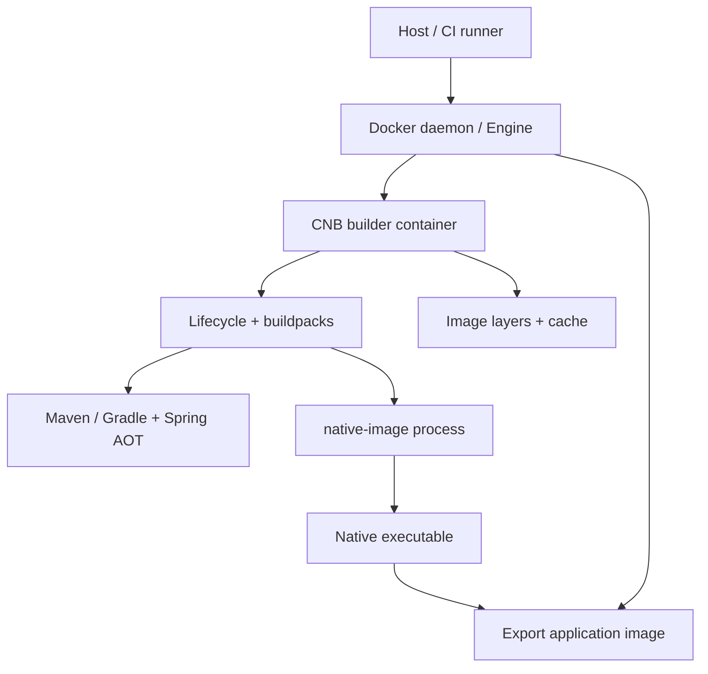

# Tài nguyên dành cho Docker daemon và tiến trình native-image trong build

## 1. Vì sao cần tách tài nguyên của Docker daemon và native-image?

Khi tạo container image cho ứng dụng Spring Boot bằng **Cloud Native Buildpacks (CNB)** và GraalVM Native Image, máy build có thể chạy nhiều thành phần đồng thời: Docker daemon, CNB lifecycle, builder container, buildpack, Maven/Gradle, Spring AOT và tiến trình `native-image`. Những thành phần này có thể tiêu thụ CPU, RAM, dung lượng đĩa và I/O khác nhau.

Một lỗi phổ biến là thấy native build bị OOM rồi chỉ tăng heap của Java, trong khi Docker Desktop hoặc CI runner mới là nơi đang giới hạn tổng bộ nhớ container. Trường hợp khác, Docker daemon đủ tài nguyên nhưng tiến trình `native-image` chạy bên trong builder bị giới hạn heap hoặc bị kill do cgroup memory limit.

Trong module **SPRING_BOOT_NATIVE_IMAGE**, cần tách tối thiểu ba phạm vi:

- **Docker daemon/engine và môi trường máy host**: quản lý container, image layers, volumes, network và lưu trữ.
- **Builder container/CNB lifecycle**: chạy buildpack, build tool và các tiến trình con.
- **Tiến trình GraalVM Native Image**: phân tích reachability, tối ưu và tạo mã native; thường là một phần tiêu thụ RAM lớn trong build.



Docker daemon và builder container không nhất thiết là cùng một tiến trình hay cùng một máy. Với Docker Desktop trên Windows/macOS, engine thường chạy trong VM/Linux environment được quản lý riêng. Với remote Docker context, daemon còn có thể ở một host khác. Vì vậy, chỉ quan sát RAM của terminal chạy lệnh build là chưa đủ.

## 2. Các loại tài nguyên cần theo dõi

| Tài nguyên | Docker daemon/host | Builder và native-image |
|---|---|---|
| CPU | Điều phối container, nén/ghi layer, network | Compile Java, AOT, phân tích reachability, tối ưu và sinh mã |
| RAM | Daemon, VM, cache và các container khác | JVM builder, native-image heap, native memory, linker và process con |
| Disk | Image store, layer, volume, build cache | Temporary files, generated sources, object files, executable trung gian |
| I/O | Pull/push image, layer extraction, metadata | Đọc classpath/dependencies, ghi output, linker |
| Process/thread | Docker service, container runtime | Gradle/Maven, Java builder, compiler, linker, buildpack processes |

Không cộng máy móc mọi số liệu RSS nếu các process chia sẻ page hoặc nằm trong container/VM có cơ chế accounting khác nhau. Khi cần đánh giá giới hạn của một CI job, số liệu **cgroup/container hoặc VM** thường hữu ích hơn một PID đơn lẻ.

## 3. Hiểu các giới hạn memory trong Docker

### Docker Engine trên Linux

Trên Linux, Docker container chịu giới hạn do cgroup và cấu hình runtime. Một container có thể bị OOM kill khi tổng memory vượt giới hạn dù heap Java chưa chạm `-Xmx`. Kiểm tra giới hạn thực tế từ cgroup (đường dẫn và file phụ thuộc cgroup v1/v2):

- cgroup v2 thường cung cấp `memory.max`, `memory.current`, `memory.events`.
- cgroup v1 thường có các file như `memory.limit_in_bytes`, `memory.usage_in_bytes`, `memory.failcnt`.

Không giả định container có quyền đọc mọi file cgroup; CI hoặc runtime có thể mount namespace khác nhau.

### Docker Desktop trên Windows/macOS

Docker Desktop chạy Linux containers trong một môi trường Linux VM. Tài nguyên được phân bổ cho VM có thể giới hạn tổng RAM/CPU khả dụng của builder, kể cả khi host có nhiều RAM trống. Cấu hình Docker Desktop khác nhau theo phiên bản và backend (WSL 2/Hyper-V trên Windows, virtual machine framework trên macOS).

Khi native build OOM trên Docker Desktop:

1. Kiểm tra tổng RAM và CPU được cấp cho Docker Desktop/VM.
2. Kiểm tra container builder có giới hạn riêng hay không.
3. Xác nhận các ứng dụng khác và container khác đang chiếm tài nguyên.
4. Kiểm tra dung lượng disk của VM và Docker image store.
5. Quan sát memory peak của build container trong lúc `native-image` chạy.

Không lấy RAM vật lý host làm số RAM chắc chắn có thể sử dụng trong Linux builder VM.

## 4. Heap của native-image không phải tổng RAM build

GraalVM Native Image builder chạy trên JVM. Có thể cấu hình heap của JVM builder qua tùy chọn `-J`, ví dụ:

```bash
native-image -J-Xmx4g -jar app.jar app
```

Đây là ví dụ trực tiếp của Native Image command; ứng dụng Spring Boot thường cần quy trình AOT/plugin thích hợp. `-J-Xmx4g` đặt giới hạn heap cho JVM builder, không giới hạn toàn bộ RSS của tiến trình, builder container hay Docker VM.

Tổng memory build còn có thể gồm:

- Heap JVM builder.
- Native memory của builder và các cấu trúc dữ liệu ngoài heap.
- Maven/Gradle daemon hoặc process điều phối.
- Compiler/linker và process con.
- Page cache, memory-mapped files và các dịch vụ trong cùng container/VM.

Vì vậy, nếu builder heap được đặt 4 GiB, container có thể dùng hơn 4 GiB. Ngược lại, nếu cgroup chỉ cho container 3 GiB, tăng `-J-Xmx` lên 4 GiB có thể làm build bị kill sớm hơn.

**Cấu hình heap phải nằm trong ngân sách container**, đồng thời chừa chỗ cho overhead native, process con và hệ thống. Đừng sao chép một con số `-Xmx` từ máy developer sang runner có memory limit nhỏ hơn.

## 5. Xác định process nào đang tiêu thụ RAM

Trên Linux host, có thể xem container:

```bash
docker stats
```

Lệnh cho thấy CPU, memory, network và block I/O theo container đang chạy. Trong lúc build, xác định container builder theo tên/ID và quan sát peak usage. `docker stats` phản ánh góc nhìn Docker; số liệu chi tiết và cách hiển thị memory cache có thể khác giữa nền tảng.

Xem process trong container (nếu image có công cụ tương ứng):

```bash
docker top <builder-container-id>
```

Nếu có quyền truy cập process namespace của container, dùng `ps` để xác định Java/native-image/compiler. Một số builder image tối giản không có `ps`, `top` hoặc shell đầy đủ; có thể quan sát từ host hoặc dùng công cụ giám sát container.

Với Linux, kiểm tra thông tin cgroup:

```bash
cat /sys/fs/cgroup/memory.current
cat /sys/fs/cgroup/memory.max
cat /sys/fs/cgroup/memory.events
```

Các file này minh họa cgroup v2 ở root cgroup; container có thể thấy mount point và path khác. `memory.events` có thể giúp nhận biết sự kiện `oom`/`oom_kill`, nếu được cấp quyền đọc.

Trên Windows host dùng Docker Desktop, có thể quan sát Docker Desktop/WSL VM trong Task Manager và dùng `docker stats` từ terminal. Với remote Docker daemon, số liệu host local không đại diện cho server remote; phải quan sát phía máy chạy daemon.

## 6. Tài nguyên CPU: build native có thể song song

Native Image compilation và các bước Java build có thể sử dụng nhiều CPU. Gradle/Maven, compiler và linker có thể chạy song song tùy cấu hình. Nếu Docker VM chỉ được cấp ít vCPU, build kéo dài dù host có nhiều core.

Các yếu tố ảnh hưởng:

- Số worker Gradle và cấu hình parallel build.
- Số process compiler/linker được Native Image sử dụng.
- CPU quota của container/runner.
- Các job CI khác chạy đồng thời.
- Tốc độ CPU thực tế của VM và host.

Không nên tăng số worker vô hạn. Khi RAM hạn chế, tăng song song có thể làm nhiều compiler/task giữ dữ liệu cùng lúc, khiến peak RAM cao hơn. Điều chỉnh song song cần đo cả thời gian build lẫn memory peak.

Với Gradle, có thể giới hạn worker bằng:

```bash
./gradlew --max-workers=2 bootBuildImage
```

Cờ `--max-workers` điều khiển số worker của Gradle, **không nhất thiết giới hạn mọi thread/process nội bộ của GraalVM hoặc buildpack**. Nó là một phần của điều chỉnh tổng thể, không thay thế giới hạn container.

## 7. Disk và cache cũng là tài nguyên build

Buildpacks sử dụng layers và cache để tái sử dụng dependency hoặc artifact giữa các lần build. Native Image còn tạo generated sources, temporary files, object files và executable trung gian. Vì vậy, disk có thể cạn trước khi RAM hoặc CPU trở thành vấn đề.

Kiểm tra dung lượng Docker:

```bash
docker system df
```

Trên Linux host có thể kiểm tra filesystem chứa Docker data root và workspace:

```bash
df -h
du -sh ~/.gradle/caches ~/.m2/repository
```

Đường dẫn cache có thể khác theo user và cấu hình. Với Docker Desktop, Docker image store có thể nằm trong virtual disk; dung lượng trống của ổ đĩa Windows/macOS và dung lượng còn lại trong virtual disk là hai góc nhìn cần kiểm tra.

Không chạy `docker system prune -a --volumes` một cách tùy tiện: lệnh này có thể xóa image, cache và volume không được tham chiếu mà người dùng còn cần. Nếu cần giải phóng dung lượng, xác định rõ tài nguyên nào có thể bỏ và tuân thủ quy trình của CI/đội vận hành.

## 8. Buildpacks: builder container và giới hạn tài nguyên

Khi Spring Boot gọi CNB thông qua Maven hoặc Gradle, plugin sẽ sử dụng Docker daemon để tạo builder container, chạy lifecycle rồi export application image. Tùy plugin, builder và môi trường, có thể có cấu hình điều khiển container creation hoặc môi trường build.

Ví dụ Gradle:

```groovy
tasks.named("bootBuildImage") {
    builder = "paketobuildpacks/builder-jammy-base"
    imageName = "example/native-service:1.0.0"
}
```

Đây chỉ là ví dụ về chọn builder và tên image; không phải mọi tag đều hỗ trợ native build. Hãy xác minh builder/buildpack tương thích Spring Boot, GraalVM, OS và kiến trúc đích.

Nếu cần giới hạn tài nguyên cho builder container, trước tiên kiểm tra API/configuration của Spring Boot plugin và Docker environment đang sử dụng. Không giả định có một thuộc tính Gradle chung cho mọi phiên bản để đặt memory limit. Một số giới hạn được đặt ở Docker Desktop/VM, CI runner hoặc cấu hình Docker daemon; cách áp dụng phụ thuộc nền tảng.

Với lệnh `pack`, tùy chọn và cách cấu hình resource cũng phụ thuộc phiên bản CLI và builder. Hãy đọc `pack build --help` của phiên bản đã cài và tài liệu builder cụ thể, không sao chép tham số của Docker CLI sang `pack` nếu không được hỗ trợ.

## 9. Cách xử lý OOM theo thứ tự

Giả sử build Spring Boot native trong builder container bị dừng giữa lúc GraalVM phân tích. Một cách xử lý có căn cứ:

1. **Xác định lỗi gốc**: log có `OutOfMemoryError: Java heap space`, lỗi allocation khác hay process bị hệ điều hành OOM-kill?
2. **Xác định phạm vi bị giới hạn**: Docker Desktop VM, CI runner, builder container hay process JVM cụ thể?
3. **Đo peak**: quan sát `docker stats`, cgroup memory events, CI metrics và log native-image.
4. **Kiểm tra heap builder**: nếu lỗi thực sự là heap exhaustion, điều chỉnh `-J-Xmx` theo giới hạn container và overhead còn lại.
5. **Điều chỉnh song song**: giảm Gradle workers hoặc concurrency nếu nhiều task/process cạnh tranh RAM.
6. **Cấp tài nguyên phù hợp**: tăng RAM/CPU runner hoặc Docker VM nếu ngân sách hiện tại không đủ.
7. **Build lại và xác nhận**: kiểm tra exit code, artifact native mới, rồi chạy smoke/integration test trên image.

Không giải quyết OOM bằng cách chỉ tăng heap nếu cgroup đã hết memory. Cũng không kết luận Docker daemon là nguyên nhân chỉ vì build được gọi qua Docker: native-image có thể là process tiêu thụ memory lớn nhất trong builder container.

## 10. Ví dụ điều tra bằng số liệu

Giả sử Docker Desktop VM được cấp 6 GiB RAM. Khi build, builder container dùng gần 5.8 GiB và dừng với OOM kill. Log JVM không có `Java heap space`, nhưng cgroup báo `oom_kill` tăng.

Cách diễn giải:

- Giới hạn tổng của môi trường builder gần 6 GiB.
- Builder, native-image và process phụ đã dùng gần hết ngân sách.
- Không đủ căn cứ để quy lỗi cho Java heap; cgroup có thể kill process dù heap chưa đạt max.
- Tăng `-J-Xmx` có thể khiến tình trạng tệ hơn.
- Cần giảm cạnh tranh/concurrency, tăng VM memory hoặc điều chỉnh workload/build strategy rồi đo lại.

Ngược lại, nếu container có 10 GiB limit nhưng log báo rõ `Java heap space` trong native-image builder ở mức heap 2 GiB, có thể xem xét tăng heap builder, đồng thời theo dõi tổng memory và overhead. Các số liệu trên là ví dụ minh họa, không phải định mức chung cho mọi dự án.

## 11. Phân biệt tài nguyên build với tài nguyên runtime

Builder image và application image có vai trò khác nhau. Native-image build có thể cần nhiều RAM/CPU và dung lượng tạm, trong khi container chạy executable chỉ cần ngân sách runtime phù hợp workload. Không lấy peak RAM build làm memory limit cho pod production.

| Chỉ số | Build stage | Runtime stage |
|---|---|---|
| CPU | Compile, AOT, reachability analysis, link | Xử lý request, GC, I/O |
| RAM | JVM builder, compiler, process con | Heap native runtime, stack, native memory |
| Disk | Cache, source, object, temporary output | Image layers, log và file ứng dụng ghi ra |
| Cần đo | Peak builder/cgroup/VM | RSS/working set, peak dưới tải |
| Cấu hình | Docker VM/runner, builder container, heap builder | Container memory limit, heap/runtime config, workload |

Khi so sánh JAR và native, đo riêng peak RAM của build và memory khi ứng dụng chạy. Native có thể giúp giảm startup và memory runtime trong một số workload, nhưng lợi ích phải được xác nhận bằng đo đạc.

## 12. Checklist trước khi chạy native build trong CI

- Xác định Docker daemon local hay remote, Docker Desktop VM hay Linux runner.
- Ghi rõ memory/CPU limit của host, VM và builder container.
- Xác nhận builder/buildpack có hỗ trợ Native Image với phiên bản GraalVM/Spring Boot đang dùng.
- Đo peak RAM và disk của một build đại diện.
- Phân biệt lỗi Java heap với cgroup OOM kill.
- Cấu hình Gradle/Maven concurrency phù hợp ngân sách.
- Giữ cache ở nơi có dung lượng đủ và không xóa volume/image đang được sử dụng.
- Thu thập log buildpack, native-image, container stats và exit code.
- Sau build, chạy smoke test và integration test trên application image.
- Cấp memory limit runtime theo số liệu tải thực tế, độc lập với build resource.

## 13. Câu hỏi tự kiểm tra

1. Vì sao Docker daemon/VM có thể hết RAM dù host Windows còn nhiều RAM trống?
2. `-J-Xmx` giới hạn phần bộ nhớ nào và vì sao nó không giới hạn tổng memory builder container?
3. Làm thế nào phân biệt `Java heap space` với container bị OOM kill?
4. Vì sao tăng Gradle worker có thể làm peak RAM native build tăng?
5. Cache CNB giúp tiết kiệm gì và vì sao vẫn có thể phải chạy lại native-image?
6. Tại sao memory limit của builder container không nên được dùng làm memory limit của application container?
7. Khi build qua remote Docker daemon, cần quan sát tài nguyên ở đâu?

**Ghi nhớ:** buildpacks chỉ là cách điều phối quá trình đóng gói; tài nguyên thực tế được tiêu thụ bởi Docker/VM, builder, build tool và native-image. Hãy đo đúng phạm vi process/container/cgroup, phân biệt heap với tổng RAM và tách ngân sách build khỏi runtime để xử lý OOM có căn cứ.
