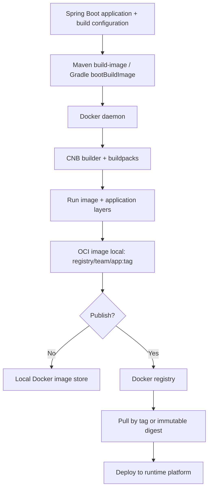
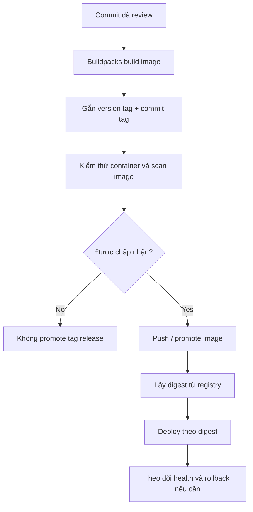

# Đặt tên, gắn tag và xuất image tới registry

> **Chương: Buildpacks.** Trong module **SPRING_BOOT_NATIVE_IMAGE**, Spring AOT chuẩn bị ứng dụng và GraalVM Native Image tạo executable native. Cloud Native Buildpacks (CNB) đóng gói ứng dụng thành OCI image để triển khai. Bài học này hướng dẫn đặt tên image, quản lý tag và đưa image lên registry bằng Spring Boot Maven/Gradle plugin.

## 1. Mục tiêu học tập

Sau bài học, bạn có thể:

1. Đọc và tạo tên OCI image gồm registry, namespace, repository và tag.
2. Phân biệt tên image, tag, digest, builder image và run image.
3. Cấu hình tên image và nhiều tag trong Spring Boot Maven/Gradle plugin.
4. Chọn cách build image local hoặc publish trực tiếp tới Docker registry.
5. Cấu hình thông tin xác thực registry mà không ghi secret vào mã nguồn.
6. Kiểm tra image sau khi push và triển khai đúng image đã được kiểm chứng.

## 2. Buildpacks tạo image nào?

Cloud Native Buildpacks nhận ứng dụng và builder, sau đó chạy các buildpack để tạo một **OCI image** có thể được container runtime chạy. Với Spring Boot, có thể dùng:

- Maven goal `spring-boot:build-image`.
- Gradle task `bootBuildImage`.

Hai cách trên sử dụng Docker daemon để làm việc với builder/run image và tạo image ứng dụng. Khi chưa bật publish, image được tạo trong kho image local của Docker daemon. Khi bật publish, plugin gửi image đã tạo lên registry được xác định trong tên image.

Với ứng dụng Spring Boot native, buildpack cần được cấu hình để tạo GraalVM Native Image. Ví dụ với Paketo Java buildpacks, biến build-time `BP_NATIVE_IMAGE=true` yêu cầu buildpack tạo native executable. Khi dùng Spring Boot plugin, biến này được truyền vào cấu hình `image.env` (Maven) hoặc `environment` (Gradle). Cần dùng builder/buildpack tương thích với phiên bản Spring Boot, Java và GraalVM của dự án.



**Builder image**, **run image** và **application image** là ba khái niệm khác nhau:

| Loại image | Vai trò | Ví dụ tên |
|---|---|---|
| Builder image | Môi trường chứa lifecycle và buildpacks để tạo ứng dụng | `paketobuildpacks/builder-noble-java-tiny:latest` |
| Run image | Lớp nền dùng khi khởi chạy ứng dụng sau build | `paketobuildpacks/ubuntu-noble-run:latest` |
| Application image | Image cuối cùng chứa các layer ứng dụng và runtime cần thiết | `registry.example.com/team/orders:1.4.2` |

Tên cấu hình cho application image không đổi tên builder hoặc run image. Nếu builder/run image nằm trong registry riêng cần xác thực, cấu hình credentials dành cho builder registry riêng; phần này khác với credentials để publish application image.

## 3. Cấu trúc tên OCI image

Một image reference thường có dạng:

```text
[registry-host[:port]/][namespace/]repository[:tag][@digest]
```

Ví dụ:

```text
registry.example.com:5000/platform/orders-api:1.4.2
```

Trong đó:

- `registry.example.com:5000`: địa chỉ registry và port.
- `platform`: namespace hoặc project.
- `orders-api`: tên repository của image.
- `1.4.2`: tag mô tả phiên bản.

| Reference | Ý nghĩa |
|---|---|
| `orders-api` | Mặc định thành `docker.io/library/orders-api:latest` |
| `team/orders-api:1.4.2` | Repository `team/orders-api` trên Docker Hub |
| `registry.example.com/team/orders-api:1.4.2` | Repository trên registry riêng |
| `registry.example.com:5000/team/orders-api:git-a1b2c3d` | Registry riêng dùng port và tag theo commit |
| `registry.example.com/team/orders-api@sha256:...` | Tham chiếu image theo digest |

Nếu không chỉ rõ registry, Docker mặc định dùng `docker.io`; nếu không chỉ rõ namespace, Docker Hub dùng namespace `library` cho image chính thức. Nếu không ghi tag, tag mặc định là `latest`. Vì vậy, nên khai báo đầy đủ registry/repository và tag trong pipeline phát hành để tránh đẩy nhầm image tới Docker Hub hoặc dùng tag mặc định.

Tên repository thường dùng chữ thường, số và dấu phân cách phù hợp. Tag có thể dùng chữ hoa, số, dấu gạch dưới, dấu chấm và dấu gạch ngang; không dùng dấu gạch chéo trong tag. Nếu tên nhánh Git có dạng `feature/payment`, hãy chuyển thành chuỗi hợp lệ như `feature-payment` trước khi tạo tag.

### 3.1. Image name, tag và digest khác nhau thế nào?

- **Image name/reference** xác định registry và repository nơi image được lưu.
- **Tag** là nhãn dễ đọc, ví dụ `1.4.2` hoặc `git-a1b2c3d`. Một tag có thể được di chuyển sang image mới khi publish lại; vì vậy tag không mặc nhiên bất biến.
- **Digest** là mã định danh nội dung, thường có dạng `sha256:...`. Deploy theo digest giúp pin đúng nội dung image đã kiểm thử.

Ví dụ cùng một image có thể được gắn nhiều tag:

```text
registry.example.com/team/orders-api:1.4.2
registry.example.com/team/orders-api:release-2026-11
registry.example.com/team/orders-api:git-a1b2c3d
```

Các tag trên có thể trỏ tới cùng một image manifest. Khi build lại và publish cùng tag, tag đó có thể trỏ sang nội dung khác. Registry có chính sách *immutable tag* có thể từ chối thao tác ghi đè.

## 4. Chiến lược đặt tên và tag

Tên image nên ổn định theo ứng dụng và môi trường quản lý repository; tag nên giúp trả lời câu hỏi **đây là phiên bản nào, được build từ mã nguồn nào và dùng cho môi trường nào**.

| Loại tag | Ví dụ | Mục đích |
|---|---|---|
| Version release | `1.4.2` | Phiên bản phát hành, dễ tra cứu |
| Commit | `git-a1b2c3d` | Truy ngược đúng commit tạo image |
| Build number | `build-582` | Truy vết lần chạy CI |
| Kênh phát hành | `stable`, `staging` | Nhãn di động cho một kênh triển khai |
| Alias tiện dụng | `latest` | Chỉ dùng khi quy ước nhóm định nghĩa rõ ý nghĩa |

Khuyến nghị:

1. Tạo tag bất biến theo version hoặc commit cho mỗi lần build phát hành.
2. Nếu cần tag di động như `stable` hoặc `latest`, chỉ cập nhật chúng sau khi image đã qua kiểm thử và được chấp nhận.
3. Không dùng `latest` làm định danh duy nhất trong manifest triển khai production.
4. Ghi lại digest thực tế sau khi push và dùng digest đó trong bước triển khai quan trọng.
5. Không tái sử dụng cùng repository/tag cho bản JVM và bản native nếu hai image có hành vi hoặc mục tiêu khác nhau.

Ví dụ phân biệt hai loại image:

```text
registry.example.com/platform/orders-api:1.4.2-jvm
registry.example.com/platform/orders-api:1.4.2-native
```

Tag `native` chỉ là nhãn do nhóm đặt; nó không tự làm image trở thành native. Cấu hình buildpack, đặc biệt `BP_NATIVE_IMAGE=true` với Paketo Java Native Image buildpack tương thích, mới quyết định quá trình build native.

## 5. Cấu hình tên image và publish với Maven

Spring Boot Maven plugin cung cấp goal `spring-boot:build-image`. Mặc định tên image được suy ra từ `artifactId` và `version` của Maven project; nên đặt tên đầy đủ khi publish tới registry của tổ chức.

Ví dụ cấu hình trong `pom.xml`:

```xml
<build>
    <plugins>
        <plugin>
            <groupId>org.springframework.boot</groupId>
            <artifactId>spring-boot-maven-plugin</artifactId>
            <configuration>
                <image>
                    <name>registry.example.com/platform/orders-api:1.4.2-native</name>
                    <env>
                        <BP_NATIVE_IMAGE>true</BP_NATIVE_IMAGE>
                    </env>
                    <publish>true</publish>
                </image>
                <tags>
                    <tag>registry.example.com/platform/orders-api:git-a1b2c3d</tag>
                </tags>
                <docker>
                    <publishRegistry>
                        <username>${env.REGISTRY_USER}</username>
                        <password>${env.REGISTRY_PASSWORD}</password>
                    </publishRegistry>
                </docker>
            </configuration>
        </plugin>
    </plugins>
</build>
```

Giải thích:

- `image.name` là image reference chính, gồm registry, repository và tag.
- `image.env` truyền biến build-time cho builder; `BP_NATIVE_IMAGE=true` yêu cầu Paketo tạo native image nếu builder/buildpack đang dùng hỗ trợ.
- `image.publish` bật publish tới registry. Nếu không bật, plugin tạo image local trên Docker daemon.
- `tags` khai báo thêm một hoặc nhiều image reference đầy đủ. Các tag bổ sung nên trỏ tới cùng repository/image theo quy ước của nhóm.
- `docker.publishRegistry` cung cấp thông tin xác thực để publish. Registry đích được xác định từ phần registry trong image name; thuộc tính `url` trong credentials (nếu dùng) không thay thế phần registry của image reference.

`REGISTRY_USER` và `REGISTRY_PASSWORD` là biến môi trường do CI secret store hoặc môi trường chạy cấp. Không commit giá trị thật vào `pom.xml`. Nếu Docker CLI đã có credential helper hoặc thông tin đăng nhập trong `~/.docker/config.json`, Spring Boot plugin có thể sử dụng cấu hình Docker đó khi không khai báo credentials riêng; xem tài liệu plugin của đúng phiên bản.

Chạy:

```bash
./mvnw spring-boot:build-image
```

Nếu chỉ muốn build local, bỏ `<publish>true</publish>`. Có thể dùng property khi chạy lệnh:

```bash
./mvnw spring-boot:build-image \
  -Dspring-boot.build-image.imageName=registry.example.com/platform/orders-api:1.4.2-native
```

Muốn publish trực tiếp, bật property `spring-boot.build-image.publish` hoặc cấu hình `image.publish` như ví dụ. Nếu goal được gắn vào lifecycle `package` trong POM, dùng `build-image-no-fork` theo hướng dẫn plugin để tránh fork lifecycle không cần thiết.

## 6. Cấu hình tên image và publish với Gradle

Với Gradle, Spring Boot plugin tạo task `bootBuildImage` khi Java/War plugin phù hợp được áp dụng. Có thể đặt `imageName`, các tag bổ sung, biến môi trường builder và chế độ publish ngay trong task.

Ví dụ **Groovy DSL**:

```groovy
// build.gradle
tasks.named("bootBuildImage") {
    imageName = "registry.example.com/platform/orders-api:" + project.version + "-native"
    tags = ["registry.example.com/platform/orders-api:git-a1b2c3d"]
    environment["BP_NATIVE_IMAGE"] = "true"
    publish = true
    docker {
        publishRegistry {
            username = providers.environmentVariable("REGISTRY_USER").get()
            password = providers.environmentVariable("REGISTRY_PASSWORD").get()
        }
    }
}
```

Ví dụ **Kotlin DSL**:

```kotlin
// build.gradle.kts
tasks.named<BootBuildImage>("bootBuildImage") {
    imageName.set("registry.example.com/platform/orders-api:" + project.version + "-native")
    tags.set(listOf("registry.example.com/platform/orders-api:git-a1b2c3d"))
    environment.put("BP_NATIVE_IMAGE", "true")
    publish.set(true)
    docker {
        publishRegistry {
            username.set(providers.environmentVariable("REGISTRY_USER").get())
            password.set(providers.environmentVariable("REGISTRY_PASSWORD").get())
        }
    }
}
```

Với Kotlin DSL, cần import kiểu `BootBuildImage` nếu chưa được IDE tự nhận:

```kotlin
import org.springframework.boot.gradle.tasks.bundling.BootBuildImage
```

Chạy task:

```bash
./gradlew bootBuildImage
```

Nếu `publish` là false (mặc định), image được tạo local. Khi bật `publish`, plugin publish image tới registry. Nếu registry không yêu cầu xác thực, có thể bỏ cấu hình `docker.publishRegistry`. Nếu không truyền credentials trực tiếp, plugin có thể đọc cấu hình Docker CLI và credential helper hiện có.

**Lưu ý phiên bản:** tên property và DSL có thể thay đổi theo Spring Boot Gradle plugin. Ví dụ trên dùng Groovy/Kotlin property theo API plugin hiện hành; nếu dự án dùng phiên bản khác, xem mục *Packaging OCI Images* trong tài liệu đúng nhánh. Danh sách `tags` phải là các image reference đầy đủ, không chỉ là chuỗi tag rời.

## 7. Đăng nhập và xuất image bằng Docker CLI

### 7.1. Build local rồi tự gắn tag và push

Luồng này hữu ích khi muốn tách quyền build và quyền publish. Trước tiên, build image local:

```bash
./mvnw spring-boot:build-image \
  -Dspring-boot.build-image.imageName=orders-api:1.4.2-native
```

Hoặc:

```bash
./gradlew bootBuildImage --imageName=orders-api:1.4.2-native
```

Sau đó đăng nhập vào registry. Docker CLI có thể hỏi password tương tác:

```bash
docker login registry.example.com --username "$REGISTRY_USER"
```

Trong CI Linux, có thể truyền password qua standard input để tránh ghi trực tiếp password trong command line:

```bash
printf '%s' "$REGISTRY_PASSWORD" | docker login registry.example.com \
  --username "$REGISTRY_USER" --password-stdin
```

Gắn tag đầy đủ và push:

```bash
docker tag orders-api:1.4.2-native registry.example.com/platform/orders-api:1.4.2-native
docker tag orders-api:1.4.2-native registry.example.com/platform/orders-api:git-a1b2c3d
docker push registry.example.com/platform/orders-api:1.4.2-native
docker push registry.example.com/platform/orders-api:git-a1b2c3d
```

`docker tag` tạo thêm reference cho image local hiện có; nó không build lại ứng dụng. `docker push` gửi image theo tag lên registry. Nếu muốn một tag khác repository, phải dùng đúng reference đầy đủ và có quyền ghi vào repository đích.

### 7.2. Build và publish trực tiếp từ Spring Boot plugin

Nếu muốn plugin thực hiện cả hai bước, cấu hình `publish=true` và registry credentials như các ví dụ Maven/Gradle ở trên. Đây thường là cách ngắn gọn cho CI pipeline có quyền publish.

| Cách làm | Ưu điểm | Khi nên dùng |
|---|---|---|
| Plugin build local, Docker CLI tag/push | Tách rõ bước build và bước phát hành; dễ gắn thêm tag sau khi kiểm tra | Muốn review/scan image local trước khi publish |
| Plugin build và publish trực tiếp | Ít lệnh; cấu hình nhất quán với Maven/Gradle | CI đã xác thực registry và cần publish tự động |

`publish=true` là một hành động gửi image ra registry. Hãy đặt nó trong job release hoặc job có điều kiện branch/tag rõ ràng, không bật vô tình ở mọi lần build developer.

## 8. Kiểm tra image đã build và publish

### 8.1. Xác minh image local

Liệt kê image:

```bash
docker image ls registry.example.com/platform/orders-api
```

Xem metadata:

```bash
docker image inspect registry.example.com/platform/orders-api:1.4.2-native
```

Chạy thử container:

```bash
docker run --rm --publish 8080:8080 registry.example.com/platform/orders-api:1.4.2-native
```

Mở health endpoint hoặc API của ứng dụng để xác minh. Đối với native image, cần kiểm tra hành vi thật, cấu hình runtime, kết nối database, resource và các thư viện hệ thống cần thiết. Việc Docker tạo được image chưa có nghĩa executable đã tương thích với môi trường triển khai.

### 8.2. Xác minh registry sau khi push

Pull đúng tag vừa publish từ registry:

```bash
docker pull registry.example.com/platform/orders-api:1.4.2-native
```

Sau đó kiểm tra image:

```bash
docker image inspect registry.example.com/platform/orders-api:1.4.2-native
```

Với Docker Buildx, có thể xem manifest trên registry:

```bash
docker buildx imagetools inspect registry.example.com/platform/orders-api:1.4.2-native
```

Kết quả cho biết tag trỏ tới manifest hoặc image index nào và platform nào được công bố. Với registry hỗ trợ, có thể dùng digest lấy từ kết quả inspect/pull để pin deployment:

```text
registry.example.com/platform/orders-api@sha256:<digest-thuc-te>
```

Thay placeholder bằng digest thật. Không suy digest từ tag và không ghi một digest mẫu vào cấu hình production.

### 8.3. Đọc kết quả push

| Dấu hiệu | Ý nghĩa thường gặp | Hướng xử lý |
|---|---|---|
| `unauthorized` / HTTP 401 | Chưa đăng nhập, token hết hạn hoặc credentials sai | Xác thực lại; kiểm tra credential helper và token |
| `denied: requested access to the resource is denied` | Tài khoản không có quyền push repository hoặc namespace sai | Kiểm tra quyền ghi và repository path |
| `manifest unknown` khi pull | Tag chưa tồn tại hoặc push tới registry/repository khác | Kiểm tra image reference đầy đủ và kết quả push |
| `name unknown` / repository not found | Repository/project chưa được tạo hoặc sai namespace | Tạo repository theo policy của registry, xác minh URL |
| HTTP 413 / upload timeout | Registry/proxy giới hạn kích thước hoặc thời gian upload | Kiểm tra reverse proxy, registry storage và giới hạn upload |
| TLS certificate error | Registry dùng CA chưa được Docker daemon tin cậy | Cài CA đúng cách vào trust store của Docker host |
| Image chạy sai kiến trúc | Image/native executable không khớp platform triển khai | Build và publish đúng platform; xác minh manifest |

## 9. Tag, digest và quy trình phát hành an toàn

Tag giúp con người nhận diện image; digest giúp runtime lấy chính xác nội dung. Một pipeline có thể triển khai theo quy trình:



Ví dụ chính sách:

- Mỗi build CI tạo tag duy nhất như `git-a1b2c3d` hoặc `build-582`.
- Khi phát hành, gắn tag phiên bản `1.4.2` và có thể thêm alias `stable`.
- Chỉ cập nhật `latest` nếu nhóm đã định nghĩa rõ đó là bản nào.
- Ghi digest trong deployment record để biết production đang chạy chính xác image nào.
- Rollback bằng digest hoặc version tag đã lưu, không phụ thuộc một tag di động có thể đã bị ghi đè.

Nếu registry hỗ trợ **immutable tags**, bật chính sách đó cho tag version/commit. Tag di động như `stable` vẫn cần được quản lý riêng. Không nên để job build feature branch có quyền ghi đè tag release.

### 9.1. Không nhầm tag với phiên bản native hoặc kiến trúc

Tên tag `native` chỉ là metadata do nhóm đặt. Để xác nhận image chứa native executable:

1. Kiểm tra buildpack log có chạy bước GraalVM Native Image không.
2. Xác nhận `BP_NATIVE_IMAGE=true` được truyền ở **build time** và builder có buildpack native phù hợp.
3. Chạy image và xác nhận process ứng dụng là native executable theo cấu hình builder.
4. Lưu lại builder/run image, GraalVM, OS và kiến trúc đã dùng.

Một image native thường gắn với OS/CPU cụ thể. Gắn thêm tag `linux-arm64` cho image đã build `linux/amd64` không chuyển binary sang ARM64. Muốn hỗ trợ nhiều kiến trúc, cần build cho từng platform tương ứng hoặc sử dụng quy trình multi-platform/manifest list được builder và registry hỗ trợ; kiểm tra manifest sau publish.

## 10. Bài tập thực hành

Giả sử dịch vụ Spring Boot tên `orders-api` có version `1.4.2`. Registry công ty là `registry.example.com`, namespace là `platform`. Nhóm cần publish native image và có thể rollback đúng build.

Thực hiện:

1. Đặt image name chính là `registry.example.com/platform/orders-api:1.4.2-native`.
2. Tạo thêm tag `registry.example.com/platform/orders-api:git-a1b2c3d`.
3. Cấu hình `BP_NATIVE_IMAGE=true` trong buildpack environment cho builder tương thích.
4. Cấu hình credentials qua CI secret hoặc Docker credential helper.
5. Build local và kiểm tra image bằng `docker image inspect`.
6. Đăng nhập registry, gắn tag bổ sung và push cả hai tag; hoặc cấu hình plugin publish trực tiếp.
7. Pull lại tag từ registry, chạy container và gọi endpoint health.
8. Ghi lại digest của image đã xác minh và dùng digest đó trong một deployment mẫu.

| Trường | Giá trị thực tế |
|---|---|
| Source commit | … |
| Spring Boot / GraalVM / builder | … |
| Image reference chính | … |
| Tag bổ sung | … |
| Registry | … |
| Build mode | JVM / Native Image |
| Push result | Pass / Fail |
| Registry digest | … |
| OS / architecture | … |
| Container smoke test | Pass / Fail |

## 11. Câu hỏi tự kiểm tra

1. Một image reference đầy đủ gồm những thành phần nào?
2. Vì sao bỏ tag trong image name có thể khiến plugin dùng `latest`?
3. `tags` của Spring Boot plugin nhận chuỗi tag rời hay image reference đầy đủ?
4. Sự khác nhau giữa `publish=true` và việc chỉ tạo image local là gì?
5. `docker.publishRegistry` và `docker.builderRegistry` được dùng cho hai mục đích nào?
6. Vì sao `docker tag` không tạo ra một bản build mới?
7. Vì sao tag version/commit và digest phù hợp hơn `latest` khi triển khai production?
8. Nếu image mang tag `native` nhưng buildpack không chạy GraalVM Native Image, có thể kết luận điều gì?
9. Vì sao một tag `linux-arm64` không làm executable amd64 chạy được trên ARM64?

## Ghi nhớ

**Đặt tên xác định đúng registry/repository; tag mô tả bản build; digest xác định nội dung; publish đưa image lên registry.** Spring Boot Maven plugin dùng `spring-boot:build-image`, Gradle plugin dùng `bootBuildImage`. Cả hai có thể tạo image local hoặc publish trực tiếp khi bật cấu hình publish và xác thực registry. Với bản native, phải cấu hình buildpack phù hợp (ví dụ `BP_NATIVE_IMAGE=true` với Paketo Java Native Image buildpack), kiểm tra image sau build/push và triển khai bằng version tag hoặc digest đã được xác minh.

## Tài liệu tham khảo chính thức

- [Spring Boot 4.2 — Packaging OCI Images (Maven)](https://docs.spring.io/spring-boot/4.2/maven-plugin/build-image.html): đặt image name, cấu hình `publish`, registry credentials và tags.
- [Spring Boot 3.5 — Packaging OCI Images (Gradle)](https://docs.spring.io/spring-boot/3.5/gradle-plugin/packaging-oci-image.html): `bootBuildImage`, image name, tags, publish, registry credentials và platform.
- [Paketo — Building Java Apps with Buildpacks](https://paketo.io/docs/buildpacks/language-family-buildpacks/java/): tạo image Java và native image với `BP_NATIVE_IMAGE`.
- [Paketo — Java Native Image Buildpack Reference](https://paketo.io/docs/reference/java-native-image-reference/): các buildpack thành phần cho native image.
- [Paketo — Configuration](https://paketo.io/docs/howto/configuration/): biến môi trường build-time và runtime.
- [Docker — docker image tag](https://docs.docker.com/reference/cli/docker/image/tag/): tạo reference/tag cho image.
- [Docker — docker image push](https://docs.docker.com/reference/cli/docker/image/push/): push image tới registry.
- [Docker — docker login](https://docs.docker.com/reference/cli/docker/login/): xác thực với registry và cách dùng `--password-stdin`.
- [OCI Distribution Specification](https://github.com/opencontainers/distribution-spec): giao thức phân phối image qua registry.
