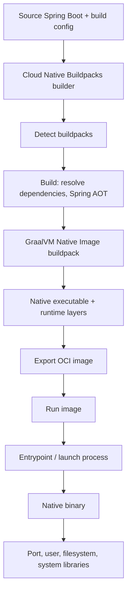

# Chạy container và kiểm chứng binary, cổng, quyền người dùng, dependency hệ thống

## 1. Mục tiêu: xác minh image native trong môi trường chạy thật

Sau khi Spring Boot được biên dịch thành **GraalVM Native Image**, bước tiếp theo là đóng gói và vận hành executable trong container. Với module **SPRING_BOOT_NATIVE_IMAGE**, build thành công mới chỉ chứng minh trình biên dịch tạo được artifact; ta còn phải xác nhận container thực sự khởi chạy binary native, ứng dụng lắng nghe đúng cổng, tiến trình chạy bằng người dùng phù hợp, filesystem có quyền cần thiết và các thư viện hệ điều hành đều sẵn sàng.

Bài này dùng **Cloud Native Buildpacks** để tạo OCI image, sau đó kiểm chứng image bằng Docker. Các nội dung chính:

- Cấu hình Spring Boot Maven/Gradle plugin để yêu cầu build native image.
- Đọc log buildpack và metadata image để xác nhận loại artifact, entrypoint, port, OS và kiến trúc.
- Chạy container, kiểm tra HTTP response, readiness và log.
- Kiểm tra user/group, quyền đọc/ghi, thư mục tạm và volume.
- Kiểm tra libc, thư viện native, chứng chỉ CA, timezone, DNS và các dependency hệ thống.
- Chẩn đoán lỗi thường gặp trước khi triển khai lên Kubernetes hoặc nền tảng container khác.

> Các lệnh minh họa dùng Docker CLI và image tên `hello-native:local`. Hãy thay tên image, cổng, endpoint và đường dẫn theo ứng dụng thật. Buildpacks có nhiều builder/buildpack khác nhau; luôn kiểm tra builder đang dùng có hỗ trợ GraalVM Native Image và tương thích với phiên bản Spring Boot/GraalVM của dự án.

## 2. Buildpacks đóng gói ứng dụng như thế nào?

Buildpacks chuyển mã nguồn hoặc artifact ứng dụng thành OCI image thông qua một chuỗi bước chuẩn hóa. Thay vì tự viết Dockerfile để cài JDK, GraalVM, compiler và runtime image, builder sẽ chọn buildpack phù hợp để chuẩn bị môi trường build và image chạy.



Builder thường bao gồm lifecycle, buildpacks và một build image; image kết quả dùng run image tương thích. Buildpacks quản lý các layer và metadata của ứng dụng, chẳng hạn process để khởi chạy. Khi bật native build, buildpack tương ứng thực hiện Spring AOT và gọi GraalVM Native Image trong môi trường build. Image xuất ra chứa executable cùng những thành phần runtime cần thiết.

Phân biệt ba khái niệm:

| Thành phần | Vai trò | Điều cần xác minh |
| --- | --- | --- |
| **Builder image** | Môi trường chứa lifecycle và buildpacks để tạo image | Có buildpack hỗ trợ native, compiler và toolchain phù hợp |
| **Build image** | Nền hệ thống được dùng trong lúc biên dịch | Có dependency phát triển và tương thích với toolchain |
| **Run image** | Nền hệ thống dùng khi container chạy | Có thư viện runtime cần thiết cho executable |
| **OCI application image** | Image cuối cùng chứa ứng dụng và launch metadata | Đúng OS/architecture, user, process, port và runtime layers |

Buildpacks thường giữ quan hệ tương thích giữa build image và run image. Không nên tùy tiện thay run image bằng một image cực nhỏ hoặc `scratch` sau khi build: binary native có thể liên kết động với libc hoặc thư viện khác mà image mới không có.

## 3. Yêu cầu trước khi build image native

Chuẩn bị:

1. Ứng dụng Spring Boot đã build và chạy đúng trên JVM.
2. Spring Boot Maven plugin hoặc Gradle plugin tương thích với dự án.
3. Docker daemon hoặc container backend mà plugin có thể sử dụng.
4. Builder image có buildpack hỗ trợ GraalVM Native Image; builder có thể tải về từ registry nếu chưa có cache.
5. CPU/RAM/ổ đĩa đủ cho quá trình native compilation, vốn thường tốn tài nguyên hơn build JAR.
6. Quyền truy cập registry nếu builder hoặc dependency phải tải từ registry riêng.

Kiểm tra Docker và kiến trúc máy:

```bash
docker version
docker info --format '{{.OSType}}/{{.Architecture}}'
```

Nếu dùng Linux/macOS để build native trực tiếp ngoài Buildpacks, cần kiểm tra thêm:

```bash
java -version
native-image --version
```

Với Buildpacks, GraalVM toolchain có thể được cung cấp bên trong builder/buildpack; không nhất thiết phải cài `native-image` trực tiếp trên máy host. Tuy vậy, cần đọc log để xác nhận buildpack native đã được detect và chạy. Nếu log chỉ cho thấy build Java/JVM, image được tạo có thể vẫn là image chạy JAR.

## 4. Bật native image trong Cloud Native Buildpacks

Spring Boot Maven/Gradle plugin tích hợp với Buildpacks. Biến môi trường buildpack `BP_NATIVE_IMAGE=true` yêu cầu buildpack Java native tạo Native Image, nếu builder đang chọn có hỗ trợ chức năng đó.

### 4.1. Maven

Trong `pom.xml`, cấu hình `spring-boot-maven-plugin`:

```xml
<build>
    <plugins>
        <plugin>
            <groupId>org.springframework.boot</groupId>
            <artifactId>spring-boot-maven-plugin</artifactId>
            <configuration>
                <image>
                    <name>hello-native:local</name>
                    <env>
                        <BP_NATIVE_IMAGE>true</BP_NATIVE_IMAGE>
                    </env>
                </image>
            </configuration>
        </plugin>
    </plugins>
</build>
```

Build image:

```bash
./mvnw spring-boot:build-image
```

Plugin sẽ gọi Buildpacks lifecycle để detect, build và export image. Log là bằng chứng quan trọng: tìm buildpack native/GraalVM và bước tạo native executable. Nếu builder không hỗ trợ native hoặc biến môi trường không được truyền vào build phase, cần sửa cấu hình builder/plugin thay vì mặc định image đã là native.

### 4.2. Gradle

Trong `build.gradle` (Groovy DSL), cấu hình task `bootBuildImage`:

```groovy
tasks.named('bootBuildImage') {
    imageName = 'hello-native:local'
    environment = [
        'BP_NATIVE_IMAGE': 'true'
    ]
}
```

Chạy:

```bash
./gradlew bootBuildImage
```

Với Kotlin DSL, cú pháp cấu hình property có thể khác; tham khảo kiểu `BootBuildImage` của phiên bản Spring Boot Gradle plugin đang dùng. Maven và Gradle là hai lựa chọn theo hệ thống build của dự án, không cần áp dụng đồng thời.

### 4.3. Kiểm tra kết quả build

Sau khi build:

```bash
docker image ls hello-native
docker image inspect hello-native:local
```

Đọc log để xác nhận native-image buildpack thực sự được sử dụng và build hoàn tất. Tên buildpack, phiên bản builder, run image và các layer phụ thuộc cấu hình dự án. Không nên dựa vào tên image hoặc tag `native` để kết luận binary bên trong là native.

Một số lệnh xem metadata hữu ích:

```bash
# OS và kiến trúc được ghi trong image manifest.
docker image inspect --format '{{.Os}}/{{.Architecture}}' hello-native:local

# User mặc định của image. Kết quả rỗng có nghĩa Docker mặc định chạy root.
docker image inspect --format '{{if .Config.User}}{{.Config.User}}{{else}}root (default){{end}}' hello-native:local

# Entrypoint, command và cổng được khai báo trong image config.
docker image inspect --format '{{json .Config.Entrypoint}} {{json .Config.Cmd}}' hello-native:local
docker image inspect --format '{{json .Config.ExposedPorts}}' hello-native:local
```

`EXPOSE`/`ExposedPorts` chỉ là metadata mô tả cổng; nó **không tự publish cổng ra host**. Ta vẫn phải chỉ định ánh xạ cổng khi chạy container.

## 5. Xác minh container thực sự chạy native executable

Không nên chỉ nhìn image name. Kết hợp ba bằng chứng:

1. **Build log:** có bước native-image buildpack/GraalVM Native Image và log biên dịch thành công.
2. **Image launch configuration:** kiểm tra `Entrypoint`, `Cmd`, process type và metadata buildpacks.
3. **Tiến trình khi chạy:** xem process thực tế trong container, xác nhận command là native executable của ứng dụng, không phải lệnh `java -jar`.

Ví dụ xem launch config và process:

```bash
docker image inspect --format '{{json .Config.Entrypoint}} {{json .Config.Cmd}}' hello-native:local

docker run -d --name hello-native-check -p 18080:8080 hello-native:local
docker top hello-native-check
docker logs hello-native-check
```

Buildpacks có thể đặt executable ở đường dẫn do buildpack quản lý; không hardcode đường dẫn của một builder khác. Dùng launch metadata và build log để biết process nào được khởi chạy. Một số run image được tối giản và **không có shell, `ps`, `file` hay `ldd`**; vì vậy `docker exec ... sh` có thể thất bại dù ứng dụng chạy bình thường. `docker top` và `docker inspect` là những cách kiểm tra từ host không cần shell bên trong container.

Nếu cần xem thuộc tính file binary như định dạng ELF, kiến trúc hoặc dynamic linker, hãy kiểm tra artifact trong build workspace hoặc trích xuất đúng executable từ image theo launch metadata rồi dùng công cụ phân tích tương thích. Đừng suy đoán tên/path file trong image.

Sau khi kiểm tra xong, dừng và xóa container:

```bash
docker stop hello-native-check
docker rm hello-native-check
```

## 6. Kiểm tra cổng, địa chỉ bind và readiness

### 6.1. Ánh xạ host port và container port

Giả sử Spring Boot lắng nghe cổng `8080` trong container. Chạy:

```bash
docker run --rm --name hello-native \
  -p 18080:8080 \
  hello-native:local
```

Trong đó `18080` là cổng trên host, `8080` là cổng bên trong container. Kiểm tra:

```bash
curl -i http://localhost:18080/hello
```

Nếu endpoint trả HTTP 200 và JSON đúng, luồng từ host đến process trong container đang hoạt động. Nếu host port đã được dùng, đổi số bên trái, ví dụ `-p 18081:8080`; nếu ứng dụng đã cấu hình port khác, đổi số bên phải cho đúng.

### 6.2. Ứng dụng phải lắng nghe trên interface có thể truy cập

Trong container, Spring Boot thường dùng cổng `8080` và bind trên interface mặc định của server. Nếu cấu hình `server.address=127.0.0.1`, ứng dụng chỉ lắng nghe loopback trong container; Docker port mapping từ host sẽ không truy cập được. Không đặt bind address về loopback khi muốn nhận request qua container network.

Có thể đổi cổng bằng biến môi trường Spring Boot:

```bash
docker run --rm --name hello-native \
  -e SERVER_PORT=8081 \
  -p 18080:8081 \
  hello-native:local
```

Khi thay `SERVER_PORT`, cần cập nhật container port trong `-p` và cấu hình probe tương ứng. Đừng nhầm cổng trong image metadata với cổng ứng dụng thực sự đang listen.

### 6.3. Kiểm tra readiness/liveness

Đối với dịch vụ triển khai lâu dài, nên có health endpoint để phân biệt process đã chạy với ứng dụng đã sẵn sàng nhận traffic. Có thể thêm `spring-boot-starter-actuator` và cấu hình:

```properties
management.endpoint.health.probes.enabled=true
management.endpoints.web.exposure.include=health
```

Khi ứng dụng bật health probes, các endpoint thường dùng là:

- `GET /actuator/health/liveness`: tiến trình có còn hoạt động không.
- `GET /actuator/health/readiness`: ứng dụng đã sẵn sàng nhận traffic chưa.

Kiểm tra trong container:

```bash
curl -i http://localhost:18080/actuator/health/readiness
curl -i http://localhost:18080/actuator/health/liveness
```

Chỉ expose endpoint phù hợp với chính sách bảo mật. Trong Kubernetes, dùng HTTP readiness/liveness probes hoặc startup probe theo thời gian khởi động thực tế. Nếu tạo Docker `HEALTHCHECK`, hãy chắc chắn run image có công cụ probe được chỉ định; nhiều image tối giản không chứa `curl` hoặc `wget`.

## 7. Kiểm tra user, group và quyền filesystem

### 7.1. Xác nhận container không chạy root ngoài ý muốn

Ứng dụng container nên chạy bằng user không có quyền root nếu workload cho phép. Buildpacks thường thiết lập user không đặc quyền trong run image, nhưng cần **xác minh image thực tế** thay vì giả định:

```bash
docker image inspect --format '{{if .Config.User}}{{.Config.User}}{{else}}root (default){{end}}' hello-native:local
```

Nếu kết quả là UID/GID dạng `1000:1000` hoặc tên user cụ thể, đó là user được khai báo trong image config. Nếu rỗng, Docker mặc định chạy tiến trình với quyền root. Có thể xem tiến trình đang chạy bằng:

```bash
docker top hello-native
```

Một số image tối giản không có lệnh `id` hoặc shell, nên không thể dựa vào `docker exec ... id` như cách duy nhất. Khi cần áp đặt user riêng bằng `--user`, phải bảo đảm UID/GID đó có quyền đọc executable, chứng chỉ, config và ghi đúng các thư mục ứng dụng cần dùng.

### 7.2. Kiểm thử filesystem read-only

Native executable thường không cần ghi vào thư mục cài đặt ứng dụng. Hãy thử chạy container với root filesystem chỉ đọc, đồng thời cấp `/tmp` dạng tmpfs nếu framework hoặc thư viện cần thư mục tạm:

```bash
docker run --rm --name hello-native-readonly \
  --read-only \
  --tmpfs /tmp:rw,nosuid,size=64m \
  -p 18080:8080 \
  hello-native:local
```

Nếu ứng dụng khởi động và phục vụ request bình thường, đây là tín hiệu tốt cho việc hạn chế quyền ghi. Nếu thư viện cần thực thi file tạm hoặc cần ghi vào một thư mục khác, hãy cấp đúng quyền/thư mục theo yêu cầu đó và đánh giá lại; không cấp quyền ghi toàn bộ filesystem chỉ để che lỗi.

### 7.3. Volume và quyền sở hữu dữ liệu

Nếu ứng dụng cần ghi file, log riêng hoặc dữ liệu bền vững, mount một volume vào **đúng thư mục dữ liệu đã cấu hình**:

```bash
docker volume create hello-native-data

docker run --rm \
  --mount type=volume,source=hello-native-data,target=/var/lib/hello \
  -p 18080:8080 \
  hello-native:local
```

Ví dụ này chỉ mount volume; ứng dụng phải được cấu hình để thực sự ghi vào `/var/lib/hello`. Docker volume mới có thể có ownership không khớp user của image. Hãy đọc UID/GID từ image config, rồi chuẩn bị quyền sở hữu volume bằng một bước khởi tạo có kiểm soát hoặc cơ chế init phù hợp với nền tảng. Tránh chạy ứng dụng production bằng root chỉ để ghi được volume.

Trong Kubernetes, đối chiếu `runAsUser`, `runAsGroup`, `fsGroup`, `readOnlyRootFilesystem` và quyền của PersistentVolume. Các giá trị security context phải tương thích UID/GID thực tế của image và chính sách cluster.

## 8. Kiểm tra dependency hệ điều hành và kiến trúc

Native Image không cần JVM tại runtime, nhưng executable vẫn có thể phụ thuộc vào **native system libraries**. Các dependency thường gặp gồm libc, thư viện SSL/crypto, thư viện native do JNI sử dụng, CA certificates và các dữ liệu hệ thống như timezone.

### 8.1. OS và CPU architecture

Kiểm tra image:

```bash
docker image inspect --format '{{.Os}}/{{.Architecture}}' hello-native:local
docker info --format '{{.OSType}}/{{.Architecture}}'
```

Ví dụ image `linux/amd64` được build cho kiến trúc x86-64. Nếu máy chạy là `linux/arm64`, không thể mặc định binary amd64 sẽ chạy trực tiếp. Có thể dùng emulation nếu Docker host hỗ trợ, nhưng hiệu năng và tính ổn định không tương đương native execution. Với production, build và test artifact cho đúng từng kiến trúc đích.

Đặt `--platform` khi chạy container chỉ yêu cầu Docker chọn/giả lập platform image; nó **không tự biên dịch lại** native executable sang kiến trúc khác. Multi-architecture image cần có manifest và binary phù hợp từng platform.

### 8.2. libc và dynamic libraries

Nhiều native executable GraalVM trên Linux liên kết với glibc và dynamic libraries của hệ điều hành. Nếu build trên nền glibc nhưng chạy trên image chỉ có musl (hoặc ngược lại), binary có thể không khởi động. Tương tự, lỗi `error while loading shared libraries` hoặc `not found` thường chỉ ra thiếu thư viện runtime hoặc dynamic linker.

Khi có executable ở build workspace, dùng công cụ trên môi trường Linux tương thích để kiểm tra:

```bash
file ./hello-native
readelf -l ./hello-native
ldd ./hello-native
```

`file` cho biết định dạng/kiến trúc; `readelf -l` có thể chỉ ra ELF interpreter; `ldd` liệt kê các thư viện động mà binary cần. Chỉ dùng `ldd` với binary do mình tin cậy và trên hệ thống phù hợp. Kết quả `not found` cần được xử lý bằng cách cung cấp thư viện tương ứng hoặc build theo một cấu hình liên kết phù hợp.

Với Buildpacks, builder/run image được thiết kế để phối hợp theo stack; ưu tiên giữ run image tương thích với builder. Nếu cần thay run image, phải xác minh libc, dynamic linker và toàn bộ native libraries. Không đổi sang `scratch` hoặc Alpine chỉ vì muốn image nhỏ hơn mà chưa chứng minh binary tương thích.

### 8.3. CA certificates, HTTPS và timezone

Ứng dụng gọi HTTPS có thể khởi động bình thường nhưng thất bại khi kết nối ra ngoài vì run image thiếu CA certificates, truststore hoặc cấu hình TLS không phù hợp. Hãy kiểm thử một request HTTPS thực tế từ ứng dụng trong container cuối cùng. Nếu Native Image đóng gói thông tin certificate tại build time theo cấu hình toolchain, cần tạo lại image khi thay đổi nguồn certificate; không giả định chỉ thêm file vào runtime là đủ cho mọi cách build.

Timezone và locale cũng cần kiểm tra ở môi trường cuối: biến `TZ`, dữ liệu timezone, locale được hỗ trợ và cách Native Image được build. Nếu logic nghiệp vụ phụ thuộc múi giờ, ngày giờ hoặc định dạng số/tiền tệ, hãy test với giá trị thực tế thay vì chỉ xác nhận process khởi động.

Các dependency khác cần rà soát khi ứng dụng sử dụng:

- **DNS và network:** truy cập service nội bộ, proxy, DNS search domain, IPv4/IPv6.
- **JNI/native library:** driver hoặc thư viện native đúng kiến trúc và ABI.
- **Font/image processing:** fontconfig, font, thư viện xử lý ảnh nếu ứng dụng tạo PDF/ảnh.
- **Temp directory:** quyền ghi và dung lượng `/tmp`, đặc biệt với thư viện giải nén hoặc tạo file tạm.
- **Locale/timezone data:** định dạng, parsing và tính toán thời gian theo môi trường mục tiêu.

## 9. Quan sát container khi chạy

Sau khi khởi động container ở terminal nền:

```bash
docker ps
docker logs hello-native
docker inspect hello-native
docker stats --no-stream hello-native
docker top hello-native
```

Các lệnh trả lời những câu hỏi khác nhau:

| Lệnh | Thông tin |
| --- | --- |
| `docker ps` | Container có đang chạy và port mapping hiện tại |
| `docker logs` | Log stdout/stderr của ứng dụng |
| `docker inspect` | Image, state, user, network, mount, entrypoint và cấu hình |
| `docker stats` | CPU, memory, network I/O và block I/O tại thời điểm quan sát |
| `docker top` | Tiến trình đang chạy trong container |

Nếu container thoát ngay sau khi start, xem `docker ps -a` và `docker logs <container>`. Exit code, log khởi tạo Spring và thông báo dynamic linker thường giúp phân biệt lỗi cấu hình ứng dụng với lỗi hệ điều hành.

Với container chạy lâu dài, cấu hình log ra stdout/stderr để nền tảng thu thập. Kiểm tra graceful shutdown khi Docker gửi SIGTERM; có thể bật:

```properties
server.shutdown=graceful
spring.lifecycle.timeout-per-shutdown-phase=20s
```

Giá trị timeout phải phù hợp thời gian xử lý request, thời hạn termination của orchestrator và công việc cleanup thực tế.

## 10. Bảng chẩn đoán lỗi khi chạy container

| Triệu chứng | Nguyên nhân có thể | Cách kiểm chứng và xử lý |
| --- | --- | --- |
| Container thoát ngay, exit code khác 0 | Native binary lỗi khởi tạo, thiếu config hoặc shared library | Đọc `docker logs`, exit code, build log và dependency của binary |
| `exec format error` | Sai kiến trúc hoặc định dạng executable | So sánh image architecture với host; build đúng platform |
| `no such file or directory` dù binary có tồn tại | ELF interpreter/dynamic linker không có hoặc path/working directory sai | Dùng `readelf -l`, kiểm tra thư viện và đường dẫn launch |
| `error while loading shared libraries` | Run image thiếu thư viện native | Kiểm tra `ldd` trong môi trường tương thích, chọn run image đúng stack |
| Host không gọi được endpoint | Chưa publish port, map sai port hoặc app bind loopback | Xem `docker ps`, `ExposedPorts`, `-p` và server address |
| Container chạy nhưng readiness chưa đạt | App còn khởi tạo, DB/DNS/config lỗi hoặc health group chưa bật | Xem log, readiness endpoint và dependency ngoài |
| `Permission denied` khi khởi chạy | Binary thiếu execute bit hoặc user không đọc được file | Kiểm tra file mode, ownership và image user |
| `Permission denied` khi ghi file | Root filesystem read-only, volume sai owner hoặc path không writable | Cấp tmpfs/volume đúng path, sửa ownership theo UID/GID |
| HTTPS handshake/certificate error | Thiếu CA/truststore hoặc TLS config không phù hợp | Kiểm thử HTTPS trong run image, bổ sung certificate đúng quy trình |
| Locale/timezone sai | Thiếu dữ liệu hoặc cấu hình không khớp | Kiểm tra `TZ`, locale và native-image build configuration |
| Chạy được trên amd64 nhưng lỗi arm64 | Binary hoặc native dependency chỉ có một kiến trúc | Build/test riêng cho từng target platform |
| Không chạy được `docker exec ... sh` | Run image tối giản không chứa shell | Dùng `docker inspect`, `docker top`, logs hoặc image chẩn đoán tương thích |

Không nên khắc phục nhanh bằng `--privileged`, chạy root, mount toàn bộ filesystem writable hoặc thêm thư viện ngẫu nhiên. Xác định đúng quyền, đường dẫn, ABI và dependency bị thiếu; sau đó tạo lại image và chạy lại cùng bài test.

## 11. Checklist trước khi đưa image lên môi trường triển khai

| Nhóm | Câu hỏi xác nhận |
| --- | --- |
| Native build | Log chứng minh GraalVM Native Image buildpack đã chạy và tạo binary? |
| Launch process | Entrypoint/process thực sự chạy native executable, không chạy `java -jar`? |
| Image platform | OS/CPU architecture khớp node triển khai? |
| Port | App bind đúng interface, port mapping/service target port chính xác? |
| Health | Readiness/liveness phản ánh đúng trạng thái ứng dụng và dependency cần thiết? |
| User | Image chạy non-root theo UID/GID đã xác minh? |
| Filesystem | Root filesystem có thể read-only; `/tmp` và volume được cấp quyền đúng mức? |
| System libraries | libc, dynamic linker, JNI/native libraries tương thích run image? |
| Certificates | HTTPS outbound và truststore hoạt động trong image cuối? |
| Configuration | Profile, env, secret và config ngoài được truyền lúc runtime, không nhúng bí mật vào image? |
| Observability | Logs, metrics, exit code và shutdown được kiểm chứng? |
| Reproducibility | Ghi lại builder, buildpack, run image, toolchain, commit và image digest? |

## 12. Bài thực hành: build, chạy và kiểm chứng image

**Bối cảnh:** Ứng dụng `hello-native` có endpoint `GET /hello`, chạy được bằng JAR trên JVM. Nhiệm vụ là tạo container image bằng Buildpacks ở chế độ GraalVM Native Image và xác minh hành vi runtime.

**Các bước thực hiện:**

1. Ghi lại phiên bản Spring Boot, Java, Docker, builder và kiến trúc host.
2. Cấu hình Maven `spring-boot:build-image` hoặc Gradle `bootBuildImage` với `BP_NATIVE_IMAGE=true`.
3. Build image, lưu log và xác nhận native-image buildpack đã chạy.
4. Dùng `docker image inspect` để kiểm tra OS, architecture, user, entrypoint và exposed ports.
5. Chạy container với port mapping `-p 18080:8080`, gọi `/hello` và ghi HTTP status/body.
6. Dùng `docker top`, `docker logs`, `docker stats` để kiểm tra process, log và tài nguyên.
7. Thử chế độ `--read-only` cùng tmpfs cho `/tmp`; xác định thư mục nào thật sự cần ghi.
8. Nếu ứng dụng dùng volume, kiểm tra UID/GID và quyền mount bằng đúng user của image.
9. Kiểm tra HTTPS/DNS hoặc native library mà ứng dụng thật sự dùng; xác minh run image có đủ dependency.
10. Ghi lại image digest, builder/run image, OS/architecture, kết quả smoke test và các giới hạn đã phát hiện.

**Tiêu chí hoàn thành:**

- Image được build bằng native buildpack và có bằng chứng từ log.
- Launch process là native executable, đúng OS/architecture mục tiêu.
- Endpoint trả kết quả đúng qua host port đã ánh xạ.
- Container chạy bằng user không đặc quyền theo cấu hình đã xác minh.
- Filesystem và volume có quyền tối thiểu cần thiết.
- Dependency hệ điều hành, certificate và network mà ứng dụng sử dụng hoạt động trong run image.
- Log, readiness, shutdown và số liệu runtime có thể quan sát được.

## 13. Tổng kết

Vận hành GraalVM Native Image trong container cần kiểm chứng toàn bộ đường đi từ **Buildpacks builder → native compilation → OCI image → launch process → hệ điều hành runtime**. Build log xác nhận cách image được tạo; image inspection và process inspection xác nhận binary/entrypoint; HTTP probe xác nhận port và readiness; kiểm tra UID/GID cùng filesystem xác nhận quyền; kiểm tra libc, kiến trúc, CA và native libraries xác nhận dependency hệ thống.

Một container native đáng tin cậy là container chạy đúng binary trên nền tảng đích, nhận traffic qua cổng đã cấu hình, hoạt động với quyền tối thiểu và có đủ thư viện/runtime data cần thiết. Sau khi các điều kiện này đạt, mới nên dùng cùng image để benchmark startup, RSS, throughput và đưa vào quy trình phát hành.
