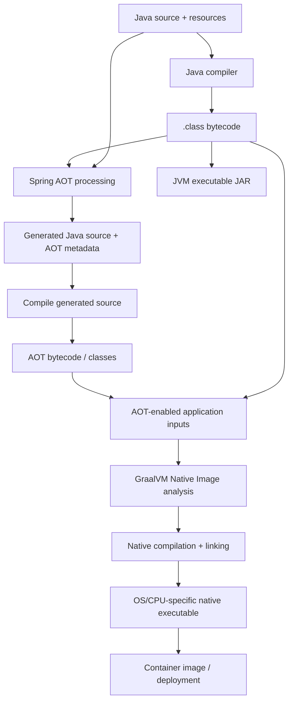

# Phân biệt source, bytecode, mã AOT và binary native

## Mục tiêu bài học

Khi build một ứng dụng **Spring Boot Native Image**, dự án có thể tạo ra nhiều loại tệp trung gian và sản phẩm cuối. Những tệp này thường nằm trong cùng thư mục build, có tên gần giống nhau và đều được gọi chung là “artifact”, nhưng chúng mang ý nghĩa rất khác nhau.

Bài học này phân biệt bốn loại quan trọng:

1. **Source code** — mã nguồn Java do lập trình viên viết.
2. **Bytecode** — mã lệnh JVM được biên dịch từ Java, thường lưu trong tệp `.class` và được đóng gói trong JAR.
3. **Mã AOT được sinh** — mã Java và metadata do Spring AOT tạo để chuẩn bị cấu hình ứng dụng trước khi chạy.
4. **Native binary** — tệp thực thi được GraalVM Native Image biên dịch thành mã máy cho hệ điều hành và kiến trúc đích.

Sau bài học, bạn có thể:

- Giải thích mỗi artifact được tạo ở giai đoạn nào và được dùng bởi công cụ nào.
- Phân biệt mã Java được sinh bởi Spring AOT với binary native.
- Nhận diện các thư mục output thường gặp trong Maven và Gradle.
- Dùng công cụ dòng lệnh để kiểm tra nội dung JAR, bytecode và định dạng executable.
- Chọn đúng artifact để chạy, đóng gói container, debug và triển khai.

> **Nguyên tắc:** một tệp `.jar` có thể chứa mã bytecode đã được xử lý AOT, nhưng điều đó không biến nó thành native binary. Chỉ khi Native Image compiler tạo executable phù hợp với OS/CPU đích, bạn mới có sản phẩm native.

## 1. Bốn loại artifact trong một quy trình build

### 1.1. Source code — mã nguồn

Đây là những gì lập trình viên trực tiếp tạo và chỉnh sửa:

- Tệp `.java` chứa class, interface, record, annotation và logic nghiệp vụ.
- Tài nguyên như `.properties`, `.yml`, template, file JSON, chứng thư hoặc dữ liệu trong `src/main/resources`.
- Cấu hình build như `build.gradle`, `pom.xml`, Gradle Wrapper và Maven Wrapper.

Ví dụ:

```java
package com.example.hello;

import org.springframework.web.bind.annotation.GetMapping;
import org.springframework.web.bind.annotation.RestController;

@RestController
class HelloController {
    @GetMapping("/hello")
    String hello() {
        return "Hello Spring Boot";
    }
}
```

Source code dễ đọc và chỉnh sửa, nhưng JVM không trực tiếp thực thi văn bản Java này. Trước tiên, compiler phải chuyển nó thành bytecode. Với Native Image, source và dependency còn đi qua các bước AOT/reachability analysis trước khi thành mã máy.

### 1.2. Bytecode — mã lệnh JVM

Java compiler (`javac`) chuyển source `.java` thành tệp `.class`. Bên trong `.class` có bytecode JVM, constant pool, mô tả field/method và metadata phục vụ JVM. Bytecode được thiết kế cho **Java Virtual Machine**, không phải tập lệnh CPU cụ thể.

Ví dụ, với phương thức `hello()` ở trên, compiler có thể tạo bytecode chứa các lệnh tương đương việc nạp chuỗi, trả kết quả. Có thể quan sát bằng:

```bash
javap -c -p build/classes/java/main/com/example/hello/HelloController.class
```

Bytecode thường có khả năng chạy trên nhiều hệ điều hành và kiến trúc CPU nếu có JVM tương thích và dependency phù hợp. Tuy nhiên, tính di động này không tuyệt đối: ứng dụng có thể phụ thuộc phiên bản Java, JNI, thư viện native, hệ thống file hoặc tính năng riêng của nền tảng.

**JAR không đồng nghĩa bytecode đơn thuần.** JAR là định dạng archive dựa trên ZIP; nó có thể chứa `.class`, resource, metadata và thư viện phụ thuộc. Spring Boot executable JAR thường chứa ứng dụng cùng các dependency lồng bên trong để Spring Boot launcher chạy chúng trên JVM.

### 1.3. Mã AOT được sinh — generated AOT code

**Spring AOT** phân tích cấu hình ứng dụng trong giai đoạn build và sinh mã Java cùng metadata để hỗ trợ bootstrap. Mã được sinh có thể chứa các thành phần như:

- Mã đăng ký bean definitions đã được phân tích.
- Generated `ApplicationContextInitializer` để thiết lập các đăng ký vào context.
- Mã/hỗ trợ khởi tạo bean và cấu hình hạ tầng theo mô hình AOT.
- Runtime hints cho reflection, proxy, resource hoặc serialization khi framework có thể suy ra hoặc được khai báo.

Mã AOT được sinh thường là **Java source** (`.java`) và tài nguyên đi kèm. Sau đó, build tool có thể biên dịch các source này thành `.class`. Chúng vẫn là source Java/bytecode JVM ở các giai đoạn tương ứng; bản thân một tệp generated `.java` chưa phải mã máy native.

Ví dụ minh họa, Spring AOT có thể sinh một initializer gọi tới phần đăng ký bean:

```java
// Ma minh hoa, khong phai ten class generated co dinh
final class HelloApplication__ApplicationContextInitializer
        implements ApplicationContextInitializer<GenericApplicationContext> {

    @Override
    public void initialize(GenericApplicationContext context) {
        new HelloApplication__BeanRegistrations()
                .registerBeanDefinitions(context);
    }
}
```

Tên class và cấu trúc thật phụ thuộc phiên bản Spring Boot/Spring Framework và cấu hình build. Không sửa trực tiếp generated source; hãy thay đổi source/config gốc hoặc Runtime Hints rồi chạy lại AOT.

### 1.4. Native binary — tệp thực thi native

**GraalVM Native Image** phân tích bytecode và metadata, xác định phần mã có thể được sử dụng (reachability analysis), sau đó biên dịch thành mã máy và đóng gói thành executable. Tệp này dành cho một tổ hợp hệ điều hành, kiến trúc CPU và môi trường ABI cụ thể.

Đặc điểm:

- Chạy trực tiếp như executable của hệ điều hành, không cần JVM để nạp Java bytecode.
- Bao gồm mã máy của ứng dụng và phần runtime native cần thiết.
- Có thể khởi động nhanh và dùng ít bộ nhớ hơn trong nhiều workload Spring Boot, nhưng mức cải thiện phải được đo.
- Thường gắn với OS/CPU đích; executable Linux x86-64 không thể đổi tên thành `.exe` để chạy trên Windows.
- Có thể cần các thư viện hệ điều hành động như libc hoặc thư viện native khác, tùy cách build và môi trường đóng gói.

Native binary không có nghĩa “không còn runtime”. Native Image có runtime riêng cho quản lý bộ nhớ, thread, exception và các dịch vụ cần thiết; điểm khác là ứng dụng không chạy trên JVM để thông dịch/JIT bytecode.

## 2. Bản đồ chuyển đổi artifact

Một đường build điển hình:



Sơ đồ là mô hình khái quát. Thứ tự task và cách plugin tổ chức classpath có thể khác nhau theo phiên bản. Đặc biệt, AOT không nhất thiết là một nhánh tuyến tính tách hẳn khỏi bytecode: Spring AOT phân tích application model, sinh mã/metadata, và những generated source này tiếp tục được compiler xử lý. Native Image sử dụng các đầu vào đã được chuẩn bị đó để tạo executable.

### 2.1. Bảng phân biệt nhanh

| Artifact | Ví dụ tên/đuôi | Ai tạo ra? | Dùng để làm gì? | Có chạy trực tiếp như native executable? |
|---|---|---|---|---|
| Source | `HelloController.java` | Lập trình viên | Đầu vào cho compiler/framework | Không |
| Java bytecode | `HelloController.class` | `javac`/Gradle/Maven compiler | JVM nạp và thực thi | Không |
| Executable JAR | `app.jar` | Spring Boot/Maven/Gradle packaging | Chạy bằng `java -jar` trên JVM | Không |
| Generated AOT source | `...__ApplicationContextInitializer.java` | Spring AOT | Mã bootstrap được sinh trước | Không |
| AOT compiled classes | Generated `.class` | Java compiler sau Spring AOT | Đầu vào cho runtime AOT/Native Image | Không |
| Native executable | `app`, `app.exe` | GraalVM Native Image | Chạy trực tiếp trên OS/CPU đích | Có |
| OCI container image | `app:1.0` | Buildpacks/Docker | Phân phối ứng dụng và môi trường chạy | Chạy qua container runtime |

## 3. Artifact thường nằm ở đâu trong Maven và Gradle?

Đường dẫn chính xác phụ thuộc phiên bản plugin, tên project, module và cấu hình build. Những đường dẫn dưới đây là **ví dụ phổ biến**, không phải cam kết rằng mọi dự án đều có đủ tất cả thư mục.

### 3.1. Maven

Sau khi chạy các goal phù hợp, bạn có thể gặp:

```text
target/
├── classes/                         # .class va resources cua ung dung
├── generated-sources/               # generated sources khac (neu co)
├── spring-aot/
│   └── main/
│       ├── sources/                  # Java source do Spring AOT sinh
│       ├── resources/                # AOT resources / metadata
│       └── classes/                  # class output tuy cau hinh
├── app.jar                           # executable JAR, ten tuy artifact
└── app                               # native executable, neu native compile
```

Goal thường gặp:

```bash
# Bien dich Java va dong goi JAR
./mvnw clean package

# Sinh Spring AOT source/metadata
./mvnw spring-boot:process-aot

# Native compilation voi native profile/plugin da cau hinh
./mvnw -Pnative native:compile
```

Không phải mọi dự án cần chạy thủ công cả ba lệnh liên tiếp. `native:compile` với profile tích hợp phù hợp có thể điều phối các bước AOT/compile cần thiết. Mục đích của ví dụ là cho thấy từng giai đoạn và loại artifact cần tìm.

### 3.2. Gradle

Một số output thường thấy:

```text
build/
├── classes/
│   └── java/main/                    # .class cua source Java
├── resources/main/                   # resource da copy
├── generated/
│   ├── aotSources/                   # generated Java source
│   └── aotResources/                 # AOT resource/metadata
├── libs/
│   └── app.jar                       # JAR, ten tuy project
└── native/
    └── nativeCompile/
        └── app                       # native executable, neu build
```

Task thường gặp:

```bash
# JVM JAR
./gradlew clean bootJar

# Spring AOT processing
./gradlew processAot

# Native executable
./gradlew nativeCompile
```

Đầu ra generated AOT có thể nằm trong `build/generated/aotSources` và `build/generated/aotResources`; đường dẫn có thể đổi theo plugin. Nếu không thấy, kiểm tra task output hoặc cấu hình generated source directories của dự án.

### 3.3. Container image là một dạng sản phẩm đóng gói khác

Với Spring Boot Buildpacks, Gradle `bootBuildImage` hoặc Maven `spring-boot:build-image` tạo **OCI image**. Image có thể chứa ứng dụng JVM hoặc native tùy cấu hình buildpack. Bản thân OCI image là archive/layer metadata và filesystem, không phải một tệp `.class` hay một binary đơn lẻ.

Khi build native container image, GraalVM executable thường nằm trong filesystem của image cùng các thư viện hệ điều hành cần thiết. Vì vậy cần kiểm tra log buildpack và kiểm thử container; không suy luận image native chỉ từ tên tag hoặc dung lượng.

## 4. Bytecode và AOT bytecode: khác nhau ở đâu?

Bytecode của ứng dụng thông thường được tạo từ source do lập trình viên viết. AOT processing có thể tạo thêm source Java rồi compiler biên dịch source đó thành bytecode. Cả hai đều có thể là `.class`, nhưng nguồn gốc và vai trò khác nhau:

| Tiêu chí | Bytecode ứng dụng | Bytecode từ generated AOT |
|---|---|---|
| Nguồn | `src/main/java` | Source được Spring AOT sinh |
| Nội dung | Controller, service, repository, cấu hình gốc... | Đăng ký bean definitions, initializer và hỗ trợ bootstrap |
| Tạo bởi | Java compiler | Java compiler sau Spring AOT processing |
| Dùng trong JVM | JVM thực thi class theo cơ chế runtime thông thường | Có thể được dùng trong chế độ AOT-enabled trên JVM |
| Dùng trong Native Image | Là một phần đầu vào phân tích | Cung cấp mã/metadata đã chuẩn bị để phân tích native |

**AOT là cách chuẩn bị ứng dụng trước runtime, không phải tên một định dạng file duy nhất.** Tùy giai đoạn, đầu ra AOT có thể gồm `.java`, `.class`, resource và metadata. Đừng gọi tất cả chúng là “native code”.

## 5. Kiểm tra từng loại artifact bằng công cụ

### 5.1. Xem nội dung JAR

Liệt kê nội dung JAR:

```bash
jar tf build/libs/app.jar
```

Với executable JAR của Spring Boot, bạn có thể thấy:

```text
META-INF/
BOOT-INF/
├── classes/
│   └── com/example/hello/HelloController.class
└── lib/
    ├── spring-boot-....jar
    └── spring-web-....jar
org/springframework/boot/loader/...
```

Tên thư mục và launcher thay đổi theo phiên bản Spring Boot. Điều cần nhận diện là `.class` của ứng dụng nằm trong archive và dependency được đóng gói theo cấu trúc phù hợp. JAR chạy bằng:

```bash
java -jar build/libs/app.jar
```

Lệnh trên yêu cầu JVM tương thích. Nếu chạy một file `.jar` bằng cách double-click, hệ điều hành có thể dùng association đã cài, nhưng cơ chế thực thi vẫn là JVM.

### 5.2. Đọc bytecode

Với class file đã compile:

```bash
javap -classpath build/classes/java/main -c -p com.example.hello.HelloController
```

- `-c` hiển thị bytecode của method.
- `-p` hiển thị cả thành phần không public.
- `-classpath` chỉ nơi chứa class cần đọc.

`javap` phân tích class file; nó không chứng minh class đó đã được chuyển thành mã máy native. JVM có thể biên dịch bytecode thành mã máy bằng JIT trong lúc chạy, nhưng đó là một cơ chế khác với việc GraalVM tạo executable native trước khi deploy.

### 5.3. Tìm generated AOT source

Với Gradle, có thể tìm các tệp Java được sinh:

```bash
find build/generated -type f -name '*.java'
find build/generated -type f -name '*ApplicationContextInitializer*.java'
```

Với Maven:

```bash
find target/spring-aot -type f -name '*.java'
find target/spring-aot -type f -name '*ApplicationContextInitializer*.java'
```

Trên PowerShell:

```powershell
Get-ChildItem -Path build/generated -Recurse -Filter '*.java'
Get-ChildItem -Path target/spring-aot -Recurse -Filter '*.java'
```

Nếu không có file trùng tên `ApplicationContextInitializer`, chưa chắc AOT thất bại: tên class generated thay đổi theo phiên bản/cấu trúc ứng dụng. Kiểm tra output task và tìm interface `ApplicationContextInitializer` hoặc các lớp đăng ký bean trong cây source đã sinh.

### 5.4. Nhận diện native executable

Trên Linux:

```bash
file build/native/nativeCompile/app
readelf -h build/native/nativeCompile/app
ldd build/native/nativeCompile/app
```

Ý nghĩa:

- `file` nhận diện định dạng và kiến trúc tệp.
- `readelf -h` đọc ELF header để xem loại executable và machine architecture.
- `ldd` hiển thị các shared library mà executable cần (nếu công cụ và định dạng hỗ trợ).

Trên macOS có thể dùng `file` và `otool -hv`; trên Windows có thể dùng công cụ Visual Studio như `dumpbin /headers app.exe`. Công cụ cụ thể tùy hệ điều hành.

Nếu `file` báo ELF 64-bit LSB executable cho x86-64, đó là dấu hiệu định dạng Linux ELF và kiến trúc x86-64; không phải Java bytecode. Một số native executable có thể được link tĩnh một phần/toàn phần, vì vậy `ldd` không phải phép thử duy nhất và có thể báo không phải dynamic executable.

## 6. Khả năng di động và yêu cầu runtime

### 6.1. Java bytecode

Java bytecode được thiết kế để chạy trên JVM tương thích, vì vậy cùng một JAR thường có thể chạy trên Windows, Linux hoặc macOS nếu:

- Có JDK/JRE phù hợp phiên bản bytecode.
- Dependency và thư viện native (nếu có) tương thích.
- Cấu hình môi trường, quyền truy cập file/network và các dịch vụ phụ thuộc phù hợp.

Bytecode không tự mang theo một JVM. Một executable JAR cần môi trường Java cài đặt sẵn hoặc một cơ chế đóng gói runtime riêng.

### 6.2. Native binary

Native executable phụ thuộc tổ hợp build target. Một binary Linux x86-64 không thể chạy trực tiếp trên Windows x86-64 chỉ vì CPU có cùng kiến trúc; định dạng executable và ABI hệ điều hành khác nhau. Tương tự, Linux ARM64 và Linux x86-64 không tương thích trực tiếp.

| Artifact | Phụ thuộc hệ điều hành | Phụ thuộc CPU | Cần JVM để chạy? |
|---|---|---|---|
| Java source | Không trực tiếp | Không trực tiếp | Cần compiler để tạo bytecode |
| `.class` bytecode | Thông qua JVM/OS | Thông qua JVM/CPU | Có |
| Executable JAR | Thông qua JVM/OS | Thông qua JVM/CPU | Có |
| Generated AOT `.java` | Không trực tiếp | Không trực tiếp | Chưa chạy trực tiếp; cần compiler và quy trình runtime phù hợp |
| AOT `.class` | Thông qua JVM/Native Image | Thông qua runtime/compiler | Có nếu chạy JVM |
| Native executable | Có | Có | Không cần JVM; vẫn có thể cần thư viện hệ điều hành |

Đừng nhầm “không cần JVM” với “chạy được ở mọi nơi”. Khi triển khai, hãy build cho đúng OS/CPU/libc hoặc chọn container base/run image tương thích.

## 7. Một ví dụ hoàn chỉnh: lần theo sản phẩm build

Giả sử dự án Gradle có `HelloController` và đã cấu hình Spring Boot AOT cùng GraalVM Native Build Tools.

### Bước 1 — Tạo bytecode và JAR

```bash
./gradlew clean bootJar
```

Kiểm tra:

```bash
ls -lh build/libs/
jar tf build/libs/app.jar
```

Bạn tìm thấy `.class` của controller và các dependency trong JAR. Đây là **JVM artifact**.

### Bước 2 — Sinh mã AOT

```bash
./gradlew processAot
```

Tìm generated source/resource trong `build/generated` (đường dẫn cụ thể theo plugin). Đọc initializer và lớp đăng ký bean để hiểu Spring đã chuẩn bị gì. Đây là **AOT-generated artifact**; source vẫn là Java.

### Bước 3 — Biên dịch native

```bash
./gradlew nativeCompile
```

Kiểm tra thư mục output được thông báo trong log, thường là:

```text
build/native/nativeCompile/
└── app
```

Dùng `file`/`readelf` trên Linux để nhận diện binary. Đây mới là **native executable**.

### Bước 4 — Chạy hai sản phẩm

JAR:

```bash
java -jar build/libs/app.jar
```

Native:

```bash
./build/native/nativeCompile/app
```

Hai lệnh có thể phục vụ cùng endpoint, nhưng cách khởi chạy khác nhau. Bản JAR khởi chạy JVM; bản native khởi chạy executable của hệ điều hành.

### Bước 5 — Đóng gói container (nếu cần)

```bash
./gradlew bootBuildImage
```

Task này tạo OCI image. Nếu muốn image chứa bản native, cần cấu hình builder/buildpack native đúng cách và xác minh log có bước GraalVM Native Image compilation. Không mặc định `bootBuildImage` luôn tạo native image.

## 8. Lựa chọn artifact đúng cho từng mục đích

| Mục đích | Artifact phù hợp | Lý do |
|---|---|---|
| Phát triển và debug nhanh trên JVM | Source + class/JAR | Vòng phản hồi nhanh, công cụ IDE phong phú |
| Phân phối ứng dụng Java đa nền tảng | Executable JAR | Dùng JVM tương thích trên nền tảng đích |
| Phân tích cách Spring chuẩn bị context | Generated AOT source/resources | Nhìn thấy mã và metadata do AOT tạo |
| Kiểm tra bytecode và compiler output | `.class` + `javap` | Quan sát lệnh JVM |
| Chạy ứng dụng không cần JVM | Native executable | Chạy trực tiếp trên OS/CPU đích |
| Triển khai bằng Docker/Kubernetes | OCI image JVM hoặc native | Phân phối cùng filesystem/runtime cần thiết |
| Điều tra lỗi reflection/resource ở native | Generated metadata + native build/runtime logs | Xác định phần framework đã suy ra và phần cần hints bổ sung |

Không xóa thư mục build chỉ vì thấy nhiều artifact giống nhau trước khi đã xác định file nào cần debug hoặc deploy. Có thể chạy `clean` để tạo lại output khi cần build sạch, nhưng hãy giữ source/config và lưu log cần thiết cho việc phân tích.

## 9. Bài tập tự kiểm tra

1. Một tệp `.class` có thể chạy trực tiếp bằng lệnh `./MyClass.class` không? Giải thích vai trò của JVM.
2. Nếu `processAot` tạo ra một tệp `__ApplicationContextInitializer.java`, vì sao chưa thể gọi đó là native binary?
3. Một executable JAR chứa rất nhiều `.class`. Lệnh nào cho biết nội dung archive, và lệnh nào giúp xem bytecode của một class?
4. Nếu `file app` báo ELF 64-bit cho Linux x86-64, bạn có thể đem tệp đó chạy trên Windows x86-64 không? Vì sao?
5. `bootBuildImage` hoàn tất nhưng log không có dấu hiệu GraalVM Native Image compiler. Bạn cần kiểm tra điều gì trước khi gọi image đó là native?
6. Hãy vẽ lại đường đi từ `src/main/java` tới native executable và chỉ ra nơi Spring AOT tham gia.

**Ghi nhớ:** source là đầu vào con người chỉnh sửa; bytecode là mã JVM; mã AOT là source/metadata được sinh để chuẩn bị bootstrap; native binary là mã máy được biên dịch cho nền tảng đích. Nhận diện đúng từng loại artifact giúp bạn chạy đúng lệnh, đọc đúng log, tìm đúng nơi khi lỗi và chọn đúng sản phẩm để triển khai Spring Boot.
