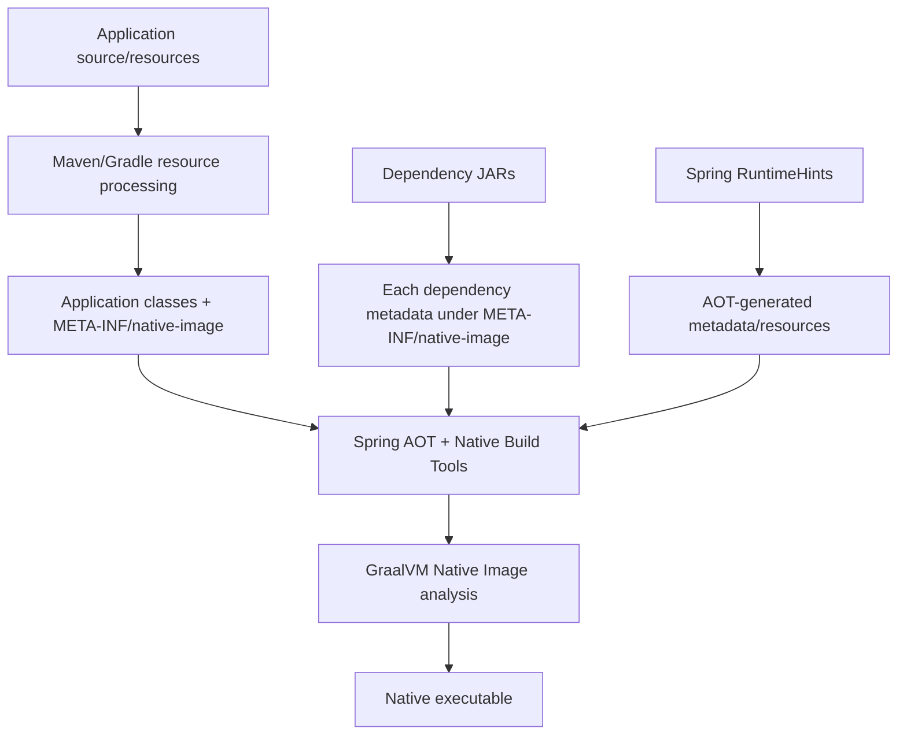
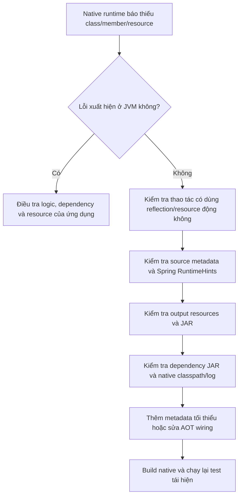

# META-INF/native-image và cách metadata đi cùng classpath

## 1. Vì sao metadata phải đi cùng classpath?

Trong module **SPRING_BOOT_NATIVE_IMAGE**, ứng dụng Spring Boot được xử lý bằng **Spring AOT** rồi biên dịch thành **GraalVM Native Image** để kiểm tra tính tương thích, thời gian khởi động, bộ nhớ và khả năng vận hành trong container. Một phần quan trọng của quy trình là cung cấp cho Native Image những thông tin mà phân tích mã tĩnh không thể tự suy ra đầy đủ.

JVM có thể thực hiện nhiều thao tác động khi chạy: tìm class bằng tên chuỗi, gọi constructor qua reflection, đọc resource theo đường dẫn do cấu hình quyết định, tạo proxy hoặc nạp thư viện JNI. Native Image phân tích tập mã có thể tiếp cận tại thời điểm build theo mô hình **closed-world**. Nếu class, method hoặc resource chỉ được sử dụng động mà không có metadata thích hợp, thành phần đó có thể không được đưa vào executable.

GraalVM hỗ trợ **reachability metadata** để mô tả những thành phần cần giữ lại hoặc cho phép truy cập lúc runtime. Metadata thường được đặt dưới:

```text
META-INF/native-image/
```

Thư mục này có ý nghĩa đặc biệt: metadata được đóng gói trong **classpath entry** (thư mục output hoặc dependency JAR) để Native Image có thể tìm thấy trong quá trình build. Vì vậy, metadata cần được đóng gói cùng artifact sở hữu nó và xuất hiện trên classpath native compilation.

Sau bài học, người học có thể:

1. Giải thích quan hệ giữa classpath, dependency JAR và `META-INF/native-image`.
2. Nhận diện metadata cho reflection, resource, proxy, serialization và JNI.
3. Đặt metadata đúng vị trí trong source resources để Maven/Gradle đưa vào artifact.
4. Phân biệt metadata do thư viện cung cấp với runtime hints do Spring AOT sinh.
5. Kiểm tra metadata thực sự có mặt trong JAR và được đưa vào native build.
6. Chẩn đoán trường hợp JVM chạy được nhưng native executable thiếu class, member hoặc resource.

> **Nguyên tắc:** metadata chỉ có tác dụng khi được Native Image nhận diện trong quá trình build. Một file JSON nằm đâu đó trong repository nhưng không được copy vào output resources hoặc không thuộc classpath native build thì không thể giúp executable.

## 2. Classpath là tập hợp các nguồn chứa lớp và metadata

Classpath không chỉ là thư mục chứa file `.class`. Nó có thể gồm nhiều entry:

- Output classes của ứng dụng, ví dụ `target/classes` trong Maven hoặc `build/classes/java/main` trong Gradle.
- Output resources đã được copy, thường nằm cùng output classes hoặc trong resource output riêng.
- Dependency JAR do Maven/Gradle phân giải.
- Generated classes/resources, bao gồm một số output của Spring AOT.

Mỗi entry có thể mang theo lớp, resource và metadata riêng. Ví dụ:

```text
Native Image classpath
├── target/classes/
│   ├── com/example/...
│   └── META-INF/native-image/com.example/orders/
│       └── reachability-metadata.json
├── spring-context-....jar
│   └── META-INF/native-image/...
├── third-party-library-....jar
│   └── META-INF/native-image/...
└── other-dependency-....jar
```

Đây là sơ đồ logic. Một JAR chứa metadata không nhất thiết có cùng cấu trúc với JAR khác; thư mục `META-INF/native-image` có thể nằm ở root của từng dependency JAR. Native Image xử lý metadata từ các classpath entry mà quá trình build cung cấp.

### 2.1. Metadata gắn với artifact sở hữu nó

Giả sử thư viện `com.acme:document-engine` sử dụng reflection để tạo implementation theo tên class lấy từ cấu hình. Nếu thư viện đóng gói reachability metadata trong chính JAR của nó, ứng dụng sử dụng thư viện có thể nhận metadata đó khi dependency được đưa vào native classpath.

```text
document-engine-2.4.0.jar
├── com/acme/document/...
└── META-INF/
    └── native-image/
        └── com.acme/
            └── document-engine/
                └── reachability-metadata.json
```

Đặt metadata gần artifact sở hữu nó giúp:

- Thư viện tự mô tả các nhu cầu truy cập động của mình.
- Ứng dụng tiêu thụ không phải sao chép cấu hình của từng dependency.
- Metadata được phân phối cùng version thư viện, thuận tiện nâng cấp và kiểm soát thay đổi.
- Nhiều thư viện có thể cung cấp cấu hình riêng mà không ghi đè file của nhau.

Thư mục con theo group/artifact là cách tổ chức dễ quản lý và tránh va chạm tên. Tên thư mục cần được duy trì ổn định trong artifact; không dùng tên tùy tiện rồi giả định plugin tự ánh xạ theo tọa độ Maven.

### 2.2. Classpath native khác với classpath lúc chạy JVM ở điểm nào?

Ứng dụng JVM có thể chạy qua Spring Boot launcher, Maven plugin hoặc classpath do IDE thiết lập. Native Image được build từ classpath và các đầu vào mà native plugin chuẩn bị. Những nguồn này có liên quan nhưng không phải lúc nào cũng giống hệt nhau:

| Nguồn | Vai trò | Cần xác minh |
| --- | --- | --- |
| `target/classes` / `build/classes` | Bytecode ứng dụng đã compile | Có class và metadata/resources của ứng dụng không? |
| Dependency JAR | Class và resource của thư viện | JAR có `META-INF/native-image` không? |
| Spring AOT outputs | Mã bootstrap/context đã sinh và runtime hints | Output AOT có được native task sử dụng không? |
| Native plugin classpath | Tập đầu vào thực tế của GraalVM | Log plugin cho thấy dependency và metadata nào được cung cấp? |
| Spring Boot executable JAR | Artifact JVM đã repackage | Không mặc định coi JAR này là classpath entry Java thông thường; nested JAR cần Boot launcher hoặc tích hợp tương ứng. |

Vì vậy, không nên chỉ kiểm tra `jar tf app.jar` rồi kết luận toàn bộ metadata đã được Native Image sử dụng. Cần kiểm tra artifact, dependency graph và log của native build.

## 3. Các loại reachability metadata thường gặp

Metadata có thể mô tả nhiều dạng truy cập động. Tùy GraalVM version, định dạng thống nhất `reachability-metadata.json` và các file cấu hình JSON riêng lẻ có thể được sử dụng. Hãy dùng schema được tài liệu của phiên bản GraalVM mục tiêu hỗ trợ.

| Nhu cầu runtime | Metadata thường gặp | Ví dụ |
| --- | --- | --- |
| Reflection | `reflection` trong `reachability-metadata.json` hoặc `reflect-config.json` | Tạo instance qua `Constructor.newInstance`, gọi method bằng reflection. |
| Resource | `resources` hoặc `resource-config.json` | Đọc template, file cấu hình, certificate hoặc schema bằng classpath. |
| Dynamic proxy | `proxy` hoặc `proxy-config.json` | Tạo proxy interface động. |
| Serialization | `serialization` hoặc `serialization-config.json` | Serialize/deserialize một số kiểu qua cơ chế cần metadata. |
| JNI | `jni` hoặc `jni-config.json` | Truy cập class/member từ native code. |
| Resource bundle | `bundles` hoặc cấu hình resource bundle tương ứng | Đọc thông điệp đa ngôn ngữ bằng `ResourceBundle`. |

Không phải mọi class trong ứng dụng đều cần đăng ký reflection. Những lời gọi trực tiếp có thể được phân tích tĩnh thường không cần metadata bổ sung. Chỉ đăng ký phần thực sự được sử dụng động; khai báo quá rộng có thể làm tăng binary và làm giảm lợi ích của phân tích reachability.

### 3.1. Định dạng metadata thống nhất

Với GraalVM hỗ trợ reachability metadata format hiện đại, có thể tổ chức nhu cầu reflection và resource trong một file:

```json
{
  "reflection": [
    {
      "type": "com.example.plugins.JsonPlugin",
      "allDeclaredConstructors": true,
      "allPublicMethods": true
    }
  ],
  "resources": {
    "includes": [
      {
        "pattern": "templates/.*\\.txt"
      }
    ]
  }
}
```

Đây là ví dụ minh họa schema: thay class và resource pattern bằng thành phần thực tế, đồng thời đối chiếu phiên bản GraalVM vì metadata format có thể phát triển. `pattern` là biểu thức theo định dạng metadata của Native Image; cần escape dấu gạch chéo ngược đúng trong JSON. Không copy ví dụ mà chưa kiểm tra tên kiểu và đường dẫn tài nguyên.

Một cách tổ chức trong ứng dụng:

```text
src/main/resources/
└── META-INF/
    └── native-image/
        └── com.example/
            └── orders-api/
                └── reachability-metadata.json
```

Khi Maven xử lý resources, file sẽ được copy tới output resources, thường là `target/classes/META-INF/native-image/...`; khi Gradle xử lý resources, file thường xuất hiện dưới `build/resources/main/META-INF/native-image/...`. Cấu hình resource filtering hoặc custom source set có thể thay đổi kết quả, vì vậy phải kiểm tra output thật.

### 3.2. Các file cấu hình riêng kiểu truyền thống

Nhiều dự án và dependency vẫn có metadata dạng file riêng:

```text
META-INF/native-image/com.example/orders-api/
├── reflect-config.json
├── resource-config.json
├── proxy-config.json
├── serialization-config.json
├── jni-config.json
└── native-image.properties
```

Ví dụ `reflect-config.json`:

```json
[
  {
    "name": "com.example.plugins.JsonPlugin",
    "allDeclaredConstructors": true,
    "allPublicMethods": true
  }
]
```

Ví dụ `resource-config.json`:

```json
{
  "resources": {
    "includes": [
      {
        "pattern": "templates/.*\\.txt"
      }
    ]
  }
}
```

Các file legacy vẫn xuất hiện trong nhiều thư viện và hướng dẫn. Đừng đặt đồng thời hai định dạng mô tả cùng một nhu cầu một cách thiếu kiểm soát; có thể gây khó bảo trì hoặc khai báo trùng. Khi nâng cấp GraalVM, kiểm tra khả năng tương thích, cảnh báo deprecation và cách chuyển sang định dạng metadata thống nhất.

### 3.3. `native-image.properties` dùng để làm gì?

`native-image.properties` có thể cung cấp các tùy chọn Native Image cho artifact chứa file đó. Ví dụ tối giản:

```properties
Args = --verbose
```

Ví dụ này chỉ bật log chi tiết để chẩn đoán. Các tùy chọn thật phải được cân nhắc theo GraalVM version và mục tiêu build. Tránh đưa các flag toàn cục hoặc tùy chọn khởi tạo class tùy tiện vào dependency vì chúng có thể tác động tới mọi ứng dụng tiêu thụ thư viện.

Nếu một thư viện cần flag đặc biệt, hãy ghi rõ lý do, phạm vi ảnh hưởng và version đã kiểm chứng. Cấu hình plugin Maven/Gradle của ứng dụng cũng có thể cung cấp build arguments; cần kiểm tra cách các nguồn options được kết hợp trong log thay vì giả định thứ tự hoặc ưu tiên.

## 4. Đặt metadata vào project resources

### 4.1. Với Maven

Trong ứng dụng Maven, đặt file metadata bên dưới `src/main/resources`, không đặt trong `src/main/java`:

```text
src/main/
├── java/com/example/...
└── resources/
    ├── application.properties
    └── META-INF/native-image/com.example/orders-api/
        └── reachability-metadata.json
```

Chạy bước xử lý resources/compile và kiểm tra:

```bash
./mvnw clean process-resources

# Kiểm tra file đã tới output resources chưa
find target/classes/META-INF/native-image -type f
```

Nếu dùng Windows, có thể dùng `Get-ChildItem` để kiểm tra cây thư mục. Đừng dựa vào lệnh `find` của Linux nếu đang dùng PowerShell thuần.

Sau đó đóng gói JAR:

```bash
./mvnw package
jar tf target/orders-api-0.0.1-SNAPSHOT.jar
```

Đường dẫn JAR trong ví dụ cần thay bằng tên artifact thực tế. Với ordinary JAR, metadata thường hiện trực tiếp dưới `META-INF/native-image/...`. Với Spring Boot executable JAR, resource ứng dụng thường nằm trong `BOOT-INF/classes/META-INF/native-image/...`; đây là vị trí bên trong archive của ứng dụng, được Boot launcher hiểu khi chạy JVM. Native Build Tools tích hợp với Spring Boot cần chuẩn bị classpath native thích hợp; không tự suy ra rằng một resource nằm trong executable JAR sẽ được standard classpath loader của Native Image tìm như resource ở root.

### 4.2. Với Gradle

Trong ứng dụng Gradle, vị trí source tương tự:

```text
src/main/resources/
└── META-INF/native-image/com.example/orders-api/
    └── reachability-metadata.json
```

Kiểm tra sau khi xử lý resources:

```bash
./gradlew processResources
find build/resources/main/META-INF/native-image -type f
```

Sau khi đóng gói:

```bash
./gradlew jar
jar tf build/libs/orders-api-0.0.1-SNAPSHOT.jar
```

Tên JAR phụ thuộc `archiveBaseName`, version và cấu hình build. Với Spring Boot, `bootJar` tạo executable JAR và có thể đưa resources vào `BOOT-INF/classes`; `jar` và `bootJar` có thể là hai artifact khác nhau. Kiểm tra đúng artifact mà ứng dụng phân phối và đúng classpath mà `nativeCompile` dùng.

### 4.3. Metadata trong dependency JAR

Một thư viện cung cấp metadata cần đóng gói file vào chính JAR của nó. Khi dependency đó xuất hiện trên native classpath, GraalVM có thể đọc metadata tương ứng. Kiểm tra dependency:

```bash
./mvnw dependency:tree
./mvnw dependency:build-classpath \
  -DincludeScope=runtime \
  -Dmdep.outputFile=target/runtime-classpath.txt
```

Sau khi biết đường dẫn JAR từ dependency classpath, kiểm tra nội dung:

```bash
jar tf /path/to/dependency.jar | grep 'META-INF/native-image/'
```

Đường dẫn `/path/to/dependency.jar` là placeholder; thay bằng đường dẫn JAR đã phân giải. Với Gradle có thể dùng `dependencies` và `dependencyInsight` để xác định artifact/version được chọn, rồi kiểm tra JAR tương ứng.

Nếu metadata không nằm trong JAR dependency mà chỉ tồn tại ở repository source của thư viện, ứng dụng tiêu thụ sẽ không tự nhìn thấy nó. Cần phát hành lại thư viện với metadata được đóng gói đúng, hoặc tạo metadata ở ứng dụng nếu bạn sở hữu cấu hình và hiểu chính xác nhu cầu của dependency.

## 5. Spring AOT RuntimeHints và GraalVM metadata liên quan thế nào?

Spring Framework có API **Runtime Hints** để mô tả những truy cập động mà framework hoặc ứng dụng cần khi chạy trong môi trường AOT/native. Ví dụ:

```java
package com.example.orders;

import org.springframework.aot.hint.MemberCategory;
import org.springframework.aot.hint.RuntimeHints;
import org.springframework.aot.hint.RuntimeHintsRegistrar;
import org.springframework.context.annotation.Configuration;
import org.springframework.context.annotation.ImportRuntimeHints;

@Configuration(proxyBeanMethods = false)
@ImportRuntimeHints(OrderRuntimeHints.class)
class NativeHintsConfiguration {}

final class OrderRuntimeHints implements RuntimeHintsRegistrar {
    @Override
    public void registerHints(RuntimeHints hints, ClassLoader classLoader) {
        hints.reflection().registerType(
            OrderPlugin.class,
            MemberCategory.INVOKE_DECLARED_CONSTRUCTORS,
            MemberCategory.INVOKE_PUBLIC_METHODS
        );
        hints.resources().registerPattern("templates/order-confirmation.txt");
    }
}
```

Ví dụ giả định `OrderPlugin` và resource `templates/order-confirmation.txt` thực sự tồn tại. Đặt lớp vào package/file phù hợp, import đúng API của Spring Framework version đang dùng và chỉ đăng ký member được gọi động. Không đăng ký tất cả constructor/method/field nếu ứng dụng không cần.

**Spring AOT xử lý RuntimeHints** và tạo các đầu ra cần thiết cho native build. Các đầu ra generated có thể bao gồm mã bootstrap, metadata/resource dành cho Native Image; đường dẫn và chi tiết file thay đổi theo Spring Boot/Framework version và plugin. Vì thế:

- Ưu tiên RuntimeHints API khi nhu cầu gắn với Spring application và có thể mô tả bằng code.
- Dùng metadata file dưới `META-INF/native-image` khi cần cung cấp cấu hình ở cấp artifact/dependency hoặc khi thư viện không tích hợp Spring.
- Tránh khai báo cùng một nhu cầu ở nhiều nơi nếu không cần; khi có trùng lặp, cần biết nguồn nào đang sinh metadata và kiểm tra kết quả cuối.
- Đọc log AOT/native build và output generated để xác nhận hints thực sự được chuyển thành cấu hình mà GraalVM sử dụng.

RuntimeHints không phải file JSON, và `@ImportRuntimeHints` không trực tiếp biến class thành native binary. Nó là một phần của đầu vào AOT; native plugin cùng GraalVM mới thực hiện biên dịch executable.

## 6. Native Image tìm metadata trên classpath như thế nào?

Ở mức khái niệm, quá trình native build nhận một tập classpath entries. Native Image tìm metadata trong các vị trí `META-INF/native-image` của những entry được đưa vào build, sau đó hợp nhất cấu hình thích hợp trong quá trình phân tích. Metadata có thể đến từ:

1. **Ứng dụng:** file đặt trong `src/main/resources/META-INF/native-image/...` và được copy vào output resources.
2. **Thư viện:** file nằm trong dependency JAR đã phát hành.
3. **Spring AOT:** hints được xử lý và chuyển thành các đầu ra phục vụ native compilation.
4. **Build tooling:** metadata hoặc cấu hình được cung cấp bởi plugin/build process theo cách của version đang dùng.



Đây là mô hình khái niệm, không phải cam kết về một thứ tự task cố định. Maven/Gradle plugin quyết định classpath và generated outputs cụ thể. Hãy xem log thực tế của `native:compile` hoặc `nativeCompile`, đặc biệt khi dự án có nhiều module, custom source set hoặc buildpack.

### 6.1. Metadata không phải một resource nghiệp vụ thông thường

Hai file sau có mục đích khác nhau:

| File | Vai trò |
| --- | --- |
| `META-INF/native-image/.../reachability-metadata.json` | Chỉ dẫn cho Native Image về các thành phần cần hỗ trợ khi build native. |
| `application.properties` hoặc `templates/email.html` | Dữ liệu/configuration mà ứng dụng đọc khi runtime. |

Đưa `reachability-metadata.json` vào JAR không có nghĩa ứng dụng Spring sẽ tự đọc file đó như cấu hình nghiệp vụ. Ngược lại, việc một template đã nằm trong JAR JVM không tự bảo đảm template đó được đưa vào native image khi đường đọc resource mang tính động.

### 6.2. Metadata không tự sửa được mọi vấn đề tương thích

Metadata giúp Native Image nhận diện các điểm truy cập động; nó không sửa logic sai, dependency không tương thích, cấu hình môi trường sai hoặc native library thiếu trên hệ điều hành đích. Nếu một thư viện dùng JNI, vẫn phải có binary native tương ứng và thư viện hệ thống cần thiết. Nếu reflection metadata chỉ đăng ký class mà thiếu member cần gọi, runtime vẫn có thể lỗi.

## 7. Kiểm chứng metadata đã đi vào artifact và native build

### Bước 1 — Xác nhận source metadata

Kiểm tra chính xác đường dẫn, tên file và JSON syntax. Metadata đặt dưới `src/main/resources` (hoặc resource source set tương ứng), không chỉ nằm ở một thư mục tài liệu hoặc thư mục tạm.

### Bước 2 — Xác nhận resource output

Maven:

```bash
./mvnw clean process-resources
find target/classes/META-INF/native-image -type f
```

Gradle:

```bash
./gradlew clean processResources
find build/resources/main/META-INF/native-image -type f
```

Nếu lệnh `find` không có trên shell đang dùng, dùng lệnh liệt kê thư mục tương ứng của hệ điều hành. Điều cần xác nhận là file đã được resource processing copy vào output.

### Bước 3 — Xác nhận metadata trong JAR ứng dụng

Maven ordinary JAR:

```bash
jar tf target/orders-api-0.0.1-SNAPSHOT.jar | grep 'META-INF/native-image/'
```

Spring Boot executable JAR có thể cho thấy đường dẫn resource ứng dụng bắt đầu bằng `BOOT-INF/classes/META-INF/native-image/`. Điều này phản ánh archive layout của Boot, không phải vị trí root của một ordinary JAR. Khi native plugin xử lý ứng dụng, kiểm tra log và generated output để xác nhận cấu hình tương ứng được cung cấp cho GraalVM.

### Bước 4 — Xác nhận dependency metadata

Kiểm tra dependency tree và JAR thật của dependency. Đừng chỉ thấy tên dependency trong `pom.xml` mà kết luận metadata có mặt: dependency có thể bị exclude, scope không phù hợp hoặc version thực tế khác. Với multi-module, kiểm tra artifact đã publish/resolve mà ứng dụng đang sử dụng.

### Bước 5 — Xác nhận AOT và native build

Với Maven (giả định profile/plugin đã được cấu hình):

```bash
./mvnw -Pnative spring-boot:process-aot
./mvnw -Pnative native:compile
```

Với Gradle:

```bash
./gradlew processAot
./gradlew nativeCompile
```

Dùng log chi tiết khi cần:

```bash
./mvnw -Pnative native:compile -X
# hoặc
./gradlew nativeCompile --info
```

Tìm bằng chứng cho biết AOT outputs, Native Image executable/version, classpath và metadata config được sử dụng. Tên task/goal và cách wiring phụ thuộc plugin version. Không đánh dấu hoàn thành chỉ vì task compile trả exit code 0; còn phải chạy executable và kiểm thử đường đi từng cần metadata.

## 8. Dùng Native Image tracing agent để khám phá metadata

Khi một ứng dụng JVM có nhiều thao tác động khó liệt kê, Native Image tracing agent có thể ghi nhận các truy cập trong **những kịch bản đã chạy** rồi tạo metadata gợi ý. Cách sử dụng cụ thể phụ thuộc GraalVM version; một số bản hỗ trợ agent qua JVM option:

```bash
java -agentlib:native-image-agent=config-output-dir=target/native-agent-config \
  -jar target/orders-api-0.0.1-SNAPSHOT.jar
```

Chạy ứng dụng JVM với agent, sau đó thực hiện các luồng nghiệp vụ đại diện. Agent có thể ghi metadata vào thư mục chỉ định. Đây là **dữ liệu quan sát**, không phải bằng chứng đầy đủ cho mọi hành vi runtime.

Các giới hạn cần nhớ:

- Luồng chưa chạy sẽ không được agent quan sát; endpoint hiếm dùng, error path, profile khác hoặc dữ liệu production đặc biệt có thể bị bỏ sót.
- Kết quả có thể rộng hơn nhu cầu thật và cần rà soát để loại cấu hình thừa.
- Cần kiểm tra schema, version và vị trí output trước khi đưa metadata vào `src/main/resources/META-INF/native-image`.
- Không thay thế Spring AOT RuntimeHints hoặc kiểm thử native bằng việc chạy agent một lần.

Quy trình phù hợp là: chạy agent với test scenario rõ ràng → xem lại metadata được sinh → tinh chỉnh theo nhu cầu thật → build native → chạy lại test và kiểm tra lỗi.

## 9. Lỗi thường gặp và cách xác định nguyên nhân

| Triệu chứng | Nguyên nhân có thể | Cách kiểm tra/khắc phục |
| --- | --- | --- |
| Native báo thiếu constructor/method nhưng JVM chạy được | Reflection metadata thiếu class hoặc member. | Xác định chính xác member được gọi, bổ sung RuntimeHints hoặc reflection metadata tối thiểu. |
| Native không tìm thấy template/certificate/schema | Resource không nằm trong native image hoặc resource pattern sai. | Kiểm tra resource output, path trong JAR, metadata `resources` và cách đọc resource. |
| Metadata có trong source nhưng không có trong JAR | Đặt sai thư mục, resource filtering/source set hoặc cấu hình package. | Kiểm tra `process-resources`/`processResources` và JAR listing. |
| Metadata có trong app JAR nhưng native vẫn thiếu | Plugin không dùng artifact/classpath đó, nested JAR layout hoặc AOT output chưa được nối đúng. | Kiểm tra native task graph, classpath/plugin logs và output generated. |
| Thư viện có metadata ở source nhưng dependency JAR không có | Metadata không được publish/đóng gói. | Kiểm tra JAR dependency thật; phát hành artifact có resources đúng hoặc bổ sung config ở ứng dụng. |
| JSON metadata bị lỗi parse | Sai schema, dấu phẩy/escape hoặc file thuộc format khác version GraalVM. | Validate JSON và đối chiếu schema/tài liệu đúng GraalVM release. |
| Thay đổi metadata nhưng build không phản ánh | Build cache/stale output hoặc task input không được nhận diện đúng trong cấu hình custom. | Chạy clean build có kiểm soát, kiểm tra task inputs/log và resource output. |
| Metadata bị trùng hoặc xung đột | Nhiều artifact khai báo cùng cấu hình, path hoặc flag. | Dùng thư mục con riêng, loại duplicate và xác định nguồn cấu hình. |
| Agent tạo rất nhiều reflection entries | Scenario quan sát quá rộng hoặc framework truy cập nhiều class. | Review và thu hẹp; ưu tiên RuntimeHints/library metadata chính thức. |
| Binary build được nhưng lỗi khi chạy | Metadata không đầy đủ cho luồng chưa thử, hoặc lỗi môi trường/native library. | Tái hiện bằng test native; phân loại reflection, resource, JNI, OS library hay logic ứng dụng. |

### 9.1. Trình tự khoanh vùng



Luôn bắt đầu từ stack trace và thao tác gây lỗi. Đừng thêm tất cả class vào reflection config để che một resource path sai hoặc một dependency bị loại khỏi classpath.

## 10. Bài thực hành: đóng gói metadata cùng ứng dụng

**Bối cảnh:** một dịch vụ Spring Boot đọc file `templates/order-confirmation.txt` và tạo implementation `OrderPlugin` theo cấu hình. JVM chạy bình thường nhưng native executable báo không tìm thấy resource hoặc constructor.

### Nhiệm vụ

1. Tạo resource `src/main/resources/templates/order-confirmation.txt` và class `OrderPlugin` trong package ứng dụng.
2. Chọn cách khai báo phù hợp: Spring `RuntimeHintsRegistrar` cho nhu cầu gắn với ứng dụng, hoặc `reachability-metadata.json` trong `src/main/resources/META-INF/native-image/<group>/<artifact>/`.
3. Nếu dùng JSON, kiểm tra schema đúng GraalVM version và chỉ đăng ký constructor/method thực sự cần.
4. Chạy Maven `process-resources` hoặc Gradle `processResources`; xác nhận metadata có trong output resources.
5. Đóng gói JAR và kiểm tra đường dẫn metadata bằng `jar tf`. Nếu kiểm tra dependency, mở đúng JAR dependency thay vì chỉ xem danh sách tên trong Boot executable archive.
6. Chạy Spring AOT và Native Image build; lưu log cho thấy classpath và metadata được sử dụng.
7. Chạy native executable, gọi luồng đọc template và tạo plugin; chạy thêm trường hợp resource không tồn tại và class name không hợp lệ.
8. Ghi nhận metadata cuối cùng, lý do từng entry, kết quả test JVM/native và metric startup/RSS nếu có.

### Biên bản kết quả

| Bằng chứng | Giá trị cần ghi |
| --- | --- |
| Đường dẫn source metadata | `src/main/resources/META-INF/native-image/...` hoặc vị trí RuntimeHints trong source. |
| Resource output | Đường dẫn file sau `process-resources`/`processResources`. |
| Artifact đóng gói | Tên JAR và vị trí metadata trong JAR. |
| Dependency metadata | Tọa độ dependency, version và file trong JAR nếu có. |
| AOT/native build | Task/goal, version GraalVM, log classpath và metadata. |
| Reflection/resource được đăng ký | Tên class/member/path và lý do nghiệp vụ. |
| Kết quả chức năng | Test JVM/native và các tình huống lỗi. |
| Hiệu năng | Startup-to-ready, RSS, số lần chạy và điều kiện đo. |

### Tiêu chí hoàn thành

- [ ] Giải thích được vì sao `META-INF/native-image` cần xuất hiện trên classpath native build.
- [ ] Phân biệt metadata trong application resources với metadata đóng gói trong dependency JAR.
- [ ] Chứng minh metadata đã được copy vào output và nằm trong artifact đúng vị trí.
- [ ] Chứng minh Spring AOT/Native Build Tools dùng các đầu vào tương ứng.
- [ ] Runtime hints/metadata chỉ khai báo class, member và resource có nhu cầu thật.
- [ ] Native executable chạy được luồng nghiệp vụ và test lỗi đã định nghĩa.
- [ ] Ghi rõ phiên bản GraalVM/schema và bằng chứng tái lập.

## 11. Câu hỏi tự đánh giá

1. Vì sao metadata được đặt trong `META-INF/native-image` của dependency JAR có thể hữu ích cho ứng dụng tiêu thụ dependency đó?
2. File JSON nằm trong thư mục repository nhưng không được resource processing đưa vào artifact có tác dụng với Native Image không? Vì sao?
3. Khác biệt giữa Spring `RuntimeHintsRegistrar` và file `reachability-metadata.json` là gì?
4. Vì sao `BOOT-INF/classes/META-INF/native-image` trong executable JAR không nên bị nhầm với root `META-INF/native-image` của một classpath JAR thông thường?
5. Tracing agent có thể bỏ sót metadata nào nếu scenario kiểm thử không chạy đủ luồng?
6. Khi native thiếu resource, cần xác minh những lớp nào từ source resources tới native classpath?
7. Vì sao không nên đăng ký reflection cho mọi class như một cách sửa lỗi mặc định?

## 12. Tài liệu chính thức

Định dạng reachability metadata và các tùy chọn Native Image có thể thay đổi theo release. Đối chiếu tài liệu của GraalVM và Spring version thực tế:

- [GraalVM Native Image — Reachability Metadata](https://www.graalvm.org/latest/reference-manual/native-image/metadata/): định dạng metadata, vị trí và cách cung cấp cấu hình.
- [GraalVM Native Image — Metadata in JAR files](https://www.graalvm.org/latest/reference-manual/native-image/metadata/#metadata-in-jar-files): cách metadata đi cùng classpath/JAR dependency.
- [GraalVM Native Image — Tracing Agent](https://www.graalvm.org/latest/reference-manual/native-image/metadata/AutomaticMetadataCollection/): thu thập metadata từ các luồng chạy quan sát được.
- [Spring Framework — Runtime Hints](https://docs.spring.io/spring-framework/reference/core/aot.html): API hints và xử lý AOT.
- [Spring Boot — GraalVM Native Image](https://docs.spring.io/spring-boot/reference/packaging/native-image/index.html): tích hợp AOT/native qua Maven, Gradle và Buildpacks.
- [GraalVM Native Build Tools](https://graalvm.github.io/native-build-tools/latest/): plugin Maven/Gradle, native compilation và kiểm thử.

**Điểm cần nhớ:** `META-INF/native-image` là nơi metadata reachability có thể được phân phối cùng artifact và classpath. Một ứng dụng native đáng tin cậy cần metadata đúng phiên bản, đúng vị trí, đúng thành phần được truy cập động và có kiểm thử chứng minh metadata đã được sử dụng khi build cũng như khi chạy.
