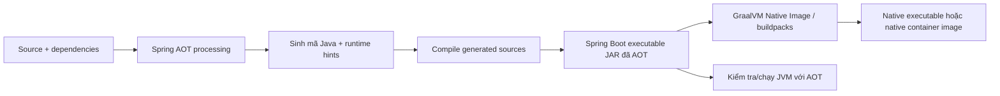
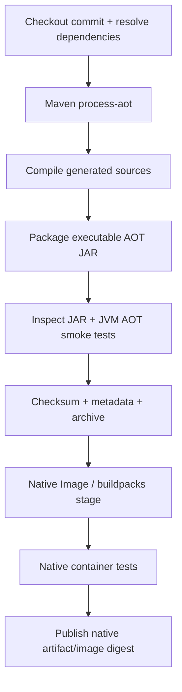

# Spring Boot executable JAR chứa kết quả AOT để chuyển đổi ở bước sau

Trong quy trình tạo **GraalVM Native Image**, ứng dụng Spring Boot thường cần một bước chuẩn bị trước khi biên dịch thành mã máy: **Spring AOT (Ahead-of-Time processing)** phân tích cấu hình, chuẩn bị bean graph, sinh mã Java và metadata cần thiết. Những kết quả này có thể được biên dịch và đóng gói cùng ứng dụng thành một **Spring Boot executable JAR đã xử lý AOT**. JAR là artifact trung gian thuận tiện để kiểm tra, lưu trữ hoặc chuyển tiếp tới bước build native tiếp theo.

Điều cần nhớ: **executable JAR vẫn chứa Java bytecode và vẫn chạy trên JVM**. Kết quả AOT bên trong JAR giúp Spring khởi tạo container theo đường đã chuẩn bị trước và cung cấp metadata cho Native Image. Nó chưa phải là tệp thực thi native. Việc chuyển thành binary native cần thêm GraalVM Native Image hoặc một quy trình buildpacks/native build phù hợp.

## 1. Mục tiêu học tập

Sau bài này, bạn có thể:

- Giải thích executable JAR đã xử lý AOT khác gì với JAR Spring Boot thông thường và native executable.
- Cấu hình Maven để chạy Spring AOT trong quy trình build và đóng gói kết quả vào JAR.
- Nhận diện các thành phần quan trọng trong executable JAR như `BOOT-INF/classes`, `BOOT-INF/lib`, manifest và native-image metadata.
- Kiểm tra JAR bằng `jar tf`, `unzip` hoặc công cụ tương đương, xác nhận mã sinh và tài nguyên đã được đóng gói.
- Chạy và kiểm thử artifact AOT trên JVM khi cần, đồng thời hiểu giới hạn của profile và cấu hình đã chọn lúc build.
- Bàn giao đúng artifact cùng thông tin build cho bước Native Image tiếp theo, tránh nhầm JAR với binary native.

## 2. Vị trí của executable JAR trong quy trình Native Image

Một quy trình phổ biến có thể chia thành các giai đoạn:



Mỗi giai đoạn tạo ra một loại kết quả:

| Giai đoạn | Artifact/kết quả | Mục đích |
| --- | --- | --- |
| Biên dịch mã ứng dụng | Java classes/bytecode | Tạo lớp ứng dụng và dependencies |
| Spring AOT | Generated Java sources, generated resources, runtime hints | Chuẩn bị cấu trúc container và metadata truy cập động |
| Compile và package | Executable JAR đã AOT | Gom application classes, mã AOT, resources và thư viện runtime |
| Native Image compilation | Native executable | Phân tích reachability và tạo mã máy cho nền tảng đích |
| Container packaging | OCI image native | Đóng gói executable cùng runtime layers cần thiết |

**Không phải mọi quy trình đều bắt buộc dùng executable JAR làm đầu vào trực tiếp của trình biên dịch native.** Một số plugin lấy compiled classes và metadata trong thư mục build; buildpacks có thể dùng JAR làm application artifact rồi xử lý các bước tiếp theo. Vai trò của JAR ở đây là artifact đóng gói có thể kiểm tra và chuyển giao; cách công cụ native tiêu thụ nó phụ thuộc vào Maven plugin, Native Build Tools hoặc buildpacks đang sử dụng.

## 3. JAR thường và JAR đã xử lý AOT khác nhau thế nào?

JAR Spring Boot thông thường chứa bytecode của ứng dụng, thư viện runtime và metadata đóng gói. Khi chạy, Spring thường khám phá cấu hình, đánh giá điều kiện và chuẩn bị bean factory trong quá trình khởi động.

Với AOT, build thực hiện thêm một bước phân tích cấu hình Spring. Kết quả có thể bao gồm:

- Các lớp Java được sinh để đăng ký bean và chuẩn bị khởi tạo container.
- Mã đã sinh được compile thành bytecode và đưa vào artifact.
- Runtime hints cho reflection, resource, proxy, serialization hoặc những truy cập mà Native Image cần biết trước.
- Metadata/tài nguyên được tạo trong quá trình AOT và cần có mặt trên classpath.

| Khía cạnh | Executable JAR thông thường | Executable JAR đã AOT |
| --- | --- | --- |
| Application bytecode | Có | Có |
| Runtime dependencies | Có | Có |
| Generated AOT classes | Thường không | Có nếu AOT processing đã chạy và kết quả được đóng gói |
| Native-image hints/metadata | Có thể có từ thư viện hoặc cấu hình riêng | Có thể có thêm từ Spring AOT và các extension |
| Cách chuẩn bị bean graph | Chủ yếu theo cơ chế runtime thông thường | Có đường khởi tạo đã được chuẩn bị từ build |
| Có phải native executable? | Không | Không |
| Có cần JVM khi chạy JAR? | Có | Có |
| Có thể dùng làm bước chuẩn bị Native Image? | Cần chạy AOT riêng nếu quy trình yêu cầu | Có, theo quy trình toolchain đã cấu hình |

**JAR đã AOT vẫn có thể chạy bằng JVM.** Các phương thức Java của ứng dụng vẫn thực thi trên JVM và JIT vẫn có thể biên dịch mã nóng khi ứng dụng hoạt động. Spring AOT chuẩn bị cấu trúc framework trước; nó không thay thế toàn bộ JIT và cũng không biên dịch toàn bộ application bytecode thành native machine code.

## 4. Cấu hình Maven để chạy Spring AOT và đóng gói JAR

### 4.1. Khai báo Spring Boot Maven Plugin

Trong `pom.xml`, dự án cần dùng `spring-boot-maven-plugin` tương thích với phiên bản Spring Boot. Có thể cấu hình execution cho goal `process-aot` trong một Maven profile chuyên biệt:

```xml
<profiles>
    <profile>
        <id>aot</id>
        <build>
            <plugins>
                <plugin>
                    <groupId>org.springframework.boot</groupId>
                    <artifactId>spring-boot-maven-plugin</artifactId>
                    <executions>
                        <execution>
                            <id>process-aot</id>
                            <goals>
                                <goal>process-aot</goal>
                            </goals>
                        </execution>
                    </executions>
                </plugin>
            </plugins>
        </build>
    </profile>
</profiles>
```

`aot` là tên profile do dự án đặt, không phải profile mặc định của mọi ứng dụng. Nếu dự án đã có cấu hình Spring Boot Maven Plugin trong `<build><plugins>`, nên bổ sung execution vào cấu hình hiện tại thay vì khai báo plugin trùng lặp.

Goal `process-aot` yêu cầu ứng dụng có thể được khởi tạo trong môi trường build để Spring phân tích cấu hình. Phiên bản plugin, cách binding vào Maven lifecycle và những plugin native đi kèm cần tuân theo cấu hình của phiên bản Spring Boot đang dùng. Với dự án đã có profile `native`, có thể đặt execution AOT ở profile đó hoặc gọi profile riêng phù hợp với quy trình của dự án.

### 4.2. Chạy AOT và package

Với profile ví dụ ở trên:

```bash
./mvnw -Paot clean package
```

Lệnh này yêu cầu Maven kích hoạt profile `aot` và thực hiện lifecycle package. Trong log cần xác nhận goal `process-aot` thật sự được gọi, các lớp/tài nguyên sinh ra được compile và bước đóng gói tạo executable JAR.

Nếu chỉ chạy:

```bash
./mvnw clean package
```

thì không nên mặc định kết quả đã có AOT. Điều đó chỉ đúng nếu dự án đã cấu hình AOT execution được kích hoạt trong lifecycle mặc định hoặc profile đang dùng.

Vị trí JAR thường là:

```text
target/<artifactId>-<version>.jar
```

Tên thật phụ thuộc `artifactId`, `version`, `finalName` và cấu hình Maven. Với multi-module project, cần xác định đúng module chứa ứng dụng Spring Boot và đúng artifact được đóng gói.

### 4.3. Cấu hình điều kiện và profile khi AOT

Spring AOT phân tích cấu hình trong môi trường build. Những yếu tố ảnh hưởng đến bean graph có thể gồm:

- `@Profile` và profile đang active khi AOT processing.
- `@ConditionalOnProperty` và các property condition.
- `@ConditionalOnClass`, classpath và phiên bản dependency.
- `@ConditionalOnBean` / `@ConditionalOnMissingBean`.
- Các cấu hình `@Import`, component scanning và auto-configuration.

Ví dụ nếu bean `AuditService` chỉ được đăng ký khi `feature.audit.enabled=true` tại lúc xử lý AOT, thay đổi property này khi chạy JAR không tự bảo đảm tạo thêm bean mới. Hãy quản lý các giá trị quyết định cấu trúc container như một phần của công thức build.

Không phải mọi runtime property đều bị cố định. Giá trị nghiệp vụ như endpoint, timeout hoặc credentials có thể được cấp khi chạy nếu code đọc chúng ở runtime và chúng không làm thay đổi bean graph đã chuẩn bị. Cần phân biệt **property quyết định cấu trúc** với **property cấu hình vận hành**.

### 4.4. Ví dụ gọi AOT theo profile native có sẵn

Nhiều dự án sử dụng profile `native` để gom các thiết lập Spring AOT và GraalVM Native Build Tools. Khi đó lệnh có thể là:

```bash
./mvnw -Pnative clean package
```

Nhưng chỉ dùng lệnh này nếu profile `native` trong chính dự án có khai báo execution AOT và lifecycle phù hợp. Không có profile Maven chuẩn tên `native` áp dụng tự động cho mọi dự án.

Nếu mục tiêu là chỉ tạo executable JAR đã AOT để chuyển giao, hãy bảo đảm lifecycle không bắt buộc chạy native compiler ở bước package. Có thể tách profile `aot-jar` và `native` theo nhu cầu: profile đầu tạo JAR trung gian, profile sau thực hiện native compilation/container build.

## 5. Những thành phần thường có trong executable JAR

Spring Boot executable JAR dùng cấu trúc nested JAR. Ví dụ rút gọn:

```text
application.jar
├── META-INF/
│   └── MANIFEST.MF
└── BOOT-INF/
    ├── classes/
    │   ├── com/example/Application.class
    │   ├── com/example/...
    │   ├── <generated AOT classes>
    │   └── META-INF/
    │       └── native-image/
    │           └── <generated hints and metadata>
    ├── lib/
    │   ├── spring-boot-*.jar
    │   ├── spring-context-*.jar
    │   └── <application dependencies>.jar
    ├── classpath.idx
    └── layers.idx
```

Đây là sơ đồ minh họa; **tên thư mục con, lớp được sinh, metadata và các file index thay đổi theo phiên bản Spring Boot, plugin và dependency**. Không nên dựa vào một tên generated class cụ thể làm hợp đồng ổn định.

### 5.1. `META-INF/MANIFEST.MF`

Manifest của executable JAR thường chỉ ra launcher và lớp ứng dụng:

```text
Manifest-Version: 1.0
Main-Class: org.springframework.boot.loader.launch.JarLauncher
Start-Class: com.example.Application
```

Đây là ví dụ với một thế hệ Spring Boot loader; package launcher có thể khác giữa các phiên bản. `Main-Class` chỉ ra entry point của Spring Boot loader; `Start-Class` là lớp ứng dụng. Khi JAR đã AOT, manifest vẫn phục vụ cách chạy executable JAR như thông thường.

### 5.2. `BOOT-INF/classes`

Đây là nơi chứa classes và resources của ứng dụng. Khi AOT processing được cấu hình và kết quả được đóng gói đúng, có thể có:

- Bytecode của các lớp do người phát triển viết.
- Bytecode của các lớp Java được sinh từ Spring AOT sau khi compile.
- Metadata và resources do AOT hoặc extension tạo ra.
- Cấu hình/resource của ứng dụng được package theo quy tắc Spring Boot.

Các generated classes thường phục vụ việc đăng ký bean, wiring và chuẩn bị application context. Chúng là **bytecode Java** nằm trong JAR; không phải mã máy native.

### 5.3. `BOOT-INF/lib`

Thư mục này chứa các dependency runtime được đóng gói dạng nested JAR, chẳng hạn Spring Framework, logging, JDBC driver và thư viện ứng dụng. Những thư viện này tiếp tục cần thiết khi chạy executable JAR trên JVM.

Khi chuyển sang Native Image, toolchain cần phân tích application classes và dependencies để xác định mã có thể truy cập. Không phải mọi dependency trong `BOOT-INF/lib` đều chắc chắn được giữ nguyên trong native binary; GraalVM có thể loại bỏ phần không reachable theo phân tích và metadata.

### 5.4. `META-INF/native-image` và runtime hints

Metadata native image có thể mô tả nhu cầu reflection, resource, proxy, serialization hoặc JNI. Ví dụ tên file thường gặp trong hệ sinh thái GraalVM:

| Metadata | Ý nghĩa |
| --- | --- |
| `reflect-config.json` | Các kiểu/member cần truy cập bằng reflection |
| `resource-config.json` | Pattern tài nguyên cần đưa vào image |
| `proxy-config.json` | Thông tin dynamic proxy |
| `serialization-config.json` | Các kiểu cần hỗ trợ serialization |
| `jni-config.json` | Các thành phần cần truy cập qua JNI |

Spring AOT và các thư viện có thể cung cấp hints ở những vị trí khác nhau, hoặc sử dụng cơ chế metadata mới theo phiên bản GraalVM. Vì vậy bảng này giúp nhận diện loại thông tin, không khẳng định mọi JAR đều chứa đủ năm file trên. Nếu không thấy file JSON cụ thể, chưa thể kết luận hints bị mất; cần kiểm tra output AOT, plugin và metadata được hợp nhất trong build.

## 6. Kiểm tra JAR sau khi package

### 6.1. Kiểm tra file và nội dung

Xác định artifact được tạo:

```bash
ls -lh target/*.jar
```

Trên Windows PowerShell có thể dùng:

```powershell
Get-ChildItem target -Filter *.jar
```

Liệt kê nội dung JAR:

```bash
jar tf target/application.jar
```

Lọc những khu vực cần quan sát trên Linux/macOS:

```bash
jar tf target/application.jar | grep -E 'BOOT-INF/classes|BOOT-INF/lib|META-INF/native-image'
```

Trên Windows PowerShell:

```powershell
jar tf target/application.jar | Select-String 'BOOT-INF/classes|BOOT-INF/lib|META-INF/native-image'
```

Tên `application.jar` chỉ là ví dụ; thay bằng tên file thực tế. Không chỉ tìm chuỗi `META-INF/native-image` rồi kết luận toàn bộ AOT đã có mặt. Hãy kiểm tra thêm generated classes, log goal AOT và kết quả compile.

### 6.2. Kiểm tra manifest

Trên Linux/macOS có thể đọc manifest trực tiếp:

```bash
unzip -p target/application.jar META-INF/MANIFEST.MF
```

Hoặc giải nén nội dung JAR ra thư mục tạm rồi đọc file manifest. Cần xác nhận đây là executable Spring Boot JAR có launcher phù hợp và đúng lớp main.

### 6.3. Kiểm tra generated classes và AOT output

Trong quá trình build, Spring Boot Maven Plugin thường tạo output AOT trong một thư mục thuộc `target/spring-aot/`; cấu trúc cụ thể phụ thuộc phiên bản. Hãy kiểm tra log Maven để biết đường dẫn output thực tế và xác nhận:

1. AOT processing được thực hiện.
2. Có generated source/resources như mong đợi.
3. Generated Java code được compile thành class.
4. Các class/resource liên quan được đưa vào executable JAR.
5. Runtime hints cần thiết được giữ trong artifact hoặc được toolchain native nhận biết qua cơ chế tương ứng.

Nếu chỉ thấy generated source nhưng không có generated class trong JAR, bước compile/package có thể chưa được cấu hình đúng. Đừng tự copy thư mục generated vào JAR thủ công khi chưa hiểu lifecycle; hãy sửa cấu hình plugin để output được xử lý đúng cách.

## 7. Chạy thử executable JAR đã AOT trên JVM

JAR đã AOT vẫn là Java artifact. Khi muốn kiểm tra đường chạy AOT trên JVM, Spring Boot hỗ trợ bật chế độ AOT khi chạy bằng thuộc tính:

```bash
java -Dspring.aot.enabled=true -jar target/application.jar
```

Thuộc tính này yêu cầu Spring dùng các thành phần AOT đã chuẩn bị. Nếu bỏ qua, ứng dụng có thể đi theo đường khởi tạo thông thường tùy cấu hình/phiên bản; do đó phải kiểm tra log và hành vi của đúng artifact.

Nếu ứng dụng dùng profile ảnh hưởng bean graph, cần chạy với cấu hình phù hợp với môi trường AOT đã dùng khi build:

```bash
java \
  -Dspring.aot.enabled=true \
  -Dspring.profiles.active=prod \
  -jar target/application.jar
```

Ví dụ chỉ hợp lệ khi profile `prod` là profile đã được tính đến lúc AOT. Không mặc định có thể đổi sang một profile chưa được xử lý và mong Spring dựng lại toàn bộ bean graph.

Kiểm thử tối thiểu:

- Ứng dụng khởi động và đạt readiness.
- Các bean quan trọng được đăng ký và dependency injection hoạt động.
- Endpoint HTTP và luồng nghiệp vụ chính trả kết quả đúng.
- Serialization/JSON binding, resource, database và TLS hoạt động nếu dự án sử dụng.
- Log không cho thấy ứng dụng quay về đường khởi tạo không mong muốn hoặc thiếu generated component.

### JAR AOT vẫn có JIT

Khi chạy trên JVM, các phương thức Java vẫn được thực thi bởi JVM. JIT có thể biên dịch mã nóng theo dữ liệu runtime. Spring AOT giảm một số công việc phân tích/khởi tạo framework; nó không tắt JIT và không biến mọi bytecode thành mã máy trước khi chạy.

## 8. Bàn giao JAR cho bước Native Image tiếp theo

Khi JAR đã AOT được xác minh, cần bàn giao cùng thông tin build để bước native compilation có thể tái tạo kết quả.

### 8.1. Thông tin artifact nên lưu

| Thuộc tính | Ví dụ/thông tin cần ghi |
| --- | --- |
| Tên artifact | `order-service-1.0.0.jar` |
| SHA-256 | Checksum của đúng file JAR đã kiểm thử |
| Commit | Commit SHA tạo ra artifact |
| Java/Spring | Phiên bản JDK, Spring Boot, Spring Framework |
| Maven | Maven Wrapper/Maven version, plugin version |
| AOT | Profile, properties, active conditions và output AOT |
| Dependencies | Dependency tree/lock và repository provenance nếu có |
| Nền tảng build tiếp theo | OS, architecture, GraalVM/Native Image version |
| Test evidence | Kết quả JVM AOT smoke test và các integration test |

Ví dụ tạo checksum trên Linux/macOS:

```bash
sha256sum target/application.jar
```

Trên PowerShell:

```powershell
Get-FileHash target/application.jar -Algorithm SHA256
```

Checksum giúp xác nhận file ở bước sau đúng là artifact đã tạo và kiểm thử. Chỉ tên file và version trong đường dẫn chưa đủ để chứng minh nội dung giống nhau.

### 8.2. Native compilation tiêu thụ gì?

Ở bước kế tiếp, GraalVM Native Image cần mã ứng dụng, dependency bytecode, AOT generated classes và native metadata. Tùy pipeline:

- Native Build Tools có thể lấy compiled classes từ thư mục build của Maven cùng runtime classpath.
- Spring Boot buildpacks có thể nhận executable JAR, phân tích và chuẩn bị application layers rồi chạy native build trong builder.
- Một pipeline tùy chỉnh có thể giải nén/chuẩn bị classpath từ JAR, nhưng phải giữ đúng dependency và metadata.

Vì thế **không nên mặc định raw command `native-image -jar application.jar` là cách chuẩn để chuyển mọi Spring Boot executable JAR thành native binary**. Spring Boot JAR là nested executable archive; Native Image cần được tích hợp với cách launcher, classpath, AOT metadata và Spring hints được xử lý đúng. Hãy dùng Native Build Tools/Spring Boot plugin/buildpacks tương thích hoặc quy trình được tài liệu phiên bản dự án chỉ định.

### 8.3. Artifact JAR và native executable khác nhau

| Đặc điểm | AOT executable JAR | Native executable |
| --- | --- | --- |
| Định dạng | ZIP/JAR chứa bytecode và nested dependencies | Mã máy theo OS/architecture |
| Cách chạy | `java -jar app.jar` | Chạy executable trực tiếp |
| JVM/JRE | Cần | Thông thường không cần JVM |
| AOT generated classes | Có thể nằm trong `BOOT-INF/classes` | Được dùng trong quá trình phân tích/biên dịch, không chạy như class file |
| Runtime hints | Được đóng gói hoặc cung cấp cho native toolchain | Đã được sử dụng để tạo executable; không nhất thiết còn dưới dạng file JSON |
| Tương thích nền tảng | JAR có thể chạy trên JVM tương thích nhiều OS/CPU | Binary gắn với platform đích |
| JIT | Có khi chạy trên JVM | Không có JIT HotSpot theo cách JVM thông thường |

JAR là artifact trung gian có thể lưu trữ và chuyển giao. Native executable là đầu ra của bước chuyển đổi tiếp theo.

## 9. Troubleshooting

### 9.1. Build thành công nhưng JAR không có AOT

**Dấu hiệu:** `jar tf` chỉ thấy application classes/dependencies thông thường; không có dấu hiệu generated AOT classes, và log Maven không cho thấy `process-aot` chạy.

**Nguyên nhân:** profile không được kích hoạt, execution chưa khai báo, goal AOT không gắn đúng lifecycle hoặc bước compile/package không đưa generated output vào artifact.

**Xử lý:**

1. Chạy Maven với profile dự kiến và bật log đủ chi tiết để xem goal được gọi.
2. Kiểm tra execution của `spring-boot-maven-plugin` và lifecycle theo phiên bản đang dùng.
3. Xem output AOT được tạo ở đâu và có compile hay không.
4. Kiểm tra JAR sau khi package, không chỉ thư mục generated source.
5. Build lại sạch và xác minh checksum/artifact mới.

### 9.2. JAR chạy được nhưng lỗi khi bật AOT

**Dấu hiệu:** `java -jar` chạy, nhưng thêm `-Dspring.aot.enabled=true` thì thiếu bean hoặc lỗi khởi tạo.

**Nguyên nhân có thể:** AOT profile/property khác với cấu hình runtime, bean được đăng ký động, custom registrar/post-processor không hỗ trợ AOT hoặc generated output không đầy đủ.

**Xử lý:** xác định bean thiếu, điều kiện lúc build, profile, classpath và extension point liên quan; sau đó sửa cấu hình/đóng góp AOT phù hợp và build lại. Không cố chữa lỗi cấu trúc bean bằng cách thêm reflection hint nếu vấn đề là bean chưa được đăng ký.

### 9.3. JAR có AOT nhưng native build báo thiếu reflection/resource

**Dấu hiệu:** JVM AOT smoke test chạy, nhưng Native Image gặp lỗi reflection, serialization, proxy hoặc resource.

**Nguyên nhân:** code hoặc thư viện dùng truy cập động mà metadata/hints chưa mô tả đầy đủ; hoặc resource không được đưa vào native image.

**Xử lý:** xem native-image build report/log, bổ sung Spring Runtime Hints hoặc metadata phù hợp, chạy lại native compilation và test binary. JAR có AOT không bảo đảm mọi dynamic access đều được native compiler suy ra.

### 9.4. Native build dùng artifact cũ

**Dấu hiệu:** thay đổi source hoặc AOT configuration nhưng binary native không phản ánh thay đổi.

**Nguyên nhân:** pipeline lấy nhầm JAR, cache cũ, tag mutable hoặc artifact từ module khác.

**Xử lý:** clean build khi cần, xác nhận đường dẫn artifact, ghi SHA-256, dùng version/tag bất biến và kiểm tra digest ở bước native compilation. Trong multi-module Maven, bảo đảm đúng module đã chạy AOT và tạo executable JAR.

### 9.5. Chạy JAR báo không tìm thấy main class hoặc dependency

**Nguyên nhân:** đang dùng JAR thường thay vì executable Spring Boot JAR, cấu hình repackage không chạy, hoặc artifact bị thiếu nested dependencies.

**Xử lý:** kiểm tra `META-INF/MANIFEST.MF`, `Main-Class`/`Start-Class`, `BOOT-INF/lib` và Maven repackage goal. Chạy đúng artifact được tạo bởi Spring Boot plugin.

## 10. Quy trình CI/CD đề xuất



Trong pipeline, nên phân biệt:

- **AOT JAR job:** tạo và lưu executable JAR cùng checksum, commit và cấu hình build.
- **Native build job:** lấy đúng JAR hoặc compiled outputs mà toolchain yêu cầu, chạy Native Image/buildpacks trên platform phù hợp.
- **Native test job:** chạy executable/container thực tế, kiểm tra endpoint, reflection/resource, database/TLS và readiness.
- **Publish job:** chỉ publish artifact đã qua kiểm thử; ghi image digest và thông tin provenance.

Nếu chỉ cần tạo native container image trực tiếp bằng Spring Boot buildpacks, có thể dùng goal `spring-boot:build-image` với native mode đã cấu hình. Khi cần một artifact trung gian có thể lưu và tái sử dụng độc lập, executable JAR AOT là một sản phẩm build riêng, hữu ích cho việc bàn giao và điều tra.

## 11. Bài thực hành tổng hợp

**Bối cảnh:** dự án Maven `order-service` dùng Spring Boot, có endpoint HTTP và một bean chỉ xuất hiện theo profile `prod`. Mục tiêu là tạo executable JAR có kết quả AOT để bước native build tiếp theo dùng.

1. Kiểm tra Maven Wrapper, JDK và phiên bản Spring Boot plugin.
2. Tạo profile `aot` (hoặc dùng profile native đã có) để gọi goal `process-aot` theo lifecycle phù hợp.
3. Chạy `./mvnw -Paot clean package`; quan sát log xác nhận AOT processing và compile generated sources.
4. Xác định JAR trong `target/`; dùng `jar tf` để quan sát `BOOT-INF/classes`, `BOOT-INF/lib`, generated classes và metadata liên quan.
5. Kiểm tra `META-INF/MANIFEST.MF` và xác nhận đây là executable Spring Boot JAR.
6. Chạy `java -Dspring.aot.enabled=true -Dspring.profiles.active=prod -jar target/order-service-1.0.0.jar` nếu `prod` là profile đã dùng khi AOT; kiểm thử readiness và luồng nghiệp vụ.
7. Tạo SHA-256 checksum, ghi commit và cấu hình AOT; bàn giao đúng JAR cho bước Native Image tiếp theo.
8. Ở bước native build, dùng toolchain/plugin/buildpacks tương thích và kiểm tra binary/container trên platform đích.

**Câu hỏi tự kiểm tra:** Vì sao JAR có generated AOT classes và `META-INF/native-image` vẫn cần JVM khi chạy bằng `java -jar`? Vì những thành phần này vẫn là Java bytecode và metadata; chúng chuẩn bị Spring container và hỗ trợ native compilation, nhưng chưa phải mã máy của hệ điều hành.

## 12. Ghi nhớ

- Spring AOT phân tích cấu hình và sinh mã/metadata tại build time; mã sinh cần được compile và đóng gói để trở thành một phần của executable JAR.
- Executable JAR đã AOT chứa bytecode, generated classes, runtime dependencies và metadata liên quan. **Nó vẫn là JAR Java**, không phải native executable.
- Maven cần gọi `spring-boot:process-aot` trong profile/lifecycle phù hợp trước khi package; không mặc định mọi lệnh `mvn package` đều tạo AOT artifact.
- Kiểm tra `BOOT-INF/classes`, `BOOT-INF/lib`, manifest, generated classes và native metadata để xác nhận artifact đã được tạo đúng.
- Các điều kiện profile/property ảnh hưởng bean graph cần nhất quán giữa build và runtime; runtime hints hỗ trợ truy cập động nhưng không tự đăng ký bean bị thiếu.
- Bước Native Image tiếp theo dùng classpath, generated code và metadata qua Native Build Tools hoặc buildpacks phù hợp; không mặc định gọi raw `native-image -jar` với mọi Spring Boot executable JAR.
- Lưu checksum, commit, phiên bản toolchain, cấu hình AOT và test evidence để bảo đảm đúng artifact được chuyển sang giai đoạn native.

Khi đã tạo được executable JAR AOT có thể kiểm tra và tái tạo, bạn có một ranh giới artifact rõ ràng giữa **chuẩn bị ứng dụng Spring** và **biên dịch thành native executable**. Đây là cơ sở để bước build native sau đó có thể lặp lại, truy vết và kiểm thử độc lập.
