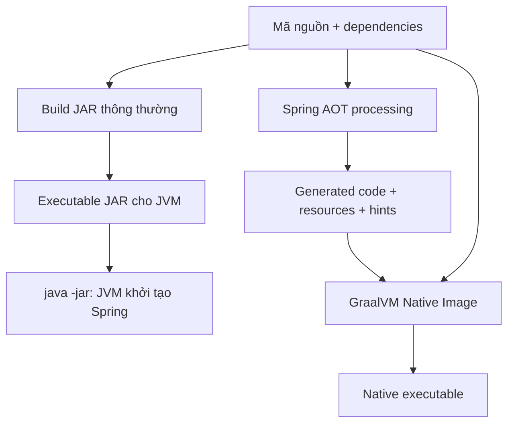
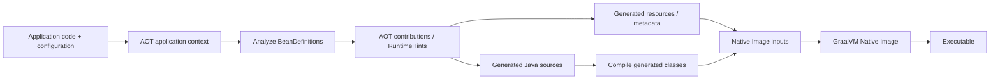

# Giới hạn của một JAR thông thường chưa chứa kết quả Spring AOT

> **Chương:** Sản phẩm build  
> **Module:** `SPRING_BOOT_NATIVE_IMAGE`  
> **Mục tiêu:** Phân biệt executable JAR chạy trên JVM với đầu ra Spring AOT cần cho GraalVM Native Image; hiểu giới hạn của JAR thường khi biên dịch native, tạo container image và kiểm thử tương thích.

## 1. JAR chạy được chưa có nghĩa đã qua Spring AOT

Một ứng dụng Spring Boot thường được đóng gói thành **executable JAR**. File này chứa bytecode của ứng dụng, các thư viện phụ thuộc và metadata để Spring Boot Launcher khởi động ứng dụng trên JVM.

Ví dụ:

```bash
# Maven
./mvnw clean package

# Gradle
./gradlew clean bootJar

# Chạy ứng dụng trên JVM
java -jar target/native-demo.jar
```

Đây là artifact hợp lệ cho JVM. Nhưng nếu build chỉ chạy `package` hoặc `bootJar` theo cấu hình thông thường, không thể mặc định rằng Spring AOT đã chạy hoặc kết quả AOT đã được đóng gói.

Spring AOT xử lý application context ở build time. Nó phân tích bean definitions và cấu hình, tạo mã khởi tạo có thể xác định trước, đồng thời tổng hợp resource và runtime hints cần thiết. Những đầu ra này giúp GraalVM Native Image xử lý ứng dụng Spring trong môi trường có giới hạn về reflection và khám phá động.

Cần phân biệt ba loại đầu ra:

- **JAR thông thường:** bytecode và dependencies để JVM chạy ứng dụng theo cơ chế thông thường.
- **AOT output:** mã nguồn/lớp được sinh, tài nguyên và metadata từ quá trình Spring AOT.
- **Native executable:** file mã máy do GraalVM Native Image tạo ra từ ứng dụng cùng đầu vào AOT và metadata tương ứng.



**Phần mở rộng `.jar` không quyết định artifact có AOT hay không.** Một JAR có thể được đóng gói sau AOT nếu build được cấu hình để đưa kết quả đó vào artifact. Bài này tập trung vào JAR thông thường **chưa chứa kết quả Spring AOT**.

## 2. Một executable JAR thông thường chứa gì?

Cấu trúc thường gặp của Spring Boot executable JAR:

```text
native-demo.jar
├── META-INF/
│   └── MANIFEST.MF
└── BOOT-INF/
    ├── classes/
    │   ├── com/example/NativeDemoApplication.class
    │   └── application.yml
    └── lib/
        ├── spring-boot-*.jar
        ├── spring-context-*.jar
        ├── spring-web-*.jar
        └── other-dependencies.jar
```

| Thành phần | Vai trò |
|---|---|
| `META-INF/MANIFEST.MF` | Metadata khởi chạy, thường chỉ định Spring Boot launcher |
| `BOOT-INF/classes` | Bytecode và resource của ứng dụng |
| `BOOT-INF/lib` | Các JAR dependency được đóng gói lồng bên trong |
| `application.yml` | Cấu hình mặc định đi cùng ứng dụng |
| Metadata của dependency | Có thể chứa cấu hình GraalVM hoặc Spring hints do thư viện cung cấp |

JAR có đủ thông tin để JVM nạp class, đọc resource và khởi tạo Spring. Tuy nhiên, cấu trúc này **không tự sinh mã khởi tạo AOT cho application context**.

Một dependency có thể chứa `META-INF/native-image/...` với cấu hình reflection/resource của chính thư viện. Điều đó hữu ích cho Native Image, nhưng không thay thế mã AOT và hints được sinh từ cấu hình của ứng dụng. Tương tự, nếu JAR có class `RuntimeHintsRegistrar` thì sự hiện diện của class đó cũng chưa chứng minh registrar đã được Spring AOT phát hiện và thực thi.

## 3. Spring AOT bổ sung những gì?

Quá trình AOT phân tích application context trong môi trường build và tạo các đầu ra có thể được dùng ở runtime hoặc native compilation. Tùy phiên bản Spring Boot và cấu hình Maven/Gradle, cấu trúc thư mục cụ thể có thể khác nhau.

| Đầu ra | Mục đích |
|---|---|
| **Generated Java sources** | Biểu diễn trước một số bước khởi tạo context, bean factory và đăng ký bean |
| **Generated classes** | Các lớp biên dịch từ mã sinh, dùng trong AOT runtime |
| **Generated resources** | Tài nguyên hoặc tệp mô tả cần cho ứng dụng AOT |
| **Runtime hints** | Khai báo reflection, resource, proxy, serialization, JNI hoặc truy cập động khác |
| **Thông tin build** | Giúp plugin native/buildpack đưa đúng đầu ra AOT vào bước biên dịch |



### 3.1. Generated code khác RuntimeHints

Không nên coi RuntimeHints là toàn bộ kết quả AOT.

- **Generated initialization code** mô tả những bước khởi tạo Spring có thể xác định ở build time.
- **Reflection hints** giúp compiler giữ class/member cần truy cập bằng reflection.
- **Resource hints** yêu cầu giữ file classpath cần dùng khi chạy.
- **Proxy hints** khai báo proxy interface cần tạo.
- **Serialization/JNI hints** khai báo những kiểu hoặc thành phần native cần hỗ trợ.
- **Metadata dependency** hỗ trợ các hành vi native của chính thư viện.

Một ứng dụng có thể khai báo `RuntimeHintsRegistrar` trong source hoặc JAR. Registrar chỉ đóng góp khi Spring AOT phát hiện và gọi nó theo cơ chế đăng ký tương ứng. **Class registrar có mặt trong JAR không đồng nghĩa hints đã được tổng hợp vào native build.**

## 4. Những giới hạn khi dùng JAR thường làm đầu vào Native Image

### 4.1. Không có mã khởi tạo Spring đã sinh

JAR thường có thể chứa class cấu hình gốc, annotation và `@Bean` method. Nhưng nếu chưa chạy AOT, các initializer được sinh từ application context chưa chắc có trong classpath đầu vào của native compiler.

Native Image không tự thực hiện thay toàn bộ Spring AOT chỉ bằng cách đọc tên class và annotation. Một workflow Spring Boot native chuẩn cần kết quả AOT tương ứng.

### 4.2. Phân tích tĩnh không nhìn thấy mọi hành vi động

Ví dụ:

```java
Class<?> type = Class.forName(configuredClassName);
Object instance = type.getDeclaredConstructor().newInstance();
```

Nếu `configuredClassName` chỉ đến từ cấu hình runtime, compiler có thể không biết class và constructor đó cần được giữ lại. Khi thiếu metadata, binary có thể build được nhưng lỗi ở nhánh reflection khi chạy.

Spring AOT và RuntimeHints giúp khai báo những đường truy cập này. Chúng không tự suy ra mọi class có thể được nạp từ dữ liệu tùy ý bên ngoài.

### 4.3. Resource có thể không được giữ lại

Ứng dụng có thể đọc template, schema, JSON, certificate hoặc file theo tên runtime. File có trong JAR thường **không bảo đảm** nó sẽ được đưa vào native executable. Cần khai báo resource hints hoặc cấu hình include tương ứng rồi kiểm tra trên binary.

### 4.4. Metadata của dependency không đủ cho ứng dụng

Thư viện native-friendly có thể đã cung cấp metadata riêng, nhưng không thể biết hết bean, class động, template/resource, proxy hoặc điều kiện cấu hình do ứng dụng sở hữu.

### 4.5. Không có bằng chứng về topology bean lúc build

Spring AOT cần xử lý application context với cấu hình build phù hợp. JAR thường chưa qua AOT không cung cấp bằng chứng rằng các điều kiện `@Profile`, `@ConditionalOnProperty` và tập bean đã được đánh giá đúng cho binary native.

Các điều kiện làm thay đổi bean graph thường được quyết định ở build time. Chạy native với profile khác có thể không tạo ra những bean vốn vắng mặt khi AOT processing.

### 4.6. Đổi JAR thành container image không bổ sung AOT

Buildpack có thể đóng gói JAR thành JVM image. Để tạo native image, pipeline cần native mode, đầu vào AOT và toolchain tương thích. Đổi lệnh sang `spring-boot:build-image`, `bootBuildImage` hoặc `pack build` không tự chứng minh Spring AOT đã chạy.

## 5. So sánh ba loại artifact

| Tiêu chí | JAR thường | Artifact đã AOT xử lý | Native executable |
|---|---|---|---|
| Bytecode ứng dụng | Có | Có | Đã được biên dịch vào binary theo reachability |
| Chạy bằng JVM | Có | Có thể, nếu đóng gói và bật AOT mode phù hợp | Không dùng `java -jar` |
| Generated Spring AOT classes | Không được bảo đảm | Có, nếu build đưa chúng vào artifact/classpath | Được dùng trong native compilation |
| Generated resources/hints | Không được bảo đảm | Có theo output AOT | Được dùng để tạo binary/metadata |
| Bean model đã xử lý AOT | Không được bảo đảm | Có | Là một phần của workflow build |
| Dùng cho native workflow Spring Boot | Chưa đủ nếu thiếu AOT output | Có, nếu toolchain tương thích | Là kết quả build native |
| Thay source/hints mà dùng artifact cũ | Không | Không thể mặc định; có thể cần AOT/build lại | Cần build lại |

**JAR đã AOT không phải một phần mở rộng file khác.** Nó vẫn có thể là `.jar`. Điều quan trọng là quy trình build có chạy AOT và đưa kết quả vào đúng đầu vào runtime/native hay không.

## 6. Quy trình Maven: từ JAR thường tới native executable

### 6.1. Tạo JAR JVM baseline

```bash
./mvnw clean package
java -jar target/native-demo.jar
```

JAR này phù hợp để chạy JVM. Nếu POM không cấu hình AOT execution, không nên xem lệnh package là bằng chứng AOT đã chạy.

### 6.2. Chạy Spring AOT processing

Với dự án đã cấu hình Spring Boot Maven Plugin:

```bash
./mvnw spring-boot:process-aot
```

Goal này tạo đầu ra AOT. Trong một số cấu hình Maven phổ biến, output nằm dưới `target/spring-aot/main` với các phần nguồn, lớp và resource. Đường dẫn có thể thay đổi theo phiên bản plugin hoặc cấu hình dự án; hãy đọc log và cấu hình task thay vì hard-code đường dẫn.

Đầu ra này là **kết quả trung gian**, chưa phải executable native. Bước biên dịch sau phải sử dụng đúng output vừa tạo.

### 6.3. Build native theo profile đã cấu hình

Với dự án sử dụng Spring Boot starter parent và native profile phù hợp:

```bash
./mvnw -Pnative native:compile
```

Profile chuẩn thường nối AOT processing với GraalVM Native Build Tools. Hãy kiểm tra log xác nhận `process-aot` chạy và native compiler nhận đầu vào tương ứng.

Nếu POM tùy biến chưa nối native goal với AOT, chỉ chạy `native:compile` chưa bảo đảm workflow Spring Boot native đầy đủ.

### 6.4. Tạo container image ở chế độ native

Khi native profile và Spring Boot build-image plugin được cấu hình:

```bash
./mvnw -Pnative spring-boot:build-image \
  -Dspring-boot.build-image.imageName=native-demo:local
```

Đây là pipeline tạo OCI image. Xác minh log builder cho thấy native compilation đã thực sự xảy ra. Nếu native profile không được bật, cùng goal build-image có thể tạo JVM image từ JAR thông thường.

## 7. Quy trình Gradle: từ JAR thường tới native executable

### 7.1. Tạo JAR JVM baseline

```bash
./gradlew clean bootJar
```

Artifact thường nằm trong `build/libs/`. Việc chạy `bootJar` đơn lẻ không chứng minh AOT processing đã chạy.

### 7.2. Chạy AOT và native compile

Với dự án áp dụng Spring Boot Gradle plugin và GraalVM Native Build Tools plugin:

```bash
./gradlew processAot
./gradlew nativeCompile
```

Trong cấu hình chuẩn, `nativeCompile` thường phụ thuộc `processAot`, do đó chạy `nativeCompile` có thể kích hoạt AOT tự động. Gọi riêng `processAot` hữu ích khi cần quan sát đầu ra trung gian.

Đường dẫn generated sources/classes/resources phụ thuộc phiên bản plugin và cấu hình Gradle. Hãy xem task output và log của dự án.

### 7.3. Tạo OCI image native

```bash
./gradlew bootBuildImage
```

Khi native plugin và cấu hình tương ứng đã được áp dụng, Spring Boot Gradle plugin có thể phối hợp Buildpacks để tạo image chứa executable native. Nếu thiếu cấu hình native, `bootBuildImage` có thể tạo JVM image.

**Tên task không phải bằng chứng loại artifact.** Kiểm tra log build và chạy image để xác minh.

## 8. Vì sao `native-image -jar app.jar` không thay thế Spring AOT?

GraalVM Native Image có thể nhận JAR hoặc classpath tùy cách gọi. Nhưng Spring Boot Native Image là workflow có tích hợp framework. Spring AOT tạo thông tin ứng dụng mà native compiler cần.

Chạy:

```bash
native-image -jar target/native-demo.jar
```

không tự động tương đương với các bước:

1. Tạo application context ở build time.
2. Phân tích bean definitions và điều kiện cấu hình.
3. Gọi các AOT processors/contributions.
4. Sinh initializer code và tổng hợp RuntimeHints.
5. Biên dịch từ đúng đầu vào AOT.

Một chương trình đơn giản có thể biên dịch bằng GraalVM với metadata thủ công. Tuy nhiên, cách đó không tự tạo ra quy trình Spring AOT đầy đủ. Ứng dụng dùng reflection, proxy, resource hoặc cấu hình Spring phức tạp có thể chỉ bộc lộ lỗi khi chạy.

**Cách ưu tiên:** dùng plugin/profile tích hợp Spring AOT với Native Build Tools hoặc Buildpacks theo hướng dẫn của phiên bản Spring Boot dự án. Nếu phải gọi native-image trực tiếp, cần tự quản lý generated output, classpath và metadata tương đương rồi kiểm thử toàn diện.

## 9. Cách xác minh một JAR có chứa kết quả AOT

Không thể kết luận chỉ dựa vào tên file. Hãy kết hợp build log, nội dung artifact và hành vi runtime.

### 9.1. Xem cấu trúc JAR

```bash
jar tf target/native-demo.jar
```

Trên Linux/macOS có thể lọc:

```bash
jar tf target/native-demo.jar | grep -Ei "BOOT-INF|META-INF/native-image|aot|generated"
```

Thông thường sẽ thấy `BOOT-INF/classes`, `BOOT-INF/lib` và manifest. Dependency JAR được đóng gói lồng trong `BOOT-INF/lib`, nên lệnh trên chỉ liệt kê tên các JAR lồng chứ không duyệt sâu toàn bộ nội dung của chúng.

Một dependency có thể có `META-INF/native-image` riêng. Đây là metadata của thư viện, không phải bằng chứng ứng dụng đã có AOT initializer hoặc hints.

### 9.2. Xem output AOT

Sau `process-aot` hoặc `processAot`, kiểm tra thư mục output được task công bố. Với Maven, một vị trí thường gặp là `target/spring-aot/main`. Tìm các phần source, classes và resources được sinh.

Không dựa cứng vào tên lớp initializer hay đường dẫn cụ thể; chúng có thể khác giữa các phiên bản. Đối chiếu thời điểm sinh file với lần chạy AOT của đúng commit.

### 9.3. Kiểm tra log pipeline

Cần thấy bằng chứng rằng:

- Spring AOT processing đã chạy trên application context.
- Generated sources/resources đã được tạo và đưa vào bước compile.
- Native Build Tools hoặc native buildpack thực sự chạy compiler.
- Native executable được tạo thành công.

Chỉ thấy `package`, `bootJar` hoặc log Buildpacks “exporting image” không đủ để kết luận ứng dụng đã được biên dịch native.

### 9.4. Kiểm tra chức năng trên từng artifact

| Thử nghiệm | JAR thường trên JVM | Native executable |
|---|---|---|
| Khởi động | `java -jar` | Chạy trực tiếp binary |
| REST endpoint | Kiểm tra ứng dụng JVM | Kiểm tra chức năng binary |
| Reflection | JVM có thể xử lý động | Cần hints phù hợp |
| Resource | JVM classloader đọc resource trong JAR | Cần resource được giữ trong binary hoặc đọc ngoài filesystem |
| Dynamic class loading | Linh hoạt hơn trong một số trường hợp | Bị giới hạn bởi code đã phân tích/đóng gói |
| Profile thay đổi bean graph | Đánh giá khi khởi động JVM | Phải phù hợp với cấu hình AOT lúc build |

JAR JVM chạy tốt không chứng minh binary native cũng chạy tốt. Integration test cần chạy trên **chính executable native** hoặc container image native.

## 10. Ví dụ lỗi: JAR có template nhưng native không đọc được

Giả sử ứng dụng có file:

```text
src/main/resources/templates/invoice.html
```

Code JVM đọc template qua classpath và hoạt động bình thường. Trong JAR thường, file nằm dưới `BOOT-INF/classes/templates/invoice.html`.

Khi tạo native executable, nếu resource hints không phù hợp, template có thể không được giữ trong binary. Build có thể thành công nhưng chức năng tạo hóa đơn lỗi khi người dùng gọi.

Hướng xử lý:

1. Xác định resource được đọc bằng cơ chế nào và path chính xác.
2. Dùng Spring AOT/RuntimeHints hoặc cấu hình resource của GraalVM để khai báo resource cần giữ.
3. Chạy lại AOT processing và native compilation.
4. Gọi chức năng tạo hóa đơn trên executable native.
5. Nếu template cần thay sau deploy, cân nhắc đọc từ filesystem hoặc mount ngoài thay vì nhúng vào binary.

Ví dụ đăng ký resource hints:

```java
import org.springframework.aot.hint.RuntimeHints;
import org.springframework.aot.hint.RuntimeHintsRegistrar;
import org.springframework.context.annotation.ImportRuntimeHints;

class InvoiceResourceHints implements RuntimeHintsRegistrar {

    @Override
    public void registerHints(RuntimeHints hints, ClassLoader classLoader) {
        hints.resources().registerPattern("templates/*.html");
    }
}

@ImportRuntimeHints(InvoiceResourceHints.class)
class InvoiceConfiguration {
}
```

Đây là ví dụ minh họa; package và cách tổ chức cấu hình phải phù hợp với Spring Framework đang dùng. Registrar phải được AOT processing phát hiện. Chỉ có class registrar trong JAR chưa đủ.

## 11. Những giới hạn khác cần hiểu

### JAR không phải snapshot application context

JAR chứa bytecode và resource. Nó không lưu heap của tiến trình, không chứa kết nối database đang mở và không phải checkpoint của một Spring context đã chạy. Spring AOT sinh mã khởi tạo; nó không serialize toàn bộ trạng thái runtime vào JAR.

### AOT không giải quyết mọi hành vi động

Plugin nạp bằng tên tùy ý, classpath thay đổi sau deploy, bytecode generation hoặc proxy chưa được khai báo có thể cần thiết kế lại. AOT và RuntimeHints chỉ hỗ trợ các hành vi có thể xác định hoặc khai báo phù hợp trước build.

### Build thành công chưa chứng minh tương thích

Native compiler không nhất thiết biết mọi nhánh sẽ được gọi ở production. Hãy test reflection, serialization, resource, TLS, JDBC, JSON binding, dynamic proxy và các nhánh cấu hình quan trọng.

### JAR thường vẫn có giá trị

JAR JVM vẫn là artifact hữu ích để:

- Phát triển và chạy ứng dụng trên JVM.
- Làm baseline so sánh startup, RSS, throughput và latency.
- Kiểm tra classpath/dependencies và chạy integration test.
- Phân phối ứng dụng khi hệ thống không cần native executable.

Giữ JAR baseline giúp benchmark Native Image có đối chứng đáng tin cậy. Chỉ cần phân biệt rõ mục đích của từng artifact.

## 12. Bài thực hành: từ JAR thường đến native executable

Giả sử dự án có endpoint `/actuator/health` hoặc một endpoint health tương đương.

**Bước 1 — Build JAR JVM baseline:**

```bash
./mvnw clean package
java -jar target/native-demo.jar
```

Xác nhận ứng dụng khởi động và endpoint health trả trạng thái mong đợi. Ghi lại commit, JDK và cấu hình.

**Bước 2 — Quan sát JAR:**

```bash
jar tf target/native-demo.jar
```

Ghi nhận `BOOT-INF/classes`, `BOOT-INF/lib`, manifest và metadata sẵn có. Đừng kết luận AOT chỉ vì thấy metadata native trong một dependency.

**Bước 3 — Chạy AOT:**

Maven:

```bash
./mvnw spring-boot:process-aot
```

Gradle:

```bash
./gradlew processAot
```

Kiểm tra log và generated output. Nếu native plugin đã nối task chuẩn, bước native compile có thể tự chạy AOT; không cần chạy lặp lại trừ khi đang quan sát output.

**Bước 4 — Tạo executable native:**

Maven:

```bash
./mvnw -Pnative native:compile
```

Gradle:

```bash
./gradlew nativeCompile
```

Chạy binary vừa tạo và gọi endpoint health.

**Bước 5 — Kiểm thử chức năng quan trọng:**

Chạy cùng integration test trên JAR JVM và native executable. Ưu tiên nhánh dùng reflection, JSON binding, serialization, resource, TLS và database. Health endpoint chỉ chứng minh khởi động cơ bản, không chứng minh mọi chức năng tương thích.

**Bước 6 — Tạo container image nếu cần:**

Dùng Dockerfile đóng gói executable hoặc Buildpacks native mode đã cấu hình. Kiểm tra log để xác nhận AOT processing và native compilation thực sự xảy ra.

**Bước 7 — Ghi kết quả:**

| Artifact | Lệnh tạo | Cách chạy | Mục tiêu |
|---|---|---|---|
| JAR thường | `mvn package` / `gradle bootJar` | JVM | Baseline |
| AOT output | `process-aot` / `processAot` | Đầu vào của AOT/native pipeline | Generated sources/classes/resources/hints |
| Native executable | `native:compile` / `nativeCompile` | Chạy trực tiếp | Native compatibility, startup, memory |
| Native OCI image | `build-image` / `bootBuildImage` ở native mode | Container runtime | Đóng gói và vận hành |

## 13. Checklist xác nhận artifact

- [ ] Đã xác định JAR là JAR JVM thông thường hay artifact được đóng gói sau AOT.
- [ ] Đã xem task graph và build log để xác nhận `process-aot`/`processAot` có chạy.
- [ ] Đã kiểm tra generated sources/classes/resources và biết output path của plugin đang dùng.
- [ ] Đã xác minh RuntimeHints của ứng dụng được phát hiện và tổng hợp.
- [ ] Không nhầm metadata native của dependency với application AOT output.
- [ ] Native compiler đã chạy và tạo executable cho OS/CPU đích.
- [ ] Binary được chạy và integration test trên chính artifact native.
- [ ] Đã kiểm tra reflection, resource, proxy, serialization, TLS và database nếu ứng dụng sử dụng.
- [ ] Profile/conditional ảnh hưởng bean topology đã được chọn đúng ở build time.
- [ ] Nếu tạo OCI image, đã xác nhận image chạy native executable thay vì JVM launcher.
- [ ] JAR JVM được giữ làm baseline để so sánh công bằng.

## 14. Ghi nhớ

Một **JAR thông thường chưa chứa kết quả Spring AOT** là artifact JVM hợp lệ, nhưng không tự mang theo toàn bộ mã khởi tạo và metadata mà Spring Boot Native Image cần. Bytecode, annotation, resource và metadata của dependency là các đầu vào quan trọng; chúng không thay thế việc Spring AOT phân tích application context, sinh initializer và tổng hợp RuntimeHints cho ứng dụng.

Hãy nhìn vào **quy trình tạo artifact**, không chỉ phần mở rộng file: JAR thường đến từ `package`/`bootJar`; AOT output đến từ `process-aot`/`processAot`; native executable đến từ `native:compile`/`nativeCompile`; OCI image native cần pipeline Buildpacks/Docker tương thích. Cuối cùng, chỉ kiểm thử trên executable native mới xác nhận được các nhánh reflection, resource và nghiệp vụ hoạt động trong môi trường triển khai.

### Tài liệu tham khảo

- [Spring Boot Reference — Ahead-of-Time Processing](https://docs.spring.io/spring-boot/reference/packaging/aot.html)
- [Spring Boot Reference — GraalVM Native Images](https://docs.spring.io/spring-boot/reference/packaging/native-image/introducing-graalvm-native-images.html)
- [Spring Boot Maven Plugin — process-aot](https://docs.spring.io/spring-boot/maven-plugin/process-aot.html)
- [Spring Boot Gradle Plugin — AOT tasks](https://docs.spring.io/spring-boot/gradle-plugin/aot.html)
- [Spring Framework Reference — Ahead of Time Optimizations](https://docs.spring.io/spring-framework/reference/core/aot.html)
- [GraalVM Native Image — Build Overview](https://www.graalvm.org/latest/reference-manual/native-image/)
