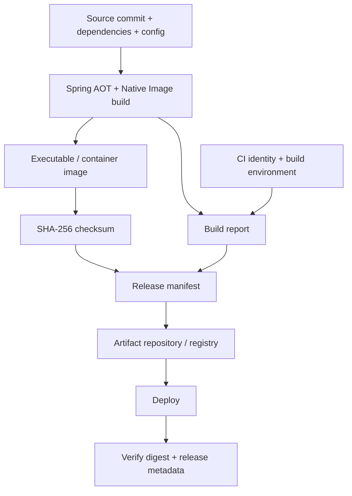

# Quản lý checksum, báo cáo build và truy vết đầu vào của sản phẩm

## 1. Vì sao cần truy vết sản phẩm Native Image?

Một lần build Spring Boot thành **GraalVM Native Image** tạo ra sản phẩm triển khai có thể là executable, container image hoặc cả hai. Khi phát hiện lỗi trên production, nhóm cần trả lời được: binary này được tạo từ commit nào, dùng JDK/GraalVM và plugin phiên bản nào, profile AOT nào, dependency nào, build trên OS/kiến trúc nào, và artifact có bị thay đổi sau khi build hay không.

Ba cơ chế hỗ trợ việc đó:

- **Checksum** xác định dấu vân tay nội dung của file/artifact, giúp phát hiện file bị thay đổi hoặc tải sai.
- **Build report/manifest** ghi lại đầu vào, công cụ, cấu hình không nhạy cảm, kết quả và vị trí artifact.
- **Provenance/attestation** liên kết artifact với quy trình build và danh tính nguồn, hỗ trợ kiểm toán và chuỗi cung ứng phần mềm.

Trong module **SPRING_BOOT_NATIVE_IMAGE**, các thông tin này giúp tái hiện build Maven/Gradle, cấu hình Spring AOT, xử lý metadata reflection/resource, đóng gói container và so sánh hiệu năng giữa các phiên bản native. Checksum đúng không chứng minh ứng dụng không có lỗ hổng hoặc được build từ nguồn đáng tin; nó chỉ giúp xác minh nội dung theo thuật toán và nguồn checksum mà ta tin cậy.



## 2. Checksum là gì và dùng khi nào?

Checksum là giá trị băm được tính từ bytes của một file. Với SHA-256, cùng một nội dung đầu vào sẽ tạo ra cùng digest; chỉ cần một thay đổi nhỏ trong file thường dẫn đến digest khác biệt.

Checksum hữu ích để:

1. Xác minh artifact sau khi upload/download không bị thay đổi ngoài dự kiến.
2. Phân biệt hai binary cùng tên nhưng nội dung khác nhau.
3. Đối chiếu file trong thư mục build với file lưu ở artifact repository.
4. Lưu dấu vết trong release manifest và phục vụ kiểm toán.

Checksum **không phải chữ ký số**. Nếu kẻ tấn công có thể thay cả artifact và file checksum đi kèm, họ có thể tính lại checksum. Để xác minh nguồn phát hành, cần chữ ký số hoặc attestation được ký bởi danh tính tin cậy, cùng chính sách xác minh tương ứng.

### Tính SHA-256

Linux:

```bash
sha256sum build/native/nativeCompile/app
```

macOS:

```bash
shasum -a 256 build/native/nativeCompile/app
```

Windows PowerShell:

```powershell
Get-FileHash .\build\native\nativeCompile\app.exe -Algorithm SHA256
```

Tên file và đường dẫn tùy cấu hình Gradle/Maven, OS và project. Lưu thuật toán cùng digest; không ghi một chuỗi hash mà thiếu tên file hoặc thuật toán.

Tạo file checksum (Linux):

```bash
sha256sum app > app.sha256
sha256sum -c app.sha256
```

Trên Windows có thể xuất digest từ `Get-FileHash` vào manifest hoặc dùng công cụ tạo checksum phù hợp. Khi verify, phải so sánh đúng artifact và đảm bảo file checksum đến từ nguồn tin cậy.

## 3. Artifact nào cần checksum?

Một pipeline Spring Boot Native Image có thể sinh nhiều sản phẩm:

| Artifact | Nội dung | Mục đích checksum |
|---|---|---|
| JAR JVM | Bytecode và runtime dependencies | Đối chiếu baseline JVM |
| Native executable | Binary cho OS/CPU cụ thể | Xác minh file triển khai |
| OCI container image | Các layer và cấu hình image | Dùng digest image của registry |
| SBOM | Danh sách thành phần phần mềm | Xác minh tài liệu thành phần đi kèm |
| Build report/manifest | Metadata của lần build | Đảm bảo báo cáo được gắn đúng release |
| Test report | Kết quả kiểm thử | Gắn bằng chứng kiểm thử với build cụ thể |

Không dùng checksum của JAR để xác minh executable native; đây là hai file khác nhau. Với container image, registry thường cung cấp **OCI digest** (ví dụ `sha256:...`) của manifest/index image. Digest này xác định nội dung đối tượng OCI được tham chiếu; nó khác với checksum SHA-256 tính trên file TAR được export.

## 4. Build report nên ghi những gì?

Một build report tốt giúp người khác hiểu artifact được tạo ra thế nào mà không phải suy đoán từ tên file. Các trường gợi ý:

| Nhóm | Trường nên ghi |
|---|---|
| Định danh | Service/module, artifact name, version, build ID |
| Source | Git commit SHA, branch/tag, dirty state |
| Toolchain | JDK/GraalVM/Native Image version, Maven/Gradle wrapper, plugin versions |
| Build config | OS, architecture, profile AOT, target platform, build task |
| Dependencies | Lockfile/checksum hoặc SBOM, dependency graph đã resolve |
| Kết quả | Exit code, thời gian build, test summary, artifact path/size |
| Integrity | SHA-256 của executable/JAR, OCI digest nếu có |
| Provenance | CI workflow/run ID, builder image digest, identity thực hiện build |
| Performance | Startup, RSS, peak build memory và workload nếu đã đo |

Không đưa secret, access token, password, private key, nội dung biến môi trường nhạy cảm hay credentials repository vào report. Với cấu hình nhạy cảm, chỉ ghi tên biến hoặc giá trị đã được phân loại an toàn; không log toàn bộ environment.

### Ví dụ build manifest JSON

```json
{
  "service": "SPRING_BOOT_NATIVE_IMAGE",
  "artifact": {
    "name": "quote-service",
    "version": "1.4.0",
    "type": "native-executable",
    "file": "quote-service",
    "sha256": "<sha256-digest>"
  },
  "source": {
    "repository": "example/shop-platform",
    "commit": "<git-commit-sha>",
    "dirty": false
  },
  "build": {
    "tool": "Gradle",
    "task": ":api-app:nativeCompile",
    "java": "<jdk-version>",
    "graalvm": "<graalvm-version>",
    "springBoot": "<spring-boot-version>",
    "os": "linux",
    "architecture": "amd64",
    "aotProfile": "prod"
  },
  "verification": {
    "unitTests": "passed",
    "nativeSmokeTest": "passed"
  }
}
```

Các giá trị trong dấu `<...>` là placeholder cần thay bằng dữ liệu thực. Đây là cấu trúc minh họa do dự án tự quản lý, không phải schema bắt buộc của Gradle, Spring Boot hay GraalVM. Có thể bổ sung timestamp, CI run ID, image digest, SBOM và report hiệu năng theo nhu cầu.

## 5. Thu thập thông tin đầu vào trong Gradle

Gradle cung cấp các task và thông tin project để pipeline ghi lại. Một cách đơn giản là truyền metadata từ CI thành Gradle properties hoặc environment variables, sau đó dùng script/report task của dự án. Không nên tự suy đoán version từ tên file hoặc hard-code giá trị không khớp môi trường.

Ví dụ lệnh build:

```bash
./gradlew :api-app:nativeCompile
```

Ghi nhận ít nhất:

- Project path: `:api-app`.
- Task thực tế: `:api-app:nativeCompile`.
- Git commit được checkout.
- Java/GraalVM version trong môi trường build.
- Gradle Wrapper version và plugin versions.
- Profile/property dùng khi Spring AOT chạy.
- OS và architecture của runner/target.

Có thể kiểm tra một số thông tin cơ bản:

```bash
./gradlew --version
java -version
native-image --version
git rev-parse HEAD
git status --short
```

Các lệnh cần chạy trong cùng môi trường build đã tạo artifact. Nếu dùng daemon Gradle chạy với JDK khác shell hiện tại, `java -version` ngoài shell không đủ chứng minh daemon dùng cùng JDK; kiểm tra Gradle daemon/toolchain configuration và log task.

### Đầu ra và checksum

Sau khi native compile thành công, xác định chính xác output path do plugin/project cấu hình. Ví dụ task Gradle thường tạo executable dưới `build/native/nativeCompile/`, nhưng tên và vị trí có thể khác. Chỉ tính checksum sau khi artifact đã hoàn tất và được xác định đúng.

```bash
sha256sum build/native/nativeCompile/api-app
```

Không dùng wildcard quá rộng để tính checksum mọi file trong `build/` rồi gắn nhầm digest vào release. Manifest cần liên kết rõ artifact name, path, platform và digest.

## 6. Maven: ghi nhận build tương đương

Với Maven, wrapper giúp cố định Maven distribution theo cấu hình project:

```bash
./mvnw -Pnative native:compile
./mvnw --version
java -version
native-image --version
git rev-parse HEAD
```

Profile `native` là cấu hình ví dụ; project phải định nghĩa profile và plugin phù hợp. Ghi nhận Maven Wrapper, Spring Boot Maven Plugin, Native Build Tools plugin và GraalVM version thực tế.

Đường dẫn native output thường nằm trong `target/`, nhưng không nên mặc định tên file. Kiểm tra cấu hình plugin và log build để lấy artifact path, sau đó tính checksum trên đúng file.

## 7. Kiểm tra checksum sau khi lưu trữ và tải xuống

Một chu trình cơ bản:

1. Build artifact trong CI.
2. Tính SHA-256 và lưu digest trong report.
3. Upload artifact và report vào nơi lưu trữ tin cậy.
4. Download artifact về môi trường kiểm thử/triển khai.
5. Tính lại checksum và so sánh với digest trong report đã xác thực.
6. Chỉ tiếp tục deploy khi artifact và metadata khớp chính sách.

Ví dụ Linux:

```bash
sha256sum -c app.sha256
```

Nếu kết quả báo `OK`, bytes của file khớp với digest trong file checksum. Điều đó không chứng minh digest đến từ CI tin cậy nếu file `app.sha256` có thể bị sửa cùng artifact.

Với Windows PowerShell:

```powershell
$actual = (Get-FileHash .\app.exe -Algorithm SHA256).Hash.ToLower()
$expected = (Get-Content .\app.exe.sha256).Trim().ToLower()
if ($actual -ne $expected) {
    throw "SHA-256 mismatch"
}
```

Đoạn ví dụ giả định file checksum chỉ chứa digest; nếu định dạng file có tên, thuật toán hoặc nhiều trường, cần parse theo định dạng đó thay vì `Trim()` đơn giản.

## 8. Container image: dùng digest thay cho chỉ tag

Tag như `quote-service:1.4.0` là tên tham chiếu có thể được cập nhật. Digest OCI xác định nội dung manifest/index được registry trả về. Khi triển khai, nên ghi lại image digest thay vì chỉ lưu tag.

Ví dụ lấy image digest sau khi push:

```bash
docker push registry.example.com/quote-service:1.4.0
docker inspect --format='{{index .RepoDigests 0}}' registry.example.com/quote-service:1.4.0
```

Kết quả `RepoDigests` phụ thuộc registry và trạng thái image. Với multi-architecture image, digest có thể trỏ tới manifest list/index; cần ghi rõ platform đã chạy trong kiểm thử. Không tự tính SHA-256 trên thư mục layer rồi gọi đó là OCI digest.

Khi build bằng Cloud Native Buildpacks, builder image, buildpack versions và run image cũng ảnh hưởng sản phẩm. Để tái hiện, ghi lại builder/run image digest và buildpack identifiers/versions cùng cấu hình native. Cùng source commit nhưng builder hoặc GraalVM khác version có thể tạo binary khác.

## 9. SBOM và provenance bổ sung thông tin gì?

**SBOM (Software Bill of Materials)** liệt kê thành phần phần mềm trong artifact hoặc image: dependency, version, package identity và các thông tin liên quan. Nó giúp rà soát thư viện, license và lỗ hổng đã biết. SBOM không phải checksum và không chứng minh artifact được build từ commit nào.

**Provenance** mô tả nguồn và quy trình tạo artifact: source, builder, tham số, workflow và danh tính build. Các định dạng như in-toto Statement và SLSA provenance cung cấp cấu trúc chuẩn để gắn thông tin này với subject (artifact).

Một release đáng tin cậy có thể kết hợp:

- Digest của artifact/image.
- SBOM được tạo cho chính artifact/image đó.
- Provenance/attestation gắn subject digest.
- Chữ ký hoặc danh tính phát hành để xác thực nguồn.
- Chính sách xác minh trong pipeline triển khai.

Không tạo report giả định rằng chỉ vì có trường `commit` là provenance đã được xác thực. Muốn tin cậy, phải ký hoặc phát hành attestation qua hệ thống CI/identity có kiểm soát và xác minh chữ ký/issuer khi tiêu thụ.

## 10. So sánh hiệu năng có thể truy vết

Trong bài toán Spring Boot Native Image, checksum và build report còn giúp chắc chắn số liệu startup/RSS được đo trên đúng artifact. Nếu chạy benchmark nhiều lần, cần biết mỗi lần đo sử dụng binary nào.

Một báo cáo hiệu năng nên kèm:

- Artifact SHA-256 hoặc OCI digest.
- Source commit và build ID.
- GraalVM/JDK, Spring Boot, plugin version.
- OS/CPU architecture, container limits.
- Profile và cấu hình AOT/runtime.
- Workload, concurrency, thời gian warm-up/đo.
- Startup đến readiness, RSS idle/peak, latency/throughput.
- Số lần lặp và cách tổng hợp kết quả.

Mẫu:

| Thuộc tính | JVM artifact | Native artifact |
|---|---|---|
| Commit | … | … |
| Build ID | … | … |
| Artifact digest | … | … |
| Toolchain | … | … |
| Platform | … | … |
| Startup đến readiness | … ms | … ms |
| RSS khi idle | … MiB | … MiB |
| Peak RSS dưới tải | … MiB | … MiB |
| p95 latency | … ms | … ms |

Bảng là mẫu điền số liệu thực nghiệm. Không kết luận native nhanh hơn hoặc nhẹ hơn chỉ dựa vào digest hay loại artifact.

## 11. Những lỗi thường gặp

| Triệu chứng | Nguyên nhân có thể | Hướng xử lý |
|---|---|---|
| Checksum sau download khác | File hỏng, sai artifact, upload/download không hoàn chỉnh | So sánh path, size, digest và tải lại từ nguồn tin cậy |
| Digest khớp nhưng artifact không đáng tin | Checksum/report có thể bị thay cùng artifact | Xác minh chữ ký/attestation và nguồn phát hành |
| Manifest ghi sai commit | CI truyền nhầm biến hoặc report được tạo ngoài build | Gắn metadata trực tiếp vào pipeline và kiểm tra dirty state |
| Cùng commit tạo binary khác | Toolchain, dependency, timestamp, environment hoặc build không reproducible | Ghi đủ tool versions/inputs, kiểm tra reproducible-build assumptions |
| Image tag trỏ nội dung khác | Tag mutable hoặc registry đã cập nhật tag | Deploy theo digest, xác minh registry digest |
| SBOM không khớp image | SBOM tạo từ JAR hoặc source thay vì image cuối | Tạo/kiểm tra SBOM gắn đúng image digest |
| Benchmark khó so sánh | Không ghi artifact digest và điều kiện tải | Gắn build report và workload vào mỗi kết quả |

## 12. Checklist release artifact

- Source commit và trạng thái working tree được ghi rõ.
- Gradle/Maven Wrapper, JDK/GraalVM, Spring Boot và plugin versions được ghi.
- Application module, build task, profile AOT, OS và architecture được xác định.
- Artifact path, kích thước và SHA-256 được lưu trong manifest.
- OCI image digest được ghi sau khi push nếu phát hành container.
- Checksum được xác minh sau khi tải hoặc trước triển khai.
- SBOM và provenance gắn đúng artifact digest khi pipeline hỗ trợ.
- Report không chứa secret hoặc thông tin xác thực.
- Test report và benchmark gắn với đúng build ID/digest.
- Release policy xác minh nguồn và chữ ký/attestation nếu yêu cầu bảo đảm chuỗi cung ứng.

## 13. Câu hỏi tự kiểm tra

1. Checksum SHA-256 giúp xác minh điều gì và không chứng minh được điều gì?
2. Vì sao checksum của native executable không thể thay thế digest của OCI image?
3. Những trường nào trong build report cần thiết để tái hiện một build Spring Boot Native Image?
4. Vì sao chỉ ghi Git commit chưa đủ để tái hiện binary?
5. OCI digest khác tag container ở điểm nào?
6. SBOM, provenance và checksum bổ sung cho nhau như thế nào?
7. Làm thế nào đảm bảo số liệu benchmark được gắn với đúng executable đã phát hành?

**Ghi nhớ:** checksum xác minh nội dung bytes, build report ghi lại đầu vào và kết quả, còn provenance/attestation giúp xác thực nguồn và quy trình tạo artifact. Kết hợp chúng với test report và benchmark có digest cụ thể giúp sản phẩm Spring Boot Native Image có thể truy vết, kiểm tra và phát hành có kiểm soát.
