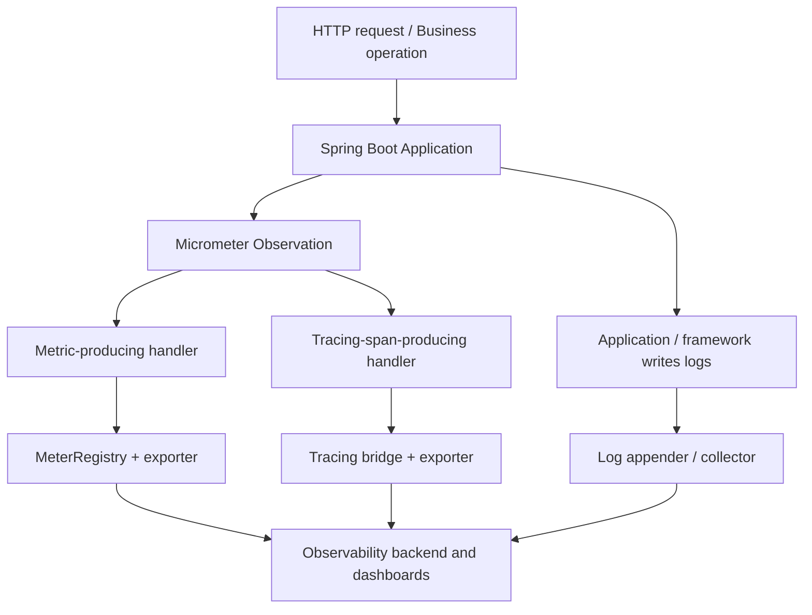

# What Is Observability?

> **Chapter:** Observability Foundation  
> **Scope:** Spring Boot Observability — observing Spring Boot applications with Micrometer Observation, metrics, logs, and distributed tracing.

## Lesson Objectives

After this lesson, you will be able to:

- Explain **observability** and distinguish it from monitoring, logging, or simply having dashboards.
- Understand what different questions metrics, logs, and traces answer, and why they need to be correlated.
- Recognize the roles of **Micrometer Observation**, context propagation, tags/cardinality, exporters, and sampling in a Spring Boot application.
- Use observability signals to form hypotheses, narrow down scope, and verify the root cause of errors or latency in a real request flow.

## 1. The Problem That Observability Solves

Suppose an e-commerce system has the following flow:

1. A client sends an order creation request to a Spring Boot API.
2. The order service checks inventory.
3. The payment service calls an external provider.
4. The result is written to the database and returned to the client.

One evening, customers report that the "Place Order" button spins for a long time. The API is still running, the server is not out of RAM, and some requests still succeed. You need to know: **where is it slow, who is affected, when did it start, and what changed?**

Looking only at CPU usage or a single "request failed" message is usually not enough. A single request can cross multiple services, databases, queues, and external providers; a failure in one step can manifest as latency in another.

**Observability** is the ability to infer the internal state and behavior of a system from the signals it emits externally. In software, the typical signals are **metrics**, **logs**, and **traces**, accompanied by enough context to correlate them with one another.

A system with good observability helps operators answer newly emerging questions, including questions that were not anticipated when dashboards were created. That requires collecting **the right data, with the right context, at the right execution boundaries**; simply installing a monitoring tool does not automatically create this capability.

## 2. How Do Observability, Monitoring, and Telemetry Differ?

| Concept | Role | Example |
| --- | --- | --- |
| **Telemetry** | Data emitted by a system so it can be observed from the outside. | Request count, processing duration, error logs, HTTP spans. |
| **Instrumentation** | Measuring and attaching context to code or frameworks to produce telemetry. | Timing a payment operation, attaching route and outcome status tags. |
| **Monitoring** | Tracking indicators/states and alerting on conditions that need attention. | Alerting when the HTTP 5xx error rate exceeds a threshold over 5 minutes. |
| **Observability** | The capability to use contextualized telemetry to reason about system behavior and investigate issues. | From a 5xx alert, isolating the affected request group, tracing to a timed-out dependency call, and verifying via logs. |

Monitoring is an important part of observability: it helps detect anomalies. Observability also supports **root-cause investigation** when you do not yet know exactly what to look for. The two concepts complement each other rather than being mutually exclusive choices.

For example, a low CPU chart **does not prove** that the API is fast; an external service call can wait for 8 seconds even while CPU is nearly idle. Conversely, a rising latency chart alone does not indicate which operation is slow without traces or context in logs.

## 3. The Three Core Signals

| Signal | Representation | Questions It Answers Well | Limitations on Its Own |
| --- | --- | --- | --- |
| **Metrics** | Time series of numeric values and labels: counters, gauges, timers, histograms... | Is the error rate rising? How has p95 latency changed? How many requests per second? | Data is usually aggregated, making it hard to tell the exact steps a specific request went through. |
| **Logs** | Event records with timestamps, severity levels, and context fields. | What was the exact error? Which condition caused the operation to be rejected? | Scattered logs make it hard to reconstruct ordering and relationships across services without correlation. |
| **Traces** | A structure of related **spans** within an execution flow, typically with durations, attributes, and errors. | Which service or operation slowed the request down? How were calls sequential or parallel? | Traces may be sampled; uninstrumented spans leave gaps in the flow. |

### 3.1. Metrics — Seeing Trends and Impact

Several foundational metric groups should be tracked for HTTP/API workloads:

- **Traffic:** requests per second, number of tasks processed.
- **Errors:** error rate by endpoint, error type, or dependency.
- **Latency:** distribution of processing time, such as p50/p95/p99 instead of averages alone.
- **Saturation:** utilization of bounded resources such as thread pools, connection pools, CPU, or queues.

Suppose traffic stays constant while the p95 of `POST /orders` jumps from 300 ms to 4 seconds; this signals that a significant share of requests are slow, even though the mean might not have risen much yet. To compute reliable percentiles over aggregated data, the metrics system must be configured to publish appropriate histograms/distributions.

Metrics typically carry **labels/tags** such as `method=POST`, `uri=/orders`, and `status=500`. Labels must have a bounded set of values to avoid creating too many time series. Individual `orderId` or `userId` values vary widely and **should not** become metric labels.

### 3.2. Logs — Preserving Event Evidence

A structured log line can carry information like this:

```text
2026-11-22T10:15:04Z level=ERROR service=checkout
traceId=4f8a... spanId=6b12...
event=payment_timeout provider=partner_a duration_ms=3000
message="Payment provider did not respond before timeout"
```

When debugging errors, this structure is far more useful than free-form logs like `An error occurred` because it includes the service, event type, provider, wait duration, and correlation trace IDs. The `traceId`/`spanId` values in the example are illustrative; they only appear when the application captures and injects tracing context into logs.

Logs should describe **significant events**, not dump every internal variable. Do not put passwords, tokens, card numbers, personal data, or full request bodies into logs. Log frequency and verbosity should be proportional to diagnostic value and storage cost.

### 3.3. Traces — Following a Request's Path

A **trace** describes an entire tracked execution journey; each **span** represents a unit of work, such as an HTTP handler, database query, or API call. Spans have parent–child relationships, start/end timestamps, attributes, and error status.

```text
Trace: POST /orders                                 4.2 s
├── HTTP server: checkout                           4.2 s
│   ├── inventory.reserve                            0.1 s
│   ├── payment.charge                               3.9 s
│   │   └── HTTP client: payment-provider            3.8 s (timeout)
│   └── database.insert-order                        0.1 s
```

The trace shows that latency is concentrated in the payment call, though it does not yet prove whether the underlying cause is the provider, the network, or retry behavior. You still need to cross-check logs, dependency metrics, and deployment events.

A **Trace ID** identifies a correlated execution flow; a **Span ID** identifies a single operation within that flow. In distributed systems, HTTP headers or message metadata carry tracing context across service boundaries so spans can be linked into the same trace.

### 3.4. Correlating Signals Creates an Actionable Picture

An investigation workflow can follow this path:

**Metric alert** (rising error rate) → **filter by route/dependency** → **open a representative trace** (slow payment call span) → **search logs with the same trace ID** (timeout, retry) → **cross-check metrics and recent changes** (confirm scope, verify hypothesis).

Not every system provides direct links from metric charts to traces. Some platforms use *exemplars* or correlation metadata; when unavailable, filter by matching time window, service, and attributes.

## 4. How Does Observability Work in Spring Boot?

In the Spring Boot ecosystem, **Micrometer Observation** provides a unified way to describe and measure an operation. An observation has a start–stop lifecycle, a name, and contextual attributes. Corresponding `ObservationHandler` implementations can turn an observation into a **metric** or a **tracing span** when integration is configured.



The diagram illustrates **the data paths** rather than implying that a single observation automatically generates all three signals. Logs are still written through a logging framework (such as SLF4J/Logback); correlating logs with spans requires configuring and propagating correlation context. Handlers, registries, exporters, and backends determine which telemetry actually appears.

Common components:

| Component | Purpose |
| --- | --- |
| **Spring Boot Actuator** | Provides operational and observability endpoints along with auto-instrumentation for many framework components. |
| **Micrometer Metrics / MeterRegistry** | Collects, manages, and exports metrics to systems such as Prometheus. |
| **Micrometer Observation / ObservationRegistry** | Unified API for creating and managing an observation with context. |
| **Micrometer Tracing** | Tracing integration that bridges observations to spans and manages trace context via a suitable bridge. |
| **Exporter / Collector / Backend** | Ships, ingests, stores, queries, and visualizes telemetry; each signal may use a different pipeline. |

For example, a Spring Boot setup using Actuator and the Prometheus registry can expose metrics at `/actuator/prometheus` once the corresponding dependency is added and the endpoint is exposed. Tracing requires an appropriate bridge and exporter; adding Actuator alone **is not enough** to get cross-service distributed tracing.

### 4.1. Example: Creating an Observation for Business Logic

The following snippet illustrates wrapping an order creation operation in an observation. `channel` is normalized to a small set of values so it can safely be used as a metric tag.

```java
import java.util.function.Supplier;

import io.micrometer.observation.Observation;
import io.micrometer.observation.ObservationRegistry;
import org.springframework.stereotype.Service;

@Service
public class OrderObservationService {
    private final ObservationRegistry registry;

    public OrderObservationService(ObservationRegistry registry) {
        this.registry = registry;
    }

    public <T> T observeOrderCreation(String channel, Supplier<T> action) {
        String safeChannel = switch (channel) {
            case "web", "mobile" -> channel;
            default -> "other";
        };

        return Observation.createNotStarted("order.create", registry)
                .lowCardinalityKeyValue("channel", safeChannel)
                .observe(action);
    }
}
```

`observe(action)` manages the observation lifecycle around the passed operation and can record errors when the operation throws an exception. Once the necessary handlers are configured, the name `order.create` and its associated context can be used to produce metrics/spans. This code alone does not guarantee that telemetry will be exported to a backend.

In real projects, place observations around **meaningful business boundaries** (placing an order, reserving inventory, calculating fees) rather than wrapping every method. At the same time, rely on the framework's built-in instrumentation for HTTP, database, and messaging boundaries; creating manual observations that duplicate auto-instrumentation can result in double counting.

### 4.2. A Starter Configuration for Observation

Example for Spring Boot versions using standard Actuator/Micrometer configuration:

```yaml
management:
  endpoints:
    web:
      exposure:
        include: health,info,prometheus
  tracing:
    sampling:
      probability: 0.1
```

This configuration takes effect for each signal **only when the corresponding dependencies and exporters are properly installed**. `prometheus` requires the Prometheus registry; `tracing.sampling.probability` adjusts the trace sampling rate in a compatible tracing setup (10% here). Exact dependency names and exporter properties may vary across Spring Boot versions, so verify against the documentation for the version you are using.

Actuator endpoints should be access-controlled per environment. Do not expose metrics, health details, or sensitive operational data publicly over the Internet.

## 5. Context, Tags, and Cardinality

### 5.1. Context Must Travel with the Work

Suppose `checkout-service` calls `payment-service` over HTTP. If tracing context is propagated, the payment service's server span can be linked to the caller's client span, even though each service runs on a different machine.

Context typically contains a trace ID, span ID, and sampling decision information. Standards like W3C Trace Context support propagating context across components built with different technologies. When using asynchronous processing, executors, new threads, queues, or message brokers, ensure the framework/instrumentation actually **injects/extracts** and restores context. If propagation breaks, spans can split into separate traces and logs lose correlation fields.

Do not generate a brand-new trace ID in every service for the same request, and do not use a business identifier as a substitute for trace context. Business identifiers and trace IDs have different purposes, scopes, and security policies.

### 5.2. Cardinality Determines Cost and Usability

**Cardinality** is the number of distinct values that an attribute or tag set can take. For time-series metrics, the larger the number of tag combinations, the more series must be stored and queried.

| Data/Attribute | Suitable as a Metric Tag? | Explanation |
| --- | --- | --- |
| `http.method=POST` | Yes | Small, stable set of values. |
| `uri=/orders/{id}` | Yes | Normalized route without concrete IDs. |
| `result=success/failed` | Yes | Bounded outcome categories. |
| `userId=938472...` | No | Value set grows with users; carries privacy risk. |
| `orderId=<different value per request>` | No | Easily causes series explosion; not useful for trend aggregation. |

With Micrometer Observation, **low-cardinality key values** are appropriate for metric tags; **high-cardinality key values** can be useful for trace context, but require weighing cost, data sensitivity, and collection policies. Not every high-cardinality attribute should be recorded.

A simple rule of thumb: to filter **groups of requests**, use bounded metric tags; to investigate **a specific execution**, use traces/logs with appropriate context while complying with data policies.

## 6. Exporters, Sampling, and Data Reliability

- **Exporters** send telemetry from the application/agent to a collector or backend. Examples: metrics in Prometheus format; traces via an OTLP-compatible exporter; logs via an appender or log collector. Each pipeline must be configured and monitored for errors.
- **Collectors** (if present) can receive, transform, filter, sample, or forward telemetry. They provide a useful intermediary layer when many applications emit data.
- **Sampling** keeps a subset of traces to control load and cost. At a 10% probability, you cannot expect to find a span for **every** request in the backend. You need an appropriate strategy when investigating rare errors or critical flows.
- **Metrics** are usually aggregated from observations inside the application and are not sampled at the trace sampling rate. However, completeness still depends on instrumentation, pipelines, and actual data drops.

A missing trace does not prove an operation never occurred. Conversely, a single trace with an unusual duration does not prove the issue is widespread: verify the impact via metrics. In particular, monitor the telemetry pipeline itself: full queues, failing exporters, overloaded collectors, or clock skew can all mislead an investigation.

## 7. Reasoning Exercise: Slow Order Creation API

**Scenario:** After an application release, p95 latency on the order creation endpoint rises noticeably; timeout error rates also increase. A typical investigation workflow:

1. **Confirm the symptom and scope.** Check throughput, error rate, and latency over time; compare before/after the release. Inspect multiple instances and routes to see whether the problem is widespread or isolated to one path.
2. **Narrow down from metrics.** Group by route, outcome, dependency, or existing bounded tags. If errors cluster on `POST /orders`, prioritize that flow instead of guessing from host-wide CPU.
3. **Inspect relevant traces.** Find slow or errored traces from the anomalous time window. Compare span durations to see whether most of the time sits in the HTTP server, DB, inventory, or payment.
4. **Correlate logs by trace ID and timestamp.** Look for timeouts, retries, exceptions, or provider responses. If traces are sampled and no matching trace exists, filter logs by time, service, and related event fields.
5. **Verify the root cause.** Compare dependency metrics, timeout/retry configuration changes, connection counts, saturation levels, and recent deployments. Distinguish the **symptom** ("3.8-second payment span") from the **root cause**, which might be connection pool exhaustion or a slow provider response.
6. **Evaluate after fixing.** Re-check error rate, p95/p99 latency, throughput, and load. Verify that the fix genuinely improves user-facing behavior without triggering extra retries or failures in other services.

A measurement is **actionable** when it helps you decide what step to check next. A dashboard crowded with charts that cannot isolate requests or dependencies is usually less useful than a small set of consistently named and correlated signals.

## 8. Designing Observability Step by Step

For a new Spring Boot application, you can proceed in this order:

1. Identify behaviors that matter to users: orders succeed, responses are fast, payments are not duplicated.
2. Attach suitable **service level indicators** (SLIs), such as request success rate and order creation latency; set objectives (SLOs) once operational expectations are agreed upon.
3. Enable Spring Boot/Actuator built-in instrumentation for HTTP and supported components; add observations for missing business steps.
4. Standardize observation names, metric tags, and log fields across teams; propagate trace context across synchronous and asynchronous boundaries.
5. Configure exporters/backends and verify that a sample request can be followed from metrics to logs/traces (when sampled).
6. Use controlled fault injection in staging, such as a dependency timeout, to confirm the telemetry can answer "where, why, and how big is the impact."
7. Maintain cost efficiency and data safety: bound cardinality, choose appropriate sampling, scrub sensitive data, and monitor pipeline performance and access control.

**Common mistakes:** counting total errors without categorizing them, using unbounded IDs as metric labels, logging exceptions without trace context, treating one sampled trace as representative of the whole system, creating overly granular spans that add noise, or building dashboards without specific operational questions.

## 9. Self-Check Questions

**Question 1.** An API shows low CPU usage but high p95 latency. Is this a contradiction?  
**Hint:** No. Requests may be waiting on a database, lock, queue, or HTTP dependency; inspect the relevant spans and metrics.

**Question 2.** Why shouldn't `orderId` be a metric label?  
**Hint:** Every new order creates a new value, increasing cardinality and time-series cost; use bounded labels to observe trends.

**Question 3.** Can you conclude a request never happened if its trace cannot be found?  
**Hint:** No. The trace may have been dropped by sampling, lost context, lacked instrumentation, or failed to export.

**Question 4.** Does Micrometer Observation automatically produce metrics, logs, and distributed traces?  
**Hint:** No. Observation provides a unified lifecycle and context; handlers/integrations and exporters determine which metrics and spans are produced, while logs go through the logging system.

**Key takeaway:** Observability is the capability to **explain system behavior using correlated signals**. In Spring Boot, Micrometer Observation provides consistent instrumentation; metrics show magnitude and trends, traces show paths and timings, and logs provide event evidence. Context propagation, cardinality, sampling, and exporters determine both the quality and the cost of that picture.
