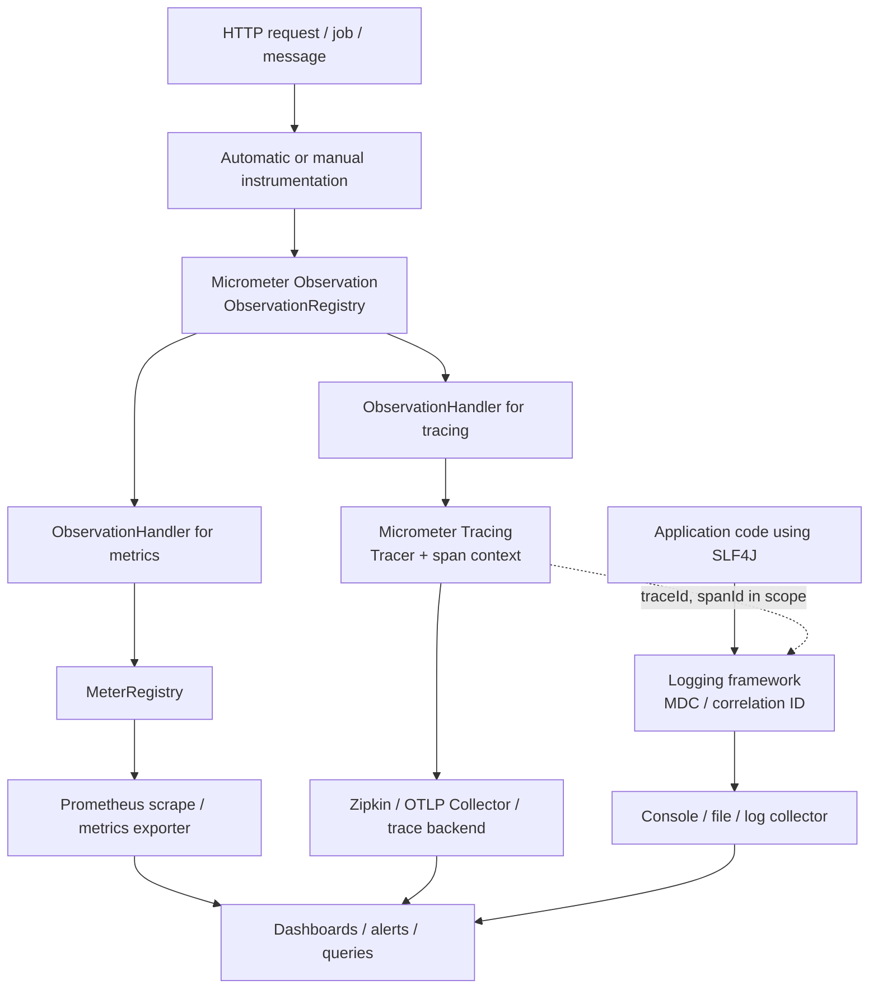
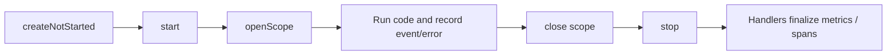

# How Spring Boot Observes a System

When a Spring Boot API returns HTTP 500 or becomes unusually slow, knowing that "something failed" is not enough. Operators also need to answer: which service produced the error, when did it start, how many requests are affected, which part of the execution flow spent the time, and what evidence explains the cause? **Observability** is the ability to infer a system's internal state from the signals it emits at runtime.

In the **SPRING_BOOT_OBSERVABILITY** module, we build that capability with **Micrometer Observation, metrics, logs, and distributed tracing**. Spring Boot provides integration points and auto-configuration; the application adds business context; collection and analysis systems turn those signals into evidence for investigating errors, latency, and application behavior in real environments.

## 1. Learning Outcomes

After this lesson, you will be able to:

- Describe the path from an HTTP request to logs, metrics, and traces in Spring Boot.
- Distinguish the roles of Actuator, `ObservationRegistry`, `MeterRegistry`, Micrometer Tracing, exporters, and backends.
- Explain why an `Observation` can produce metrics and spans, yet is not itself a log, metric, or span.
- Choose tags with appropriate cardinality, and explain trace/span IDs and context propagation across services.
- Set up an observable example, inspect its signals, and investigate an incident using evidence.

## 2. What Does Spring Boot "See"?

Suppose the request `GET /api/orders/42` flows through API Gateway → Order Service → Inventory Service → database. Occasionally users experience 3 seconds of latency instead of 150 ms.

The three signal types answer different questions:

| Signal | Sample Evidence | Strongest Question | Limitations to Remember |
|---|---|---|---|
| **Metrics** | Requests/sec, 5xx rate, processing time distribution, heap, CPU | "Is the issue widespread, when did it start, and how severe is it?" | Aggregated data; usually does not pinpoint one exact request. |
| **Logs** | `ERROR Inventory timeout after 2000 ms` with `traceId` | "What specific event and cause did the application record?" | Easily fragmented across services; logs without context are hard to stitch together. |
| **Traces** | Trace containing HTTP server, HTTP client, and DB spans | "Where did a request travel and which step consumed the time?" | May be sampled; a single trace does not represent every request. |

**Metrics provide the macro picture, traces show the request path, and logs provide event details.** Combining all three signals lets you move from a symptom ("p95 increased") to scope ("mostly on the order API"), and then to the most likely cause ("Inventory Service waiting for DB connections").

Observability is not the same as a health check. The `/actuator/health` endpoint answers whether the application satisfies a set of health indicators; it does not explain why API p95 latency increased.

## 3. Observability Architecture in Spring Boot



The diagram separates three layers:

1. **Instrumentation** defines which operations are tracked: HTTP server/client, custom tasks, asynchronous jobs, and so on.
2. **Signal recording**: Micrometer turns an operation's lifecycle into measurements; tracing creates/updates spans; logging records messages emitted by the application and framework.
3. **Collection and analysis**: Prometheus typically *scrapes* metrics; trace exporters typically *push* spans to an ingestion system; logs go through stdout, files, or agents. Grafana, Zipkin, or equivalent backends provide querying and visualization.

Spring Boot does not include a built-in storage engine for all metrics, logs, and traces. Having Actuator and observability libraries gives you **the ability to produce and expose signals**; you still need appropriate exporters, collectors, and storage backends to operate at production scale.

### Where Does Each Component Live?

| Component | Responsibility |
|---|---|
| **Spring Boot Actuator** | Enables measurement auto-configuration and provides management endpoints such as `health`, `metrics`, and `prometheus` when matching dependencies/configuration are present. |
| **`ObservationRegistry`** | Holds configuration and handlers for the `Observation` lifecycle; serves as the common integration point for instrumentation. |
| **`Observation`** | Describes an operation with start/end boundaries, errors, events, and contextual key-values. |
| **`ObservationHandler`** | Receives callbacks when an Observation starts, opens scope, encounters an error, or stops; can create meters or spans. |
| **`MeterRegistry`** | Manages meters such as counters, timers, and gauges along with adapters for metric formats/backends. |
| **Micrometer Tracing + tracer implementation** | Manages traces, spans, parent-child links, sampling, and propagation; uses Brave or OpenTelemetry depending on configuration. |
| **SLF4J + Logback/Log4j2 + MDC** | Writes logs and injects correlation IDs into logging context when tracing is configured and scope is properly preserved. |
| **Exporter/collector/backend** | Transports, ingests, stores, searches, and visualizes signals; these are distinct roles. |

Micrometer Observation is an **abstraction layer** that lets you instrument an operation without forcing business code to implement separate Prometheus and Zipkin emission logic. If only metric registries/handlers are present, you get metrics; when tracing and an exporter are added, the same operation can simultaneously emit spans. **Logs must still be actively written by the application or framework**; Observation does not automatically turn every execution step into a log entry.

## 4. An HTTP Request Observed End to End

Consider `GET /api/orders/42` handled by Spring MVC:

1. **Request arrives**. Spring instrumentation creates an HTTP server Observation (typically named `http.server.requests`) and starts timing.
2. **Extract or create trace context**. If the request carries the standard W3C `traceparent` header, the tracer can continue an existing trace; otherwise, it can start a new root trace.
3. **Open processing scope**. The current trace/span is bound to the execution context; logging can read `traceId` and `spanId` via MDC.
4. **Controller calls service**. A business Observation created here can become a child span of the HTTP server span. With a Spring Boot-configured HTTP client, the current context is propagated to the downstream service.
5. **Finish or throw an exception**. Depending on how instrumentation is implemented, the Observation receives status, duration, and error details; exceptions handled by the framework may require additional configuration to be reflected accurately in metrics.
6. **Handlers process the data**. The metric handler records duration/count; the tracing handler finishes the span. Whether tracing data is exported depends on sampling and exporter configuration.
7. **Backend ingests data**. Operators can filter metrics by `method`/`uri`/`status`, open a related trace, and search logs by `traceId`.

A trace shares the same **trace ID** across multiple services; each tracked operation has its own **span ID** and parent-child relationship when propagation succeeds. The span ID in service A's logs does not have to equal service B's span ID, even though both share the same trace ID.

Visual path:

```text
Client
  └─ trace T (traceparent)
       ├─ span A: Order Service / HTTP server
       │    ├─ span B: pricing.quote (business)
       │    └─ span C: HTTP client → Inventory Service
       └─ span D: Inventory Service / HTTP server (child of C)
            └─ span E: DB query or processing (if instrumented)
```

Not every DB call or library operation automatically produces a span. Auto-instrumentation coverage depends on the stack, libraries, and configuration. For JDBC, for instance, getting detailed observations for individual queries typically requires additional integration; enabling Actuator alone is not enough.

## 5. Observation: The Basic Unit of Measurement

An `Observation` has this conceptual lifecycle:



Calling `observe(...)` is a convenient way to start, open a scope, run a callback, record any thrown exception, close the scope, and stop the Observation. As a result, duration is measured even when the task throws an exception.

Two concepts are frequently confused:

- **Observation**: models what is happening, e.g. "calculate price".
- **Scope**: makes the current Observation/span available to code running in that execution context; it does not mean context automatically follows every thread.

An `Observation` name such as `pricing.quote` is typically used to create a meter/timer, while also serving as the span name or name source by convention. `contextualName` can provide a more readable name for tracing. `ObservationConvention` lets you standardize names and metadata without editing every instrumentation site.

### Low Cardinality vs. High Cardinality

*Cardinality* is the number of distinct values a key can take.

| Attribute | Example | How to Use |
|---|---|---|
| **Low cardinality** | `method=GET`, `status=200`, `uri=/api/orders/{id}`, `tier=vip` | Suitable as metric tags and trace attributes. |
| **High cardinality** | `order.id=7f8...`, `request.id=...`, paths containing concrete IDs | Can be used as trace attributes when genuinely needed, after checking security and volume; avoid putting into metrics. |

If you add `userId` as a metric tag with millions of values, each tag combination can create a new time series: increasing memory usage, storage cost, and query overhead. Therefore, Micrometer puts **low-cardinality key-values** into metrics and traces; **high-cardinality key-values** go only into traces when a tracing handler is present.

**Practical rule:** use templated routes like `/api/orders/{id}` for metrics, never `/api/orders/42`; do not put tokens, passwords, emails, personal data, or sensitive payloads into tags, spans, or logs.

## 6. Hands-On Example with Spring Boot 4.x

This example uses Spring MVC, Actuator, Prometheus, and Zipkin to observe all three signals. The dependencies below target **Spring Boot 4.x**; Spring Boot 3.x packages tracing differently (typically using `micrometer-tracing-bridge-*` and separate exporters rather than the newer Zipkin/OpenTelemetry starters), so check the documentation for your exact project version.

### Step 1: Add Dependencies

If your project already uses the Spring Boot Gradle plugin and appropriate dependency management:

```groovy
dependencies {
    implementation 'org.springframework.boot:spring-boot-starter-webmvc'
    implementation 'org.springframework.boot:spring-boot-starter-actuator'
    implementation 'org.springframework.boot:spring-boot-starter-zipkin'
    runtimeOnly 'io.micrometer:micrometer-registry-prometheus'
}
```

- `spring-boot-starter-webmvc` serves HTTP APIs.
- `spring-boot-starter-actuator` provides the observability foundation and management endpoints.
- `micrometer-registry-prometheus` exposes the Prometheus scrape endpoint when enabled.
- `spring-boot-starter-zipkin` provides Brave → Zipkin tracing configuration for the example. You can swap it for an appropriate OpenTelemetry/OTLP starter when using a Collector.

To study **metrics without a tracing backend**, you can start with web + actuator + the Prometheus registry. Viewing `/actuator/metrics` does not require Zipkin.

### Step 2: Configure for the Local Environment

```yaml
spring:
  application:
    name: pricing-service

management:
  endpoints:
    web:
      exposure:
        include: "health,info,metrics,prometheus"
  tracing:
    sampling:
      probability: 1.0
    export:
      zipkin:
        endpoint: "http://localhost:9411/api/v2/spans"
  observations:
    key-values:
      environment: local
      region: dev
```

Here `probability: 1.0` sets **100% sampling for hands-on practice**. Do not apply this by default in production: high traffic can cause tracing costs to spike rapidly. Current Spring Boot versions default to 10% sampling, though in operations you should verify your exact version and active configuration.

Only expose the endpoints you need. `metrics` and `prometheus` **are not exposed over HTTP by default**; the `include` line above enables them on the local application. Production environments must protect management paths using internal networks, authentication/authorization, and strict limits on exposed details.

### Step 3: Instrument a Business Operation

```java
import java.util.Locale;

import io.micrometer.observation.Observation;
import io.micrometer.observation.ObservationRegistry;
import org.slf4j.Logger;
import org.slf4j.LoggerFactory;
import org.springframework.stereotype.Service;

@Service
public class PricingService {
    private static final Logger log = LoggerFactory.getLogger(PricingService.class);
    private final ObservationRegistry observations;

    public PricingService(ObservationRegistry observations) {
        this.observations = observations;
    }

    public String quote(String rawTier) {
        // Normalize into a bounded value set for metrics.
        String tier = "vip".equals(rawTier.toLowerCase(Locale.ROOT))
                ? "vip" : "standard";

        return Observation.createNotStarted("pricing.quote", observations)
                .contextualName("calculate-price")
                .lowCardinalityKeyValue("tier", tier)
                .observe(() -> {
                    log.info("Calculating price, tier={}", tier);
                    if ("fail".equalsIgnoreCase(rawTier)) {
                        throw new IllegalStateException("Simulated pricing failure");
                    }
                    return "vip".equals(tier) ? "90.00" : "100.00";
                });
    }
}
```

Expose that service via a controller:

```java
import org.springframework.web.bind.annotation.GetMapping;
import org.springframework.web.bind.annotation.PathVariable;
import org.springframework.web.bind.annotation.RequestMapping;
import org.springframework.web.bind.annotation.RestController;

@RestController
@RequestMapping("/api/prices")
public class PricingController {
    private final PricingService service;

    public PricingController(PricingService service) {
        this.service = service;
    }

    @GetMapping("/{tier}")
    public String quote(@PathVariable String tier) {
        return service.quote(tier);
    }
}
```

In this example:

- **HTTP server observation** is created by Spring MVC instrumentation for incoming requests to `/api/prices/{tier}`.
- **`pricing.quote`** is created manually to measure the business operation; it can produce its own timer and a child span when tracing is configured.
- **`tier`** only takes `vip` or `standard`, keeping time-series count bounded.
- **`log.info(...)`** emits a business log; when trace context is in scope, the log can carry correlation IDs.
- **`/api/prices/fail`** intentionally throws an exception to observe the error path. This is learning code—never ship a simulated failure branch in a production API.

This approach does not require enabling annotation scanning for `@Observed`. If you choose `@Observed`, you must enable annotation support and AspectJ according to your Spring Boot version; avoid placing it on controllers that are already auto-instrumented.

### Step 4: Send Requests and Inspect

Start Zipkin locally on port 9411 using your preferred installation method, then run the application and call:

```bash
curl -i http://localhost:8080/api/prices/vip
curl -i http://localhost:8080/api/prices/standard
curl -i http://localhost:8080/api/prices/fail

curl http://localhost:8080/actuator/health
curl http://localhost:8080/actuator/metrics
curl "http://localhost:8080/actuator/metrics/pricing.quote?tag=tier:vip"
curl http://localhost:8080/actuator/prometheus
```

Expected observations, depending on libraries and configuration:

1. `/api/prices/vip` returns a result; `/api/prices/fail` returns an HTTP 5xx error.
2. Server logs record "Calculating price", and when tracing is active, the log line can contain the `traceId-spanId` pair.
3. `/actuator/metrics` lists `http.server.requests` and `pricing.quote` after they have been recorded.
4. `/actuator/metrics/pricing.quote` returns statistics such as `COUNT` and `TOTAL_TIME`; data appears only after an observation has occurred.
5. `/actuator/prometheus` outputs Prometheus-normalized time series, e.g. a timer can become series like `pricing_quote_seconds_count` and `pricing_quote_seconds_sum`.
6. The Zipkin UI at `http://localhost:9411` lets you search sampled traces, open spans, and inspect durations. Traces may not appear immediately because the exporter sends in batches.

`/actuator/metrics` is an application-level diagnostic interface; `/actuator/prometheus` is the format intended for periodic Prometheus scraping. Do not feed the JSON output of `metrics` into Prometheus.

If metrics exist but traces are missing, check tracing dependencies, sampling, Zipkin address and availability, exporter error logs, and then propagation. If logs lack trace IDs, check whether tracing is active and whether context is still in scope when logging occurs.

## 7. Metrics: Quantitative Signals Across the System

Spring Boot Actuator and Micrometer can automatically collect several categories of meters when conditions are met:

| Category | Examples | Used to Detect |
|---|---|---|
| HTTP server | `http.server.requests`, duration, count, status | Error rate, slow APIs, breakdown by route. |
| HTTP client | `http.client.requests` | Slow or failing external dependencies. |
| JVM | `jvm.memory.*`, `jvm.gc.*`, `jvm.threads.*` | Heap, GC, or thread pressure. |
| Process/system | CPU, uptime, file descriptors when supported by platform | Resource saturation or restarts. |
| Custom business | `pricing.quote`, queued items count, failed orders count | What actually matters to users. |

Exact names and labels depend on the framework, conventions, and configuration. In Spring MVC, `http.server.requests` is typically a timer; request counts can be read from the timer's count without needing a separate counter for every request.

PromQL examples in Prometheus:

```promql
# Requests per second over 5 minutes
sum(rate(http_server_requests_seconds_count[5m]))

# 5xx response ratio over 5 minutes
sum(rate(http_server_requests_seconds_count{status=~"5.."}[5m]))
/
sum(rate(http_server_requests_seconds_count[5m]))
```

Not every timer exports histogram buckets needed to compute **p95**. If you need distribution-based p95 in Prometheus, explicitly enable histograms for the desired meters, for example:

```yaml
management:
  metrics:
    distribution:
      percentiles-histogram:
        http.server.requests: true
```

Once `_bucket` series appear and have data, you can query:

```promql
histogram_quantile(
  0.95,
  sum by (le, uri) (
    rate(http_server_requests_seconds_bucket[5m])
  )
)
```

A p95 figure is meaningful only with an appropriate time range, route set, and sample size. For example, an endpoint receiving two requests per hour does not carry the same distribution meaning as one handling thousands of requests per minute.

## 8. Traces, Propagation, and Log Correlation

### How Does a Trace Differ from a Span?

A **trace** represents the path of a request or job across multiple steps. A **span** represents a unit of work within a trace, with a name, start/end timestamps, attributes, and error/event details. A trace typically contains multiple parent-child spans, though missing instrumentation or sampling will leave gaps.

W3C Trace Context uses the `traceparent` header containing version, trace ID, parent span ID, and trace flags. Illustrative format (IDs are examples only):

```http
traceparent: 00-4bf92f3577b34da6a3ce929d0e0e4736-00f067aa0ba902b7-01
```

When Order Service calls Inventory Service, the HTTP client must inject/continue trace context so the receiving service can create spans in the same trace. In Spring Boot, use **Spring-managed `RestClient.Builder` or `WebClient.Builder`** to inherit default customizers and instrumentation. Constructing clients manually outside Spring's configuration can break automatic propagation.

Example usage with `RestClient`:

```java
import org.springframework.stereotype.Component;
import org.springframework.web.client.RestClient;

@Component
class InventoryClient {
    private final RestClient restClient;

    InventoryClient(RestClient.Builder builder) {
        this.restClient = builder.baseUrl("http://inventory:8081").build();
    }

    String getAvailability(String sku) {
        return restClient.get()
                .uri("/api/stock/{sku}", sku)
                .retrieve()
                .body(String.class);
    }
}
```

This client snippet illustrates HTTP propagation; you need an actual Inventory endpoint and tracing configured in both services to see cross-service traces.

### Threads, `@Async`, and Reactor

Context propagation is easy to overlook:

- In synchronous flows, the current scope is typically available to downstream calls.
- When switching threads, `ThreadLocal` does not follow automatically. In Spring Boot 4.x with auto-configured executors, you can enable `spring.task.execution.propagate-context=true`. If configuring a custom executor, register an appropriate `ContextPropagatingTaskDecorator`.
- In Reactor/WebFlux applications, context lives in the reactive pipeline; `spring.reactor.context-propagation=auto` can help restore context automatically.
- If using `new Thread(...)`, custom executors, or external async libraries manually, carefully verify how context and scopes are captured, restored, and closed. Never assume all async tasks preserve traces automatically.

Lost context typically shows up as broken traces, outbound requests appearing under new root traces, or logs missing correlation IDs even though the original request had them.

### How Are Logs Correlated with Traces?

When Micrometer Tracing is configured, Spring Boot can add correlation IDs to logs from MDC based on the current trace/span. Illustrative format:

```text
2026-11-22 INFO [pricing-service,4bf92f3577b34da6a3ce929d0e0e4736,00f067aa0ba902b7] Calculating price, tier=vip
```

The log backend must **collect and index** the `traceId` field so operators can search for "all logs for trace T". Simply configuring console formatting does not turn logs into searchable data in Grafana/Loki, Elasticsearch, or another backend.

A correlation ID is a clue for joining signals, **not proof that the trace was stored by the backend**: a request can carry a trace ID in its logs even if the corresponding trace was dropped by sampling.

## 9. How Do Sampling and Exporters Affect Data?

Never equate "no trace found" with "no request occurred". With probabilistic sampling, only a fraction of traces are recorded/exported. For example, `management.tracing.sampling.probability=0.1` selects roughly 10% of incoming traces under the active sampler. Parent-based sampling is also influenced by the upstream system's sampling decision.

Keep the distinctions clear:

- **Metrics** generally continue aggregating instrumented calls even when a call's trace is not sampled.
- **Logs** are still written according to log levels and logging policies, not automatically scaled down by the trace sampling rate.
- **Traces** appear in the backend only when instrumentation, tracer, sampling decision, exporter, and backend ingestion all succeed.

Exporters may also buffer or batch exports, so display lag is normal. Losing connectivity to Collector/Zipkin can prevent traces from arriving while the API continues serving responses. Monitor the telemetry pipeline itself and ensure exporting never overloads the request-serving path.

An organization might choose **Prometheus → Grafana** for metrics, **OpenTelemetry Collector → Tempo/Jaeger** for traces, and **stdout → agent → Loki/Elasticsearch** for logs. That is one architectural example; the exact choices depend on platform standards and operational requirements. **OTLP** is a telemetry transport protocol, not the name of a storage system.

## 10. Investigating an Incident Using All Three Signals

**Scenario:** After a deployment, users report that the order API is slow and occasionally returns 500.

| Investigation Step | Evidence to Inspect | Next Decision |
|---|---|---|
| 1. Confirm impact | Request rate, 5xx rate, p95/p99 by `uri`, release/instance | Distinguish traffic spike, post-deploy regression, or localized failure. |
| 2. Narrow down | HTTP client metrics by target service, CPU/GC, connection pools, database | Find components correlating with the latency/errors. |
| 3. Open matching traces | Which span takes most of the total duration; gaps between spans; error status | Identify the exact call path instead of guessing from symptoms. |
| 4. Check logs with same trace ID | Timeouts, exceptions, retries, sanitized business details | Find error messages to form root-cause hypotheses. |
| 5. Verify | Cross-check multiple traces, before/after metrics, deployment versions, recurrence rate | Conclude only when signals are representative; never rely on a single trace. |
| 6. Monitor after remediation | Error rate, latency, saturation, alerts, and exporter signals | Confirm the fix improves user-facing behavior. |

For example, metrics show `http.server.requests` p95 rising on Order Service while CPU and GC remain steady. Sampled traces show the HTTP client span to Inventory Service taking 1.8 seconds. Logs with the same trace ID in Inventory report DB access timeouts. A better hypothesis is a DB connection or query issue on Inventory's side; still check the pool, database, and other requests before confirming the cause.

Observability supports **hypothesis verification**—two charts rising together do not automatically prove causation.

## 11. Common Misconceptions and Implementation Pitfalls

| Symptom | Causes to Check | How to Fix |
|---|---|---|
| `/actuator/metrics` returns 404 | Missing Actuator or endpoint not exposed | Check starter, endpoint exposure, base path, access control. |
| `/actuator/metrics` exists but `/actuator/prometheus` does not | Missing Prometheus registry or exposure | Add `micrometer-registry-prometheus` and exposure. |
| HTTP metrics exist but business metrics are missing | Observation not created or method never ran | Instrument the proper business boundary, invoke the endpoint, then re-check. |
| Traces missing in Zipkin | Missing tracer/exporter, wrong endpoint, sampling, network error | Check dependencies, version-matching properties, exporter logs, and backend. |
| Downstream service has a different trace ID | Outbound client not instrumented or context lost | Use Spring-managed builders; inspect headers and thread/reactive context. |
| `@Async` task logs lack trace ID | Context not propagated to executor | Enable propagation or configure a suitable task decorator. |
| Metric series count explodes | Concrete IDs/URLs used as tags | Bound value sets and use URI templates. |
| Adding `@Observed` doubles measurements | Same code already has auto-instrumentation | Keep only one appropriate instrumentation layer. |
| No p95 in Prometheus | Timer does not export histogram buckets | Enable histogram distribution; check sample count and PromQL query. |
| Trace shows 200 even though business failed | Exception was caught/mapped into a success response | Define business error conventions; record appropriate events/metrics instead of inferring from HTTP status alone. |

A few durable implementation principles:

1. **Instrument meaningful boundaries**: inbound/outbound HTTP, DB, queues, jobs, expensive business steps. Do not create spans for every getter or tiny loop.
2. **Keep names and tags stable**: they serve as the contract for dashboards, alerts, and queries. When changing conventions, check impact on existing charts.
3. **Protect sensitive data**: scrub sensitive fields before logging or adding attributes; lock down Actuator and backend access.
4. **Control overhead**: evaluate sampling, span volume, log volume, cardinality, and backend cost under realistic load.
5. **Monitor the observability pipeline itself**: the application can keep running normally even while exporters/collectors fail, leaving dashboards blind.

## 12. Self-Check Questions

1. When `/actuator/metrics` has `http.server.requests` but Zipkin has no traces, which components may still be working normally? Which components should you inspect?
2. Why is `uri=/api/orders/{id}` safer than `uri=/api/orders/42` as a metric tag?
3. If the trace IDs in Order Service and Inventory Service logs differ, what will you check first?
4. Does 10% sampling mean metrics and logs only record 10% of requests? Why or why not?
5. Why is a single trace showing "Inventory took 2 seconds" insufficient to conclude that every slow request is caused by Inventory?
6. Does enabling Actuator automatically give you centralized logging and monitoring dashboards? What parts still need to be built?

**Suggested practice:** run the Pricing Service example, and compare `/api/prices/vip` and `/api/prices/fail` in three places: `/actuator/metrics`, console logs, and Zipkin. Then temporarily stop Zipkin to observe firsthand which signals remain available and which stop being exported.

## 13. Official References

- [Spring Boot — Observability](https://docs.spring.io/spring-boot/reference/actuator/observability.html): Observation, context propagation, cardinality, annotations, and OpenTelemetry integration.
- [Spring Boot — Metrics](https://docs.spring.io/spring-boot/reference/actuator/metrics.html): MeterRegistry, endpoints, HTTP instrumentation, and metric export systems.
- [Spring Boot — Tracing](https://docs.spring.io/spring-boot/reference/actuator/tracing.html): tracers, sampling, log correlation, HTTP propagation, and exporters.
- [Spring Boot — Actuator Endpoints](https://docs.spring.io/spring-boot/reference/actuator/endpoints.html): endpoint exposure and security.
- [Micrometer — Observation Introduction](https://docs.micrometer.io/micrometer/reference/observation/introduction.html): Observation lifecycle, handlers, low/high cardinality.
- [W3C Trace Context](https://www.w3.org/TR/trace-context/): `traceparent` structure and cross-system trace context sharing.

**Key takeaway:** Spring Boot observes a system by instrumenting operations, routing them through Micrometer Observation to emit metrics/traces when matching handlers are present, correlating logs via trace context, and shipping signals to suitable backends. Investigation quality depends on measurement semantics, proper propagation, bounded tags, sampling policies, and the health of the collection pipeline.
