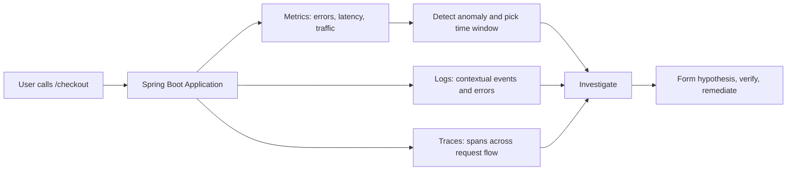

# The Difference Between Monitoring and Observability

In a Spring Boot application running in production, knowing that CPU is at 90% or that the HTTP 5xx rate just spiked is useful. Yet when users only hit errors while paying with one specific method on one specific release, the harder questions are: **Why is it happening, which step slowed the request down, and which users are affected?**

**Monitoring** helps detect and track system health using predefined indicators, thresholds, and conditions. **Observability** enables investigating internal system behavior from the signals the system emits, even when the questions you need to answer were not predicted in advance.

In the **SPRING_BOOT_OBSERVABILITY** module, these two concepts form the foundation for understanding how Micrometer Observation connects metrics, logs, and distributed tracing; why context propagation, tag/cardinality management, exporters, and sampling matter; and how to correlate signals when investigating errors or latency.

## Learning Objectives

After this lesson, you will be able to:

1. Explain monitoring and observability using the same operational scenario, and point out how they relate.
2. Distinguish **symptom detection** from **root-cause investigation**; understand why dashboards and alerts are useful yet insufficient for every incident.
3. Choose the right role for metrics, logs, and traces when analyzing a request flowing across multiple Spring Boot components.
4. Identify the technical requirements that make a system truly observable: correlated context, structured data, coverage, cardinality, sampling, and cost.
5. Outline how to add observability signals to a Spring Boot business flow without letting telemetry volume grow unchecked.

## 1. What Is Monitoring?

Monitoring is the process of **collecting, aggregating, tracking, and comparing signals against expected states** to see whether the system operates within target goals. A monitoring system typically answers known questions:

- Is the service up and ready to serve requests?
- Did the HTTP 5xx error rate over the last five minutes cross the alert threshold?
- Has p95 latency on the payment API exceeded the committed target?
- Are CPU, heap memory, database connection count, and queue depth abnormal?
- Has today's successful transaction count dropped compared with an equivalent time window?

The typical workflow is **define targets → pick measurement signals → build dashboards/alerts → detect anomalies → respond**. For example, an operations team sets a rule: if the payment error rate exceeds 2% over 10 minutes, fire an alert. When that condition triggers, monitoring tells you *a problem is happening* and *its impact may be significant*.

Monitoring can use metrics, logs, traces, synthetic checks, business events, or infrastructure data. Therefore, defining monitoring as "metrics only" is too narrow. The key distinction lies in **how signals are used to track predefined states and conditions**.

### Strengths and Limitations

Monitoring is especially effective when you already know what matters: user-facing availability, reliability indicators, capacity, performance, and resource consumption. It supports early detection and incident prioritization.

However, a "p95 exceeded 1 second" alert cannot by itself explain why the API is slow. Averages or per-minute totals can also mask a rare subset of requests—for instance, only transactions matching a special business condition hang. If the system only keeps a few aggregated charts, engineers struggle to slice along unforeseen dimensions.

## 2. What Is Observability?

In systems engineering, observability describes **how well internal states and behavior can be inferred from externally observable signals**. In software, those signals include data emitted by applications, infrastructure, and related components: metrics, structured logs, distributed traces, configuration/deployment change events, and sometimes profiling.

A system with good observability allows engineers to ask new questions **after** an incident occurs:

- Do the failing requests share a deployment version, route, or dependency?
- Is the latency inside application processing, database queries, queues, or external service calls?
- Which services did a request from the API gateway traverse, and in which span did duration jump?
- Are there log errors sharing the same trace, time window, and release version?
- When did the symptom begin, which system change coincided with it, and is the root-cause hypothesis corroborated by multiple signals?

Observability **does not mean automatically finding the root cause**. It provides the data and context needed to form, test, and refute hypotheses. Sometimes you still need to reproduce the bug, inspect configurations, check the database, profile, or read source code.

### Relationship Between the Two Concepts

Monitoring and observability **complement each other**. Monitoring is a critical operational practice powered by observability capabilities; observability also supports open-ended investigation, performance analysis, and understanding unexpected behavior.

A system can have dozens of dashboards and alerts yet offer poor investigative power if logs lack context and traces break across services. Conversely, a system collecting rich traces without useful SLOs or alerts can still detect incidents too late.

| Aspect | Monitoring | Observability |
|---|---|---|
| Typical question | "Is the system healthy against defined targets?" | "What is happening inside and why is this behavior occurring?" |
| Starting point | Predefined metrics, states, thresholds, and behaviors of interest | A symptom or question that may never have been anticipated |
| Key activities | Dashboards, alerts, SLI/SLO tracking, trend monitoring | Signal correlation, contextual slicing, querying, and narrowing root cause |
| Usable data | Metrics, logs, traces, checks, events | The same signals, with emphasis on coverage, structure, and correlation |
| Expected outcome | Detecting issues, estimating impact, evaluating targets | Understanding execution paths and conditions; confirming or refuting hypotheses |
| Risk when poorly implemented | Alerts only on foreseen conditions; excessive alert noise | Missing context, fragmented data, hard queries, high collection cost |

Do not categorize a tool solely by whether it is marketed as a "monitoring platform" or an "observability platform": real products often do both. What matters more is **which questions operators can answer** from the available data.

## 3. Metrics, Logs, and Traces Answer Different Questions

These three signals are often called the three pillars of observability. They are most valuable when **correlated together**, rather than collected in isolation.

### Metrics: How Much Is the System Changing?

A metric represents a measurement over time, such as:

- Requests per second and error rates.
- Response time distribution, p95/p99.
- JVM memory, garbage collector activity, active connections.
- Successful/failed transactions by operation type.

Metrics excel at aggregation, trend comparison, dashboards, and alerting. They usually carry **labels/tags with low distinct value counts** such as `method=POST`, `route=/checkout`, `status=500`, or `application=checkout-service`.

A rising latency graph shows *when* and *how severely* behavior degraded, but an aggregated data point usually does not contain the individual steps taken inside a request.

### Logs: What Specific Event Occurred?

Logs record point-in-time events, such as "failed to acquire DB connection", "payment gateway timed out", or "retrying attempt 3". Structured logs use named fields instead of stuffing everything into hard-to-search plain text strings.

Illustrative example (synthetic values):

```json
{
  "timestamp": "2026-03-12T09:02:15Z",
  "level": "WARN",
  "service": "checkout-service",
  "event": "payment_gateway_timeout",
  "traceId": "4a9f6d84a3b94162b33e847fc9840f15",
  "spanId": "e2b13a4c9d8706f1",
  "gateway": "provider-a",
  "durationMs": 1500
}
```

Logs are great for reading error messages, condition states, and concrete evidence. However, if logs lack `traceId`, service name, normalized timestamps, or searchable fields, stitching events across services is tedious. Logs alone also do not reliably show full ordering, parent–child relationships, or durations of every operation.

### Distributed Traces: Where Did a Request Travel?

A trace describes an execution flow made of multiple **spans**, where each span represents an operation with a start time, end time, context, and attributes. Spans have parent–child or linked relationships matching how work was executed.

Example of an order request:

```text
Trace: POST /checkout                                    1.850 ms
├── checkout-service: validate-cart                       35 ms
├── inventory-service: reserve-stock                     140 ms
├── payment-service: authorize                         1.590 ms
│   └── HTTP request to payment-provider                 1.510 ms
└── checkout-service: persist-order                       60 ms
```

The durations here are illustrative. Inspecting the trace shows the payment branch consumes most of the time and can be cross-checked with timeout logs. Still, **one slow trace does not prove every slow request shares the same cause**; inspect distributions, related trace sets, and independent metrics.

Traces also have limits: sampling may omit a portion of requests; uninstrumented spans create gaps; broken propagation can split traces across HTTP, messaging, or asynchronous tasks.

### Why Must Signals Be Correlated?



Metrics help **narrow down the area to investigate**, traces help **locate the slow or failing segment**, and logs help **read event details**. A strong pipeline also stamps all signals with consistent service names, environments, release versions, and trace context. When a system supports *exemplars*, a data point on a metric chart can link straight to a corresponding trace; not every backend or setup provides this feature.

## 4. The Same Incident: Monitoring Alone vs. Combined with Observability

Suppose an e-commerce system consists of a Spring Boot API gateway, checkout-service, inventory-service, payment-service, and a database. At 09:00 after a new release, p95 of `POST /checkout` jumps from 300 ms to 1.8 seconds; the 5xx rate rises to 3%. These numbers are hypothetical.

### Step 1 — Monitoring Detects and Quantifies Impact

Dashboards and alerts can tell you:

- The incident began around 09:00.
- The checkout route is affected far more than other routes.
- Both latency and error rate increased; immediate attention is needed.
- Cluster-wide CPU is relatively normal, so "high CPU" lacks supporting evidence.

This is valuable operational output. Yet with this data alone, you cannot tell whether the fault lies in the database, network, payment provider, or the release itself.

### Step 2 — Observability Narrows Scope and Verifies Cause

1. **Ask contextual questions:** are failing requests concentrated in the new version, one deployment zone, or one payment method? Use bounded-cardinality metric labels alongside detailed log/trace fields.
2. **Select a relevant group of traces:** query slow or errored traces in the 09:00–09:15 window. Compare multiple traces to see which step consistently repeats the symptom.
3. **Locate the slow segment:** traces show the span calling the payment provider regularly takes around 1.5 seconds, while the inventory step maintains normal duration.
4. **Correlate logs:** search logs with the same `traceId` and find multiple provider timeout events. Cross-check error codes, retries, timestamps, and connection limits.
5. **Verify the hypothesis:** inspect HTTP connection metrics, timeout/retry settings, deployment events, and provider stats; reproduce the request in a suitable test environment if needed.
6. **Measure after remediation:** confirm latency, error rate, and retry behavior return to expected thresholds; continue monitoring to ensure the fix introduces no side effects.

This investigation path moves from "users are having trouble" to "which step is abnormal and what evidence supports it". If traces instead show the DB waiting on locks rather than a slow HTTP provider, your hypothesis must adapt to the evidence. Good observability makes **updating hypotheses** fast and evidence-based.

## 5. Applying This in Spring Boot with Micrometer

Spring Boot uses the **Micrometer** ecosystem to feed application observations into metrics and tracing pipelines. Starting in Spring Boot 3.x, **Micrometer Observation** provides an API representing an observed operation; registered `ObservationHandler` instances can turn that operation into measurements and/or spans depending on configuration.

Common components:

| Component | Role in a Spring Boot Scenario |
|---|---|
| Spring Boot Actuator | Provides health, metrics, and instrumentation/observability integration points |
| Micrometer Metrics | Records and exports measurements: timers, counters, gauges, latency distributions |
| Micrometer Observation | Unified API to describe an operation and attach context and tags |
| Micrometer Tracing | Bridge between observations and trace context/spans via a tracing implementation |
| OpenTelemetry/Zipkin and matching exporters | Ships trace data to a suitable collector/backend |
| Logging framework and log collector | Writes, centralizes, and queries logs; can include `traceId`/`spanId` when tracing context is integrated |
| Backends like Prometheus, Grafana, Tempo, Jaeger, or equivalents | Stores, queries, visualizes, and links signals; exact capabilities depend on each product's setup |

### Minimal Configuration Example

With **Spring Boot 3.x** and Gradle, illustrative dependencies for Prometheus metrics and OpenTelemetry tracing might look like:

```groovy
dependencies {
    implementation 'org.springframework.boot:spring-boot-starter-actuator'
    runtimeOnly 'io.micrometer:micrometer-registry-prometheus'

    implementation 'io.micrometer:micrometer-tracing-bridge-otel'
    runtimeOnly 'io.opentelemetry:opentelemetry-exporter-otlp'
}
```

An example `application.yml`:

```yaml
management:
  endpoints:
    web:
      exposure:
        include: health,info,prometheus
  metrics:
    tags:
      application: checkout-service
  tracing:
    sampling:
      probability: 0.10
  otlp:
    tracing:
      endpoint: http://otel-collector:4318/v1/traces
```

In this example, `/actuator/prometheus` is the endpoint for scraping metrics when the Prometheus registry is present; access to it should be restricted appropriately for each deployment environment. The `otel-collector` address is illustrative and only works when a matching collector is running. Sampling probability `0.10` targets roughly 10% of traces under the active sampling mechanism; it does **not** mean only 10% of metrics are collected. Exact property names, dependencies, and exporter auto-configuration must be checked against your project's actual Spring Boot version.

Spring Boot/Actuator includes built-in instrumentation for many HTTP operations and integrated libraries, yet **it cannot infer every business step on its own**. To measure the payment authorization step specifically, you can wrap it in an observation:

```java
import io.micrometer.observation.Observation;
import io.micrometer.observation.ObservationRegistry;
import org.springframework.stereotype.Service;

@Service
class CheckoutService {
    private final ObservationRegistry observationRegistry;
    private final PaymentGateway paymentGateway;

    CheckoutService(ObservationRegistry observationRegistry,
                    PaymentGateway paymentGateway) {
        this.observationRegistry = observationRegistry;
        this.paymentGateway = paymentGateway;
    }

    PaymentResult authorize(PaymentRequest request) {
        return Observation.createNotStarted(
                    "checkout.payment.authorize", observationRegistry)
                .contextualName("authorize-payment")
                .lowCardinalityKeyValue("operation", "authorize")
                .observe(() -> paymentGateway.authorize(request));
    }
}
```

`PaymentGateway`, `PaymentRequest`, and `PaymentResult` here are illustrative domain types. Observation represents the operation boundary; depending on registered handlers, the system can record duration in metrics and create a trace span. It does not replace retries, exception handling, timeouts, or business logging.

### Propagation Preserves the Causal Chain Across Components

When a request moves from the API gateway to checkout-service and then payment-service, tracing must **propagate trace context** through HTTP headers, message headers, or another suitable mechanism. W3C Trace Context commonly uses the `traceparent` header to preserve span linkage. If context is not propagated or restored properly, the backend can display disconnected traces even though they originated from the same transaction.

In Spring Boot, prefer already-instrumented HTTP clients and integrations; tasks running on separate threads, queues, or async pipelines must be tested for propagation in practice. Never assume that merely adding a tracing dependency connects every business flow automatically.

When logging is integrated with tracing, `traceId` and `spanId` can appear in MDC/log patterns or structured logs. This is an effective bridge between a concrete error and the trace under inspection. **Never put personal data, tokens, or sensitive payment details into logs, span attributes, or baggage** just to make them searchable.

## 6. Tags, Cardinality, and Sampling: Collect Enough to Investigate

Observability does not mean collecting infinitely. Good queryability requires intentional data design and a clear cost budget.

### Low Cardinality vs. High Cardinality

**Cardinality** is the number of distinct values that can appear along a data dimension. For multi-label metrics, each label combination can create a separate time series. Adding `orderId` as a label on a checkout duration metric across millions of orders can spawn millions of series, driving up storage cost, query latency, and overload risk.

| Data | Typical Suitable Location | Reason |
|---|---|---|
| `method=POST`, `route=/checkout` | Metric tag | Small value set, useful for aggregation and alerting |
| `status=200/500` or status group | Metric tag | Used to calculate success/error rates |
| `operation=authorize` | Low-cardinality observation tag | Fixed per operation kind, comparable across requests |
| `traceId`, order ID, request ID | Log or controlled trace attribute | Searching a specific request; unsuitable as a metric label |
| Email, card number, access token | Do not collect as regular telemetry | Security and privacy risk; redact/omit per policy |

Micrometer Observation distinguishes **low-cardinality key values** and **high-cardinality key values** so handlers can route them appropriately. High-cardinality values can often be attached to traces, though length, sensitive data, and cost still require bounds. Never use raw URLs containing dynamic IDs as metric tags; use templated routes like `/orders/{id}`.

### Sampling Does Not Mean Losing All Observability

In high-traffic systems, keeping every trace can be expensive. Sampling selects a fraction of traces to retain; the rate depends on goals, load, and backend capacity. Keep in mind:

- A request whose trace was not recorded can still be counted in aggregated metrics and logged, depending on the pipeline.
- Too-low sampling can miss rare errors; verify the sampling strategy and any error/slow-trace retention capabilities of your stack.
- Retained traces need complete context and spans to be useful; capturing many broken traces is often less helpful than capturing fewer complete ones.
- When analyzing error rates or full traffic distributions, rely on properly measured metrics; **never treat a sampled trace set as 100% of requests** unless you know how sampling affects the result.

Logs likewise need limits on verbosity, retention periods, and redaction rules for sensitive data. The goal is keeping enough data to explain important behavior within controllable cost and risk.

## 7. Monitoring Ties to SLIs/SLOs; Observability Helps When SLOs Are Threatened

An operations team should define clearly what users consider "the service working well", instead of watching server resources alone.

- **SLI (Service Level Indicator):** a measurement of service quality, such as checkout success rate or percentage of requests completing within a latency threshold.
- **SLO (Service Level Objective):** a target set for an SLI over a time window, such as "at least 99.9% of valid checkout transactions succeed over 30 days".
- **Alerts:** signal risk of missing an objective, usually based on errors, latency, or error-budget burn rate.

Metrics and alerting rules sit at the heart of monitoring at this stage. When an SLI degrades, engineers use traces, logs, and system change records to answer *why* and *where to intervene*.

For example, an infrastructure dashboard showing steady CPU does not prove users have a good experience. If the checkout SLO is breached due to a slow dependency, looking at **signals along the user journey** guides responders to the right place far faster than inspecting individual machine health.

## 8. Designing Observability Around Operational Questions

Before adding hundreds of metrics or logs, pick a critical user journey such as "place order → reserve stock → charge payment → persist order" and ask:

1. **Detection:** what signals show users are hitting errors or waiting too long? Pick throughput, error rate, latency, and relevant business signals.
2. **Isolation:** can results be sliced by service name, route template, operation, environment, and release version?
3. **Correlation:** when picking an errored request, can you find its trace and jump to logs sharing the same context?
4. **Coverage:** are spans/logs present at HTTP, database, message queue, and key downstream boundaries? Where might trace context drop?
5. **Control:** which tags risk high cardinality, what needs sampling, what data must never be collected, and who has access?
6. **Feedback:** are alerts tied to user impact and service targets? After a fix, do metrics confirm recovery?

A practical rollout can follow this sequence: instrument key entry points and dependencies; define SLI metrics and alerts; standardize logs with service/trace context; connect traces across services; add observations for high-value business steps; and finally evaluate queryability and cost against real incidents encountered.

### Misconceptions to Avoid

| Misconception | Accurate Understanding |
|---|---|
| "Having dashboards means we have observability." | A dashboard is a UI. Investigative power depends on coverage, context, and the underlying telemetry. |
| "Monitoring is obsolete; replace it completely with tracing." | Monitoring remains essential for detection, alerting, and SLO tracking; tracing adds execution context. |
| "More data always means better observability." | Noisy, high-cardinality, uncorrelated, or sensitive-data-leaking telemetry can make things worse. |
| "One slow trace proves the root cause." | A trace is evidence of a single execution path; corroborate with logs, metrics, and related events. |
| "Adding a tracing dependency automatically tracks all business logic." | Instrumentation and propagation have boundaries; custom business steps need explicit observation when needed. |
| "Seeing no error traces means no errors happened." | Traces may not have been sampled, exported, or correlated properly. Check the pipeline alongside other metrics/logs. |

## 9. Self-Check with a Scenario

**Scenario:** At 15:20, p99 for `POST /orders` quadruples while CPU and heap remain normal. Some customers report duplicate orders after clicking the pay button again.

**Monitoring should tell you:** traffic volume, error rate, latency distribution, duplicate order counts, and when each signal shifted; alerts tied to appropriate SLIs/SLOs.

**Observability should help inspect:** which requests retried, which span increased in duration, which call timed out, what error messages share the same `traceId`, how idempotency behaved, and whether any deployment or config changes coincided.

**Premature conclusions to avoid:** normal CPU does not rule out DB locks, pool exhaustion, network waits, or external provider delays. Seeing duplicate orders also does not prove retries were the sole cause; cross-check traces, logs, and business records.

That is the practical difference: **monitoring tells you where and when a system deviates from its targets; observability gives you the ability to follow evidence to understand the behavior causing that deviation**. With Spring Boot, Micrometer Observation, metrics, logs, tracing, and propagation work together as complementary mechanisms to achieve both goals.
