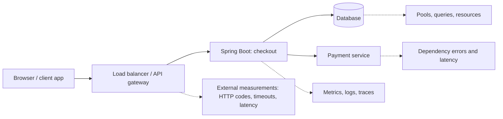

# External Signals and Internal State

A Spring Boot application returns `UP` at `/actuator/health` and uses only 35% CPU, yet users keep hitting payment failures. A process *looking healthy* is not enough to prove the user experience is good. Conversely, merely knowing that many HTTP requests are timing out does not tell you whether the fault is in the gateway, the application, the database, or the payment service.

That is the core problem of **observability**: using observable signals to form hypotheses, reason about, and verify the **internal state** of a running system. In Spring Boot, Micrometer Observation, metrics, logs, and distributed tracing help build that chain of evidence.

After this lesson, you will be able to:

1. Distinguish **externally visible symptoms** from **internal application state and causes**.
2. Explain what different parts of an incident metrics, logs, and traces reveal, including the limits of each signal.
3. Choose suitable measurement points across the client, gateway, application, and dependencies; recognize when signals between layers can appear to conflict.
4. Set up basic observability in Spring Boot, create a custom `Observation`, and correlate telemetry with trace context.
5. Avoid false conclusions caused by missing instrumentation, sampling, lost context, or overly high tag cardinality.

## 1. From Observable Outputs to Internal State

Consider a `POST /checkout` request passing through the following components:



**Internal state** can include in-flight request count, connections waiting in a connection pool, task queues, retry counts, dependency wait time, business errors, or lock contention. Most of that state never appears directly on the user's screen.

**Observable signals** are what the system exposes externally: HTTP `504`, completion time of a request, a counter value, a log line, a span in a trace, health check status, or the outcome of a synthetic probe.

You can picture the process like this:

```text
Internal state + environmental effects
                 |
                 v
       Behavior and emitted signals
                 |
                 v
  Observe -> Hypothesize -> Verify
```

From a single signal, **a single unique cause does not necessarily follow**. For example, rising p95 latency could come from database locks, a slow dependency, CPU saturation, queuing, network issues, or retries. Improving observability means collecting *enough independent and correlatable signals* to distinguish among competing hypotheses, rather than guessing the cause from a single number.

In operations, two viewpoints complement each other:

- **External observation (black-box):** Measures what users or API callers actually receive, such as page load time, checkout success rate, HTTP `502/504` at the gateway, or reachability from a network region.
- **Internal instrumentation (white-box):** Measures what the application and infrastructure are doing, such as `http.server.requests`, connection pool usage, Java exceptions, outbound HTTP call spans, and query durations.

These two terms describe **where you measure**. Meanwhile, metrics, logs, and traces describe **the form of the signal**: a metric can be measured at the gateway or inside the JVM; a log can be emitted by a proxy or the application.

## 2. The Same Incident Looks Different From Each Vantage Point

| Observation Point | Visible Signals | What Cannot Yet Be Concluded |
|---|---|---|
| Browser, mobile app, synthetic probe | Failed requests, load times, experience from a specific location | Which backend service caused the error |
| CDN, ingress, API gateway | Total inbound requests, `502/503/504`, timeouts, upstream latency | Whether the request reached the controller or was blocked earlier |
| Spring Boot HTTP server | Requests reaching the app, response codes, HTTP timers, recorded exceptions | Requests that never reached the app; full client-side network time |
| Business services and dependency clients | Processing steps, API call durations, retries, business errors | Final client experience if the gateway already timed out |
| Database, JVM, container, host | Connections, threads, heap, GC, CPU, I/O, locks, saturation | Whether a busy resource is truly causing the user-facing failure |

For example, suppose the gateway sets a 2-second timeout. A request taking 3 seconds in the application can result in the **gateway returning `504`**, while the application continues processing and later records a successful HTTP response in its own logs or metrics. Consequently, the gateway error rate and the application `5xx` rate **can differ** without either measurement system being broken.

Similarly, a `health` endpoint reporting `UP` typically reflects only the conditions checked by health indicators at the moment it was called. It is not a comprehensive test of every business flow. A passing `GET /actuator/health` probe does not prove `POST /checkout` can succeed.

**Practical rule:** use measurements closest to the user experience to gauge *impact*; use internal telemetry to investigate *mechanism*; then use external measurements again to verify whether the remediation worked.

## 3. What Do Metrics, Logs, and Traces Tell You?

The three common signal types in the Spring Boot ecosystem are **metrics**, **logs**, and **traces**. They complement one another, and none completely replaces the other two.

| Signal Type | Primary Unit | Questions It Answers Well | Typical Limitations |
|---|---|---|---|
| **Metrics** | Aggregated measurements over time and tag sets | When did errors rise? How many requests/sec? What is p95 latency? Is the pool saturated? | Aggregated data usually does not identify a single request or unique root cause |
| **Logs** | Record of a contextualized event | What happened at this step? Which exception occurred? Was retry policy applied? | Hard to spot trends by reading lines one by one; hard to search without structure or correlation |
| **Distributed traces** | Trace of spans with parent–child relationships | Which services did the request visit? Which step consumed time? Did a downstream call fail? | May be sampled; does not cover uninstrumented steps; a slow span alone does not prove root cause |

A trace might look like this (illustrative durations):

```text
traceId = 7d0a...e41f
POST /checkout                   1 850 ms
  ├─ validate-order                 12 ms
  ├─ inventory.reserve             38 ms
  └─ payment.authorize          1 740 ms
       └─ HTTP POST /authorize  1 720 ms
```

The trace helps isolate that most time was spent in `payment.authorize`. To learn why it was slow, you still need to check dependency timeouts, retries, networking, and related logs/metrics. A long-duration span only shows **where time was spent**—it does not by itself establish *the root cause*.

Systems can also use profiling, deployment events, audit events, and configuration metadata. These are valuable supporting evidence; calling them the "three pillars" does not restrict observability to strictly three data types.

### Correlating Signals with Shared Context

To connect a request across the gateway, application, and dependencies, standardize several context dimensions:

| Field | Purpose | Notes |
|---|---|---|
| `service.name`, environment, release version | Distinguish signal origin and deployment | Keep names stable and consistent across tools |
| `traceId` | Find logs/spans belonging to the same trace | Present only when tracing/context is configured; the trace itself might not be exported |
| `spanId` | Identify the active span when a log was emitted | One request can contain many spans |
| HTTP route template like `/orders/{id}` | Group requests hitting the same endpoint | Avoid putting raw paths with millions of values into metrics |
| Timestamp and HTTP status | Compare event ordering and error expression | Synchronize clocks; mind time zones and measurement layers |

`traceId` is a **lookup key**; it does not automatically turn logs into traces. You need a mechanism to attach correlation IDs to log records and a storage/search backend capable of querying by that key.

## 4. Choosing the Right Signals for Operational Questions

For an HTTP API, a useful starting point is the **RED** method:

- **Rate:** valid requests per second by service/route.
- **Errors:** failed request rate by clear definition (e.g. `5xx`, timeouts, or critical business failures).
- **Duration:** distribution of processing time, especially p95/p99 and SLO thresholds.

For resources and queues, the **USE** method helps inspect causes:

- **Utilization:** usage level, such as active connections out of max allowed connections.
- **Saturation:** work forced to wait because a resource is near or past capacity, such as pending connections or queue depth.
- **Errors:** resource errors, timeouts, allocation failures, rejected tasks.

The "Four Golden Signals" (latency, traffic, errors, saturation) are a helpful combined perspective. Never watch CPU alone: a system can degrade severely due to a database pool or external API even while CPU stays low.

### Choosing the Right Denominator for Error Rates

Suppose the API gateway receives **10,000** requests and returns **400** timeouts; Spring Boot handles only **9,600** requests, returning **50** `5xx` responses. Then:

```text
Gateway timeout rate = 400 / 10,000 = 4%
Application HTTP 5xx rate = 50 / 9,600 ≈ 0.52%
```

The two numbers describe different sets of requests. Do not treat 0.52% as the user failure rate if requests at the gateway can time out before or after entering the application.

When defining a **success-rate SLI**, explicitly state the measurement location, eligible request set, what counts as failure, and evaluation window:

```text
Success SLI = eligible requests meeting success criteria
              / total eligible requests
```

Some HTTP `4xx` responses represent valid application behavior (such as input validation), whereas some `200` responses still represent business failures. Therefore, error classification must follow the API contract and user expectations. Histogram/latency percentile measurements must be configured properly; a **low average** does not rule out a small tail of very slow requests.

## 5. Applying This in Spring Boot with Micrometer Observation

Spring Boot Actuator provides numerous metrics and observability integration points; **Micrometer Observation** is the unified API for recording a named operation with context. With matching handlers registered, a single observation can produce both metrics and spans so the same operation is visible across multiple signals.

### 5.1. Baseline Configuration for Spring Boot 3.x

The Maven example below uses Spring Boot **3.x** with Spring Boot's BOM/dependency management. A real web application also needs the appropriate web or webflux starter.

```xml
<!-- Application health, metrics endpoints, and Observation support -->
<dependency>
    <groupId>org.springframework.boot</groupId>
    <artifactId>spring-boot-starter-actuator</artifactId>
</dependency>

<!-- Expose metrics in Prometheus format when scraped -->
<dependency>
    <groupId>io.micrometer</groupId>
    <artifactId>micrometer-registry-prometheus</artifactId>
</dependency>

<!-- Connect Micrometer Tracing to OpenTelemetry -->
<dependency>
    <groupId>io.micrometer</groupId>
    <artifactId>micrometer-tracing-bridge-otel</artifactId>
</dependency>

<!-- Send traces to collector/backend via OTLP -->
<dependency>
    <groupId>io.opentelemetry</groupId>
    <artifactId>opentelemetry-exporter-otlp</artifactId>
</dependency>
```

An illustrative `application.yml` configuration:

```yaml
management:
  endpoints:
    web:
      exposure:
        include: health,info,metrics,prometheus
  metrics:
    distribution:
      percentiles-histogram:
        http.server.requests: true
  tracing:
    sampling:
      probability: 0.1
  otlp:
    tracing:
      endpoint: http://localhost:4318/v1/traces
```

In this configuration:

- Prometheus **scrapes** `/actuator/prometheus`; merely adding the registry does not provide a Prometheus server or dashboards.
- A collector/backend accepting OTLP HTTP must be running at the declared endpoint; otherwise traces cannot reach a searchable store.
- `probability: 0.1` is a 10% sampling probability for traces; it does **not** mean only 10% of metrics are recorded. In a lab you can raise it to `1.0` to inspect every trace, then tune sampling for production traffic.
- Histograms for `http.server.requests` enable latency distribution analysis and percentile queries in a compatible backend; exported metric names may differ from internal meter names.
- Actuator endpoints contain operational telemetry: keep them on management networks with proper authorization; never expose all endpoints publicly to the Internet by default.

**Version note:** Spring Boot **4.x** changes tracing starters and configuration properties. For example, standard OpenTelemetry/OTLP integration uses `spring-boot-starter-opentelemetry` and the `management.opentelemetry.tracing.export.otlp.*` property group. When working on 4.x, check the documentation for that exact version rather than copying 3.x configuration verbatim. The Observation → metrics/traces principle and the need to verify exporters remain unchanged.

Once the application starts and receives real requests, you can test:

```bash
curl -fsS http://localhost:8080/actuator/health
curl -fsS http://localhost:8080/actuator/metrics/http.server.requests
curl -fsS http://localhost:8080/actuator/prometheus
```

A meter may not appear until the first matching operation has been recorded. The URLs and port above assume Actuator runs on the same HTTP port `8080` without extra authentication; substitute the proper management address in real environments.

### 5.2. Creating an Observation for a Business Step

Suppose the application already has an `InventoryClient` bean calling the inventory system. Add an observation around the reservation operation:

```java
import io.micrometer.observation.Observation;
import io.micrometer.observation.ObservationRegistry;
import org.slf4j.Logger;
import org.slf4j.LoggerFactory;
import org.springframework.stereotype.Service;

@Service
public class CheckoutService {
    private static final Logger log =
            LoggerFactory.getLogger(CheckoutService.class);

    private final InventoryClient inventoryClient;
    private final ObservationRegistry observationRegistry;

    public CheckoutService(InventoryClient inventoryClient,
                           ObservationRegistry observationRegistry) {
        this.inventoryClient = inventoryClient;
        this.observationRegistry = observationRegistry;
    }

    public boolean reserveItem(String sku) {
        return Observation.createNotStarted("checkout.reserve", observationRegistry)
                .lowCardinalityKeyValue("operation", "reserve")
                .lowCardinalityKeyValue("dependency", "inventory")
                .observe(() -> {
                    boolean reserved = inventoryClient.reserve(sku);
                    log.info("Inventory reservation result={}",
                            reserved ? "reserved" : "rejected");
                    return reserved;
                });
    }
}

// Illustrative interface; the application must supply a matching implementation/bean.
interface InventoryClient {
    boolean reserve(String sku);
}
```

`checkout.reserve` is a stable operation name; `operation=reserve` and `dependency=inventory` are tags with few distinct values. The `sku` value is passed only to the inventory system and is **not** turned into a metric tag. When tracing is active, this observation can appear as a span inside the HTTP request trace; with a metrics handler, it can produce a timer for the operation.

If `InventoryClient` throws an exception inside the observed operation, instrumentation can record the error. By contrast, `reserve()` returning `false` is a **business outcome**, not automatically equivalent to an exception or HTTP `5xx`: define and measure a dedicated rejection rate if that signal needs tracking. In real applications, measure at meaningful boundaries and avoid creating duplicate spans for an operation already instrumented by the framework.

### 5.3. Preserving Context Across Calls

A request in service A calling service B can produce a cross-service trace only if tracing context is propagated across that boundary. For HTTP, the common mechanism is **W3C Trace Context**, such as the `traceparent` header; backends use trace/span relationships to reconstruct the call chain.

```text
Client -> [Spring Boot A: server span]
                 |
                 | HTTP request with traceparent
                 v
          [Spring Boot B: server span]
                 |
                 v
              Database
```

In Spring Boot, create HTTP clients using **Spring Boot auto-configured** `RestClient.Builder` or `WebClient.Builder` if you want automatic instrumentation and propagation. Instantiating standalone clients manually can bypass trace propagation. Likewise, when handing work off to a thread pool, async task, or message broker, verify that context is carried across the boundary; **never assume every asynchronous path inherits context automatically**.

If a request's trace is missing, check each possibility: the request never reached the service, client/server lacked instrumentation, context broke mid-flight, sampling dropped the trace, or the exporter/backend failed. A missing trace **does not prove** the request never existed.

## 6. Tags, Cardinality, Sampling, and Observability Cost

### 6.1. Tag Cardinality

In metrics, each distinct tag set generates its own time series. If a metric has `route` (20 values), `status` (5 values), and `instance` (10 values), the theoretical combination count is already `20 × 5 × 10 = 1,000` time series, before counting histogram buckets or extra dimensions.

| Usage | Example | Assessment |
|---|---|---|
| Low cardinality | `operation=reserve`, `status=success|failure`, route `/orders/{id}` | Appropriate for metric tags if value count stays controlled |
| High cardinality | `userId`, `orderId`, email, URLs with arbitrary IDs | Do not put in metric tags; risks series explosion and data leakage |
| Trace attributes for diagnostics | An error classification code, dependency name, release tag | Collect only what is needed and enforce security/retention policies |

Micrometer Observation separates `lowCardinalityKeyValue(...)` and `highCardinalityKeyValue(...)`: low-cardinality keys apply to both metrics and traces; high-cardinality keys are meant for trace context when handlers support them, **never as metric dimensions**. Still, "traces only" **does not** permit sending secrets or arbitrary personally identifiable information.

### 6.2. Sampling Does Not Mean Losing All Measurement Capability

Traces typically cost more to ship and store than aggregated metrics. At 10% sampling, a rare failure might have no saved trace. Therefore:

- Rely on metrics or external measurements for **incident frequency and scope**, even when traces are absent.
- Use collected traces to examine **sample execution paths**; never blindly divide errored traces by total traces to compute system-wide error rates if sampling is biased.
- Use structured logs and trace correlation to locate related requests, while also monitoring telemetry collection and export health.
- Consider sampling strategies tailored to traffic, criticality, and error retention; specifics depend on your SDK, collector, and backend.

Telemetry is itself a system that can fail: clogged collectors, rejected exports, missing dashboard data, or clock skew. Always distinguish **"no event occurred"** from **"failed to record the event"**.

## 7. Investigating an Incident From Symptoms to Root Cause

**Hypothetical scenario:** After a traffic surge, users start encountering payment timeouts. JVM dashboards look normal and `/actuator/health` returns `UP`.

| Step | Evidence to Seek | Hypothesis Tested |
|---|---|---|
| 1. Quantify impact | Gateway timeout rate, latency distribution, and affected routes; compare with baseline | Are users genuinely affected, and how wide is the scope? |
| 2. Compare two boundaries | Gateway `504`s vs. Spring Boot HTTP status/timers | Are timeouts happening before, during, or after app processing? |
| 3. Find sample requests | `traceId` from correlated logs, trace across `checkout` → `payment` | Which step accounts for the largest share of time? |
| 4. Inspect resources & dependencies | Active/pending pools, queue depth, timeouts, retries, DB latency, error logs | Is there saturation, cascading retries, or slow downstream calls? |
| 5. Correlate changes | Deploy timestamps, traffic spikes, timeout/config edits, dependency status | Which signals support or refute each candidate cause? |
| 6. Confirm after fix | Timeouts, p95/p99, success rate from gateway or synthetic checks | Has the user experience recovered? |

For example, suppose you observe **rising gateway timeouts**, sample traces showing `payment.authorize` is very slow, while pool pending connections spike and timeouts appear in logs. Together, those pieces point toward contention on the dependency call path; verify which pool, underlying resource limits, actual latency, and retry behavior before changing settings. Blindly raising connection limits indefinitely can simply shift the bottleneck onto the database or downstream service.

Conversely, if the gateway reports `504`s while **no matching requests appear in Spring Boot telemetry**, inspect ingress, DNS, networking, upstream routing, sampling, and instrumentation coverage. Do not start by looking for exceptions in a controller and conclude "there is no error" just because application logs are empty.

### When Signals Appear to Contradict

| Observation | Possible Explanation | How to Verify |
|---|---|---|
| Health `UP`, users failing | Health check does not exercise business flow; endpoint is too trivial | Synthetic transaction, inspect real dependencies/flows |
| Gateway shows many `504`s, app shows few `5xx`s | Different denominators; timeout happened before or after app finished | Compare request IDs, timestamps, upstream latency, and app timers |
| High p95 latency, low CPU | Waiting on I/O, connection pools, locks, retries, or queues | Span durations, pool saturation, dependency metrics |
| Error logs exist, no traces | Sampling, lost context, exporter failure, or incomplete tracing config | Check log correlation, span exporter, and collector |
| Metric exists but missing from dashboard | Wrong metric name, filter, tag, scrape timing, or export pipeline | Check `/actuator/metrics`, exporter endpoint, and backend query |

## 8. A Small Hands-On Lab to Self-Verify

You can use a Spring Boot API with Actuator and a test downstream call to run through these steps:

1. **Capture a baseline:** Call the endpoint a few times, inspect `http.server.requests` and client-side timing/HTTP status. Record clearly whether each measurement is client-side or server-side.
2. **Introduce controlled latency in the lab:** Make the mock dependency slow, observe p95/p99 or histograms, and cross-check against a sample request trace.
3. **Log with context:** Emit a log inside an observation, locate the same `traceId` if tracing and correlation are configured; try calling across two services to verify header propagation.
4. **Simulate a business rejection:** Have `reserve()` return `false` and check whether metrics/error signals reflect your chosen definition of "failure".
5. **Lower sampling:** Compare visible trace count against total requests in metrics. Explain why you cannot derive total failed requests from retained trace counts alone.
6. **Check blind spots:** Temporarily stop the collector in the lab or observe when the exporter fails to send; distinguish application failures from observability pipeline failures.

Answer these three questions yourself to check understanding:

**Question 1.** Why can `/actuator/health` return `UP` while the gateway still returns `504`?  
**Hint:** Health checks and business requests do not necessarily traverse the same path; the gateway also has its own timeouts, routing, and network path.

**Question 2.** A trace shows `payment.authorize` took 1.7 seconds. Is that enough to conclude the payment service is the root cause?  
**Hint:** Not yet. You must separate network time, queuing, retries, connection waits, dependency processing, and span coverage.

**Question 3.** Should `customerId` be attached to `http.server.requests` to make debugging individual customers easier?  
**Hint:** No. IDs explode cardinality and carry personal data risks. Use bounded routes/tags; when tracing individual requests is required, use controlled correlation with proper access controls.

## 9. Takeaways When Designing Observability

- **Start from the questions you need to answer:** "Where and why are users failing?" before choosing metrics, logs, traces, and measurement points.
- **Measure at multiple boundaries:** client/gateway for impact; application/dependencies for mechanism; reconcile differences instead of forcing every layer to report identical counts.
- **Keep signals correlated:** standardize service identity, timestamps, routes, trace context, and log correlation; verify propagation across services and async tasks.
- **Keep telemetry sustainable long term:** bounded tag cardinality, intentional sampling, no sensitive data leaks, restricted access, and monitored export pipelines.
- **Validate against external experience:** improving an internal metric is not enough; user-visible signals must improve too.

### Official References

- [Spring Boot 3.5 — Observability](https://docs.spring.io/spring-boot/3.5/reference/actuator/observability.html)
- [Spring Boot 3.5 — Tracing](https://docs.spring.io/spring-boot/3.5/reference/actuator/tracing.html)
- [Spring Boot 4.0 — Observability](https://docs.spring.io/spring-boot/4.0/reference/actuator/observability.html)
- [Spring Boot 4.0 — Tracing](https://docs.spring.io/spring-boot/4.0/reference/actuator/tracing.html)
