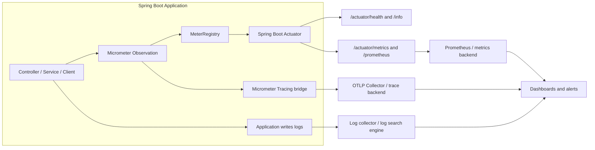

# The Role of Spring Boot Actuator in Observability

A Spring Boot application can return HTTP 200 on its homepage while still failing to fulfill orders: database connections are exhausted, processing queues are backed up, or the payment service is timing out repeatedly. When an incident hits, developers need to know **whether the application is still healthy, how it is processing traffic, and where the root cause lies**.

**Spring Boot Actuator** provides runtime observability and management capabilities: health checks, application info, publishing metrics, controlled runtime log-level adjustments, and access to diagnostic views. In the Spring Boot ecosystem, Actuator is also a primary entry point for integrating **Micrometer Metrics**, **Micrometer Observation**, and **distributed tracing**. It helps expose operational signals outside the application, though it does not itself replace storage, search, visualization, or alerting systems.

This lesson belongs to the **Observability Foundation** chapter and focuses on Actuator's specific role in connecting **metrics, logs, and traces** to investigate errors, latency, and application behavior in production-like environments.

## 1. Distinguishing Monitoring, Observability, and Actuator

- **Monitoring** answers anticipated questions, such as HTTP requests per second, error rates, or memory usage.
- **Observability** uses signals emitted by the system to explain internal state, even when an unforeseen failure appears.
- **Actuator** is the Spring Boot component that produces and exposes many operational signals while providing management endpoints.

For example, a spike on a latency chart is a symptom that demands investigation. Metrics can show which API is slow; logs show a payment call timed out; a trace reveals 900 ms of the request sat inside an outbound call to the payment system. Actuator helps generate or expose several inputs into that investigation.

| Component | Primary Role | Is It the Complete Observability System? |
| --- | --- | --- |
| Spring Boot Actuator | Provides health, management, app info, metrics endpoints, and observability integration | No |
| Micrometer Metrics | Defines and records counters, gauges, timers, and distribution summaries via `MeterRegistry` | No |
| Micrometer Observation | Models an observable operation, attaches key-values, and notifies handlers | No |
| Micrometer Tracing + tracer bridge | Converts eligible observations to spans, manages trace/span context, and propagates context | No |
| Prometheus, OTLP Collector, log systems, trace backends | Ingest, store, query, and support signal analysis | External platform components outside the application |

By design, **Actuator makes an application observable**, while the ability to investigate a cross-service incident further depends on code instrumentation, exporters, context propagation, collection pipelines, and querying tools.

## 2. Where Does Actuator Sit in the Architecture?



The diagram shows the **logical flow**, not that every piece is activated simply by adding a single dependency. For instance, the Prometheus endpoint requires the Prometheus registry, while sending traces via OTLP requires a compatible tracer bridge and exporter. Logs usually flow through logging configuration and a separate agent/collector; Actuator does not ship all logs to a centralized store by default.

Actuator's core responsibilities include:

1. **Providing a unified management interface** over HTTP or JMX so infrastructure can query it.
2. **Auto-configuring standard measurements** based on Spring Boot, Micrometer, and libraries present on the classpath.
3. **Integrating health and availability** so load balancers or orchestrators know whether an instance can accept traffic.
4. **Supporting extensibility** via custom health indicators, meters, observations, endpoints, and exposure controls.

## 3. Key Endpoints

HTTP paths typically use the `/actuator` prefix. You can customize the prefix or move the management server to a separate port; the table below assumes default path settings.

| Endpoint | Data / Purpose | Usage Notes |
| --- | --- | --- |
| `/actuator/health` | Aggregated health status from registered health indicators | Suitable for health checks; control how much detail is exposed |
| `/actuator/health/liveness` | Process liveness state when liveness probes are enabled | Used to decide container restarts; avoid tying to external dependencies |
| `/actuator/health/readiness` | Readiness to accept requests when readiness probes are enabled | Used to decide whether to route traffic to the instance |
| `/actuator/info` | Application, build, git, or custom info metadata | Expose only approved information |
| `/actuator/metrics` | List of meters; query a single meter and its tags over HTTP | Useful to inspect instrumentation; not a historical time-series store |
| `/actuator/prometheus` | Metrics formatted for Prometheus scraping | Available only when the Prometheus registry is present and exposed |
| `/actuator/loggers` | View or adjust log levels at runtime | Impacts cost/log volume; restrict access strictly |
| `/actuator/threaddump` | Thread snapshot for analyzing deadlocks/blocked threads | Intended for authorized operators only |
| `/actuator/env`, `/actuator/configprops` | Configuration properties and property sources | Highly sensitive; never expose publicly |

Available endpoints vary by version, included libraries, and configuration. **An endpoint existing in the application does not mean it is exposed over HTTP.** In familiar Spring Boot 3.x defaults, `health` and `info` are typically exposed over HTTP (though `info` may show nothing until populated); other endpoints must be explicitly included. When Spring Security is present, endpoint access policies must also be configured explicitly.

### 3.1. How Does Health Differ From Metrics?

`/actuator/health` answers the operational question **"does this instance satisfy its defined health criteria?"**. For example:

```json
{"status":"UP"}
```

Metrics answer **"how well is it performing, and how is that changing over time?"**. An instance can report `UP` while p95 latency climbs from 100 ms to 2 s. Never rely solely on HTTP 200 from a health check to conclude user experience is healthy.

### 3.2. Liveness and Readiness Are Not Interchangeable

- **Liveness** checks whether the process can still make forward progress or is stuck in an unrecoverable state. If liveness fails, the orchestrator typically restarts the container. Never include an external system like a database in liveness: a database outage could trigger cascading restarts across your entire fleet.
- **Readiness** determines whether the instance can accept new traffic. If readiness fails, the instance is temporarily removed from routing targets without necessarily restarting.
- **Startup** addresses slow-starting apps separately. Kubernetes offers startup probes so liveness checks do not fire prematurely.

Spring Boot provides `ApplicationAvailability`, `LivenessState`, `ReadinessState`, and corresponding health groups. Enable probes if your runtime environment does not auto-enable them, and verify the exact paths for your version. External dependencies that must be checked should be added intentionally to the readiness group with proper timeouts and policies; readiness does not check every external dependency by default.

## 4. Integrating Actuator Into an Application

The example below targets **Spring Boot 3.x** with Maven and dependency versions managed by the Spring Boot BOM/parent. Some properties, exporters, or metric names evolve across Spring Boot and Micrometer releases; verify against the documentation for your deployment version before using in production.

### 4.1. Dependencies

```xml
<dependencies>
    <dependency>
        <groupId>org.springframework.boot</groupId>
        <artifactId>spring-boot-starter-actuator</artifactId>
    </dependency>

    <!-- Expose metrics for Prometheus -->
    <dependency>
        <groupId>io.micrometer</groupId>
        <artifactId>micrometer-registry-prometheus</artifactId>
    </dependency>

    <!-- Needed only if the app ships distributed traces via OpenTelemetry -->
    <dependency>
        <groupId>io.micrometer</groupId>
        <artifactId>micrometer-tracing-bridge-otel</artifactId>
    </dependency>
    <dependency>
        <groupId>io.opentelemetry</groupId>
        <artifactId>opentelemetry-exporter-otlp</artifactId>
    </dependency>
</dependencies>
```

`spring-boot-starter-actuator` provides the starting point for health, endpoints, and metrics; `micrometer-registry-prometheus` adds Prometheus export formatting; the two tracing dependencies illustrate one option for sending traces via OpenTelemetry. Omit the tracer/exporter if your current goal is solely health and metrics.

### 4.2. Minimal Configuration for Observability

```yaml
spring:
  application:
    name: order-service

management:
  endpoints:
    web:
      exposure:
        include: health,info,metrics,prometheus
  endpoint:
    health:
      probes:
        enabled: true
      show-details: never
  metrics:
    tags:
      application: order-service
  tracing:
    sampling:
      probability: 0.1
  otlp:
    tracing:
      endpoint: http://otel-collector:4318/v1/traces
```

In this example:

- Four endpoints are allowed over HTTP; `liveness` and `readiness` appear under `health` when probes are enabled.
- The `application=order-service` tag distinguishes services in metrics; any additional tags must be governed consistently.
- Sampling 10% of traces illustrates a cost trade-off; **10% does not guarantee every errored request is recorded**.
- OTLP configuration takes effect only when the tracer/exporter are installed, the collector listens on the matching protocol, and network connectivity exists.

**Deployment warning:** `exposure.include` only controls which endpoints can be reached over HTTP—**it is not an authentication/authorization rule**. Protect `metrics`, `prometheus`, and management endpoints using internal networks, gateways, Spring Security, or equivalent controls matching your operational model. Never use `include: '*'` on public endpoints. When configuring a custom `SecurityFilterChain`, verify both Actuator access rules and normal API security rules.

### 4.3. Checking via HTTP

Once the application is running on port 8080:

```bash
curl -s http://localhost:8080/actuator/health
curl -s http://localhost:8080/actuator/health/readiness
curl -s http://localhost:8080/actuator/metrics
curl -s http://localhost:8080/actuator/metrics/http.server.requests
curl -s http://localhost:8080/actuator/prometheus
```

`/actuator/metrics/http.server.requests` returns data only once the meter is registered and at least one matching request has been recorded. You typically need to send a few real requests before querying. The `metrics` endpoint is meant for **exploring and inspecting live meters**, whereas Prometheus scrapes periodically to store time series for charts, queries, and alerts.

If you receive 404, check four things: whether the right dependency is present, whether the endpoint is enabled, whether it is included in web exposure, and whether the app uses a custom base path or management port. If you receive 401/403, review security configuration rather than blindly broadening exposure.

## 5. How Does Actuator Connect Metrics with Micrometer?

Micrometer uses the concepts of **meters** and **registries**. Actuator wires up common defaults, records many standard measurements, and lets you inspect or export them.

| Metric Type | Meaning | Examples in Spring Boot |
| --- | --- | --- |
| Counter | Monotonically increasing event total | Failure count, request count |
| Gauge | Value at a point in time | Active connections, resource usage |
| Timer | Duration and completion count of operations | HTTP request latency, dependency call duration |
| Distribution summary | Distribution of sizes/values, not necessarily time | Payload sizes or batch item counts |

Common meters come from Spring Boot, Micrometer, JVM, servlet server, and compatible library instrumentations, such as `jvm.memory.used`, `process.cpu.usage`, and `http.server.requests`. Exact names and tag sets depend on the version and stack in use.

Metrics become actionable when combining **meter name + tags + time**. For HTTP servers, common tags are method, status, outcome, and URI template. A clean tag set lets you answer "when did the 5xx rate on the order creation endpoint start climbing?" without inspecting individual requests.

### 5.1. Tag Cardinality Determines Operability

**Cardinality** is the number of distinct tag-value combinations. A metric with `method` (5 values), `status` (6 values), and `uri` (20 route templates) already produces hundreds of time series, even before counting instance or application tags. Adding `userId` or `orderId` with millions of values can explode series counts, straining memory, storage, and collection cost.

Guidelines:

- Use **low-cardinality tags** for bounded dimensions useful for aggregation: operation kind, outcome, normalized route name.
- Use **high-cardinality key-values** for diagnostic lookups in traces or logs, such as order IDs; never promote these into metric tags.
- Prefer templated URI values like `/orders/{id}` instead of raw per-request paths like `/orders/123456`.
- Weigh histogram bucket counts and tag counts carefully, since each configuration multiplies time-series volume.

### 5.2. Observation Connects Metrics and Traces for One Business Action

Micrometer Observation describes a unit of work in flight. Handlers can turn it into a metric and, when a tracer bridge is properly configured, create a corresponding span.

```java
import io.micrometer.observation.Observation;
import io.micrometer.observation.ObservationRegistry;
import org.springframework.stereotype.Service;

@Service
public class PaymentService {
    private final ObservationRegistry observationRegistry;

    public PaymentService(ObservationRegistry observationRegistry) {
        this.observationRegistry = observationRegistry;
    }

    public void confirm(String channel, String orderId) {
        Observation.createNotStarted("payment.confirm", observationRegistry)
            .lowCardinalityKeyValue("channel", channel)  // Value from allowed bounded set
            .highCardinalityKeyValue("order.id", orderId) // Used only for context/trace
            .observe(() -> performConfirmation(orderId));
    }

    private void performConfirmation(String orderId) {
        // Call payment service; configure timeouts and error handling here.
    }
}
```

When the app uses a small fixed set of channels such as `card`, `bank_transfer`, and `wallet`, `channel` fits metrics well. `order.id` has many distinct values, so it belongs in spans/logs or diagnostic context rather than metric tags. Whether high-cardinality key-values appear on traces depends on the active tracing handler and configuration.

Observation does not automatically guarantee every code path is instrumented. If service calls, message consumers, or background jobs lack instrumentation, add observations/spans intentionally. Keep naming conventions consistent across application versions as well.

## 6. How Far Does Actuator Go With Distributed Tracing and Logs?

Actuator participates in Spring Boot's observability auto-configuration, yet **tracing only yields full data when a compatible tracer bridge, instrumentation, exporter, and trace backend are present**. Key concepts:

- A **Trace** follows one logical transaction across one or more services.
- A **Span** represents one operation with start/end times and parent–child relationships.
- **Context propagation** passes trace context across boundaries such as HTTP, messaging, or threads so spans join the same trace.
- **Sampling** decides which traces to keep/export, affecting investigative coverage and observability cost.

For instance, suppose `order-service` calls `payment-service`. When both sides use compatible propagation (typically the W3C `traceparent` header) and have instrumentation enabled, the trace backend can display the link between the outbound client span and the downstream HTTP server span. Without propagation, the two services produce two disconnected traces even for a single business request.

Across async tasks, thread handoffs, or reactive chains, context may not survive every boundary automatically. Verify the context propagation mechanisms supported by your Spring Boot/Micrometer version and test real flows; never assume adding Actuator alone keeps traces intact everywhere.

**Logs** supply fine-grained details such as partner error codes, retry states, and business context. When tracing is configured with correlation support, logs can carry `traceId` and `spanId` to jump from a log line to its matching trace. Exact field names and formatting depend on logging configuration and version. `/actuator/loggers` lets you view/adjust logger levels, **not** collect and ship logs to a centralized backend.

A note on sampling: a 0.1 rate means in principle only a subset of traces are recorded; a request having error logs without a stored trace in the backend is completely normal. If error traces must be preserved, design appropriate sampling and collection policies (such as collector tail-based sampling when supported), rather than assuming every error leaves a trace.

## 7. Custom Health Indicators: Checking Business Conditions

Beyond built-in health indicators, Actuator lets you define custom `HealthIndicator` beans. Example adapter checking payment gateway reachability:

```java
import org.springframework.boot.actuate.health.Health;
import org.springframework.boot.actuate.health.HealthIndicator;
import org.springframework.stereotype.Component;

@Component("paymentGateway")
public class PaymentGatewayHealthIndicator implements HealthIndicator {
    private final PaymentGatewayClient client;

    public PaymentGatewayHealthIndicator(PaymentGatewayClient client) {
        this.client = client;
    }

    @Override
    public Health health() {
        try {
            return client.ping()
                ? Health.up().build()
                : Health.down().withDetail("dependency", "unavailable").build();
        } catch (Exception ex) {
            return Health.down().withDetail("dependency", "unavailable").build();
        }
    }
}
```

`PaymentGatewayClient` is an illustrative application interface, not a built-in Spring Boot class. `ping()` must use a short timeout, bounded resources, and zero side effects. Never let a health check repeatedly trigger real payment transactions.

A custom indicator can contribute to overall health, yet **it does not automatically gate the readiness probe**. If the business genuinely cannot accept orders while the gateway is unreachable, explicitly include `paymentGateway` in the readiness health group. Conversely, if the system can queue orders for deferred processing, do not pull the entire instance out of rotation just because a downstream dependency hiccups. Health definitions should mirror actual serving capability.

## 8. Cross-Signal Incident Investigation Workflow

Suppose `POST /orders` becomes slow after a deployment. Actuator serves as an entry point to answer initial operational questions:

| Step | Signal / Tool | Question to Answer |
| --- | --- | --- |
| 1. Determine scope | `health`, readiness, deployment dashboards | Were any instances pulled from traffic? Is the issue on one or multiple instances? |
| 2. Measure impact | HTTP metrics, CPU, memory, connection pools | Which endpoint saw rising 5xx, traffic, or latency? Starting when? |
| 3. Narrow component | HTTP client, database, or custom observation metrics | Is time spent inside internal code or downstream calls? |
| 4. Trace one request | Distributed tracing and context propagation | Which span dominates total time? Are there retries or timeouts? |
| 5. Inspect root cause | Logs with `traceId`/`spanId` and error details | What is the exact error? Does it tie to config changes or upstream issues? |
| 6. Verify remediation | Time-series metrics, health, and post-fix traces | Have latency and error rates dropped sustainably? Did new errors appear? |

An illustrative progression:

1. `health` still reports `UP`, yet dashboards show p95 on `/orders` climbed; initial conclusion is a performance degradation rather than a dead process.
2. Request counts and error rates are checked alongside latency to avoid misreading traffic shifts. Route-templated tags enable accurate comparisons.
3. A slow request trace shows most time inside the `payment-service` span. If no trace exists, check sampling, exporters, and propagation before concluding no cross-service issue occurred.
4. Logs matching that `traceId` report a gateway timeout; outbound and connection pool metrics confirm whether this is an isolated glitch or an ongoing trend.
5. After tuning timeouts/circuit breakers or fixing the partner issue, compare error rates and latency distributions under comparable load—never just re-check `health`.

In this scenario, Actuator supplies health and metrics endpoints while wiring observability inside the app. Prometheus, the logging platform, and the tracing backend store the history needed to compare before/after and link events together.

## 9. Safe Operations and Cost Optimization

### 9.1. Controlling Endpoints and Sensitive Data

- Expose only truly needed endpoints and restrict network reachability. Endpoints such as `env`, `configprops`, `heapdump`, `threaddump`, and `loggers` require strict access policies.
- Protect detailed health output, build/git metadata, and logs. Sanitization/masking reduces risk but never replaces authorization.
- If using a separate management port (`management.server.port`), review network policies, firewalls, scrape targets, and probes; a separate port alone does not guarantee security.
- Restrict permission to change log levels and set rollback timers, since DEBUG/TRACE modes can dramatically inflate log volume and accidentally leak sensitive data.

### 9.2. Data Quality Matters More Than Endpoint Count

- Choose **stable metric/observation names**, and standardize service names, environments, and tag conventions.
- Avoid unbounded tags such as userId, sessionId, raw URLs, SQL text, or exception messages.
- Choose sampling based on traffic, investigative goals, and budget; verify sampled traces are representative enough.
- Separate error classes: expected business rejections, HTTP 4xx, 5xx, and upstream timeouts carry different alerting meanings.
- Put timeouts on health indicators and limit heavy diagnostic actions in production.
- Verify exporters, networks, clocks, collectors, and retention policies; a metric appearing inside the app does not guarantee the backend successfully ingested it.

### 9.3. Avoiding Common Misconceptions

| Misconception | Accurate Understanding |
| --- | --- |
| "Adding Actuator gives full tracing." | You still need a tracing bridge, instrumentation, exporter/backend, and proper propagation. |
| "Health says UP, so there's no incident." | Health reflects only configured checks; latency, per-endpoint errors, and user experience can still be broken. |
| "Putting `orderId` in a metric tag makes debugging easy." | That is high-cardinality data; traces and logs are the proper place for it. |
| "Actuator metrics store history." | The endpoint shows current in-memory meters; you need a collection system to store and query over time. |
| "Enabling web exposure means it's secured." | Proper authentication, authorization, and network restrictions are still required. |
| "A missing trace means the request never hit the service." | The trace may have been dropped by sampling, failed export, or lost context in transit. |

## 10. Short Hands-On Exercise

Using an existing Spring Boot REST API service:

1. Add Actuator and the Prometheus registry; configure web exposure specifically for `health`, `metrics`, and `prometheus`. Verify the endpoints with `curl`.
2. Send at least one successful request and one valid error request. Query `http.server.requests` and inspect invocation counts, total time, and associated tags if enabled.
3. Add an observation around one business operation. Attach a bounded `operation` or `channel` tag, and keep `orderId` in high-cardinality context.
4. Configure a test tracing backend and issue a request spanning two services. Verify `traceId` stays continuous from the server span through the client span into the downstream service.
5. Simulate slow upstream responses or timeouts; cross-check metrics, traces, and logs to explain the cause. Lower sampling and observe the impact on retained traces.
6. Audit which endpoints are exposed, who has access, and whether any sensitive data appears in tags, logs, or health details.

**Completion criteria:** ability to explain Actuator's responsibilities versus Micrometer and observability backends; effective use of health, metrics, and Prometheus endpoints; sound readiness/liveness design; and clear understanding of why context propagation, cardinality, sampling, and exporter setup directly shape incident investigation quality.

## Conclusion

Spring Boot Actuator is the **core application-side integration layer for observability and operations**. It surfaces health status, exposes standard measurements, and connects the Micrometer ecosystem. Turning those signals into true incident investigation capability requires pairing Actuator with business instrumentation, `traceId`-correlated logs, cross-service distributed tracing, collectors/backends, dashboards, and alerts. When health groups, tag cardinality, propagation, exporters, sampling, and endpoint security are thoughtfully designed, Actuator becomes a reliable foundation for understanding Spring Boot behavior in real environments.
