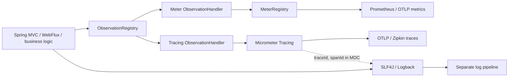

# Micrometer in the Spring Ecosystem

## 1. Learning Objectives

After this lesson, you will be able to:

- Explain the roles of **Micrometer Metrics**, **Micrometer Observation**, and **Micrometer Tracing** when building observability for Spring Boot applications.
- Distinguish creating metrics directly via `MeterRegistry` from modeling an operation with `ObservationRegistry`.
- Identify which parts Spring Boot/Spring Framework auto-instrument and which business steps need manual instrumentation.
- Create an observation for a business operation, attach metadata with proper cardinality, export metrics/traces, and correlate logs with traces.
- Diagnose common issues involving propagation, sampling, exporters, and time-series cardinality.

**Scope:** This lesson focuses on Micrometer within the Spring ecosystem as the foundation for configuring metrics, logs, and distributed tracing, tracking context across services, and investigating latency/errors in real environments. Configuration examples specify versions explicitly because Spring Boot 3.x and 4.x differ in some dependencies and properties.

## 2. Why Does Spring Need Micrometer?

Suppose a `POST /orders` request moves through the API layer, business logic, database, and payment service. When customers hit errors or rising latency, the questions to answer fall into three categories:

| Signal | Typical Questions | Examples |
| --- | --- | --- |
| **Metrics** | How many requests are failing? How is p95 latency changing? | Request counts by HTTP status, processing time distribution |
| **Traces** | Which step slowed down a specific request, and which services did it cross? | HTTP span → checkout → payment call |
| **Logs** | What did the application record at that step? | Exception log carrying matching `traceId` and `spanId` |

Micrometer provides unified APIs for collecting metrics and describing observable operations; Micrometer Tracing bridges tracing to implementations such as OpenTelemetry or Brave. **Micrometer is not a storage or visualization engine**: Prometheus, trace backends like Jaeger/Tempo/Zipkin, and log systems are separate components. Spring Boot Actuator handles integration, auto-configuration, and exposing suitable endpoints.



The diagram shows configurable data paths; not every application enables all handlers or exporters. An observation emits only the signals handled by registered handlers.

## 3. Core Components and Responsibility Boundaries

| Component | Role | When to Use |
| --- | --- | --- |
| `micrometer-core` / `MeterRegistry` | Manages and exports meters such as Counter, Timer, Gauge | Measuring counts, durations, or system states |
| `micrometer-observation` / `ObservationRegistry` | Manages an operation's lifecycle and observation handlers | Instrumenting an operation that can feed both metrics and traces |
| `Observation` | Represents an operation with name, context, metadata, errors, and start/end timing | Wrapping a business action or infrastructure operation |
| `ObservationHandler` | Reacts to `start`, `stop`, `error`, scope, and event callbacks | Turning observations into timers, spans, or custom behavior |
| `ObservationConvention` | Defines names and key-values for a family of observations | Standardizing naming/tags across services |
| `ObservationPredicate` / `ObservationFilter` | Respectively decides whether to observe / enriches context | Suppressing unneeded observations, adding shared metadata |
| `micrometer-tracing` / `Tracer` | Implementation-agnostic tracing API | Creating/reading active spans, propagation, correlation |
| OTel or Brave bridge | Connects the Micrometer Tracing API to an actual tracer | Integrating exporters and trace backends |
| `micrometer-context-propagation` | Propagates context values across execution boundaries | Executors, callbacks, and supported async flows |

### 3.1. Two Measurement Styles: Direct Meters vs. Observations

**Direct meters** fit standalone events or states: total successful orders, queue length, or active job count. You choose the meter type and when to update it.

**Observations** fit measuring an *operation* with a start, end, error outcome, and context: processing checkout, reserving inventory, or calling an API. Depending on registered handlers, the same instrumentation can emit both a duration metric and a trace span. Never assume every observation always emits both signals.

For example, if Spring MVC already creates an observation for `GET /products/{id}`, you do not need to wrap the entire controller manually just to measure HTTP duration. A dedicated observation inside `inventory.reserve` makes sense when you want visibility into the business step inside that request.

### 3.2. Lifecycle of an Observation

```text
createNotStarted(...) → start() → openScope() → execution
                                          ↘ error(exception) if failed
                             close Scope → stop()
```

- `start()` marks the beginning; `stop()` marks completion and lets handlers record the data.
- `openScope()` binds the observation to the current execution context within the scope; scopes must be closed. Scope is **distinct** from the observation lifecycle: closing a scope does not replace `stop()`.
- `error(e)` notifies handlers of failure so they can attach appropriate status/attributes.
- `observation.observe(() -> ...)` is shorthand: the framework handles starting, scoping, recording exceptions, closing scope, and stopping around the lambda.

Example manual instrumentation with `try/finally`:

```java
Observation observation = Observation.start("inventory.reserve", observationRegistry);
try (Observation.Scope scope = observation.openScope()) {
    reserveInventory();
} catch (RuntimeException ex) {
    observation.error(ex);
    throw ex;
} finally {
    observation.stop();
}
```

In normal synchronous code, prefer `observe(...)` unless explicit scope control is required. In asynchronous flows, **never** let `try/finally` stop an observation right after merely launching a `CompletableFuture`; determine clearly when the actual work finishes.

## 4. How Do Spring Boot and Spring Framework Integrate?

With Actuator and matching dependencies, Spring Boot auto-configures `ObservationRegistry`, `MeterRegistry`, handlers, and tracers/exporters. Spring Framework supplies instrumentation for many common APIs.

Common telemetry sources:

| Component | Signals Available | What to Verify |
| --- | --- | --- |
| Spring MVC / WebFlux inbound HTTP | `http.server.requests` and HTTP server span when tracing is enabled | Use route templates instead of URLs containing concrete IDs |
| `RestClient`, `WebClient` outbound HTTP | `http.client.requests` and HTTP client span | Build clients from Spring Boot's auto-configured builders |
| JVM / process / system | Heap, GC, CPU, threads, uptime... | Actuator and a matching registry are present |
| Spring Data Repository, cache, executor, Kafka... | Metrics/instrumentation depending on technology and dependencies | Verify exact auto-configuration; do not assume every call is traced |
| Custom business steps | Not built in | Create appropriate Observations or Meters |

**Common pitfall:** calling `RestClient.create()` or `WebClient.create()` directly and expecting trace context to propagate over HTTP like clients built from Spring-managed `RestClient.Builder`/`WebClient.Builder`. When customizing clients, start from the auto-configured builder.

The `@Observed` annotation can instrument methods via AOP when annotation support is enabled and AspectJ is configured. However, placing `@Observed` on a method or controller already instrumented by the framework can emit duplicate observations; self-invocation within the same bean also interacts with proxy semantics. For business actions needing explicit tag and error control, using `ObservationRegistry` directly is often easier to reason about.

## 5. Hands-On: Metrics and Tracing on Spring Boot 3.5

The example below **targets Spring Boot 3.5.x**, using Java 17+, Spring MVC, and Actuator. Spring Boot 4.x configuration is noted separately in Section 5.5; do not mix properties between the two lines.

### 5.1. Dependencies

For a project using the Spring Boot BOM or parent to manage versions, add to `pom.xml`:

```xml
<dependencies>
    <dependency>
        <groupId>org.springframework.boot</groupId>
        <artifactId>spring-boot-starter-web</artifactId>
    </dependency>
    <dependency>
        <groupId>org.springframework.boot</groupId>
        <artifactId>spring-boot-starter-actuator</artifactId>
    </dependency>
    <dependency>
        <groupId>io.micrometer</groupId>
        <artifactId>micrometer-registry-prometheus</artifactId>
    </dependency>
    <dependency>
        <groupId>io.micrometer</groupId>
        <artifactId>micrometer-tracing-bridge-otel</artifactId>
    </dependency>
    <dependency>
        <groupId>io.opentelemetry</groupId>
        <artifactId>opentelemetry-exporter-otlp</artifactId>
    </dependency>
</dependencies>
```

`micrometer-registry-prometheus` enables the Prometheus scrape endpoint; the OTel bridge and OTLP exporter send spans to an OTLP-capable collector. To study metrics alone, you can omit the two tracing/exporter dependencies. Adding dependencies does not provide Prometheus or an OpenTelemetry Collector automatically: you still need to run the corresponding backends.

### 5.2. Configuration

```yaml
spring:
  application:
    name: checkout-service

management:
  endpoints:
    web:
      exposure:
        include: health,info,metrics,prometheus
  metrics:
    tags:
      application: ${spring.application.name}
  tracing:
    sampling:
      probability: 1.0 # ONLY to observe all traces during hands-on practice
  otlp:
    tracing:
      endpoint: http://localhost:4318/v1/traces
```

- `/actuator/metrics` exposes meter details; `/actuator/prometheus` outputs Prometheus scrape format when the Prometheus dependency is present and the endpoint is exposed.
- `localhost:4318/v1/traces` assumes an OTLP/HTTP collector running on the same machine. Inside containers, `localhost` points to **the application container itself**; use the collector service DNS name on the container network.
- `sampling.probability: 1.0` is only suitable for demos or controlled testing. Real environments require sampling rates/strategies aligned with traffic and diagnostic needs.
- Actuator endpoints exposed over HTTP must have proper access and network controls; never expose operational telemetry unconditionally.

### 5.3. Instrumenting a Business Operation

Suppose `PaymentGateway`, `Order`, and `Receipt` are domain types in your project. The class below shows how to record **an observation** for checkout processing while also counting outcomes:

```java
import io.micrometer.core.instrument.MeterRegistry;
import io.micrometer.observation.Observation;
import io.micrometer.observation.ObservationRegistry;
import org.springframework.stereotype.Service;

@Service
public class CheckoutService {
    private final ObservationRegistry observations;
    private final MeterRegistry meters;
    private final PaymentGateway payments;

    public CheckoutService(
            ObservationRegistry observations,
            MeterRegistry meters,
            PaymentGateway payments) {
        this.observations = observations;
        this.meters = meters;
        this.payments = payments;
    }

    public Receipt checkout(Order order) {
        // Allow only a bounded set of tag values.
        String channel = order.isWebOrder() ? "web" : "other";

        return Observation.createNotStarted("checkout.process", observations)
                .contextualName("checkout")
                .lowCardinalityKeyValue("channel", channel)
                .observe(() -> {
                    try {
                        Receipt receipt = payments.charge(order);
                        meters.counter("checkout.completed",
                                "result", "success", "channel", channel).increment();
                        return receipt;
                    } catch (RuntimeException ex) {
                        meters.counter("checkout.completed",
                                "result", "failure", "channel", channel).increment();
                        throw ex;
                    }
                });
    }
}
```

When a meter handler is present, `checkout.process` can be measured as a Timer; when a tracing handler and matching tracer are present, it can emit a span. The `checkout.completed` counter is an *additional* business metric separating success from failure. Because `observe` wraps the lambda and captures exceptions, you do not need to call `observation.error(ex)` manually here. If you need to record events directly on the observation, keep a reference to the `Observation` so you can call `event(...)` during execution.

This snippet uses illustrative domain types; replace `PaymentGateway`, `Order`, and `Receipt` with your application's real classes when running. Never put order IDs, emails, or IPs into the `channel` metric tag.

### 5.4. Verifying the Output

1. Start the application and send several requests to your project's real checkout endpoint (including both successful and failing requests).
2. Open `GET /actuator/metrics`, then `GET /actuator/metrics/checkout.process` and `GET /actuator/metrics/checkout.completed`. If meters do not appear, check that the code executed and that `MeterRegistry`/handlers were initialized.
3. Open `GET /actuator/prometheus`; look for the series matching checkout and `http_server_requests_seconds_...`. Output names are mapped by the registry following Prometheus conventions.
4. Check whether the collector receives spans and whether the trace backend displays the HTTP server span and `checkout.process` span under the same trace ID.
5. Inject controlled latency in `PaymentGateway`, and compare the rising latency metric against span durations to pinpoint the cause.

A common PromQL query to check the HTTP 5xx rate:

```promql
sum(rate(http_server_requests_seconds_count{status=~"5.."}[5m]))
```

To estimate p95 **across multiple instances**, enable appropriate histograms and use `histogram_quantile` over buckets summed by `le`; you cannot derive accurate p95 from `_sum/_count` alone. Avoid averaging per-instance p95 values and treating the result as system-wide p95.

### 5.5. Spring Boot 4.x Compatibility Notes

Spring Boot 4.x introduces dedicated starters and different OTLP tracing properties compared to 3.5. For OpenTelemetry over OTLP, Boot 4 documentation specifies `org.springframework.boot:spring-boot-starter-opentelemetry` and the `management.opentelemetry.tracing.export.otlp.*` property group. Therefore, **do not copy Boot 3.5's `management.otlp.tracing.endpoint` configuration verbatim** into Boot 4 without checking that version's docs. The programming APIs `Observation`, `ObservationRegistry`, and `MeterRegistry` remain your starting point for understanding the model.

## 6. Metrics: Meter Types, Tags, and Cardinality

| Meter | Meaning | Example | Notes |
| --- | --- | --- | --- |
| `Counter` | Cumulative event count, monotonically increasing | Completed transactions | Query with `rate()` or `increase()` for rates |
| `Timer` | Invocation count and duration | Checkout duration | Can configure histogram/SLO buckets |
| `DistributionSummary` | Distribution of a non-time quantity | Payload size | Choose explicit units and buckets |
| `Gauge` | Instantaneous value at read time | Queue depth | Gauges are unsuitable for counting total events |
| `LongTaskTimer` | Tracks in-progress long-running tasks | Long batch import | Unlike Timer, which measures after completion |

**Cardinality** is the number of tag-value combinations. For example, `http.server.requests` with `method` (3 values), `status` (6), and `uri` (20) can already yield `3 × 6 × 20 = 360` combinations, before accounting for `instance` or other tags. Adding `userId` with millions of values can explode time-series count, inflating RAM, disk, storage cost, and query latency.

Micrometer Observation distinguishes:

- **Low-cardinality key-values**: small, bounded value sets (e.g., `channel=web|other`, `result=success|failure`). These can become tags on both metrics and traces.
- **High-cardinality key-values**: diverse values such as request IDs or order IDs; excluded from metric tags via Observation, yet can appear on spans when the tracing handler supports them. **This does not authorize logging sensitive data**: trace backends still carry cost, retention policies, and data protection requirements.

Example:

```java
Observation.createNotStarted("checkout.process", observationRegistry)
    .lowCardinalityKeyValue("channel", "web")
    // Only when the value is approved for collection and stripped of sensitive data:
    .highCardinalityKeyValue("workflow.run.id", safeOpaqueRunId)
    .observe(this::performCheckout);
```

To standardize metrics and tags across modules, use `ObservationConvention` instead of scattering key strings across services. To filter or cap time series, use `MeterFilter` on `MeterRegistry`; to decide whether an observation should be created at all, use `ObservationPredicate`. These two mechanisms operate at different layers.

## 7. Distributed Tracing and Context Propagation

A trace represents a request's journey across multiple operations or services. Each span has an ID, timestamp, duration, parent-child linkage, and attributes. A request crossing `API → checkout → payment-service` joins into **one trace** only when trace context is properly propagated across HTTP/message/async boundaries.

```text
traceId = 6f...ab
  API: POST /checkout                 [server span]
    checkout.process                  [internal span]
      payment: POST /charge           [client span]
        payment-service: POST /charge [server span, same traceId]
```

Over HTTP, propagation typically uses W3C standard headers like `traceparent` (and `tracestate` when present). Baggage carries auxiliary cross-service context when configured; never carelessly pass identifiers or secrets in baggage. On inbound requests, the framework extracts parent context from headers; on outbound requests, instrumented clients inject context into headers.

Across thread/executor or callback boundaries, merely seeing `traceId` in the first thread's logs **does not prove** the downstream thread has the right active observation/span. You need propagation compatible with the execution model:

- Synchronous Spring MVC: scope usually follows the request thread, making instrumentation straightforward.
- WebFlux/Reactor: context follows the reactive chain; never assume `ThreadLocal` travels across every operator automatically.
- `@Async`, `CompletableFuture`, custom executors: verify task decorators/context snapshots or framework-supported propagation; test with a real cross-thread request to confirm.
- Kafka/RabbitMQ or message brokers: producers and consumers need matching instrumentation/propagators; header preservation depends on protocol and client libraries.

Sampling decides which traces/spans are recorded and exported to the backend. Probabilistic sampling at `0.1` **does not mean** metrics only count 10% of requests: meters still aggregate according to their own instrumentation and registry. However, when a trace is not sampled, investigating that specific request will lack span data. Sampler design must weigh traffic, backend load, and capturing rare errors; some strategies also honor the parent's sampling decision.

## 8. Correlating Logs, Metrics, and Traces During Incident Investigation

Micrometer does not ship all log lines to a log analysis backend on its own. Applications still write logs through SLF4J/Logback; a log pipeline (agent/appender/collector) transports them. When Micrometer Tracing is suitably configured, the active trace and span can populate MDC so logs include `traceId` and `spanId`; both log formatting and the pipeline must preserve those fields.

Illustrative log example:

```text
2026-11-22T10:15:03Z WARN checkout-service
traceId=6f22... spanId=2ac1... payment provider timeout
```

Investigation flow for a spike in slow checkouts:

1. **Metrics**: identify when errors/latency rose, which route or `channel` is affected, and the error rate.
2. **Trace**: pick a trace from that time window; compare the API, checkout, and payment spans to isolate where time was spent.
3. **Logs**: search by `traceId` across relevant services to read exceptions, retries, and business error codes.
4. **Verify**: compare the sample trace against prevalence in metrics; one slow trace does not automatically represent all traffic.

Metric systems supporting *exemplars* can attach trace references to histogram samples, creating a direct jump from a latency chart to a concrete trace. This depends on registry, backend, trace context availability, and configuration—not every stack enables it out of the box.

## 9. Design Pitfalls to Avoid

| Symptom | Possible Cause | How to Check and Fix |
| --- | --- | --- |
| `/actuator/metrics` exists, `/actuator/prometheus` does not | Missing Prometheus registry or endpoint not exposed | Check dependencies and `management.endpoints.web.exposure.include` |
| HTTP metrics exist, no traces | Missing tracing bridge/exporter, OTLP send failing, sampling | Check classpath, collector endpoint, sampler, and exporter error logs |
| Trace breaks between two HTTP services | Outbound client uninstrumented or headers not forwarded | Build clients via Spring's builder; inspect `traceparent` in test env |
| Trace vanishes after `@Async` | Missing propagation across executor/thread | Check task context propagation and active span inside callback |
| Metrics have too many series | Tags contain raw IDs/URLs, unbounded labels | Use route templates, bounded enums/tags, and filters/caps |
| Controller produces two observations | Auto-instrumentation and `@Observed` both wrap the action | Keep only the needed instrumentation; check names/tags |
| Logs have `traceId` but trace cannot be found | Trace dropped by sampling, exporter failed, or backend missed it | Check sampler, exporter queue, Collector, and retention; log correlation does not guarantee trace storage |
| Timer does not yield system-wide p95 | Histograms disabled or wrong aggregation | Export matching buckets and compute p95 from histogram buckets across needed dimensions |
| Checkout metric exists but slowness cause is unclear | Only counts measured, business steps unmeasured | Add Observations for meaningful steps; inspect child spans and logs |

## 10. Principles for Production Environments

- Start with Spring's built-in instrumentation, then add observations for business operations with diagnostic value; avoid double-instrumenting the same boundary across layers.
- Keep names short, conventional, and stable across deployments. Observation names should describe **operations** (`checkout.process`), never contain IDs or request payloads.
- Define a key-value schema upfront: allowed values, expected cardinality, and whether any sensitive data exists. Enforce these rules for both metric labels and span attributes.
- Account for the cost of histogram buckets, sampling, log volume, trace/span counts, and retention; a pretty dashboard with skewed data or lost context will not help troubleshoot.
- Verify end to end: inject test errors/latency and inspect meters, cross-service traces, log correlation, and exporter health. An endpoint returning HTTP 200 does not prove telemetry reached the backend.

## 11. Self-Check Questions

1. A method is already auto-instrumented by Spring MVC. When does it still make sense to add an `Observation` inside that method?
2. What is the difference between `MeterRegistry`, `ObservationRegistry`, and `Tracer`?
3. Why is `orderId` unsuitable as a metric tag? If recorded on a span, what extra controls are required?
4. When `WebClient` calls another service and the trace splits in two, what points will you check?
5. Why does 10% sampling not automatically reduce request count metrics to 10%?
6. How do you pivot from a p95 latency spike on a dashboard to a slow business step and its matching log lines?

## References

- [Spring Boot 3.5 — Observability](https://docs.spring.io/spring-boot/3.5/reference/actuator/observability.html)
- [Spring Boot 3.5 — Metrics](https://docs.spring.io/spring-boot/3.5/reference/actuator/metrics.html)
- [Spring Boot 3.5 — Tracing](https://docs.spring.io/spring-boot/3.5/reference/actuator/tracing.html)
- [Spring Boot 4.x — Tracing](https://docs.spring.io/spring-boot/reference/actuator/tracing.html)
- [Micrometer — Observation Introduction](https://docs.micrometer.io/micrometer/reference/observation/introduction.html)
- [Micrometer — Observation Components](https://docs.micrometer.io/micrometer/reference/observation/components.html)
