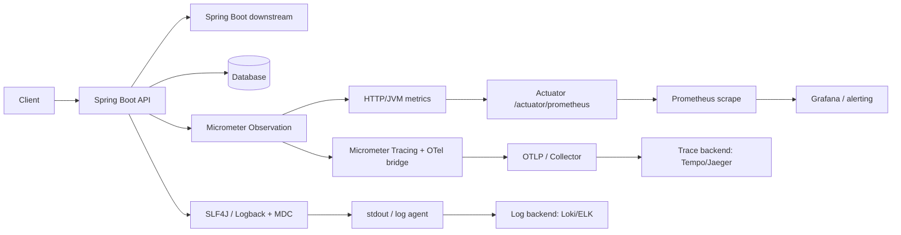

# Observability for Local and Production in Spring Boot

> **Chapter:** Observability Foundation  
> **Scope:** SPRING_BOOT_OBSERVABILITY — setting up and operating observability with Micrometer Observation, metrics, logs, and distributed tracing; understanding context propagation, tags/cardinality, exporters, sampling, and how to correlate signals to investigate errors, latency, and application behavior in real environments.

## Learning Objectives

After this lesson, you will be able to:

1. Explain why local and production need **the same observability model** while differing in sampling, security, cost, and operations.
2. Configure Spring Boot to expose HTTP/JVM metrics via Actuator/Prometheus, export traces via OpenTelemetry Protocol (OTLP), and emit logs containing trace ID/span ID.
3. Distinguish low-cardinality metric tags from high-cardinality details that belong only under controlled conditions in traces/logs.
4. Preserve trace context when making outbound HTTP calls to another service or handing work off to another thread.
5. Use metrics → traces → logs to pinpoint an incident's root cause, and verify the observability pipeline before deploying to production.

## 1. How Does Observability Differ Between Local and Production?

**Monitoring** typically answers "did the system cross a predefined threshold?". **Observability** lets you infer a system's internal state from emitted signals, even when a failure mode was not anticipated ahead of time. In Spring Boot, the three common signals are:

| Signal | Useful Content | Typical Questions |
|---|---|---|
| **Metrics** | Aggregated measurements over time: traffic, error rate, latency, CPU, heap, connection pools | "Is the 5xx rate climbing? Which endpoint's p95 is slow?" |
| **Distributed traces** | Spans tracking a request or workflow across components; showing ordering, duration, and causality | "Did this request wait on the database, downstream HTTP, or internal processing?" |
| **Logs** | Specific events, failure reasons, safely sanitized business values, stack traces | "Inside this span, what condition caused processing to fail?" |

**Micrometer Observation** is the in-application instrumentation API layer. Depending on dependencies and configuration, an observation can be recorded by handlers as a metric, a trace, or both. **Micrometer Tracing** links observations to a tracer; with the OpenTelemetry bridge, spans can be shipped to a backend via OTLP. Logs still travel through their own logging pipeline, yet can include the same trace ID for correlation.

| Aspect | Local/Development | Production |
|---|---|---|
| Purpose | Understanding flow, fast debugging, verifying instrumentation | Detecting incidents, measuring SLIs/SLOs, trend analysis, root-cause investigation |
| Metrics | Scraping one instance at short intervals, low data volume | Centralized multi-instance scraping, planned retention and aggregation |
| Traces | Can sample 100% to inspect every test request | Budgeted sampling; consider tail sampling if error traces must be retained |
| Logs | Human-readable on console, log levels raised temporarily | Structured, trace-correlated, data-controlled, with explicit retention |
| Exposure | Actuator endpoints accessed only from local machine/dev network | Endpoints restricted to management network, access control, and proper TLS |
| Cost | Prioritizes visibility; small data volume | Bounded cardinality, frequencies, span counts, log volume, and retention |
| Reliability | Collector/backend may run on the same laptop | Independent telemetry pipeline with buffers/backpressure and export-failure alerts |

**Operational principle:** instrumentation, metric names, observation names, and tag policies should stay consistent across environments. Vary endpoints, sampling, log levels, access controls, and retention per environment. That way, queries tested locally remain valid in production.

## 2. Three-Signal Architecture



The diagram shows the **telemetry flow**; correlating logs, metrics, and traces relies primarily on shared attributes such as `service`, `environment`, HTTP route, and especially `traceId`.

Distinguish two transport models:

- **Prometheus-style metrics:** the application **exposes** `/actuator/prometheus`; Prometheus periodically **pulls/scrapes** that endpoint. The application does not push metric requests to Prometheus in this model.
- **OTLP-style traces:** the SDK/exporter inside the app **pushes** spans to an OTLP receiver/Collector (typically HTTP `4318` or gRPC `4317`, matching the configured protocol).
- **Logs:** the application writes to stdout/files; an agent or platform collects and ships them to a backend. Having a trace ID in a log does not automatically turn the log into a span.

In production, teams commonly place a Collector/agent between workloads and backends to manage routing, batching, retries, auth, and telemetry processing. Collectors themselves must be observed: losing a collector or misconfiguring it creates blind spots while business traffic keeps flowing.

## 3. Basic Spring Boot Configuration

The examples below target **Spring Boot 3.x**, Java 17+, Spring MVC, and Maven with Spring Boot dependency management. For Spring Boot 4 or other versions, check the corresponding artifact names and configuration properties before applying.

### 3.1. Dependencies

In the `pom.xml` of a Spring Boot application with an appropriate parent/BOM, add these dependencies:

```xml
<dependencies>
    <!-- HTTP health/metrics/Prometheus endpoints -->
    <dependency>
        <groupId>org.springframework.boot</groupId>
        <artifactId>spring-boot-starter-actuator</artifactId>
    </dependency>
    <dependency>
        <groupId>io.micrometer</groupId>
        <artifactId>micrometer-registry-prometheus</artifactId>
    </dependency>

    <!-- Observation -> Micrometer Tracing -> OpenTelemetry -->
    <dependency>
        <groupId>io.micrometer</groupId>
        <artifactId>micrometer-tracing-bridge-otel</artifactId>
    </dependency>
    <dependency>
        <groupId>io.opentelemetry</groupId>
        <artifactId>opentelemetry-exporter-otlp</artifactId>
    </dependency>
</dependencies>
```

If using Gradle, choose the equivalent artifacts and let Spring Boot manage compatible versions. Add only the tracing bridge matching your chosen stack; do not configure multiple independent tracers/SDKs for the same requests without an explicit integration design.

Actuator provides health/metrics endpoints. The Prometheus registry formats metrics for Prometheus. The tracing bridge and OTLP exporter handle instrumentation/correlation and span shipping. SLF4J/Logback is normally already included via Spring Boot's logging starter; you do not need a new "logs exporter" dependency merely to print trace IDs in console logs.

### 3.2. Shared Configuration

Example `application.yml`:

```yaml
spring:
  application:
    name: checkout-service

management:
  endpoints:
    web:
      exposure:
        include: health,info,metrics,prometheus
  metrics:
    tags:
      application: ${spring.application.name}
    distribution:
      percentiles-histogram:
        http.server.requests: true
  tracing:
    sampling:
      probability: 0.10
  otlp:
    tracing:
      endpoint: ${OTLP_TRACES_ENDPOINT:http://localhost:4318/v1/traces}
```

Explanation:

- `spring.application.name` identifies the service. `application` acts as a common tag on metrics; production setups also attach environment and namespace/cluster tags at the collection layer.
- `percentiles-histogram.http.server.requests` publishes histogram buckets so p95/p99 can be aggregated across multiple instances. Histograms add series and cost; enable them only for meters that need them.
- `management.tracing.sampling.probability` sets application-side trace sampling probability. `0.10` targets roughly 10% of traces via head sampling; it does not mean every tenth request is strictly guaranteed to be kept.
- OTLP **HTTP** endpoints typically use the `/v1/traces` path. Never point the exporter at the Jaeger/Tempo query UI URL.
- Exposing an endpoint in config does not authenticate it; access control is a separate responsibility.

If the OTLP receiver is not ready at startup, the exporter may log trace-shipping errors. That does not necessarily crash business APIs, though traces will be dropped. In local labs, start the receiver first or expect clear warnings while the backend is down.

### 3.3. Local Configuration

Example `application-local.yml`:

```yaml
management:
  tracing:
    sampling:
      probability: 1.0
  endpoints:
    web:
      exposure:
        include: health,info,metrics,prometheus

logging:
  level:
    root: INFO
    com.example.checkout: DEBUG
```

Replace `com.example.checkout` with your actual package. 100% sampling is useful when testing a handful of requests; avoid copying this setting to high-traffic production.

Run the application with the local profile:

```bash
./mvnw spring-boot:run -Dspring-boot.run.profiles=local
```

Or run the built JAR:

```bash
java -jar app.jar --spring.profiles.active=local
```

Ensure the app listens on the configured `server.port` (default `8080`, for instance). Verify:

```bash
curl -i http://localhost:8080/actuator/health
curl -s http://localhost:8080/actuator/metrics
curl -s http://localhost:8080/actuator/prometheus
```

Expected result: health returns an appropriate status, metrics lists registered meters, and the Prometheus endpoint outputs `# HELP` and `# TYPE` lines along with time series. Some meters appear only after traffic arrives or matching instrumentation runs.

### 3.4. Minimal Local Stack: Prometheus and OTLP Collector

In your local practice directory, you can prepare these two configurations. These are **illustrative snippets**; you do not need to create extra files inside this module.

`prometheus.yml`:

```yaml
global:
  scrape_interval: 15s

scrape_configs:
  - job_name: spring-boot-local
    metrics_path: /actuator/prometheus
    static_configs:
      - targets:
          - host.docker.internal:8080
```

`otel-collector.yml`:

```yaml
receivers:
  otlp:
    protocols:
      http:
        endpoint: 0.0.0.0:4318

exporters:
  debug:
    verbosity: basic

service:
  pipelines:
    traces:
      receivers: [otlp]
      exporters: [debug]
```

`compose.yaml` running the two local components:

```yaml
services:
  prometheus:
    image: prom/prometheus:latest
    ports:
      - "9090:9090"
    volumes:
      - ./prometheus.yml:/etc/prometheus/prometheus.yml:ro

  otel-collector:
    image: otel/opentelemetry-collector:latest
    command: ["--config=/etc/otelcol/config.yaml"]
    ports:
      - "4318:4318"
    volumes:
      - ./otel-collector.yml:/etc/otelcol/config.yaml:ro
```

Run `docker compose up`. The Prometheus UI is at `http://localhost:9090`; `up{job="spring-boot-local"}` returning `1` means the latest scrape succeeded. The Collector in this example only **prints traces via the debug exporter**; for waterfall views and trace search, replace or add an exporter targeting a backend such as Tempo or Jaeger. On Docker Desktop, `host.docker.internal` normally resolves to the host machine; on Linux, ensure it resolves (e.g. via `host-gateway`) or point `targets` to an address reachable from the container.

The `latest` image tag is solely for quick local experimentation. In reproducible or production environments, pin tested versions/digests, maintain upgrade policies, and avoid mounting untrusted configurations.

**Local data-path check:**

1. Open `/actuator/prometheus` directly: if it fails, fix the app before debugging Prometheus.
2. Open Prometheus Targets: `spring-boot-local` must show **UP**.
3. Send a few requests to a real endpoint in the app; query `http_server_requests_seconds_count` to verify HTTP metrics increment.
4. Inspect the collector container logs: trace data should arrive when sampling is `1.0` and the app handles instrumented requests.
5. Check Spring Boot console logs for correlation IDs when requests execute inside trace context.

## 4. From Local to Production: Per-Environment Configuration

Reference production configuration in `application-prod.yml`:

```yaml
management:
  server:
    port: 8081
  endpoints:
    web:
      exposure:
        include: health,info,prometheus
  endpoint:
    health:
      probes:
        enabled: true
  tracing:
    sampling:
      probability: ${TRACE_SAMPLING_PROBABILITY:0.10}
  otlp:
    tracing:
      endpoint: ${OTLP_TRACES_ENDPOINT}

logging:
  level:
    root: INFO
```

This example intentionally requires the `OTLP_TRACES_ENDPOINT` environment variable so a production app never accidentally sends traces to `localhost`. The endpoint must point to an OTLP receiver reachable from the container/pod, such as an internal Kubernetes Service. `management.server.port=8081` merely separates the management port; **it creates neither authentication nor network policy**. In deployment, lock down that port via ingress, network policies, firewalls, and proper auth, or let internal agents scrape directly inside the private network.

With Kubernetes, health probes typically target:

- `/actuator/health/liveness`: is the process healthy enough to stay running?
- `/actuator/health/readiness`: is the instance ready to receive traffic?

If health is exposed on a separate management port, a passing probe does not automatically prove the business HTTP port is accepting connections. Design readiness/liveness checks to match real serving paths while avoiding excessive external dependencies that cause cascading restarts.

### 4.1. What Must Be Added in Production

| Decision | Practical Recommendation |
|---|---|
| **Service identity** | Keep `service.name` stable, add environment/namespace/cluster to distinguish deployments; attach infrastructure labels via orchestrator/Collector |
| **Metrics scrape** | Use proper target discovery (ServiceMonitor/PodMonitor or job discovery), internal endpoints, and TLS/auth where required |
| **OTLP transport** | Use an internal Collector or gateway; manage TLS, credentials, batching, retries, and load limits |
| **Sampling** | Start with a budgeted rate, measure traffic/trace volume, and tune per service and workload |
| **Logs** | Write to stdout, one event per line, prefer structured logs; never log request bodies/tokens/PII by default |
| **Retention** | Set separate retention for logs/metrics/traces, cap tags, and govern cost |
| **Dashboards/alerts** | Track traffic, errors, p95/p99, saturation, plus signals from the Collector and backends |
| **Operations** | Assign dashboard owners, telemetry verification steps, and runbooks for signal loss |

Spring Boot versions supporting structured console logging can enable matching configuration (such as `logging.structured.format.console: ecs` where supported). Pick a concrete schema matching your log pipeline and verify trace/span field names after ingestion; changing console formats without updating parsers can break log queries.

### 4.2. Never Make Telemetry Required for Request Success

When the Collector or backend loses connectivity, the normal goal is for business APIs to keep serving requests while internal logs/metrics flag that telemetry is dropping. Therefore:

- Configure bounded batching, timeouts, queues, and retries on exporters and Collectors; avoid unbounded retries and memory growth.
- Monitor collector/exporter metrics such as spans received/exported, dropped counts, queue depth, and export errors.
- Never put secrets into OTLP headers, baggage, tags, or log messages.
- Test network failures against the OTLP receiver to confirm request latency does not degrade unacceptably.

## 5. Instrumenting with Micrometer Observation

Spring Boot already instruments many HTTP/JVM layers through Actuator and its integrations. You do not need to create custom HTTP request metrics when standard ones already exist. Create custom observations when you need visibility into a meaningful business step.

Checkout example:

```java
import io.micrometer.observation.Observation;
import io.micrometer.observation.ObservationRegistry;
import org.springframework.stereotype.Service;

@Service
public class CheckoutService {
    private final ObservationRegistry registry;
    private final PaymentGateway paymentGateway;

    public CheckoutService(
            ObservationRegistry registry,
            PaymentGateway paymentGateway) {
        this.registry = registry;
        this.paymentGateway = paymentGateway;
    }

    public Receipt place(OrderCommand command) {
        return Observation.createNotStarted("checkout.place", registry)
                .contextualName("place checkout")
                .lowCardinalityKeyValue("channel", command.channel().name())
                .observe(() -> paymentGateway.charge(command));
    }
}
```

`OrderCommand`, `Receipt`, and `PaymentGateway` are illustrative domain types; what matters here is wrapping an operation in an observation. With matching meter and tracing handlers configured, this observation can emit an operation duration metric and a corresponding span; verify exact names and tags at the exporter.

**Cardinality rules:**

| Attribute | Example | Use For |
|---|---|---|
| Low cardinality | `method=GET`, `status=500`, `channel=WEB`, URI template `/orders/{id}` | Metric tags and aggregation dimensions |
| High cardinality | Order ID, user ID, email, raw URL/query, session ID, trace ID | Never put in metric tags; use very selectively in traces/logs per data policy |
| Trace context | `traceId`, `spanId`, span name, duration | Correlating requests and execution steps; never turn trace IDs into Prometheus labels |

Why? If you add `orderId` as a metric tag across 100,000 orders, a single metric explodes into hundreds of thousands of time series. Storage costs, scrape payload sizes, and memory jump sharply. Always use normalized route templates, small enums, or bounded status groupings.

Do not create observations that duplicate built-in instrumentation without a clear reason: a single request path can appear double-counted on dashboards if manual and automatic meters overlap without distinction.

## 6. Context Propagation Across Services and Threads

A trace links spans via trace context; when calling another service over HTTP, pass standard headers—typically W3C `traceparent` (and `tracestate` when present). Downstream spans share the same trace ID while creating their own span IDs; the parent/child tree reveals timing and call relationships.

### 6.1. HTTP Clients

Spring Boot auto-instruments HTTP clients built using Spring Boot-configured builders. Example:

```java
import org.springframework.stereotype.Service;
import org.springframework.web.client.RestClient;

@Service
public class InventoryClient {
    private final RestClient client;

    public InventoryClient(RestClient.Builder builder) {
        this.client = builder
                .baseUrl("http://inventory-service")
                .build();
    }

    public String getAvailability(String sku) {
        return client.get()
                .uri("/api/inventory/{sku}", sku)
                .retrieve()
                .body(String.class);
    }
}
```

This example requires Spring Boot/Spring Framework with `RestClient`. If you construct an HTTP client outside auto-configuration or use an uninstrumented library, propagation may be missing. In that case, configure instrumentation or inject/extract context explicitly using the library's hooks. Never concatenate `traceparent` strings by hand when a standard propagator exists.

### 6.2. Thread Handoffs and Async Tasks

Trace context is typically bound to the current execution context. Running `CompletableFuture`, `@Async`, custom executors, or callbacks without propagating context can drop MDC and parent spans. On Spring Framework 6.1+, use a task decorator:

```java
import org.springframework.context.annotation.Bean;
import org.springframework.context.annotation.Configuration;
import org.springframework.core.task.support.ContextPropagatingTaskDecorator;
import org.springframework.scheduling.concurrent.ThreadPoolTaskExecutor;

@Configuration
public class ExecutorConfig {
    @Bean("observedExecutor")
    public ThreadPoolTaskExecutor observedExecutor() {
        ThreadPoolTaskExecutor executor = new ThreadPoolTaskExecutor();
        executor.setCorePoolSize(4);
        executor.setMaxPoolSize(8);
        executor.setQueueCapacity(100);
        executor.setTaskDecorator(new ContextPropagatingTaskDecorator());
        executor.initialize();
        return executor;
    }
}
```

The application must actually dispatch work onto this executor. With Reactor/WebFlux, verify Reactor context propagation and your Spring Boot version's settings; ThreadLocal-based MDC alone is insufficient across a reactive chain. With messaging, producers and consumers must propagate/extract context via headers or matching integrations; fan-out messaging may call for span links rather than a direct parent/child relationship.

**Propagation test:** send a request A → B → C, then inspect logs and the trace backend. The trace ID must stay identical across all three services while span IDs change per span. If each service gets a different trace ID, check HTTP builders, headers, proxies stripping headers, propagator setup, and async boundaries.

## 7. Correlation Across Logs, Metrics, and Traces

### 7.1. Trace ID and Span ID in Logs

With Micrometer Tracing configured, Spring Boot can populate MDC with trace/span IDs and log correlation patterns. If your app customizes its console pattern, add a correlation pattern such as:

```yaml
logging:
  pattern:
    correlation: '[${spring.application.name:app},%X{traceId:-},%X{spanId:-}] '
```

Exact defaults and property support depend on your Spring Boot version and logging layout. With structured logs, ensure trace/span IDs are preserved as queryable fields matching your backend schema.

Example log line inside a request:

```text
INFO [checkout-service,4bf92f3577b34da6a3ce929d0e0e4736,00f067aa0ba902b7] Checkout completed
```

In code:

```java
private static final Logger log =
        LoggerFactory.getLogger(CheckoutService.class);

// Log only normalized status/stage codes; never log tokens or card data.
log.info("Checkout completed; channel={}", command.channel());
```

Never put trace IDs into metric labels. Query metrics by route/status/service to spot anomalous groups; from a trace matching that service, route, and time window, look up logs by trace ID to inspect the concrete event.

### 7.2. Investigating a Slow Request

Suppose `POST /api/checkouts` shows rising error rates and p95 latency:

1. **Metrics:** identify the start time, service, version/instance, `uri`, and `status`; check error ratio alongside the latency histogram.
2. **Traces:** filter traces by service, operation, time window, and status if supported by the backend; find spans consuming large durations (database, outbound HTTP, locks/queue waits).
3. **Logs:** use the anomalous trace's `traceId` to pull logs for that same request, sanitized stack traces, and events not represented by spans.
4. **Cross-check:** inspect downstream latency and saturation. Never conclude "the database is slow" merely from a long DB span: that duration may include pool waits, lock contention, or network latency.
5. **Verify after remediation:** compare p95, error ratio, and saturation before/after the fix across comparable traffic windows with adequate sample counts.

A single trace does not represent the entire system's latency distribution. Conversely, metrics tell you "what is changing" without always revealing the cause of one specific request. Combining all three prevents single-signal bias.

## 8. Metrics and Queries in Practice

In Spring MVC, the HTTP server meter typically carries the Micrometer name `http.server.requests`. At `/actuator/metrics/http.server.requests` you can inspect statistics and available tags. Through the Prometheus registry, names and units typically map to series like `http_server_requests_seconds_count`, `http_server_requests_seconds_sum`, and, when histograms are enabled, `http_server_requests_seconds_bucket`.

The PromQL examples below assume `job="spring-boot-prod"`; replace with your actual Prometheus label.

**Requests per second (RPS):**

```promql
sum(rate(http_server_requests_seconds_count{job="spring-boot-prod"}[5m]))
```

**5xx error ratio out of total requests (0–1):**

```promql
sum(rate(http_server_requests_seconds_count{
  job="spring-boot-prod",status=~"5.."
}[5m]))
/
clamp_min(
  sum(rate(http_server_requests_seconds_count{
    job="spring-boot-prod"
  }[5m])),
  1e-9
)
```

**p95 latency by URI template, when histograms are enabled:**

```promql
histogram_quantile(
  0.95,
  sum by (le, uri) (
    rate(http_server_requests_seconds_bucket{
      job="spring-boot-prod"
    }[5m])
  )
)
```

**Suggested dashboards:** request rate, error ratio, p50/p95/p99 latency, in-flight requests (when a suitable meter exists), JVM heap/GC, CPU, threads, HTTP client latency, database connection pools, and collector/exporter health. Choose **SLIs/SLOs** around service requirements; set alert thresholds only after understanding traffic patterns, seasonality, and endpoint characteristics. Route-level p95 with sparse traffic fluctuates wildly—always check sample counts too.

Note: some registry/instrumentation versions emit different names or tags. Before copying queries, verify exact time-series names and labels via `/actuator/prometheus` or a metrics explorer. Histogram buckets exist only when enabled and populated with matching traffic. Never calculate cluster-wide p95 by averaging per-instance p95 values.

## 9. Sampling, Cardinality, and Telemetry Budgets

### Head Sampling

The application decides early at trace start; `management.tracing.sampling.probability` is the standard setting with Micrometer Tracing. Advantage: low overhead right at the source. Disadvantage: a rare failing request may not be sampled, even though logs and metrics still record the failure.

### Tail Sampling

A Collector can decide whether to keep or drop a trace **after observing more details** such as duration, status, or attributes. This helps retain slow/errored traces, at the cost of routing all related spans to the same collector, memory/queue capacity, consistent policies, and extra architecture. Do not change sampling on the Collector alone and expect to recover spans already dropped by application-side head sampling.

### Selecting Data by Diagnostic Value

- **Metrics:** tags with bounded value sets; weigh histogram buckets and cardinality before enabling broadly.
- **Traces:** stable span names per operation/route; useful span granularity, avoiding spans per loop iteration or tiny record.
- **Logs:** INFO for key operational events, WARN/ERROR for actionable failures, time-boxed DEBUG; never log full request/response bodies.
- **Baggage:** pass only essential, small, non-sensitive attributes. Baggage crosses the network and is not a security boundary for user data.

To estimate cardinality, consider a metric with 12 URI templates × 5 HTTP methods × 6 status codes × 8 instances = up to roughly **2,880 label combinations** before counting extra tags or buckets. Replacing route templates with URLs containing order IDs makes combinations scale with order count. These numbers are illustrative rather than live measurements; the key rule is **multiplying the value counts of each label**.

## 10. Security and Data Integrity

Endpoints such as `/actuator/env`, `/actuator/configprops`, `/actuator/heapdump`, and `/actuator/threaddump` can expose sensitive internals; never expose them publicly by default. Even `/actuator/prometheus` can reveal service names, endpoints, dependencies, and traffic profiles. Govern endpoints at both application and network layers.

Practical guidelines:

- Place management endpoints behind internal networks, add authentication/authorization where needed, enforce appropriate TLS, and restrict who can scrape.
- Scrub secrets, access tokens, emails, payment data, and sensitive query parameters from logs, spans, and tags—including exception messages.
- Apply least-privilege access to dashboards and observability backends; configure retention around legal, operational, and budget requirements.
- Identify deployments using stable labels; never use personal data as labels.
- Monitor the telemetry pipeline itself and apply health checks/alerts for the Collector, Prometheus scrapes, trace ingestion, and log ingestion.

**Operational warning:** `health=UP` confirms only that configured health indicators reported healthy. It does not prove dashboards, exporters, log agents, and downstream systems are all working properly.

## 11. Symptom-Based Troubleshooting

| Symptom | Checks in Order |
|---|---|
| `/actuator/prometheus` returns 404 | Are `spring-boot-starter-actuator` and `micrometer-registry-prometheus` present? Is the endpoint exposed? Is there a custom base path or management port? |
| Endpoint returns 401/403 | Check Spring Security, ingress/network rules, and Prometheus credentials; never disable security just to make scraping easier |
| Prometheus target is **DOWN** | Check host/port from **inside the Prometheus container**, DNS, routing, HTTP status, TLS/auth, and `metrics_path` |
| HTTP metrics missing | Was an instrumented API called? Is there traffic? Check `/actuator/metrics`, registry, meter names, and exported labels |
| No `_bucket` for p95 calculation | Is `percentiles-histogram` enabled for the right meter? Did new requests arrive and did Prometheus scrape enough samples? |
| Collector receives no traces | Check bridge/exporter dependencies, sampling, `OTLP_TRACES_ENDPOINT`, HTTP `4318/v1/traces` vs. gRPC `4317`, DNS, and connectivity |
| Logs have trace ID but trace is missing | Check sampling (trace may be dropped), exporter/Collector drops, backend retention, wrong time range, or wrong service name |
| Trace breaks at downstream call | Check whether the client is instrumented by Spring Boot, propagation headers, proxies, async boundaries, and propagators on both sides |
| Async logs lack trace ID | Verify the executor has context propagation or reactive context is configured properly |
| Series count / memory spikes | Check tags for dynamic IDs/URLs, unnecessary histograms, changing deployment labels, and target counts |
| Traces work but logs are missing | Check stdout collector/log agent, parser format, trace ID field name, log backend indexing, and retention |

## 12. Production Handoff Checklist

Before allowing a new service to receive live traffic, gather evidence for each item below:

- [ ] Service/environment/deployment identity defined and dashboard owners assigned.
- [ ] `/actuator/health` and the Prometheus endpoint are reachable from approved callers; management endpoints are locked down by auth and network rules.
- [ ] Prometheus target is **UP**, and HTTP/JVM metrics populate after real requests.
- [ ] A test request produces spans in the trace backend and propagates trace context across at least one downstream call.
- [ ] Corresponding logs contain trace ID/span ID, are searchable in the backend, and contain no sensitive data.
- [ ] Sampling, histograms, tags, and retention fit within the telemetry budget.
- [ ] Dashboards cover traffic, 5xx, p95, and saturation; alerts have thresholds and designated responders.
- [ ] Temporary Collector/backend outages were tested and confirmed to keep API impact within acceptable bounds.
- [ ] A runbook documents how to go from metric alert → anomalous trace → logs → post-fix verification.

## 13. Capstone Exercise

**Scenario:** a checkout service makes an HTTP call to inventory and performs a payment step. Under load, users report checkout slows down.

Follow these steps in order:

1. **Local:** enable the `local` profile, send test requests, and confirm `http.server.requests` increments; set sampling to `1.0` to see complete traces for the test flow.
2. **Measure the bottleneck:** wrap the checkout step in an `Observation`; confirm the new span/timer appears, attaching a bounded `channel` tag.
3. **Verify propagation:** confirm `traceId` stays intact across the inventory call and that logs from both services can be correlated.
4. **Simulate failure:** make inventory return errors or high latency in a test environment; inspect error ratio/p95, downstream spans, and matching logs.
5. **Adapt config for production:** lower sampling to a budgeted rate, point to an internal OTLP receiver, restrict management exposure to the admin network, and configure scrapes/alerts.
6. **Write an incident summary:** state which metric proves impact, which span reveals where time went, which log identifies the cause, and which numbers confirm recovery.

**Completion criteria:** ability to present a measurable chain of evidence from test traffic rather than guessing from one log line. You should also be able to explain why local prioritizes detail for debugging while production balances safety, cost, and pipeline continuity.

---

### Key Takeaway

Effective observability starts with consistent instrumentation in Spring Boot: **Micrometer Observation → metrics and tracing**, logs carrying **trace context**, Prometheus scraping metrics, OTLP shipping traces, and a log agent collecting stdout. Local environments verify each link in the chain; production adds sampling, cardinality control, security, reliability, and a cross-signal investigation workflow built on all three pillars.
