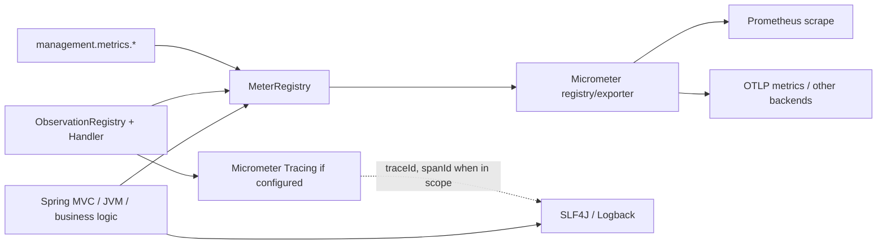
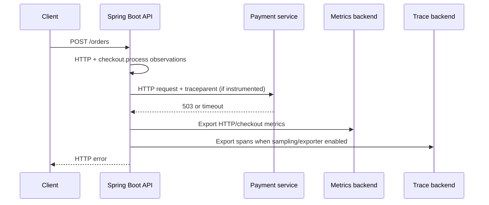

# `management.metrics`: Configuring Micrometer Metrics in Spring Boot

## 1. Objectives and scope

In Spring Boot, a great deal of operational data is already available out of the box: heap usage, CPU, GC, connection counts, HTTP request counts, and latency. What matters is **defining which metrics are recorded, which labels are attached, and how statistics are exported**. The `management.metrics.*` property group is a central configuration point for Micrometer Metrics at the Spring Boot Actuator layer.

This lesson belongs to the **Spring Boot metrics** chapter of the **SPRING_BOOT_OBSERVABILITY** module. After completing it, you will be able to:

- Explain what `management.metrics` controls in `MeterRegistry`, and how it differs from `management.observations` and exporter properties.
- Use `management.metrics.tags.*` to attach common tags with a controlled set of values.
- Use `management.metrics.enable.*` to enable/disable meters by name prefix.
- Configure `management.metrics.distribution.*`: histograms, percentiles, SLO buckets, expected value bounds, and statistics windows.
- Create a business metric using Micrometer Observation or `MeterRegistry`, inspect the results via Actuator/Prometheus, and analyze p95 latency.
- Identify impacts on cardinality, time series cost, dashboards, alerts, and relationships with logs, tracing, and sampling.
- Check the documentation for the exact Spring Boot 3.5.x/4.x version before migrating configurations across systems.

**Primary example version:** Spring Boot **3.5.x**, Java 17+, Micrometer, and Spring MVC. The core properties in this lesson also appear in the Boot 4.x reference; starter names, classes, and some auto-configuration groups may change, so dependency examples should be cross-checked against your specific version.

## 2. Where does `management.metrics` sit in the observability architecture?



- `MeterRegistry` is where **Meters** are registered, including `Counter`, `Timer`, `Gauge`, `DistributionSummary`, and other types. It manages names, tags, statistical samples, and how they are read/exported per registry.
- `management.metrics.*` are **Spring Boot properties** used to configure meters and registries managed by Spring Boot; this is not a Java package or an API that automatically creates spans.
- `ObservationRegistry` describes an operation's lifecycle. With Actuator integration, `DefaultMeterObservationHandler` can generate metrics from completed observations.
- Exporters/registries such as Prometheus and OTLP Metrics forward measurements to a monitoring system. Exporter properties **do not all live under** `management.metrics`.
- Distributed tracing and logs have separate pipelines, sampling, and retention. They can be linked with metrics via service name, timestamp, and trace ID when supported by the system.

Distinguish clearly between three things: **collecting measurements**, **exporting measurements**, and **analyzing measurements**. An `/actuator/metrics` endpoint returning data does not prove Prometheus has scraped it or that an OTLP Collector has received the metrics.

### 2.1. Related namespaces that are easy to confuse

| Property group | Purpose | Example |
| --- | --- | --- |
| `management.metrics.tags.*` | Common tags for meters | `application=checkout-service` |
| `management.metrics.enable.*` | Accept/deny meters by name | Disable `jvm` in a test environment |
| `management.metrics.distribution.*` | Distributions, percentiles, histograms, and SLOs | SLO buckets 100 ms, 300 ms, 1 s |
| `management.endpoints.web.exposure.include` | Expose Actuator endpoints over HTTP | `metrics,prometheus` |
| `management.prometheus.metrics.export.*` | Prometheus registry/export | Enable or disable the Prometheus registry |
| `management.otlp.metrics.export.*` | Send metrics over OTLP | `url` to the collector |
| `management.observations.*` | Control and configure Observations | Enable observations, rename HTTP observations |
| `management.tracing.*` | Control tracing/sampling | Trace sampling probability |

Do not use `management.metrics.tags` expecting it to automatically add span attributes to all distributed traces. Likewise, do not use `management.tracing.sampling` to fix a metric that has too many tag values.

## 3. Initializing the demo project

For a **Spring Boot 3.5.x** application using the Spring Boot parent/BOM for version management, the minimal Maven dependencies to run an API and view Prometheus metrics are:

```xml
<dependencies>
    <dependency>
        <groupId>org.springframework.boot</groupId>
        <artifactId>spring-boot-starter-web</artifactId>
    </dependency>
    <dependency>
        <groupId>org.springframework.boot</groupId>
        <artifactId>spring-boot-starter-actuator</artifactId>
    </dependency>
    <dependency>
        <groupId>io.micrometer</groupId>
        <artifactId>micrometer-registry-prometheus</artifactId>
    </dependency>
</dependencies>
```

Actuator integrates Micrometer and auto-configures registries according to the dependencies present. The Prometheus registry exposes data at `/actuator/prometheus` if the endpoint is exposed. **You do not need to enable tracing to learn metrics configuration**; viewing spans requires adding a separate tracing bridge/exporter and backend.

Minimal `application.yml` example, where endpoints should only be exposed with proper access control:

```yaml
spring:
  application:
    name: checkout-service

management:
  endpoints:
    web:
      exposure:
        include: health,info,metrics,prometheus
  metrics:
    tags:
      application: checkout-service
      environment: local
```

In production environments, `/actuator/metrics` and `/actuator/prometheus` require proper authentication, network, or reverse-proxy policies. `localhost` and the ports below are for local illustration only and are not defaults for production.

## 4. `management.metrics.tags.*`: common tags

### 4.1. What are common tags?

Common tags are dimensions that appear on **every meter** of the configured registry. They help group data by application or environment without repeating tags whenever creating each `Counter` or `Timer`.

```yaml
management:
  metrics:
    tags:
      application: checkout-service
      environment: staging
      region: ap-southeast-1
```

For example, the same `http.server.requests` meter name across two applications or regions can be distinguished by `application`, `environment`, and `region`. In Prometheus, labels are exported in Prometheus format and may be supplemented by labels added by the scrape/target mechanism, such as `job` and `instance`.

| Recommended | Consider carefully | Avoid |
| --- | --- | --- |
| `application`, `environment`, deployment region with a managed value set | `version`/build hash (each deploy creates a new dimension) | `userId`, `orderId`, `traceId`, `sessionId` |
| Fixed `team`/service group | `instance` if the backend already adds it | Raw URL, token, email |
| Allowlisted `component` | Tenant when tenant count can grow unbounded | Exception message or request body |

**Common tags apply to every meter, so their impact is wide.** A `userId` in common tags can cause a time series explosion across the entire application, not just in one business metric.

### 4.2. Cardinality budget

Suppose a metric has 4 `method` values, 5 `status` values, 30 `uri` values, is scraped from 6 instances, and you add 2 `region` values. The theoretical upper bound when all combinations occur is:

\[
4 \times 5 \times 30 \times 6 \times 2 = 7{,}200\ \text{series}
\]

If a unique request ID is attached per request, cardinality can grow without bound along with traffic and retention. With a Timer histogram, each tag combination can also generate multiple `_bucket`, `_count`, and `_sum` series.

To investigate *an individual request*, use access-controlled logs and traces; to compute **error rate/p95/throughput**, use metrics with bounded labels.

### 4.3. Common tags in Java instead of properties

When you need to control tag ordering (for example, in hierarchical registries like Graphite) or apply custom logic, Spring Boot supports `MeterRegistryCustomizer`:

```java
import io.micrometer.core.instrument.MeterRegistry;
import org.springframework.boot.actuate.autoconfigure.metrics.MeterRegistryCustomizer;
import org.springframework.context.annotation.Bean;
import org.springframework.context.annotation.Configuration;

@Configuration(proxyBeanMethods = false)
class MetricsConfiguration {
    @Bean
    MeterRegistryCustomizer<MeterRegistry> metricsCommonTags() {
        return registry -> registry.config()
                .commonTags("application", "checkout-service",
                            "environment", "staging");
    }
}
```

This is an **alternative** to the corresponding common tags configuration in YAML. Avoid configuring the same tag key in multiple places without controlling the final value. `MeterRegistryCustomizer` configures the **metrics registry**, unlike `ObservationRegistryCustomizer` which is for the observation registry.

In application code, prefer injecting the Spring-managed `MeterRegistry`; avoid relying on static `Metrics.counter(...)` calls, as the global registry has a different lifecycle and governance model.

## 5. `management.metrics.enable.*`: accepting or denying meters

Spring Boot uses the meter name prefix to decide whether a meter is accepted into the registry. For example:

```yaml
management:
  metrics:
    enable:
      jvm: false
```

The configuration above **denies meters whose names start with `jvm`** in registries subject to this policy, such as `jvm.memory.used`. The goal might be to reduce unnecessary data in test environments, but disabling too broadly removes useful JVM dashboards and alerts.

Example of disabling a custom metric group:

```properties
management.metrics.enable.internal.poll=false
```

Comparison table:

| Case | What changes? |
| --- | --- |
| `management.metrics.enable.jvm=false` | Meters in the `jvm` group are excluded from registries applying the configuration |
| `management.metrics.enable.checkout=false` | Meters starting with `checkout` may be excluded, even when created directly via `MeterRegistry` |
| `management.observations.enable.checkout=false` | Can block observations with the matching prefix; operates at the Observation layer, distinct from meter filters |
| `management.tracing.sampling.probability=0.1` | Adjusts trace sampling, not meter enabling/disabling |

**Note on choosing prefixes:** per-meter properties match names starting with the prefix; if multiple rules apply, the longer match takes precedence according to Boot's mechanism. Do not disable all of `http` if you only want to drop an internal subset.

If a meter is denied, business code still runs; updating that counter/timer simply no longer provides the expected numbers. Thus **disabling a meter reduces observability**, without changing order-processing logic.

### Verifying the rule

1. Run the application with `jvm` disabled.
2. Call `GET /actuator/metrics` and verify that `jvm.*` meters are no longer provided.
3. Re-enable and restart the application; verify that the meters reappear.
4. Cross-check dashboards and alerts before bringing the rule to production.

When you need to filter based on **tag values** or cap cardinality per group, use `MeterFilter` instead of relying solely on `enable` properties.

## 6. `management.metrics.distribution.*`: measuring time and size distributions

`Counter` provides total event counts; `Timer` provides counts and durations; `DistributionSummary` stores distributions of quantities that are not necessarily time (for example, payload size). To inspect p95 latency or the percentage of requests under an SLO threshold, you need appropriate distribution statistics configuration.

### 6.1. Important properties

| Property under `management.metrics.distribution` | Effect | When to use |
| --- | --- | --- |
| `percentiles-histogram.<meter>` | Requests a histogram supporting aggregatable percentile estimation across dimensions/supported backends | When you want p95 across instances/routes |
| `slo.<meter>` | Defines SLO boundaries for cumulative histograms | When measuring the percentage under 100 ms, 300 ms, 1 s |
| `percentiles.<meter>` | Exports percentiles computed on the application side | When inspecting local percentiles, understanding aggregation limits |
| `minimum-expected-value.<meter>` | Minimum expected value to clamp bucket range | Reduce irrelevant buckets |
| `maximum-expected-value.<meter>` | Maximum expected value to clamp bucket range | Bound buckets to the latency domain |
| `expiry.<meter>` | Rotation period for decaying statistics windows in certain registries | Tune local statistics windows |
| `buffer-length.<meter>` | Number of statistics buffers/windows | Tune smoothness and RAM cost |

Names are specified using the **meter name in code**, such as `http.server.requests` or `checkout.process`, not the transformed Prometheus name like `http_server_requests_seconds`.

### 6.2. SLO buckets for a business Timer

Suppose an organization wants to know the percentage of checkouts completed within **300 ms**. Configure SLOs for `checkout.process`:

```yaml
management:
  metrics:
    distribution:
      slo:
        "[checkout.process]":
          - 100ms
          - 300ms
          - 1s
```

The brackets are quoted so that Spring Boot Binder preserves the **literal dot** in the map key instead of interpreting it as nested configuration branches. You can also express this in `application.properties`:

```properties
management.metrics.distribution.slo.checkout.process=100ms,300ms,1s
```

Once a Timer named `checkout.process` receives samples, an exporter supporting cumulative histograms such as Prometheus can generate buckets with boundaries 0.1 s, 0.3 s, 1 s, and `+Inf`, along with the corresponding count/sum series. The exact number and names of output series depend on the registry and Micrometer version; do not expect histograms on backends that do not support them.

To estimate the percentage of checkouts within 300 ms once Prometheus has scraped:

```promql
sum(rate(checkout_process_seconds_bucket{le="0.3"}[5m]))
/
sum(rate(checkout_process_seconds_count[5m]))
```

This formula applies when the `le="0.3"` bucket actually exists and you aggregate over the same set of instances/labels in both numerator and denominator. It represents the **proportion of observed samples less than or equal to 300 ms** in the evaluation window, not a probability for every future request.

### 6.3. Histograms for aggregatable p95

The following configuration is an **alternative approach** when you want p95/p99 over histograms on supported backends:

```yaml
management:
  metrics:
    distribution:
      percentiles-histogram:
        "[checkout.process]": true
      minimum-expected-value:
        "[checkout.process]": 10ms
      maximum-expected-value:
        "[checkout.process]": 3s
```

Setting `minimum-expected-value`/`maximum-expected-value` tells Micrometer to emit only buckets covering the expected duration range. **This does not mean measurements outside the range are truncated or dropped**; check the exact Micrometer/registry semantics regarding bucket boundaries and extreme values.

If `checkout_process_seconds_bucket` series exist, the aggregated p95 query is:

```promql
histogram_quantile(
  0.95,
  sum by (le) (
    rate(checkout_process_seconds_bucket[5m])
  )
)
```

Keep in mind:
- This is an **estimate** of p95 from buckets, not the exact percentile of all raw requests.
- When you need p95 *per route or channel*, preserve that dimension in `sum by (le, uri)` or `sum by (le, channel)` rather than aggregating it away.
- If histograms are not configured or the backend does not provide matching buckets, `histogram_quantile` has no data to compute.
- `_sum / _count` is the **mean**, not p95; the average of per-instance p95s is not the overall p95 either.

### 6.4. Application-side `percentiles`: benefits and limits

You can configure:

```yaml
management:
  metrics:
    distribution:
      percentiles:
        "[checkout.process]":
          - 0.5
          - 0.95
```

The numbers `0.5` and `0.95` correspond to p50 and p95 **computed inside the application/registry**. These quantiles are **not aggregatable** across multiple instances: you cannot compute a system-wide p95 by averaging each pod's p95 value.

Comparing options:

| Goal | What to use |
| --- | --- |
| View local p95 of a single instance | `percentiles` when supported by the registry |
| Aggregate p95 across multiple instances | `percentiles-histogram` and an appropriate histogram query |
| Track % of requests under an SLA/SLO threshold | `slo` buckets, ratio of `_bucket / _count` |
| Only need request count and total duration | Regular Timer; no extra histogram needed |
| Reduce data volume | Optimize tags, limit metric families/buckets, pick only needed SLOs |

`percentiles`, `slo`, and `percentiles-histogram` can interact with one another and affect export cost; design a configuration tailored to your goal instead of enabling all three on every meter.

### 6.5. `expiry` and `buffer-length` are not Prometheus retention

Some metrics systems maintain sliding statistics windows in memory to compute recent percentiles/max values. `management.metrics.distribution.expiry.*` and `buffer-length.*` affect how these statistics accumulate and rotate.

Illustrative example:

```properties
management.metrics.distribution.expiry.checkout.process=1m
management.metrics.distribution.buffer-length.checkout.process=3
```

This **does not change how long data already scraped into Prometheus is stored**. Retention in Prometheus/OTLP backends must be configured in the respective storage system. For cumulative histograms, adjusting statistics windows does not replace defining buckets either.

## 7. Java example: one business operation, one Counter, and one Observation

Spring Boot can automatically instrument HTTP server requests into `http.server.requests`. Let's add a business operation `checkout.process` and a counter `checkout.attempts` to understand a processing step inside the request.

```java
package com.example.checkout;

import io.micrometer.core.instrument.MeterRegistry;
import io.micrometer.observation.Observation;
import io.micrometer.observation.ObservationRegistry;
import org.springframework.web.bind.annotation.GetMapping;
import org.springframework.web.bind.annotation.RequestParam;
import org.springframework.web.bind.annotation.RestController;

@RestController
public class CheckoutDemoController {

    private final ObservationRegistry observations;
    private final MeterRegistry meters;

    public CheckoutDemoController(
            ObservationRegistry observations,
            MeterRegistry meters) {
        this.observations = observations;
        this.meters = meters;
    }

    @GetMapping("/demo/checkout")
    public String checkout(
            @RequestParam(defaultValue = "false") boolean fail) {

        return Observation.createNotStarted(
                        "checkout.process", observations)
                .contextualName("process checkout")
                .lowCardinalityKeyValue("channel", "web")
                .observe(() -> {
                    if (fail) {
                        meters.counter("checkout.attempts",
                                "outcome", "failure").increment();
                        throw new IllegalStateException(
                                "Simulated checkout failure");
                    }

                    meters.counter("checkout.attempts",
                            "outcome", "success").increment();
                    return "checkout completed";
                });
    }
}
```

How to read this:
- Spring MVC tracks HTTP requests automatically if instrumentation is enabled. The new Observation measures the business part and can produce a `checkout.process` Timer.
- `MeterRegistry` creates the `checkout.attempts` Counter categorizing the two outcomes.
- When the request fails, `observe` records the exception on the observation and rethrows it; with default Spring MVC behavior, an unhandled exception typically produces HTTP 500.
- `channel` and `outcome` have small value sets. Do not add `orderId` or `userId` as metrics tags.
- Common tags `application` and `environment` in configuration apply to Spring-managed meters; they do not turn into tracing attributes everywhere.

If `checkout.process` SLOs from Section 6.2 are configured, after a few successful/failed requests there will be samples for the Timer and corresponding buckets when the registry supports them.

## 8. Viewing results: Actuator metrics and Prometheus

### 8.1. Actuator endpoints

After starting the application at `localhost:8080`, issue these requests:

```text
GET http://localhost:8080/demo/checkout
GET http://localhost:8080/demo/checkout?fail=true

GET http://localhost:8080/actuator/metrics
GET http://localhost:8080/actuator/metrics/checkout.process
GET http://localhost:8080/actuator/metrics/checkout.attempts
GET http://localhost:8080/actuator/prometheus
```

The path `/actuator/metrics/checkout.process` uses the **Micrometer name in code**. Do not substitute Prometheus's `checkout_process_seconds` when querying Actuator. The `metrics` endpoint can return `COUNT`, `TOTAL_TIME`, `MAX`, and a list of tags depending on the meter/registry type.

You can filter by tag:

```text
GET /actuator/metrics/checkout.attempts?tag=outcome:failure
GET /actuator/metrics/checkout.process?tag=channel:web
```

When a metric does not appear yet, verify that the code executed, the observation called `stop()`, a `MeterRegistry` and metrics handler exist, the meter name is correct, and no `management.metrics.enable` rule is blocking it.

### 8.2. Prometheus scrape

With `micrometer-registry-prometheus` and the endpoint exposed, `/actuator/prometheus` can contain series such as:

```text
checkout_attempts_total{application="checkout-service",outcome="success",...} ...
checkout_process_seconds_count{application="checkout-service",channel="web",...} ...
checkout_process_seconds_sum{application="checkout-service",channel="web",...} ...
checkout_process_seconds_bucket{le="0.3",...} ...
```

This is a **structural illustration**, not verbatim output. Exact labels/names depend on conventions, registry, Micrometer version, and histogram configuration; `_bucket` appears only when histograms/buckets are active.

Sample scrape configuration on the machine running Prometheus:

```yaml
scrape_configs:
  - job_name: "checkout-spring"
    metrics_path: "/actuator/prometheus"
    static_configs:
      - targets: ["localhost:8080"]
```

If Prometheus runs inside a container while Spring Boot runs outside the container, `localhost` inside the container does not point to the application host. You must use an address reachable from Prometheus (such as a service DNS name on the container network). Never expose Actuator publicly just to make backend scraping succeed.

### 8.3. Business-oriented PromQL

Checkout failure rate:

```promql
sum(rate(checkout_attempts_total{outcome="failure"}[5m]))
```

Error ratio over total checkouts:

```promql
sum(rate(checkout_attempts_total{outcome="failure"}[5m]))
/
sum(rate(checkout_attempts_total[5m]))
```

When samples are very sparse or the denominator is 0, the ratio can be unstable or undefined; clearly define alert conditions and minimum traffic thresholds. `rate`/counters must account for process resets during redeployments.

Average checkout latency:

```promql
sum(rate(checkout_process_seconds_sum[5m]))
/
sum(rate(checkout_process_seconds_count[5m]))
```

This is the mean processing time in seconds. For p95, rely on appropriate histogram buckets as shown in Section 6.3.

## 9. Exporters: why `management.metrics` alone is not enough

### 9.1. Prometheus is a pull model

Prometheus reads `/actuator/prometheus` on a scrape schedule. You need:
1. The `micrometer-registry-prometheus` dependency.
2. The Actuator Prometheus endpoint exposed.
3. Prometheus configured with the target/metrics path and access permissions.
4. Verification of target status, sample ingestion, and actual queries.

The property `management.prometheus.metrics.export.enabled` controls the Prometheus registry at the export layer; it is different from `management.metrics.enable.<meter>`, which decides whether a **specific meter** is accepted into the registry.

### 9.2. OTLP Metrics is a push/export model

In **Spring Boot 3.5.x**, if using the `micrometer-registry-otlp` registry, an example OTLP Metrics endpoint configuration is:

```yaml
management:
  otlp:
    metrics:
      export:
        url: http://localhost:4318/v1/metrics
```

This is `management.otlp.metrics.export.url`, under the **metrics exporter** branch, not `management.metrics.distribution`. The collector must receive OTLP Metrics at the matching protocol and address. Inside a container, `localhost` refers to the container itself.

**Note:** `management.otlp.metrics.export.url` is distinct from OTLP tracing properties and from the OpenTelemetry trace exporter. Using the same collector does not mean two signals use the same endpoint or the same SDK. When adding logs, tracing, and metrics, verify each data pipeline independently.

### 9.3. Simple registry and global registry

Spring Boot can use a **simple in-memory registry** as a fallback when no other registry is configured. In the 3.5 branch, the fallback can be disabled with:

```properties
management.simple.metrics.export.enabled=false
```

Spring Boot 3.5 also supports:

```properties
management.metrics.use-global-registry=false
```

This property controls linking Boot auto-configured registries into Micrometer's global static composite registry. In Spring code, **prefer injecting the `MeterRegistry` bean** and minimize reliance on static `Metrics.counter(...)` so configuration, testing, and lifecycle remain consistent.

## 10. Optimizing cardinality when enabling histograms and common tags

The biggest risk in metrics is **time series count**, not the number of lines of metric-recording code.

Suppose `http.server.requests` has:
- 4 HTTP methods,
- 6 HTTP statuses,
- 25 URI templates,
- 8 instances,
- 2 environments.

Upper bound if every combination occurs:

\[
4 \times 6 \times 25 \times 8 \times 2 = 9{,}600\ \text{label combinations}
\]

If each combination has 12 histogram bucket series plus `_count` and `_sum`, the corresponding series count can reach **134,400** under this assumption. Actual numbers depend on the bucket set, labels, registry, traffic, and observed combinations.

Mitigations:
- Only attach tags from **enums/allowlists/route templates**; never attach raw URIs, request IDs, exception messages, or customer IDs.
- Do not enable `percentiles-histogram` indiscriminately on `all` or an overly broad prefix; evaluate which metrics truly need p95.
- Use meaningful SLO boundaries, check bucket counts, and estimate cost before deploying.
- Evaluate whether common tags duplicate labels added by backend scraping (`job`, `instance`) or vary per request.
- Monitor `prometheus_tsdb_head_series` in Prometheus and meter counts in the application; abnormal series growth can come from histograms, new tags, instance scaling, or route changes.
- For libraries with dynamic tag values, consider `MeterFilter.maximumAllowableTags(...)` as a defensive guardrail, though **denied meters cause missing data**; the primary solution remains normalizing inputs.

### Illustrative tag-limiting `MeterFilter`

```java
import io.micrometer.core.instrument.config.MeterFilter;
import org.springframework.context.annotation.Bean;
import org.springframework.context.annotation.Configuration;

@Configuration(proxyBeanMethods = false)
class MetricGuardrails {
    @Bean
    MeterFilter limitChannelValues() {
        return MeterFilter.maximumAllowableTags(
                "checkout.process",
                "channel",
                3,
                MeterFilter.deny());
    }
}
```

Spring Boot automatically applies `MeterFilter` beans to managed registries. The filter prevents new `channel` values after the threshold, but **does not automatically rewrite the fourth value to `other`**. Normalize `channel` before creating the meter so essential samples are not lost.

## 11. Distinguishing metrics from observations, tracing, and logs during incident investigation

A `POST /orders` flow passes through:
- Spring MVC's HTTP server observation;
- the `checkout.process` business observation;
- an HTTP client span calling the payment gateway if tracing/instrumentation is present;
- logging when payment fails.



How to use signals to find root cause:

1. **Metrics:** from `http.server.requests` and `checkout.process`, determine when latency rose, the error rate, and affected routes/channels. Tags must be stable.
2. **Traces:** pick a trace from the corresponding timeframe and inspect HTTP server, checkout, and payment client/server spans. If no trace is found, check sampling, exporter, and propagation.
3. **Logs:** search by `traceId`/`spanId` (if MDC/correlation is configured) and inspect exceptions/retries/timeouts.
4. **Cross-check:** use metrics to gauge prevalence; a single isolated trace does not represent all traffic.

**Configuring `management.metrics.distribution.percentiles-histogram` does not automatically enable distributed tracing.** Similarly, `management.tracing.sampling.probability=0.1` does not cause a Counter to drop down to 10% of events. Metrics and traces have different collection, storage, cardinality, and sampling systems.

Prometheus **exemplars** can link a histogram sample to a trace ID so you can jump from a chart to a trace, provided both exporter and backend support it, span context is active, and configuration is compatible. This is a system-dependent feature and does not exist by default just from adding common tags.

## 12. Differences between Spring Boot 3.5.x and 4.x

**The core `management.metrics.*` group still appears in Spring Boot 4.x documentation**, including common tags, per-meter enablement, percentile histograms, SLOs, percentiles, expiry, and buffer-length. What must be checked during an upgrade is not only individual properties, but also dependencies/starters, auto-configurations, and specific integrations that were reorganized in Spring Boot 4.x.

| Aspect | What to verify when upgrading |
| --- | --- |
| `management.metrics.tags.*` | Verify tags exported in Actuator and exporters, with no duplicate labels |
| `management.metrics.enable.*` | Verify the exact meter name/prefix being filtered |
| `management.metrics.distribution.*` | Verify SLOs/histograms are applied and inspect actual buckets |
| Prometheus / OTLP exporters | Check dependencies, endpoints, URLs, and access permissions |
| Observation → Metrics | Verify handlers/registries still create Timers with expected names |
| Java customizer/filter | Use API packages compatible with the new Boot version |
| Tracing/logs | Check tracing/exporter properties and context propagation separately |

Do not use a Boot 3.5 `application.yml` example to infer every tracing/OTLP exporter property in Boot 4.x. This lesson maintains **a Boot 3.5 metrics baseline** and guides you on how to verify when using another branch.

## 13. Common configuration pitfalls

| Symptom | Possible cause | How to locate and fix |
| --- | --- | --- |
| `/actuator/metrics` returns 404 | Endpoint not exposed, Actuator missing, or base path changed | Check dependencies and `management.endpoints.web.exposure.include` |
| `/actuator/metrics` exists, but `/actuator/prometheus` does not | Missing Prometheus registry or not exposed | Check `micrometer-registry-prometheus` dependency and exposure |
| Metrics appear in Actuator, but Prometheus does not see them | Wrong scrape target, network issue, auth, or relabeling | Inspect Prometheus targets, scrape logs, and network |
| `checkout.process` not visible | Code didn't run/stop, metrics handler missing, or blocked by enable rule | Execute the business path, then inspect registry and enable config |
| Disabled `jvm`, and JVM alerts lost data | `management.metrics.enable.jvm=false` took effect too broadly | Review the prefix and restore the appropriate rule |
| Series count spikes after enabling p95 | Histogram adds buckets for every label combination | Review `percentiles-histogram`, tags, buckets, and instance count |
| p95 is wrong when aggregating across pods | Averaging client-side quantiles | Use histograms and `histogram_quantile` with proper aggregation |
| SLO bucket `le="0.3"` does not appear | SLO not applied to the right name, no samples yet, or different backend | Check config key, `/actuator/prometheus`, and meter name |
| `management.metrics.tags.application` missing on a metric | Registry not managed by Boot or meter registered elsewhere | Inject Spring-managed `MeterRegistry`; check mappers/filters |
| OTLP Metrics do not reach backend | Wrong `management.otlp.metrics.export.url`, protocol/collector, or credentials | Check exporter logs, network, and OTLP Metrics endpoint |
| Metrics exist, but no traces | Tracing bridge/exporter not added, or dropped by sampling | Inspect tracing independently |
| Cardinality increases after adding a tag | Attached raw ID/URL or dynamic common tag | Normalize values, reduce dimensions, check MeterFilter |
| HTTP request metric gets unexpected error tag | Exception handled by handler; convention/outcome differs from expectation | Check HTTP status and exception recording rules; don't infer from stack trace alone |
| Changing `management.metrics` at runtime has no effect | Many settings are read when creating the registry/meter | Restart or use a supported reload mechanism; do not assume hot reload |

## 14. Controlled practice

To understand each property, make one change per step and compare:

1. **Baseline:** run the app with Actuator and the Prometheus registry. Send 10 `/demo/checkout` requests, including 2 failures; inspect `checkout.attempts` and `checkout.process`.
2. **Common tags:** add `management.metrics.tags.environment=local`, restart, and observe the new metric carrying the `environment` label.
3. **Enable:** disable only `jvm`, confirm `jvm.memory.used` is no longer exported in the registry; re-enable before continuing.
4. **SLO:** configure `management.metrics.distribution.slo.checkout.process=100ms,300ms,1s`, re-run requests, and inspect the `le="0.3"` bucket if using a supported Prometheus exporter.
5. **Histogram:** test `percentiles-histogram.checkout.process=true`, measure bucket/time series counts before and after; decide whether aggregated p95 is needed.
6. **Query:** use `rate(checkout_attempts_total[5m])`, calculate error ratio and `histogram_quantile` when histograms exist.
7. **Investigation:** simulate a checkout failure, inspect metrics at the time of failure; if tracing and log correlation are enabled, open the trace/span and logs from the same timestamp to determine the root cause.

When practicing, do not read samples immediately after startup and conclude a meter is missing: many meters appear only **after the first activity**; some registries also follow their own export/scrape schedule.

## 15. Self-study questions

1. Does `management.metrics.tags.application=checkout-service` add an `application` attribute to every distributed tracing span? Why or why not?
2. Which layers do `management.metrics.enable.jvm=false` and `management.observations.enable.http.server.requests=false` affect?
3. Why can adding `userId` as a common tag be more dangerous than adding `userId` to a single metric?
4. When should you choose `percentiles`, `percentiles-histogram`, or `slo`?
5. Can system-wide p95 be calculated by averaging per-instance p95s? State a correct method when the backend supports histograms.
6. For `checkout.process`, why does the Actuator endpoint use `/actuator/metrics/checkout.process` while Prometheus uses `checkout_process_seconds_count`?
7. Explain why reducing trace sampling from 100% to 10% does not reduce the cardinality of `checkout.attempts`.
8. An application exposes Actuator metrics, but the Prometheus target stays DOWN. Which points will you check?
9. How can enabling histograms for 20 routes with 5 statuses across 10 instances impact the series count?
10. You use `management.metrics.distribution.slo.*` for a 300 ms timeout; how do you calculate the proportion of operations within that threshold?

## References

- [Spring Boot 3.5 — Metrics](https://docs.spring.io/spring-boot/3.5/reference/actuator/metrics.html)
- [Spring Boot 3.5 — Common Application Properties](https://docs.spring.io/spring-boot/3.5/appendix/application-properties/index.html)
- [Spring Boot 4.0 — Metrics](https://docs.spring.io/spring-boot/4.0/reference/actuator/metrics.html)
- [Spring Boot 4.0 — Common Application Properties](https://docs.spring.io/spring-boot/4.0/appendix/application-properties/index.html)
- [Micrometer — Meter Filters](https://docs.micrometer.io/micrometer/reference/concepts/meter-filters.html)
- [Micrometer — Timers](https://docs.micrometer.io/micrometer/reference/concepts/timers.html)
- [Micrometer — Histograms and Percentiles](https://docs.micrometer.io/micrometer/reference/concepts/histogram-quantiles.html)
- [Prometheus — Histograms and Summaries](https://prometheus.io/docs/practices/histograms/)
- [Prometheus — Data Model](https://prometheus.io/docs/concepts/data_model/)
