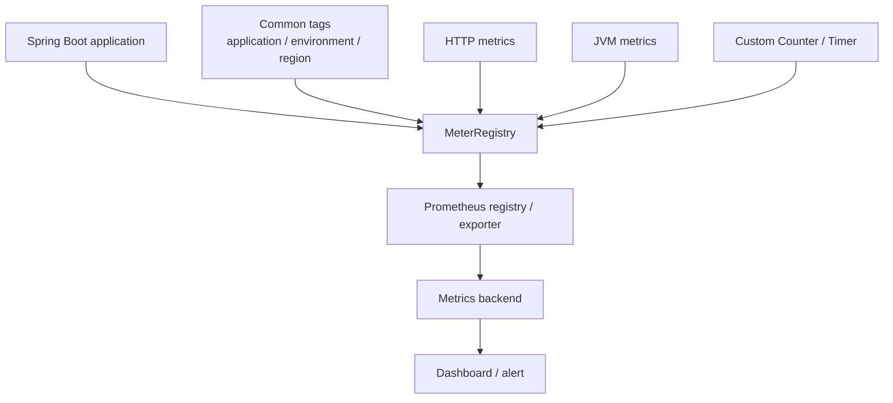
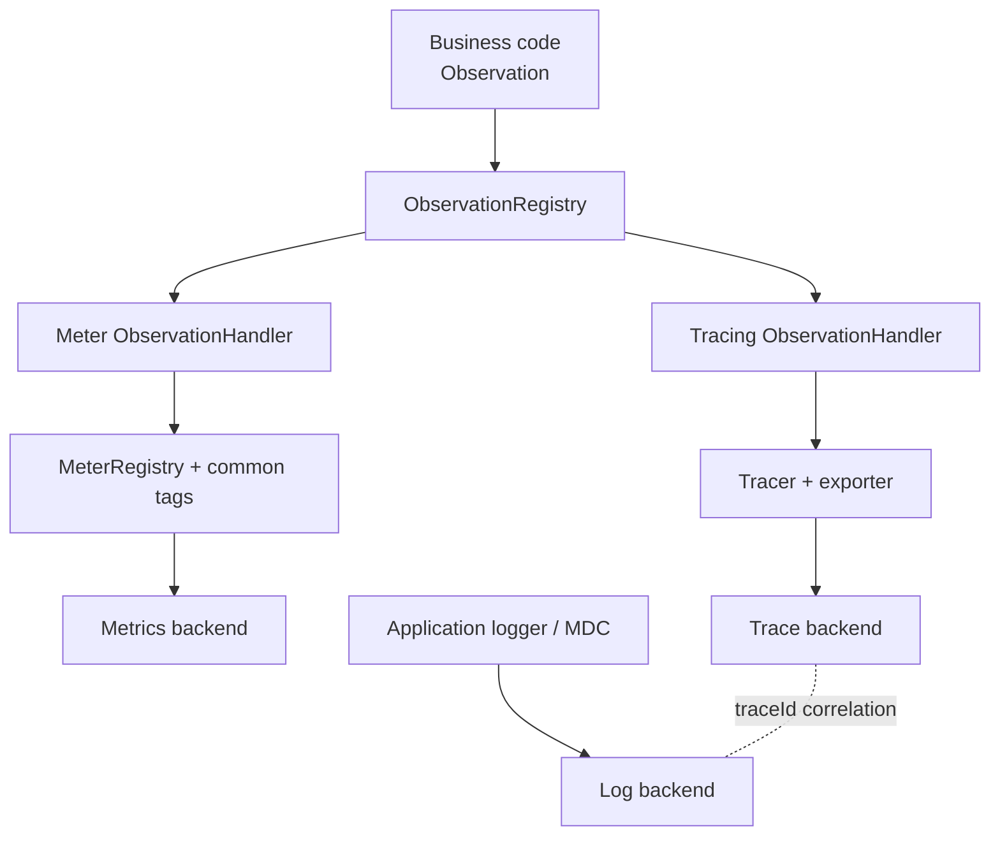

# Common Tags in Spring Boot Metrics

When a company operates multiple Spring Boot applications, charts showing only metric names such as `http.server.requests` or `jvm.memory.used` are often not enough to answer: **which application, which environment, and which deployment region did this metric come from?** If services all export metrics into the same Prometheus system or centralized observability platform, operators need a consistent way to attach metadata for filtering and aggregating measurements.

In Micrometer Metrics, **common tags** are `key=value` pairs applied across meters registered in a `MeterRegistry`. For example: `application=order-service`, `environment=prod`, and `region=ap-southeast-1`. A `Timer` or `Counter` can then carry both common tags and its own tags such as `outcome=success`, allowing an operation to be observed in its deployment context without repeating configuration code everywhere.

This lesson is **Common tags**, in the **Spring Boot metrics** chapter of the **SPRING_BOOT_OBSERVABILITY** module. The module's goal is to establish observability in Spring Boot using Micrometer Observation, metrics, logs, and distributed tracing; understanding context propagation, tags/cardinality, exporters, sampling, and signal correlation to investigate errors, latency, and application behavior in real environments. This lesson focuses on **how to configure and govern common tags**, as well as their boundaries with Observation metadata, logging, and tracing.

## 1. Learning objectives

After this lesson, you will be able to:

- Explain what common tags are, where they are attached, and how they differ from a meter's own tags.
- Configure common tags in Spring Boot using `management.metrics.tags.*`.
- Write a `MeterRegistryCustomizer<MeterRegistry>` to configure common tags in Java when flexible logic is needed.
- Choose an appropriate tag set for application, environment, and deployment region while avoiding per-request varying data.
- Predict the impact of common tags on cardinality and histogram time series.
- Verify tags via Actuator, Prometheus, and several PromQL queries.
- Distinguish **metrics** common tags from trace attributes, baggage, and logging MDC.
- Diagnose why a metric is missing tags, has conflicting tags, or does not appear in the backend.

## 2. What problem do common tags solve?

A single service can provide many meters:

- `http.server.requests`: counts and measures duration of HTTP requests.
- `jvm.memory.used`: amount of JVM memory currently in use.
- `system.cpu.usage`: system CPU utilization, when the corresponding binder is enabled.
- `business.checkout.duration`: custom business timer created by the application.
- `business.payment.failed`: business counter.

Suppose the operations team wants to filter **all** metrics emitted from the production environment of `order-service` in region `ap-southeast-1`. If every location creating a meter had to add those three labels manually, code would be duplicated and labels easily missed.

With common tags, the `MeterRegistry` configuration applies the same label set to meters registered through that registry:



For example, the same `application=order-service` tag can appear in HTTP, JVM, and business counter data. When investigating a slow request, operators can filter consistently by application and deployment region across multiple metric types.

### How do common tags differ from per-meter tags?

| Metadata type | Example | Scope | Who usually sets it? |
| --- | --- | --- | --- |
| **Common tag** | `application=order-service` | Many or all meters in the registry | Spring Boot configuration / `MeterRegistryCustomizer` |
| **Meter-specific tag** | `operation=reserve`, `outcome=error` | One metric family or one operation | Business code, meter binders |
| **HTTP instrumentation tag** | `method=POST`, `status=500`, `uri=/orders/{id}` | HTTP request metrics | Framework instrumentation/conventions |
| **Backend resource label** | `job`, `instance`, `pod` | Data at scrape/collector/backend | Prometheus, OpenTelemetry, collector infrastructure |
| **Trace attribute** | `db.system`, `http.request.method` | Span/trace | Tracing instrumentation |
| **Log field** | `event=order_failed`, `traceId=...` | Log record | Logger, MDC, encoder, and pipeline |

Common tags **are not information that must be identical across every backend**. They belong to Micrometer metrics configuration. Bringing equivalent fields into traces, logs, or resource metadata requires its own mechanism and separate verification.

## 3. Which common tags should you choose?

A good set of common tags describes the **source emitting the metrics** and has stable operational meaning throughout an instance's lifetime:

| Suggested key | Example | Purpose |
| --- | --- | --- |
| `application` | `order-service` | Identify the application/service emitting metrics |
| `environment` | `dev`, `staging`, `prod` | Filter by environment |
| `region` | `ap-southeast-1` | Compare across deployment regions |
| `deployment.group` | `blue`, `green` | Compare two deployment groups if truly needed |
| `team` | `payments`, `orders` | Operational ownership, if the team list is stable |

You do not need to use all of the tags above. Pick fields needed for dashboards, alerts, and incident analysis. If the exporter or infrastructure already supplies suitable labels, such as `job` or `cluster`, consider **reusing them at the query layer** instead of creating redundant labels from the application.

**Fields that should NOT be common tags:**

- `userId`, `orderId`, `tenantId` with thousands or millions of values.
- `traceId`, `spanId`, request ID, session ID.
- URLs containing path parameters, query strings, message payloads, or exception messages.
- User IPs, emails, tokens, cookies, or sensitive data.
- Timestamps, per-request generated UUIDs, or continuously generated deployment names without a specific monitoring need.

A common tag appears on **many meters**. Therefore, a high-cardinality tag can inflate data volume across a much wider scope than a single custom metric.

### Are common tags completely immutable?

They do not need to be immutable forever. `environment` or `region` can vary between deployments, and `application` differs between services. What matters is that **each instance uses a controlled set of values** and tag changes follow intentional deployment boundaries rather than per-request changes.

If a container starts with `region=ap-southeast-1`, almost all of its meters should stay consistent with that value. When deploying to another region, that is a different instance/metric source with the new value—not a tag arbitrarily changing between requests.

## 4. Configuring via `management.metrics.tags`

For **Spring Boot 3.x** versions with Actuator metrics auto-configuration, the standard approach is declaring `management.metrics.tags` properties in `application.yml`:

```yaml
spring:
  application:
    name: order-service

management:
  metrics:
    tags:
      application: ${spring.application.name}
      environment: ${APP_ENV:local}
      region: ${APP_REGION:local}
```

Explanation:

1. `spring.application.name` supplies the configured application name, such as `order-service`.
2. `management.metrics.tags.application` creates a common tag named `application` for metrics.
3. `APP_ENV` and `APP_REGION` are deployment environment variables provided by the operations platform; `local` is the fallback when unset.
4. When meters are registered into the Boot-managed registry, they can receive this set of common tags alongside their own tags.

For example, a production environment may have:

```text
APP_ENV=prod
APP_REGION=ap-southeast-1
```

Meters emitted by the application will carry labels such as `application=order-service`, `environment=prod`, and `region=ap-southeast-1`, provided they go through the Spring Boot-configured registry and are not altered by other configurations or filters.

**Caveat:** property values come from the deployment environment. If every pod injects an arbitrary `APP_REGION` or the application name contains dynamically generated IDs, those values can still cause high cardinality. Property configuration **does not automatically validate** whether a value set is safe.

### Equivalent YAML and properties configuration

In `application.properties`, the idea is identical:

```properties
spring.application.name=order-service
management.metrics.tags.application=${spring.application.name}
management.metrics.tags.environment=${APP_ENV:local}
management.metrics.tags.region=${APP_REGION:local}
```

Choose a configuration format that fits your project. When multiple profiles or property sources exist, rely on Spring Boot's precedence rules and inspect the **effective final value** in the runtime environment. Avoid assigning conflicting values to the same key across multiple places.

### Applying across deployment environments

| Environment | `application` | `environment` | `region` |
| --- | --- | --- | --- |
| Developer workstation | `order-service` | `local` | `local` |
| Staging | `order-service` | `staging` | `ap-southeast-1` |
| Production Region A | `order-service` | `prod` | `ap-southeast-1` |
| Production Region B | `order-service` | `prod` | `ap-southeast-2` |

The table above is merely an example deployment convention. Architecturally, the two production regions share `application` and `environment`, while `region` lets operations compare latency and error rates across regions.

## 5. Configuring via `MeterRegistryCustomizer`

When common tags need to be computed, normalized from config, or selected according to specific rules, you can declare a `MeterRegistryCustomizer<MeterRegistry>` bean:

```java
import io.micrometer.core.instrument.MeterRegistry;
import org.springframework.beans.factory.annotation.Value;
import org.springframework.boot.actuate.autoconfigure.metrics.MeterRegistryCustomizer;
import org.springframework.context.annotation.Bean;
import org.springframework.context.annotation.Configuration;

@Configuration(proxyBeanMethods = false)
public class MetricsCommonTagsConfiguration {

    @Bean
    MeterRegistryCustomizer<MeterRegistry> commonMetricTags(
            @Value("${spring.application.name:application}") String app,
            @Value("${observability.region:local}") String rawRegion) {

        String region = switch (rawRegion) {
            case "ap-southeast-1" -> "ap-southeast-1";
            case "ap-southeast-2" -> "ap-southeast-2";
            case "eu-west-1" -> "eu-west-1";
            default -> "other";
        };

        return registry -> registry.config().commonTags(
            "application", app,
            "region", region
        );
    }
}
```

This snippet illustrates the API commonly used in **Spring Boot 3.x**. Package names and auto-configuration mechanisms should be re-verified if using another major version. Place the configuration class within Spring component scan scope or import it into the application.

In this example:

- Spring Boot applies the customizer bean to the `MeterRegistry` it manages during the appropriate configuration phase before meters are registered.
- `region` is normalized against an allowlist; invalid deployment values collapse into `other`, preventing unbounded metric series.
- `application` should come from a trusted deployment config source with a fixed naming convention. Similar validation can be applied if the platform permits arbitrary names.
- `registry.config().commonTags(...)` configures shared labels on the registry, not on an individual timer or counter.

**Avoid declaring the same key via both `management.metrics.tags` and `MeterRegistryCustomizer` unless precedence rules are explicitly understood.** These two approaches are alternatives, or complementary when keys are disjoint. Overlapping keys with conflicting values can cause unpredictable behavior or inconsistent meter tags.

### Distinguishing registry configuration from meter registration

If you manually instantiate a `SimpleMeterRegistry` or standalone registry using `new`, customizer beans managed by Spring Boot **will not automatically apply to that registry**. Common tag configuration must be applied to the **exact registry** where meters are created.

If you call `commonTags(...)` **after** many meters have already been registered, do not assume existing meters will immediately change IDs or gain all new labels. Standard practice is to configure the registry **before registering meters**; with Spring Boot, use properties or customizers during startup initialization.

## 6. How do common tags appear on meters?

Suppose a service declares a business counter:

```java
import io.micrometer.core.instrument.MeterRegistry;
import org.springframework.stereotype.Component;

@Component
public class CheckoutMetrics {

    private final MeterRegistry meterRegistry;

    public CheckoutMetrics(MeterRegistry meterRegistry) {
        this.meterRegistry = meterRegistry;
    }

    public void completed(String outcome) {
        String safeOutcome = switch (outcome) {
            case "success", "rejected", "error" -> outcome;
            default -> "unknown";
        };

        meterRegistry.counter(
            "business.checkout.completed",
            "outcome", safeOutcome
        ).increment();
    }
}
```

Here, `outcome` is the **counter's own tag**. The `completed` method should only be called after checkout actually finishes; input normalization ensures only four values can ever be emitted. The code does **not** repeat `application`, `environment`, or `region`.

If the registry is configured with common tags as shown earlier, a Prometheus export sample might look like:

```text
business_checkout_completed_total{
  application="order-service",
  environment="prod",
  region="ap-southeast-1",
  outcome="success"
} 120
```

This is formatted across lines for readability; actual scrape output is typically on a single line, and metric/label names follow the registry/exporter naming convention. The key point is that **a meter carries both common tags and its own tags**.

### Why not make `outcome` a common tag?

`outcome` changes **per execution**. It cannot be a shared constant value valid for JVM memory, CPU usage, and every counter. If `outcome=success` were configured at the registry level, even meters with no concept of "success" would be mislabeled.

Similarly, `http.method`, `http.status`, `uri`, and `exception` are metadata for **specific requests** or specific metric families. Never put them into common tags. Only use keys describing the **shared deployment source**.

### Tags already added by the framework

Spring Boot Actuator typically instruments HTTP server requests with tags such as method, status, outcome, or route template, depending on version and conventions. Common tags are combined with that tag set when the meter passes through the corresponding registry.

If the framework uses `uri=/orders/{id}`, do not replace it with the concrete path `/orders/483927`. URLs with dynamic IDs cause cardinality to explode. Using common tags does not fix a per-meter tag that has excessive cardinality.

## 7. Impact on cardinality and cost

**Cardinality** is the number of distinct values for each tag. The potential number of time series for a meter is driven by the **product of the value sets** when those combinations occur in practice.

Suppose a system has:

| Dimension | Value count |
| --- | ---: |
| `application` | 5 |
| `environment` | 3 |
| `region` | 4 |
| `http.method` | 5 |
| `http.route` | 12 |
| `outcome` | 4 |

If every combination occurs, the theoretical maximum number of label combinations by multiplication is:

\[
5 \times 3 \times 4 \times 5 \times 12 \times 4 = 14\,400
\]

The figure above is only a **theoretical estimate**, not the actual series count. Some routes only exist on one application, many environments do not deploy to all regions, and some outcomes never happen; conversely, Prometheus may add `job`, `instance`, `pod`, or other scrape labels that increase total series.

If you add a `requestId` tag with 100,000 distinct values, the theoretical upper bound becomes:

\[
14\,400 \times 100\,000 = 1\,440\,000\,000
\]

This is why per-request ID tags are unsuitable for metrics. With histogram Timers, bucket, count, and sum series multiply data volume even further per label set.

### Common tags can collide with backend labels

Suppose `region` is already attached to every series by a collector using Kubernetes metadata or service discovery. If the application also attaches `region` with a different value, the pipeline can experience collisions, label renaming, or confusing query results. Decide **which layer owns each label** and keep names and values consistent.

There is no need to create `instance.id` or `pod.uid` under `management.metrics.tags` when the backend already has instance-identifying labels. Values that change on scaling or rollouts create many new series and increase churn. When pod-level analysis is needed, prefer existing infrastructure labels.

### Tag budgeting

An effective governance workflow:

1. List required common tags and their expected value counts.
2. List tags for each key metric family (HTTP, database, messaging, business timers).
3. Estimate value combinations and extra series added when enabling histograms.
4. Check labels from infrastructure, exporters, and collectors—not just Java code.
5. Set limits/alerts on active series or metric churn according to backend capacity.
6. When proposing a new tag, state the operational question it answers and its expected cardinality impact.

**There is no fixed "low cardinality" threshold for every project.** A tag set reasonable for ten small services can become a heavy burden when multiplied across thousands of instances and multiple histograms.

## 8. Common tags and Micrometer Observation

In the Micrometer Observation model, an `Observation` describes a unit of work, and `ObservationHandler` implementations can convert it into **metrics** or **tracing spans**. In Spring Boot, the meter observation handler can record Timers into the `MeterRegistry` configured with common tags.



### Example: custom observation with low-cardinality key-values

```java
import io.micrometer.observation.Observation;
import io.micrometer.observation.ObservationRegistry;
import org.springframework.stereotype.Service;

@Service
public class InventoryService {
    private final ObservationRegistry observationRegistry;
    private final InventoryGateway gateway;

    public InventoryService(ObservationRegistry observationRegistry,
                            InventoryGateway gateway) {
        this.observationRegistry = observationRegistry;
        this.gateway = gateway;
    }

    public void reserve(String orderId) {
        Observation observation = Observation
            .createNotStarted("business.inventory.reserve", observationRegistry)
            .lowCardinalityKeyValue("operation", "reserve")
            .start();

        try (Observation.Scope ignored = observation.openScope()) {
            try {
                gateway.reserve(orderId);
                observation.lowCardinalityKeyValue("outcome", "success");
            } catch (RuntimeException ex) {
                observation.lowCardinalityKeyValue("outcome", "error");
                observation.error(ex);
                throw ex;
            }
        } finally {
            observation.stop();
        }
    }
}

interface InventoryGateway {
    void reserve(String orderId);
}
```

This is a **business** observation: `operation=reserve` and `outcome=success|error` belong specifically to the inventory operation. If the meter handler converts it into a Timer in Boot's `MeterRegistry`, that timer can also receive common tags like `application=order-service` and `environment=prod`.

**Notice three distinct tag layers:**

- `management.metrics.tags.*`: shared metadata on the **MeterRegistry**.
- `observation.lowCardinalityKeyValue(...)`: metadata on the **observation**, which meter handlers can convert into meter tags.
- `observation.highCardinalityKeyValue(...)`: detailed metadata, generally not used as metric labels by standard meter handlers, though tracing handlers can use it as span attributes.

Adding common tags at the metrics layer **does not automatically attach the same tags** to trace attributes or log fields. If you need to query traces by region or service, configure **tracing resource attributes** in the corresponding stack; if you need environment/region in logs, configure structured logging or enrichment in the log pipeline.

### Do observation tags replace common tags?

No. An individual observation should not carry a `region` tag because region is not an inherent property of the operation. If hundreds of observations manually attached `region`, code would repeat deployment details everywhere. Common tags centralize this in `MeterRegistry`, while low-cardinality observation key-values describe **the work**.

## 9. Common tags are not trace context or baggage

Three concepts that are easy to confuse:

| Mechanism | Scope | Example | Automatically propagated to other services? |
| --- | --- | --- | --- |
| **Common metrics tags** | Application's `MeterRegistry` | `application`, `region` | **No** |
| **Trace context** | Span/trace of a request | `traceId`, `spanId`, `traceparent` | Possible, when propagator/instrumentation is present |
| **Baggage** | Business/trace context intentionally allowed to propagate | Controlled `correlation-type` | Depends on propagator config and policy |
| **MDC / structured log fields** | A log record or logging scope | `traceId`, `environment` | Not automatically over the network |

If `order-service` calls `payment-service`, the two applications can have different common tags (`application=order-service` and `application=payment-service`). Tracing propagation lets spans of a single request share the same trace ID if instrumentation is configured, but **does not propagate common metrics tags** from caller to callee.

Never put `traceId` into `management.metrics.tags`. Nearly every request has a distinct trace ID, creating massive cardinality. Trace IDs belong in logs/traces for per-request correlation; metrics use stable dimensions to pinpoint **groups** of failing requests.

### Example: investigating an error using all three signals

A dashboard reports an elevated HTTP 5xx rate for `application=order-service`, `environment=prod`, `region=ap-southeast-1`. Procedure:

1. Filter metrics by the three common tags to identify the affected region and service.
2. Check 5xx rate and latency of HTTP or related custom observations.
3. Search logs for the same service, region, and time window; inspect stable error codes and `traceId` if present.
4. Open the trace by `traceId` to view the path HTTP → inventory → database, if the trace was sampled and successfully exported.
5. Correlate traces/logs with dependency metrics before concluding where the failure or bottleneck lies.

Common tags help **scope by metric emitter**; correlation IDs help **follow a specific request**. The two mechanisms serve different purposes.

## 10. How to verify common tags in Spring Boot

### 10.1. Enable Actuator and the Prometheus registry

For a Gradle Kotlin DSL project using a compatible Spring Boot BOM:

```kotlin
dependencies {
    implementation("org.springframework.boot:spring-boot-starter-actuator")
    runtimeOnly("io.micrometer:micrometer-registry-prometheus")
}
```

Example enabling endpoints for verification:

```yaml
management:
  endpoints:
    web:
      exposure:
        include: health,info,metrics,prometheus
```

`management.endpoints.web.exposure` controls which endpoints are accessible over HTTP when they exist and are permitted. `/actuator/prometheus` requires a compatible Prometheus registry; long-term backend storage requires Prometheus or a collector actually scraping and storing the data.

In production, restrict access to management endpoints per security policies. Do not expose internal operational data unnecessarily.

### 10.2. Verify via Actuator

Once the application is running and at least one meter has been registered:

```text
GET /actuator/metrics
GET /actuator/metrics/jvm.memory.used
GET /actuator/metrics/business.checkout.completed
```

The metrics endpoint lists meter names and returns measurement info and available tags based on actual recorded data. Once common tags are configured, verify that `application`, `environment`, and `region` appear properly in the responses for relevant meters.

Illustrative example response for a meter:

```json
{
  "name": "business.checkout.completed",
  "measurements": [
    { "statistic": "COUNT", "value": 120.0 }
  ],
  "availableTags": [
    { "tag": "application", "values": ["order-service"] },
    { "tag": "environment", "values": ["prod"] },
    { "tag": "region", "values": ["ap-southeast-1"] },
    { "tag": "outcome", "values": ["success"] }
  ]
}
```

This is only an illustrative response model; actual values depend on recorded data, Actuator version, and how meters are grouped during queries.

### 10.3. Verify via Prometheus

```text
GET /actuator/prometheus
```

Locate a familiar metric and inspect its labels:

```text
jvm_memory_used_bytes{application="order-service",environment="prod",region="ap-southeast-1",area="heap",id="G1 Eden Space"} 1.23456E8
```

This illustrates the concept: common tags are attached alongside the JVM meter's own labels. Exact memory metric names and labels depend on the JVM, Micrometer, registry, and exporter in use.

If common tags appear on `business.checkout.completed` but not on `jvm.memory.used`, check whether both meters actually use the same configured registry, whether different filters or pipelines apply, and whether meters were created before or after the customizer ran.

## 11. PromQL: using common tags to analyze multiple services

Assuming Prometheus provides `http_server_requests_seconds_count` counters from Spring Boot HTTP instrumentation; verify series names against a live scrape before running queries.

### 11.1. Request rate by application and region

```promql
sum by (application, region) (
  rate(http_server_requests_seconds_count{
    environment="prod"
  }[5m])
)
```

This query returns requests/second per application/region pair in production over a 5-minute window, aggregating away remaining labels such as instance and route.

### 11.2. HTTP 5xx ratio by application and region

```promql
sum by (application, region) (
  rate(http_server_requests_seconds_count{
    environment="prod", status=~"5.."
  }[5m])
)
/
sum by (application, region) (
  rate(http_server_requests_seconds_count{
    environment="prod"
  }[5m])
)
```

The result is the ratio of HTTP 5xx requests over total recorded requests per application/region. If the denominator is 0 in the window, dashboards must handle the no-traffic case. An HTTP 4xx due to invalid client input usually does not indicate a technical failure of the service.

### 11.3. Mean HTTP latency by region

```promql
sum by (application, region) (
  rate(http_server_requests_seconds_sum{environment="prod"}[5m])
)
/
sum by (application, region) (
  rate(http_server_requests_seconds_count{environment="prod"}[5m])
)
```

The unit is seconds/request. This is the **mean latency** derived from total duration divided by request count, not p95.

### 11.4. p95 if histograms are available

```promql
histogram_quantile(
  0.95,
  sum by (le, application, region) (
    rate(http_server_requests_seconds_bucket{environment="prod"}[5m])
  )
)
```

This query is valid only when the backend receives **classic histogram buckets** from instrumentation; not every `Timer` has `_bucket` by default. If your deployment uses native histograms or another backend, metric structure and queries will differ. Histogram-based p95 is an estimate depending on buckets and data; do not average per-pod p95s to obtain system-wide p95.

### When to keep or drop a common tag in aggregations?

If the goal is an overall SLO for an application across all regions, you can `sum by (application)` to aggregate away `region`. If you want to pinpoint which region has issues, keep `region`. If alerting per environment, filter by or preserve `environment`. Every dashboard and alert should clearly define **ownership and data scope**.

## 12. Common design mistakes

| Issue | Symptom | Remediation |
| --- | --- | --- |
| Manually attaching `application` in code everywhere | Meters have inconsistent or missing tags | Configure once at the registry level |
| Service creates a `MeterRegistry` outside Spring Boot | Some metrics lack common tags | Inject the Boot-configured registry |
| Calling `commonTags(...)` after meters are registered | Earlier meters lack new labels | Apply configuration before creating meters |
| Using the same key in YAML and customizer | Conflicting labels, unpredictable results | Pick one owner per tag |
| Putting `orderId`, `traceId` in common tags | Massive cardinality explosion | Only use deployment labels with small value sets |
| Making `outcome` a common tag | JVM/HTTP/DB metrics get nonsensical labels | Place `outcome` on the relevant meter or observation |
| Unstandardized environment values | `prod`, `production`, `prd` for the same meaning | Enforce an enum of values in deployment config |
| App's `region` label differs from collector's `region` | Dashboard filtering mismatches or breaks grouping | Define label ownership and naming standards |
| Treating common tags as trace baggage | Values missing in downstream services | Configure tracing propagation separately |
| Assuming `management.metrics.tags` writes to logs | Logs lack application/region | Configure log schema/MDC/pipeline separately |
| Missing Prometheus registry | `/actuator/prometheus` unavailable | Add dependency and configure registry |
| Endpoint enabled but backend not scraping | No long-term charts | Check scrape target, permissions, collector |
| Adding many labels with histograms enabled | Active series count spikes | Budget tags and buckets |
| Double measuring HTTP via auto-instrumentation and manual code | Misleading figures | Check existing meters/observations |

## 13. Hands-on practice: applying and verifying Common tags

**Scenario:** you operate two Spring Boot services, `order-service` and `payment-service`, in staging and production, each with different deployment regions. You want to filter metrics by service, environment, and region while still tracking checkout error rates by outcome.

### Part A — Configuration

1. Add `spring.application.name` and `management.metrics.tags.application/environment/region` to each service.
2. Supply `APP_ENV` and `APP_REGION` from deployment with standardized values.
3. Use a Spring Boot-managed `MeterRegistry` in business code; create the `business.checkout.completed` counter with its own `outcome` tag.
4. Enable Actuator metrics and, if observing via Prometheus, add the Prometheus registry and expose its endpoint.
5. Verify common tags on both a JVM metric and the custom business metric.

### Part B — Verification cases

| Case | Action | Expected result |
| --- | --- | --- |
| A | Start `order-service` with `APP_ENV=staging` | Common tag `environment=staging` |
| B | Switch to production in another deployment | `environment=prod` on metrics from that instance |
| C | Change `APP_REGION` between two deployments | Metrics can be filtered per region |
| D | Record a successful checkout | Counter has common tags and `outcome=success` |
| E | Record a failed checkout | Counter has the same common tags, `outcome=error` |
| F | Generate many distinct order IDs | Tag value count does not grow with order IDs |
| G | Inspect `jvm.memory.used` | Has common tags even though JVM binder code did not add them manually |
| H | Look up a failed request by trace ID | Trace ID is in logs/traces, not a common metrics tag |

### Part C — Cardinality exercise

Suppose 4 applications, 3 environments, 2 regions, 6 routes, and 5 HTTP status groups. If every combination occurs, the maximum number of tag combinations is:

\[
4 \times 3 \times 2 \times 6 \times 5 = 720
\]

Now add `podId` with 500 values:

\[
720 \times 500 = 360\,000
\]

Explain why the actual count may be lower than the theoretical upper bound, and describe how adding `podId` in the application can duplicate metadata when Prometheus already attaches `instance` or `pod`. Finally, propose **two or three common tags** that are genuinely necessary for the team's dashboard.

### Part D — Incident response scenario

Metrics show the 5xx rate for `payment-service` in `ap-southeast-2` rising while `ap-southeast-1` remains stable. Verify:

1. Whether series from both regions share the same naming convention and differ specifically on the `region` tag.
2. Whether Prometheus scraping was interrupted or targets are missing in the affected region.
3. Whether HTTP error rate and latency rose simultaneously.
4. Whether logs and traces from that timeframe show dependency timeouts, exhausted connection pools, or application errors.
5. After remediation, whether the affected region's error rate drops without altering deployment tag sets.

### Self-assessment questions

1. When should you use `management.metrics.tags` instead of `MeterRegistryCustomizer`?
2. Why should common tags describe the metrics source, while `status` and `outcome` are typically per-meter-family tags?
3. Is `application=order-service` automatically sent in an HTTP header to `payment-service`? Why or why not?
4. If one meter lacks common tags while other meters have them, what possibilities should you check?
5. Adding a tag with only 4 values can multiply the number of series combinations by what factor in the worst case?
6. Why is `traceId` well suited for log/trace correlation but unsuitable as a common metric tag?
7. If Prometheus already provides `cluster` and `instance` labels, when should you let the backend manage them instead of creating similar common tags in the application?
8. How do you compare error rates and p95 across regions without averaging per-pod p95s?

## 14. Key takeaways

**Common tags** are metadata configured globally on `MeterRegistry`, allowing many types of Spring Boot meters to carry the same stable labels such as `application`, `environment`, and `region`. The standard approach is `management.metrics.tags.*`; when flexible configuration logic is required, use `MeterRegistryCustomizer<MeterRegistry>`. Configure them before meters are registered, verify output via Actuator/Prometheus, and avoid setting conflicting values for the same key across multiple sources.

Common tags let you filter and aggregate **metrics** by deployment source. Meter-specific tags or `Observation.lowCardinalityKeyValue(...)` describe **the work**, while trace context and log fields serve **per-request** investigation. By choosing a low-cardinality tag set, clearly defining label ownership, and properly managing exporters, sampling, and context propagation, a Spring Boot system can correlate metrics, logs, and distributed tracing to investigate errors, latency, and application behavior while keeping observability costs under control.
