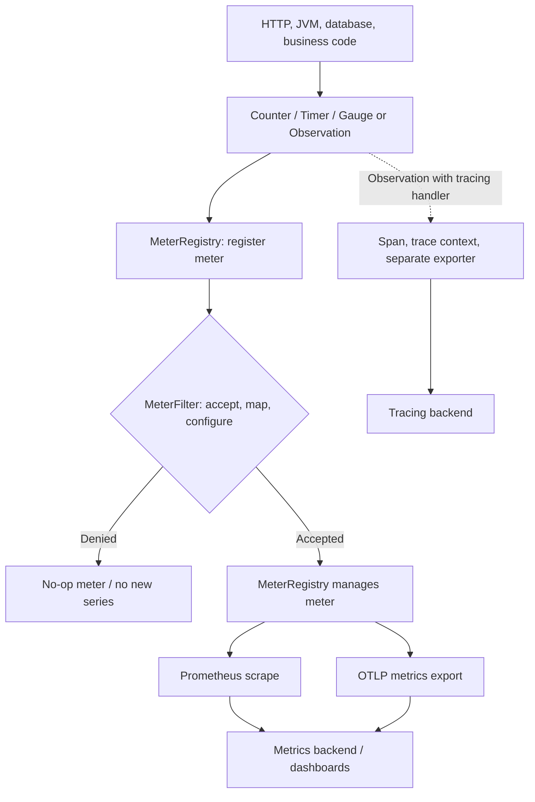
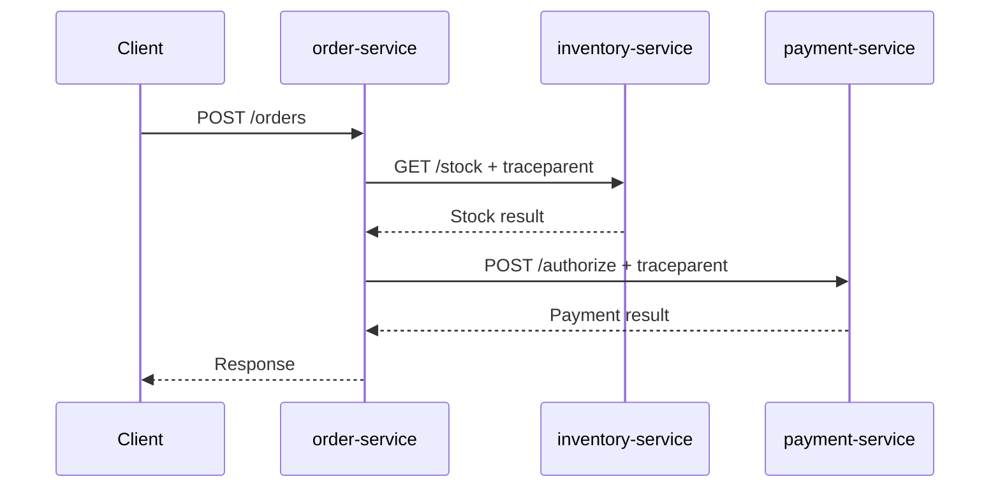
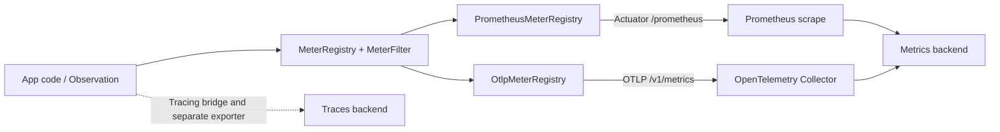

# `MeterFilter` in Spring Boot Metrics

**MeterFilter** is Micrometer's mechanism for applying policies to **meters** when they are registered with a `MeterRegistry`: deciding whether to accept a meter, modifying its name or tags, and customizing distribution statistics configurations for certain meter types. In Spring Boot, it is an important tool for controlling time series count, standardizing metadata, and avoiding exporting unnecessary measurements to monitoring systems.

This lesson belongs to the **Spring Boot metrics** chapter of the **SPRING_BOOT_OBSERVABILITY** module. After completing it, you will be able to write and register `MeterFilter`s, explain their impact on Counter/Timer/Gauge, assess cardinality risks, inspect metrics via Actuator/Prometheus/OTLP, and distinguish metrics policies from **Micrometer Observation**, logs, distributed tracing, context propagation, and sampling.

## 1. Where does `MeterFilter` sit in the metrics pipeline?

A Spring Boot service can record metrics directly through `MeterRegistry` or via `ObservationRegistry` and a metrics handler. When a meter is created, Micrometer uses configured filters to determine how that meter is registered.



Key distinctions:

- **`MeterRegistry`** is where meters are registered and measurements are exported.
- **`MeterFilter`** enforces policies applied when registering a meter into the registry.
- **`ObservationRegistry`** manages the Observation lifecycle; metrics handlers can use `MeterRegistry` to record measurements.
- **Tracing bridges/exporters** provide spans and distributed trace context via a separate pipeline.

A `MeterFilter` denying a meter **does not mean** it prevents an Observation from running or deletes related spans/logs. To govern all observability data, policies must be applied at each appropriate layer.

### Example motivations

Suppose an application has 300 endpoints, each accepting many query parameters. If instrumentation records raw URLs in a `uri` label, an HTTP Timer can create tens of thousands of time series. Or the system carries many `legacy.*` meters no longer used by dashboards. `MeterFilter` can help:

1. Deny the `legacy.*` meter group.
2. Standardize a tag key or a low-cardinality set of tag values.
3. Block new meter registrations beyond an allowed tag threshold, as a defensive guardrail.
4. Define histogram/percentile configurations for critical Timers.

However, **fixing instrumentation at the source** to use route templates and finite value sets remains the most sustainable approach. A filter denying series can also cause alerting data to go missing.

## 2. Core mechanisms: `accept`, `map`, and `configure`

Micrometer models `MeterFilter` through three functional groups applied during **meter registration**.

| Group | Typical API | Question it answers | Result |
| --- | --- | --- | --- |
| Accept/deny | `accept(Meter.Id)` | Should this meter be registered? | `ACCEPT`, `DENY`, `NEUTRAL` |
| Identity transformation | `map(Meter.Id)` | What should the meter's name or tags look like? | Returns adjusted `Meter.Id` |
| Statistics configuration | `configure(Meter.Id, DistributionStatisticConfig)` | What histogram or SLOs does this Timer/summary need? | Returns distribution config |

`Meter.Id` holds a meter's identity and metadata, such as name, tags, base unit, and description. Micrometer uses this identifier to manage registered meters and handle name/tag collisions.

### 2.1. Meaning of `MeterFilterReply`

For allow/deny decisions:

- `DENY`: rejects the corresponding meter. The registry typically returns a **no-op** meter to the caller; operations on that meter do not produce exported measurements.
- `NEUTRAL`: makes no definitive decision, allowing subsequent filters to evaluate; if no filter blocks it, the meter is normally accepted.
- `ACCEPT`: accepts according to filter policy; may short-circuit further accept/deny checks under Micrometer's evaluation rules.

Filter registration order and rule order can affect the outcome. Do not return an overly broad `ACCEPT` and assume later deny rules are guaranteed to still run.

### 2.2. When do filters run?

**`MeterFilter` runs when a meter is registered**, usually the first time code calls `registry.counter(...)`, `registry.timer(...)`, or `Gauge.builder(...).register(registry)` for a new `Meter.Id`. Filters are not callbacks invoked on every `counter.increment()` or every backend scrape.

This leads to important considerations:

- Register filters **before** critical meters are created. Spring Boot typically applies filter beans when configuring `MeterRegistry` during startup.
- Changing filters after meters are registered does not guarantee existing meters will be retroactively filtered or renamed.
- Registering multiple times with the same `Meter.Id` typically reuses the existing meter; do not rely on re-registering to apply new rules.
- Mapping names/tags can cause two originally distinct meters to collapse into **the same identifier**, causing collisions or loss of distinction.

## 3. Preparing Spring Boot 3.x and Actuator

Examples in this lesson use **Spring Boot 3.x** with compatible dependency management. Starters and property names may differ in other Spring Boot versions; verify the configuration in use when upgrading.

### 3.1. Maven dependencies

```xml
<dependencies>
    <dependency>
        <groupId>org.springframework.boot</groupId>
        <artifactId>spring-boot-starter-actuator</artifactId>
    </dependency>

    <!-- Only needed if you want Prometheus to scrape metrics -->
    <dependency>
        <groupId>io.micrometer</groupId>
        <artifactId>micrometer-registry-prometheus</artifactId>
    </dependency>
</dependencies>
```

Actuator integrates Micrometer with Spring Boot and lets you observe JVM, HTTP stack, and supported library instrumentation metrics. Add the Prometheus registry to verify how filtered meters are exported as time series.

### 3.2. `application.yml`

```yaml
spring:
  application:
    name: order-service

management:
  endpoints:
    web:
      exposure:
        include: health,info,metrics,prometheus
  metrics:
    tags:
      application: order-service
      environment: development
```

Run the application and send a few HTTP requests to generate measurements:

```bash
curl -s http://localhost:8080/actuator/metrics
curl -s http://localhost:8080/actuator/metrics/http.server.requests
curl -s http://localhost:8080/actuator/prometheus
```

`/actuator/metrics` shows meters inside the application. `/actuator/prometheus` serves data for Prometheus to scrape if the registry is present and the endpoint is exposed. Having data at the endpoint **does not guarantee** Prometheus has scraped and stored it; verify target health, network, access permissions, and PromQL in the backend.

In Spring Boot, a `MeterFilter` bean in the `ApplicationContext` is usually applied automatically to framework-managed registries. When writing business services, inject Spring's `MeterRegistry` instead of instantiating a separate registry that lacks unified configuration.

## 4. Denying unnecessary meters

The simplest case is disabling unused metrics, such as an entire `legacy.*` namespace.

### 4.1. Deny by name prefix

```java
import io.micrometer.core.instrument.config.MeterFilter;
import org.springframework.context.annotation.Bean;
import org.springframework.context.annotation.Configuration;

@Configuration
public class MetricsFilterConfiguration {

    @Bean
    MeterFilter denyLegacyMetrics() {
        return MeterFilter.denyNameStartsWith("legacy.");
    }
}
```

The example above denies meters whose names start with `legacy.` when registered through a registry carrying this filter. It does not affect `http.server.requests` or JVM meters just because they belong to the same application.

Suppose business code calls:

```java
registry.counter("legacy.orders", "outcome", "success").increment();
registry.counter("orders.completed", "outcome", "success").increment();
```

Expected behavior:

- `legacy.orders` is denied; no corresponding series is exported by that registry.
- `orders.completed` is still recorded unless another filter removes it.

**Do not rely on the returned Counter object to determine whether it was blocked.** A no-op meter can still accept `increment()` calls without increasing exported numbers. Inspect the meter list and exporter output.

### 4.2. Writing custom decisions based on `Meter.Id`

When you need finer conditions, implement `accept(...)`:

```java
import io.micrometer.core.instrument.Meter;
import io.micrometer.core.instrument.config.MeterFilter;
import io.micrometer.core.instrument.config.MeterFilterReply;
import org.springframework.context.annotation.Bean;
import org.springframework.context.annotation.Configuration;

@Configuration
public class DebugMetricsPolicy {

    @Bean
    MeterFilter rejectDebugMeters() {
        return new MeterFilter() {
            @Override
            public MeterFilterReply accept(Meter.Id id) {
                if (id.getName().startsWith("debug.")) {
                    return MeterFilterReply.DENY;
                }
                return MeterFilterReply.NEUTRAL;
            }
        };
    }
}
```

Returning `NEUTRAL` in the fallback branch lets other rules continue evaluating. Do not blindly return `ACCEPT` for all other meters just to "enable the rest" when multiple filters exist across different components.

### 4.3. When should you **not** deny?

Do not disable a meter solely because it creates many series without investigating the root cause. For example, if `http.server.requests` puts raw URLs in the `uri` label, denying all HTTP metrics will lose traffic, latency, and error-rate visibility. Fix labeling at the instrumentation level, use route templates, control cardinality, and then apply limits as a safeguard.

## 5. Controlling cardinality with `MeterFilter`

**Cardinality** is the number of distinct values for a tag; in Prometheus-style backends, each combination of metric name and full label set can create a separate time series.

Suppose an HTTP Timer has:

| Tag | Assumed value count |
| --- | ---: |
| `uri` as route template | 40 |
| `method` | 4 |
| `status` | 5 |
| `instance` | 10 |

Upper bound of combinations:

\[
40 \times 4 \times 5 \times 10 = 8\,000
\]

This is a theoretical upper bound; many combinations may never occur. With multi-bucket histograms, series counts can be significantly higher depending on backend export format.

Replacing `uri=/orders/{id}` with raw URLs like `/orders/8711`, `/orders/8712` causes `uri` values to grow with order volume. This triggers **label explosion**, drives up storage cost, and makes dashboards difficult to aggregate.

### 5.1. Capping tag value counts

Micrometer supports `MeterFilter.maximumAllowableTags(...)`:

```java
import io.micrometer.core.instrument.config.MeterFilter;
import org.springframework.context.annotation.Bean;
import org.springframework.context.annotation.Configuration;

@Configuration
public class CardinalityProtection {

    @Bean
    MeterFilter limitHttpUriCardinality() {
        return MeterFilter.maximumAllowableTags(
                "http.server.requests",
                "uri",
                100,
                MeterFilter.deny()
        );
    }
}
```

Meaning:

- Applies to meters whose names start with `http.server.requests`.
- Tracks the number of distinct values for the `uri` tag within the scope supported by the filter.
- When a new `uri` value exceeds the threshold of 100, applies the fallback filter returning `DENY`.
- Measurements for denied meters **are not recorded normally**.

This limit is a **cardinality circuit breaker**, not a tool that automatically rewrites raw URLs into route templates. If a new legitimate endpoint appears after the limit is reached, metrics for that endpoint may vanish. Monitor and evaluate the risk of missing alert/SLO data.

### 5.2. This threshold is not a system-wide quota

Important distinctions:

- Limiting the `uri` tag does not directly bound combinations with `method`, `status`, or other tags.
- Meters can still receive common tags and labels added by scraping/backends after export.
- Across multiple instances, each process enforces the rule independently; total series in the backend can be much higher.
- New tag values appearing over time can cause churn even if active series at a single instant are modest.
- Do not assume `MeterFilter` manages the cardinality of logs or traces.

### 5.3. Reducing cardinality properly

Normalize data at the source:

| Avoid | Prefer | Purpose |
| --- | --- | --- |
| `uri=/orders/8917` | `uri=/orders/{id}` | Group URLs belonging to the same route |
| `user.id=8342` | `user.tier=standard/premium` if truly needed | Analyze finite segments |
| `exception.message=Timeout for order 8917` | `error.category=timeout` | Eliminate free-form values |
| `request.id=<uuid>` | Do not use request IDs as metric labels | Avoid per-request series |
| `channel=<raw input>` | `channel=web/mobile/other` | Bound group count |

Never put access tokens, email addresses, card details, raw payloads, or personal data into tags. Even if a `MeterFilter` later strips the label, data passed through other layers or written to logs/traces can still leak. **Control it right at the instrumentation source.**

## 6. Transforming tags with `MeterFilter`

When labels need to be aligned across components, `MeterFilter` provides helpers such as `ignoreTags(...)`, `renameTag(...)`, or `replaceTagValues(...)`, depending on the Micrometer version.

### 6.1. Dropping an inappropriate tag

```java
import io.micrometer.core.instrument.config.MeterFilter;
import org.springframework.context.annotation.Bean;
import org.springframework.context.annotation.Configuration;

@Configuration
public class TagPolicy {

    @Bean
    MeterFilter ignoreRequestIdentifierTag() {
        return MeterFilter.ignoreTags("request.id");
    }
}
```

If upstream instrumentation attached `request.id` to a meter, this filter removes the tag when building the mapped `Meter.Id`, preventing per-request labels from being exported.

This is a **defensive measure**. If sensitive data already entered meter names, spans, baggage, or logs, a metrics filter alone does not guarantee removal across all signals.

### 6.2. Renaming a tag

Suppose a legacy metrics system uses `sales_channel`, while new dashboards standardize on `channel`. You can map the key at the registry layer:

```java
@Bean
MeterFilter renameSalesChannelTag() {
    return MeterFilter.renameTag(
            "orders.",
            "sales_channel",
            "channel"
    );
}
```

This example assumes the bean is inside a Spring `@Configuration` class with `MeterFilter` and `Bean` imported.

The filter renames the key on meters matching the prefix. **It does not reduce cardinality** if tag values remain IDs or arbitrary inputs. When renaming a tag already used in production, update dashboards/alerts and account for historical data still using the old key.

### 6.3. Normalizing tag value sets

Suppose the `channel` label arrives from multiple sources with inconsistent casing or naming:

```java
@Bean
MeterFilter normalizeChannelTag() {
    return MeterFilter.replaceTagValues(
            "channel",
            value -> {
                if ("web".equalsIgnoreCase(value)) {
                    return "web";
                }
                if ("mobile".equalsIgnoreCase(value)) {
                    return "mobile";
                }
                return "other";
            }
    );
}
```

The goal is maintaining a small, consistent value set. However, **metric label normalization must not alter business behavior**. An invalid payment value must be handled per the business contract; never silently treat it as valid just because a filter mapped the tag to `other`.

If multiple meter types share the `channel` key, evaluate the blast radius. A cleaner approach is usually normalizing where tags are constructed or in each operation's `ObservationConvention`; use a filter when enforcing a registry-wide policy.

### 6.4. Beware when two meters merge into the same identity

Suppose two distinct meters differed only by the `request.id` tag. After ignoring that tag, **the two `Meter.Id`s can collapse into the same name+tags**. The registry may reuse an existing meter or hit type/unit conflicts; it will not automatically preserve two separate data streams.

If the goal is aggregating requests, design Counters/Timers from the start with stable tags for predictable behavior. For `Gauge`, two different objects sharing one `Meter.Id` is especially dangerous because tracking the underlying target object can produce unexpected readings.

## 7. Configuring distribution statistics for `Timer` / `DistributionSummary`

Beyond accept/deny decisions and tag mapping, `MeterFilter` can participate in **distribution configuration** for distributional meters like `Timer` and `DistributionSummary`.

For example, suppose you need p95/p99 HTTP request latency across multiple instances. A Timer with only count and total time is insufficient for a backend to compute system-wide percentiles without proper histogram/bucket mechanisms.

In Spring Boot 3.x, many requirements can be handled with properties first:

```yaml
management:
  metrics:
    distribution:
      percentiles-histogram:
        http.server.requests: true
      slo:
        http.server.requests: 100ms,300ms,1s
```

Purpose:

- Enable histogram distributions for a critical timer group.
- Define latency boundaries aligned with SLOs such as 100 ms, 300 ms, and 1 second.
- Allow histogram-capable backends to calculate percentiles from exported buckets.

**Buckets have a cost.** With multiple labels such as `uri`, `method`, `status`, and `instance`, each combination generates many more series. Enable histograms only on operations truly needed for SLOs and monitor cost after deployment.

### When to write a custom `configure(...)`?

You can use `MeterFilter.configure(Meter.Id, DistributionStatisticConfig)` to set conditional distribution rules based on `Meter.Id`. For example, a business Timer group needing different buckets than the HTTP server Timer. This fits when logic is too complex for properties or when applying a shared convention across multiple meter families.

Evaluate filter ordering and how Micrometer merges distribution configurations. When using Spring Boot and needing basic histograms/SLOs, properties are usually easier to manage and verify than custom code.

### Distinguishing histograms from tag renaming

- `map(...)` affects **meter identity**.
- `configure(...)` affects **distribution statistics**.
- `accept(...)` affects **whether the meter exists**.

Keep these three policy types separate rather than cramming everything into one overly complex filter.

## 8. How do `MeterFilter` and `ObservationConvention` differ?

In the Spring Boot Observability ecosystem, applications can use `Observation.createNotStarted(...)` to instrument a business step and emit both metrics and traces when handlers are configured.

Example:

```java
import io.micrometer.observation.Observation;
import io.micrometer.observation.ObservationRegistry;
import org.springframework.stereotype.Service;

@Service
public class PaymentService {

    private final ObservationRegistry observationRegistry;

    public PaymentService(ObservationRegistry observationRegistry) {
        this.observationRegistry = observationRegistry;
    }

    public void authorize(String method, Runnable action) {
        String group = "wallet".equals(method) ? "wallet" : "card";

        Observation.createNotStarted(
                    "payment.authorize",
                    observationRegistry
                )
                .lowCardinalityKeyValue("payment.method", group)
                .observe(action);
    }
}
```

A metrics observation handler can produce a Timer from the Observation. A tracing observation handler can produce a span in the active trace, depending on dependencies, context, and sampling.

A `MeterFilter` can subsequently drop the meter or map tags **only on the metrics branch**. It does not automatically change span names or span attributes.

| Tool | Primary effect | Example |
| --- | --- | --- |
| **`ObservationConvention`** | Standardizes names/key-values for an Observation type | `payment.authorize`, `payment.method` |
| **`ObservationFilter`** | Adds/modifies metadata during Observation lifecycle | Attaches a shared attribute when an Observation is processed |
| **`ObservationPredicate`** | Decides whether to enable handling for a specific Observation | Skips an internal Observation type |
| **`MeterFilter`** | Allows, denies, maps, or configures meters in `MeterRegistry` | Blocks `legacy.*`; caps `uri` tag cardinality |
| **Tracing sampler/exporter** | Decides which traces are sampled and shipped to backend | Head/tail sampling traces, OTLP export |

### Where should each policy live?

If you want **both metrics and tracing** to share `payment.method=card/wallet`, standardize it in business code or an `ObservationConvention`. If you only want the **metrics registry** to drop an unneeded tag or meter, use `MeterFilter`.

If you want to **suppress observation creation** for a specific case, `ObservationPredicate` is the right mechanism within Observation scope. Note, however, that disabling an Observation can suppress all signals derived from it.

If you want to **reduce trace volume**, configure tracing sampling or tail sampling at the Collector/backend. `MeterFilter` is not a trace sampler and has no control over W3C `traceparent`.

## 9. How rules affect logs and distributed tracing

Spring Boot observability typically combines three signals:

- **Metrics** reveal trends: error rate, request rate, latency, saturation.
- **Traces** show the journey of a specific request across spans.
- **Logs** provide detailed execution context, stack traces, errors, and allowed business details.

Example of a slow `POST /orders` request:



Low-cardinality HTTP Timer labels like `uri=/orders`, `method=POST`, `outcome=SERVER_ERROR` reveal **how many requests are failing or slow**. A sampled trace pinpoints where the `payment-service` leg slowed down, and logs matching the Trace ID confirm timeouts or retries.

**Never attach `trace.id`, `request.id`, or `user.id` to metric labels to link metrics with traces.** Those identifiers have huge value sets and blow up cardinality. If your registry/backend supports exemplars, selected measurements can embed a trace reference for investigation without becoming regular metric dimensions; support depends on exporter, backend, and active tracing context.

### Propagation is a separate mechanism

A distributed trace crossing services requires context propagation, such as the W3C header:

```http
traceparent: 00-4bf92f3577b34da6a3ce929d0e0e4736-00f067aa0ba902b7-01
```

Use instrumented HTTP clients and proper context propagation across thread switches, Reactor, or message brokers. A `MeterFilter` cannot create parent span relationships or restore lost trace context.

### Sampling is a separate mechanism

In Spring Boot 3.x, an example config:

```yaml
management:
  tracing:
    sampling:
      probability: 0.10
```

`0.10` represents the sampling probability in the configured sampler, not an exact guarantee of 10% over every short interval. **Metrics do not automatically drop by 90% just because tracing sampling is 10%**: measurements processed by the metrics handler still reflect all operations while only a fraction of traces are kept.

Conversely, if a `MeterFilter` denies an HTTP meter, traces can still appear in the tracing backend. When investigating issues, verify each signal pipeline separately.

## 10. `MeterFilter` and Prometheus / OTLP backends

An application can use `PrometheusMeterRegistry` or `OtlpMeterRegistry`:



In Spring Boot 3.x, the Prometheus registry is typically enabled via the `micrometer-registry-prometheus` dependency. OTLP metrics can use `micrometer-registry-otlp` with configuration such as:

```yaml
management:
  otlp:
    metrics:
      export:
        enabled: true
        url: http://collector:4318/v1/metrics
        step: 30s
```

This illustrates OTLP/HTTP configuration assuming `collector` has a matching receiver. Port 4318 is typically OTLP/HTTP, while 4317 is typically OTLP/gRPC; endpoint and protocol must match deployment. Adding OTLP **metrics** does not automatically enable OTLP **traces**.

### Which registry does the filter apply to?

With standard Spring Boot auto-configuration, `MeterFilter` beans are applied to Boot-managed registries. However, if the application manually instantiates a standalone `SimpleMeterRegistry` or runs code outside the `ApplicationContext`, filter beans may **not be attached** to that registry.

When multiple registries exist, verify that each registry receives the right policies and that post-mapping names/tags stay consistent. Do not assume every backend handles histograms, units, and semantic names identically.

## 11. Properties vs. `MeterFilter` bean?

Spring Boot 3.x provides properties that address common needs without writing Java code.

### 11.1. Disabling a metric group

```yaml
management:
  metrics:
    enable:
      jvm: false
```

This example disables meters under the `jvm` prefix using Spring Boot's built-in mechanism. Use this only when intentionally excluding that group; in production, disabling JVM metrics removes crucial signals for detecting GC, heap, or memory pressure issues.

### 11.2. Common tags

```yaml
management:
  metrics:
    tags:
      application: order-service
      environment: staging
```

Common tags apply across meters, making aggregation by service/environment easier. Only use low-cardinality values containing no sensitive data.

### 11.3. Distribution settings

```yaml
management:
  metrics:
    distribution:
      percentiles-histogram:
        http.server.requests: true
      slo:
        http.server.requests: 100ms,300ms,1s
```

If a policy can be expressed clearly with properties, that is usually more convenient operationally. Use a `MeterFilter` bean for custom conditions inspecting `Meter.Id` or when centralizing application-specific rules.

### 11.4. Avoid conflicting policies

For instance, if properties already add `application=order-service` as a common tag and a filter renames or overwrites it, dashboards can fragment. Assign a single owner per tag:

- Instrumentation/`ObservationConvention` owns business metadata.
- Properties own common tags, histograms, and enabling/disabling metric groups.
- `MeterFilter` handles special policies at the meter registration layer.
- Collector/backend handles infrastructure limits and relabeling.

## 12. Verifying `MeterFilter` and distinguishing errors

A `MeterFilter` might work as written yet drop expected data, or fail to apply because it was never attached to the registry. Verify systematically.

### 12.1. In-application verification

1. Verify the filter is a Spring bean and Spring Boot manages `MeterRegistry`.
2. Create a meter whose presence can be checked before and after applying the filter.
3. Call `/actuator/metrics` to check meter names after filtering.
4. Call `/actuator/metrics/{name}` to inspect measurements and `availableTags`.
5. Cross-check against `/actuator/prometheus` output or the OTLP backend.

For example, to verify denying `legacy.*`, create both a `legacy.orders` Counter and an `orders.completed` Counter before checking. If `legacy.orders` does not appear while `orders.completed` still increments, the policy is taking effect.

### 12.2. Checking `MeterFilterReply` with a small example

The snippet below shows how to inspect a filter's decision on a given ID purely to understand `accept(...)` logic:

```java
MeterFilter filter = MeterFilter.denyNameStartsWith("legacy.");
MeterFilterReply decision = filter.accept(
        new Meter.Id(
                "legacy.orders",
                Tags.empty(),
                null,
                null,
                Meter.Type.COUNTER
        )
);
```

This example requires importing `Meter`, `Tags`, `MeterFilter`, and `MeterFilterReply`. The exact `Meter.Id` constructor signature may vary across versions; in real tests, prefer verifying behavior through a registry and meters rather than depending on internal constructors.

The point is observing the filter return `DENY` for `legacy.orders`. An integration test with a configured registry proves even more clearly that the filter is actually applied to meters.

### 12.3. Symptoms and troubleshooting steps

| Symptom | Possible cause | Action |
| --- | --- | --- |
| Filter bean exists, but metric is not blocked | Meter registered earlier, non-Spring registry, filter ordering | Check lifecycle, bean wiring, order, and registry |
| Denied metric does not appear | Filter is working as intended | Confirm whether that meter is actually needed by dashboards/alerts |
| Counter still accepts `increment()`, but values don't increase | No-op Counter because it was denied | Check `MeterFilterReply` and registry output |
| Metric name changed, but old PromQL returns empty | Filter mapped name/tag, or Prometheus converted format | Update queries/dashboards and inspect live output |
| New routes have no data | `maximumAllowableTags` reached its threshold | Check actual cardinality and fix labels at source |
| Series remain high despite `uri` limit | Other tags or backend labels multiply combinations | Analyze all dimensions |
| Only one exporter has data | Different registries/collectors/targets | Check Prometheus and OTLP pipelines individually |
| Tracing still has spans, but meter is missing | `MeterFilter` affects metrics only | Check Observation/tracing separately |
| Trace breaks across services | Missing propagation | Check `traceparent`, HTTP client, async boundaries |
| Histogram grows too large | Too many buckets × labels | Narrow down operations and tags; tune buckets |

### 12.4. Notes when changing policies in production

Renaming meters or tags can create **new series** in the backend; old series remain until retention expires. Alert rules or dashboards relying on old names may go blank after deployment.

Denying meters can lower apparent traffic metrics or skew derived error rates if not all requests are measured consistently. Treat metric policy changes as operational data contract changes requiring review and verification.

## 13. Hands-on lab: designing and verifying a `MeterFilter` policy

Suppose an order-processing application has three metric groups:

- `orders.completed`: Counter with `channel=web/mobile`.
- `http.server.requests`: default Timer from the web stack.
- `legacy.orders.count`: a deprecated metric to retire.

### Step 1 — Enable Actuator and a metrics backend

In Spring Boot 3.x, add `spring-boot-starter-actuator` and `micrometer-registry-prometheus` as in Section 3. Expose `metrics,prometheus` only in an appropriate test environment. Send a few requests and inspect existing metrics.

### Step 2 — Add a filter denying legacy meters

Register `MeterFilter.denyNameStartsWith("legacy.")`. Verify `legacy.orders.count` no longer appears after startup and meter registration, while `orders.completed` continues incrementing normally.

### Step 3 — Use a finite tag set at the source

```java
import io.micrometer.core.instrument.MeterRegistry;
import org.springframework.stereotype.Service;

@Service
public class OrderMetrics {

    private final MeterRegistry registry;

    public OrderMetrics(MeterRegistry registry) {
        this.registry = registry;
    }

    public void completed(String source) {
        String channel = "mobile".equalsIgnoreCase(source)
                ? "mobile" : "web";

        registry.counter(
                "orders.completed",
                "channel", channel
        ).increment();
    }
}
```

This snippet illustrates only a very simple convention. Invalid inputs must be handled by business logic according to contract; do not silently coerce every unknown input to `web` if doing so distorts data semantics. A production design might use an allowlist and an `other` label.

### Step 4 — Guard high-cardinality labels

Use `MeterFilter.maximumAllowableTags(...)` with a small threshold **in a lab only** for a test metric. Generate synthetic tag values and observe new meters exceeding the threshold getting denied.

Do not test with real IDs or user data; never generate unbounded series against a production backend.

### Step 5 — Verify post-mapping names/tags

Add a `renameTag(...)` or `replaceTagValues(...)` filter in the lab. Send traffic and compare `/actuator/metrics` with Prometheus exposition. Ensure dashboards/queries use the final exported names.

### Step 6 — Verify Observation/Tracer together

Instrument a `payment.authorize` operation with Observation. If a Micrometer Tracing bridge and exporter are present, compare the operation's Timer with the corresponding span in a sampled trace. Try denying the metric with `MeterFilter` and verify tracing continues working when the tracing pipeline is configured.

### Step 7 — Check histograms and cost

Enable histograms for the HTTP Timer in the lab. Estimate label combinations and bucket counts. Query series counts in the backend and compare before/after. Confirm the metric design answers p95/p99 questions appropriately.

### Step 8 — Correlate real-world signals

Simulate a slow `POST /orders` scenario:

1. Metrics show elevated error rate or p95.
2. Trace timeline points to a slow payment leg.
3. Logs contain the Trace ID and allowed timeout/retry details.
4. `MeterFilter` keeps request IDs out of metric labels while preserving enough tags for aggregation.

### Verification checklist

| Item to verify | Passing sign |
| --- | --- |
| Filter registration | Spring manages the bean; registry receives the filter |
| Deny | Legacy meter not exported; valid meters still record data |
| Map | Post-mapping names/tags consistent; backend queries match schema |
| Cardinality | Tags have bounded value sets; series count can be estimated |
| Tag limit | Exceeding threshold in lab denies excess meters as expected |
| Distribution | Histograms/SLOs enabled only for required operations |
| Observation | Metrics handler works properly for permitted meters |
| Tracing | Traces/sampling/propagation verified independently |
| Export | Prometheus/OTLP backend receives post-filter data |
| Security | No tokens, personal IDs, or raw payloads in metadata |

## 14. Mistakes to avoid

1. **Treating `MeterFilter` as a secret-scrubbing tool everywhere.** It only acts on the registry's metrics branch; spans, baggage, and logs have separate pipelines.
2. **Using deny instead of fixing raw URL tags at the source.** This can drop request metrics and distort SLOs.
3. **Putting `request.id` or `trace.id` into labels.** Causes excessive cardinality; use tracing/log correlation and exemplars where supported.
4. **Making an overly broad `ACCEPT` filter.** Can bypass control rules placed elsewhere depending on filter order.
5. **Expecting filters to apply retroactively to existing meters.** Policies must be registered before meters are created.
6. **Mapping distinct states onto the same name/tags.** Can cause meter collisions or unexpected object/measurement behavior.
7. **Enabling histograms on every Timer without controlling tags.** Can massively multiply time series and costs.
8. **Confusing exporter issues with filter issues.** When a meter exists in Actuator but not in the backend, check the scrape/OTLP pipeline.
9. **Confusing trace sampling with metrics filtering.** A request missing a trace does not mean its metric was denied, and vice versa.
10. **Changing metric schemas without updating dashboards/alerts.** New names/tags can break existing queries.

## 15. Conclusion

`MeterFilter` is the policy-control tool **at meter registration time** in Micrometer: **`accept`** to allow/deny, **`map`** to adjust names/tags, and **`configure`** to tune distribution statistics. In Spring Boot, you can register `MeterFilter` beans or use equivalent properties when configuration is straightforward.

In production systems, prioritize metrics with **stable names, low-cardinality tags, and no sensitive data**, using limiting filters as a safeguard whose impact is well understood. Verify step by step from `MeterRegistry`, Actuator, and exporters to the backend to separate instrumentation bugs from export issues.

`MeterFilter` keeps metrics aggregatable and cost-predictable; **`ObservationConvention`** keeps operation metadata consistent across metrics and traces; **distributed tracing** and **logs** provide per-request context. Combining these mechanisms properly enables investigating errors, latency, and behavior in Spring Boot applications without turning individual IDs into millions of metric series.
