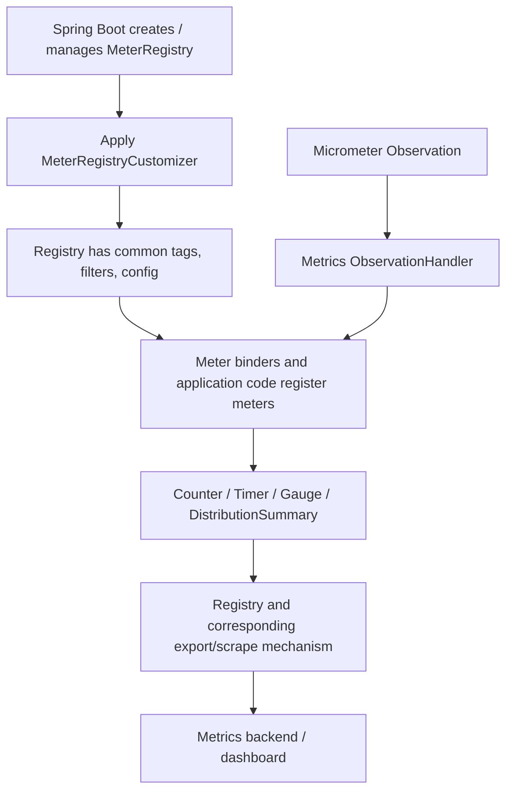
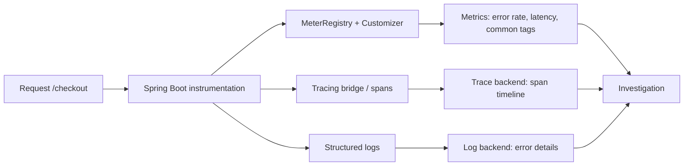

# `MeterRegistryCustomizer` in Spring Boot

A Spring Boot application can export dozens of metric types: HTTP request counts, response times, JVM memory, connection pools, queues, and business measurements. When an application runs across multiple environments, operations teams need to identify which service and environment a metric comes from, while capping tags that could cause unbounded time series growth.

If every call site using `Counter.builder(...)` or `Timer.builder(...)` had to manually attach `application=checkout-service`, a single forgotten place would produce unlabeled series. If every library defined its own metrics policy, dashboards would also be difficult to compare across instances. **`MeterRegistryCustomizer`** is a Spring Boot extension point for applying **shared configuration to Spring Boot-managed `MeterRegistry` instances** before meters are registered.

This lesson belongs to the **Spring Boot metrics** chapter in the **SPRING_BOOT_OBSERVABILITY** module. The module focuses on setting up observability using Micrometer Observation, metrics, logs, and distributed tracing; learning context propagation, tags/cardinality, exporters, sampling, and signal correlation when investigating errors or latency in production environments. Here, the emphasis is on configuring the **metrics registry**, understanding its scope of impact, and verifying whether data is actually recorded and exported as expected.

## Learning objectives

After this lesson, you will be able to:

1. State the exact role of `MeterRegistryCustomizer` in Spring Boot and distinguish it from `MeterRegistry`, `MeterBinder`, `MeterFilter`, and `ObservationRegistry`.
2. Create a `MeterRegistryCustomizer<MeterRegistry>` bean to set consistent common tags for metrics.
3. Know when configuring via `management.metrics.tags.*` is sufficient and when a Java customizer is needed.
4. Apply or register a `MeterFilter` to control accepted meters/tags and understand the limits of cardinality guardrails.
5. Understand type-specific registry customization, ordering principles, the effects of auto-configuration, and manually created registries.
6. Read results via `/actuator/metrics` and `/actuator/prometheus`, and cross-check series in the backend.
7. Distinguish metrics configuration from tracing sampling, log correlation, and exporters, avoiding the assumption that a customizer solves every observability concern.

## 1. What problem does `MeterRegistryCustomizer` solve?

**`MeterRegistry`** is the central object of Micrometer Metrics: meters such as `Counter`, `Timer`, `Gauge`, and `DistributionSummary` are registered into a registry. The registry is responsible for managing meters, enforcing measurement policies, and connecting export mechanisms suited to the active registry type.

**`MeterRegistryCustomizer<T extends MeterRegistry>`** is **Spring Boot's** customization contract. A bean implementing this contract receives a compatible registry to adjust its configuration, typically during the phase when Boot initializes and manages the registry.

A customizer can configure:

- **Common tags:** shared metadata such as application name and environment applied to meters.
- **`MeterFilter`:** denying or transforming meter IDs/tags, and enforcing name/tag-based limits.
- **Naming conventions** or other `MeterRegistry.Config` options when genuinely needed, accounting for the registry and exporter.
- **Registry-type-specific** settings matching the generic type parameter and how Spring Boot constructs the registry.

A customizer does **not** represent a measurement, does not record metric values, and does not automatically make a `Counter` or `Timer` appear. It configures **where meters are registered**.

### Visualizing the data flow



Key point: customizers must be applied **before meters are registered**. Adding common tags or filters after a meter already has an ID does not guarantee existing meters will be updated. Configuration changes should go through Spring Boot's initialization process and be verified against live data.

## 2. Distinguishing related components

| Component | Responsibility | Example |
|---|---|---|
| `MeterRegistry` | Registers and manages meters; connects collection/export mechanisms | `PrometheusMeterRegistry`, `SimpleMeterRegistry` |
| `MeterRegistryCustomizer<T>` | Applies configuration to compatible Spring Boot-managed registries | Sets common tags `application` and `environment` |
| `MeterFilter` | Evaluates/modifies meter IDs, limits or denies meters, adjusts distribution configs where appropriate | Blocks a meter group or caps `uri` tag values |
| `MeterBinder` | Registers a group of meters from a specific source | JVM, executor, or connection pool metrics |
| `ObservationRegistry` | Manages observation lifecycle, scopes, contexts, and observation handlers | Observes HTTP processing or business steps |
| Metrics `ObservationHandler` | Turns observation events into metrics measurements when configured | Records observation duration as a timer |
| Exporter/collector/backend | Transfers, filters, stores, and queries telemetry | Prometheus scrape, OTLP metrics pipeline |

In Spring Boot, Micrometer Observation and Micrometer Metrics can work together, but **the two registries have different responsibilities**. `MeterRegistryCustomizer` customizes `MeterRegistry`; it does not automatically add a tracing handler to `ObservationRegistry`, create spans, change tracer sampling policies, or format logs.

For example, adding the common tag `application=checkout-service` to metrics **does not guarantee** that logs or distributed traces automatically carry the same attribute. To correlate signals, you must separately design service/resource metadata, log correlation, trace propagation, and compatible backends.

## 3. When does Spring Boot apply customizers?

In Spring Boot 3.x with Micrometer Metrics and appropriate auto-configuration, Spring Boot automatically manages `MeterRegistry` beans from registry dependencies on the classpath. It discovers `MeterRegistryCustomizer<?>` beans and applies them to matching registries during configuration.

Conceptual flow:

```text
1. Application starts up
2. Spring Boot prepares MeterRegistry and corresponding configurations
3. Matching MeterRegistryCustomizer beans are applied
4. MeterBinders/instrumentation/application code register meters
5. Registry collects values; exporter/scrape serves data
6. Backend stores and visualizes metrics
```

Depending on the version and registry, internal initialization steps may vary. The prerequisite for customization to take effect is that **the registry is integrated into Spring Boot's management mechanism** and the customizer is discovered as a Spring bean.

There are two important limitations:

1. A `MeterRegistry` instantiated directly via `new SimpleMeterRegistry()` in code and held privately outside Spring Boot's management **does not automatically** receive customizer beans.
2. A meter registered too early, before common tags/filters take effect, may retain its original ID/schema. Do not try to work around this by mutating config while the application is serving requests; ensure configuration is applied during initialization.

If the application has multiple registries (such as a composite registry, a test registry, and a specialized registry), verify which registry type the customizer targets and which registry meters are actually recorded into.

## 4. Configuring common tags with `MeterRegistryCustomizer`

Suppose a checkout service runs in `staging` and `production` environments. We want all metrics to have two stable dimensions:

- `application=checkout-service`: application name.
- `environment=production` or `environment=staging`: deployment environment.

An illustrative Java configuration in **Spring Boot 3.x**:

```java
import io.micrometer.core.instrument.MeterRegistry;
import org.springframework.boot.actuate.autoconfigure.metrics.MeterRegistryCustomizer;
import org.springframework.context.annotation.Bean;
import org.springframework.context.annotation.Configuration;
import org.springframework.core.env.Environment;

@Configuration(proxyBeanMethods = false)
class MetricsConfiguration {

    @Bean
    MeterRegistryCustomizer<MeterRegistry> commonMetricsTags(
            Environment environment) {

        String applicationName = environment.getProperty(
                "spring.application.name", "checkout-service");
        String deploymentEnvironment = environment.getProperty(
                "app.deployment.environment", "local");

        return registry -> registry.config().commonTags(
                "application", applicationName,
                "environment", deploymentEnvironment
        );
    }
}
```

The example above uses:

- `@Configuration` to declare Spring configuration.
- `@Bean` so Spring Boot can discover the customizer.
- Generic `MeterRegistry` to target registries compatible with the general type; concrete application still depends on auto-configuration.
- `Environment` to read application/environment names from deployment configuration, never from per-request input.
- `registry.config().commonTags(...)` so meters registered afterward inherit the shared tag set.

Example input configuration:

```yaml
spring:
  application:
    name: checkout-service

app:
  deployment:
    environment: staging
```

An HTTP or business meter registered through a matching registry can be exported with `application=checkout-service` and `environment=staging`. Metric names and tag formatting in the backend may change according to naming conventions/exporters; verify the actual output.

### Common tags do not automatically isolate data by tenant

If the application name is fixed per deployment, it is a low-value-count tag useful for grouping metrics. Conversely, reading a customer/tenant ID from an HTTP header and adding it as a tag to every meter causes high cardinality and risks exposing sensitive data.

`commonTags` applies **registry-wide**, not per request. Common values should reflect **stable properties of the application or environment**, not dynamic properties of a single request.

### Difference from passing tags when creating a meter

Suppose business code registers:

```java
import io.micrometer.core.instrument.Counter;
import io.micrometer.core.instrument.MeterRegistry;

class CheckoutMetrics {
    private final Counter acceptedOrders;

    CheckoutMetrics(MeterRegistry registry) {
        this.acceptedOrders = Counter.builder("checkout.orders.accepted")
                .description("Accepted checkout orders")
                .tag("channel", "web")
                .register(registry);
    }

    void orderAccepted() {
        acceptedOrders.increment();
    }
}
```

If `registry` has already received the customizer, this meter can carry both the `application` and `environment` common tags as well as its own `channel=web` tag. The `Counter` is still registered and incremented by business code. The customizer only provides shared configuration; it never calls `increment()` itself.

If the same tag key is declared in both common tags and a specific meter, conflict resolution may depend on filter logic and application order. **Avoid duplicate keys**, standardize your tag schema, and verify output via Actuator/registry.

## 5. When Spring Boot properties are sufficient

Simple requirements can use application properties instead of writing a Java class. For example, Spring Boot 3.x supports configuring common tags for metrics via `management.metrics.tags.*`:

```yaml
management:
  metrics:
    tags:
      application: checkout-service
      environment: staging
```

This approach makes sense when tags are static values from environment configuration and require no custom logic.

| Need | Approach to consider |
|---|---|
| Add `application` and `environment` to every metric | `management.metrics.tags.*` or a shared customizer |
| Compute values from multiple config sources with normalization/fallbacks | `MeterRegistryCustomizer` |
| Enforce limits or rewrite IDs by specific rules | `MeterFilter`, registered via appropriate config |
| Create a new business metric | `Counter`, `Timer`, `DistributionSummary`, `MeterBinder`, or instrumentation |
| Change name/tags of an HTTP observation type | Corresponding observation convention/instrumentation |
| Enable/configure backend exporter | Registry/exporter/collector dependencies and properties |
| Adjust distributed trace sampling rate | Sampling mechanism of the tracing implementation/collector |

**Do not declare the same common tag in both a Java customizer and YAML** just to be sure it appears. Duplicating it can create conflicts or confuse operators about the authoritative configuration source. Pick one clear owner and verify the resulting schema.

Across Spring Boot versions, customizer package/type names, auto-configuration ordering, and metrics properties can change. The Java examples above are framed in Spring Boot 3.x; when moving to another version, cross-check against the documentation/API of that exact version.

## 6. Using `MeterFilter` with a customizer

A `MeterFilter` can deny meters or adjust meter configuration according to registry policy. For example, in an application, some debug meters are only for development and should not be exported to a production backend.

```java
import io.micrometer.core.instrument.MeterRegistry;
import io.micrometer.core.instrument.config.MeterFilter;
import org.springframework.boot.actuate.autoconfigure.metrics.MeterRegistryCustomizer;
import org.springframework.context.annotation.Bean;
import org.springframework.context.annotation.Configuration;

@Configuration(proxyBeanMethods = false)
class MeterPolicyConfiguration {

    @Bean
    MeterRegistryCustomizer<MeterRegistry> excludeDebugMeters() {
        return registry -> registry.config().meterFilter(
                MeterFilter.denyNameStartsWith("internal.debug.")
        );
    }
}
```

In this example, the filter rejects registration of meters matching the prefix `internal.debug.` per the API's semantics. Do not use this filter to drop business meters required for SLOs or alerts without assessing the impact.

### Limiting tag value counts to prevent cardinality explosions

Another example is a guardrail:

```java
import io.micrometer.core.instrument.MeterRegistry;
import io.micrometer.core.instrument.config.MeterFilter;
import org.springframework.boot.actuate.autoconfigure.metrics.MeterRegistryCustomizer;
import org.springframework.context.annotation.Bean;
import org.springframework.context.annotation.Configuration;

@Configuration(proxyBeanMethods = false)
class HttpMetricLimitConfiguration {

    @Bean
    MeterRegistryCustomizer<MeterRegistry> guardHttpUriCardinality() {
        return registry -> registry.config().meterFilter(
                MeterFilter.maximumAllowableTags(
                        "http.server.requests",
                        "uri",
                        100,
                        MeterFilter.deny()
                )
        );
    }
}
```

Idea behind this example: for meters starting with `http.server.requests`, limit how many `uri` tag values the filter accepts. Once the limit is exceeded, new IDs may be denied registration.

This is a **last-resort safeguard**, not the proper way to normalize tags. If the `uri` tag contains raw URLs like `/orders/984712` instead of the route template `/orders/{id}`, fix instrumentation/naming first. A filter capped at 100 can hide metrics for a newly added legitimate route once the cap is hit. Monitor denied meter counts and check impact on monitoring/SLOs.

Also avoid using `MeterFilter` to scrub sensitive information that already entered meter creation paths. Data should be stripped or normalized **before** reaching telemetry; filters are only an additional safeguard.

### `MeterFilter` is not `ObservationFilter`

Both names contain "filter", but their roles differ:

- **`MeterFilter`:** operates on meter IDs, tags, or distribution configs in **Micrometer Metrics**.
- **`ObservationFilter`:** modifies the context of **Micrometer Observation** during the observation lifecycle.
- **`ObservationPredicate`:** decides whether an observation is processed by handlers based on given conditions.

An Observation converted into a metric by a handler can be affected by `MeterFilter`, but a `MeterFilter` **does not** control how many spans are sampled in the tracing backend.

## 7. Customizing registries by type

When an application has multiple registries, not every setting applies to all of them. For instance, a setting specific to a Prometheus registry should not be blindly applied to an in-memory registry.

The customizer uses a generic type parameter:

```java
MeterRegistryCustomizer<MeterRegistry>
```

to specify the target registry type. When you need a policy for a concrete registry type, you can write:

```java
// Illustrative form when targeting a Prometheus registry.
MeterRegistryCustomizer<PrometheusMeterRegistry>
```

The second form requires the `PrometheusMeterRegistry` class on the **compile classpath** if your code references it directly. Moreover, Spring Boot must manage that exact registry type for the customizer to apply. If the Prometheus dependency is declared as `runtimeOnly` while Java code imports that class, compilation will fail due to a missing compile-time dependency.

In most applications needing only common tags and general `MeterFilter`s, keep `MeterRegistryCustomizer<MeterRegistry>` and avoid coupling general configuration to exporter-specific logic.

### Composite registry and multiple backend registries

An application may export the same measurement to multiple systems, or use a composite registry. In that case, verify:

1. Which registry the customizer runs on: the composite, child registries, or both under the active version's auto-configuration?
2. Does it create duplicate tags or repeated policies?
3. Was a meter registered before a child registry was added to the composite?
4. Do Backend A and Backend B support the same metric names, tags, and types?
5. Is an operation measured twice by another instrumentation or handler?

The same `registry.counter(...).increment()` call can be recorded and exported by multiple registries/backends, but that is **one operation fanned out to multiple destinations**, not necessarily two distinct business events. Verify how many times instrumentation actually calls `increment()` before concluding a metric is double-counted.

## 8. Configuration ordering and metric schema changes

### Customizers must run before meters are registered

The reason is very practical: Micrometer binds a meter to its name and tag set at registration time. Once a registry holds that meter ID, adding a new common tag does not retroactively recreate older meters with the new ID.

Therefore:

- Put registry policies into Spring Boot startup configuration.
- Avoid creating meters during configuration assembly before customizers have been applied.
- When multiple customizers modify registry config, manage ordering intentionally if they depend on each other; only add `@Order` when genuinely required and verify ordering on your Boot version.
- Do not expect runtime property changes to rewrite all previously exported time series.

### Renaming metrics/tags is a telemetry contract change

Suppose previously every metric carried only the `application` tag. After adding `environment`, Prometheus sees **a new set of time series** with different label combinations. Dashboards or alerts filtering on old labels may need adjustments.

Similarly, changing `application=checkout-service` to `application=checkout` splits queries grouped by application into pre-deployment and post-deployment groups.

Manage such changes like a data schema migration:

1. Audit dashboards, recording rules, and alerts/SLOs consuming the metric.
2. Align tag lists and value semantics across services.
3. Roll out by environment and monitor both old and new series if needed.
4. Verify exporter/backend output, especially when multiple instances run mixed versions concurrently.
5. Ensure measurement units and meter types do not silently change.

**Do not use a tag to "fix" unit mismatches.** If one service records milliseconds into a timer while another records seconds into a summary with a similar name, the issue lies in meter/instrumentation semantics and cannot be solved simply by adding a common tag.

## 9. Verifying customizers via Actuator and Prometheus

Suppose an application uses Actuator and the Micrometer Prometheus registry. With Spring Boot 3.x and Gradle, illustrative dependencies:

```groovy
dependencies {
    implementation 'org.springframework.boot:spring-boot-starter-actuator'
    runtimeOnly 'io.micrometer:micrometer-registry-prometheus'
}
```

Example endpoint configuration for inspection in a test environment:

```yaml
spring:
  application:
    name: checkout-service

app:
  deployment:
    environment: staging

management:
  endpoints:
    web:
      exposure:
        include: health,info,metrics,prometheus
```

When the Prometheus registry is properly auto-configured, the endpoint is normally `/actuator/prometheus` under the default Actuator base path. `/actuator/metrics` lets you inspect meters registered in the registry along with configured names and tags. Protect operational endpoints with proper network/security settings; do not expose telemetry or management endpoints unnecessarily.

### Verification workflow

1. **Start the application** with the customizer bean on the classpath and a compatible registry.
2. **Generate at least one request** to an endpoint or trigger an instrumented business flow.
3. **Check `/actuator/metrics`** to see expected meter names; query a specific meter to inspect available tags, including `application` and `environment`.
4. **Check `/actuator/prometheus`** to confirm exported series have expected labels. Metric names may be converted from dots to underscores with suffixes added per meter type.
5. **Check Prometheus/backend** after several scrapes: are data points arriving, and are label values consistent across instances and environments?
6. **Check filter effects:** are denied meters genuinely absent, and are valid meters still exported completely?
7. **Check cardinality:** do distinct value counts per tag and generated time series fit within budget?

Illustrative output for a counter might look like:

```text
checkout_orders_accepted_total{
  application="checkout-service",
  environment="staging",
  channel="web"
} 42
```

This is a **formatting example**, not a guarantee that every registry/version emits the exact name `checkout_orders_accepted_total`. Actual metric names, units, and suffixes must be verified from the live endpoint. Even `/actuator/metrics` and `/actuator/prometheus` can display names according to different conventions.

### Why is a common tag missing?

Several possibilities:

- The class containing the customizer bean was not component-scanned or was excluded by a configuration condition.
- The meter was registered in a manually created registry outside Spring Boot's auto-configuration.
- The meter was created before the customizer ran, or another customizer/filter altered the tags.
- Multiple registries exist and you are inspecting a different registry/backend.
- The exporter, naming convention, or backend query renders/groups tags differently than expected.
- No new samples occurred or scraping hasn't run yet, so the series has not appeared where you are querying.

Do not immediately crank up log levels or append tags at every metric call site. Identify **the actual registry owning the meter** and the customizers/filters applied to that registry.

## 10. Customizers in the broader observability picture

`MeterRegistryCustomizer` affects only the **metrics path**. In Spring Boot, a single request can simultaneously produce:

- **HTTP metrics:** response time, count, status, and finite labels.
- **Structured logs:** timeout events or business errors, optionally with trace ID/span ID when log correlation is integrated.
- **Distributed traces:** HTTP server, HTTP client, and instrumented business step spans.
- **Business metrics:** accepted transaction counts or cart sizes.

Example when `POST /checkout` sees an elevated error rate:



Common tags select the right service/environment on dashboards. Operators then use traces to locate slow legs and logs to read concrete errors.

Keep in mind:

- A customizer **does not** govern tracer sampling or how many traces are retained. Sampling 10% of traces does not mean metrics measure only 10% of requests.
- Adding `application` to metrics **does not** give logs/traces the same resource attribute. Configure naming/resource metadata separately for each telemetry signal.
- Never attach `traceId` or `requestId` to metric tags to link individual requests: cardinality will explode. If your backend supports **exemplars**, a metric sample can reference a trace via a dedicated mechanism.
- Missing traces can stem from propagation, sampling, exporters, or collectors. `MeterRegistryCustomizer` cannot fix broken context propagation across threads or services.
- A metric spike alone does not prove root cause. Combine multiple signals and verify hypotheses.

## 11. Real-world scenario: metrics fail to aggregate after a deploy

An operations team runs three instances of `checkout-service`. After a new deployment, the dashboard aggregating HTTP error rates by application shows data from only two instances. The third instance still processes requests and writes logs normally.

Assumed details:

- The two older instances have `application=checkout-service`.
- The new instance uses a registry instantiated manually in an adapter and does not receive common tags from Spring Boot.
- Some other custom meters still use the default registry and have full tags.
- Tracing still shows requests passing through the new instance because tracing is configured separately.

### Investigation path

**Step 1 — Verify where data is actually missing.** An aggregate metrics query returning partial results does not mean the data does not exist anywhere. Compare meters by instance and label; inspect scrape targets, series names, and label values.

**Step 2 — Identify each meter's registry.** Find where adapters inject `MeterRegistry` and where registries are instantiated via `new`. If an adapter uses a non-Boot registry, Boot's common customizer will not automatically apply to it.

**Step 3 — Check customizer beans.** Confirm the bean exists in the application context and applies to the registry where the meter is registered. Verify configuration timing during startup.

**Step 4 — Restore registry ownership.** Unless there is a strong technical reason to keep a separate registry, use the Boot-managed `MeterRegistry`, or explicitly wire the custom registry with matching customizers and exporters. Avoid creating duplicate registry beans that make auto-configuration or injection ambiguous.

**Step 5 — Cross-check with logs/traces.** Logs and traces confirm requests reached the new instance, but do not replace HTTP error-rate measurements with the proper denominator. Inspect missing context propagation points if traces are fragmented.

**Step 6 — Re-evaluate dashboards and alerts.** Once tags are consistent, inspect series by environment, instance, and version; verify alerts/SLOs no longer drop an instance due to label filters.

### What can be concluded

The customizer successfully standardized labels for registries that actually received that configuration. Other meters lacking common tags stemmed from a **different registry registration path**, not from all of Spring Boot metrics being broken.

**What is not yet proven:** that an instance is healthy merely because traces or logs exist. Measure latency, throughput, and error rate separately on the proper registry/pipeline.

## 12. Common mistakes and fixes

| Mistake | Consequence | Fix |
|---|---|---|
| Thinking `MeterRegistryCustomizer` creates metrics automatically | No new business metrics appear | Use specific meters/instrumentation to record values |
| Adding common tags after meters were registered | Old meters may retain earlier schema | Apply customizer during startup initialization |
| Creating `new SimpleMeterRegistry()` and expecting Boot to customize it | Standalone registry misses customizer beans | Inject Boot-managed registry, or customize standalone explicitly |
| Putting `userId` or `traceId` in common tags | Massive cardinality explosion, data exposure risk | Use bounded deployment/operation tags |
| Defining the same tag key in both Java and YAML | Unclear precedence, easy conflicts | Pick one authoritative configuration source |
| Blocking too many meters with `MeterFilter` | Loss of metrics needed for SLOs/investigations | Scope narrowly and monitor dropped meters |
| Thinking `maximumAllowableTags` fixes raw URLs | New meters get denied; instrumentation bug remains | Normalize HTTP route templates at the source |
| Applying exporter-specific settings to all registries | Incompatibility or hard-to-debug behavior | Customize by specific registry type if truly needed |
| Renaming a common tag without updating alerts | Dashboards/SLOs miss series | Govern telemetry schema and plan transitions |
| Assuming common tags apply to traces/logs too | Signals cannot be correlated | Configure resource metadata and log correlation separately |
| Rushing to edit code when metrics are missing in Prometheus | Might just be a scrape/export/query issue | Trace Actuator → registry → exporter → backend |
| Reading error log counts as failed request counts | Double counting from retries and repeated logs | Use request metrics or SLIs with the right denominator |

## 13. Checklist for deploying `MeterRegistryCustomizer`

Before promoting configuration to production, verify:

1. **Purpose:** do you need common tags, filters, naming conventions, or exporters? Is a Java customizer genuinely required?
2. **Registry:** which `MeterRegistry` are meters registered on? Is that registry managed and customized by Spring Boot?
3. **Timing:** is configuration applied before binders/application code create meters?
4. **Tags:** are you using stable dimensions like application/environment/operation? Are there dynamic tags, user IDs, or raw URLs?
5. **Compatibility:** do metric names, tags, and units align with existing dashboards/alerts/SLOs?
6. **Filters:** are denied meters intentionally identified? Could tag-value guardrails drop critical data?
7. **Multiple registries:** have generic types and export paths been verified, without duplicate configs or wrong injections?
8. **Spring config:** is the customizer bean discovered, duplicate properties removed, and auto-configuration active?
9. **Runtime inspection:** does `/actuator/metrics` show expected names/tags? Do `/actuator/prometheus` and the backend have matching series?
10. **Security:** are metrics endpoints protected, and is telemetry free of sensitive information?
11. **Cost:** how much do meter/time series counts and label values grow after adding tags?
12. **Signal correlation:** when a metric degrades, are logs, spans, and trace context sufficient to investigate errors/latency?

## 14. Self-assessment

**Question 1.** A `MeterRegistryCustomizer<MeterRegistry>` adds `application=checkout-service`. Will every log and span automatically carry this tag?

**Hint:** No. Customizers apply to the Micrometer Metrics path. Logging/tracing require separate correlation and resource metadata configuration.

**Question 2.** A developer instantiates `SimpleMeterRegistry` with `new` inside a utility and registers a counter in it. Will common tags from a customizer bean appear automatically?

**Hint:** Do not assume so. A registry outside Spring Boot's management must be configured explicitly or replaced with an injected Boot-managed registry.

**Question 3.** When adding two static tags `application` and `environment`, is a Java customizer mandatory?

**Hint:** No. `management.metrics.tags.*` handles basic static cases if supported by your Boot version. Pick one clear configuration source.

**Question 4.** A filter caps `uri` at 100 values. Does it automatically rewrite `/orders/123` to `/orders/{id}`?

**Hint:** No. The guardrail only limits newly accepted values; the root issue must be solved at the routing/instrumentation layer.

**Question 5.** A dashboard shows only two of three instances after adding a common tag. Can you conclude the third instance is receiving no requests?

**Hint:** Not yet. Check registries, label schemas, scrape targets, and queries. Logs/traces can show requests are still running, though they do not replace metrics request counts.

**Question 6.** A customizer attaches `traceId` to all metrics so operators can look up individual traces from a dashboard. Is this a good practice?

**Hint:** No. Trace IDs have extremely high cardinality, generating huge numbers of time series. Use trace/log correlation and exemplars where supported by the stack.

**Question 7.** A meter is registered before a customizer adds `environment`. Will it always automatically gain the new tag afterward?

**Hint:** Never assume that. Meter IDs are typically fixed at registration time; apply customizers before meters are created and verify against live output.

## Conclusion

**`MeterRegistryCustomizer` is Spring Boot's extension point for configuring managed Micrometer `MeterRegistry` instances**, especially useful when consistent common tags and `MeterFilter`s are needed across framework and application metrics. It must be applied at the right time, on the right registry, and with cardinality-controlled tags. Registry configuration does not replace business instrumentation, does not automatically produce logs/spans, and does not govern sampling or context propagation. In operations, verify data from Actuator through exporters to the backend, monitor time series impact, and combine metrics with logs and distributed traces to investigate anomalies with solid evidence.
