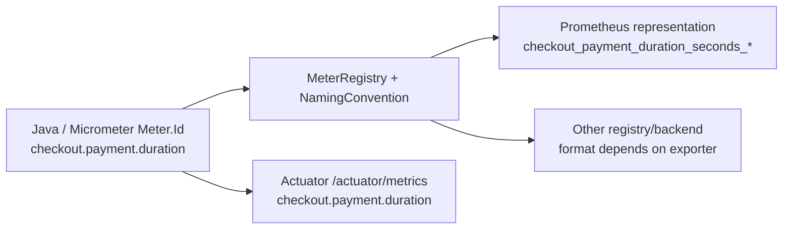

# Metric Naming Convention

You add a timer named `checkout.payment.duration` in Spring Boot code, yet at `/actuator/prometheus` you see series like `checkout_payment_duration_seconds_count` and `checkout_payment_duration_seconds_sum`. A colleague searches for `checkout_payment_duration` in Actuator and cannot find it; someone else creates a new metric named `checkout_payment_duration_seconds` to "match Prometheus", splitting data across multiple names or causing collisions. Dashboards across two services are also hard to combine because one service uses `payment.latency` while the other uses `payments.time` for the exact same measurement.

That is the problem solved by a **metric naming convention**: choosing names with stable semantics at the instrumentation layer, understanding how each registry/exporter transforms names and units, and aligning names with meter types and tags. In the **Spring Boot metrics** chapter of the **SPRING_BOOT_OBSERVABILITY** module, this skill helps you implement observability using **Micrometer Observation, metrics, logs, and distributed tracing**, correlate signals when investigating errors or latency, avoid excessive cardinality costs, and avoid breaking dashboards when switching exporters.

After this lesson, you will be able to:

1. Distinguish **Micrometer meter name**, **`Meter.Id`**, **exported metric name**, and **trace/span name**.
2. Name Counters, Gauges, Timers, and DistributionSummaries consistently, including data types, units, and suffixes.
3. Explain how dots are converted to underscores, along with `_total`, `_seconds`, `_count`, `_sum`, and `_bucket` suffixes in Prometheus where applicable.
4. Use Spring Boot Actuator, `MeterRegistry`, `MeterFilter`, and `NamingConvention` at the proper layers.
5. Keep metric names and tag keys bounded in cardinality, avoiding dynamic data and sensitive information.
6. Distinguish **Micrometer `ObservationConvention`** from **Micrometer Metrics `NamingConvention`**.
7. Establish a controlled renaming process and verify actual names across Actuator, exporters, dashboards, and alerts.

## 1. The same measurement can have multiple name representations

An application measures the duration of the payment authorization step. In Java code, the name should have a readable and stable structure:

```java
Timer.builder("checkout.payment.duration")
     .description("Time to authorize a payment")
     .register(meterRegistry);
```

To Micrometer, `checkout.payment.duration` is the **application-level meter name**. When exported through a Prometheus registry, this name may be normalized and suffixed with seconds as the unit, then exposed as multiple time series:

```text
Name in Java code / Actuator:
    checkout.payment.duration

Example names exported via Prometheus when appropriately configured:
    checkout_payment_duration_seconds_count
    checkout_payment_duration_seconds_sum
    checkout_payment_duration_seconds_max
    checkout_payment_duration_seconds_bucket{le="0.5", ...}
```

The exact series depend on **meter type, registry version, histogram configuration, and naming convention**. For instance, `_bucket` exists only when histograms are exported, while `_max` depends on how the registry represents maximums. Do not assume every series in the illustration appears automatically.

Three key layers:

| Layer | Where do you configure it? | Example | Role |
| --- | --- | --- | --- |
| **Canonical meter name in code** | `Counter.builder(...)`, `Timer.builder(...)`, Observation name | `checkout.payment.duration` | Stable identifier for instrumenting and querying in Micrometer |
| **Meter identity** | `Meter.Id`: name, tags, type, base unit, and metadata | `checkout.payment.duration{provider=primary}` | Distinguishes registered meters |
| **Exported name** | Registry/exporter naming convention and formatting rules | `checkout_payment_duration_seconds_count` | Name used in backends/queries/alerts |

The meter name in Java is the **canonical source**, while the metric name in Prometheus is the backend-specific representation. Start from a clear, semantic Micrometer name and let the corresponding registry transform it. Writing the Prometheus name directly inside `Timer.builder(...)` often causes duplicate suffixes and breaks portability across exporters.

### 1.1. Names and tags together identify a metric series

Example of two calls using the same timer name but different providers:

```text
checkout.payment.duration{provider="primary", outcome="approved"}
checkout.payment.duration{provider="backup",  outcome="error"}
```

They measure the same quantity, differing only in **dimensions**. There is no need to name them:

```text
checkout.payment.primary.duration
checkout.payment.backup.duration
```

unless there is a clear reason they are genuinely different meter types. Putting a bounded attribute into a tag makes dashboards and queries much more flexible than multiplying meter names per value.

**Be careful:** tag values can drive up time series counts rapidly. Keep `provider` within an allowed catalog; never use `orderId`, `userId`, tokens, or URLs containing IDs as metric names or tags.

## 2. What should you name a metric so others understand what it measures?

Micrometer encourages **dot-separated hierarchical** names, typically lowercase, clearly describing the business domain and the measured quantity. A practical pattern:

```text
<domain>.<component-or-operation>.<measurement>

checkout.payment.duration
checkout.payment.attempts
checkout.queue.depth
inventory.reservation.duration
inventory.reservation.rejections
report.generation.duration
```

This is a **naming convention**, not mandatory Java syntax. You can adopt another structure as long as it is consistent and expresses semantics clearly.

### 2.1. Design principles

1. **Start with a meaningful domain/context**: `checkout`, `inventory`, or `billing`, not generic `data` or `metric`.
2. **State explicitly what is measured**: `duration`, `attempts`, `depth`, `size`, `connections.active` instead of vague names like `value`.
3. **Keep names stable across invocations**: a request must never generate a new meter name containing an ID or timestamp.
4. **Keep meter types consistent**: do not reuse the same name and tags for both a Counter and a Gauge/Timer with different semantics.
5. **Separate names from dimensions**: provider, outcome, route template, and environment belong in tags when their value sets are controlled.
6. **Specify accurate units**: set `baseUnit` where the instrument supports it; Timers convert durations to the proper unit on export.
7. **Do not manually append an exporter suffix** to the canonical name if the registry generates that suffix automatically.

Example table:

| Measurement need | Suggested Micrometer name | Suitable meter | Useful tags |
| --- | --- | --- | --- |
| Payment attempt count | `checkout.payment.attempts` | Counter | `provider`, `result` if clearly defined |
| Payment processing time | `checkout.payment.duration` | Timer | `provider`, `outcome` |
| Queue element count | `checkout.queue.depth` | Gauge | `queue` from a finite catalog |
| Input payload size | `checkout.request.size`, base unit `bytes` | DistributionSummary | Normalized `route` or request type |
| Active connection count | `datasource.connections.active` | Gauge | `pool` with a bounded value set |
| Report generation time | `report.generation.duration` | Timer | Bounded `report.type` |

Naming a Counter `checkout.payment.attempts` is a deliberate convention choice; the Prometheus registry can append `_total` on export. Do not manually append `_total` in Java code for a standard Counter.

### 2.2. Metric names are not business database tables

Do not turn each entity or transaction into a separate metric name:

```text
Wrong:
  checkout.payment.ORD-829317.duration
  checkout.payment.customer-4721.duration
  http.server.requests./orders/829317

Better:
  checkout.payment.duration{outcome="approved", provider="primary"}
  http.server.requests{uri="/orders/{id}", method="GET", status="200"}
```

Every order ID would create new names/series, increasing application memory, scrape load, backend storage, and query cost. Look up specific transactions via **access-controlled trace IDs and log/audit correlation**, not via metric names.

## 3. Metric names and meter types must align

A good name paired with the wrong meter type still leads to misleading dashboards.

| Meter type | What should it measure? | Semantics and example |
| --- | --- | --- |
| **Counter** | Monotonically increasing events, call/error counts | `checkout.payment.attempts`: increments by 1 per attempt |
| **Gauge** | Instantaneous value that can go up or down | `checkout.queue.depth`: number of items currently waiting |
| **Timer** | Operation duration and observation count | `checkout.payment.duration`: duration of payment calls |
| **DistributionSummary** | Distribution of non-duration values | `checkout.request.size`, unit bytes |
| **LongTaskTimer** | Long-running tasks when tracking active count and elapsed time | `report.generation.active` when tracking unfinished jobs |

Common mistakes:

- Using a Gauge to count total requests—a Gauge only reports the current value and lacks monotonic counter semantics.
- Using a Counter to measure duration, preventing a `duration` metric from supporting proper histogram/quantile queries.
- Manually creating a Counter named `http.server.requests` when Spring Boot HTTP metrics already measure the same requests, causing name collisions with incompatible types or double-counted measurements.
- Giving the same name to a Timer and a DistributionSummary, leaving registries/backends unable to agree on type and unit.

A **Timer** typically exposes both count and total time, so you do not always need an extra Counter solely to count **the exact same completions**. If you need **started attempts** while the timer records only **completed attempts**, the two measurements have different definitions and can coexist under different names.

## 4. Units and suffixes: why Prometheus names differ from Micrometer names

Micrometer instruments according to meter semantics. The registry/exporter formats names according to the destination's rules. Prometheus typically uses underscores and suffixes to indicate **units** or **series types**.

Common examples (illustrative only; always verify live exporter output):

| Micrometer name | Type / configuration | Typical Prometheus form |
| --- | --- | --- |
| `checkout.payment.attempts` | Counter | `checkout_payment_attempts_total` |
| `checkout.payment.duration` | Timer | `checkout_payment_duration_seconds_count`, `checkout_payment_duration_seconds_sum` |
| `checkout.payment.duration` | Timer + histogram | The series above plus `checkout_payment_duration_seconds_bucket` |
| `checkout.queue.depth` | Gauge | `checkout_queue_depth` |
| `checkout.request.size` | DistributionSummary with `baseUnit("bytes")` | `checkout_request_size_bytes_count`, `checkout_request_size_bytes_sum`, and buckets if histogram enabled |
| `jvm.memory.used` | Gauge measuring bytes | `jvm_memory_used_bytes` |

### 4.1. Meaning of common suffixes

- **`_total`**: typically denotes a cumulative counter in Prometheus.
- **`_seconds`**: denotes seconds as the unit. Micrometer Timers are represented in the backend's base unit, normally seconds for Prometheus.
- **`_count`**: observation count of a Timer/DistributionSummary or summary/histogram metric.
- **`_sum`**: sum of observed values; for a Timer, typically total duration in seconds.
- **`_bucket`**: bucket of a classic histogram, usually carrying the `le` (*less than or equal*) label, used to calculate ratios under thresholds and estimate percentiles.
- **`_max`**: may be exported as an additional series representing the windowed maximum; it should not be assumed to be a mandatory part of a Prometheus classic histogram.

A Timer named `checkout.payment.duration` does **not** become just a single scalar "duration". Each measurement feeds data allowing the registry to summarize count, total time, maximum, and histograms/percentiles as configured.

### 4.2. Do not double-append suffixes

If the Java name is `checkout.payment.duration.seconds`, the exporter can produce an awkward name or append a second unit suffix. Instead, use:

```java
Timer.builder("checkout.payment.duration")
     .description("Payment authorization latency")
     .register(registry);
```

For payload size, provide an explicit base unit:

```java
DistributionSummary.builder("checkout.request.size")
    .baseUnit("bytes")
    .description("Size of checkout request payloads")
    .register(registry);
```

Using `baseUnit("bytes")` makes unit metadata explicit. Do not confuse **base unit** with a `unit=bytes` tag: units are an intrinsic property of the measurement; trying to patch poor naming with a tag makes queries awkward and may still export non-standard backend names.

### 4.3. Two Java names can collide after conversion

The names:

```text
checkout.payment.duration
checkout_payment_duration
```

are two distinct strings in code, yet a naming convention converting dots to underscores can produce **the exact same exported name**. Likewise, tag keys `client.channel` and `client_channel` can collide after normalization.

Consequences depend on the registry: series collisions, registration warnings, unexpected output, or backend rejection of mismatched metadata. Avoid relying on separators to distinguish two metrics with different meanings; use **genuinely distinct words** in canonical names.

## 5. What is `NamingConvention` in Micrometer?

Micrometer provides the **`NamingConvention`** interface to transform meter names, tag keys, and tag values according to rules appropriate for a registry. Different registries can use different representations for the **same canonical application name**.



For instance, Prometheus enforces rules on metric and label names that the registry must satisfy; another system may support dots, underscores, unit names, or different metadata conventions. Keep canonical names stable so instrumentation remains reusable.

**Important distinction:** `NamingConvention` at the registry layer **is not** a contract for mutating `Meter.Id` in the same way as renaming in code. It governs how names/labels are *formatted externally*; renaming a meter via `MeterFilter` changes how the meter is registered and identified inside the registry.

### 5.1. When is a custom `NamingConvention` needed?

By default, use the naming convention provided by the registry. Customize only when there is a clear requirement, such as normalizing a legacy namespace before exporting to a system with strict pre-existing standards. Weigh benefits against risks:

- Exported names in the backend change while `Meter.builder(...)` calls and some Actuator endpoints still use canonical names.
- A loose prefix or replacement rule can cause two distinct meters to collide after export.
- Tracing, logs, and dashboards do not automatically adapt to metrics naming conventions.
- When upgrading Micrometer or exporters, unit suffixes and label normalization must be re-verified.

Below is an illustrative example showing how to **wrap an existing naming convention**, adding a prefix only to one metric group upon export. Treat this as an option for systems with an explicit renaming contract, not a default pattern to apply to every project.

```java
import io.micrometer.core.instrument.Meter;
import io.micrometer.core.instrument.config.NamingConvention;

public final class CommercePrefixNamingConvention
        implements NamingConvention {

    private final NamingConvention delegate;

    public CommercePrefixNamingConvention(NamingConvention delegate) {
        this.delegate = delegate;
    }

    @Override
    public String name(String name, Meter.Type type, String baseUnit) {
        String exportedName = name.startsWith("checkout.")
                ? "commerce." + name
                : name;
        return delegate.name(exportedName, type, baseUnit);
    }

    @Override
    public String tagKey(String key) {
        return delegate.tagKey(key);
    }

    @Override
    public String tagValue(String value) {
        return delegate.tagValue(value);
    }
}
```

During registry configuration **before meters are registered**, attach the wrapped convention:

```java
import io.micrometer.core.instrument.MeterRegistry;
import org.springframework.boot.actuate.autoconfigure.metrics.MeterRegistryCustomizer;
import org.springframework.context.annotation.Bean;
import org.springframework.context.annotation.Configuration;

@Configuration
class MetricsNamingConfig {

    @Bean
    MeterRegistryCustomizer<MeterRegistry> commerceNamingCustomizer() {
        return registry -> {
            var existing = registry.config().namingConvention();
            registry.config().namingConvention(
                    new CommercePrefixNamingConvention(existing));
        };
    }
}
```

This example targets **Spring Boot 3.x** using the corresponding auto-configuration package. In multi-registry applications, each registry may have its own convention; if overriding across all registries, evaluate exported names for every exporter. Always inspect live series after configuration. Spring Boot 4.x may change integration packages/starters; check the docs for your exact version.

**Think carefully:** a `commerce` prefix may make sense for a legacy backend, yet be worse than the original meter names. Changing exported names can cause existing alerts and dashboards to stop receiving data. Never introduce an experimental convention in production without auditing consumers first.

## 6. `MeterFilter` and renaming meters at the registry level

If you want to **translate a legacy meter name into a new canonical name at registration time**, you can use `MeterFilter`. This is a different mechanism from `NamingConvention`, which formats names during export.

Example translating an old name `checkout.payment.time` to `checkout.payment.duration`:

```java
import io.micrometer.core.instrument.Meter;
import io.micrometer.core.instrument.config.MeterFilter;
import org.springframework.context.annotation.Bean;
import org.springframework.context.annotation.Configuration;

@Configuration
class MetricMigrationConfig {

    @Bean
    MeterFilter renameLegacyPaymentTime() {
        return new MeterFilter() {
            @Override
            public Meter.Id map(Meter.Id id) {
                if ("checkout.payment.time".equals(id.getName())) {
                    return id.withName("checkout.payment.duration");
                }
                return id;
            }
        };
    }
}
```

The filter runs at meter registration time (under matching configuration and auto-configuration conditions), so do not expect it to "live-rename" historical time series already exported in the past. If the target name already has a different meter type or incompatible tag set, renaming can cause collisions. Ensure the migration is clearly defined and verify both Actuator and exporter output.

| Need | Suitable tool |
| --- | --- |
| Pick a new meter name in code | `Timer.builder("...")`, `Counter.builder("...")` |
| Standardize names for a business observation group | `ObservationConvention` or name passed to the Observation API |
| Rename a meter at registration time | `MeterFilter.map(Meter.Id)` |
| Format names/tags for a backend | Registry's `NamingConvention` |
| Transform tag keys with custom rules | An appropriate `MeterFilter` or registry convention/tag handling |
| Switch dashboards to a new name | Update backend queries, recording rules, and alert rules |

Do not confuse **`MeterFilter`** (Micrometer Metrics) with **`ObservationFilter`** (Micrometer Observation). These two extension points operate at different layers and lifecycles.

### 6.1. Keep clear ownership over naming rules

If one team names metrics in instrumentation, another renames them via `MeterFilter`, and a third adds prefixes via `NamingConvention`, soon nobody knows what name the backend stores. A stable architecture should maintain:

1. An agreed catalog of canonical meter names and meter types.
2. Tags and base units documented in the same catalog.
3. Controlled registry/exporter configuration with minimal unnecessary overrides.
4. Periodic verification of backend name mappings against raw telemetry.
5. Clear migration policies whenever renaming is truly required.

## 7. Spring Boot Actuator and built-in metric names

Spring Boot Actuator and integrated libraries can register many meters automatically, such as HTTP server, JVM, process, system, connection pool, and cache metrics. Not every meter exists in every application: it depends on dependencies, technology stack, and whether a given operation has occurred yet.

Some common Micrometer names (version/config dependent):

| Name in Micrometer | Typical meaning | Verification hint |
| --- | --- | --- |
| `http.server.requests` | Count and duration of incoming HTTP requests | Send a request and inspect method/uri/status |
| `http.client.requests` | HTTP client metrics when instrumentation is active | Check how the client is constructed and dependencies |
| `jvm.memory.used` | Current JVM memory usage | Inspect tags such as `area` and `id` |
| `jvm.gc.pause` | Measured GC pause durations | Locate the meter and duration distribution |
| `process.cpu.usage` | Process CPU utilization | Distinguish from system CPU |
| `system.cpu.usage` | System CPU utilization | Exported only when the corresponding binder has data |

The point of a naming convention is keeping names **understandable and reusable**. If you create a custom timer named `web.response.time` measuring the exact same boundary that `http.server.requests` already measures, you create duplicate data without adding observability.

For built-in metrics, first understand their existing semantics and tags. Rename or add instrumentation only when an operational question remains unanswered.

### 7.1. Query examples via Actuator

In a lab environment with Actuator configured:

```bash
curl -fsS http://localhost:8080/actuator/metrics
curl -fsS http://localhost:8080/actuator/metrics/http.server.requests
curl -fsS http://localhost:8080/actuator/prometheus
```

- `/actuator/metrics` lists available meter names in the registry.
- `/actuator/metrics/http.server.requests` queries a meter by its **canonical name** to inspect tags and measurements.
- `/actuator/prometheus` shows **actual exported time series names**, including unit and data-type suffixes where applicable.

If a meter is missing, the application may not have triggered that activity yet, the dependency/binder may be disabled, a filter may have dropped it, or registry/exposure settings may differ from expectations. Do not rename a metric to "fix" an unverified pipeline issue.

Actuator endpoints are administrative interfaces. In production, enforce network controls, authentication/authorization, and restrict exposure per application policy.

## 8. Creating consistently named metrics in Spring Boot

### 8.1. Basic dependencies (Spring Boot 3.x example)

In a Maven application using Spring Boot dependency management:

```xml
<!-- Actuator provides metrics and Observation integrations -->
<dependency>
    <groupId>org.springframework.boot</groupId>
    <artifactId>spring-boot-starter-actuator</artifactId>
</dependency>

<!-- Needed when Prometheus scraping is required -->
<dependency>
    <groupId>io.micrometer</groupId>
    <artifactId>micrometer-registry-prometheus</artifactId>
</dependency>
```

An HTTP application also requires the corresponding web/webflux starter. The Prometheus registry formats data for export; storing, querying, and graphing require a Prometheus server or compatible backend ingesting the telemetry.

### 8.2. Endpoint and common tags configuration

```yaml
management:
  endpoints:
    web:
      exposure:
        include: health,info,metrics,prometheus
  metrics:
    tags:
      application: checkout-service
      environment: lab
    distribution:
      percentiles-histogram:
        checkout.payment.duration: true
```

Explanation:

- `management.metrics.tags.application` and `environment` are common tags distinguishing application and environment in metrics data.
- Common tags **must not** contain request IDs, unnecessary dynamic hostnames, or values with uncontrolled cardinality.
- Histogram configuration uses the canonical name `checkout.payment.duration`, not the exported name `checkout_payment_duration_seconds_bucket`.
- Tag keys are normalized by the registry per backend rules; verify final label names in raw output.
- In multi-service systems, keep service identification consistent so queries do not accidentally mix data.

This configuration serves metrics. Tracing, log correlation, OTLP exporters, and sampling have separate configurations and are not enabled merely by metric names.

### 8.3. Java code: Counter and Timer following the same taxonomy

The example below counts payment *attempt starts* and the duration of *each completion*. All tags have finite value sets.

```java
import io.micrometer.core.instrument.Counter;
import io.micrometer.core.instrument.MeterRegistry;
import io.micrometer.core.instrument.Timer;
import org.springframework.stereotype.Service;

@Service
public class PaymentMetricsService {
    private final MeterRegistry registry;
    private final PaymentGateway gateway;

    public PaymentMetricsService(MeterRegistry registry,
                                 PaymentGateway gateway) {
        this.registry = registry;
        this.gateway = gateway;
    }

    public boolean authorize(String provider, String paymentToken) {
        String safeProvider = switch (
                provider == null ? "" : provider) {
            case "primary" -> "primary";
            case "backup" -> "backup";
            default -> "other";
        };

        Counter.builder("checkout.payment.attempts")
                .description("Number of payment authorization attempts")
                .tag("provider", safeProvider)
                .register(registry)
                .increment();

        Timer.Sample sample = Timer.start(registry);
        String outcome = "error";

        try {
            boolean accepted = gateway.authorize(paymentToken);
            outcome = accepted ? "approved" : "rejected";
            return accepted;
        } finally {
            Timer timer = Timer.builder("checkout.payment.duration")
                    .description("Time to authorize a payment")
                    .tag("provider", safeProvider)
                    .tag("outcome", outcome)
                    .register(registry);
            sample.stop(timer);
        }
    }
}

interface PaymentGateway {
    boolean authorize(String paymentToken);
}
```

Key design choices:

- `checkout.payment.attempts` is a **Counter**: incremented before calling the dependency.
- `checkout.payment.duration` is a **Timer**: recorded after the call, even if the dependency throws an exception because `finally` still runs.
- `provider=primary|backup|other` and `outcome=approved|rejected|error` have small value sets.
- `paymentToken` is never emitted into tags, metric names, traces, or logs.
- `Timer.Sample` measures duration in standard units, avoiding manual millisecond values passed to a meter expecting nanoseconds or seconds.
- Counter and Timer names share the `checkout.payment` namespace while differing in **measured quantity** and meter type.

`Timer.builder(...).register(registry)` looks up or registers a meter by identity; in high-traffic systems, you can pre-register meters for finite tag sets to reduce lookup overhead, though never build a meter cache keyed by transaction IDs.

**Note on error modeling:** `outcome=error` in this example applies when the call throws an exception before returning a boolean. If your application has fallbacks returning success or special business outcome categories, update the taxonomy accordingly. If you want errors recorded on traces, use Observation/tracing instrumentation or appropriate error recording; a standalone Timer does not create a span.

### 8.4. Prometheus queries for exported names

Assuming the raw endpoint exports the counter as `checkout_payment_attempts_total`, you can compute attempts/second by provider:

```promql
sum by (provider) (
  rate(checkout_payment_attempts_total[5m])
)
```

If the `checkout.payment.duration` timer has histograms enabled, an example service-wide p95 for provider `primary`:

```promql
histogram_quantile(
  0.95,
  sum by (le) (
    rate(
      checkout_payment_duration_seconds_bucket{
        provider="primary"
      }[5m]
    )
  )
)
```

This example uses **classic histograms** and is valid only when histogram buckets are actually exported. Metric names may be normalized differently depending on your registry/Prometheus version; inspect the raw endpoint before copying queries.

Do not average per-pod p95 values to compute service-wide p95. With compatible histograms, sum bucket rates first before calling `histogram_quantile()`. Histogram percentiles carry estimation error depending on bucket boundaries; always monitor request counts alongside p95/p99.

## 9. Naming conventions and Micrometer Observation

Spring Boot observability includes an additional conceptual layer: **Micrometer Observation**. An Observation is an API describing an operation with context and lifecycle; when a metrics handler is present, it can produce timers/metrics; when a tracing handler is present, it can produce spans.

```java
import io.micrometer.observation.Observation;
import io.micrometer.observation.ObservationRegistry;

public boolean authorizeWithObservation(
        ObservationRegistry registry,
        PaymentGateway gateway,
        String token) {

    return Observation.createNotStarted(
                    "checkout.payment.authorization", registry)
            .contextualName("authorize payment")
            .lowCardinalityKeyValue("operation", "authorize")
            .lowCardinalityKeyValue("dependency", "payment")
            .observe(() -> gateway.authorize(token));
}
```

In this example:

- **Observation name**: `checkout.payment.authorization`, identifying the operation. With an appropriate metrics handler, it typically serves as the source of the meter name.
- **Contextual name**: `authorize payment`, a friendlier description for span/tracing contexts when supported by the handler.
- **Low-cardinality key-values**: `operation` and `dependency`, which can become metric tags.
- **Registry `NamingConvention`**: formats metric names when exporting to a backend.
- **`ObservationConvention`**: chooses names and key-values based on `Observation.Context` type for an observation family—**not** Prometheus's dot-to-underscore rule.

### 9.1. Two different "conventions"

| Tool | Package/layer | Decides | Example |
| --- | --- | --- | --- |
| `ObservationConvention` | Micrometer Observation | Observation name, contextual name, low/high-cardinality key-values | Naming the payment step `checkout.payment.authorization` |
| `NamingConvention` | Micrometer Metrics registry | How meter/tag names are formatted for a backend | `checkout.payment.authorization` → Prometheus-compatible name |
| `MeterFilter` | Micrometer Metrics registry | Accept/deny/transform `Meter.Id` or tags at registration | Map legacy canonical name to new name |
| `ObservationFilter` | Micrometer Observation | Enrich/modify `Observation.Context` at the appropriate stage | Attach outcome from context onto observation |

An `ObservationConvention` does not make Prometheus automatically export traces. A `NamingConvention` does not propagate trace context between HTTP services. Each layer serves a distinct purpose; metrics registries, tracing bridges, exporters, and collectors are needed for telemetry to reach backends.

**Avoid duplicate instrumentation:** If you create both a manual Timer `checkout.payment.duration` and an Observation covering the same scope with a metrics handler also emitting a timer, dashboards may show two measurements for the same work. Establish clear boundaries and ownership: instrument business steps with Observation when you need correlated metrics/traces, or with a direct Timer when only a duration metric is required.

## 10. Tag keys and cardinality are also part of a naming strategy

A stable metric name solves only half the problem. Every distinct combination of tag values can create a separate time series.

Suppose `http.server.requests` has these dimensions:

- `uri`: 30 route templates.
- `method`: 4 HTTP methods.
- `status`: 5 status groups.
- `instance`: 12 instances.

Theoretical number of combinations:

```text
30 × 4 × 5 × 12 = 7,200 label sets
```

Adding a `customerId` with 50,000 values raises potential combinations to **360 million**, before even counting histogram buckets. Only combinations with actual traffic materialize, yet the cost explosion remains huge.

### 10.1. Tag names should be consistent

| Use when appropriate | Avoid | Reason |
| --- | --- | --- |
| `uri=/orders/{id}` | `uri=/orders/721891` | Route templates group many requests |
| `outcome=approved|rejected|error` | `outcome=exception message` | Finite value set |
| `provider=primary|backup` | `provider=<arbitrary request hostname>` | Avoid dynamic labels |
| `environment=prod|staging` | Timestamps in metric names | Use tags for environment |
| `error.kind=timeout|validation|other` | Stack traces in labels | Summarize errors by category |
| `traceId` in logs/traces | `traceId` as a metric label | Nearly unique ID per request |
| Consistent `service.name` | Each service inventing its own arbitrary key | Easy multi-app dashboard aggregation |

On export, tag keys like `client.channel` may be converted into `client_channel`. Do not use both forms in the same system because they can collide after normalization.

Labels must preserve **consistent semantics across services and versions**. If Service A uses `outcome=failed` while Service B uses `outcome=error` for the same state, combined dashboards will break. Define a shared tag dictionary before release.

### 10.2. Metric name cardinality can grow too

Metric names are not the place to stuff dimensions:

```text
Wrong:
  checkout.payment.provider-a.success.duration
  checkout.payment.provider-b.error.duration
  checkout.payment.order-000123.duration

Good:
  checkout.payment.duration{
    provider="primary",
    outcome="approved"
  }
```

Using stable names and bounded-value labels keeps a measurement queryable across dozens of instances. Note that many labels—even with few values each—still multiply into large series counts; measure actual total series in the registry/backend.

## 11. Metric names in OTLP/Prometheus and backend portability

An application may expose Prometheus-scraped metrics while also shipping traces via OTLP to a collector. Metric names received by Prometheus **do not necessarily match** those produced by another exporter.

Distinctions to keep clear:

- **Micrometer Meter name:** usually defined in Java using dot notation.
- **Prometheus time series:** converted by the registry to Prometheus naming, labeling, and unit rules.
- **OTLP metrics:** represented via the OpenTelemetry metric data model and corresponding exporter/semantic conventions; names do not default to Prometheus conventions.
- **Trace span name:** determined by tracing instrumentation and Observation contextual name, not necessarily equal to the Timer name.
- **Logs:** can include `traceId`/`spanId` when correlation is configured, but do not automatically inherit every metric tag or meter name.

Do not write code trying to force OTLP and Prometheus to share identical exported name strings. A better strategy is standardizing **semantics and canonical names** inside the application, then documenting appropriate mappings/queries per backend.

### 11.1. Trace sampling does not change the meaning of a metric name

If tracing sampling = 10%, a request can still record a Timer metric in the application even when its trace is not exported. Therefore:

- Metrics establish error rates, traffic volumes, and latency distributions across all instrumented requests.
- Traces reveal the execution path of **a subset of recorded requests**, subject to sampling.
- Logs provide exceptions, retries, and business states; correlatable only when correlation and compatible storage exist.

Renaming a meter will not fix missing traces caused by sampling or broken propagation. When dashboards have metrics but traces are missing, inspect the tracing bridge, context propagation, exporter, and collector.

## 12. Process for renaming metrics without breaking monitoring

In running systems, metric names are part of the **telemetry data contract**. Changing a name can impact dashboards, PromQL queries, alert rules, recording rules, SLO reports, and downstream tools.

Suppose you want to rename:

```text
Old name: payment.time
New name: checkout.payment.duration
```

Proceed step by step:

1. **Verify semantics:** Do both names measure the exact same boundary? Do units, meter type, and tags remain unchanged?
2. **Inventory consumers:** Locate all queries, alerts, dashboards, SLOs, pipeline transforms, and docs referencing the old name.
3. **Choose a migration strategy:** Update instrumentation, use `MeterFilter` at registration time, or dual-emit during a controlled transition window.
4. **Check for collisions:** Ensure the new name does not collide with another meter after the registry converts dots, units, and suffixes.
5. **Validate in practice:** Compare counts, durations, units, tags, and histogram buckets between old and new names on the same traffic sample.
6. **Update consumers:** Switch dashboards, alert rules, and recording rules on an agreed schedule.
7. **Retire the old name deliberately:** Confirm all consumers have migrated and ensure historical charts across the transition period are clearly explained.

**Dual emission** can ease migration, yet increases metric cost and risks double counting if queries accidentally sum old and new names. Use it only with a short-term plan and clear definitions.

### 12.1. Compatibility checks when upgrading Spring Boot/Micrometer

When upgrading frameworks or registries, pay special attention to:

- Auto-instrumentation may change observation names, conventions, or tags between versions.
- Registries/exporters may change suffix and unit handling.
- Prometheus classic histograms, native histograms, and summary forms follow distinct rules; do not assume every version emits the exact same series set.
- Switching from Prometheus scraping to OTLP may require rewriting backend queries.
- Spring Boot 3.x and 4.x configurations differ in starters/packages/properties; check release notes and reference docs for your exact version.

**Do not "fix" a metric name in code just because a dashboard uses a different name** before verifying the pipeline and the exporter's naming convention.

## 13. Incident investigation: from metric name to accurate conclusion

**Scenario:** After a deployment, the `checkout_payment_duration_seconds_count` chart suddenly drops to 0. Operations worries the application stopped processing transactions.

There are at least four possibilities:

| Hypothesis | Evidence to check | Interpretation |
| --- | --- | --- |
| Application genuinely receives no traffic | Gateway request rate, access logs, synthetic checks | There may be no valid incoming requests |
| Meter was renamed | `/actuator/metrics` and `/actuator/prometheus` | Still recording, but old queries no longer match |
| Labels changed | Raw series and PromQL label filters | Queries filtering on old `provider`/`service` return empty |
| Exporter/scrape failed | Prometheus targets, scrape failures, collector logs | Backend data is missing even though the app is healthy |
| Instrumentation stopped recording duration | Code paths, exceptions, and `stop()` | Timer count misses certain branches |
| Only traces vanished | Sampler, tracing bridge, and collector | Not directly related to metric naming |

**Short isolation flow:**

```text
1. Are requests reaching the user/Gateway?
           |
           v
2. Does /actuator/metrics have the canonical name?
           |
           v
3. What series name and tags does /actuator/prometheus export?
           |
           v
4. Is Prometheus scraping that series?
           |
           v
5. Are dashboards/alerts querying the exact name + labels?
           |
           v
6. If the metric exists but latency rose: open traces/logs to investigate root cause
```

If HTTP metrics look normal while the business timer is missing, check whether the custom observation or Timer is started/stopped properly, whether an early-return branch skips instrumentation, and whether histogram config targets the exact meter name.

If p95 rises, the metric name merely points you to the right distribution. To learn **why** p95 rose, cross-check errors, saturation, traces of slow requests, and logs with trace correlation. Good metric names make queries reliable; they do not replace an investigation methodology.

## 14. Hands-on exercise: consistent naming and exporter verification

Suppose you build a small Spring Boot API with a `POST /checkout` endpoint. Follow these steps:

1. **List meter names:** Call `/actuator/metrics`, locate `http.server.requests` and built-in JVM metrics. Distinguish canonical names from Prometheus names.
2. **Create Counter and Timer:** Implement `checkout.payment.attempts` and `checkout.payment.duration` as in Section 8. Call the endpoint with both successes and controlled failures in a lab environment.
3. **Inspect tags:** Allow only `provider=primary|backup|other` and `outcome=approved|rejected|error`. Send 100 different order IDs and verify meter name/tag value counts do not grow with IDs.
4. **Enable histograms:** Configure `management.metrics.distribution.percentiles-histogram.checkout.payment.duration=true` (or equivalent YAML). Inspect actual bucket series in `/actuator/prometheus`.
5. **Write queries:** Compute attempt rate using the Counter and p95 using `histogram_quantile()` over bucket rates aggregated across instances.
6. **Test collisions:** Suppose two canonical names differ only by a dot versus an underscore. Explain why they can collide after conversion and pick clearer names.
7. **Test migration:** Use `MeterFilter` for a legacy name in the lab, and inspect before/after names in Actuator and the exporter. Do not change production directly before updating dashboards/alerts.
8. **Correlate tracing:** Create a custom Observation for the payment step, enable tracing in the lab, and observe that span names and metric names do not have to be identical. Look up logs via `traceId` when correlation is active.
9. **Observe the pipeline:** Temporarily break scraping or misconfigure a query in the lab to distinguish "metric does not exist" from "backend has not ingested the metric".
10. **Draft team conventions:** Create an official table listing meter name, type, unit, tags, owner, emitter source, exporter mapping, and consuming dashboards/alerts.

### Self-check

**Question 1.** Why should Java code write `http.server.requests` while Prometheus may use `http_server_requests_seconds_count`?

Because Micrometer's canonical name is transformed by the registry/exporter into a backend-compatible name, including units and suffixes representing a Timer. Both strings refer to the same data group at two different layers.

**Question 2.** Should a Counter be named `checkout.payment.attempts_total` directly in Java?

Usually **no**. The `_total` suffix belongs to Prometheus's convention for exported counters. Use the canonical name `checkout.payment.attempts` and verify registry output.

**Question 3.** Should `orderId` be placed inside a metric name to debug a specific order?

No. It generates excessive meter names/series and creates data exposure risks. Use bounded-cardinality tags for statistics, and access-controlled traces/logs/audits to look up individual transactions.

**Question 4.** Are `ObservationConvention` and `NamingConvention` the same thing?

No. `ObservationConvention` defines names/contexts/key-values for an Observation family. Micrometer Metrics `NamingConvention` defines how meter/tag names are formatted for a registry/backend.

**Question 5.** Does renaming a meter via `MeterFilter` automatically fix older Prometheus charts?

No. It affects how the meter is registered and exported from when the config takes effect; queries, dashboards, alerts, and historical data must still be managed separately.

**Question 6.** Why should you not reuse the same canonical name for both a Gauge and a Timer?

Because they measure different quantities and data types. Registries/backends can encounter type conflicts or misinterpret data; names should clearly distinguish current values from durations.

**Question 7.** Traces are missing while metric counts keep increasing—is the metric naming wrong?

You cannot conclude that. Trace sampling, propagation, bridges, exporters, or collectors can prevent traces from being stored while metrics continue recording normally.

## 15. Production checklist for designing a metric naming convention

| Question | Passing criterion |
| --- | --- |
| Is the metric name stable? | Contains no user/order/request IDs, timestamps, or arbitrary hostnames |
| Are semantics clear? | Name describes domain, operation, and measurement |
| Is the meter type right? | Counter/Gauge/Timer/Summary matches the measured quantity |
| Are units clear? | Timer and base units defined consistently; no manual suffix duplication |
| Are tags appropriate? | Consistent keys, normalized values, controlled cardinality |
| No post-export collisions? | Distinct canonical names do not accidentally merge after normalization |
| Are exported names verified? | Inspected raw `/actuator/prometheus` or OTLP/backend endpoint |
| Is data sufficient for investigations? | Traffic/error/latency metrics plus log/trace correlation at key points |
| Is there a migration policy? | Dashboards/alerts/recording rules and historical continuity accounted for |
| Is ownership clear? | Team knows where names are defined and which filters/conventions apply |

A useful naming convention should let readers answer **"what quantity is this, where is it measured, in what unit, and along which dimensions?"** before writing a single query. When names, units, and tags are consistent, metrics correlate much more reliably with tracing and logs during incident investigations.

### References

- [Micrometer — Naming Meters](https://docs.micrometer.io/micrometer/reference/concepts/naming.html)
- [Micrometer — Meter Filters](https://docs.micrometer.io/micrometer/reference/concepts/meter-filters.html)
- [Micrometer — Counters](https://docs.micrometer.io/micrometer/reference/concepts/counters.html)
- [Micrometer — Timers](https://docs.micrometer.io/micrometer/reference/concepts/timers.html)
- [Micrometer — Histograms and Percentiles](https://docs.micrometer.io/micrometer/reference/concepts/histogram-quantiles.html)
- [Spring Boot 3.5 — Metrics](https://docs.spring.io/spring-boot/3.5/reference/actuator/metrics.html)
- [Spring Boot 3.5 — Observability](https://docs.spring.io/spring-boot/3.5/reference/actuator/observability.html)
- [Prometheus — Data Model](https://prometheus.io/docs/concepts/data_model/)
- [Prometheus — Naming and Labeling](https://prometheus.io/docs/practices/naming/)
