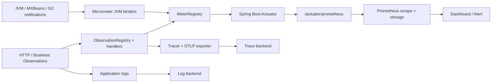
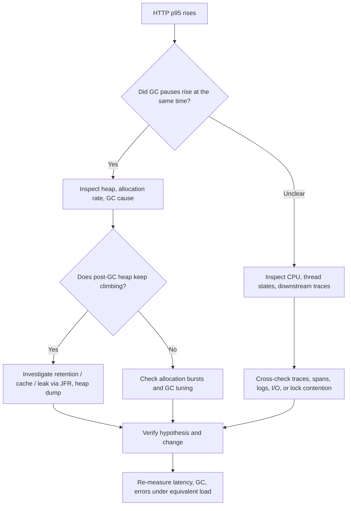

# JVM Metrics in Spring Boot: Observing Memory, GC, and Execution Threads

A Spring Boot API might return HTTP 200 while its p95 response time climbs from 120 ms to 1.8 seconds. Inspecting a slow request's trace may reveal a large chunk of elapsed time with no corresponding downstream call. One hypothesis to check is **JVM memory pressure or garbage collection (GC)**. With HTTP metrics alone, pinpointing the cause is difficult. JVM metrics provide data on heap, non-heap, garbage collectors, threads, class loading, and several process-level resources.

This **JVM metrics** lesson belongs to the **Spring Boot metrics** chapter in the `SPRING_BOOT_OBSERVABILITY` module. The overall goal is setting up observability for Spring Boot using Micrometer Observation, metrics, logs, and distributed tracing; understanding context propagation, tags/cardinality, exporters, and sampling; and combining signals to investigate errors, latency, and application behavior in production. Here, the focus is collecting, reading, and interpreting JVM metrics accurately, and linking them to API-level symptoms.

## 1. What questions do JVM metrics answer?

**JVM metrics** measure the state and activity of the Java Virtual Machine, typically collected by Micrometer through JVM management interfaces such as JMX/MXBeans and published through a `MeterRegistry`. When Spring Boot Actuator is configured properly, many standard JVM meters are registered automatically.

Common questions include:

- How much heap is used, how much memory has the JVM committed, and what are the current limits?
- After GC, does retained heap keep climbing over time?
- Is GC running too frequently or causing excessively long application pauses?
- Are live threads or blocked threads spiking suddenly?
- Are metaspace/class loading or direct buffers growing abnormally?
- Does process CPU rise alongside request latency?

JVM metrics measure **runtime health**, whereas business metrics measure business operations, HTTP metrics measure requests, tracing captures a single execution, and logs add error details. JVM metrics cannot directly tell you which request or Java class caused a memory leak; they help narrow down hypotheses before using heap dumps, thread dumps, JFR, or appropriate diagnostic tools.

| Signal group | Common meter names | General meaning |
| --- | --- | --- |
| Heap/non-heap | `jvm.memory.used`, `jvm.memory.committed`, `jvm.memory.max` | Used, committed, and maximum bytes per area/pool |
| GC | `jvm.gc.pause` | Count and duration of recorded GC pause events |
| Memory allocation/promotion | `jvm.gc.memory.allocated`, `jvm.gc.memory.promoted` | Estimated bytes allocated or promoted to older generations, when supported by the binder |
| Live data size | `jvm.gc.live.data.size`, `jvm.gc.max.data.size` | Estimated live data/capacity related to GC when data is available |
| Threads | `jvm.threads.live`, `jvm.threads.daemon`, `jvm.threads.peak`, `jvm.threads.states` | Thread counts by state and type |
| Classes | `jvm.classes.loaded`, `jvm.classes.unloaded` | Currently loaded classes and cumulative unloaded count |
| Buffers | `jvm.buffer.count`, `jvm.buffer.memory.used`, `jvm.buffer.total.capacity` | Buffer pools such as `direct` and `mapped` |
| Related process/system | `process.cpu.usage`, `system.cpu.usage`, `process.uptime` | Relative CPU usage and process/system uptime |

**Version note:** meter names, labels, and the presence of individual measurements depend on Spring Boot, Micrometer, JDK, collector, platform, and registry. Do not assume every JVM emits all meters in this table. Verify actual names and tags via Actuator or your exporter.

## 2. How do JVM metrics travel from the application to the dashboard?



Micrometer ships several *binders* for JVM and system telemetry. A binder reads runtime state and registers meters into the registry; **Actuator exposes endpoints to inspect or publish those meters**. Prometheus must scrape periodically to build history; Actuator `/metrics` alone is not a time-series database.

When an application has Micrometer Observation and a tracing bridge, a request can emit HTTP metrics, spans, and correlated logs. JVM metrics are sampled/recorded at the runtime level and **do not carry per-request `traceId`s**. During investigations, correlate them by **service, instance, and timestamp**, then use traces/logs to inspect specific work.

## 3. Enabling JVM metrics in Spring Boot

Example for **Spring Boot 3.x with Java 17+**, with dependency versions managed by Spring Boot parent/BOM. Most applications adding Actuator already get standard JVM binders. Add the Prometheus registry when Prometheus scraping is needed.

```xml
<dependencies>
    <dependency>
        <groupId>org.springframework.boot</groupId>
        <artifactId>spring-boot-starter-actuator</artifactId>
    </dependency>
    <dependency>
        <groupId>io.micrometer</groupId>
        <artifactId>micrometer-registry-prometheus</artifactId>
    </dependency>
</dependencies>
```

Illustrative configuration in `application.yml`:

```yaml
spring:
  application:
    name: order-service

management:
  endpoints:
    web:
      exposure:
        include: health,info,metrics,prometheus
  metrics:
    tags:
      application: order-service
```

The `application` field is a **common tag** distinguishing the service in the metrics system. Labels like `instance`, `job`, and `namespace` may be added by Prometheus or deployment infrastructure; they do not necessarily originate from the application.

Once the service is running on port 8080 under default configuration:

```bash
curl -s http://localhost:8080/actuator/health
curl -s http://localhost:8080/actuator/metrics
curl -s http://localhost:8080/actuator/metrics/jvm.memory.used
curl -s http://localhost:8080/actuator/metrics/jvm.gc.pause
curl -s http://localhost:8080/actuator/metrics/jvm.threads.live
curl -s http://localhost:8080/actuator/prometheus
```

If `jvm.gc.pause` has no data yet, no qualifying GC event may have occurred since startup. If an endpoint returns 404, check dependencies, exposure, base path/management port, actual meter names, and runtime support. If you get 401/403, check access policies.

**Security:** `management.endpoints.web.exposure.include` only controls which endpoints are published over HTTP; it does not configure authentication/authorization. Allow access only to authorized monitoring systems and operators via compatible network policies/gateways/Spring Security. Never expose sensitive diagnostic endpoints such as heap dumps to the Internet.

## 4. Heap and non-heap: understanding `used`, `committed`, and `max`

### 4.1. How does heap differ from non-heap?

**Heap** is where most Java objects allocated at runtime reside. GC manages the lifecycle of most of these objects. **Non-heap** includes JVM-managed regions such as metaspace and code cache. Additionally, the Java process uses native memory for thread stacks, direct buffers, JIT, runtime internals, and native libraries.

Therefore:

> **JVM heap used does not equal total memory consumed by the container or process.**

An application with stable heap can still face container memory pressure from direct buffers, native allocations, thread stacks, or off-heap components. JVM memory metrics are not a complete inventory of RSS or cgroup memory.

### 4.2. Meaning of the memory meters

| Meter | Question | Interpretation |
| --- | --- | --- |
| `jvm.memory.used` | How many bytes are currently used? | Current usage per memory pool |
| `jvm.memory.committed` | How many bytes has the JVM committed for use? | Does not mean all committed bytes are actively used |
| `jvm.memory.max` | What is the maximum reported by the pool? | May be undefined or vary by pool/GC |

These meters typically carry tags such as `area=heap/nonheap` and `id=<memory pool>`. For example `id=G1 Eden Space` or `id=Metaspace`; pool names depend on JDK and GC.

An **illustrative** Actuator response for `jvm.memory.used` might list:

```json
{
  "name": "jvm.memory.used",
  "baseUnit": "bytes",
  "measurements": [
    {"statistic": "VALUE", "value": 268435456}
  ],
  "availableTags": [
    {"tag": "area", "values": ["heap", "nonheap"]},
    {"tag": "id", "values": ["G1 Eden Space", "G1 Old Gen", "Metaspace"]}
  ]
}
```

The numbers and pool list above are purely illustrative. Querying `/actuator/metrics/jvm.memory.used` **without tag filtering** may aggregate multiple meters sharing the same name; it does not necessarily represent heap alone.

Filter to the right area:

```bash
curl -G 'http://localhost:8080/actuator/metrics/jvm.memory.used' \
  --data-urlencode 'tag=area:heap'

curl -G 'http://localhost:8080/actuator/metrics/jvm.memory.used' \
  --data-urlencode 'tag=area:nonheap'
```

### 4.3. How should you read heap ratio?

A useful chart sums `jvm.memory.used` with `area=heap` per instance. You can compare it with committed heap to see utilization of committed memory:

\[
\text{Ratio to committed heap}
=\frac{\text{heap used}}{\text{heap committed}}\times100\%.
\]

However, this is **not** the utilization ratio against the configured `-Xmx` heap limit. Pools can have an undefined max (often represented as a negative value in JVM APIs or omitted from metrics), and summing `jvm.memory.max` across all pools does not always yield a reliable heap cap. When comparing against actual heap limits, verify JVM flags and cgroup/container limits on the running runtime version.

Post-GC heap creeping upward **may** suggest increasing retained memory; by itself it is not enough to prove a memory leak. Warming caches, changing load patterns, collector behavior changes, or peak traffic can also explain that trend.

## 5. GC metrics: frequency, pause duration, and live data size

The garbage collector reclaims memory from objects no longer in use. GC can introduce pauses (*stop-the-world*) and CPU overhead; depending on the collector, much work also runs concurrently with application threads. JVM metrics help observe overall impact, though specific meter names and details depend on the JDK/collector.

### 5.1. `jvm.gc.pause` is a Timer

`jvm.gc.pause` is typically recorded by Micrometer as a `Timer`. Important data includes:

- **Count:** number of recorded pause events.
- **Total time:** cumulative duration of recorded pauses.
- **Maximum or histogram:** peak pause or distribution data, when configured and supported by the backend.
- **Tags:** may include `gc`, `action`, and `cause` as reported by the JVM.

Never read a single total-time sample of `jvm.gc.pause` as the duration of the **most recent GC**. Count and total time are cumulative over the meter's lifetime; to see rate or average duration over a window, compute differences over time in the backend.

Illustrative results for one instance:

| Time window | GC pause count increase | Total pause time increase | Average duration per pause |
| --- | ---: | ---: | ---: |
| Previous 5 minutes | 20 | 0.6 s | 30 ms |
| Next 5 minutes | 60 | 6 s | 100 ms |

In the second window, the application experienced more pauses and longer average pauses. This data is worth comparing against p95 HTTP latency, request throughput, and CPU. It does not prove every slow request was caused by GC; inspect timestamps and corroborating evidence.

### 5.2. Allocation, promotion, and live data

| Common meter | Meaning | Caveats to know |
| --- | --- | --- |
| `jvm.gc.memory.allocated` | Estimated total bytes allocated in tracked regions | Not an exact count of every per-thread allocation |
| `jvm.gc.memory.promoted` | Estimated total bytes promoted to older generations | Depends on GC notifications; collectors differ |
| `jvm.gc.live.data.size` | Estimated live data size after qualifying cycles | Updates on GC events rather than continuously |
| `jvm.gc.max.data.size` | Capacity metric related to live data/old generation | May be absent or non-constant |

Allocation rate rising with request traffic is usually normal. However, if allocation rate surges while throughput stays flat, extra intermediate objects, serialization, or temporary allocations may have been introduced. Sustained promotion growth warrants investigation alongside old-generation occupancy and GC pauses.

### 5.3. GC metrics do not answer every question

- A large pause does not automatically explain every slow request; correlate timestamps.
- Pause duration depends on collector and event type; concurrent GC work cannot always be inferred directly from pause timers.
- GC metrics do not reveal the exact object graph retaining memory. Use Java Flight Recorder (JFR), heap dumps, or profilers under safe operational procedures when needed.
- Changing GC algorithms or JDK versions can alter `gc` tags, memory pool names, update cadence, and distributions. Record version and configuration when comparing before/after.

## 6. Thread metrics: when requests wait instead of working

An application can be slow even with low CPU: many threads may be waiting on locks, I/O, or exhausted connection pools. JVM thread metrics help distinguish several patterns:

| Meter | How to read |
| --- | --- |
| `jvm.threads.live` | Number of live threads |
| `jvm.threads.daemon` | Number of daemon threads |
| `jvm.threads.peak` | Peak number of threads observed by the JVM |
| `jvm.threads.states` | Thread counts by state: `RUNNABLE`, `BLOCKED`, `WAITING`, `TIMED_WAITING`, ... |

For example, `jvm.threads.states{state="blocked"}` spiking alongside latency may signal monitor/lock contention. Still, inspect thread dumps or JFR to identify the exact lock. `WAITING` is not inherently an error: healthy thread pools spend most idle time waiting for work.

**Never put thread names or request IDs into metric tags** to track individual threads. Dynamic thread counts or names quickly blow up cardinality. When debugging a specific thread, use thread dumps/profilers and appropriately scoped logs.

In Spring MVC/Servlet apps, HTTP worker thread counts also depend on the servlet container and executor config. Rising JVM thread count does not by itself prove HTTP workers are leaking; schedulers, HTTP clients, business executors, or other libraries can spawn threads too.

## 7. Classes, buffer pools, and CPU: off-heap memory matters too

### 7.1. Class loading and metaspace

`jvm.classes.loaded` reflects currently loaded classes. `jvm.classes.unloaded` typically tracks cumulative unloaded classes. Metaspace appears under `jvm.memory.used{area="nonheap",id="Metaspace"}` or the equivalent JDK pool name.

Class count rising during warm-up is normal. If it keeps climbing across dynamic class-loader operations in the same process, or climbs alongside non-heap memory, check class loader retention and dynamic proxy/class generation. This is a **hypothesis**, not a definitive diagnosis from two metrics alone.

### 7.2. Direct and mapped buffers

`jvm.buffer.memory.used`, `jvm.buffer.total.capacity`, and `jvm.buffer.count` may carry `id=direct` or `id=mapped` tags. They are helpful for NIO, networking, memory-mapped files, and libraries allocating direct buffers.

Buffer metrics do not cover all native memory. A container OOMKill while heap used is modest may involve off-heap memory, though you must examine cgroup/container metrics, thread stacks, native libraries, and JVM flags before concluding.

### 7.3. CPU and process

`process.cpu.usage` and `system.cpu.usage` usually express utilization ratios over an observation interval, though exact sampling and semantics depend on runtime/platform. `process.cpu.usage` is not "CPU seconds" to sum directly and does not necessarily share the same denominator as CPU percentage in `top` or Kubernetes dashboards.

`process.uptime` helps spot recent restarts, though it does not replace container restart counts, OOMKill events, and CPU throttling metrics. On Kubernetes, inspect container/cgroup metrics to detect CPU throttling or memory limits. High CPU paired with high allocation rate often points to GC or heavy object processing; low CPU paired with many blocked threads suggests lock or I/O bottlenecks.

## 8. Labels and cardinality of JVM metrics

JVM metrics already come with finite dimensions defined by binders, such as:

| Group | Common tags | Value count |
| --- | --- | --- |
| Memory | `area=heap/nonheap`, `id=<pool>` | Small, depends on JVM/GC |
| GC pause | `gc`, `action`, `cause` | Depends on collector, typically bounded |
| Threads | `state` | JVM thread states |
| Buffers | `id=direct/mapped` | Finite set |
| Infrastructure | `application`, `instance`, `pod` | Scales with deployed instances/pods |

Every combination of metric name and tag set generates a separate time series in the backend. Across many instances, JDK/GC pools, and histogram buckets, series counts multiply across those dimensions. Therefore, even though standard JVM tags have low cardinality individually, evaluate total series at deployment scale.

Never put `userId`, `requestId`, `traceId`, thread IDs, or raw exception messages onto JVM metrics. They add no value to runtime group analysis while inflating costs. Trace IDs and per-request IDs belong in tracing/logging systems with dedicated retention and access control.

**Changing GC or JDK** can change memory pool `id` names. If a dashboard hardcodes `id="G1 Old Gen"`, the panel can go blank when the service switches collectors. Prefer querying by `area=heap` for overviews and filter by specific pool names only when explicitly required.

## 9. Querying JVM metrics in Prometheus

The examples below assume Spring Boot uses the Micrometer Prometheus registry and Prometheus scrapes the service. Exported names typically convert dots to underscores and add unit suffixes—for example, `jvm.memory.used` becomes `jvm_memory_used_bytes`. **Verify actual series names at `/actuator/prometheus` on your running version** before copying PromQL.

Expressions assume a common label `application="order-service"` and Prometheus's `instance` target label. To investigate a specific pod, group by `instance` instead of summing across all pods.

### 9.1. Heap used (bytes), by instance

```promql
sum by (application, instance) (
  jvm_memory_used_bytes{
    application="order-service", area="heap"
  }
)
```

This sums heap pools to give an overview of used heap per instance. Pool figures are collected at nearby scrape instants, so do not treat them as an atomic snapshot across every pool.

### 9.2. Utilization ratio against committed heap

```promql
100 *
sum by (application, instance) (
  jvm_memory_used_bytes{
    application="order-service", area="heap"
  }
)
/
sum by (application, instance) (
  jvm_memory_committed_bytes{
    application="order-service", area="heap"
  }
)
```

This expression reflects **used/committed**, not used/`-Xmx`. Ensure the denominator is positive and complete; if meters are missing or pools resize, interpret carefully. A briefly high ratio right before GC can be completely normal depending on workload and GC algorithm.

### 9.3. GC pauses per second

```promql
sum by (application, instance) (
  rate(jvm_gc_pause_seconds_count{
    application="order-service"
  }[5m])
)
```

The unit is **pauses/second** over a 5-minute window. For **pauses/minute**, multiply by 60 in the query or display layer.

### 9.4. Average GC pause duration

```promql
sum by (application, instance) (
  rate(jvm_gc_pause_seconds_sum{
    application="order-service"
  }[5m])
)
/
sum by (application, instance) (
  rate(jvm_gc_pause_seconds_count{
    application="order-service"
  }[5m])
)
```

The returned value is **seconds/pause**, i.e., the mean duration of recorded pauses in the 5-minute window. At very low GC activity, the denominator can approach 0 or yield no data; do not treat an average with too few samples as statistically reliable.

### 9.5. Allocation rate and blocked threads

If `jvm_gc_memory_allocated_bytes_total` exists:

```promql
sum by (application, instance) (
  rate(jvm_gc_memory_allocated_bytes_total{
    application="order-service"
  }[5m])
)
```

The unit is **bytes/second** per the binder's meter definition and sampling mechanism. This is an estimate from Micrometer/JVM events, not a method-level allocation profiler.

For threads in the `BLOCKED` state:

```promql
sum by (application, instance) (
  jvm_threads_states_threads{
    application="order-service", state="blocked"
  }
)
```

The exported name of `jvm.threads.states` may include a `_threads` unit suffix as shown, depending on naming conventions. Verify live output before alerting on it. Rising blocked threads is only a cue to investigate further via thread dumps/JFR.

### 9.6. p95 GC pause duration

If an **appropriate histogram** is configured for the `jvm.gc.pause` Timer and the exporter actually emits `jvm_gc_pause_seconds_bucket`:

```promql
histogram_quantile(
  0.95,
  sum by (le, application, instance) (
    rate(jvm_gc_pause_seconds_bucket{
      application="order-service"
    }[5m])
  )
)
```

You cannot derive p95 from `_count` and `_sum` alone. Histograms must be properly configured in `MeterRegistry`/Actuator with sufficient samples; bucket series add extra series and cost. Before enabling globally, check the series impact on GC metrics given existing tags.

## 10. Combining JVM metrics with HTTP metrics, logs, and distributed tracing

A realistic incident: after a deployment, p95 for `POST /orders` rises while HTTP 5xx errors have not noticeably increased. A sound investigation flow:



| Step | Signal | Investigation question |
| --- | --- | --- |
| 1. Quantify impact | HTTP server metrics by route/status | Which route is slow? How did latency and traffic shift? |
| 2. Align timelines | `jvm.gc.pause`, allocation/heap | Did pauses rise at the exact time p95 rose or elsewhere? |
| 3. Check footprint | Heap, non-heap, buffers, container memory | Is pressure on heap or off-heap? Near cgroup limits? |
| 4. Check contention | Thread states, CPU, connection pool metrics | Are there blocked threads, CPU throttling, or pool exhaustion? |
| 5. Trace a request | Distributed trace and spans | Is the delay local processing, a downstream call, or an unexplained gap? |
| 6. Find error evidence | Logs with `traceId`/`spanId` and GC/JVM logs if configured | Are there timeouts, OOMs, safepoints, exceptions, or partner errors? |
| 7. Verify after fix | Metrics on the same timeline | Did latency, GC, and error rates improve sustainably? |

**Correlation does not prove causation.** If GC pauses rise at the same time p95 rises, it is a strong hypothesis, though both could stem from a third cause like a traffic burst. Inspect GC logs, JFR, heap allocations, and trace details to confirm.

### Why might traces not show JVM impact directly?

Spans show total operation duration, but do not automatically annotate each request with "GC paused 80 ms". A long span with no long child span could come from lock contention, queueing, CPU scheduling, GC, or local logic. Instance-level JVM metrics aligned by timestamp help narrow down the cause, while JFR/GC logs supply runtime-level proof.

Tracing bridges, exporters, and context propagation determine whether spans across HTTP/messages/threads link properly. Sampling retains only a subset of traces; failing requests without stored traces still show up in HTTP/JVM metrics. JVM metrics do not depend on trace sampling probability in the same way, making them valuable even when traces for rare incidents are dropped.

### Correlating logs with JVM metrics

Application logs can include `traceId` and `spanId` when tracing + MDC are properly configured. GC logs/JFR usually follow separate diagnostic channels and do not automatically carry per-request trace IDs. When combining them, align **service, instance, container, timezone, and timestamp**; account for clock skew across hosts.

## 11. Common misconceptions and configuration pitfalls

| Claim / mistake | Why it is inaccurate | How to handle |
| --- | --- | --- |
| "Rising heap used definitely means a memory leak" | Heap can rise with caches, load, or GC cycles | Track post-GC trends across workloads; check JFR/heap dump if needed |
| "Low heap used means the container cannot OOMKill" | Native/off-heap, thread stacks, and cgroups also consume memory | Combine container memory, buffer metrics, and JVM flags |
| "`used/committed` = `-Xmx` utilization" | Committed can differ from maximum heap limit | Check actual limit metrics and JVM/cgroup configuration |
| "Every JVM has `jvm.gc.memory.allocated`" | Depends on JDK/GC/binder | Inspect live meters |
| "Total GC pause 3 s means a single 3 s pause" | Total time is cumulative across multiple events | Use count, rate, and histograms when distributions are needed |
| "Thread `WAITING` means deadlock" | Idle thread pools normally sit in WAITING | Verify with thread dumps |
| "Process CPU equals container CPU throttling" | Different scope and units | Include container/cgroup metrics |
| "No trace means the JVM isn't causing latency" | Traces may be dropped by sampling or exporter issues | Use JVM/HTTP metrics and GC/JFR to investigate |
| "Enabling every histogram is always better" | Histograms multiply series counts | Enable only on meters with clear SLO/p95 needs |
| "Tagging thread ID or request ID helps debug JVM metrics" | Causes high cardinality and breaks aggregation | Use logs/traces/dumps for individual requests/threads |

### When dashboards suddenly lose JVM series

Check whether the service is alive, whether Prometheus scraping succeeds, and whether endpoint ports/paths or security policies changed. Then verify meters exist on the app via `/actuator/metrics`, and inspect exported names at `/actuator/prometheus`. If you recently upgraded the JDK or switched GC, pool names and some tags may have changed; if you upgraded Micrometer, naming conventions may differ too. Never work around missing series by creating custom duplicate default metrics before identifying the root cause.

## 12. Hands-on practice: observing the JVM under controlled load

Create a Spring Boot app with Actuator and a business endpoint to receive requests. Perform these steps in a **test environment**—never deliberately induce memory pressure in production:

1. **Start the application** and record JDK, GC algorithm, heap flags, cgroup memory limit (if containerized), and Spring Boot/Micrometer versions.
2. **Explore meters:** call `/actuator/metrics`, then inspect `jvm.memory.used`, `jvm.memory.committed`, `jvm.gc.pause`, `jvm.threads.states`, and buffer/class metrics if present.
3. **Filter heap/non-heap:** use query parameters `tag=area:heap` or `tag=area:nonheap` to separate regions. Record values across multiple timestamps to observe changes.
4. **Generate moderate load:** send a bounded batch of requests at a controlled rate, or run a controlled allocation test. Watch heap used, GC count, and pauses alongside HTTP latency.
5. **Enable Prometheus scraping:** verify `jvm_memory_used_bytes`, `jvm_gc_pause_seconds_count`, and other live series. Write PromQL for heap used, GC pause rate, average GC pause, and blocked threads.
6. **Practice reasoning:** if HTTP p95 climbs, inspect GC pauses, heap, and CPU before jumping to conclusions. If those are normal, pivot to traces, thread states, pool metrics, or downstream latency.
7. **Verify propagation:** with tracing configured, send a request across two services and verify log/trace correlation; explain why JVM metrics relate to requests only indirectly via instance and timestamp.
8. **Operational review:** restrict management endpoint access, control cardinality, histogram buckets, retention, and alerts; compare post-change metrics against a baseline under equivalent load.

### Self-check questions

1. How do `jvm.memory.used`, `committed`, and `max` differ? Why can you not always sum every pool's `max` to recover `-Xmx`?
2. Why does low heap used not rule out container OOMKill?
3. When `jvm.gc.pause` rises, how do you use count, sum, and histograms to separate frequency, average duration, and p95?
4. Is rising `jvm.threads.states{state="blocked"}` enough to conclude a deadlock?
5. If a slow request has no trace in the backend, how can JVM metrics and GC logs still assist the investigation?
6. When switching GC from G1 to another collector, why can dashboards filtering by memory pool name stop showing data?

## 13. JVM metrics operational checklist

- Enable required JVM binders via Actuator and verify meters actually exist at runtime.
- Attach consistent service/instance labels so data correlates to the exact process.
- Distinguish heap, non-heap, and container memory; check JVM/cgroup limits.
- Interpret `used`, `committed`, and `max` per each pool's semantics.
- Evaluate GC using frequency, total pause time, average duration, and distributions when histograms are available.
- Track allocation and live data trends alongside traffic; never diagnose leaks from a single gauge reading.
- Combine thread states, CPU, connection pools, and thread dumps when investigating contention.
- Never add high-cardinality IDs to JVM metrics.
- Verify exporters/scrapes, units, labels, and changes after JDK/GC upgrades.
- Read JVM metrics alongside HTTP/business metrics, traces, logs, and GC/JFR when proving root cause.
- Secure management endpoints and account for histogram, retention, and instance-scaling costs.

## Conclusion

**JVM metrics** expose the runtime state behind latency and error numbers in a Spring Boot application. Micrometer/Actuator provides meters for heap, GC, threads, classes, buffers, and related resources; Prometheus or other backends store history for comparison and alerting. Using this data accurately requires understanding units and scope for each meter, collector/JDK behavior, tags/cardinality, and measurement limits. When combined properly with HTTP/business observations, distributed tracing, logs, context propagation, exporters, and sampling, operations teams can separate memory pressure, GC stalls, thread contention, and downstream failures to investigate production incidents with solid evidence.
