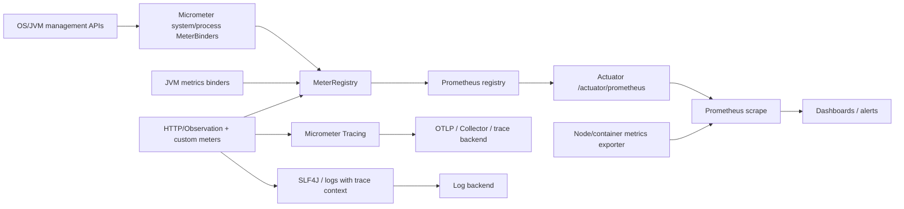
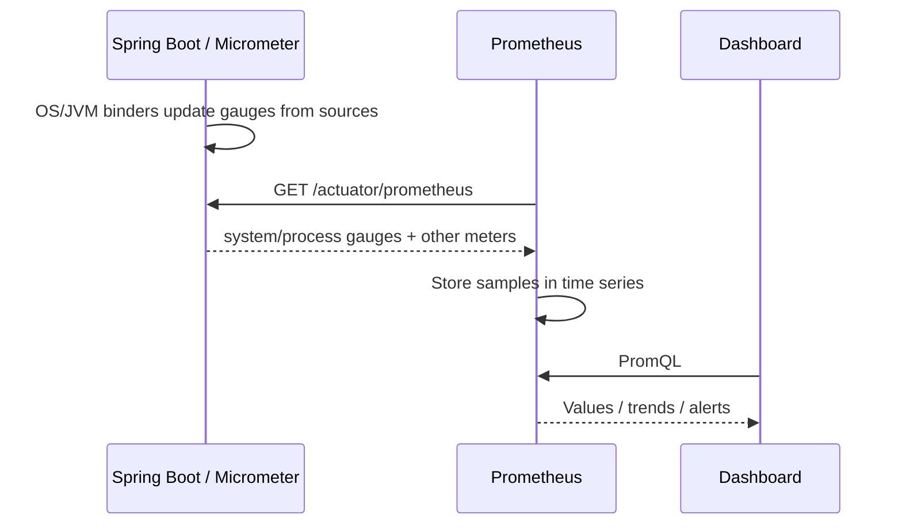
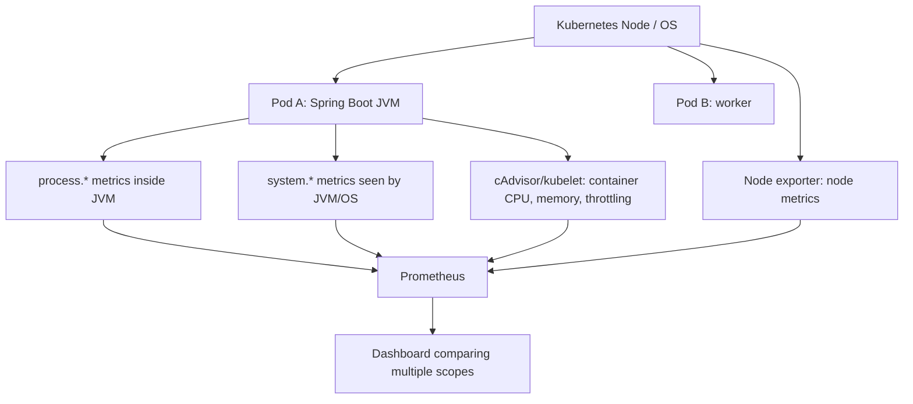

# System Metrics in Spring Boot: CPU, Load, Uptime, Disk, and File Descriptors

> **Chapter:** Spring Boot metrics  
> **Module:** `SPRING_BOOT_OBSERVABILITY` — Setting up observability for Spring Boot using Micrometer Observation, metrics, logs, and distributed tracing. Learning context propagation, tags/cardinality, exporters, sampling, and signal correlation to investigate errors, latency, and application behavior in production.  
> **Lesson scope:** Understand, collect, read, and interpret **system metrics** provided by Micrometer/Spring Boot; identify observation boundaries across processes, hosts, and containers; use these metrics to evaluate resources alongside latency, error rates, and request traces.

## Learning objectives

After this lesson, you will be able to:

1. Distinguish system metrics, process metrics, JVM metrics, application metrics, and infrastructure metrics; identify **which entity is actually being measured**.
2. Explain the meaning, units, and limits of meters such as `system.cpu.usage`, `process.cpu.usage`, `system.cpu.count`, `system.load.average.1m`, `process.uptime`, `process.start.time`, `disk.free`, `disk.total`, and file descriptor metrics when supported by the OS.
3. Enable Spring Boot Actuator and the Micrometer Prometheus registry; inspect meters via `/actuator/metrics` and `/actuator/prometheus`.
4. Write proper PromQL for **Gauges**: reading current, average, or peak values over a time window; avoiding `rate()` as used for Counters when inappropriate.
5. Understand the difference between CPU reported inside the process/JVM and CPU or memory at the host/container/Kubernetes level; know when to add metrics from cAdvisor, kubelet, node exporter, or cloud monitoring.
6. Build resource dashboards and alerts with context, avoiding misconceptions around load average, missing/`NaN` values, disk paths, and restarts.
7. Combine system metrics with request latency, errors, traces, and logs to distinguish CPU, disk, dependency, thread pool, or container resource bottlenecks.

## 1. What questions do system metrics answer?

When users report a slow API, one of the first questions is: **is the application running short on compute or system resources?** System metrics provide part of the evidence to answer that question.

For example, suppose the checkout service slows down after a traffic surge. You want to verify:

- Did the Java process CPU increase at the same time p95 latency rose?
- Is the machine running the process heavily loaded across multiple CPU cores?
- Did the application just restart, leaving cold caches or rebuilding connections?
- Does the disk where the process writes data/logs still have free space?
- Are open file descriptors/sockets approaching the process limit?
- If running in a container, do the observed numbers actually reflect the container or the entire node?

System metrics are **contextual and resource-level signals**; they do not explain business root causes on their own. High CPU may stem from JSON serialization, GC, encryption, CPU-heavy algorithms, or high concurrency. Low CPU with high latency may come from waiting on databases, networks, locks, queues, or resource caps at another layer.

### 1.1. Identify the exact measurement scope

| Group | Example | Measured entity | Answers well |
|---|---|---|---|
| **System/OS** | `system.cpu.usage`, `system.load.average.1m` | Operating system or scope visible to JVM/OS APIs | How heavily is the system CPU loaded? |
| **Process** | `process.cpu.usage`, `process.uptime`, `process.files.open` | Current Java application process | How much CPU does the process use, how long has it been up, how many descriptors are open? |
| **JVM** | `jvm.memory.used`, `jvm.gc.pause`, `jvm.threads.live` | JVM and runtime components | Are heap, GC, or threads creating pressure? |
| **Application** | `http.server.requests`, custom Timers/Counters | Requests or business steps | Which endpoint is slow, failing, or heavily called? |
| **Container/node** | CPU usage/throttling, memory working set, OOM events, node disk | Cgroup/container, pod, or node | Is the container hitting CPU quotas, memory limits, or node pressure? |

**System metrics inside the JVM are not synonymous with container metrics.** A system meter may rely on an OS management bean and reflect the host, even while a pod has its own CPU quota. On modern Java, some values are container-aware, though exact behavior varies by JDK, OS, runtime, and deployment setup. In Kubernetes, always cross-check with container/node-level sources before concluding anything about quotas or throttling.

## 2. How system metrics flow in Spring Boot

Micrometer supplies **meter binders** that collect information from the JVM and OS. Spring Boot Actuator provides auto-configuration to bind compatible binders into `MeterRegistry` when required dependencies and environment conditions are met.



In the **Prometheus pull** model, the application exposes metrics and Prometheus periodically scrapes the endpoint. Traces typically travel via an exporter/Collector, and logs via stdout/log collectors. These streams can be viewed side by side on a dashboard, yet **system gauges do not automatically contain trace IDs**.

### 2.1. Components to distinguish

- `MeterRegistry` is the registry receiving and managing meters such as Gauge, Counter, and Timer. System binders register meters here.
- `ObservationRegistry` manages the lifecycle and handlers of `Observation`. With meter/tracing handlers, an Observation can generate a Timer or span; **you do not create an Observation on every CPU reading**.
- `Gauge` reflects a sampled value at read time. Many system/process metrics are Gauges.
- `Counter` reflects a monotonically increasing cumulative quantity, normally queried with `rate()`/`increase()` in Prometheus.
- Collectors/exporters/remote-write and dashboards make up the rest of the pipeline; scrape failures can cause missing data even when JVM binders work fine.

### 2.2. What Spring Boot provides automatically

In a typical Spring Boot 3.x application, `spring-boot-starter-actuator` brings in Micrometer and configures available meter binders. Certain metrics depend on OS support or permissions and may be absent on some platforms. If using Spring Boot 4 or another version, verify starters, properties, and meter names against that version's documentation.

**Do not manually register `new ProcessorMetrics().bindTo(...)` in an application already configured by Actuator**, unless you know exactly why the default binder is insufficient. Binding redundantly can cause duplicate/confusing meters, even though registries generally merge meters with identical IDs.

## 3. Catalog of important system and process metrics

Micrometer uses dot-separated names in Java; Prometheus may normalize dots to underscores and append unit suffixes. The table below lists common **Micrometer** names without guaranteeing every name exists on every machine.

| Micrometer meter | Typical type | Meaning and unit | Watch out for |
|---|---|---|---|
| `system.cpu.usage` | Gauge | System CPU utilization, usually a ratio in range 0–1 | Host/container scope depends on OS/JDK; does not automatically equal pod quota usage |
| `process.cpu.usage` | Gauge | Java process CPU utilization normalized per platform API, usually 0–1 | Do not treat directly as Kubernetes "millicores" without verifying semantics |
| `system.cpu.count` | Gauge | Available processors visible to JVM/binder | May reflect container-aware JVM and CPU limits |
| `system.load.average.1m` | Gauge, platform-dependent | 1-minute system load average, **not CPU percentage** | Meaningful mainly on supported OSes; may be absent or invalid |
| `process.uptime` | Gauge | Seconds the Java process has been running | Resets near 0 on process restart |
| `process.start.time` | Gauge | Process start instant, usually Unix epoch seconds | Useful to align restarts; not a duration |
| `disk.free` | Gauge | Free bytes on the bound filesystem/path | May be missing depending on config; does not represent **all** disks |
| `disk.total` | Gauge | Total bytes on the corresponding filesystem/path | Compare with `disk.free` for the **same path** |
| `process.files.open` | Gauge, platform-dependent | Number of open file descriptors | Usually available only on Unix-like OSes |
| `process.files.max` | Gauge, platform-dependent | Process file descriptor limit | May depend on OS/user limits/container |

Some names may be exported to Prometheus as `system_cpu_usage`, `process_cpu_usage`, `system_cpu_count`, `process_uptime_seconds`, `disk_free_bytes`, and `disk_total_bytes`. **Do not copy these names blindly into dashboards before checking `/actuator/prometheus`**, as versions, base units, naming conventions, and exporters can differ.

Beyond this list, production dashboards typically also need `jvm.memory.used`, `jvm.gc.pause`, `jvm.threads.live`, along with HTTP server metrics, connection pool metrics, and container/host metrics from infrastructure monitoring.

## 4. CPU usage: reading percentages accurately

### 4.1. How do `system.cpu.usage` and `process.cpu.usage` differ?

`system.cpu.usage` describes CPU utilization reported by the system API. `process.cpu.usage` measures CPU attributed to the Java process. These values are typically expressed as **ratios**:

- `0.25` corresponds to roughly 25% against the denominator used by the binder/OS API.
- `0.80` corresponds to roughly 80%.
- `1.00` corresponds to roughly 100% per the source's normalization.

Convert to percent simply by multiplying by 100. However, ask **100% of what?** On an 8-core machine, a JVM process can use multiple cores concurrently. The OS/JDK may report percentage relative to total visible processors, whereas container orchestrators measure in cores or millicores with separate quotas. Thus, for the exact same workload, the process CPU gauge and container CPU metric can show different percentages.

**Analysis examples:**

| Observed pattern | Reading hint | Next check |
|---|---|---|
| High process CPU, high system CPU | Java likely contributes heavily to CPU load | GC, profiling, workload concurrency, node contention |
| Low process CPU, high system CPU | Load may come from another process on the node | Node exporter/cAdvisor, process list, and noisy neighbors |
| Low process CPU, rising latency | Likely **waiting** on I/O, locks, pools, queues | Traces, DB/client timings, thread dumps, saturation |
| High process CPU, flat throughput | Possible repeated work, busy loops, GC, or expensive computation | CPU profiles, GC metrics, code paths |
| Container throttled heavily, process CPU gauge looks low | Quota/throttling caps actual CPU time | Cgroup CPU throttling metrics, pod limits/requests |

Each row above is an **investigation hypothesis**, not an automatic diagnosis from a single gauge.

### 4.2. `system.cpu.count` is not necessarily guaranteed cores for the pod

This metric usually reflects the CPU count visible to the runtime, which does not replace Kubernetes resource requests/limits. For example, a pod limited to 500 millicores on a 16-core node: verify JVM-detected processors, CPU quotas, and throttling across both JDK and container metrics. To measure "how much of its quota is the pod consuming?", use container metrics alongside configured limits.

### 4.3. How long must high CPU last before alerting?

Brief 95% CPU during application warm-up can be normal; sustained 95% paired with rising p95 latency and error ratios warrants investigation. Inspect:

- 5–15 minute averages to smooth out noise.
- Window peaks when bursts matter.
- Throughput, p95/p99, error ratio, and queue depth to see whether high CPU hurts users.
- Replica count, quotas, throttling levels, and deploy/restart events.

Never apply a single rigid CPU threshold across all services. Batch workers, low-latency APIs, JVM warm-ups, and seasonal traffic apps behave very differently.

## 5. Load average: not CPU utilization

`system.load.average.1m` reflects the **system load average** over a short window on platforms that provide it. On Linux, load average includes runnable tasks plus tasks in uninterruptible I/O wait. Consequently:

- A load average of `4` does **not** mean 4% CPU.
- A load average of `4` on a 4-logical-core host means something very different than on a 32-core host.
- High load with high CPU suggests CPU contention.
- High load without high CPU may indicate blocked I/O or OS load-reporting differences.
- Inside a container, load may reflect host scope rather than the pod's CPU quota.

### 5.1. Interpreting with core counts

Suppose a system has 4 available CPUs and a 1-minute load average of `6.0`. The reference ratio `6 / 4 = 1.5` suggests more tasks competing or waiting than intuitive CPU capacity, **but it is neither a CPU utilization formula nor proof of a CPU bottleneck**.

In Kubernetes, apply this ratio even more cautiously because numerator and denominator may not share the same observation scope. Never autoscale pods purely because `system.load.average.1m` exceeds `system.cpu.count` without checking container CPU throttling, latency, and workload metrics.

### 5.2. Unsupported platforms

Some OS/JDK combinations return meaningless values or do not expose load average at all. Backends may represent this as missing series, `NaN`, or sentinel values; inspect live data. When a meter does not exist, **do not coerce it to 0**—0 means "zero load", which is completely different from "no data".

## 6. Process uptime and start time

`process.uptime` returns elapsed time since the process started, usually in seconds. `process.start.time` reports the start instant, usually as a Unix timestamp in seconds.

Example:

```text
process.uptime = 7200 seconds
process.start.time = 1795000000 seconds
```

These two values illustrate the format, not data from a specific system.

**Why track them?**

- A newly restarted process can undergo JVM JIT warm-up, cold caches, connection pool rebuilding, or readiness transitions.
- If p95 spikes right after a rolling deployment, uptime and start time put telemetry in proper context.
- Repeated short uptimes can suggest a crash loop; confirm via Kubernetes restart counts, logs, exit codes, and orchestrator events.

**Do not use uptime as a substitute for reliable restart history.** New pods often get new instance labels; Prometheus sees old series disappear and new series start. In Kubernetes, container restart counters and pod status from infrastructure metrics are much clearer.

### 6.1. Uptime is a Gauge even though its value keeps rising

Uptime rises with wall-clock time while the process lives, yet it reflects **the current state of a process**, not an event-counting Counter. Never run `rate(process_uptime_seconds[5m])` to measure requests/second. To count requests, use a Counter or HTTP Timer count; to display uptime, show seconds or convert to hours/days.

## 7. Disk space: measuring the right filesystem and unit

`disk.free` and `disk.total` typically represent **free bytes** and **total bytes** of the filesystem at a path the binder is configured to watch. Values may carry a path or source tag depending on binder/registry.

General percentage used calculation:

\[
\text{used ratio} = \frac{\text{disk.total} - \text{disk.free}}{\text{disk.total}}
\]

For example, `disk.total=100 GiB` and `disk.free=20 GiB` gives an ~80% used ratio as measured here. Always match the **same path** and ensure `disk.total > 0` before dividing.

### 7.1. What disk space does **not** tell you

- Does not show disk read/write throughput, I/O latency, or queued I/O operations.
- Does not prove all pod volumes still have space.
- Does not accurately reflect container-specific ephemeral storage/quotas in every runtime.
- Does not replace inode metrics: a filesystem can have free bytes yet run out of inodes.
- Does not replace cloud disk metrics, PVC usage, node filesystems, log volumes, or database storage metrics.

Inside a Spring Boot container, `/`, `/tmp`, and a mounted volume can live on completely different filesystems. If the application stores uploads in `/data/uploads`, inspect metrics for that exact filesystem/path or add infrastructure storage monitoring. Disk-space health indicators and disk metrics are also distinct mechanisms: **`health=UP` does not guarantee you have full I/O and storage metrics**.

### 7.2. Disk alerting rules

A threshold like "under 10% free" can be an initial signal, but also account for:

- Rate of free-byte decrease (time until full?).
- Absolute remaining space (10% of 10 TiB differs vastly from 10% of 10 GiB).
- Affected path and service.
- Workload type (temporary files, logs, caches, database), cleanup policies, and quotas.
- Inode usage, volume health, and system-level I/O errors where applicable.

## 8. File descriptors: open sockets are system resources too

On supported operating systems (typically Unix-like), metrics such as `process.files.open` and `process.files.max` report open descriptors and the process limit.

Every TCP socket, file, or pipe can consume a descriptor. When a process approaches its limit, the application can fail to open new files or sockets even with plenty of CPU and heap left.

Example:

```text
process.files.open = 850
process.files.max = 1024
open / max = 0.83
```

That corresponds to about 83% of the limit in this example. When you see a high and steadily climbing ratio:

1. Check connection pools and whether response bodies/input streams are properly closed.
2. Check whether the application opens files or sockets without closing them.
3. Compare against database connections, HTTP clients, and traffic volume.
4. Check `ulimit`/container limits and whether the platform exposes max descriptors.
5. When needed, inspect OS-level diagnostics and thread dumps/logs at failure time.

Do not treat every 80% reading as an outage: a service with stable pools/sockets can run smoothly there. What matters more is **trend**, actual limits, and file/socket creation errors.

## 9. Enabling system metrics with Spring Boot Actuator

Examples target **Spring Boot 3.x** with Java 17+ and Spring Boot dependency management (parent or BOM). For Spring Boot 4 or other stacks, verify matching artifacts and configuration properties.

### 9.1. Maven dependencies

```xml
<dependencies>
    <!-- Actuator and Micrometer instrumentation -->
    <dependency>
        <groupId>org.springframework.boot</groupId>
        <artifactId>spring-boot-starter-actuator</artifactId>
    </dependency>

    <!-- Export metrics in Prometheus format -->
    <dependency>
        <groupId>io.micrometer</groupId>
        <artifactId>micrometer-registry-prometheus</artifactId>
    </dependency>
</dependencies>
```

If using Gradle:

```groovy
implementation 'org.springframework.boot:spring-boot-starter-actuator'
runtimeOnly 'io.micrometer:micrometer-registry-prometheus'
```

Actuator and Micrometer instrumentation form the foundation; the Prometheus registry exposes `/actuator/prometheus`. **You do not need a tracing bridge or OTLP exporter solely to measure CPU/disk gauges.** Tracing dependencies are only required when correlating resource state with request traces.

### 9.2. Local configuration

Example `application.yml`:

```yaml
spring:
  application:
    name: checkout-service

management:
  endpoints:
    web:
      exposure:
        include: health,info,metrics,prometheus
  metrics:
    tags:
      application: ${spring.application.name}
      environment: ${APP_ENVIRONMENT:local}
```

This is an illustrative configuration for Spring Boot 3.x. `application` and `environment` are **common meter tags** with bounded value sets, where environment comes from deployment config. Never put request IDs, user IDs, or raw URLs into common tags.

By default, web management endpoints share the application server port and base path unless `management.server.port` or `management.endpoints.web.base-path` is changed. Locally, with the app listening on `localhost:8080`:

```bash
curl -i http://localhost:8080/actuator/health
curl -s http://localhost:8080/actuator/metrics
curl -s http://localhost:8080/actuator/metrics/system.cpu.usage
curl -s http://localhost:8080/actuator/metrics/process.cpu.usage
curl -s http://localhost:8080/actuator/prometheus
```

Inspect `/actuator/metrics` first to confirm actual meter names. If `system.cpu.usage` does not appear, check platform/JDK support, binder conditions, meter filters, or disabled metric settings—never assume CPU is 0.

### 9.3. Actuator metrics endpoint payload

`/actuator/metrics/system.cpu.usage` may return JSON such as:

```json
{
  "name": "system.cpu.usage",
  "description": "The recent CPU usage for the system",
  "baseUnit": null,
  "measurements": [
    {
      "statistic": "VALUE",
      "value": 0.37
    }
  ],
  "availableTags": []
}
```

This is an **illustrative example of structure and values**, not fixed output. A Gauge typically has measurement `VALUE`; Counters have `COUNT`; Timers have count/total time/max. Fields and tags can vary by meter or version.

When multiple tags/series exist, Actuator may aggregate or display values per endpoint rules. To inspect one dimension, filter with `?tag=...` or `--data-urlencode` in curl; avoid treating an aggregated figure as belonging to a single instance.

## 10. Prometheus scraping and series names

Illustrative local Prometheus configuration:

```yaml
global:
  scrape_interval: 15s

scrape_configs:
  - job_name: spring-boot-local
    metrics_path: /actuator/prometheus
    static_configs:
      - targets:
          - host.docker.internal:8080
```

If Prometheus runs inside Docker Desktop while Spring Boot runs on the host, `host.docker.internal` usually routes to the host. On Linux, it may require `host-gateway` network configuration or a reachable hostname/IP. If both run on the same Docker Compose network, use the service name and internal port. **`localhost` inside the Prometheus container refers to the Prometheus container itself**, not the Spring Boot host.

Prometheus scrapes periodically:



In the Prometheus UI, `up{job="spring-boot-local"}` equal to `1` indicates the target was recently scraped successfully. If `up=1` yet a metric is missing, the cause likely lies in binders, platform, config, or metric naming—do not rush to change networking.

Common series after Prometheus renaming can include:

```text
system_cpu_usage{application="checkout-service",environment="local"} 0.37
process_cpu_usage{application="checkout-service",environment="local"} 0.12
system_cpu_count{application="checkout-service",environment="local"} 8.0
process_uptime_seconds{application="checkout-service",environment="local"} 7200.0
disk_free_bytes{application="checkout-service",environment="local",path="/"} 2.5e+10
```

These are **shape examples only**. Check actual numbers and labels at `/actuator/prometheus`, especially when `instance`, `job`, `pod`, or `namespace` tags are added by Prometheus or an orchestrator.

## 11. Proper PromQL for System Gauges

Many system metrics are **Gauges**, so the questions are "what is the current value?", "what was the 5-minute average/peak?", or "how did it change?". `rate()` and `increase()` are designed primarily for **Counters**, not as the default way to analyze CPU usage gauges.

The examples below assume series names `system_cpu_usage`, `process_cpu_usage`, `system_load_average_1m`, `disk_free_bytes`, `disk_total_bytes`, and `process_uptime_seconds`. Adjust to match your live output.

### 11.1. Current process CPU usage (%)

```promql
100 * process_cpu_usage{job="checkout-service"}
```

For example, returning `63.4` means roughly 63.4% **relative to the meter's defined denominator**. If you need % relative to a pod's CPU quota, use CPU usage and quota/limits from matching container metrics.

### 11.2. 5-minute average CPU per instance

```promql
100 * avg_over_time(
  process_cpu_usage{job="checkout-service"}[5m]
)
```

`avg_over_time` computes the average of Gauge samples over the window, smoothing noise. Results retain per-series labels, including `instance`/`pod` if present.

### 11.3. 5-minute peak CPU per instance

```promql
100 * max_over_time(
  process_cpu_usage{job="checkout-service"}[5m]
)
```

Peaks reflect only scraped samples and **are not guaranteed to catch spikes shorter than the scrape interval**. For bursty workloads, tighten scrape intervals or pair with profilers/other metrics when needed.

### 11.4. System CPU by instance

```promql
100 * system_cpu_usage{job="checkout-service"}
```

This value may represent host/OS scope; do not mix it with cgroup CPU to claim "the pod uses X% of the node" without verifying both sources share the same scope.

### 11.5. One-minute load average

```promql
system_load_average_1m{job="checkout-service"}
```

Display the raw load alongside available CPU count in the same environment. You can inspect load-to-core ratio **only if both metrics actually share the same scope**:

```promql
system_load_average_1m{job="checkout-service"}
/
on (instance)
system_cpu_count{job="checkout-service"}
```

This ratio is only a rough load indicator, **not CPU percentage**. When Prometheus has multiple series per instance due to extra labels, adjust vector matching to real labels; never drop pod-distinguishing labels and misjoin series.

### 11.6. Process uptime in hours

```promql
process_uptime_seconds{job="checkout-service"} / 3600
```

Watch for sudden uptime drops or new instances appearing after deploys. If you need **exact restart counts in Kubernetes**, use orchestrator counters/events where available; uptime alone does not preserve crash history.

### 11.7. Disk used (%)

```promql
100 *
(
  1 -
  disk_free_bytes{job="checkout-service"}
  /
  clamp_min(disk_total_bytes{job="checkout-service"}, 1)
)
```

This expression is meaningful only when `free` and `total` share the same filesystem/path and matching tags, and when `total` is genuinely nonzero. Filter `path` explicitly if an instance has multiple mount paths. `clamp_min` avoids division by zero in the example, yet **does not turn `total=0` into a valid storage figure**; in production, detect invalid values separately.

### 11.8. Open file descriptor ratio

Prometheus names for file descriptor metrics depend on exporter naming/unit conversion. If the actual names are `process_files_open_files` and `process_files_max_files`:

```promql
100 *
process_files_open_files{job="checkout-service"}
/
clamp_min(process_files_max_files{job="checkout-service"}, 1)
```

Do not use this query if either metric is unsupported on your OS/JDK. When series are missing, dashboards should display "no data" rather than concluding 0% usage.

### 11.9. Aggregation rules across multiple replicas

- For per-process CPU Gauges, **never sum utilization ratios and call the result "average CPU"**. To show typical utilization, use `avg by (application)`; to spot overloaded instances, use `max by (application)` or inspect per pod.
- When dividing two metrics, align **denominators/labels/measurement scope** before aggregating. For CPU cores and quotas, aggregation works only when sources and units match.
- For HTTP request Counters, use `sum(rate(...[5m]))`; do not apply the same formula to CPU Gauges simply because values change over time.
- Missing metrics due to failed scrapes are not zero. Monitor `up`, target counts, and missing series alongside charts.

## 12. Practical alerting: combining resource signals with user impact

Suppose a service experiences brief high CPU during an overnight batch job. Alerting immediately on "CPU > 80%" produces noisy, unhelpful pages. More meaningful alerts evaluate **duration**, **blast radius**, and **impact on requests**.

**Illustrative** PromQL for 5-minute average process CPU above 85%:

```promql
avg_over_time(
  process_cpu_usage{job="checkout-service"}[5m]
) > 0.85
```

A production rule might use `for: 10m` and pair with SLO-aligned throughput/error-ratio/latency conditions. However, if `process.cpu.usage` reflects host CPU rather than pod quota, this rule may miss throttling; pair with dedicated container metrics.

Example Prometheus rule structure:

```yaml
groups:
  - name: checkout-system-resource
    rules:
      - alert: CheckoutProcessCpuSustainedHigh
        expr: avg_over_time(process_cpu_usage{job="checkout-service"}[5m]) > 0.85
        for: 10m
        labels:
          severity: warning
        annotations:
          summary: "Checkout process CPU usage sustained high"
          description: "Check p95, error ratio, GC, quota/throttling, and workload before concluding a CPU bottleneck."
```

This is a learning example, not a ready-made production rule: validate actual metric/label names, baseline thresholds, noise, scrape completeness, and alert ownership workflows.

### 12.1. Which panels should a dashboard include?

| Panel | Signal | Purpose |
|---|---|---|
| Process CPU per instance (%) | `process.cpu.usage` | Detect Java processes sustaining high CPU |
| System CPU (%) | `system.cpu.usage` | Compare host/system load visible to the JVM |
| CPU count and load average | `system.cpu.count` / `system.load.average.1m` | View relative capacity/load, annotated with scope |
| Process uptime/start time | `process.uptime` / `process.start.time` | Contextualize fluctuations with restarts/deploys |
| Disk usage/free by path | `disk.free`, `disk.total` | Monitor risk of running out of disk space |
| File descriptors (% max) | `process.files.open`, `process.files.max` | Detect approaching file/socket descriptor exhaustion |
| JVM heap/GC/threads | `jvm.*` | Separate GC/thread CPU from request processing |
| HTTP traffic, error ratio, p95 | `http.server.requests` | Measure direct impact on users |
| Container CPU throttling/memory | kubelet/cAdvisor/cloud sources | Verify quotas/limits and resource throttling |
| Scrape/Collector health | `up` and telemetry pipeline metrics | Know when dashboards are missing data |

**When building dashboards:** label units clearly (`%`, `bytes`, `seconds`, `file descriptors`), distinguish max vs. average lines, and align time windows when comparing two signals.

## 13. Containers and Kubernetes: the easiest measurement boundary to get wrong

Running a Spring Boot service directly on a VM makes comparing process CPU with system CPU relatively straightforward. In Kubernetes, a single node hosts many pods; CPU requests/limits, memory cgroups, and scheduling introduce an extra layer.



### 13.1. Example: investigating CPU throttling

A pod has a CPU limit of `500m` (0.5 vCPU). During bursts, the container can exhaust its quota within a CFS period and get throttled. Typical symptoms:

- Application latency spikes even though the process CPU Gauge never reaches "100%" as measured against the host.
- Request wait time climbs and throughput stops scaling with traffic.
- Container metrics show throttled periods/throttled seconds or CPU usage pinned near quota.
- Traces may show many spans stretching out, yet cannot prove CPU throttling alone without cgroup-level metrics.

**How to handle:** compare CPU requests/limits, container CPU usage/throttling, HTTP traffic, and CPU profiles. Adjusting limits or scaling replicas is a workload and capacity decision—never base it on a single `system.cpu.usage` Gauge.

### 13.2. System memory metrics do not replace JVM heap metrics

JVM heap is only part of a process/container's total memory. Container memory can include heap, off-heap, direct buffers, metaspace, thread stacks, mmap, and other runtime components. When a container is OOMKilled, you cannot look only at `jvm.memory.used{area="heap"}` and conclude "plenty of heap remained, so it couldn't be OOM".

System metrics like CPU, uptime, and disk provide context; diagnosing memory pressure/OOM requires JVM memory/GC metrics **and** container memory limits/working set/OOM events from infrastructure.

### 13.3. Disk in containers

A container's ephemeral filesystem, writable layer, mounted PVCs, and node filesystem can all have separate capacities and quotas. A `disk.free` metric bound to the default path may not measure the volume where the app actually writes files. For stateful or file-writing workloads, monitor the exact mount path and use storage/volume backend metrics when needed.

### 13.4. Labels and cardinality in Kubernetes

Prometheus commonly adds labels like `namespace`, `pod`, `instance`, and `job`. These are helpful operational labels, though pod names rotate across deployments and autoscaling. For custom common tags, avoid multiplying dynamic values like request IDs, user IDs, or session IDs onto every system metric; rising cardinality bloats time series and storage bills.

## 14. Reading metrics in code: only when clearly needed

For observability, Actuator and exporters are normally sufficient; there is no need to add a custom REST endpoint just to read CPU. However, when diagnosing an instance or verifying a binder, you can **read a registered Gauge** from `MeterRegistry`.

```java
package com.example.checkout.diagnostics;

import io.micrometer.core.instrument.Gauge;
import io.micrometer.core.instrument.MeterRegistry;
import java.util.OptionalDouble;
import org.springframework.stereotype.Component;

@Component
public class ProcessCpuMetricReader {

    private final MeterRegistry registry;

    public ProcessCpuMetricReader(MeterRegistry registry) {
        this.registry = registry;
    }

    public OptionalDouble currentProcessCpuFraction() {
        Gauge gauge = registry.find("process.cpu.usage").gauge();

        if (gauge == null) {
            return OptionalDouble.empty();
        }

        double value = gauge.value();
        return Double.isFinite(value)
                ? OptionalDouble.of(value)
                : OptionalDouble.empty();
    }
}
```

Explanation:

- `registry.find(...).gauge()` can return `null` if the meter does not exist yet.
- A Gauge may return a non-finite or unavailable value; representing **no data** as `OptionalDouble.empty()` is safer than coercing to 0.
- This is strictly a diagnostic utility. **Never use a CPU Gauge as a critical business condition** or to decide whether to process a payment: the measurement lags and its scope depends on the environment.
- Do not open a new public REST endpoint solely to expose this value. Actuator/Prometheus already provide proper access control and collection mechanisms.

### 14.1. Why not create a custom "CPU usage" Counter?

CPU utilization is a current value that goes up and down. A Counter is a monotonically increasing cumulative quantity—unsuitable for representing CPU percentage. When you need to measure a current resource value lacking a built-in binder, consider a Gauge with a clear unit rather than incrementing a Counter by "current CPU%".

## 15. Combining system metrics, HTTP metrics, traces, and logs

A system metric does not normally carry a trace ID. It answers **"what were an instance's resource conditions during that window?"**. Finding which specific requests caused latency to spike requires complementary signals.

### 15.1. Scenario: API p95 spikes after a deployment

Suppose from 10:10 to 10:20, p95 for `POST /api/checkouts` climbs from 180 ms to 1.2 seconds.

**Step 1 — Confirm impact:** pull HTTP server latency histograms and request/error rates by route template, service, and deployment version. Check whether the shift is sustained or an artifact of low sample count.

**Step 2 — Check resources:** inspect `process.cpu.usage` and `system.cpu.usage` per instance, pod CPU throttling, JVM GC, threads, and connection pools. If process CPU jumped sharply after the deploy, hypothesize CPU-intensive code or GC pressure.

**Step 3 — Inspect traces:** locate traces from the same window, endpoint, and version; find the longest spans. If database spans are slow while CPU stays low, inspect DB/pool/network waits. If multiple local steps stretch simultaneously alongside high CPU/throttling, suspect CPU contention or scheduling delays.

**Step 4 — Read correlated logs:** use the `traceId`/`spanId` of sampled requests to find exceptions, slow queries, retries, timeouts, or fallback triggers. Logs carry correlation IDs only if tracing instrumentation, scopes, and log formats are configured.

**Step 5 — Verify after remediation:** compare error ratio/p95, CPU, throttling, and saturation before vs. after under matching traffic; never rely on a single clean trace alone.

### 15.2. Why monitor all three signals?

| Question | Primary source |
|---|---|
| How many requests are slow/failing? | HTTP metrics, error ratio, histograms |
| Which instance is CPU-starved or low on disk? | System/process/container metrics |
| Which execution step slowed the request down? | Distributed tracing |
| What were the exact exceptions and business decisions? | Logs with trace correlation |
| Why is a downstream HTTP span slow? | Traces paired with client/DB metrics, pools, network, and logs |
| Are we losing observability itself? | Prometheus `up`, Collector/exporter metrics, and backend health |

**Sampling applies to traces**; setting tracing sampling probability to 0.1 does not mean the system CPU Gauge only has data 10% of the time. Conversely, an average CPU chart cannot tell you which 10% of requests were traced; correlation relies on service/instance/time windows and trace IDs of instrumented requests.

## 16. Troubleshooting by symptom

| Symptom | What to check |
|---|---|
| `/actuator/metrics` returns 404 | Actuator dependency, exposure, base path, management port, and security |
| `/actuator/prometheus` returns 404 | Is `micrometer-registry-prometheus` present? Is the endpoint exposed? |
| `system.cpu.usage` does not appear | Is the binder configured, OS/JDK supported, or disabled by a meter filter? |
| `system.load.average.1m` missing or invalid | Does the platform/OS API expose load average? |
| `process.files.open` absent | Does the OS support file descriptor metrics? Are binder/permissions intact? |
| `disk.free` does not reflect where the app writes files | Which filesystem/path is the binder watching? Do PVC and node volume differ? |
| Process CPU 30%, yet container throttling is high | Different denominators; check quotas/limits and cgroup metrics |
| System CPU high, Java process CPU low | Another process on the host/node is consuming CPU, or scopes don't match |
| CPU reads 0 despite heavy load | Missing data, `NaN`, wrong labels, failed scrapes, or renamed metric? |
| Uptime drops suddenly | Recent process restart, rolling deployment, or new instance |
| File descriptors climb steadily | Socket/file leaks, unclosed pools, higher traffic, low OS limit |
| Dashboard loses data after deploy | Scrape discovery, target labels, service/namespace, version names, metric renames |
| Metrics present, traces missing | Tracing bridge/exporter/Collector/sampling; system metrics don't create spans |
| Many unnecessary time series | Dynamic tags, many pods/instances, filters/conventions adding unbounded labels |

### 16.1. Sensible root-cause isolation order

1. **Application:** are health endpoints and business request paths running?
2. **Meters:** does `/actuator/metrics` list the right meters with finite values and expected units?
3. **Exporter:** does `/actuator/prometheus` emit series once the Prometheus registry is active?
4. **Scrape:** target `up`, DNS, network, TLS/auth, and Prometheus labels?
5. **Measurement scope:** host, process, pod, or container? Does the metric align with resource limits?
6. **Business impact:** did p95, error rate, queues, and traces/logs shift concurrently?
7. **Conclusion:** pick actions based on concrete evidence rather than a single CPU or disk reading.

## 17. Security, cost, and consistency in production

System metrics rarely carry personal data, yet path labels, hostnames, service names, and deployment metadata can expose infrastructure topology. Enforce access policies across Actuator, Prometheus, and dashboards.

### 17.1. Securing Actuator

- Expose only necessary endpoints. Never publicly expose `/actuator/env`, `/actuator/heapdump`, `/actuator/configprops`, or thread/heap artifacts.
- Use a dedicated management port/network when possible, protected by firewalls/ingress/network policies, authentication, and TLS.
- In Kubernetes, allow only authorized Prometheus or agents to scrape along the proper network path.
- Ensure logs/traces never leak tokens, payment data, or secrets when investigating user-impacting incidents.

### 17.2. Keeping tags controlled

- `application`, `environment`, `region`, `cluster`, and `namespace` are valuable when standardized.
- `pod`/`instance` help isolate individual targets, though monitor series costs from workload churn.
- Never put `userId`, `requestId`, `traceId`, or dynamic URLs into common meter tags.
- Never create new meter names per deploy. Stable metric names let dashboards compare old and new versions.
- If Prometheus/Collector already injects environment labels, avoid duplicating or conflicting with them in the application.

### 17.3. Controlling cost and reliability

- Choose scrape intervals suited to traffic and observability goals; do not scrape faster than you can usefully store or investigate.
- Budget retention and remote-write accordingly. Watch series counts and target counts after autoscaling.
- Monitor exporter errors, Prometheus scrape duration/`up`, and log/trace ingestion pipelines.
- When the metrics backend is disrupted, business APIs must keep serving; avoid heavy synchronous measurement callbacks or manual network calls on request paths.
- Before declaring "signal lost", distinguish a crashed process, an unreachable scrape target, a missing meter, and a broken dashboard query.

## 18. Hands-on lab: investigating CPU and latency on a Spring Boot service

**Scenario:** a checkout API runs 3 replicas. Following a traffic spike, dashboards show p95 climbing; the team suspects CPU or the database.

### Part A — Collection

1. Add `spring-boot-starter-actuator` and `micrometer-registry-prometheus` to a Spring Boot 3.x app using a matching BOM.
2. Expose the required endpoints locally, and check `/actuator/metrics` for `system.cpu.usage` and `process.cpu.usage` if supported by the OS.
3. Call `/actuator/metrics/process.uptime` and `/actuator/prometheus` to verify live units and naming.
4. Configure Prometheus to scrape the right host/port and verify `up=1`.
5. If running in Kubernetes, add container CPU usage/throttling and node CPU panels from matching sources.

### Part B — Analysis

1. Plot `process_cpu_usage * 100` per instance, showing a 5-minute average.
2. Place it alongside p95 HTTP latency and error ratio by route over the same time window.
3. Inspect JVM GC pauses, heap, thread pools, or database connection pools to avoid blaming CPU for everything.
4. Check process uptime or deployment events to spot recent restarts.
5. If process CPU is low while p95 is high, pick a slow trace, locate downstream wait time, and use its trace ID to find related logs.

### Part C — Hypothetical scenarios

| Observation | Sound hypothesis | Additional evidence needed |
|---|---|---|
| Process CPU > 90% sustained, p95 rises, throughput flat | CPU contention or CPU-heavy code | CPU profiling, GC, container throttling, core/quota limits |
| Process CPU < 20%, p95 rises, DB trace spans long | Waiting on DB/pool/locks/network | DB metrics, pool wait time, slow queries, DB logs |
| Pod heavily throttled, process CPU gauge only 40% | CPU quota capping bursts | Cgroup throttling metrics, requests/limits |
| Uptime only a few minutes post-deploy, temporary p95 spike | Cold start/JIT/cache/pool warm-up | Deployment events, startup/GC/connection metrics |
| Disk free drops fast, log writes fail | Filesystem nearly full or volume issue | Exact path, PVC/node disk/inodes, I/O logs |
| File descriptors near max, frequent connection timeouts | Descriptor exhaustion / socket leak | OS diagnostics, pool metrics, error logs |

### Part D — Verification questions

1. Does `system.cpu.usage=0.75` always mean the pod is using 75% of its CPU limit? Why or why not?
2. Why does `system.load.average.1m=8` not mean 8% CPU? What context is needed to interpret it?
3. When a process restarts, how do `process.uptime` and time series change? Why should you not use them to count exact restarts?
4. Why is `avg_over_time(process_cpu_usage[5m])` more appropriate than `rate(process_cpu_usage[5m])` for average CPU?
5. If `disk.free` stays high yet the app reports "No space left on device", what should you check regarding paths, inodes, volumes, and quotas?
6. Why is high CPU alone insufficient to conclude requests failed due to CPU? What evidence do traces/logs add?
7. If Prometheus lacks a metric that exists at `/actuator/metrics`, which layers will you inspect?

**Completion criteria:** you can identify the measurement scope of each metric, verify real output and units, write Gauge-appropriate PromQL, recognize the limits of host vs. container metrics, and correlate resource shifts with request latency and logs/traces without turning trace IDs into metric labels.

## 19. Production readiness checklist for system metrics

- [ ] Actuator/Micrometer registry is configured and endpoints are properly secured.
- [ ] Target system/process metrics actually exist on the running OS/JDK; missing values are handled cleanly.
- [ ] Dashboards label units explicitly and distinguish host/process/container scopes.
- [ ] Prometheus targets and export pipelines work; `up`/scrape failures are monitored.
- [ ] CPU, uptime, path-specific disk, and file descriptors are present where supported by the platform.
- [ ] JVM GC/heap/threads and HTTP traffic/errors/latency are available for correlation.
- [ ] Container CPU throttling and memory/quota metrics are collected when containerized.
- [ ] Alerts evaluate duration and SLO impact rather than a single Gauge spike.
- [ ] Metric names/tags are stable, with no high-cardinality request IDs.
- [ ] A runbook connects resource alerts to HTTP metrics, tracing, and logs.
- [ ] Dashboards have been tested across pod restarts and Prometheus scrape drops to avoid misinterpretation.

---

## Key takeaways

**System metrics reveal resource conditions, provided you read scope and units accurately.** `system.cpu.usage` and `process.cpu.usage` are usually ratio Gauges; `system.load.average.1m` is not a CPU percentage; `process.uptime`/`process.start.time` clarify process lifecycle state; `disk.free` and `disk.total` are meaningful only on the exact target filesystem; file descriptor metrics depend on the OS. For Gauges, prefer current values and `avg_over_time`/`max_over_time` rather than applying Counter-oriented `rate()`.

Spring Boot Actuator and Micrometer offer a convenient starting point; Prometheus tracks changes over time. In Docker/Kubernetes, always cross-check with cgroup/node metrics because the JVM can see a different resource scope than the pod's quota. When incidents occur, combine **system/process metrics + JVM metrics + HTTP latency/errors + distributed tracing + correlated logs** to find root cause instead of jumping to conclusions from a single CPU figure.
