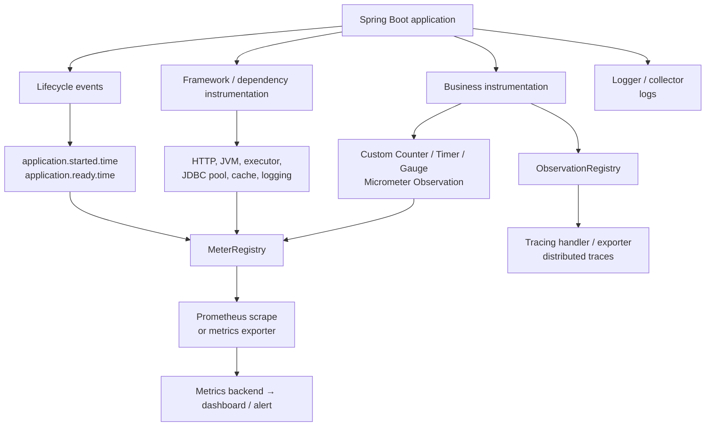
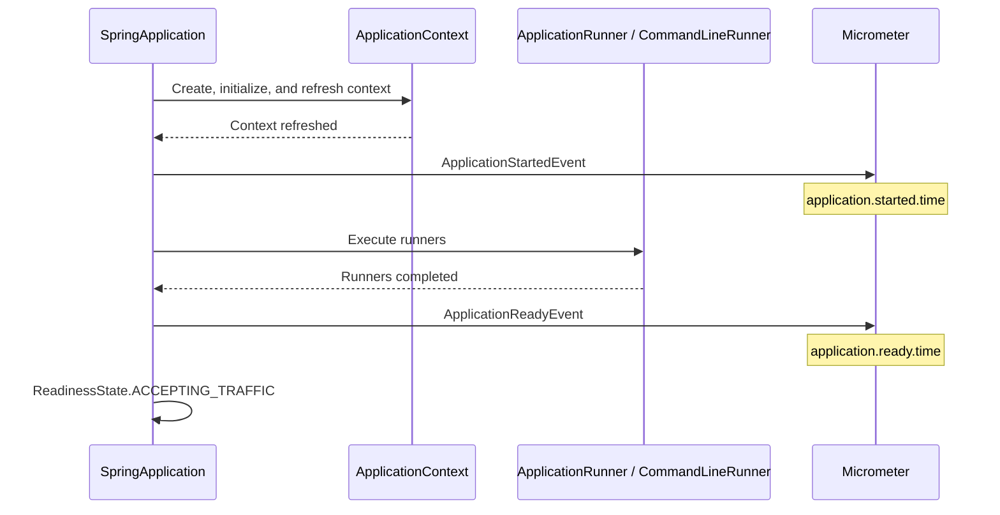

# Application Metrics

A new Spring Boot release causes the application to start up slower, yet pods still reach the Running state. A few minutes later, users report rising latency on the order API, while CPU stays low and there are few HTTP 500s. Distinguishing "slow startup", "not yet ready to serve", and "slow business processing" requires different groups of measurements. **Application metrics** turn lifecycle milestones and application behavior into quantitative signals to detect, isolate, and verify issues.

This lesson belongs to the **Spring Boot metrics** chapter in the **SPRING_BOOT_OBSERVABILITY** module. The module scope covers building observability for Spring Boot using **Micrometer Observation, metrics, logs, and distributed tracing**, exploring context propagation, tags/cardinality, exporters, sampling, and signal correlation to investigate errors, latency, and application behavior in production environments. This lesson focuses on **application metrics**: lifecycle measurements provided by Spring Boot, auto-instrumented application metrics, and business metrics intentionally designed by the development team.

> **Important distinction:** In Spring Boot documentation, **Application Startup Metrics** is a specific group consisting of `application.started.time` and `application.ready.time`. When speaking of "application metrics" in a broader operational sense, we also look at HTTP, tasks, connection pools, caches, and business metrics. The two meanings are related but not identical: do not use startup time to guess per-request latency, or treat a JVM metric as a direct measure of business success.

## 1. Learning objectives

After this lesson, you will be able to:

1. Explain the exact meanings of `application.started.time` and `application.ready.time` in the Spring Boot lifecycle.
2. Distinguish **started**, **ready**, **liveness**, **readiness**, and actual business serving capability.
3. Recognize the groups of automatic application metrics available depending on stack and dependencies, along with their limits.
4. Design business metrics for traffic, rejection rates, latency, queue depth, and processing outcomes.
5. Record data using `MeterRegistry` or `ObservationRegistry` and know when to choose each.
6. Inspect metrics via Actuator/Prometheus, read timers, and write queries for rate, error ratio, and p95 when sufficient data exists.
7. Keep metric names and tags bounded in cardinality, avoiding sensitive data or duplication.
8. Combine application metrics with logs/traces to investigate slow startup or degraded service quality.

## 2. The landscape of application metrics in Spring Boot

Application metrics can be organized into three layers by operational question:

| Layer | Example measurements | Matching questions |
|---|---|---|
| **Application lifecycle** | `application.started.time`, `application.ready.time`, uptime, readiness state | How long did the app take to start? Have runners finished? |
| **Application infrastructure and execution flow** | `http.server.requests`, `http.client.requests`, executors, `jdbc.connections.*`, `hikaricp.*`, cache, JVM, process | How is the app receiving traffic? Is the bottleneck in HTTP client, threads, DB pool, or memory? |
| **Business behavior** | `checkout.authorize`, `order.submission.result`, `inventory.reservation.rejected`, `jobs.pending` | How many transactions succeeded? How long did users wait? How many orders were rejected despite HTTP 200? |



Spring Boot Actuator works with Micrometer to register many meters automatically. However, **not every metric appears in every application**: Hikari metrics require a matching pool; cache metrics require configured and bound caches; HTTP client metrics depend on instrumented clients; custom metrics require code actually emitting events.

Some meters appear only **after the corresponding activity has occurred**. Not seeing a name in `/actuator/metrics` immediately after startup does not automatically mean auto-configuration failed.

## 3. Application Startup Metrics: two easily confused milestones

Spring Boot provides two officially documented names:

| Metric | Milestone measured | Use it to ask |
|---|---|---|
| `application.started.time` | Startup duration until `ApplicationStartedEvent`, after the application context refreshes and **before** `ApplicationRunner` / `CommandLineRunner` execute. | How long did context creation, beans, and baseline initialization take? |
| `application.ready.time` | Startup duration until `ApplicationReadyEvent`, published after application/command-line runners complete. | How long did Spring Boot take to reach the ready milestone in the application lifecycle? |

Both metrics are typically registered automatically when Spring Boot's metrics infrastructure is active. Spring Boot versions may attach a tag identifying the **fully qualified application class name**; check the exact tag list in your running version and exporter.

A typical timeline:



**Interpret carefully:** If `application.started.time` is about 2 seconds and `application.ready.time` is about 9 seconds, roughly 7 seconds were spent after context refresh, including runner execution and event handling overhead. Do not jump straight to "CommandLineRunner X took exactly 7 seconds" from subtraction alone; you need detailed runner instrumentation or startup tracing/profiling data.

### 3.1 Started does not mean ready to receive traffic

In the `SpringApplication` lifecycle:

1. `ApplicationStartedEvent` is published after context refresh, **before runners**.
2. Spring Boot publishes the corresponding liveness state change.
3. `ApplicationRunner` / `CommandLineRunner` beans are invoked.
4. `ApplicationReadyEvent` is published after runners finish.
5. Spring Boot publishes `ReadinessState.ACCEPTING_TRAFFIC` after the ready milestone.

If a runner takes a long time loading required data, the application has reached `started` but not yet `ready`. If a runner throws an exception and fails startup, `application.ready.time` may not be recorded because the ready milestone never happens.

These **lifecycle milestones** do not guarantee every business capability meets your organization's custom readiness criteria. For instance, the app may emit `ready` while an external service is not meeting SLOs yet, or a business cache is still warming asynchronously in the background.

### 3.2 Ready time differs from health/readiness endpoints

`application.ready.time` is the **duration of a one-time startup event**. It does not continuously update whenever readiness changes later.

`/actuator/health/readiness` (when readiness probes are enabled and the endpoint is exposed) reflects **current state** via health groups. An application can start up quickly and later turn unready during an outage, while the recorded startup metric remains unchanged.

| Scenario | Startup metric | Readiness/health |
|---|---|---|
| Startup takes long due to a runner | `application.ready.time` is high | May become ready only after the runner finishes. |
| App is ready, then DB fails later | Historical startup time does not change | Health/readiness can change **if** the health group includes the relevant dependency. |
| Web server opens port while app is not ready yet | `application.started.time` may already exist | Readiness may not accept traffic yet. |
| Process restarts | Startup time is measured anew for the new process | Readiness goes through a fresh startup cycle. |

Never treat a startup metric as proof of **current availability**; combine readiness, request success rate, synthetic checks, and orchestrator metrics.

### 3.3 Startup metrics do not describe individual requests

These values reflect **the startup of an instance**, not how fast the application serves requests once started. To measure request latency, use HTTP observations/timers; to measure business durations, create custom Timers or Observations.

Tuning connection pool settings so `application.ready.time` decreases does not automatically improve API p95. Measure the respective targets and verify on the same deployed version.

## 4. Verifying Application Startup Metrics

### 4.1 Dependencies

Assuming the application already has a Spring Boot web starter and matching dependency management, add:

```groovy
dependencies {
    implementation 'org.springframework.boot:spring-boot-starter-actuator'
    runtimeOnly 'io.micrometer:micrometer-registry-prometheus'
}
```

Actuator/Micrometer enables metric observation; the Prometheus registry supports exporting in scrape format. These dependencies **do not automatically create a trace backend or centralized log store**. If you only inspect `/actuator/metrics` with a matching registry, Prometheus is not required.

Spring Boot 3.x and 4.x differ in packaging and other starters, especially tracing and web. Use dependency management matching your project version and check the corresponding documentation.

### 4.2 Local configuration

```yaml
spring:
  application:
    name: order-service

management:
  endpoints:
    web:
      exposure:
        include: "health,info,metrics,prometheus"
  metrics:
    tags:
      application: order-service
      environment: local
  endpoint:
    health:
      probes:
        enabled: true
```

This configuration allows testing endpoints locally. `management.metrics.tags.*` attaches common tags with controlled value sets. Never put `orderId`, `userId`, or `traceId` into common tags.

In production, expose only required management endpoints and enforce network, authentication, and authorization controls. Exposing `/actuator/prometheus` for a scraper must be designed intentionally; never leave it open to the public Internet by default.

### 4.3 Calling endpoints

After the application starts and serves HTTP:

```bash
curl http://localhost:8080/actuator/health
curl http://localhost:8080/actuator/health/readiness

curl http://localhost:8080/actuator/metrics
curl http://localhost:8080/actuator/metrics/application.started.time
curl http://localhost:8080/actuator/metrics/application.ready.time

curl http://localhost:8080/actuator/prometheus
```

In `/actuator/metrics/application.ready.time`, inspect `measurements`, `availableTags`, and returned units; **do not assume a structure such as COUNT or VALUE without checking the actual meter type in your running version**.

Names at `/actuator/metrics` are Micrometer names. Names in Prometheus exposition can be converted by naming conventions and units. Always **check the actual line in `/actuator/prometheus`** rather than guessing `_seconds`, `_sum`, or `_count` suffixes from the Micrometer name alone.

### 4.4 If `application.ready.time` is missing

Check in order:

1. Has the application actually published `ApplicationReadyEvent`, or did startup fail or is a runner still executing?
2. Were Actuator and `MeterRegistry` properly auto-configured?
3. Is the `metrics` endpoint exposed and accessible?
4. Is a `MeterFilter` or property disabling metrics by name?
5. Are you using a custom `SpringApplication` lifecycle or test harness that does not fire standard events?
6. If data is missing only in the backend: check the registry exporter, scraping, and query names/labels.

If the application is still mid-startup, do not draw conclusions from an unopened endpoint. If the service is already serving normally yet the metric is still missing, inspect the registry, startup listeners, and version-specific configuration.

## 5. Automatic application metrics beyond startup

Spring Boot auto-instruments many components based on the active stack and beans. They help answer "how is the application processing requests?" before adding custom metrics.

| Group | Common name/prefix | When useful | Conditions/limits |
|---|---|---|---|
| HTTP server | `http.server.requests` (Micrometer conventions) | Rate, error ratio, latency by route/status. | Instrumented Spring MVC/WebFlux; names/tags may differ with OpenTelemetry conventions. |
| HTTP client | `http.client.requests` | Which dependency is slow or failing? | Requires Spring-configured client/builder or compatible instrumentation. |
| JVM | `jvm.*` | Heap, GC, threads, class loading. | Depends on JVM capabilities and instrumentation. |
| Process/system | `process.*`, `system.*`, `disk.*` | CPU, uptime, file descriptors, resources. | Some metrics depend on OS/container. |
| Thread pool/executor | `executor.*` group or matching meters | Active workers, queue, pending tasks. | Executor type and auto-binding determine actual meters. |
| JDBC pool/HikariCP | `jdbc.connections.*`, `hikaricp.*` | Active/idle/pending pool connections, wait, timeout. | Requires compatible DataSource/pool. |
| Cache | `cache.*` and cache-specific | Hits/misses/evictions. | Requires registered/bound cache; dynamically created caches may need manual binding. |
| Logging events | `logback.events.*` or `log4j2.events.*` | WARN/ERROR event rates by log level. | Depends on logging implementation; log counts do not equal business error rates. |
| Task scheduling, JMS, Batch | Framework- and convention-specific names | Job duration, message processing, failures. | Present only when the technology and instrumentation are enabled. |

### 5.1 HTTP metrics reflect request experience, with limits

In Spring MVC, `http.server.requests` is usually a timer with dimensions such as method, URI template, and status/outcome. It helps locate slow or 5xx endpoints.

However, HTTP 200 **does not guarantee business transaction success**. A payment API might return 200 with a body saying "declined" or "pending". With status code metrics alone, operations will not know the transaction rejection rate. That is where **business metrics** are required.

If the application uses different semantic conventions, metric names and tag keys can change. Do not hardcode queries to one convention without verifying exporter output.

### 5.2 Pools and caches help narrow down causes

Suppose p95 for `POST /orders` spikes while CPU remains steady. HTTP metrics confirm the slowdown; HikariCP metrics may show high active connections and growing pending threads. Combining them supports the hypothesis that the bottleneck is in the database connection pool.

Similarly, rising cache miss rates after a rollout can explain increased database queries. A high `cache.misses` metric **does not by itself prove** DB queries are the final root cause; cross-check timings, query logs, and traces.

### 5.3 Logger metrics do not replace logs

`logback.events` or `log4j2.events` show how many log events occurred at each severity level, but contain neither full stack traces nor per-event business context. To see the specific exception, read **logs**. To see where the request traveled, inspect **traces** if instrumented and retained by sampling.

## 6. Designing meaningful business application metrics

A custom metric should answer **an actionable operational question**, not simply "measure because we can".

Example for a checkout system:

| Question | Suggested metric | Meter type | Useful tags |
|---|---|---|---|
| How many authorizations resulted in approved/declined/error? | `checkout.authorization.result` | Counter | Bounded `outcome`. |
| How long does a payment provider call take? | `checkout.authorization.duration` | Timer | Normalized `provider`, `method`. |
| How many jobs are waiting to be processed? | `checkout.jobs.pending` | Gauge | `queue` from a small set. |
| How many items are in a batch? | `checkout.batch.items` | DistributionSummary | Bounded `type` or `source`. |
| How long has an active long export job been running? | `checkout.export.active` | LongTaskTimer | Bounded `type`. |
| How many HTTP 5xx requests occurred? | `http.server.requests` | Auto-instrumented Timer | `uri` template, `status`. |

Selection rules:

- **Counter** for monotonically increasing events (business outcomes, retries, rejections).
- **Gauge** for current state (queue depth, active tasks).
- **Timer** for each completed duration.
- **DistributionSummary** for distributions of non-time numeric values.
- **LongTaskTimer** for progress of long-running active tasks.

Avoid adding a Counter duplicating `Timer.count` if both measure the exact same invocation and boundary. A separate Counter for `outcome=declined` is meaningful because it captures a result that HTTP status or timer duration alone does not distinguish.

### 6.1 Keep names stable by operation type

Use:

```text
checkout.authorization.result
checkout.authorization.duration
inventory.reservation.rejected
report.generate
```

Avoid:

```text
checkout.authorization.ORDER-3842
checkout.authorization.customer-771
checkout.authorization.2026-11-22T10:15:00Z
```

Meter names and tag values that vary per request cause series counts to explode. Keep names stable and place finite groupings into low-cardinality tags.

## 7. Java example: recording business outcome metrics

Suppose the application already has Spring Boot Actuator's `MeterRegistry`. We instrument a service calling a payment gateway. The Java 17+ example below focuses on naming and semantics; `PaymentGateway` is an interface implemented by your project.

```java
import java.util.concurrent.Callable;

import io.micrometer.core.instrument.Counter;
import io.micrometer.core.instrument.MeterRegistry;
import io.micrometer.core.instrument.Timer;
import org.springframework.stereotype.Service;

@Service
public class AuthorizationMetrics {
    private final MeterRegistry registry;
    private final Counter approved;
    private final Counter declined;
    private final Counter failed;
    private final Timer duration;

    public AuthorizationMetrics(MeterRegistry registry) {
        this.registry = registry;

        approved = Counter.builder("checkout.authorization.result")
                .description("Payment authorization results")
                .tag("outcome", "approved")
                .register(registry);

        declined = Counter.builder("checkout.authorization.result")
                .description("Payment authorization results")
                .tag("outcome", "declined")
                .register(registry);

        failed = Counter.builder("checkout.authorization.result")
                .description("Payment authorization results")
                .tag("outcome", "error")
                .register(registry);

        duration = Timer.builder("checkout.authorization.duration")
                .description("Time spent authorizing payment")
                .register(registry);
    }

    public boolean recordAuthorization(Callable<Boolean> operation)
            throws Exception {
        Timer.Sample sample = Timer.start(registry);
        try {
            boolean accepted = operation.call();
            if (accepted) {
                approved.increment();
            } else {
                declined.increment();
            }
            return accepted;
        } catch (Exception failure) {
            failed.increment();
            throw failure;
        } finally {
            sample.stop(duration);
        }
    }
}
```

Callers can use:

```java
boolean approved = authorizationMetrics.recordAuthorization(
        () -> paymentGateway.authorize(command));
```

The code above requires an actual `paymentGateway` bean, `command` input, and calls from a service/controller/job. It demonstrates the instrumentation technique and is **not a complete standalone runnable application**.

**Why were these meters chosen?**

1. `checkout.authorization.result` is **one name** with three `outcome` tag values, avoiding dynamic names per request.
2. `Timer.Sample` measures the duration of every invoked call.
3. `finally` ensures `sample.stop(...)` runs even when the `Callable` throws an `Exception`.
4. A `false` return is classified as `declined` per business contract, even if HTTP returns 200. It is not misclassified as a Java exception.
5. The code catches `Exception`, not every `Throwable`; a serious JVM error still exits through `finally` without being coerced into a normal business outcome.

For cancellations/timeouts, define explicit outcome tags if the system needs to measure them separately. Do not treat every timeout or user cancellation as a 5xx error by default.

### 7.1 When a Gauge is needed for pending jobs

```java
import java.util.concurrent.atomic.AtomicInteger;
import io.micrometer.core.instrument.Gauge;

private final AtomicInteger pending = new AtomicInteger();

public void registerQueueGauge(MeterRegistry registry) {
    Gauge.builder("checkout.jobs.pending", pending, AtomicInteger::get)
            .description("Jobs currently waiting in the checkout queue")
            .register(registry);
}
```

This is a **component sketch inside a bean**, not a full Java file. The `pending` field must outlive requests (across the bean's lifetime) because gauges can hold weak references to observed objects. In production, prefer reading the actual queue size directly if the library provides a safe read method. Never allocate a new gauge or `AtomicInteger` per request.

### 7.2 Using Observation when both metrics and traces are needed

When you want to measure a business step and see a span under the HTTP request's trace ID, `ObservationRegistry` provides unified integration:

```java
import io.micrometer.observation.Observation;
import io.micrometer.observation.ObservationRegistry;
import org.springframework.stereotype.Service;

@Service
public class ReservationService {
    private final ObservationRegistry observations;

    public ReservationService(ObservationRegistry observations) {
        this.observations = observations;
    }

    public String reserve(boolean stockAvailable) {
        Observation observation = Observation
                .createNotStarted("inventory.reserve", observations)
                .contextualName("reserve inventory")
                .lowCardinalityKeyValue("operation", "reserve");

        return observation.observe(() -> {
            if (stockAvailable) {
                observation.lowCardinalityKeyValue("outcome", "reserved");
                return "reserved";
            }
            observation.lowCardinalityKeyValue("outcome", "rejected");
            return "rejected";
        });
    }
}
```

With a metrics handler, `inventory.reserve` can create a Timer. With a tracing handler, the same Observation can create a child span inside the active trace. If logging runs inside the scope, correlation IDs can appear per logging/tracing configuration.

Remember:

- `Observation` does not automatically emit all business logs.
- **Trace sampling** may drop the span even while metrics are still recorded.
- If a manual timer already measures the exact `inventory.reserve` block, do not emit another Timer with the same name for the same invocation without checking for double counting.
- The `outcome` metadata contains only two standardized values, keeping cardinality bounded.

## 8. How do application metrics differ from business KPIs?

When building application dashboards, there are usually three layers:

| Layer | Examples | Meaning |
|---|---|---|
| **Technical metrics** | CPU, GC, HTTP 5xx, pending connection pools | Shows technical health and resources. |
| **Business-operational metrics** | Payment declines, failed orders, backlog, retries | Connects system operations to business outcomes. |
| **Business KPIs** | Reconciled revenue, official conversion rate, valid orders | Business metrics requiring strict definitions, reconciliation, and authoritative data sources. |

A Micrometer Counter on `checkout.authorization.result` provides a **near-real-time signal** to detect spikes in declined payments. However, this metric does not replace accounting systems or official order records: counters reset on restarts, events can be retried, telemetry can be dropped, and metrics backends have finite retention.

**Never use the metrics pipeline as the single source of truth** for numbers requiring audit accuracy or billing integrity. Official business events/KPIs must be designed with semantics such as exactly-once/idempotency and durable business storage.

### 8.1 Define the denominator before reporting ratios

For example, a payment declined rate must specify its denominator:

- Total **authorization attempts**?
- Total **checkout sessions**?
- Total **unique orders**?
- Only transactions that reached a final outcome?

If a request retries three times, an attempt-based `Counter` increments three times. Do not present attempt counts as unique affected customers without stating the distinction clearly. Defining the exact measured entity comes before writing PromQL.

## 9. Histograms, percentiles, and latency questions

A Timer provides `count` and `total time`, enough to compute an average over a window. However, evaluating **tail latency** such as p95/p99 requires histograms or compatible distribution mechanisms.

Sample configuration:

```yaml
management:
  metrics:
    distribution:
      percentiles-histogram:
        checkout.authorization.duration: true
```

When the Prometheus registry and classic histogram support are active, series such as `checkout_authorization_duration_seconds_bucket` can appear.

Example PromQL:

```promql
# Authorization attempts/second from the instrumented counter
sum(rate(checkout_authorization_result_total[5m]))

# Declined ratio over attempts; interpret only with sufficient traffic
sum(rate(checkout_authorization_result_total{outcome="declined"}[5m]))
/
sum(rate(checkout_authorization_result_total[5m]))

# Average authorization latency
sum(rate(checkout_authorization_duration_seconds_sum[5m]))
/
sum(rate(checkout_authorization_duration_seconds_count[5m]))

# p95, only when compatible histogram buckets exist
histogram_quantile(
  0.95,
  sum by (le) (
    rate(checkout_authorization_duration_seconds_bucket[5m])
  )
)
```

**These Prometheus names are illustrative examples.** Actual exported names can differ by registry and naming convention. Inspect `/actuator/prometheus` output to confirm `_total`, `_seconds_count`, `_sum`, `_bucket`, and tag keys.

Without histogram buckets, you cannot recover p95 from `_count` and `_sum` alone. Do not average per-instance p95s to obtain system-wide p95. Histograms add extra series per bucket; enable them selectively to balance cost and precision.

To compare startup times, inspect the recorded values when instances start up; **do not apply `rate()` to startup time as if it were a request counter**.

## 10. Cardinality and naming/tag contracts

A single metric can multiply into many series across tag combinations. For example:

```text
checkout.authorization.result
  outcome = {approved, declined, error}          3 values
  channel = {web, mobile, partner}              3 values
  region  = {north, central, south}             3 values

Theoretical maximum combinations: 3 × 3 × 3 = 27 series.
```

Adding `orderId` with 100,000 values boosts theoretical combinations to **2,700,000**. High cardinality raises application memory usage, backend storage, and query cost.

| Attribute | Suitable for metric tags? | Example |
|---|---|---|
| Fixed outcome groups | Yes | `outcome=approved/declined/error`. |
| Route template | Yes | `uri=/orders/{id}`. |
| HTTP method/status | Yes | `method=POST`, `status=200`. |
| Normalized region/env | Yes if needed | `environment=prod`. |
| Request ID/order ID/user ID | No | Nearly unique value per call. |
| Tokens, passwords, emails, private data | No | Security and cardinality risk. |

For distributed tracing, certain high-cardinality attributes **can** aid per-request investigations, subject to collection, security, and retention policies. Never blindly copy tokens or PII from metric tags into spans either.

### 10.1 Application metric names must also stay stable

Never generate dynamic names like `checkout.authorization.ORDER-10243` or `inventory.reserve.customer-882`. One business operation should have one stable name, with outcomes/segments expressed via low-cardinality tags.

If you rename `checkout.authorization.result` in a new release, dashboards and alerts reading the old name will go blind. Perform controlled migrations, support querying old and new names during rollouts, and ensure the same event is not double-counted.

## 11. Combining metrics with logs and distributed tracing

A checkout request might flow through:

```text
HTTP POST /checkout       1300 ms (http.server.requests)
  ├─ Validate input          15 ms
  ├─ Call payment provider 1180 ms
  └─ Persist result          65 ms

Business metrics:
  checkout.authorization.duration
  checkout.authorization.result{outcome="declined"}

Logs by traceId:
  "Payment provider timeout after retry"

Trace:
  HTTP server span → HTTP client span → provider span (if instrumented)
```

**Metrics** confirm error/rejection rates and latency across many requests. **Traces** show which steps a request traversed and where time was spent. **Logs** capture exceptions, retries, or detailed business decisions.

Prerequisites for correlation:

- Use consistent `service.name`/application identity and labels across metrics, traces, and logs.
- Ensure trace context propagates through instrumented HTTP clients, messaging, or asynchronous executors.
- Log inside an active tracing context scope; look up `traceId` in the log backend when available.
- Never attach `traceId` as a metric tag due to near-infinite cardinality.
- Remember that trace sampling can prevent a trace from appearing in the backend even though the request produced metrics.

A rising "payment declines" metric **does not automatically prove** the provider is at fault. Inspect outcome categories, sample traces, error logs, and dependencies to rule out other causes.

## 12. Workflow for investigating slow application startup

**Scenario:** After a rollout, containers take 18 seconds before serving traffic; previously it took around 5 seconds.

1. **Confirm milestones:** read `application.started.time` and `application.ready.time` by instance/version if labeled.
2. **Isolate the phase:** did `started` rise or only `ready`? If the `ready - started` gap is large, investigate runners, listeners, or post-refresh work.
3. **Check startup logs:** review timestamps for bean initialization, migrations, DB connections, cache warm-ups, secrets/config fetches, timeouts, and retries.
4. **Watch dependencies:** is startup waiting on a database, service discovery, storage, or an external service?
5. **Check readiness:** confirm readiness transitions as expected; do not assume an open port means the app is ready.
6. **Measure finer detail:** if startup steps need breakdown, use `ApplicationStartup`/`/actuator/startup` or targeted instrumentation rather than guessing everything from two numbers.
7. **Verify:** compare multiple restarts, equivalent instances, versions, load, and dependency health; ensure ready time drops without breaking business behavior.

**Note:** `/actuator/startup` uses Spring Framework's `ApplicationStartup` data when configured. It is a tool for analyzing startup steps, **distinct** from `application.started.time` and `application.ready.time`. Do not assume `/actuator/startup` records full history unless startup step recording has been enabled.

## 13. Workflow for investigating API quality degradation

**Scenario:** A service is already ready, yet p95 for `POST /orders` spikes sharply.

| Step | Signal | Question |
|---|---|---|
| 1 | HTTP server metrics | On which route did error rate and latency rise? How much traffic is affected? |
| 2 | Business metrics | Did order rejection or payment declined rates shift despite HTTP 200? |
| 3 | JDBC/Hikari/executor metrics | Are queues backing up, pools pending, or threads saturated? |
| 4 | Distributed traces | Which span is abnormally long? On which dependency do errors occur? |
| 5 | Correlated logs | Do timeouts/retries/exceptions explain the slow span? |
| 6 | Post-fix metrics | Have p95, error ratio, success rate, and throughput recovered? |

Startup time is not the right metric for verifying API p95 after the system has been running for hours. **Ask the right question before picking a signal.**

## 14. Common implementation pitfalls

| Symptom | Possible cause | How to check/fix |
|---|---|---|
| `application.started.time` exists, `application.ready.time` missing | Runner unfinished, startup failed, or metric filtered out. | Check `ApplicationReadyEvent`, startup logs, registry. |
| Both startup metrics are low, yet users cannot reach app | Startup finished, but readiness/routing/dependencies failed. | Check health/readiness and HTTP/synthetic probes. |
| `/actuator/metrics` returns 404 | Missing Actuator, endpoint not exposed, or security rules. | Check starter, endpoint exposure config, and management port. |
| `/actuator/metrics` exists, `/actuator/prometheus` missing | Missing Prometheus registry or not exposed. | Add matching registry/exposure. |
| HTTP metric missing right at startup | No requests yet or instrumentation not active. | Send a request; check stack and conventions. |
| HTTP metric present, business outcome missing | Measuring only HTTP status, not business results. | Add a Counter or Observation with bounded outcome tags. |
| `checkout.authorization.result` has too many series | `userId`/`orderId` used as a tag. | Normalize tags; control cardinality. |
| Queue gauge shows `NaN`/disappears | Observed source garbage collected or object replaced. | Keep a strong reference; bind gauge to a stable source. |
| PromQL cannot find metric name | Name converted per exporter/semantic conventions. | Inspect `/actuator/prometheus` and update queries. |
| p95 dashboard panel is blank | Histograms not enabled or no bucket series yet. | Enable histograms on the exact timer; verify traffic and buckets. |
| Counts doubled | Framework auto-instrumentation and custom timer overlap. | Keep a single owner measuring each activity. |
| Traces missing while metrics keep rising | Trace dropped by sampling or exporter/propagation bug. | Check tracing pipeline; don't assume metrics are wrong. |
| Dashboards go blank after deploy | Metric/tag renamed or collector failure. | Compare old/new output, scrape targets, and labels. |

## 15. Scenario exercises

**Exercise 1 — Started vs. ready.** After a change, `application.started.time` stays around 2 seconds while `application.ready.time` climbs from 4 to 15 seconds. Which phases and data sources will you inspect first? Why can you not immediately conclude a specific runner took 13 seconds?

**Exercise 2 — Fast startup, failing readiness.** An app has a 3-second ready time, yet the readiness endpoint reports not accepting traffic after 30 minutes of uptime. What will you check? Why should you not expect the startup metric to update?

**Exercise 3 — HTTP 200 with declined payments.** Design a metric to measure the payment declined rate by attempts. Specify the name, meter type, outcome tags, and state the denominator clearly before building alerts.

**Exercise 4 — Too many series.** A developer adds `orderId` to `checkout.authorization.result` and sees series jump into the millions. Explain how to fix it while keeping the ability to investigate individual requests via traces/logs.

**Exercise 5 — p95 and histograms.** Why can p95 not be derived from count/sum? When can `histogram_quantile` be used? Why should you not average p95 across three pods?

**Exercise 6 — Startup metrics missing in backend.** `/actuator/metrics/application.ready.time` returns data, yet Prometheus has no matching series. Trace through registry, endpoint, exporter naming, scrape target, auth, labels, and scrape timing in order.

**Exercise 7 — Pod startup time.** A pod enters `Running`, and several seconds later the application becomes ready. Distinguish container lifecycle, `ApplicationStartedEvent`, `ApplicationReadyEvent`, and readiness probes. Explain why both application events and orchestrator state need monitoring.

**Answer hints:** Exercise 1: inspect post-refresh runners, listeners, and dependencies; Exercise 2: health groups/readiness, dependencies, and app state; Exercise 3: Counter with bounded outcomes and attempts denominator; Exercise 4: remove IDs from metric tags; Exercise 5: needs histogram buckets with enough samples; Exercise 6: trace the export/collection pipeline; Exercise 7: recognize `Running` does not equal application `ready`.

## 16. Official references

- [Spring Boot — Metrics](https://docs.spring.io/spring-boot/reference/actuator/metrics.html): list of supported metrics, `application.started.time`, `application.ready.time`, registries, and custom metrics.
- [Spring Boot — SpringApplication events](https://docs.spring.io/spring-boot/reference/features/spring-application.html): ordering of `ApplicationStartedEvent`, runners, `ApplicationReadyEvent`, and availability events.
- [Spring Boot — Actuator Endpoints](https://docs.spring.io/spring-boot/reference/actuator/endpoints.html): endpoint exposure, `health`, and securing management endpoints.
- [Spring Boot — Application Availability](https://docs.spring.io/spring-boot/reference/features/spring-application.html#features.spring-application.application-availability): liveness/readiness and lifecycle states.
- [Spring Boot — Application Startup](https://docs.spring.io/spring-boot/reference/features/spring-application.html#features.spring-application.startup-tracking): `ApplicationStartup` and analyzing startup steps.
- [Micrometer — Counters](https://docs.micrometer.io/micrometer/reference/concepts/counters.html): rate-based event counting and meter selection responsibilities.
- [Micrometer — Timers](https://docs.micrometer.io/micrometer/reference/concepts/timers.html): measuring durations and `Timer.Sample`.
- [Micrometer — Gauges](https://docs.micrometer.io/micrometer/reference/concepts/gauges.html): measuring current state and object lifecycles.
- [Micrometer — Observation](https://docs.micrometer.io/micrometer/reference/observation/introduction.html): Observation, metrics/tracing handlers, and key-values.
- [Prometheus — Histograms and Summaries](https://prometheus.io/docs/practices/histograms/): histograms, buckets, and quantiles.
- [Prometheus — Query Functions](https://prometheus.io/docs/prometheus/latest/querying/functions/): `rate`, `increase`, and `histogram_quantile`.

**Key takeaway:** Spring Boot application metrics tell you **how far startup progressed**, **how technical components are performing**, and **what outcomes the business logic is producing**. `application.started.time` and `application.ready.time` are two startup milestones with specific meanings; HTTP/pool/JVM metrics reflect runtime health; custom business metrics fill the gap that HTTP status codes cannot express. Combine the right metrics with readiness checks, logs, and distributed traces to form and verify hypotheses, while guarding systems against high cardinality, sensitive data, and conclusions drawn from a single isolated signal.
