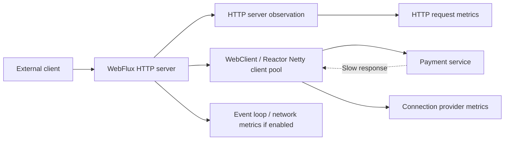
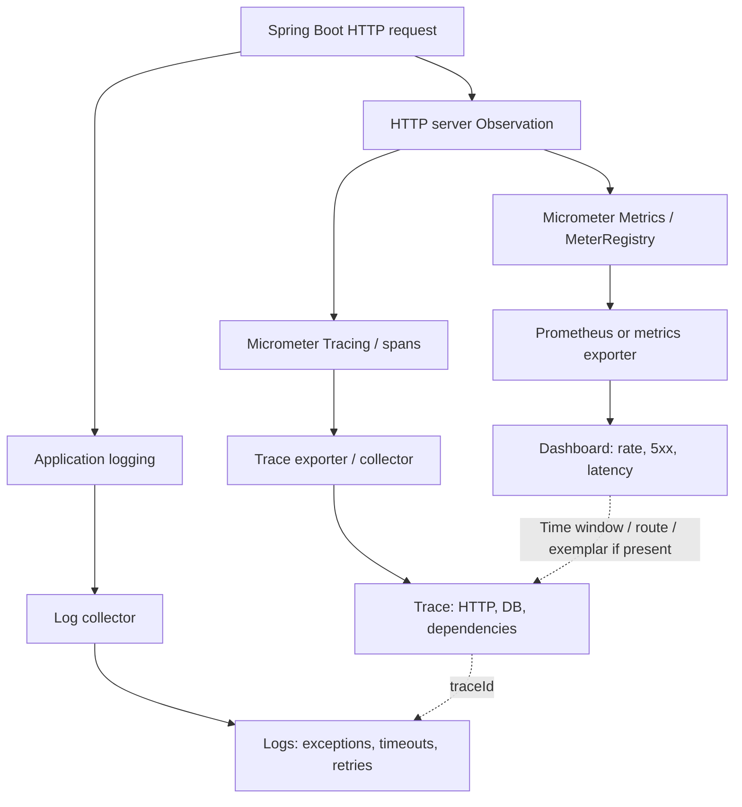

# Tomcat and WebFlux Metrics

> **Chapter:** Spring Boot metrics  
> **Module:** `SPRING_BOOT_OBSERVABILITY` — Setting up observability for Spring Boot using Micrometer Observation, metrics, logs, and distributed tracing. This lesson focuses on HTTP server and Tomcat/WebFlux runtime metrics, evaluating latency and errors, correlating with traces/logs, and understanding limits around cardinality, exporters, sampling, and context propagation.

## Learning objectives

After this lesson, you will be able to:

- Distinguish **shared HTTP request metrics** from **Tomcat servlet container metrics**, **Reactor Netty**, and connection pools in WebFlux applications.
- Explain the difference between the Servlet request-handling thread model and the reactive event-loop model; avoid drawing false conclusions when comparing thread metrics across the two runtimes.
- Read indicators such as request count, error rate, p95 latency, Tomcat busy threads, and Reactor Netty connection pool pending acquisitions.
- Configure Spring Boot Actuator/Micrometer and Prometheus to inspect emitted meters and know when additional instrumentation must be enabled.
- Design low-cardinality labels, use metrics to scope incidents, and correlate with logs/traces to investigate root causes.
- Build verification workflows when systems encounter HTTP 5xx errors, timeouts, event-loop blocking, or connection pool exhaustion.

## 1. Why distinguish Tomcat and WebFlux metrics?

Consider two applications both exposing `POST /orders`:

- Application A uses Spring MVC on **embedded Tomcat**.
- Application B uses Spring WebFlux on **Reactor Netty**.

Under rising load, both may return 503/504 or slow down. Both need HTTP error rates and latency tracking. Yet their **resource consumption mechanics** differ fundamentally.

Tomcat in the traditional Servlet model uses connector/executor threads to handle requests; too much waiting or slow work pushes busy threads toward configured limits. WebFlux on Reactor Netty typically uses a small group of **event-loop threads** serving many connections non-blockingly. Looking only at Reactor Netty thread counts does not directly show "how many request slots remain", while blocking on the event loop can stall many requests simultaneously.

Therefore, separate three measurement layers:

1. **HTTP layer:** request count, rate, error rate, latency, and tags by route/method/status.
2. **Runtime/server layer:** Tomcat connector threads/connections or Reactor Netty event-loop/network metrics.
3. **Dependency/business layer:** DB pools, HTTP client connection pools, queues, and business observations such as `checkout.submit` or `payment.authorize`.

Accurate comparisons must rely on **actual runtime mechanics**, not framework names alone.

### 1.1. WebFlux does not strictly equal Reactor Netty

Spring WebFlux is a reactive web framework. **Reactor Netty** is the common default HTTP runtime when an application uses only `spring-boot-starter-webflux`, yet WebFlux can also run on compatible servlet containers, including Tomcat under supported configurations.

Likewise, Spring Boot defaults to MVC when both MVC and WebFlux starters are on the classpath unless the application overrides the web application type. Never infer "seeing a WebFlux dependency guarantees Reactor Netty is running".

| Scope | Tomcat + Spring MVC | WebFlux + Reactor Netty |
| --- | --- | --- |
| Typical processing model | Requests served by Servlet connector/executor threads | Event loops, callbacks, and reactive pipelines |
| HTTP request metrics | Uses `http.server.requests` when properly instrumented | Also uses `http.server.requests` when properly instrumented |
| Key runtime metrics | Tomcat busy/current/configured threads, connectors/connections | Reactor Netty event loop, network I/O; outbound connection provider pools when instrumented |
| Bottleneck symptoms to inspect | High busy threads, queueing, DB waits, dependency timeouts | Event-loop blocking, pending tasks, outbound pool pending, backpressure, dependency timeouts |
| Common misconception | "High busy threads always means high CPU" | "Few JVM threads means plenty of headroom left" |

**Common ground:** metrics reveal trends and blast radius; traces show which operation is slow; logs describe timeouts, exceptions, retries, and concrete events.

## 2. HTTP server metrics: the shared baseline for both runtimes

Micrometer/Spring Boot instruments HTTP server requests and records a logical metric such as:

```text
http.server.requests
```

In standard Spring Boot setups, this is a **Timer** recording request counts and processing durations. Common key-values include `method`, `uri`, `status`, `outcome`, and `exception`. The exact tag set depends on version and conventions; inspect the live meter in your application.

| Signal | How to read | Question answered |
| --- | --- | --- |
| Request count / rate | Number or rate of requests over an interval | How much load is the system receiving? |
| HTTP error rate | Ratio of 5xx (and defined error classes) over total requests | Is the percentage of failed requests rising? |
| Average latency | Total duration divided by request count in the window | How is average response time shifting? |
| p95/p99 latency | Percentiles over duration distributions, when distribution data is available | How badly is the slow tail affecting users? |
| In-flight/active requests | Requests currently executing if supported by instrumentation | Are more requests hanging/waiting than usual? |

### 2.1. Why must `uri` be a normalized route?

Consider `GET /orders/{id}`. If every request uses raw URLs like `/orders/123`, `/orders/124`, ... as tags, time series count grows with order count.

**Aggregatable properly:**

```text
method=GET
uri=/orders/{id}
status=200
```

**Cardinality risk:**

```text
method=GET
uri=/orders/283194
status=200
```

HTTP server observation conventions normally substitute route templates when a mapping matches, but check unmapped requests, 404s, dynamic routes, WebFlux functional endpoints, and customizations. Never put query strings, request IDs, user IDs, tenant IDs, or trace IDs into tags.

### 2.2. Count, sum, and histograms differ

When using the Prometheus registry, a logical Timer can export as series such as:

```text
http_server_requests_seconds_count
http_server_requests_seconds_sum
http_server_requests_seconds_bucket
```

`_count` is the observation count; `_sum` is total duration; `_bucket` appears only when histograms are configured and the exporter supports classic buckets. Physical names may vary by version and naming convention, so always inspect `/actuator/prometheus`.

To view request rate when series match the example names:

```promql
sum(rate(http_server_requests_seconds_count[5m]))
```

To view HTTP 5xx ratio over total requests in a 5-minute window:

```promql
sum(rate(http_server_requests_seconds_count{status=~"5.."}[5m]))
/
sum(rate(http_server_requests_seconds_count[5m]))
```

The ratio is meaningful only when the denominator is positive and metric filters reflect the intended traffic. At very low traffic, rates and percentiles fluctuate wildly.

If **classic histogram buckets** exist, p95 per route can be estimated:

```promql
histogram_quantile(
  0.95,
  sum by (le, uri) (
    rate(http_server_requests_seconds_bucket[5m])
  )
)
```

The result here is in seconds. If the backend has only count and sum, **you cannot derive p95** from the mean. Native histograms or other histogram configurations may require different query syntax.

### 2.3. HTTP status does not tell the whole story

HTTP 500 can represent a code bug, dependency timeout, or misconfiguration; HTTP metrics do not identify root cause alone. An exception caught and turned into an HTTP 200 response per business contract also will not count as HTTP 5xx, even when the underlying business operation failed.

Add explicit **business observations** when you need to distinguish `payment.authorize` failure, out-of-stock, timeout, or retry—avoid inferring all system states purely from HTTP status codes.

## 3. Tomcat metrics: observing the servlet container

For Spring Boot running **embedded Tomcat**, Tomcat metrics reflect HTTP container resources. Logical names you may encounter (depending on version and instrumentation level):

| Illustrative logical metric | Meaning | Interpretation |
| --- | --- | --- |
| `tomcat.threads.busy` | Busy connector/executor threads | Climbing near the limit signals waiting or congestion to investigate |
| `tomcat.threads.current` | Threads currently in the pool | Not the count of active requests |
| `tomcat.threads.config.max` | Configured max thread limit | Use as reference ceiling when present |
| `tomcat.connections.current` | Current connections tracked by Tomcat | Includes keep-alive connections; does not equal concurrent executing requests |
| `tomcat.connections.config.max` | Reported max connection limit | Varies by connector and configuration |
| `tomcat.sessions.active.current` | Currently active HTTP sessions, if supported | Useful when applications rely on HTTP sessions |

Not every meter in this table exists on every version or connector. Only rely on meters actually observed in `/actuator/metrics`; JMX/MBean-dependent metrics may require explicit configuration.

### 3.1. Enabling prerequisites for Tomcat metrics

In some Spring Boot versions, Tomcat's `MBeanRegistry` must be enabled to emit Tomcat metrics:

```yaml
server:
  tomcat:
    mbeanregistry:
      enabled: true
```

This property registers MBeans required for Tomcat metrics in supported versions. It **does not mean** opening a public JMX port over the network, nor does it guarantee every Tomcat variant emits every metric in the table.

Before applying to production, check the docs for your **exact Spring Boot/Tomcat version**; `TomcatMetrics` binder availability, MBean activation, and meter names can change across versions. If running Undertow/Jetty or Reactor Netty, this Tomcat setting does nothing for those runtimes.

### 3.2. What do high busy threads tell you?

Suppose Tomcat is configured with `maxThreads=200`, and during an interval you observe:

```text
tomcat.threads.busy        = 190
tomcat.threads.current     = 200
tomcat.threads.config.max  = 200
p95 HTTP latency           = 5.0 s
```

This signals Tomcat is nearing saturation on the measured **thread pool**. It is not enough to conclude CPU is overloaded: threads may be blocked waiting on the database, locks, network, or an external API.

Sensible investigation flow:

1. Compare `threads.busy` against the limit the app **actually uses**.
2. Inspect HTTP latency, request rate, and error rate over the same window.
3. Inspect DB connection pools, outbound HTTP calls, and thread dumps/stack traces where appropriate.
4. Use distributed traces to pinpoint whether wait time sits in the DB, payment API, or controller itself.

If CPU is low while `threads.busy` is high, focus on **blocking I/O, locks, and dependency waits**. If CPU is high, inspect compute code, contention, GC, and process CPU time.

### 3.3. The thread pool does not represent total capacity alone

Tomcat can have multiple connectors, shared executors, or other limits like accept queues, max connections, and socket backlogs. Therefore:

- Rising `threads.current` does not mean every thread is actively processing requests.
- Rising `connections.current` does not prove high concurrent execution; keep-alive maintains idle connections.
- `busy / config.max` is only a pool utilization signal, not a full measure of queuing, accept rate, or client-side wait times.
- With async Servlet processing, request duration and thread-occupancy duration can differ.

Seeing "200 threads" also does not mean raising it to 400 will improve latency. If the true bottleneck is the database pool or a downstream dependency, adding threads can simply lengthen downstream queues.

## 4. WebFlux metrics: observing the reactive runtime properly

Spring WebFlux models request handling as a **reactive pipeline**. On Reactor Netty, a small set of event-loop threads handles I/O across many connections.

Key principle: **a request does not own an event-loop thread from start to finish**, and a low thread count does not indicate low request concurrency. If code calls a blocking API directly on the event loop, many unrelated requests stall because the event loop is not yielded in time.

### 4.1. Three signal groups to distinguish

| Group | Example indicators | Meaning |
| --- | --- | --- |
| **HTTP server observation** | `http.server.requests` and duration/status distributions | Request experience at the application layer |
| **Reactor Netty server runtime** | Event-loop pending tasks, network bytes sent/received if emitted by instrumentation | Event-loop and server-layer I/O behavior |
| **Reactor Netty connection provider** | `active.connections`, `idle.connections`, `pending.connections` for a pool | Typically monitors **outbound HTTP client connection pools** per provider |

**Critical warning:** `reactor.netty.connection.provider.*` usually describes instrumented **client connection provider pools**. Never read `pending.connections` from a `WebClient` pool and claim the embedded HTTP server has that many inbound connections waiting.

Logical names you may see when Reactor Netty metrics are appropriately enabled:

```text
reactor.netty.eventloop.pending.tasks
reactor.netty.connection.provider.active.connections
reactor.netty.connection.provider.idle.connections
reactor.netty.connection.provider.pending.connections
reactor.netty.http.server.data.received
reactor.netty.http.server.data.sent
```

Exact names, units, and tag keys depend on Reactor Netty/Micrometer versions and enabling server, client, or provider metrics individually. A standard WebFlux app is **not guaranteed** to emit all of these meters merely because Actuator was added.

### 4.2. Blocked event loop: which metrics hint at it?

Suppose a reactive controller accidentally executes blocking JDBC or `Thread.sleep()` directly on the event loop. You may observe:

- HTTP p95/p99 latency rising even while CPU stays low.
- Reactor Netty event-loop pending tasks climbing if that metric is collected.
- Multiple unrelated endpoints slowing down together even though they share no business dependency.
- Traces or profiling pointing to blocking calls on event-loop threads.

Rising `pending.tasks` is an **investigation signal**, not absolute proof of blocking. It can also reflect load spikes, scheduling, and pipeline structure. Combine it with HTTP latency, thread dumps/profiling, and trace context.

**Mistake:** looking at `jvm.threads.live` in WebFlux and applying a Tomcat-style threshold. JVM thread count aggregates many different pools; it cannot substitute for measuring event-loop saturation.

### 4.3. Do not block inside reactive request pipelines

Example endpoint illustrating non-blocking asynchronous execution without stalling the event loop:

```java
import java.time.Duration;
import java.util.Map;

import org.springframework.web.bind.annotation.GetMapping;
import org.springframework.web.bind.annotation.RestController;
import reactor.core.publisher.Mono;

@RestController
public class ReactiveDemoController {

    @GetMapping("/demo/delay")
    public Mono<Map<String, String>> delay() {
        return Mono.delay(Duration.ofMillis(150))
                .map(ignored -> Map.of("status", "ok"));
    }
}
```

`Mono.delay(...)` uses scheduling to emit after a delay without blocking a thread like `Thread.sleep(150)`. When instrumented, HTTP server duration reflects elapsed time until the response completes per instrumentation/framework semantics. For streaming responses, cancellations, or mid-stream errors, verify how the system measures duration.

When calling a legacy blocking API from reactive code is unavoidable, isolate it on a bounded scheduler such as `Schedulers.boundedElastic()` under controlled limits, or migrate to a non-blocking client/driver. Offloading to `boundedElastic` **does not eliminate load**—it shifts it to a bounded pool that can develop its own queue.

Illustrative snippet for an unavoidable blocking call:

```java
import reactor.core.publisher.Mono;
import reactor.core.scheduler.Schedulers;

Mono<String> result = Mono.fromCallable(() -> blockingLegacyClient.fetch())
        .subscribeOn(Schedulers.boundedElastic());
```

`blockingLegacyClient` is an illustrative dependency to be declared/injected in a real application. Do not apply this pattern to genuinely non-blocking steps.

## 5. Configuring Spring Boot Actuator and metrics exporters

### 5.1. Dependencies by web stack

In a Gradle project using Spring Boot dependency management, a typical setup for **Spring MVC + Tomcat**:

```groovy
dependencies {
    implementation 'org.springframework.boot:spring-boot-starter-web'
    implementation 'org.springframework.boot:spring-boot-starter-actuator'
    runtimeOnly 'io.micrometer:micrometer-registry-prometheus'
}
```

If choosing **WebFlux with Reactor Netty**:

```groovy
dependencies {
    implementation 'org.springframework.boot:spring-boot-starter-webflux'
    implementation 'org.springframework.boot:spring-boot-starter-actuator'
    runtimeOnly 'io.micrometer:micrometer-registry-prometheus'
}
```

These two snippets represent **illustrative runtime choices**. Do not include both web starters in the same app expecting a reactive runtime by default; verify the active web application type and which server actually boots.

Keep dependency versions aligned with the Spring Boot BOM/dependency management. Never mix incompatible Micrometer, Reactor Netty, Tomcat, and Spring Boot versions manually.

### 5.2. Enabling required endpoints

Example:

```yaml
management:
  endpoints:
    web:
      exposure:
        include: health,info,metrics,prometheus
  metrics:
    distribution:
      percentiles-histogram:
        http.server.requests: true
```

This YAML expresses intent to enable histograms for the HTTP server timer on Spring Boot versions supporting those properties. **Verify exact distribution properties for your version** and whether your registry emits classic or native histograms. Histograms carry significant time series cost; consider enabling them only for meters/routes requiring percentiles.

`/actuator/metrics` lists **logical** meter names recorded by the app, whereas `/actuator/prometheus` serves data published by the Prometheus exporter. On systems using another backend exclusively, the `prometheus` endpoint may not exist or be used.

Protect management endpoints with proper network/access controls. Never expose sensitive operational data publicly on the Internet.

### 5.3. Inspecting each metric group via Actuator

List available metrics:

```http
GET /actuator/metrics
```

Inspect the HTTP timer:

```http
GET /actuator/metrics/http.server.requests
```

Filter by HTTP method:

```http
GET /actuator/metrics/http.server.requests?tag=method:GET
```

In a Tomcat app, try:

```http
GET /actuator/metrics/tomcat.threads.busy
```

In a Reactor Netty app, look for meters prefixed with `reactor.netty` in the metrics list. If an expected meter is absent, check the **actual runtime**, presence of instrumentation, Reactor Netty metrics configuration, and whether the meter registers only **after traffic arrives**.

When inspecting Prometheus output:

```http
GET /actuator/prometheus
```

Verify actual exported series before writing PromQL. Never assume dotted logical names appear verbatim or that every meter has histogram buckets.

## 6. Reactor Netty connection provider metrics in WebFlux

When WebFlux uses `WebClient` on Reactor Netty, a common risk is hitting outbound connection limits: once all connections are busy, new requests must **wait to acquire a connection**.

To monitor a specific partner pool separately, configure a stably named `ConnectionProvider` with metrics enabled:

```java
package example.webflux;

import io.netty.channel.ChannelOption;
import org.springframework.context.annotation.Bean;
import org.springframework.context.annotation.Configuration;
import org.springframework.http.client.reactive.ReactorClientHttpConnector;
import org.springframework.web.reactive.function.client.WebClient;

import reactor.netty.http.client.HttpClient;
import reactor.netty.resources.ConnectionProvider;

import java.time.Duration;

@Configuration(proxyBeanMethods = false)
public class PartnerClientConfig {

    @Bean(destroyMethod = "dispose")
    ConnectionProvider partnerConnectionProvider() {
        return ConnectionProvider.builder("partner-api")
                .maxConnections(100)
                .pendingAcquireMaxCount(200)
                .pendingAcquireTimeout(Duration.ofSeconds(10))
                .metrics(true)
                .build();
    }

    @Bean
    WebClient partnerWebClient(WebClient.Builder builder,
                               ConnectionProvider partnerConnectionProvider) {
        HttpClient httpClient = HttpClient.create(partnerConnectionProvider)
                .option(ChannelOption.CONNECT_TIMEOUT_MILLIS, 5000);

        return builder
                .clientConnector(new ReactorClientHttpConnector(httpClient))
                .baseUrl("https://partner.example")
                .build();
    }
}
```

**Meaning of this example:**

- `partner-api` is a fixed pool name for easy metric filtering per provider.
- `maxConnections(100)` caps outbound connections in this provider; `pendingAcquireMaxCount(200)` caps requests queued waiting for a connection per pool policy.
- `pendingAcquireTimeout(...)` sets maximum wait time to acquire a connection in this example; it is **not** the overall HTTP call timeout or response timeout.
- `metrics(true)` enables connection provider metrics in supported Reactor Netty versions. A Micrometer registry and matching integration components must exist for meters to reach the backend.
- Using Spring Boot's managed `WebClient.Builder` preserves built-in customizers/instrumentation; still **verify live tracing/observations** after swapping connectors.
- `partner.example` is an illustrative hostname; replace it with a real endpoint and production timeout/security policies.

In some Reactor Netty versions, related APIs or meter names may differ; check runtime docs and live metrics endpoints. Enabling metrics on a **client pool** does not automatically enable all Reactor Netty HTTP server metrics.

### 6.1. Analyzing connection pool bottlenecks

Suppose:

```text
reactor.netty.connection.provider.active.connections   = 100
reactor.netty.connection.provider.pending.connections  = 140
HTTP client latency p95                                = 6 s
HTTP server latency p95                                = 6.4 s
```

If these figures belong to the same `partner-api` pool, they suggest all outbound connections are saturated and many operations are queued waiting for a connection. Still distinguish among causes:

- **Pool too small** for traffic and connection hold times.
- **Slow dependency**, keeping connections checked out longer.
- **Timeouts/connection leaks**, or response bodies not properly consumed/released.
- **DNS/connect/network errors** triggering retries and inflating queues.

Immediately raising the pool cap can push overload downstream. Check partner latency, queue depth, timeouts, and attempt outcomes; cross-check HTTP client spans in traces to locate where time is spent waiting.

### 6.2. Server and client deserve separate dashboard sections

A WebFlux app typically both accepts HTTP requests (server) and calls other services (client). Both directions use Reactor Netty yet have **different roles and resource limits**:



If only HTTP server p95 climbs, you do not yet know whether the time comes from local processing, event-loop blocking, or waiting on an external service. Pool metrics and tracing narrow down the hypothesis.

## 7. Metric tags and cardinality for Tomcat/WebFlux

Server metrics can include dimensions such as route, method, status, outcome, exception, instance, or connection pool name. Pick tags that answer concrete questions while bounding combinations.

| Value | Use as metric tag? | Reason |
| --- | --- | --- |
| `method=GET|POST` | Yes | Small value set |
| `uri=/orders/{id}` | Yes | Normalized route |
| `status=200|500` | Yes | Finite HTTP codes |
| `outcome=SUCCESS|SERVER_ERROR` | Yes when supported by convention | Outcome grouping |
| `pool.name=partner-api` | Yes | Application-managed pool name |
| `requestId` or `traceId` | No | Nearly unique per request |
| `uri=/orders/987654` | No | Route contains raw ID |
| `userId` or `tenantId` | Usually no | High cardinality, may expose sensitive data |
| Full URL with query string | No | High variance, risks leaking sensitive params |

Quick math: 10 routes × 4 methods × 5 status groups × 3 regions already equals **600 combinations**. Histogram buckets and instance labels multiply series further. Adding 50,000 user IDs pushes theoretical combinations into the millions.

Watch out specifically for **Reactor Netty URI metrics**: if you enable network metrics and customize URI tagging, normalize routes/paths before turning them into labels. Never emit raw URIs containing request IDs or query parameters.

**Metric names differ from trace IDs.** Metric names group a class of measurements, whereas trace IDs track the path of an individual request. Never embed trace IDs in meter names or labels to link the two signals.

## 8. Correlating metrics with logs and distributed tracing

A reliable observability setup brings together:



Typical investigation workflow:

1. **Metrics detect the anomaly:** `http.server.requests` p95 spikes on `POST /orders` alongside increased HTTP 5xx.
2. **Runtime metrics categorize it:** Tomcat busy threads approach the cap, or WebFlux connection-provider pending climbs—or both remain normal.
3. **Traces identify the slow step:** open sampled traces and see whether time goes into DB, outbound HTTP, business logic, or an uninstrumented gap.
4. **Logs supply concrete evidence:** find timeouts, retries, and exceptions matching `traceId`/`spanId` and timestamp.
5. **Verify root cause:** cross-check pool config, live load, recent deploys, network, DB, and downstream services.

Spring Boot Actuator and a metrics registry **do not automatically create distributed traces** without a tracing bridge/handler, exporter, and matching configuration. For logs to contain `traceId`/`spanId`, logging correlation must be wired properly to the active tracing context.

Sampling governs whether **traces are exported/stored**; a request lacking a trace in the backend is still counted in metrics. Conversely, exporters themselves can fail, so monitor telemetry pipelines too. Never treat sampled traces as an unbiased estimate of system-wide error rates without evaluating sampling bias.

### 8.1. Context propagation pitfalls in WebFlux

In the Servlet stack, many logging tools rely on thread-local MDC within the active request thread. In WebFlux, execution hops across event loops and schedulers; a request is not pinned to one thread.

When adding instrumentation:

- Use compatible Micrometer Tracing/Reactor Context propagation integrations rather than expecting `ThreadLocal` to survive across reactive operators.
- Propagate tracing context across HTTP clients/servers or messaging via proper inject/extract mechanisms (such as W3C `traceparent`).
- Never treat a client-supplied correlation ID as proof of identity or authorization.
- For custom observations in reactive chains, **measure until the reactive operation actually completes**, not merely when the publisher is created or subscribed.

Trace links can break if an uninstrumented HTTP client is used or worker tasks are spawned without preserving context. HTTP metrics may still record normally while jumping from metrics to traces loses critical spans.

## 9. Three scenarios and how to interpret them

### Scenario A: Tomcat busy threads rise while CPU stays low

**Observation:** HTTP p95 rises, `tomcat.threads.busy` stays high for a sustained period, CPU is only 25%.

**Hypothesis:** many servlet threads are blocked waiting on DB locks, HTTP dependencies, or connection pools. Not conclusive yet.

**Verification:** check DB pools, network dependency latency, thread dumps, and traces. If DB spans stretch at the same time, check indexes/locks/queries; if HTTP client spans are slow, check the partner service and timeouts.

**Do not conclude:** "CPU is low, so adding more Tomcat threads will definitely fix it."

### Scenario B: WebFlux p95 rises alongside outbound pool pending

**Observation:** HTTP server latency increases while many requests are pending on the `partner-api` pool.

**Hypothesis:** `WebClient` is waiting for connections because the pool is too small or the dependency holds connections too long.

**Verification:** inspect active/idle/pending connections, HTTP client latency/cancellations/timeouts, retries, and the partner service. Traces can reveal the slow leg, though without detailed pool instrumentation they may not always separate pool wait from network wait.

**Do not conclude:** "Raising `maxConnections` always lowers latency." If downstream is overloaded, opening more connections can trigger even more errors.

### Scenario C: Multiple WebFlux routes slow down with healthy outbound pools

**Observation:** many endpoints slow down together, CPU is moderate, outbound pools look normal, and event-loop pending tasks rise if that metric is enabled.

**Hypothesis:** blocking code on the event loop or an overloaded scheduler.

**Verification:** profiling/thread dumps, searching for blocking calls in reactive operators, checking scheduling/CPU, and comparing traces and logs. Replace blocking drivers with non-blocking ones where possible or offload blocking calls safely.

**Do not conclude:** "WebFlux has few threads, so we should raise thread count to boost throughput."

## 10. How should dashboards and alerts be structured?

A minimal dashboard covering both MVC/Tomcat and WebFlux can include:

| Section | Priority metrics | Usage |
| --- | --- | --- |
| Traffic | HTTP request rate by route | Spot traffic spikes and judge latency sample representativeness |
| Latency | p50/p95/p99 when histograms exist, average where appropriate | Measure user experience and track shifts |
| Errors | HTTP 5xx rate and instrumented business errors | Track service quality |
| Application resources | CPU, heap, GC, process | Separate compute saturation from I/O waits |
| Tomcat | Busy/current/max threads; connections if present | Inspect servlet runtime limits and congestion |
| WebFlux/Reactor Netty | Event-loop pending tasks, network I/O if present; outbound pool active/pending | Detect blocking or outbound connection acquisition waits |
| Dependencies | DB pool, HTTP client latency/errors, queues | Locate bottlenecks outside the web server |

Base primary alerts on **user impact** first: error rate and latency per service/route. Use runtime metrics to **explain likely causes** and build supporting warnings. A one-second spike in `threads.busy` or `pool.pending` alone is not an outage; weigh sustained duration, traffic volume, SLOs, and error budgets.

For low-traffic services, check sample counts before treating p95 shifts as anomalies. For WebFlux streaming endpoints, responses stay open intentionally by protocol design; separate streaming endpoints from standard request/response endpoints when defining latency SLOs.

## 11. Hands-on verification in a test environment

Prepare two standalone applications: **A: Spring MVC + Tomcat** and **B: WebFlux + Reactor Netty**, each with Actuator/Prometheus enabled for its version.

1. **Verify the runtime.** Confirm via startup logs and actual dependencies that App A runs embedded Tomcat and App B runs Reactor Netty—do not rely on starter names alone.
2. **Send normal requests.** Create an endpoint with a route template, send successful GET/POST requests, and inspect `/actuator/metrics/http.server.requests` and `/actuator/prometheus`. Note actual tag keys, timer counts, and time units.
3. **Trigger controlled HTTP 5xx errors.** Send failing requests and compare rates and latencies. Check observation status/outcome, not just exception logs.
4. **Test Tomcat.** Enable `MBeanRegistry` if required by your version; make a batch of requests wait on a blocking dependency in a test environment. Watch `tomcat.threads.busy`, request latency, and thread dumps without overloading shared environments.
5. **Test WebFlux.** Use the `Mono.delay(...)` endpoint and inspect latency. Run a controlled blocking experiment in isolation and use profiling/event-loop metrics to contrast behavior. Never ship blocking demos to production.
6. **Measure outbound pools.** Configure a `WebClient` with a metrics-enabled `ConnectionProvider` and send traffic to a delayed mock server. Inspect active, idle, and pending connections by pool name.
7. **Verify cardinality.** Send requests with many different IDs in a parameterized route. Confirm the `uri` tag stays normalized rather than growing per ID. Check actual tag names on the exporter.
8. **Enable tracing if configured.** Observe HTTP server/client traces and trace-ID logs. Test low sampling rates to see why metrics keep climbing even when not every request gets a trace.
9. **Validate dashboards and alerts.** Build panels for error rate/latency plus at least one runtime metric matching the server; use test traffic to verify labels, units, and thresholds.

**Passing criteria:** you can explain whether a metric measures **HTTP requests**, **container threads**, **event-loop tasks**, or **outbound connection pools**; verify live meters; pinpoint bottlenecks across multiple signals; and explain instrumentation, tag, exporter, and sampling limits.

## 12. Common troubleshooting issues

| Symptom | Possible cause | How to check |
| --- | --- | --- |
| `tomcat.threads.busy` missing | App not running Tomcat; MBeans not enabled; different instrumentation/version | Verify runtime, `MBeanRegistry`, Actuator, and meter list |
| WebFlux app lacks Reactor Netty metrics | Server/client/provider metrics not enabled or app uses another runtime | Check active server, connection provider, Micrometer classpath, and config |
| Prometheus lacks literal `http.server.requests` | Registry renames and adds suffixes | Inspect `/actuator/prometheus` for actual physical names |
| HTTP p95 is empty | Histogram not configured or distribution data not exported | Check count/sum/buckets, distribution settings, backend |
| Tomcat busy high while CPU low | Waiting on I/O, locks, DB pool, or dependencies | Inspect traces, thread dumps, dependency metrics |
| Reactor Netty pending rises | Outbound connection pool full, slow downstream, or leaked connections | Check active/idle/pending, timeouts, retries, body consumption/cancellation |
| Multiple WebFlux endpoints slow down together | Event-loop blocking or scheduler contention | Profiling, event-loop metrics, inspect reactive chains |
| `uri` label grows endlessly | Raw paths/query strings or unnormalized route mappings | Fix observation conventions/URI mapping; apply cardinality caps |
| Logs lose trace ID when WebFlux switches schedulers | Lost Reactor/tracing context or logging correlation | Check context propagation and compatible MDC integration |
| Metrics exist, traces missing | Sampling, missing bridge/exporter, or pipeline failure | Check trace sampler, collector, instrumentation, and trace backend |
| Raised thread/pool caps, yet errors keep rising | Real bottleneck is downstream/DB or retry storms | Inspect end-to-end load and downstream limits |
| Dashboard mixes Tomcat and WebFlux wrongly | Shared panel names masking different runtimes/units/scopes | Separate shared HTTP sections from runtime-specific sections |

## 13. Self-check

**Question 1.** Is `http.server.requests` exclusive to Spring MVC/Tomcat?  
**Hint:** No. It is a logical metric for HTTP server requests usable across instrumented stacks, including WebFlux; tags and naming depend on framework/version.

**Question 2.** In WebFlux + Reactor Netty, should you use `tomcat.threads.busy` to assess load?  
**Hint:** Not if the runtime does not use Tomcat. Look at HTTP metrics, Reactor Netty runtime metrics, and relevant dependency pools.

**Question 3.** Does `reactor.netty.connection.provider.pending.connections` report inbound requests waiting at the WebFlux server?  
**Hint:** Not by default. It typically reflects an instrumented outbound client connection-provider pool; check the provider and tags.

**Question 4.** If `tomcat.threads.busy` nears `tomcat.threads.config.max`, is high CPU definitely the cause?  
**Hint:** No. Threads may be waiting on I/O, locks, or external services. Cross-check CPU, DB/HTTP client metrics, and traces.

**Question 5.** Can HTTP p95 be computed from `_seconds_count` and `_seconds_sum` alone?  
**Hint:** No. Those two series give the mean; p95 requires histogram buckets or compatible distribution data.

**Question 6.** Why is `uri=/orders/1234` dangerous as a metric tag?  
**Hint:** Per-order paths cause high cardinality; use the route template `/orders/{id}`.

**Question 7.** Does a Reactor Netty event loop having few threads mean throughput is always high?  
**Hint:** No. Blocking on the event loop, contention, or dependency/pool saturation can still slow down many requests.

**Question 8.** Why can HTTP request rate metrics have data while an individual request has no trace?  
**Hint:** The trace may not have been sampled, or an exporter/collector failed or instrumentation was missing; never equate metric recording with trace export.

**Question 9.** When WebFlux HTTP p95 and client pool pending rise simultaneously, what do you check next?  
**Hint:** Check active/idle connections, pending acquisition timeouts, downstream latency, retries, and client spans to isolate the bottleneck.

**Question 10.** Does `server.tomcat.mbeanregistry.enabled` make a Reactor Netty app emit Tomcat metrics?  
**Hint:** No. That setting applies only when running compatible Tomcat; it produces no metrics for other runtimes.

**Key takeaway:** **HTTP server metrics** let you compare request rate, error rate, and latency across Spring Boot web stacks, while **Tomcat metrics** describe servlet container threads/connections and **Reactor Netty metrics** expose event loops/network or outbound connection pools when instrumented. Match each metric group to the right runtime and measurement boundary; control tags/cardinality, verify real names in Actuator/exporters, and correlate metrics with logs and traces when investigating errors and latency in production.
