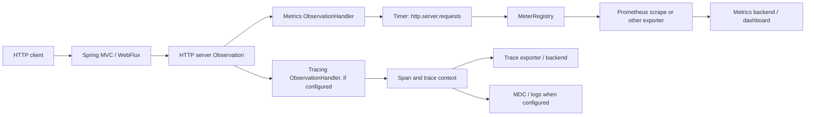
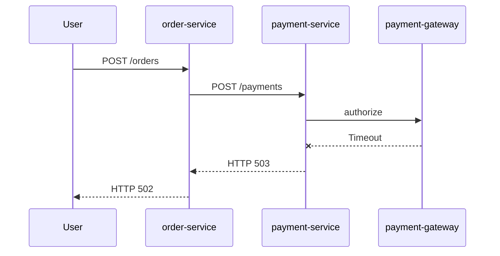
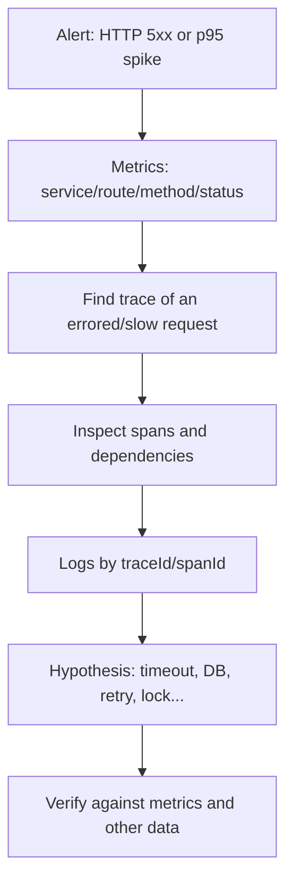
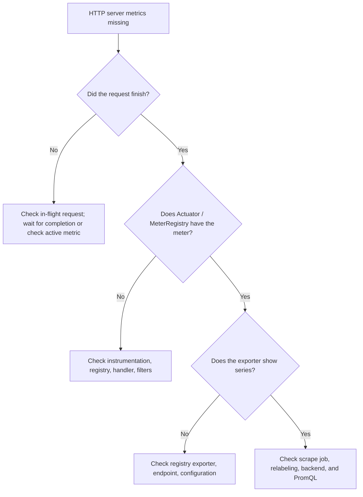

# HTTP Request Metrics in Spring Boot

When a Spring Boot service becomes slow or returns many HTTP 5xx errors, the operations team needs to know: **how many requests there are**, **which endpoints requests are hitting**, **what the error rate is**, **how latency fluctuates**, and **whether the impact is sustained**. HTTP request metrics answer these questions as aggregated numeric data over time. They are typically the starting point for investigation before opening a distributed trace or reading the logs of a specific request.

The lesson **“HTTP request metrics”** belongs to the **Application metrics** chapter in the **SPRING_BOOT_OBSERVABILITY** module. It focuses on how Spring Boot uses Micrometer Observation/Metrics to collect HTTP measurements, how to inspect data with Spring Boot Actuator and Prometheus, designing tags with appropriate cardinality, calculating throughput/error rate/latency, and correlating metrics with logs, distributed tracing, sampling, and context propagation when investigating a running application.

## 1. What are HTTP request metrics?

HTTP request metrics are measurements that describe the **set of HTTP requests** handled by an application. In Spring Boot with Micrometer integration, HTTP server instrumentation typically emits an Observation with the technical name `http.server.requests`; a metrics handler can convert that activity into a **Timer** with the same name.

A Timer aggregates important information:

- **Count:** the number of completed measurements within the meter's data interval.
- **Total time:** the total duration of the measured invocations.
- **Max:** the maximum duration according to the registry's statistical policy, usually windowed and resettable; do not treat it as "max since application startup" in every registry.
- **Histogram buckets:** duration distribution across thresholds, if enabled and supported by the backend.
- **Percentiles:** can be computed in the application or in the backend depending on the configuration mechanism; not automatically present on every Timer.

A `GET /orders/42` request that completes in 120 ms may increment Count by 1 and Total Time by 0.120 seconds for that request's **tag combination**. The next request with the same route/method/status is added to the aggregated measurement, rather than creating a new series just because the order ID differs.

### How do metrics differ from access logs and traces?

| Signal | Data unit | Helps answer |
| --- | --- | --- |
| HTTP metric | Numeric values aggregated by labels and time | What is the traffic volume? On which route did error rate/p95 increase? |
| HTTP/access log or application log | A single line/event for one request or one processing step | Which request failed? What was the exception, request reference, retry, or fallback? |
| Distributed trace | A trace consisting of multiple spans for one request | Is the latency in the controller, database, HTTP client, or downstream service? |

Metrics can alert on **a systemic issue**. Traces and logs help inspect **a specific case**. You cannot deduce a request's execution path from a metric series alone, nor can you deduce a system-wide error rate from a single trace.

## 2. Flow of creating HTTP server metrics in Spring Boot

For a Spring MVC or WebFlux application with observability configured, Spring can automatically instrument the HTTP request lifecycle. Micrometer Observation describes the process, while the metrics handler updates the Timer in the `MeterRegistry`.



A common setup:

1. Spring Boot Actuator/Micrometer provides the instrumentation foundation and `ObservationRegistry`.
2. Spring HTTP instrumentation observes server requests and sets names/tags according to the appropriate convention.
3. The metrics handler records data into `MeterRegistry`.
4. The registry/exporter exposes metrics to Prometheus or another backend.
5. If a tracing bridge, tracer, sampler, and exporter are present, the Observation can also participate in distributed tracing.

**Having Actuator or an `ObservationRegistry` alone is not enough to guarantee data appears in Prometheus.** You need the right exporter/registry type, an exposed endpoint/scrape job, and an active collecting backend. Similarly, having HTTP metrics data does not prove that distributed tracing is working.

### Lifecycle and when the Timer records

The HTTP request Timer typically reflects **completed requests** and the processing duration measured on the server side. Long-running or hung requests might not increment Count until they finish. If you need to observe **in-flight** traffic, you must check the active/in-flight meter types provided by your framework and instrumentation version; do not use the completed Timer Count as the number of open connections.

Server-measured latency also differs from **user-perceived time**: clients may incur additional DNS, TLS, network, proxy, retry, and rendering time. To find slowness along the full request path, combine server metrics with client metrics, gateway metrics, and distributed tracing.

## 3. Setting up HTTP metrics for a sample application

A Spring Boot application using Spring MVC can include these Gradle Groovy dependencies:

```groovy
dependencies {
    implementation 'org.springframework.boot:spring-boot-starter-web'
    implementation 'org.springframework.boot:spring-boot-starter-actuator'
    runtimeOnly 'io.micrometer:micrometer-registry-prometheus'
}
```

For WebFlux, replace the web MVC starter with the appropriate WebFlux starter. Dependency versions are typically managed by Spring Boot via its BOM/plugin; avoid manually pinning incompatible Micrometer versions.

Illustrative configuration:

```yaml
spring:
  application:
    name: order-service

management:
  endpoints:
    web:
      exposure:
        include: health,info,metrics,prometheus
  metrics:
    tags:
      application: order-service
      environment: local
```

In this configuration:

- `management.metrics.tags` provides stable **common tags** for metrics managed by the configured registry.
- The `/actuator/metrics` endpoint lets you inspect meters inside the application.
- The `/actuator/prometheus` endpoint allows Prometheus scraping when the Prometheus registry is present and the endpoint is enabled.
- `health` and `info` are separate endpoints and do not replace HTTP request metrics.
- Data only reaches Prometheus when Prometheus or a compatible collector **actually scrapes the endpoint**; enabling the endpoint does not configure a Prometheus server automatically.

Actuator endpoints can expose operational details. Restrict access and authenticate/protect endpoints according to your deployment policy, especially in production environments. Do not treat an example exposing endpoints locally as a safe default for the public Internet.

### Sample application returning multiple status codes

```java
import org.springframework.http.ResponseEntity;
import org.springframework.web.bind.annotation.GetMapping;
import org.springframework.web.bind.annotation.PathVariable;
import org.springframework.web.bind.annotation.RequestMapping;
import org.springframework.web.bind.annotation.RestController;

@RestController
@RequestMapping("/orders")
public class OrderController {

    @GetMapping("/{id}")
    public ResponseEntity<String> findOrder(@PathVariable long id) {
        if (id == 42L) {
            return ResponseEntity.ok("paid");
        }
        return ResponseEntity.notFound().build();
    }
}
```

You can send test requests from the terminal:

```bash
curl -i http://localhost:8080/orders/42
curl -i http://localhost:8080/orders/43
```

Illustrative result: the first request returns `200`, and the second returns `404`. For routes handled by a controller, HTTP instrumentation can typically use the **route template** `/orders/{id}` as the `uri` tag; two different IDs should not create two separate series solely due to dynamic path values.

Details of the status/uri tags and how unmatched routes or exceptions are handled depend on the Spring Boot/Spring Framework and instrumentation versions. Always verify with actual observed data.

## 4. Key tags of HTTP request metrics

An HTTP server Timer can have low-cardinality tags such as:

| Common tag | Example value | Interpretation |
| --- | --- | --- |
| `method` | `GET`, `POST` | HTTP method |
| `uri` | `/orders/{id}` | Normalized route template |
| `status` | `200`, `404`, `503` | HTTP status of the response |
| `outcome` | `SUCCESS`, `CLIENT_ERROR`, `SERVER_ERROR` | Outcome group, if provided by the convention |
| `exception` | `None` or exception class name | Exception type recorded by instrumentation, if any |
| `application` | `order-service` | Common tag configured by the application |
| `environment` | `local`, `prod` | Common tag configured per deployment |

Not every Spring Boot version or metrics registry includes **this exact** set of tags. Some fields are common defaults in Spring MVC, while others can change when using a custom `ObservationConvention`, `MeterFilter`, or exporter.

### Special attention to `uri`

For `GET /orders/42` and `GET /orders/43`, a good tag is:

```text
uri="/orders/{id}"
```

Risky tags are:

```text
uri="/orders/42"
uri="/orders/43"
```

If full paths containing IDs are placed in `uri`, the number of series can grow with the number of orders. An unmatched route might be labeled with a generic value such as `NOT_FOUND`/`UNKNOWN` or an equivalent value depending on instrumentation; **do not assign every unmatched path its own URI tag**.

### Status and outcome are not strictly synonymous with business errors

`200` means HTTP success, yet the business payload might return a rejection message in the body. `404` is classified as an HTTP client error, yet an endpoint checking for a nonexistent resource might be normal behavior. `503` usually indicates a server or dependency issue, but the root cause requires investigation.

If you use HTTP 5xx as an error SLI, that is a deliberate operational choice, and **it does not automatically cover all business errors**. For valid payment declines, add a separate business metric instead of trying to infer it from HTTP status.

### Limitations of the exception tag

For errors handled by a handler or `ControllerAdvice` that returns a response, `exception` might not match the original exception type or might indicate that no exception was recorded. Do not rely solely on this tag to count errors; combine status, business metrics, and detailed logs/traces.

## 5. Cardinality and cost of HTTP metrics

A metric named `http.server.requests` with multiple labels can create a series for each **observed combination of values**.

Suppose a service has:

| Label dimension | Hypothetical number of values |
| --- | ---: |
| `method` | 4 |
| `uri` (route template) | 20 |
| `status` | 6 |
| `outcome` | 4 |
| `environment` | 2 |

Theoretical maximum combinations under a simple model:

\[
4 \times 20 \times 6 \times 4 \times 2 = 3840
\]

This is a hypothetical combination count, **not** the number of series guaranteed to be emitted: many method/status/outcome combinations never occur on the same route. However, if you add `user.id` with 50,000 values to the same metric, the theoretical number of combinations becomes:

\[
3840 \times 50\,000 = 192\,000\,000
\]

If histograms are enabled, each tag combination can also emit multiple bucket series. At that point, cardinality impacts `MeterRegistry` memory, scrape size, bandwidth, storage, indexing, and PromQL query speed.

**Practical guidelines:**

- Use a route **template**, such as `/orders/{id}`, not concrete paths.
- Use bounded labels: `method`, `status`, `outcome` group, `application`, `environment`.
- Avoid `userId`, `orderId`, `sessionId`, `traceId`, and raw query strings as metric labels.
- Never put emails, tokens, cookies, request bodies, or stack traces into tags.
- If you need per-user or per-transaction analysis, use logs, traces, or governed business data with proper purpose, access controls, and retention.

**Observation high-cardinality key values** can be used by a tracing handler for span attributes when permitted. However, they do not automatically become metric labels, log fields, or baggage. Nor can you use sampling to fix meter cardinality that has already been created at the source.

## 6. Inspecting metrics in Actuator

Once requests have been processed, the endpoint can list meter names:

```bash
curl http://localhost:8080/actuator/metrics
```

And query the HTTP server meter:

```bash
curl http://localhost:8080/actuator/metrics/http.server.requests
```

An **illustrative** JSON response might look like:

```json
{
  "name": "http.server.requests",
  "measurements": [
    {"statistic": "COUNT", "value": 2.0},
    {"statistic": "TOTAL_TIME", "value": 0.052},
    {"statistic": "MAX", "value": 0.031}
  ],
  "availableTags": [
    {"tag": "method", "values": ["GET"]},
    {"tag": "uri", "values": ["/orders/{id}"]},
    {"tag": "status", "values": ["200", "404"]}
  ]
}
```

The values and tags are illustrative only. The Actuator metrics endpoint lets you view aggregated measurements, often filterable with `tag` parameters when supported by the endpoint:

```bash
curl 'http://localhost:8080/actuator/metrics/http.server.requests?tag=method:GET&tag=status:404'
```

Note: A Timer may report durations in the base unit stated in the metadata; do not assume every exporter displays the same unit. With Actuator, how statistics are presented and which are available depend on the meter/registry type.

### Prometheus endpoint

When `micrometer-registry-prometheus` is present and the endpoint is enabled:

```bash
curl http://localhost:8080/actuator/prometheus
```

You can look for series such as:

```text
# Illustrative data; tag/series names depend on the exporter.
http_server_requests_seconds_count{method="GET",uri="/orders/{id}",status="200",application="order-service"} 1
http_server_requests_seconds_sum{method="GET",uri="/orders/{id}",status="200",application="order-service"} 0.021
```

These series represent cumulative data per label combination. `_count` is not requests per second; `_sum` is not the latency of the last request. To see rate or latency over a period of time, query over an appropriate time window.

## 7. Four key operational indicators from HTTP metrics

### 7.1 Throughput: requests per unit of time

Throughput is usually measured in requests/second (RPS). With Prometheus, an example is:

```promql
sum(
  rate(http_server_requests_seconds_count{
    application="order-service"
  }[5m])
)
```

`rate(...)` estimates the per-second average rate of increase of a counter over a 5-minute window, handling counter resets per Prometheus semantics. `sum(...)` aggregates request rates across instances and other labels.

To break down by route:

```promql
sum by (uri) (
  rate(http_server_requests_seconds_count{
    application="order-service"
  }[5m])
)
```

Do not take a single cumulative Count value at one point in time and call it a rate.

### 7.2 Error rate: HTTP error response ratio

HTTP 5xx responses per second:

```promql
sum(
  rate(http_server_requests_seconds_count{
    application="order-service",
    status=~"5.."
  }[5m])
)
```

Ratio of 5xx to total requests:

```promql
sum(rate(http_server_requests_seconds_count{
  application="order-service",
  status=~"5.."
}[5m]))
/
sum(rate(http_server_requests_seconds_count{
  application="order-service"
}[5m]))
```

If you need to display a percentage, multiply by 100 or let the dashboard format the ratio as a percentage. When traffic is zero, the denominator may be zero or missing data; handle this properly before using it in an alert.

**HTTP 5xx error rate is not the entire business failure rate.** For example, when a payment gateway legitimately declines a card and the application returns 200 or 409, a separate business metric is needed if that is what operations wants to track.

### 7.3 Average latency

If `_sum` and `_count` share the same label/timer set:

```promql
sum(rate(http_server_requests_seconds_sum{
  application="order-service"
}[5m]))
/
sum(rate(http_server_requests_seconds_count{
  application="order-service"
}[5m]))
```

The result is in **seconds** when the Prometheus exporter outputs durations in seconds. This is an **average**, not p95. A few extremely slow requests can be hidden when traffic volume is high.

### 7.4 p95/p99 latency and histograms

p95 is a value such that roughly 95% of observations do not exceed that threshold in the considered distribution. For web systems, p95 or p99 surfaces the slow tail better than the mean.

If Spring Boot/Micrometer is configured to emit **histogram buckets** for the HTTP server Timer, Prometheus can compute p95 using `histogram_quantile(...)`:

```promql
histogram_quantile(
  0.95,
  sum by (le) (
    rate(http_server_requests_seconds_bucket{
      application="order-service"
    }[5m])
  )
)
```

To view p95 by route:

```promql
histogram_quantile(
  0.95,
  sum by (uri, le) (
    rate(http_server_requests_seconds_bucket{
      application="order-service"
    }[5m])
  )
)
```

**These queries only work when `_bucket` actually exists.** Without a histogram, looking at `_sum`/`_count` cannot produce p95. Do not average the p95 values of multiple instances and treat that as the system-wide p95; the proper way to aggregate is to sum bucket rates before applying `histogram_quantile`.

## 8. Enabling histograms to compute percentiles

An illustrative Spring Boot configuration for the `http.server.requests` Timer:

```yaml
management:
  metrics:
    distribution:
      percentiles-histogram:
        http.server.requests: true
```

The configuration must match the exact meter name, with a registry that supports buckets and a suitable exporter. With Prometheus, verify on `/actuator/prometheus` that `http_server_requests_seconds_bucket` is present before deploying p95 queries.

Do not unconditionally enable histograms for every high-cardinality Timer. Each tag combination can add many bucket series and significantly increase cost. Select meters that serve SLIs/SLOs, and check bucket counts and scrape size before enabling them broadly.

### Histograms vs. client-side percentiles

| Measurement method | Meaning | When aggregating across instances |
| --- | --- | --- |
| Count and sum | Number of events and total duration | Can be summed to compute the average |
| Histogram buckets | Counts falling into each threshold | Bucket counts/rates can be summed, then approximate percentiles computed |
| Client-side percentiles | Percentiles calculated in the registry/application as configured | Should not be simply added or averaged across instances |
| Max (time-window) | Largest value within the registry-managed window | Not p95 and not necessarily the all-time maximum |

In dashboards, clearly label the unit (ms or s), evaluation window, route group, and instance scope. A p95 of "2.0" without a unit or knowing which routes are aggregated is easily misinterpreted.

## 9. Golden Signals charts for an HTTP service

Common signals to monitor for an HTTP service are **traffic**, **errors**, **latency**, and **saturation**.

| Signal | What HTTP request metrics provide | What to add for a complete picture |
| --- | --- | --- |
| Traffic | RPS by service/route/method | Queues, background work, or non-HTTP message traffic |
| Errors | 5xx/4xx status rates and instrumented application errors | Business error rate, downstream failures |
| Latency | Mean/p95/p99 HTTP server duration | Client/gateway latency, dependency spans |
| Saturation | Only indirectly via RPS/latency | CPU, JVM memory/GC, thread pools, connection pools, queue depth, in-flight requests |

HTTP request metrics describe the **output** of HTTP processing. When p95 rises while throughput stays flat, the cause may be database locks, a slow dependency, connection pool exhaustion, GC, or CPU saturation. Other metrics and distributed traces help distinguish among these possibilities.

### Should every route share the same alert threshold?

Not necessarily. `/health`, `/login`, `/checkout`, and a report export endpoint have different characteristics. Aggregating all routes can let high-volume fast requests mask a low-traffic route that is slowing down. Define a **service-level indicator (SLI)** tailored to critical user journeys or endpoints, along with an alert window and minimum traffic threshold.

For example, the 5xx rate of `POST /checkout` may matter much more than the 404 rate on a nonexistent URL. With low request counts, a single error causes a sharp percentage spike; alerts should consider traffic volume and duration to reduce noise.

## 10. HTTP client metrics and dependency investigation

The HTTP server Timer in `order-service` shows the total request processing time at the service. If most of that time is spent calling `payment-service`, you also need to observe **HTTP client metrics** and network call spans.

Properly instrumented Spring Boot/Spring Framework HTTP clients can emit metrics/Observations for outbound calls, often with meter names such as `http.client.requests`; exact behavior depends on the HTTP client, how it is constructed (e.g., framework-provided builders), versions, and instrumentation wiring.



Measurements that may appear:

- `order-service` **server metric**: duration of `POST /orders` and status 502.
- `order-service` **client metric**: duration of the HTTP call to `payment-service` and returned status 503, if the client is instrumented.
- `payment-service` **server metric**: duration of `POST /payments` and status 503.
- `payment-service` **client metric**: call to the gateway, if the gateway HTTP client is instrumented.

**Do not add HTTP server and HTTP client metric durations together** to infer total latency: the two intervals can overlap/nest, and metrics are aggregated across many different requests. To see actual timings and parent-child relationships for a single request, use a distributed trace.

Client/server metric names and tag sets can vary; verify that the metric exists on your actual Spring Boot version, HTTP client, and exporter before building dashboards.

## 11. Customizing HTTP request metrics without creating high cardinality

Default HTTP instrumentation is usually sufficient for foundational metrics. When additional metadata is needed, you can use an **ObservationConvention** for the HTTP server or extension points supported by Spring Boot/Spring Framework, depending on version.

Reasonable use cases:

- Adding a route group or API category with a bounded set of values.
- Renaming tags to align with a unified taxonomy, while updating dashboards/alerts accordingly.
- Adding a low-cardinality key such as `api.version=v1` or `channel=web` if genuinely meaningful, stable, and small in value count.

Avoid putting these fields into HTTP metric labels: `user.id`, `order.id`, `session.id`, `traceId`, raw IP, raw URL, query string, email, token, or arbitrary exception messages. When individual investigation is needed, store appropriate attributes only in traces/logs or business data stores with clear protection policies.

### When to use a custom business metric instead of modifying HTTP metrics

HTTP status sometimes does not represent the business outcome. For example, an endpoint returns 200 even though a transaction is `DECLINED` under payment rules. In that case, create a metric `payment.authorization.attempts` with `result=approved|declined|error` and a bounded payment method tag, rather than forcing the HTTP request metric to carry transaction codes.

Example using Micrometer Metrics directly:

```java
import io.micrometer.core.instrument.Counter;
import io.micrometer.core.instrument.MeterRegistry;
import org.springframework.stereotype.Service;

@Service
public class PaymentResultMetrics {
    private final MeterRegistry meters;

    public PaymentResultMetrics(MeterRegistry meters) {
        this.meters = meters;
    }

    public void recordApproved() {
        Counter.builder("payment.authorization.attempts")
                .tag("result", "approved")
                .register(meters)
                .increment();
    }

    public void recordDeclined() {
        Counter.builder("payment.authorization.attempts")
                .tag("result", "declined")
                .register(meters)
                .increment();
    }
}
```

This is a complementary business metric and does not replace the HTTP server Timer. In production, agree on how retries, intermediate outcomes, and idempotency are measured before interpreting counts.

### Common tags for application metrics

`management.metrics.tags` can add `application`/`environment` to HTTP metrics and other meters in the registry. However, common tags belong to the **metrics pipeline** and are not automatically attached to spans/logs. Tracing should configure service identity (e.g., `service.name`) and the logging pipeline according to their respective rules.

## 12. From HTTP metrics to the trace and logs of a single request

Suppose a dashboard reports that p95 for `POST /orders` jumped from 150 ms to 2 seconds and the 5xx rate increased. An investigation might proceed as follows:

1. **Confirm scope with metrics.** Check throughput, p95, and 5xx by `application`, `environment`, `uri`, and `method`; compare the same time range before and after deployment.
2. **Pick a representative trace.** In the trace backend, look for failed or high-duration requests matching the service/route/time window. If the backend supports *exemplars* attaching trace IDs to metric data points, you can jump directly to the trace; exemplars require separate configuration.
3. **Inspect spans.** Determine whether time was spent in the controller, DB, HTTP client, queue, or dependency. Check for retries and concurrency; do not sum durations of overlapping spans.
4. **Find logs with the right context.** Take the `traceId` from the trace and search logs with that ID, combining `spanId`/service/time as needed. Check exceptions, timeouts, and fallbacks.
5. **Return to metrics.** Check dependency error rate/latency and the overall route error rate to evaluate whether the hypothesis explains the broader set of requests.



### Why might traces be missing even when HTTP counts keep rising?

There are several possible causes:

- Tracing is not configured; the application only has a metrics handler.
- Head/tail sampling dropped the trace.
- The exporter/collector is failing or the backend is not receiving spans.
- Instrumentation for the HTTP client or custom code is missing.
- Context propagation broke across an executor, reactive pipeline, HTTP call, or message broker.
- The backend is not indexing the attributes used to search for traces.

**Trace sampling does not cause the HTTP Timer to count only sampled requests.** In typical metrics/tracing setups, the Timer aggregates requests independently of whether spans are exported. Do not divide errored traces by total traces and treat that as the true HTTP error rate if the sampler may be biased.

### Log correlation

Micrometer Tracing can place `traceId` and `spanId` into the logging framework's MDC when a tracing scope is active. However, `http.server.requests` does not automatically write every HTTP access log, and common metric tags do not automatically become log fields. Verify that your JSON encoder/pattern and log pipeline actually preserve the correlation fields.

Do not attach `traceId` as a metric label to "link" metrics with logs: `traceId` has extremely high cardinality. Use exemplars if your backend supports them, or search traces by time, route, and status, then open logs by `traceId`.

## 13. Common mistakes when reading HTTP metrics

| Symptom or assumption | Point to revisit |
| --- | --- |
| “`_count` is the current RPS” | `_count` is a cumulative counter; use `rate(...)`/`increase(...)` |
| “`_sum / _count` is p95” | That is the average; p95 requires a distribution/histogram |
| “Average instance p95s to get service-wide p95” | Percentiles cannot simply be added or averaged; aggregate histogram buckets if available |
| “Any URL is fine as the `uri` tag” | Raw paths and IDs explode cardinality; use route templates |
| “All HTTP 4xx responses are server errors” | 4xx are client-side in HTTP classification, though business meaning varies by endpoint |
| “HTTP 200 means business success” | The body/business status may report declined; add a business metric |
| “Having `http.server.requests` means traces exist” | A metrics handler does not guarantee a tracing bridge/sampler/exporter |
| “Missing trace proves the request never happened” | Sampling, exporter issues, and missing instrumentation can drop traces |
| “In-flight requests definitely increment Timer count” | Timers usually record on completion; use dedicated active/in-flight metrics to track ongoing requests |
| “Empty Actuator metrics endpoint means code isn't instrumented” | There may be no requests yet, a different context/port, a registry missing handlers, or disabled config |
| “`/actuator/prometheus` enabled means Prometheus is scraping” | Requires an active scrape job, network reachability, and access permissions |
| “Status 503 metric points to DB as the cause” | Status only describes the outcome; traces, logs, and dependency metrics isolate the cause |

## 14. Checklist for troubleshooting missing HTTP metrics

Start with a reproducible request in a test environment, then inspect each layer:

### Layer 1 — Application and instrumentation

- Is the application running on Spring MVC/WebFlux with compatible Actuator/Micrometer?
- Did the request actually reach the application's controller/filter/handler?
- Does custom code disable Observation or meters?
- Is `ObservationRegistry.NOOP` or a manually created registry without a metrics handler on the instrumented path?

### Layer 2 — MeterRegistry and Actuator

- Does `/actuator/metrics` list `http.server.requests` after the request finishes?
- What are the final name and tags? Did a custom convention/filter alter the name?
- Do common tags like `application`/`environment` appear as expected?
- Which registry is the meter registered in—was a different registry accidentally used?

### Layer 3 — Exporter and backend

- Are the right dependency and exporter (e.g., Prometheus registry) present?
- Does `/actuator/prometheus` contain the Timer series?
- Is the scrape target healthy, returning HTTP success, and authorized?
- Does the backend have series limits, drop rules, relabeling, or name normalization?
- Does the PromQL filter use the right label names, app/environment, and time range?

### Layer 4 — Correlation with traces/logs

- Are the tracing bridge, tracer, sampler, and exporter configured?
- Is trace context propagated properly across HTTP clients, messaging, and async boundaries?
- Does the log pattern/JSON encoder preserve `traceId`/`spanId`?
- Are sampled or exporter-dropped traces properly accounted for when cross-referencing HTTP metrics?

Troubleshooting tree:



If endpoints are protected, use authorized operational credentials/channels for inspection. Never expose actuator metrics/prometheus publicly to the entire Internet just to fix a dashboard.

## 15. Hands-on exercise: measuring three HTTP statuses and reading p95

Perform this in a local/test environment.

### Part A — Generate controlled traffic

Use `OrderController` from Section 3. Send several `GET /orders/42` (200) and `GET /orders/43` (404) requests. For the server error path, create a **test-only** endpoint that intentionally triggers a 500 error, or use an appropriate application test to produce a 500 response.

Verify that request counts are broken down by `uri`/`method`/`status`. Do not expect a 404 response returned by the controller to carry a Java exception in `exception`; it can be a normal handled response.

### Part B — Read Count and throughput

Query `/actuator/metrics/http.server.requests`, then query Prometheus:

```promql
sum by (uri, status) (
  rate(http_server_requests_seconds_count[5m])
)
```

Compare RPS with total requests over the time window. Do not confuse cumulative Count with requests in the last 5 minutes.

### Part C — Enable histogram and read p95

Enable `management.metrics.distribution.percentiles-histogram.http.server.requests` as in Section 8, restart the application in test, and verify `_bucket` series are emitted. Calculate p95 by `uri` and compare it with the average to understand the difference.

If histogram buckets are missing, investigate the configuration and exporter before using `histogram_quantile`.

### Part D — Correlate traces and logs

When Micrometer Tracing is enabled and a trace is retained by sampling, open the trace of a slow request and search logs by `traceId`. Inspect the relationship between the server span duration and child spans, including calls that may overlap.

If no trace appears, check the sampler, exporter, and propagation before concluding the request did not happen.

### Part E — Test cardinality

Send multiple requests to `/orders/{id}` with different mock IDs. Check the number of `uri` values. If series grow per ID, review the instrumentation or custom convention: metric tags should retain the **route template**, not the raw path.

## 16. Self-check questions

1. Which requests do the HTTP server Timer's Count and Total Time measure? What happens to a hung request?
2. Why should `/orders/42` and `/orders/43` share the `uri=/orders/{id}` tag?
3. What is the difference between `status=500` and a business error with a 200 response?
4. To get RPS per route, why is `rate(...)` needed instead of reading `_count` directly?
5. Why is `_sum / _count` not p95?
6. What needs to be enabled to query `http_server_requests_seconds_bucket` with `histogram_quantile`?
7. If an HTTP client call takes 2 seconds and the server request takes 2.1 seconds, why shouldn't you add the two numbers together?
8. Does a common tag `application=order-service` on metrics automatically appear in logs or trace resources?
9. Does 10% trace sampling make HTTP request Count record only 10% of requests?
10. Why do some requests returning 404 or 403 not necessarily mean the application is failing?
11. If Actuator has the meter but Prometheus has no series, what steps should you check?
12. When investigating a specific user, why shouldn't you attach `user.id` as an HTTP request metric label?

## Conclusion

**HTTP request metrics** measure traffic, error rates, and latency in Spring Boot by service, endpoint, method, and status with controllable cardinality. In Spring Boot, Micrometer Observation/Metrics and Actuator provide the observability foundation, while the `MeterRegistry`, histograms, exporters, and backends determine how data is exported and queried.

When errors or high latency occur in a system, start with metrics to determine scope and timing, then use distributed tracing to locate the slow stage, logs to explain the specific failure, and return to metrics to verify the extent of the impact. Sampling, context propagation, log correlation, and proper tag policies are key conditions for making this investigation reliable.
