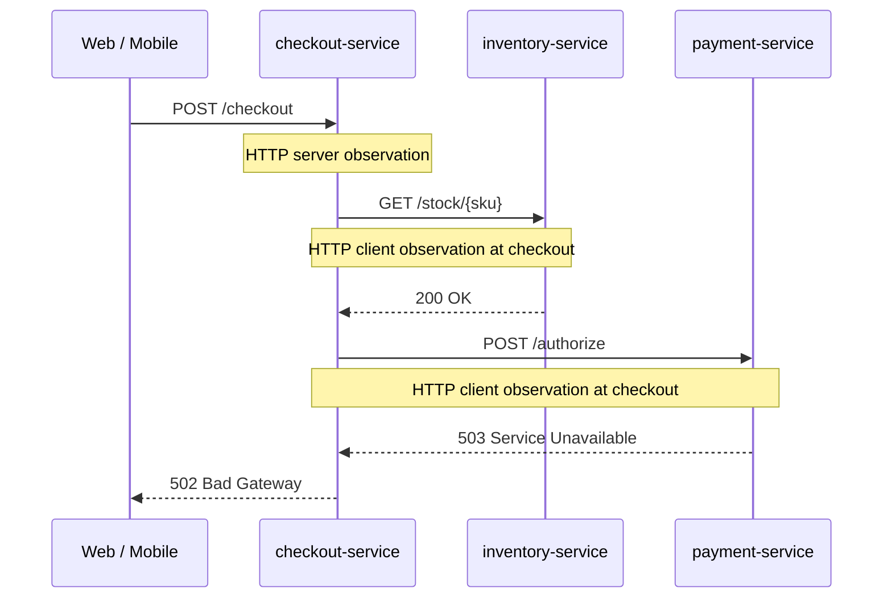
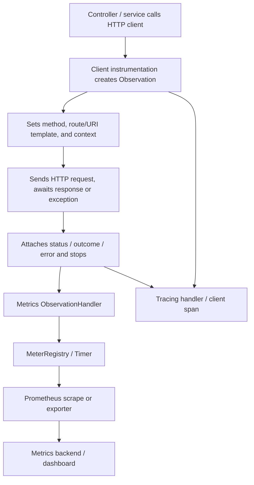
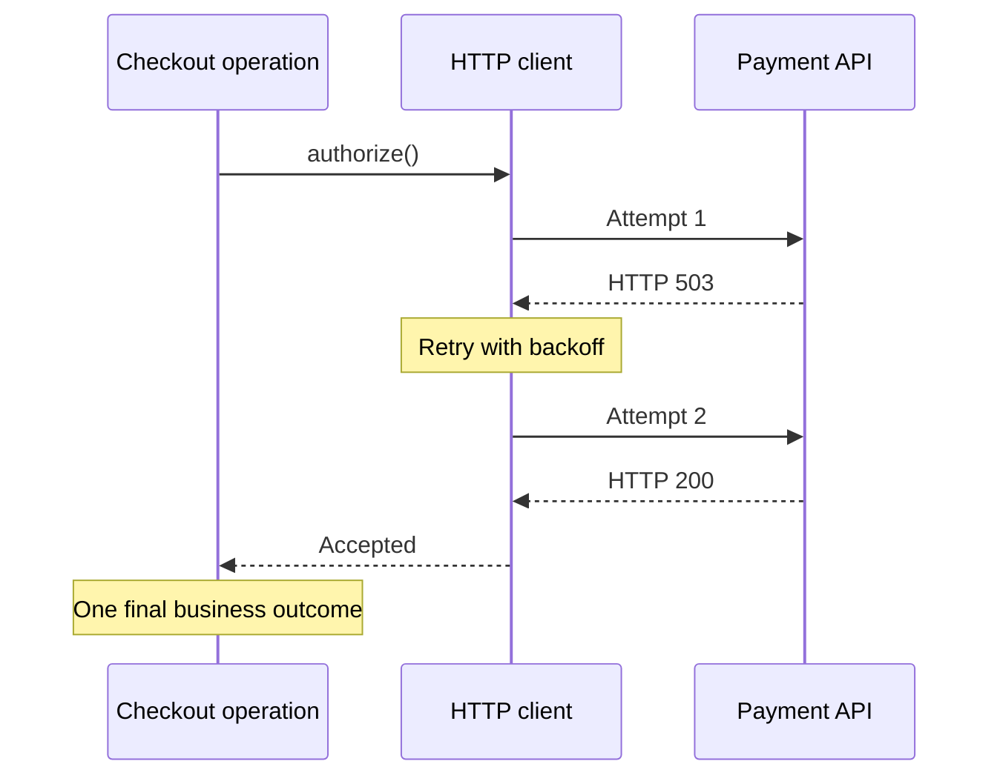
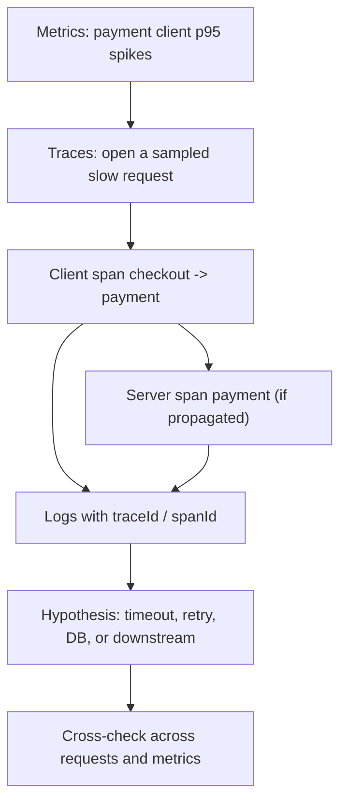

# HTTP Client Metrics in Spring Boot: Measuring Outbound Calls

When a `POST /checkout` API takes two seconds to respond, the cause might not be in the application's own controller or database. That request may have to call an inventory service, a payment service, or a third-party API. If we only measure the **inbound** HTTP processing time of checkout, we know users are waiting a long time, but we do not know which **outbound** call is causing the slowdown.

**HTTP client metrics** provide a quantitative view of the HTTP requests an application **sends to other systems**: call counts, durations, latency distribution, status codes, errors, and how these values change over time. Within the **Application metrics** chapter of the **SPRING_BOOT_OBSERVABILITY** module, this lesson focuses on how Spring Boot uses **Micrometer Observation** and **Micrometer Metrics** to measure HTTP clients, design cardinality-safe tags, export data, and correlate metrics with logs/distributed traces during incident investigations.

By the end of this lesson, you should be able to distinguish inbound vs. outbound metrics, instrument the HTTP client you are using properly, avoid generating millions of time series from dynamic URLs, read latency/error rate queries, understand the impact of retries/sampling, and verify data at each stage of the pipeline.

## 1. How do HTTP client metrics differ from HTTP server metrics?

In a distributed request, **the same service** acts both as an HTTP server to its caller and as an HTTP client to downstream services.



In this hypothetical example:

| Observation perspective | Where is it measured? | Questions answered |
| --- | --- | --- |
| **HTTP server metrics** | `checkout-service` receiving `POST /checkout` | Are users experiencing slowness or errors on the endpoint? |
| **HTTP client metrics** | `checkout-service` sending `GET /stock/{sku}` and `POST /authorize` | Which downstream is slow, timing out, or returning 5xx? |
| **Downstream HTTP server metrics** | inventory/payment receiving requests | Did the downstream receive and process that request? |
| **Distributed tracing** | Linked client and server spans | Which services did the request traverse and where was time spent waiting? |
| **Logs** | Services logging contextual events/errors | What was the specific rejection reason, timeout, or exception? |

An HTTP client metric reflects the **caller's** perspective, which is not necessarily identical to pure server processing time downstream. It can include client overhead, connection setup, and waiting for the response depending on instrumentation. A timeout before the downstream receives the request can appear in client metrics while **not** appearing in downstream server metrics.

## 2. What data should an HTTP client metric provide?

In the Spring Framework 6 / Spring Boot 3.x ecosystem, a common HTTP client observation name is `http.client.requests`. When recorded by a metrics handler, it usually becomes a **Timer** in `MeterRegistry`. A Timer has key components:

- **Count:** how many calls were recorded.
- **Total time:** total recorded duration, useful for computing the mean.
- **Max:** largest value within the registry's measurement window/design; should not be treated as the all-time maximum.
- **Histogram/buckets**, if enabled: duration distribution used to calculate p95/p99 across multiple instances.
- **Tags:** groups calls by method, URI template, client name, status/outcome, and exception, depending on the instrumentation version.

Not every Timer automatically includes percentiles or histograms. Distribution data requires configuration and exporter/backend support. A Timer also **does not automatically distinguish** a "logical business request" from "each HTTP attempt"; that depends on where instrumentation sits in the retry flow.

| Meter type | When is it suitable for outbound HTTP? |
| --- | --- |
| **Timer** | Measuring call count and HTTP request duration |
| **Counter** | Counting a business event distinct from HTTP attempts, e.g., final failed payment commands |
| **Gauge** | Measuring open connections, pending requests, or queue size if the pool/client provides corresponding instrumentation |
| **LongTaskTimer** | Use only when you genuinely need to track long-running in-progress operations; do not replace the default Timer |

**Rule:** start with the framework-instrumented HTTP client Timer. Do not manually recreate counters and timers for every request unless you need a **measurement with a different meaning**.

## 3. Lifecycle from HTTP request to time series

An HTTP client instrumented with Micrometer Observation typically follows this flow:



Overview: exact observation names, key-values, scope open timing, error callbacks, and cancellation behavior depend on the implementation. Keep three points in mind:

1. **Observation** describes the lifecycle of a call. A **Timer** can be updated each time an observation finishes; one Timer serves many requests sharing the same name/tags.
2. **MeterRegistry** holds measurements inside the application. The backend only sees data when an exporter or scrape system collects it successfully.
3. **Tracing handler** can create an HTTP client span and inject trace context into headers. A trace might not be stored due to sampling, while Timer metrics are still recorded through an independent pipeline.

If a manually constructed client is not wired with an `ObservationRegistry`, the code still sends HTTP requests normally, but **it is not guaranteed** to emit default HTTP client observations/metrics.

## 4. Prerequisites for Spring Boot to measure outbound HTTP automatically

With Spring Boot 3.x, Actuator and Micrometer provide the instrumentation foundation. An illustrative set of Gradle dependencies:

```groovy
dependencies {
    implementation 'org.springframework.boot:spring-boot-starter-actuator'
    runtimeOnly 'io.micrometer:micrometer-registry-prometheus'

    // When the application uses WebClient:
    implementation 'org.springframework.boot:spring-boot-starter-webflux'
}
```

`spring-boot-starter-webflux` is **only needed** if the project uses WebClient or the corresponding reactive stack; applications using RestTemplate/RestClient can work with other appropriate web dependencies. Tracing also requires a bridge/tracer/exporter depending on stack and version; it is **not** a prerequisite for recording the HTTP client Timer.

More important than dependencies is **how the HTTP client is created**:

- `RestClient.Builder`: on Spring Boot versions supporting `RestClient` (typically Boot 3.2+), prefer injecting the builder managed by Spring Boot.
- `RestTemplateBuilder`: use the builder provided by Spring Boot to receive customizers and observation configuration.
- `WebClient.Builder`: inject the builder provided by Spring Boot; usable in servlet or reactive applications with the right dependencies.
- Creating clients directly with `new RestTemplate()`, `RestClient.create()`, or `WebClient.builder()` outside Spring's configuration can **bypass default instrumentation**.

Do not treat this list as a contract for every Spring Boot version. Annotation names, APIs, observation configurations, and registry setup can vary across framework releases. Verify your actual version and check `/actuator/metrics/http.client.requests` or `/actuator/prometheus`.

### Exposing metrics configuration for verification

```yaml
management:
  endpoints:
    web:
      exposure:
        include: health,info,metrics,prometheus
```

`/actuator/metrics` shows management data about meters; `/actuator/prometheus` provides scrape data when the Prometheus registry and endpoint are available. Protect management endpoints and expose only what is necessary; never expose all of Actuator publicly to the Internet.

## 5. RestClient example: automatic HTTP client metrics

In Spring Boot versions supporting `RestClient`, a service can inject `RestClient.Builder` and build an HTTP client with a base URL:

```java
import org.springframework.stereotype.Service;
import org.springframework.web.client.RestClient;

@Service
public final class PaymentHttpClient {
    private final RestClient client;

    public PaymentHttpClient(RestClient.Builder builder) {
        this.client = builder
            .baseUrl("https://payments.internal.example")
            .build();
    }

    public String getPaymentStatus(String paymentId) {
        return client.get()
            .uri("/payments/{id}/status", paymentId)
            .retrieve()
            .body(String.class);
    }
}
```

If the builder is configured with an appropriate observation registry, calling `getPaymentStatus(...)` will be instrumented as an HTTP client operation. Normally, business code **does not need to create its own `Timer`** to measure the duration of this request.

**Why use `"/payments/{id}/status"`?** The URI template structure gives instrumentation a basis for attaching a stable route/URI label instead of generating a different label for every payment ID. Actual tag names and template preservation should still be verified for your client/version.

The payment ID still appears on the **actual request URL** for downstream routing. Having metrics use a URI template **does not guarantee** that proxy logs, tracing attributes, or network captures omit the raw URL. If an ID is sensitive, enforce protection policies across the entire pipeline and never put secrets in URLs.

### When responses return 4xx/5xx

With `RestClient.retrieve()`, many HTTP 4xx/5xx statuses throw an exception under default status handling. If the application catches the exception and returns a fallback result, the **HTTP client metric** can still record the 4xx/5xx status of the attempt, while the checkout endpoint's **HTTP server metric** finishes with 200.

Therefore, never infer that "checkout returned 200" means every outbound request succeeded. Conversely, a 404 status from downstream might be an expected business outcome; whether to treat it as an error depends on the contract and alerting goal.

## 6. RestTemplate and WebClient: same goal, different execution paths

### RestTemplate

Older Spring MVC applications can use `RestTemplateBuilder`:

```java
import org.springframework.boot.web.client.RestTemplateBuilder;
import org.springframework.stereotype.Component;
import org.springframework.web.client.RestTemplate;

@Component
public final class InventoryHttpClient {
    private final RestTemplate restTemplate;

    public InventoryHttpClient(RestTemplateBuilder builder) {
        this.restTemplate = builder.build();
    }

    public String getStock(String sku) {
        return restTemplate.getForObject(
            "https://inventory.internal.example/stock/{sku}",
            String.class,
            sku);
    }
}
```

A Boot-managed builder can wire the observation registry and necessary client customizers into `RestTemplate`. Creating `new RestTemplate()` manually can miss this setup. In Spring Framework 6 environments, you can explicitly set the registry using an API such as `restTemplate.setObservationRegistry(...)` when testing or configuring manually.

### WebClient

`WebClient` follows a reactive model; an HTTP request is typically only executed when a publisher is **subscribed** to:

```java
import org.springframework.stereotype.Service;
import org.springframework.web.reactive.function.client.WebClient;
import reactor.core.publisher.Mono;

@Service
public final class InventoryReactiveClient {
    private final WebClient client;

    public InventoryReactiveClient(WebClient.Builder builder) {
        this.client = builder
            .baseUrl("https://inventory.internal.example")
            .build();
    }

    public Mono<String> getStock(String sku) {
        return client.get()
            .uri("/stock/{sku}", sku)
            .retrieve()
            .bodyToMono(String.class);
    }
}
```

In reactive code, merely **creating a `Mono`** does not prove the request was sent or that the Timer recorded anything. Subscription/execution is required to observe the result. Timeouts, cancellations, retries, and publisher lifecycle can affect when the observation stops; exact behavior depends on the client version and operators.

Do not arbitrarily call `block()` on a reactive event-loop thread to test or collect metrics; this causes improper blocking. Use appropriate reactive testing techniques when the application genuinely runs reactively.

### Other HTTP client libraries

Applications may use Java `HttpClient`, Apache HttpClient, OkHttp, Feign, or a custom client. **There is no guarantee that every client is automatically instrumented by Spring Boot just because Actuator is installed.** For clients outside Boot-supported builders, look up the corresponding instrumentation/Observation API or wrap calls with an observation in an adapter. Avoid double-measuring if an SDK or agent already instruments the same request.

## 7. Metric names and important tags

HTTP client observations commonly provide similar dimensions:

| Dimension | Meaning | Notes |
| --- | --- | --- |
| `method` | HTTP method such as GET, POST | Bounded set of values |
| `uri` | URI template or normalized route label | **Do not** use raw URLs containing IDs/queries |
| `status` | HTTP response status if available | I/O errors or timeouts may lack an actual HTTP status |
| `outcome` | Outcome group if generated by instrumentation | Not synonymous with "business success" |
| `client.name` | Client/host name per instrumentation convention | Should be bounded and controlled |
| `exception` | Exception class or default value if no error | Do not use the exception message as a tag |

These are **common tags**, not a fixed list or value contract across all versions. Some instrumentations use different tag names or omit a tag when information is unavailable. Inspect `/actuator/metrics/http.client.requests` and exported data to see the actual tag set.

### Low-cardinality vs. high-cardinality

For metrics, tags must be **low-cardinality**: small enough value sets to aggregate across instances. Micrometer Observation can represent additional **high-cardinality key-values** for tracing depending on handlers, but that does not mean personally identifiable data or secrets are allowed in traces.

Examples:

```text
Good:
  method=GET
  uri=/stock/{sku}
  client.name=inventory.internal.example
  outcome=SUCCESS

Inappropriate:
  uri=/stock/ABC-194834?user=alice@example.test
  orderId=ORDER-928374
  requestId=5fa0d8...
  authorization=Bearer FAKE-TOKEN
```

In code, use overloads that accept a **URI template** instead of string concatenation:

```java
// Recommended: URI template provides stable data.
client.get().uri("/stock/{sku}", sku);

// Avoid: concatenating raw URLs; the URI tag can have very high cardinality.
client.get().uri("/stock/" + sku);
```

These are illustrative snippets within `RestClient`, without calling `retrieve()` to execute the request. Alongside the code, a `ClientRequestObservationConvention` or equivalent convention may be needed if the client does not preserve the template as expected.

### How does cardinality grow?

Suppose a metric has 4 client names, 3 HTTP methods, 8 URI templates, and 5 status groups; the maximum combinations from these four labels is:

\[
4 \times 3 \times 8 \times 5 = 480
\]

If you add an `orderId` label with 200,000 potential values, the theoretical combination count can jump to 96 million before factoring in instances or services. Actual combinations depend on traffic, but the memory and storage risk is clear. A stable `uri=UNKNOWN` value is usually better than unique raw URIs when instrumentation lacks a route template.

## 8. Success, 4xx, 5xx, timeouts, and I/O errors

An HTTP client Timer can be recorded in many situations:

| Call outcome | Has HTTP status? | What to check |
| --- | --- | --- |
| `200/201/204` | Yes | Duration, method, URI template, outcome |
| `400/404/409` | Yes | Is this a technical error or an expected business outcome? |
| `429` | Yes | Throttling, Retry-After, rate limits |
| `500/502/503/504` | Yes | Downstream error, gateway, or overload |
| Connect/read timeout | May lack response status | Exception type, timeout config, tracing/logs |
| DNS/TLS/connection refused | Usually no HTTP status | Client/network error; may not have reached downstream |
| Canceled before response | May lack status | Instrumentation behavior depends on client and reactive lifecycle |

**Do not treat every non-2xx outcome as the same kind of error.** For example, `404` when checking for a nonexistent resource can be normal. Nor should `status=200` be taken as proof that every business request succeeded: an API can return 200 with a rejection in the body.

For transport errors, there is no real HTTP status. Some instrumentations record default status/outcome values such as `IO_ERROR`, `UNKNOWN`, or an exception tag; do not hard-code a specific string without verifying the output from your version.

To measure **business failure rate**, add an outcome metric at the service layer, independent of the HTTP client Timer. The HTTP-layer metric answers "how did the network call go"; the business metric answers "did the order ultimately succeed or not."

## 9. How retries, redirects, and circuit breakers change counts

Suppose a `checkout.placeOrder` operation calls payment. The first attempt gets 503, and the second gets 200. At least two concepts must be distinguished:

- **One logical business request:** the customer placed one order.
- **Two HTTP attempts:** the client sent the request twice.



If HTTP instrumentation sits at the layer executing each network exchange, the Timer may record **two attempts**; if an observation wrapper surrounds the entire retry block, it may record **one logical operation**. The exact placement depends on the client, interceptors/filters, and retry mechanism used. **Do not assume `http.client.requests` always counts attempts or always counts logical calls** without verifying.

Situations to watch closely:

1. **Retries:** can multiply downstream calls relative to inbound requests. Set limits and avoid retrying non-idempotent operations without safety mechanisms.
2. **Redirects:** the client may automatically follow multiple HTTP responses; how instrumentation counts redirects depends on the measurement layer.
3. **Circuit breakers:** if a request is rejected before reaching the HTTP client, there **will not necessarily** be a new HTTP client metric. Separate metrics are needed for the circuit breaker or business outcome.
4. **Overall timeout vs. per-attempt timeout:** a single duration metric does not tell you how many times the client waited; trace spans/events and logs add that context.
5. **Bulkheads/rate limiters:** requests blocked before sending HTTP may not appear in outbound client metrics.

When a dashboard shows downstream RPS doubling after a deploy, check the **retry policy** and any change in instrumentation placement before concluding that organic traffic grew.

## 10. Histograms, percentiles, and SLOs for HTTP clients

Mean latency easily hides tail latency: 95% fast requests with 5% very slow ones can still trigger cascading timeouts. Thus, HTTP client metrics often require **p95/p99** or **percentage of requests within SLO**.

With Spring Boot 3.x, an illustrative configuration:

```yaml
management:
  metrics:
    distribution:
      percentiles-histogram:
        http.client.requests: true
      slo:
        http.client.requests: 100ms,300ms,1s
```

This is an example of distribution configuration for a meter; exact properties, binding, and backend histograms must be verified for your Spring Boot/Micrometer version. Enabling percentile histograms can generate extra buckets/time series and increase cost. Do not enable them unconditionally for all clients/URIs if tag cardinality is already high.

**Histogram buckets** allow proper aggregation across multiple instances (with compatible bucket boundaries) to compute approximate percentiles. Instance-level **client-side percentiles** generally **cannot be combined** into a system-wide p95 by averaging them.

Reasonable operational questions:

- Is `inventory-service` p95 below 200 ms during peak hours?
- Is the outbound 5xx/timeout rate from `payment-service` exceeding the alert threshold?
- After deployment, how did request counts and latency buckets shift?
- Given `client.name` and `uri`, which group accounts for most of the wait time?

SLOs for **downstream dependencies** should be defined according to the calling application's needs. A checkout endpoint with a 300 ms budget does not imply every minor HTTP call in the system must share the same threshold.

## 11. Reading Prometheus metrics and PromQL

When Spring Boot uses the Prometheus registry, the logical Timer `http.client.requests` is typically exported as series similar to:

```text
http_client_requests_seconds_count{method="GET",uri="/stock/{sku}",...}
http_client_requests_seconds_sum{method="GET",uri="/stock/{sku}",...}
http_client_requests_seconds_bucket{method="GET",uri="/stock/{sku}",le="0.5",...}
```

These series **only illustrate the structure**: actual suffixes, labels, units, and buckets depend on the registry/version/configuration. `_bucket` series only exist when histograms are enabled and the exporter supports that format.

### Outbound request rate

```promql
sum by (client_name) (
  rate(http_client_requests_seconds_count[5m])
)
```

This shows **recorded HTTP calls per second** by `client_name`, if that label exists. If the client name appears under a different label, inspect the actual output and adjust the query accordingly.

### HTTP 5xx ratio across recorded calls

```promql
sum(rate(http_client_requests_seconds_count{status=~"5.."}[5m]))
/
sum(rate(http_client_requests_seconds_count[5m]))
```

The query returns a **ratio from 0 to 1**, not a percentage multiplied by 100. The denominator counts all recorded calls, including calls without an HTTP status if recorded; thus the result is the ratio of **recorded calls with status 5xx**, not yet the rate of all transport errors or all business errors. When the denominator is zero or sample counts are low, the result may be unreliable.

To compute a **failure rate** including timeouts/connection errors, define a convention for calls that receive no response. You can classify them using `exception`, `outcome`, or a dedicated failure metric, depending on instrumentation.

### Average latency

```promql
sum(rate(http_client_requests_seconds_sum[5m]))
/
sum(rate(http_client_requests_seconds_count[5m]))
```

The value is in **seconds** with the illustrative metric name above. Filter by `client_name`, `uri`, `method`, or service label when focusing on a specific downstream; otherwise, durations from unrelated endpoints get mixed together.

### p95 from histogram buckets

```promql
histogram_quantile(
  0.95,
  sum by (le, client_name) (
    rate(http_client_requests_seconds_bucket[5m])
  )
)
```

This query assumes **classic Prometheus histogram buckets** and clients with compatible bucket boundaries. With native histograms or other exporter types, the formula and aggregation differ. p95 is estimated from buckets, not the exact value of the 95th out of 100 requests.

**Note:** `http.client.requests` is not guaranteed to be the final metric name in every system. Before copying a query, check `/actuator/prometheus`, target labels, and your application's exporter format.

## 12. Protecting data and controlling cardinality

HTTP client metrics easily cause high cardinality because URLs, hostnames, and error details vary per request. A transparent tag contract is essential:

| Data | Recommendation | Reason |
| --- | --- | --- |
| `method`, status class, bounded outcome | Allowed | Small value set |
| `uri` as normalized route/template | Allowed | Helps locate slow endpoints without exposing IDs |
| `client.name` as controlled logical downstream | Allowed with limits | Distinguishes inventory, payment, shipping |
| Raw query strings, `orderId`, `userId` | Do not use as metric tags | Sensitive and/or extremely high cardinality |
| Authorization headers, cookies, tokens | Do not collect | Secrets could be leaked |
| Exception messages or request bodies | Do not use as tags | May contain PII, business content, and high cardinality |

For traffic through proxies or partner APIs, URLs may contain special characters, object IDs, and user-supplied query strings. Filtering in an `ObservationFilter` upon stop **does not guarantee** removal of data already written to logs or traces earlier. Ensure safety right at the instrumentation source and govern logging/tracing exporters separately.

Micrometer Metrics `MeterFilter` can help block meters carrying an inappropriate tag; this is a **supplementary defense layer**, not a substitute for choosing URI templates and bounding values at the source.

## 13. Traces, logs, and context propagation for outbound HTTP

Metrics answer "how many" and "how slow," but when a payment times out, we want to know what happened on **one specific request**. With Micrometer Observation paired with a tracing bridge, an HTTP client observation can create a **client span**. If the downstream is also instrumented and context is propagated properly, the client span and server span can belong to the same trace.



Important notes:

1. **Without a tracing bridge**, you can still have an HTTP client Timer if the metrics handler is configured.
2. **Sampling** can prevent finding a trace for a request even while the metric keeps increasing. A log containing a trace ID also does not guarantee the trace was stored in the backend.
3. **Context propagation** over HTTP requires client instrumentation to inject appropriate headers (e.g., W3C `traceparent`) and the downstream server to extract them. Creating an observation manually does not automatically guarantee propagation.
4. **Baggage** can be forwarded across HTTP boundaries if configured. Never put emails, tokens, card numbers, or private data into baggage.
5. **Raw URLs and headers** can still leak data in span attributes/logs. Using a URI template in metrics does not automatically sanitize other signals.
6. **Exemplars** can link histogram data points to traces in some systems, but require registry, exporter, and backend support; do not assume the link exists automatically.

When investigating a transaction, use a trace ID/correlation ID per policy instead of attaching `traceId` as a metric label. A metric label containing trace IDs explodes cardinality and defeats aggregation.

## 14. Testing HTTP client metrics without real network calls

A concise unit/integration test can wire `ObservationRegistry` with `SimpleMeterRegistry` and an instrumented `RestTemplate`. Use Spring Test's `MockRestServiceServer` to return a mock response, then assert the Timer was recorded. The example below uses common Spring Framework 6 / Micrometer 1.x APIs:

```java
import io.micrometer.core.instrument.Timer;
import io.micrometer.core.instrument.observation.DefaultMeterObservationHandler;
import io.micrometer.core.instrument.simple.SimpleMeterRegistry;
import io.micrometer.observation.ObservationRegistry;
import org.junit.jupiter.api.Test;
import org.springframework.http.MediaType;
import org.springframework.test.web.client.MockRestServiceServer;
import org.springframework.web.client.RestTemplate;

import static org.junit.jupiter.api.Assertions.*;
import static org.springframework.test.web.client.match.MockRestRequestMatchers.requestTo;
import static org.springframework.test.web.client.response.MockRestResponseCreators.withSuccess;

class HttpClientMetricsTest {
    @Test
    void recordsOneSuccessfulOutboundCall() {
        try (SimpleMeterRegistry meters = new SimpleMeterRegistry()) {
            ObservationRegistry observations = ObservationRegistry.create();
            observations.observationConfig().observationHandler(
                new DefaultMeterObservationHandler(meters));

            RestTemplate client = new RestTemplate();
            client.setObservationRegistry(observations);
            MockRestServiceServer server =
                MockRestServiceServer.bindTo(client).build();

            server.expect(requestTo(
                    "https://inventory.example.test/stock/ABC"))
                .andRespond(withSuccess("available", MediaType.TEXT_PLAIN));

            String response = client.getForObject(
                "https://inventory.example.test/stock/{sku}",
                String.class,
                "ABC");

            assertEquals("available", response);
            server.verify();

            Timer timer = meters.find("http.client.requests")
                .tag("method", "GET")
                .timer();
            assertNotNull(timer);
            assertEquals(1L, timer.count());
        }
    }
}
```

This test proves: **the mock HTTP request was called once**, the observation has a metrics handler, and the Timer recorded one call. It does not prove that the Prometheus exporter, collector, or tracing propagation works. Mock servers/interceptors can affect execution paths in certain clients/versions; adjust tests when upgrading Spring Framework.

Recommended test extensions:

- An HTTP 503 response to verify the corresponding status/outcome tag, without hard-coding exception values that instrumentation does not guarantee.
- A simulated transport exception to verify whether the system records a Timer when no HTTP status is received.
- Two paths with two different IDs sharing the same URI template, ensuring **two unique `uri` tag values are not created**.
- Checking actual `method` and `client.name` values without relying on nonexistent environment addresses.
- An integration test using a Spring Boot-configured client builder to verify **auto-wiring**; a unit test calling `setObservationRegistry(...)` directly does not test auto-configuration.

For WebClient, use appropriate reactive testing tools and remember that requests only execute when the publisher is subscribed to. Never use arbitrary `Thread.sleep(...)` hoping an exporter finishes before asserting.

## 15. When metrics “don't show up”: layer-by-layer troubleshooting

Missing `http.client.requests` on a dashboard is not enough to conclude the client is uninstrumented. Trace from closest to the source outward:

| Symptom | Possible cause | How to verify |
| --- | --- | --- |
| No meter in `MeterRegistry` | Manually constructed client, no registry attached, no traffic | Check builder/`ObservationRegistry` and trigger a controlled request |
| Timer exists but count stays zero | Request not executed, reactive `Mono` not subscribed, wrong registry | Verify execution path, registry, and observation lifecycle |
| HTTP server metric exists, client metric missing | Inbound and outbound instrumentation are separate | Check outbound builder and HTTP library |
| Meter in JVM, Actuator empty | Different endpoint/config/registry, `MeterFilter` denied it | Inspect `/actuator/metrics`, dependencies, and endpoints |
| `/actuator/prometheus` has samples, backend does not | Scrape target, auth, network, exporter, or relabeling | Check target health, collector, and pipeline |
| Only seeing `uri=UNKNOWN` | Client did not preserve URI template | Use template overloads and check instrumentation |
| Huge number of `uri` values | Raw URL with IDs/query or faulty custom convention | Normalize templates and check cardinality |
| Few 5xx but many checkout failures | Timeouts lacking status or post-call error handling | Combine exception tags, client errors, and business metrics |
| Downstream RPS jumped after deploy | Retries, redirects, instrumentation changes | Distinguish HTTP attempts from logical business operations |
| Metrics present, spans missing | No tracing bridge, trace unsampled, exporter error | Check tracing and propagation separately |
| p95 missing | Histogram not enabled, buckets dropped, or wrong query | Check `_bucket`, `le` labels, and exporter |

A quick troubleshooting path:

1. Identify whether the service uses `RestClient`, `RestTemplate`, `WebClient`, or another client.
2. Trigger **one controlled real or mock request** to confirm the client is instrumented.
3. Locate the `http.client.requests` meter and its count/tags in the registry.
4. Check the Actuator endpoint or exporter to confirm data leaves the JVM.
5. Inspect scrape targets/collectors/backends before reading dashboard queries.
6. If investigating real latency or errors, use traces and logs to pinpoint the root cause rather than just counting.

## 16. Case study: slow payment while checkout still returns HTTP 200

**Hypothetical scenario:** after increasing timeouts and enabling retries in `checkout-service`, users see fewer HTTP 502s, yet p95 of `POST /checkout` climbs from 400 ms to 1.7 seconds. Operations notices outbound requests to payment increasing while order volume remains flat.

**Step 1 — Detect via metrics.** Checkout's HTTP server metrics show most responses are 200, but latency rose. HTTP client metrics filtered by `client.name=payment` show 503/timeouts and rising downstream RPS. Always inspect actual label values before writing queries.

**Step 2 — Distinguish logical calls from attempts.** Previously one order called payment once; after the change, some requests hit 503 and succeeded on retry. HTTP client metrics may record multiple attempts per order depending on instrumentation placement. A business metric `checkout.orders.completed` shows completed orders and does not replace HTTP attempt counts.

**Step 3 — Cross-check latency histograms.** HTTP client p95 to payment increased, likely dominating `POST /checkout` duration. Query histograms for the specific client, route, and environment; do not merge fundamentally different payment endpoints just because they share a hostname.

**Step 4 — Open sampled traces.** In a slow trace, the first client span shows a 503 response, followed after backoff by a successful retry attempt. Logs under that trace ID show a `payment.retry.scheduled` event and a normalized reason. This illustrates expected data, **not an assumption that every real trace has this exact structure**.

**Step 5 — Evaluate policy.** Timeouts, backoff, maximum retries, circuit breakers, and idempotency must be reviewed. Retries can improve completion rates while adding load to a struggling system and lengthening tail latency.

**Step 6 — Verify after changes.** Simultaneously monitor HTTP server p95, HTTP client p95, 5xx/transport errors, attempts per order, and business completion rate. Do not treat a single improved chart as proof that the whole system has recovered.

Takeaway from the example: **metrics quantify where the problem is, traces describe call ordering, and logs provide error context**. URI templates and low-cardinality tags allow accurate queries without putting payment IDs, tokens, or customer information into metrics.

## 17. Common design mistakes

| Mistake | Consequence | Fix |
| --- | --- | --- |
| Using raw URLs as `uri` tag | Explosion of time series by ID/query | Use URI templates and safe conventions |
| Instrumenting controllers only, ignoring outbound clients | Know API is slow, don't know which downstream | Use Boot-managed builders or appropriate instrumentation |
| Creating a new Counter per payment ID | Memory/metric cost leak, PII risk | Count by bounded outcomes |
| Merging all downstreams into one p95 | Loses signal on the slow endpoint | Group by client/URI template appropriately |
| Treating all 4xx as infrastructure errors | Noisy, misleading alerts | Separate status codes from business outcomes |
| Relying on status codes to catch timeouts | Timeouts may have no HTTP response | Check exception/transport metrics |
| Computing p95 by averaging instance p95s | Not the system-wide p95 | Use compatible buckets and `histogram_quantile` |
| Recording one logical Timer and interpreting it as attempts | Wrong RPS/denominator | Check instrumentation placement relative to retries |
| Enabling histograms on dynamic URLs | Huge cardinality and cost explosion | Bound tags, buckets, and histogram scope |
| Assuming metrics imply distributed tracing exists | Missing context when debugging specific requests | Configure tracing bridge/exporter and propagation |

## 18. Self-check exercises

**Exercise 1.** A checkout API calls inventory using `new RestTemplate()` and does not see `http.client.requests`. Can we conclude Spring Boot Actuator is broken?

*Hint:* Not yet. Check whether the client received an `ObservationRegistry`; prefer Boot-provided `RestTemplateBuilder` or configure the registry manually and verify the meter at the source.

**Exercise 2.** Two requests `GET /stock/ABC` and `GET /stock/XYZ` produce two different `uri` tag values. What is the risk?

*Hint:* The URI label is using concrete paths, risking cardinality explosion. Use `/stock/{sku}` or a normalized convention, then inspect tags after instrumentation.

**Exercise 3.** WebClient returns `Mono<String>`, but the test never subscribes. Why is the Timer count 0?

*Hint:* Reactive publishers execute lazily; no actual HTTP exchange happened, so no measurement completed.

**Exercise 4.** A checkout order retries HTTP twice before succeeding. Must the HTTP client count necessarily increase by three?

*Hint:* Not necessarily. It depends on whether instrumentation wraps each network attempt or the entire retry block. Measure logical operations separately if needed.

**Exercise 5.** PromQL filtering `status=~"5.."` returns 0%, yet users report timeouts. Is there a contradiction?

*Hint:* Timeouts may not have an HTTP status. Check exception/outcome tags, network errors, and request durations; status-only queries miss transport failures.

**Exercise 6.** To get outbound p95 across three instances, should you average each instance's p95?

*Hint:* No. Aggregate histogram buckets across instances with compatible bucket boundaries, then apply `histogram_quantile`.

**Exercise 7.** Metrics rise steadily, and logs have a trace ID, yet the backend cannot find the trace. What does this indicate?

*Hint:* Metrics and tracing use different pipelines. The trace may have been unsampled/unexported, the collector failed, or context propagation broke; never infer from metrics that a span always exists.

**Exercise 8.** Why must logs and traces still be audited even when the metric `uri` is a safe template?

*Hint:* Raw URLs, headers, and bodies can still be recorded by other components. Data protection policies must apply across metrics, logs, tracing, baggage, and exporters.

## 19. Key takeaways

- **HTTP client metrics** measure calls going **outbound** from the application, complementing HTTP server metrics that measure **inbound** calls.
- In Spring Boot with Micrometer Observation, `http.client.requests` typically creates a **Timer** for call counts and durations, with tags like method, URI template, status, client name, and exception depending on version.
- Use **Spring Boot-managed `RestClient.Builder`, `RestTemplateBuilder`, or `WebClient.Builder`** to receive proper instrumentation; manually created HTTP clients can bypass the registry.
- **URI templates and low-cardinality tags** are crucial for keeping metrics useful and safe. Never put IDs, raw URLs, tokens, queries, or personal information into metric labels.
- **Retries, redirects, timeouts, circuit breakers, and reactive cancellations** can make measured counts or outcome meanings differ from logical business operations; verify instrumentation placement.
- Histograms/PromQL support throughput, error rate, and p95 analysis; never average instance p95s. Status-only error rates do not cover all transport failures.
- When troubleshooting incidents, combine **HTTP client metrics + traces + logs**, verify sampling and context propagation, and inspect sequentially from client/registry through exporter, collector, backend, and dashboard.
