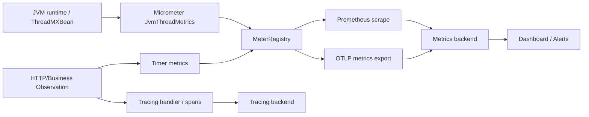
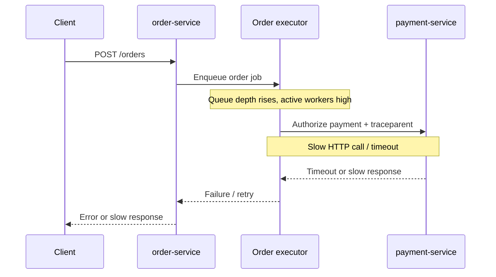

# JVM Threads Metrics in Spring Boot Observability

**JVM threads metrics** report the state of threads observed by the JVM, such as total live threads, daemon threads, historical peak counts, and thread distribution by state. In Spring Boot, Micrometer together with Spring Boot Actuator can auto-configure these measurements and export them via Prometheus or another metrics backend to monitor resource pressure and bottleneck symptoms.

This lesson belongs to the **Application metrics** chapter of the **SPRING_BOOT_OBSERVABILITY** module. The goal is not just reading metric names, but **accurately interpreting what metrics prove and do not prove**: distinguishing JVM thread states from executor queues, recognizing thread leaks, monitor contention, and I/O waits, understanding Java virtual thread limitations, and combining metrics with logs and distributed tracing when investigating errors and latency in real environments.

## 1. Why monitor JVM threads?

A Spring Boot API may respond well at low traffic and then start showing increased latency when many requests arrive concurrently. Possible causes include:

- Thread count grows continuously because a component creates threads without releasing them.
- Threads are waiting on a lock or monitor, bottlenecking a contended code region.
- Many workers are waiting on downstream HTTP calls, database connections, semaphores, or queues.
- A thread pool has exhausted its workers; work backs up in a queue and request time increases.
- Garbage collection, CPU saturation, or another resource slows down processing; thread count is a supporting signal rather than the root cause.

A dashboard showing only latency or HTTP error rates is usually insufficient to distinguish these situations. **JVM thread metrics reveal part of the resource picture**, helping choose the direction of investigation.

For example, when `POST /orders` p95 climbs from 200 ms to 3 s, we want to examine simultaneously:

| Signal | Question |
| --- | --- |
| `jvm.threads.live` | Are significantly more JVM threads being created? |
| `jvm.threads.states` | Are many threads in `BLOCKED`/`WAITING`/`TIMED_WAITING` state? |
| Executor active/queued | Is the business-processing thread pool saturated? |
| HTTP/DB connection pool metrics | Are threads waiting for connections to dependencies? |
| HTTP Timer/Observation | On which operation or route did latency increase? |
| Distributed traces | In which span does a slow request spend its time? |
| Logs/thread dump | Are there unusual stack traces, locks, or retries? |

**Do not conclude "many WAITING threads means a deadlock."** In modern servers, idle worker threads routinely sit in a waiting state completely normally.

## 2. Foundation: Java threads and ThreadMXBean

In Java, a **platform thread** is typically backed by an operating system thread. The JVM can expose thread statistics via the JMX/management API `java.lang.management.ThreadMXBean`.

Key methods:

- `getThreadCount()`: number of live threads counted by `ThreadMXBean` at read time.
- `getDaemonThreadCount()`: number of live daemon threads among managed threads.
- `getPeakThreadCount()`: highest live thread count since JVM startup or the last peak reset.
- `getAllThreadIds()`, `getThreadInfo(...)`: data needed to inspect a set of threads and their states.
- `findDeadlockedThreads()`: helps diagnose certain Java-level deadlocks when supported by the JVM implementation.

Micrometer provides the **`JvmThreadMetrics`** binder, which uses JVM management APIs to publish standard meters so developers do not have to write custom Gauges for JVM-wide thread counts.

### Data flow



**Thread count** and **request duration** measure different things. One thread can serve many requests over time; one request can traverse multiple threads or use a non-blocking model. You cannot divide live threads by request count to directly infer saturation.

## 3. Common JVM thread metrics

In a Spring Boot 3.x application with the Micrometer JVM thread binder, common meter names include:

| Micrometer name | Type | Meaning |
| --- | --- | --- |
| `jvm.threads.live` | Gauge | Number of live JVM threads at sample time |
| `jvm.threads.daemon` | Gauge | Number of currently live daemon threads |
| `jvm.threads.peak` | Gauge | Peak live thread count recorded since startup/peak reset |
| `jvm.threads.states` | Gauge with state tag | Distribution of threads by `Thread.State` |

These metrics may not be available in every JVM/runtime/configuration. Series names in Prometheus usually differ from meter names due to separator replacement and unit suffixes; check your exporter's actual output.

### 3.1. `jvm.threads.live`

This metric reflects the number of threads reported by the JVM management API. If it rises from 80 to 500 and **does not drop after load returns to normal**, there may be a thread management issue or a pool holding onto many workers.

However, a rising live thread count can also be intentional behavior:

- A thread pool scales up under load and retains idle workers.
- A web server or scheduler spawns additional threads per configuration.
- A library initializes background threads.
- A deployment changed thread pool sizing.

A blanket threshold like "more than 100 live threads is an error" usually lacks justification. You need the baseline, CPU capacity, pool settings, traffic, and release-to-release changes.

### 3.2. `jvm.threads.daemon`

**Daemon thread** is a Java thread lifecycle property; it does not mean "an unimportant thread" or "a thread only doing lightweight background work." Daemon threads can still burn CPU, hold resources, or become blocked.

Daemon thread count is typically **a subset of live thread count**. The difference between the two can suggest the number of non-daemon threads, though you must understand the scope of the JVM management API and sampling conditions.

### 3.3. `jvm.threads.peak`

Peak rises when live threads hit a new high and does not automatically decrease with live count. When traffic drops after a peak:

```text
Time              09:00  09:05  09:10  09:20
Live threads        70    150    110     75
Peak threads        90    150    150    150
```

This is a hypothetical example. Peak is historical data over the lifecycle tracked by `ThreadMXBean`, not the maximum within an arbitrary dashboard query window. Peak can be reset via management APIs; after a restart, tracking starts a new lifecycle.

To know the highest live threads over the **last 15 minutes**, use a time-range query like `max_over_time` over collected samples; that is not identical in meaning to `jvm.threads.peak`.

### 3.4. `jvm.threads.states`

This Gauge breaks threads down by Java thread state:

- `NEW`
- `RUNNABLE`
- `BLOCKED`
- `WAITING`
- `TIMED_WAITING`
- `TERMINATED`

Values of the `state` tag may be normalized in case or separators by the binder or backend. Read `availableTags` in Actuator before writing fixed queries or alerts.

State counts are a **snapshot**, not a complete history of each thread. Between two reads, a thread can transition states rapidly. Individual reads and aggregations may not form a strictly atomic snapshot of the entire JVM.

## 4. Interpreting Thread.State accurately

This is the most frequently misunderstood part of JVM thread metrics.

| State | Java meaning | Does it mean an error? |
| --- | --- | --- |
| `NEW` | Thread object created but not yet started | No; rarely appears prominently in live thread stats |
| `RUNNABLE` | Thread is runnable in the JVM; may be executing or waiting for OS resources | No; **does not mean 100% CPU time** |
| `BLOCKED` | Thread is waiting to enter a monitor guarded by `synchronized` | If sustained abnormally, may indicate lock contention |
| `WAITING` | Thread is waiting indefinitely for another condition/action | Very common for idle pool workers |
| `TIMED_WAITING` | Thread is waiting with a timeout, e.g., `sleep`, `wait(timeout)` | Can be normal or a sign of retry/backoff |
| `TERMINATED` | Thread has finished execution | Not a direct indicator of a thread leak |

### RUNNABLE does not mean "running on CPU"

In the Java thread model, `RUNNABLE` can include waiting to be scheduled by the OS or situations involving native calls. For certain I/O operations, a thread can appear `RUNNABLE` while blocked at the native layer. Therefore, when `RUNNABLE` spikes:

1. Compare with CPU usage/process CPU.
2. Check load average, GC, and thread pools.
3. Capture a thread dump or appropriate profile to inspect actual stack traces.
4. Determine whether there are CPU-bound tasks, spin loops, or blocking native I/O.

Seeing `RUNNABLE` rise alone is **not enough** to conclude CPU saturation.

### BLOCKED and lock contention

`BLOCKED` is tied to waiting on a Java monitor, typically via `synchronized`. If many threads stay `BLOCKED` for a long time waiting on the same monitor, throughput can degrade.

However, not every form of lock waiting maps to Java `BLOCKED`. For instance, locks built on `LockSupport.park` put threads into `WAITING` or `TIMED_WAITING`. Inspect stack traces and lock owners rather than relying solely on state labels.

### WAITING/TIMED_WAITING can be completely normal

Idle thread-pool workers wait on a work queue; scheduler threads wait for their next trigger; timed threads wait for I/O or synchronization conditions. Thus:

> A large proportion of `WAITING` threads is only suspicious when accompanied by **queue backlog, request latency, starvation, timeouts, or other anomalies**.

Distinguish "waiting because there is no work" from "waiting because the system cannot make progress" using executor metrics, workload data, and thread dumps.

## 5. Setting up Spring Boot Actuator and Micrometer

The configurations below illustrate **Spring Boot 3.x**. In other Spring Boot versions, starters or properties may differ. Use dependency management/BOM compatible with your project version.

### 5.1. Maven dependencies

```xml
<dependencies>
    <dependency>
        <groupId>org.springframework.boot</groupId>
        <artifactId>spring-boot-starter-actuator</artifactId>
    </dependency>

    <!-- Optional if Prometheus scraping is desired -->
    <dependency>
        <groupId>io.micrometer</groupId>
        <artifactId>micrometer-registry-prometheus</artifactId>
    </dependency>
</dependencies>
```

Spring Boot Actuator and Micrometer normally auto-configure JVM binders when appropriate conditions are met. If you only need standard JVM thread gauges, **you do not need to declare a `JvmThreadMetrics` bean manually**.

Do not create a `SimpleMeterRegistry` inside a service if Spring Boot is already managing a Prometheus/OTLP registry. A manually created registry may not be connected to your configured metrics export pipeline.

### 5.2. `application.yml` configuration

```yaml
spring:
  application:
    name: order-service

management:
  endpoints:
    web:
      exposure:
        include: health,info,metrics,prometheus
  metrics:
    tags:
      application: order-service
      environment: development
```

In a development environment you can verify:

```bash
curl -s http://localhost:8080/actuator/metrics
curl -s http://localhost:8080/actuator/metrics/jvm.threads.live
curl -s http://localhost:8080/actuator/metrics/jvm.threads.daemon
curl -s http://localhost:8080/actuator/metrics/jvm.threads.peak
curl -s http://localhost:8080/actuator/metrics/jvm.threads.states
```

`/actuator/metrics/jvm.threads.states` returns `measurements` along with values in `availableTags`; use those values to filter for a specific state.

For example, if the exported state tag is `runnable`:

```bash
curl -s "http://localhost:8080/actuator/metrics/jvm.threads.states?tag=state:runnable"
```

**Do not assume tag values are always lowercase or spelled identically to examples**; read the actual output. Actuator endpoints may also use a different port/base-path or require authentication.

### 5.3. Auto-configured metrics vs. export endpoint

`/actuator/metrics` shows meters registered inside the application. If the Prometheus registry is present and `prometheus` is exposed:

```bash
curl -s http://localhost:8080/actuator/prometheus
```

A Prometheus backend must scrape the endpoint; seeing output from the endpoint only proves **the application has data to export**, not that the backend has stored samples. In production, secure Actuator and verify scraper access permissions.

## 6. Metric names in Prometheus

Micrometer uses dot-separated names and units; Prometheus normalizes names accordingly. For JVM thread gauges, you commonly see series names like:

```promql
jvm_threads_live_threads
jvm_threads_daemon_threads
jvm_threads_peak_threads
jvm_threads_states_threads
```

These names are **common examples** with the Micrometer Prometheus registry. Exact names and labels depend on binder version, registry, naming conventions, and filters. Always inspect `/actuator/prometheus` or backend metadata.

### Illustrative PromQL queries

Assuming the metrics and labels below exist:

```promql
# Live threads per instance
jvm_threads_live_threads{application="order-service"}

# Total live threads across scraped instances
sum by (application) (
  jvm_threads_live_threads{application="order-service"}
)

# Thread state distribution per instance
sum by (instance, state) (
  jvm_threads_states_threads{application="order-service"}
)

# Highest live threads observed in 15 minutes of sampled data
max_over_time(
  jvm_threads_live_threads{application="order-service"}[15m]
)
```

Very important note: summing live thread counts across instances gives the **total threads observed across all instances**, not whether thread count on a single instance exceeded a threshold. To detect a single misbehaving JVM, monitor per-instance or use `max by (instance)` / expressions matching your infrastructure.

Do not use `rate(...)` on the `jvm_threads_live_threads` Gauge as if it were a Counter. Gauges go up and down, so `rate` does not mean "events per second." To inspect rate of change in well-understood cases, `deriv` can be used, though avoid interpreting noisy samples as real thread creation speed.

### Why might numbers differ between Actuator and the backend?

- They were read at **different timestamps**.
- Prometheus scrapes on a schedule, whereas Actuator was queried manually.
- Some gauges undergo name and unit normalization upon export.
- Tags can be added, renamed, or dropped at the registry, scrape, or Collector stage.
- Dashboards may aggregate multiple instances while Actuator shows one instance.

These are usually **observation window** differences, not necessarily instrumentation bugs.

## 7. Thread metrics vs. thread-pool metrics

**The most important point when investigating bottlenecks:** `jvm.threads.live` is a JVM-wide statistic within the management API's scope; it **does not** tell you which specific pool is running at full capacity.

Consider an executor with:

- Core pool size: 8.
- Max pool size: 16.
- Queue capacity: 200.
- Active workers: 8.
- Queued tasks: 180.

The JVM may have 100 live threads across the whole process, yet what slows the API down is **180 tasks waiting in the executor queue**. Looking only at `jvm.threads.live=100` makes it hard to spot the bottleneck.

| Metric | Scope | Question |
| --- | --- | --- |
| JVM live threads | Entire JVM per binder | How many threads are alive? |
| Executor active threads | A specific executor | How many workers are executing? |
| Executor pool size | A specific executor | How many workers are in the pool? |
| Executor queued tasks | A specific executor | How many tasks are waiting? |
| Executor completed tasks | A specific executor | How many tasks have finished? |
| HTTP/Tomcat busy threads | Web server pool if instrumented | How many threads are serving requests? |

Spring Boot and Micrometer provide metrics for several executors/web servers when those components are managed or properly instrumented. Specific names like `executor.active` or `tomcat.threads.busy` depend on version, implementation, and active instrumentation. Do not assume every custom pool is measured automatically.

### 7.1. When to add gauges for an executor

If a critical executor lacks metrics, you can add Gauges reading pool state. Example for a `ThreadPoolTaskExecutor` created and initialized in Spring:

```java
import io.micrometer.core.instrument.Gauge;
import io.micrometer.core.instrument.MeterRegistry;
import org.springframework.beans.factory.annotation.Qualifier;
import org.springframework.scheduling.concurrent.ThreadPoolTaskExecutor;
import org.springframework.stereotype.Component;

@Component
public class OrderExecutorMetrics {

    public OrderExecutorMetrics(
            MeterRegistry registry,
            @Qualifier("orderExecutor") ThreadPoolTaskExecutor executor) {

        Gauge.builder(
                "orders.executor.active",
                executor,
                ThreadPoolTaskExecutor::getActiveCount
        )
        .description("Active workers in the order executor")
        .baseUnit("threads")
        .register(registry);

        Gauge.builder(
                "orders.executor.queued",
                executor,
                e -> e.getThreadPoolExecutor().getQueue().size()
        )
        .description("Queued jobs awaiting order executor workers")
        .baseUnit("tasks")
        .register(registry);
    }
}
```

This snippet assumes the application **already has** a `ThreadPoolTaskExecutor` bean named `orderExecutor` that has completed initialization. Add these gauges only when no equivalent meter exists or when there is a clear need; avoid **duplicate registration** of the same state under too many names.

Because Spring-managed executor beans are long-lived, the Gauge will not lose its source object to weak references. Reading queue size should consider instantaneous accuracy and cost for the specific executor/queue implementation.

### 7.2. Why active workers alone are not enough

A pool at 8/8 active workers is not necessarily overloaded if the queue is empty and tasks finish quickly. However, 8/8 active workers **combined with a steadily growing queue** and rising task processing p95 is a much clearer sign of saturation.

Check all of the following:

- Queue depth and wait time.
- Task acceptance/completion/rejection rates.
- Work execution duration Timer.
- CPU and downstream latency.
- Pool configuration: core/max size, queue capacity, rejection policy.

Thread count may not rise even while queue backlog grows, especially when an executor queues work before scaling up to max size.

## 8. Virtual threads in Java 21+

Java 21 introduced **virtual threads** as a major option for I/O-bound workloads. Spring Boot 3.2+ supports enabling virtual threads in eligible components when running on Java 21 or newer.

Commonly seen property example:

```yaml
spring:
  threads:
    virtual:
      enabled: true
```

**Measurement caveat:** traditional `ThreadMXBean`-based metrics do not necessarily count or describe **all virtual threads** the same way as platform threads. On some JDKs, `ThreadMXBean.getThreadCount()` mainly reflects platform threads. Therefore:

- `jvm.threads.live` cannot automatically be interpreted as "total live virtual threads."
- Switching from a platform thread pool to virtual-thread-per-task changes what thread counts represent.
- If you need to measure virtual thread scheduling, pinning, creation/rate, or specialized states, use instrumentation/JFR/metrics appropriate for your JDK and libraries.
- With virtual threads, you must still bound DB connections, concurrent HTTP calls, and downstream resources; virtual threads do not make those resources infinite.

During a JDK upgrade or concurrency model change, **document which thread types each metric observes** and revisit alert thresholds. Do not leave an alert like `jvm.threads.live > N` unchanged if the operational meaning of the measurement has shifted.

### Virtual threads and pinning

A virtual thread can become pinned to a carrier thread in certain situations, reducing the benefit of lightweight suspension/resumption. Detecting pinning requires compatible tools such as Java Flight Recorder (JFR) or specialized signals. Traditional `jvm.threads.states` is generally insufficient to conclude whether pinning is occurring.

## 9. Thread leaks: symptoms and verification

A **thread leak** refers to threads being created or retained longer than intended, causing thread count to climb over time and fail to return to baseline after work completes.

### A hypothetical scenario

After every data sync, code creates a new executor and forgets to shut it down. Once the job runs 100 times, idle workers remain alive with no work left. A dashboard might show:

```text
Time             08:00   09:00   10:00   11:00
Live threads        80     120     165     210
Peak threads        80     120     165     210
Request rate    steady  steady  steady  steady
Heap used        nearly flat
```

This is a **suspicious symptom**, not yet proof of a thread leak. Rolling out more service workers or pool growth per configuration could produce a similar trend.

### Verification steps

1. Compare live/daemon/peak on the same instance before and after load subsides.
2. Inspect configured pools, scheduled tasks, and libraries spawning background threads.
3. Take a thread dump in an authorized environment and inspect names and stacks of the growing thread group.
4. Check code creating threads/executors: is `ExecutorService.shutdown()` called on lifecycle end? Does Spring manage the pool?
5. Cross-check deployment versions, feature flags, traffic, and thread pool configuration.
6. Verify after fixing that live threads return to a reasonable baseline and API latency/CPU/memory behave normally.

Avoid "fixing" the problem merely by raising thread limits. If the root cause is unbounded thread creation, raising limits only delays the failure without fixing it.

## 10. From elevated BLOCKED threads to diagnosing lock contention

Suppose a dashboard records `BLOCKED` threads jumping from 0–2 to 60 while latency climbs and throughput drops. A reasonable hypothesis is multiple threads contending on a `synchronized` monitor.

### Example code that can cause contention

```java
import org.springframework.stereotype.Component;

@Component
public class SerialInventoryCounter {

    private long reserved;

    public synchronized void reserveOne() {
        // Illustrative example: slow operation while holding the monitor.
        simulateSlowDependency();
        reserved++;
    }

    private void simulateSlowDependency() {
        // Simulate a slow call; not a production implementation.
    }
}
```

If a method performs I/O or waits inside a `synchronized` block, concurrent requests queue up on the monitor. Typical fixes include narrowing lock scope, moving I/O outside critical sections, or redesigning synchronization according to data consistency requirements. **Never blindly remove locks** without analyzing race conditions.

### What do thread dumps help answer?

A Java thread dump can provide:

- Thread names and states.
- Stack traces showing where threads are running or waiting.
- Monitors/object locks being awaited where available.
- Which thread currently owns the relevant monitor.
- Groups of threads sharing the same call stack.

This information distinguishes lock contention from idle sleeping or downstream waiting. Tools include `jcmd`, `jstack`, or JFR, with appropriate permissions.

Example run from an environment with JDK tools and process access:

```bash
jcmd <PID> Thread.print
```

This is an illustrative command; replace `<PID>` with the actual process ID. Thread dumps can expose thread names, stacks, and internal data; restrict access, never post them publicly, and consider performance impact when capturing repeatedly.

### How does a thread deadlock differ from high BLOCKED?

A JVM-level deadlock occurs when threads wait on each other in a cyclic lock dependency so none can make progress. High `BLOCKED` can simply be temporary contention and **is not enough to conclude deadlock**. Conversely, other forms of deadlocks/waits may not show up simply as elevated `BLOCKED` counts.

When suspecting deadlock, inspect thread dumps over multiple points in time and use proper detection tools. `ThreadMXBean.findDeadlockedThreads()` can help diagnose certain deadlocks involving monitors or ownable synchronizers, but it cannot detect all application-level, network, or database waits.

## 11. Analyzing starvation, I/O wait, and pool saturation

**Thread starvation** happens when work needs a worker but cannot be served in time because too few workers are available or existing ones are held too long. Common signs:

- Active workers near pool max for an extended period.
- Growing queue depth.
- Increasing time-to-start or end-to-end latency.
- Thread dumps showing workers waiting on a dependency or holding locks.

JVM states vary depending on the waiting mechanism:

| Cause | Possible visible state | Supporting signals to check |
| --- | --- | --- |
| Waiting on `synchronized` monitor | `BLOCKED` | Thread dump, lock owner |
| Idle worker waiting on queue | `WAITING` / `TIMED_WAITING` | Queue depth, task rate |
| Timeout/retry/backoff | `TIMED_WAITING` or other state | Retry Counter, dependency Timer |
| Blocking native I/O | May appear `RUNNABLE` or other state | Thread dump, socket/HTTP latency |
| CPU-bound tasks | `RUNNABLE` may increase | CPU load, profiler, task duration |
| Waiting for DB connection pool | `WAITING`/`TIMED_WAITING` depending on impl | Connection pool active/pending/timeout |
| Virtual thread scheduling | Not fully captured by traditional JVM gauges | JDK/JFR/virtual-thread instrumentation |

Do not infer "80 WAITING threads means 80 hung requests." Most of them may be idle pool workers. Map **thread ownership**: which threads belong to the HTTP server, business executors, schedulers, message consumers, or database infrastructure.

### A key follow-up measurement: queueing time

If a request takes 2 s end-to-end while the business processing span is only 200 ms, the remaining time may be spent before the task starts (waiting in queue), in the HTTP connector, or in an uninstrumented layer.

A task Timer that only starts when a worker picks up the task will not show prior wait time. When queues matter, measure:

- Queue depth (Gauge).
- Time in queue (Timer from enqueue to start).
- Task execution duration (Timer from start to finish).
- Accepted/rejected counters.
- End-to-end latency at HTTP/consumer level.

This makes thread metrics part of a chain of evidence rather than an isolated number.

## 12. Impact of sampling, scrape interval, and cardinality

### 12.1. JVM thread metrics are usually Gauges

`jvm.threads.live` and similar meters reflect state at read time. If thread count spikes for 200 ms between two 15-second Prometheus scrapes, the backend may **miss the instantaneous peak**.

Therefore:

- `max_over_time` returns the maximum of **stored samples**, without recovering uncollected spikes.
- `jvm.threads.peak` offers another historical view from `ThreadMXBean`, though it can reset on JVM restart or peak reset.
- Frequent scraping has cost; pick intervals based on detection needs and workload characteristics.
- To analyze brief phenomena, use profiling/JFR or dedicated instrumentation.

### 12.2. JVM thread metric tags typically have low cardinality

The `state` tag has a bounded value set because Java's `Thread.State` has only a handful of values. Common tags like `application`, `environment`, and `region` are also usually safe when standardized.

Never create metrics like:

```text
jvm.thread.state{thread.name="http-nio-8080-exec-147"}
jvm.thread.state{thread.id="742"}
jvm.thread.state{trace.id="..."}
```

Every dynamic thread ID or name can spawn many time series. Per-thread details belong in thread dumps, profiles, or controlled logs, not default metric labels.

### 12.3. Tracing sampling is completely different from metrics scraping

Illustrative configuration in Spring Boot 3.x:

```yaml
management:
  tracing:
    sampling:
      probability: 0.10
```

Tracing sampling selects a fraction of traces to record/export. It **does not mean** JVM thread Gauges only measure 10% of threads. JVM metrics continue being collected by the registry independently, even when a request is dropped by tracing.

Distinguish three cases:

- Gauge not registered / no samples: check binder/registry/exporter.
- Gauge has samples but misses spikes: check scrape interval and snapshot semantics.
- Trace missing: check sampling, instrumentation, context propagation, exporter, or tracing backend.

## 13. Correlating thread metrics with metrics, logs, and distributed tracing

The goal of **Spring Boot Observability** is not merely displaying thread counts. The goal is using signals together to investigate **errors, latency, and application behavior**.

Suppose an order service sees rising p99, growing queue depth, and a group of threads waiting for work.



Investigation workflow:

1. **Aggregate metrics:** HTTP request rate, error rate, and latency pinpoint the affected service and route.
2. **Thread/executor metrics:** JVM live/states give the runtime picture; executor active/queued show whether the business pool is saturated.
3. **Traces:** a sampled trace shows the `payment-service` span taking too long, whether retries occurred, or whether work waited before starting.
4. **Logs:** use `traceId`/`spanId` in MDC when tracing context is preserved to read allowed timeouts, retries, and exceptions.
5. **Thread dump/JFR:** if still unclear, inspect stacks, locks, or I/O to verify hypotheses.

### Never attach Trace ID to JVM thread metrics

A Trace ID identifies a single trace and has extremely high cardinality. Putting Trace ID as a label on `jvm.threads.live` destroys aggregation and explodes series counts. Instead, use **service, instance, and time window** to jump from metrics dashboards to trace search.

If **exemplars** are supported on certain metric types by your registry/backend, they can link from a measurement to a trace without adding Trace ID as a regular label. However, do not assume every JVM thread Gauge carries exemplars.

### Trace context propagation is not handled by the JVM thread binder

To preserve parent-child span relationships across services, Spring Boot/Micrometer Tracing uses HTTP client instrumentation and propagation such as W3C `traceparent`:

```http
traceparent: 00-4bf92f3577b34da6a3ce929d0e0e4736-00f067aa0ba902b7-01
```

When crossing `@Async`, custom executors, or messaging boundaries, proper context propagation is required. **A steady JVM thread count does not prove trace context is being preserved**; verify Trace IDs and parent-child relationships in your tracing backend.

## 14. Configuring Prometheus and OTLP metrics

### Prometheus scrape

If the application includes `micrometer-registry-prometheus`, expose the endpoint:

```yaml
management:
  endpoints:
    web:
      exposure:
        include: health,info,metrics,prometheus
```

Prometheus must be configured to scrape the target. In the backend, look for `jvm_threads_live_threads` or the actual exported series name and inspect `application`, `instance`, and `job` labels.

### OTLP metrics export

When using an OpenTelemetry Collector, the application can use `micrometer-registry-otlp` to **push metrics** over OTLP. Spring Boot 3.x example:

```xml
<dependency>
    <groupId>io.micrometer</groupId>
    <artifactId>micrometer-registry-otlp</artifactId>
</dependency>
```

```yaml
management:
  otlp:
    metrics:
      export:
        enabled: true
        url: http://collector:4318/v1/metrics
        step: 30s
```

The illustrative address uses OTLP/HTTP; inside containers, `collector` must be a reachable hostname. Port 4318 is commonly used for OTLP/HTTP; 4317 is commonly used for OTLP/gRPC. Verify protocol and receiver configuration in your actual deployment.

**OTLP metrics** are separate from **OTLP traces**. Micrometer Tracing bridges and trace exporters have their own settings. If the metrics backend is empty while Actuator still shows `jvm.threads.live`, check the registry/exporter, Collector, and network connectivity before concluding the JVM binder is broken.

## 15. Designing JVM threads dashboards and alerts

A useful dashboard places JVM thread metrics alongside cause-and-effect signals:

| Panel group | Purpose |
| --- | --- |
| Live, daemon, peak thread counts per instance | Detect changes in thread counts |
| States per instance | Observe monitor contention/waiting in runtime |
| CPU usage and GC pauses | Distinguish CPU/GC pressure from thread backlog |
| Executor active, queued, rejected | Clearly see pool saturation |
| HTTP request rate, error rate, p95/p99 | Measure impact on user experience |
| DB pool active/pending/timeout | Check for connection exhaustion |
| Downstream client duration and error rate | Spot slow or failing dependencies |

### Example alerts to consider

- **Live threads climbing steadily after load stabilizes:** alert on trend and baseline threshold, not just a raw absolute number.
- **Sustained high BLOCKED threads alongside falling throughput:** suspect lock contention; inspect thread dumps.
- **High executor queue depth for several minutes with rising rejected counts:** sign of saturation or slow dependency.
- **Thread pool active near max + high request latency:** prioritize analyzing queue wait time and dependency duration.

Actual thresholds must be grounded in workload, SLOs, and JVM/thread pool settings. Avoid alerting solely on `WAITING` because idle workers can sit in `WAITING` normally.

### Alerts do not replace diagnosis

A good alert flags a symptom likely affecting users. Confirming the root cause requires inspecting traces, logs, thread dumps, deployment changes, and other resources. Never use a single JVM metric fluctuation to automatically restart an application in every situation.

## 16. Troubleshooting: when numbers don't match expectations

| Symptom | Possible cause | Verification step |
| --- | --- | --- |
| `jvm.threads.live` missing in Actuator | Actuator/binder/auto-config inactive or meter filtered | Check dependencies, `/actuator/metrics`, conditions/filters |
| Actuator has meter, Prometheus empty | Wrong registry/export endpoint or scrape target | Check `/actuator/prometheus`, target health, auth, network |
| OTLP metrics not reaching backend | Wrong URL, protocol, TLS, Collector, or pipeline | Check registry, exporter logs, and Collector |
| Live threads rising while CPU is low | Idle threads, pool expansion, blocked I/O, or leak | Check executor metrics, thread dumps, and post-load trend |
| Many WAITING threads | Could be normal idle workers | Compare with queue backlog, latency, and thread dump |
| Sudden spike in BLOCKED threads | Possible monitor contention | Inspect call stacks, lock owners, throughput |
| Peak never drops | Peak is historical since startup/reset | Distinguish peak from live and `max_over_time` |
| Sum of states doesn't exactly match live | Different snapshot timing and sampling scope | Check sampling timing, JVM binder, and version |
| Many virtual threads but live count doesn't match | `ThreadMXBean` doesn't track virtual threads like platform threads | Check JDK and dedicated virtual-thread/JFR instrumentation |
| Thread pool saturated while JVM live stays flat | Pool reached max size; tasks wait in queue | Inspect executor active/queued/rejected |
| Dashboard doesn't match metric names | Different naming conventions, base units, `MeterFilter` | Read actual exporter output |
| Traces don't match slow requests | Misconfigured sampling/propagation/instrumentation | Check trace context and exporter separately |
| Too many series | Tags with thread name/id, pod churn, or extra labels | Remove dynamic IDs, standardize tags, monitor cardinality |

When diagnosing, separate four layers: **JVM instrumentation → MeterRegistry → exporter/scraper → backend/query**. Do not change tracing sampling to fix a missing JVM Gauge.

## 17. Hands-on lab: from JVM thread gauges to incident analysis

### Preparation

- A Spring Boot 3.x application running on a compatible JVM.
- `spring-boot-starter-actuator` and a metrics registry such as Prometheus.
- A development environment capable of generating test requests/tasks.
- For deeper investigation, access to JDK tools like `jcmd` and a tracing backend.

**Never spawn thousands of threads or intentionally trigger deadlocks in production.** Bottleneck experiments must only run locally or in resource-bounded test environments.

### Step 1 — Verify the binder

Start the application and call:

```bash
curl -s http://localhost:8080/actuator/metrics
curl -s http://localhost:8080/actuator/metrics/jvm.threads.live
curl -s http://localhost:8080/actuator/metrics/jvm.threads.states
```

Record live, daemon, peak, and actual `state` tag values.

### Step 2 — Record an idle baseline

Collect a few minutes of data and note:

- Average/range of live threads.
- Daemon threads and peak.
- State distribution.
- CPU usage, GC, and HTTP request rate.

A baseline distinguishes real changes from normal application numbers.

### Step 3 — Generate controlled load

Send a moderate request load through a known test endpoint. Observe:

- Do JVM live threads change?
- How do thread states shift?
- Are executor active/queue or Tomcat busy thread metrics present?
- Does p95/p99 HTTP request latency increase?

Keep load within environment limits, and do not assume flat live threads indicate a bug. With a sufficiently sized pool, the queue can grow before thread counts change.

### Step 4 — Add executor metrics

If you have an appropriate `ThreadPoolTaskExecutor`, register the gauges from Section 7 and inspect Actuator output. Compare active workers/queued tasks against JVM thread counts to see their differing scopes.

### Step 5 — Test a safe bottleneck

Introduce a controlled slow operation or test queue to simulate backlog; do not create an infinite deadlock. Confirm that when the queue grows, end-to-end duration can rise even when live threads remain unchanged.

### Step 6 — Read a thread dump

In an authorized environment, run `jcmd` to inspect a snapshot. Locate worker threads and their stacks, and compare against state gauges. Remember that state changes rapidly, so do not expect a snapshot to match earlier metric samples identically.

### Step 7 — Combine traces/logs

If Micrometer Tracing is active, send requests and find a trace for a slow request. Check:

- Which span took the longest?
- Was there wait time before a task began?
- Do logs with the same Trace ID show timeouts/retries?
- Is there enough evidence to conclude pool starvation vs. downstream latency?

Never add Trace ID or dynamic thread names to JVM metric labels.

### Step 8 — Check virtual threads if used

If running Java 21+ with virtual threads, compare JVM thread metrics with appropriate virtual-thread telemetry sources. Document `ThreadMXBean` differences before setting alerts.

### Step 9 — Verify export pipeline

Confirm the Prometheus/OTLP backend receives metrics and verify queries using the exact exported names. Compare dashboard figures with Actuator at close timestamps.

### Acceptance checklist

| Verification item | Expected outcome |
| --- | --- |
| JVM binder works | Live/daemon/peak/states present when runtime supports them |
| Semantics understood | Know peak differs from live; `WAITING` isn't automatically an error |
| Metric scope clear | Do not confuse JVM threads with executor active/queue |
| Baseline established | Compare pre/post-load state on the same instance |
| Appropriate alerts | Based on trends, latency, queues, and resource states |
| Deep diagnosis | Use thread dumps/JFR when confirming locks/I/O |
| Cardinality managed | No thread ID, request ID, or Trace ID in labels |
| Virtual threads understood | Do not treat `ThreadMXBean` as a counter of all virtual threads |
| Export and correlation | Metrics visible in backend; traces/logs support per-request investigation |

## 18. Summary and operational principles

**JVM threads metrics are important signals of runtime state, not an automated root-cause finder.** When using them in Spring Boot Observability:

1. Understand `jvm.threads.live`, `daemon`, `peak`, and `states` before building dashboards.
2. Interpret thread states in context: `RUNNABLE` does not mean 100% CPU; `WAITING` can be normal; `BLOCKED` primarily reflects monitor waiting.
3. Place JVM Gauges alongside **executor active/queued/rejected**, connection pools, CPU, and HTTP latency; do not infer saturation from total live threads alone.
4. Identify thread leaks from **sustained post-load trends**, not brief spikes.
5. Verify suspected contention/deadlocks with **thread dumps or JFR** in authorized environments.
6. With Java virtual threads, check what `ThreadMXBean`/binders cover and supplement with appropriate instrumentation.
7. Keep metric tags **low-cardinality**, using stable service/instance names instead of Thread IDs or Trace IDs.
8. Distinguish **metrics scraping**, **tracing sampling**, **trace context propagation**, and **OTLP exporters**; each solves a different piece.
9. Combine **metrics to spot trends**, **traces to understand slow requests**, and **logs to verify errors**, rather than diagnosing from a single chart.

When placed in proper context, JVM threads metrics help detect pool saturation, thread leaks, and resource contention early. They are an essential part of Spring Boot observability, especially when correlated with business metrics, logs, and distributed traces in production operations.
