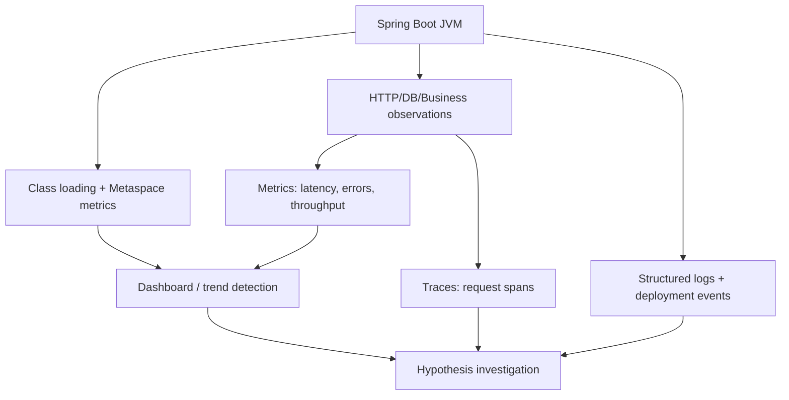

# Class Loading Metrics in Spring Boot

A Spring Boot service runs stably for days, yet **Metaspace** memory gradually climbs. After each call to a certain group of APIs, the number of Java classes loaded by the JVM also rises. Is this a class loader leak? Or is it simply lazy class loading on first use of a library, dynamic proxy creation, or framework component initialization?

To answer this, you need to understand **class loading metrics**: measurements of classes loaded, currently loaded, and unloaded in the **JVM**, and how to read them alongside memory, garbage collection, logs, and traces.

This lesson belongs to the **Application metrics** chapter of the **SPRING_BOOT_OBSERVABILITY** module. The module builds observability for Spring Boot with Micrometer Observation, metrics, logs, and distributed tracing; practicing context propagation, tags/cardinality, exporters, sampling, and signal correlation to investigate errors, latency, and application behavior in real environments. The focus here is **accurately interpreting and using class loading metrics**, not treating them as an automatic memory-leak detector.

## Learning objectives

After studying this lesson, you will be able to:

1. Describe class loading, unloading, and the role of class loaders in the JVM.
2. Distinguish **currently loaded classes** from **cumulative loads/unloads since JVM startup**.
3. Observe class loading via Spring Boot Actuator, Micrometer JVM metrics, and `ClassLoadingMXBean`.
4. Distinguish a **gauge** from a **cumulative counter**, read changes over time, and handle process restarts properly.
5. Analyze class loading metrics together with Metaspace, GC, CPU, logs, traces, and deployment events when investigating incidents.
6. Recognize legitimate sources of class count growth, suspicious patterns, and limitations of aggregated telemetry.
7. Design dashboards/alerts with low tag cardinality and avoid attaching per-class or per-request data to metric labels.

## 1. What is JVM class loading?

A Java application does not always load every class it might use right when the process starts. The JVM can load classes when code first references a type, when a framework generates a proxy, or when a library generates bytecode dynamically.

At a high level, using a class involves these concepts:

- **Loading:** a class loader locates the definition and creates the corresponding `Class` representation in the JVM.
- **Linking:** verifies, prepares, and optionally resolves references per JVM rules.
- **Initialization:** executes class initialization logic when required conditions are met.
- **Unloading:** when eligibility conditions regarding the liveness of the class loader and its classes are satisfied, the JVM can reclaim metadata of classes that are no longer needed.

**Loading is not synonymous with initialization**, and loading a class does not mean each request creates a fresh copy of the class. Java objects in the heap, class definitions in the JVM, and class loaders are three distinct concepts.

### Examples in Spring Boot

Situations that can increase currently loaded classes:

- The application begins exercising a module or library not previously executed.
- Hibernate, Spring AOP, Jackson, or another library generates dynamic proxies, adapters, or helper structures.
- The JVM loads additional classes the first time an endpoint is invoked.
- Code instrumentation tools, bytecode enhancement, or plugins introduce more classes.
- Hot reload, embedded plugins, or in-JVM redeployments create additional class loaders.

Therefore, **a rising loaded-class curve after startup is not automatically a leak**. What matters is how long it climbs, whether it stabilizes after warm-up, and whether it coincides with Metaspace growth, class loader changes, or real incidents.

### A class can be loaded by multiple class loaders

Two different class loaders can load two definitions with the same binary class name, and they are distinct types in JVM identity. Thus, loaded class count is not simply the number of `.class` files in the JAR.

Class loaders play an important role in module/plugin systems, application servers, hot restarts, and dynamic code-generation libraries. However, **standard JVM-level class loading metrics do not tell you which specific class loader created each class**.

## 2. Quantities to distinguish

The JVM exposes the `java.lang.management.ClassLoadingMXBean` management interface with three useful measurements:

| Java API | Meaning | Data type for analysis |
|---|---|---|
| `getLoadedClassCount()` | Number of classes currently loaded by the JVM | **Gauge:** can go up or down |
| `getTotalLoadedClassCount()` | Total number of class loads since the JVM started | **Cumulative counter:** does not decrease within the same process lifecycle per API semantics |
| `getUnloadedClassCount()` | Total number of classes unloaded from the JVM since the JVM started | **Cumulative counter:** does not decrease within the same process lifecycle per API semantics |

Hypothetical snapshot at one moment:

```text
Currently loaded classes      = 18,400
Total loaded since JVM start  = 21,200
Total unloaded since JVM start=  2,800
```

These numbers illustrate the relationship between active classes and cumulative totals. In a consistent snapshot, currently loaded can be understood as roughly **total loaded minus total unloaded**. However, if you read the three values at slightly different instants while the JVM is concurrently loading/unloading, the difference may not match exactly.

Do not use this arithmetic relationship to infer which specific classes were unloaded, because all three numbers are JVM-wide.

### 2.1. Currently loaded classes is a gauge

A gauge answers "**how many right now?**". The number of loaded classes can rise as new code executes, fall after unloading, or stay flat for a long time.

**Common misreading:** `loaded = 20,000` means "20,000 loads occurred this minute." Incorrect; it is the level at read time.

Similarly, dropping from 20,000 to 19,000 does not automatically prove a bug was fixed. Classes belonging to a class loader may have been reclaimed, the process may have restarted, or the inspected instance set may have changed.

### 2.2. Total loaded is a cumulative counter

`getTotalLoadedClassCount()` records **the total number of classes loaded since the JVM started**. It is useful for calculating the rate of new class generation over time, especially in applications generating dynamic bytecode.

A rising total-loaded curve does not necessarily mean current-loaded rises identically: the JVM may also be unloading classes.

### 2.3. Total unloaded is a cumulative counter

`getUnloadedClassCount()` increments when the JVM unloads classes. However, class unloading depends on eligibility conditions, GC behavior, and class loaders. Seeing zero class unloading over several minutes **is not enough to prove a JVM leak**, especially for typical services whose class loaders remain alive for the application's lifetime.

The number of unloaded classes also does not translate directly into bytes of Metaspace freed; each class has a different metadata size, and native memory is managed in lower-level structures.

## 3. Class loading metrics provided by Micrometer

Micrometer includes a JVM binder commonly known as `JvmClassLoaderMetrics`. In Spring Boot 3.x applications with Actuator and appropriate metrics auto-configuration, JVM metrics can be registered automatically.

Common meter names in Micrometer:

| Meter | Semantics | How to read |
|---|---|---|
| `jvm.classes.loaded` | Number of classes currently loaded | Gauge; inspect current level and trend |
| `jvm.classes.unloaded` | Total classes unloaded since JVM startup | Cumulative counter; use rate of increase to evaluate unloading activity |

The exact names shown here follow Micrometer's standard naming. **Exported names in Prometheus may differ** due to naming conventions, units, suffixes, and registry/exporter versions. Some other stacks or agents may publish **total loaded** as well, but do not assume every Micrometer application exposes a standard total-loaded meter under the same name.

At the JMX level, `ClassLoadingMXBean` always provides all three quantities mentioned earlier; if you want to export a measurement not provided by the active binder, design it carefully to avoid duplicating or conflicting with built-in meters.

### 3.1. Adding Actuator and exporter

Gradle dependency example for Spring Boot 3.x:

```groovy
dependencies {
    implementation 'org.springframework.boot:spring-boot-starter-actuator'
    runtimeOnly 'io.micrometer:micrometer-registry-prometheus'
}
```

In a properly configured environment, Actuator and Micrometer provide JVM meters; the Prometheus registry enables scraping metrics data. Dependencies and endpoint behavior must be verified against your exact Spring Boot and Micrometer versions.

**Do not create another `Gauge` named `jvm.classes.loaded`** if the binder already registers it. Duplicate instrumentation can cause ID/type conflicts or confusing measurements.

### 3.2. Observation endpoints

Minimal configuration example for a test environment:

```yaml
management:
  endpoints:
    web:
      exposure:
        include: health,info,metrics,prometheus
```

Common endpoints with default Actuator paths:

- `/actuator/metrics`: lists available meter names.
- `/actuator/metrics/jvm.classes.loaded`: inspects details of the currently loaded classes meter.
- `/actuator/metrics/jvm.classes.unloaded`: inspects the total unloaded classes meter.
- `/actuator/prometheus`: metrics formatted for Prometheus scraping when the corresponding registry is configured.

**Protect operational endpoints** with appropriate security and network policies. Never expose metrics or management endpoints publicly just for convenience.

If a meter name does not appear, check dependencies, metric enable/disable settings, binder status, the active `MeterRegistry`, and whether the application actually has a working metrics setup.

## 4. Reading directly via `ClassLoadingMXBean`

When you need to inspect the raw JVM numbers directly, you can use the Java Management API:

```java
import java.lang.management.ClassLoadingMXBean;
import java.lang.management.ManagementFactory;

public final class ClassLoadingSnapshot {
    public static void main(String[] args) {
        ClassLoadingMXBean bean =
                ManagementFactory.getClassLoadingMXBean();

        int currentlyLoaded = bean.getLoadedClassCount();
        long totalLoaded = bean.getTotalLoadedClassCount();
        long totalUnloaded = bean.getUnloadedClassCount();

        System.out.println("Current loaded = " + currentlyLoaded);
        System.out.println("Total loaded  = " + totalLoaded);
        System.out.println("Total unloaded= " + totalUnloaded);
    }
}
```

This is self-contained Java code reading the three JVM measurements. It clearly highlights the difference between a **gauge** and a **counter**. This `main` program measures its own JVM; to inspect a Spring Boot service's metrics, execute the read inside that process or use appropriate JVM management tools.

### Example Spring Boot diagnostic bean

Inside an application, you can encapsulate snapshot reads:

```java
import java.lang.management.ClassLoadingMXBean;
import java.lang.management.ManagementFactory;
import org.springframework.stereotype.Component;

@Component
public class ClassLoadingDiagnostics {
    private final ClassLoadingMXBean bean =
            ManagementFactory.getClassLoadingMXBean();

    public Snapshot snapshot() {
        return new Snapshot(
                bean.getLoadedClassCount(),
                bean.getTotalLoadedClassCount(),
                bean.getUnloadedClassCount()
        );
    }

    public record Snapshot(
            int currentlyLoaded,
            long totalLoaded,
            long totalUnloaded
    ) {}
}
```

`Snapshot` is an internal diagnostic object. **Do not create a public HTTP endpoint** solely to return these values when Actuator already exposes the appropriate metrics. If the application logs snapshots periodically, rate-limit them and remember that the three values are not necessarily read atomically.

Do not enable per-request detailed class logging just to populate a class loading dashboard; that increases overhead and log volume unnecessarily for routine observation.

## 5. Reading Prometheus data with accurate semantics

A Prometheus exporter may transform `jvm.classes.loaded` into a name like `jvm_classes_loaded_classes` and `jvm.classes.unloaded` into a counter with a `_total` suffix. **These are naming examples only**: verify exact names at `/actuator/prometheus` in your running application before copying queries.

Suppose the exporter produces:

```text
# Current value, gauge type (illustrative)
jvm_classes_loaded_classes{application="checkout-service",instance="a"} 18500

# Total unloaded classes, counter type (illustrative)
jvm_classes_unloaded_classes_total{application="checkout-service",instance="a"} 2700
```

### 5.1. Viewing current level per instance

```promql
jvm_classes_loaded_classes{application="checkout-service"}
```

Use a line chart or table grouped by `instance`/`pod` to see how many classes each JVM currently has loaded. If three replicas show 18,000, 18,500, and 19,000, **that does not mean the system loaded 55,500 distinct classes**. Each JVM maintains its own class-loading space; summing gauges is only meaningful if the actual question is total class entries managed across all JVMs.

When comparing releases, compare instances with similar uptime and warm-up stages.

### 5.2. Viewing gauge changes

```promql
delta(jvm_classes_loaded_classes{application="checkout-service"}[15m])
```

`delta(...)` estimates **the net change of a gauge** over the examined window. It is not the gross class-loading rate, because loads and unloads can cancel out. If the JVM restarts, the gauge jumps to the new instance's baseline; place the chart next to `process.uptime` or process start metrics to distinguish restarts from unloading events.

Likewise, a sudden drop in a gauge does not necessarily equal the exact number of classes unloaded in that interval if the target set or scrape status changed.

### 5.3. Reading unloading rate from the counter

If the backend has the corresponding counter:

```promql
rate(jvm_classes_unloaded_classes_total{
  application="checkout-service"
}[5m])
```

The result is the estimated unloading rate in **classes/second** over a five-minute window. Because class unloading often happens in batches, the value may stay 0 for long stretches and then spike.

To see the increase in total unloaded classes over 30 minutes:

```promql
increase(jvm_classes_unloaded_classes_total{
  application="checkout-service"
}[30m])
```

`rate` and `increase` on counters handle resets per Prometheus rules, though they still require enough scrape samples and valid targets. **Never apply `rate()` to the currently-loaded gauge** merely because its name includes the word `loaded`.

### 5.4. Retaining version and uptime context

In multi-instance deployments, pair the data with operational attributes such as `application`, `environment`, `instance`, deployment version (via labels or deployment events), and process uptime.

For example, an instance running for 10 minutes may still be lazily loading classes, while an instance running for 20 days is in steady state. Comparing raw counts directly without considering JVM age can lead to false conclusions.

Especially during rolling deployments when pods are replaced, aggregated lines can fluctuate simply because JVMs of **different ages** coexist, not because class-loading behavior inside any JVM became abnormal.

## 6. Class loading is not the same as Metaspace and GC

Class loading metrics relate to memory, but they do not replace memory metrics.

| Signal | What does it measure? | Limitations |
|---|---|---|
| Current loaded classes | Number of classes currently present in the JVM | Does not reveal metadata size per class |
| Total loaded | Cumulative class load count | Can rise normally over process lifetime |
| Total unloaded | Cumulative class unload count | Does not show how many bytes were returned to the OS |
| Metaspace used | Portion of non-heap memory tied to class metadata | Not a simple fixed multiple of class count |
| Compressed Class Space | Memory region for metadata in certain JVM configs | May be absent or differ by JVM/options |
| Heap used | Object memory on the heap | Not where all class metadata resides |
| GC activity | Garbage collection activity | Does not mean every GC unloads classes |

With Micrometer JVM memory metrics, some applications expose `jvm.memory.used` with tags `area=nonheap` and `id=Metaspace`. When exported to Prometheus, names/units may convert to forms like `jvm_memory_used_bytes`. Always check actual exported names rather than assuming every runtime has identical labels.

### Rising together does not prove causation

If loaded classes climb and Metaspace climbs as well, a reasonable hypothesis is that the application is creating more class metadata. Yet you still need to verify:

- Are classes being loaded once during warm-up or repeatedly?
- Is there dynamic code generation, proxying, or plugin lifecycles?
- Are old class loaders still referenced after reloads?
- Did the JVM, framework, or instrumentation agent change after deploy?
- Does Metaspace stabilize after GC cycles or keep climbing?

**You cannot conclude a "class loader leak" solely from two charts rising together.**

Conversely, Metaspace growing while currently loaded classes stay nearly flat can also happen because metadata sizes and memory allocation patterns vary. Use appropriate runtime diagnostic tools.

## 7. Distinguishing common fluctuation patterns

### 7.1. Rapid rise at startup, then flattening out

```text
Loaded classes
   ^
   |                 ____________
   |            ____/
   |        ___/
   |  _____/
   +--------------------------------> uptime
```

This can be **normal** behavior: Spring context startup, on-demand library loading, and warm-up of common request paths. Keeping a baseline curve by uptime after deploy helps tell whether "high" or "low" actually warrants attention.

### 7.2. Step increases upon first use of a new feature

For instance, PDF export, connecting a new driver, or handling a new data format for the first time. Loaded classes may jump by a step and then plateau. Without sustained growth, functional errors, or Metaspace pressure, this is not necessarily a problem.

### 7.3. Repeated growth after each reload/plugin refresh

If the application uses dynamic class loaders to reload modules, an unreleased old class loader can keep its classes alive. Current classes and Metaspace can climb steadily across reload cycles.

**Sign worth investigating:** after multiple cycles of the same plugin load/unload workflow, the current count fails to return near baseline and non-heap memory keeps climbing. Even then, inspect GC and references retaining the class loader to prove the cause.

### 7.4. Stable loaded classes with rising unloading rate

This can happen when temporary class groups are repeatedly created and reclaimed. Total loaded/unloaded may rise together while currently loaded stays nearly constant.

That is **class-loading churn**: heavy load/unload activity despite a stable active count. It can introduce CPU or GC overhead in some cases, though profiling/JFR or other resource metrics are needed to confirm impact.

### 7.5. Sudden drop on process restart

A new JVM starts counters from zero and sets gauges to the new instance's level. If the Prometheus target or `instance` label is reused, the chart can look like a sudden mass unload.

**Before concluding:** compare process start time, uptime, deploy timestamps, and pod status. A restart also wipes accumulated symptoms, temporarily masking a leak.

## 8. Investigating class loader leaks: what can class loading metrics do?

A class loader leak usually involves a class loader that should have been garbage-collected but remains pinned by live references. Those references can come from threads, static fields, callbacks, caches, registries, timers, or uncleaned resources in a reload/plugin mechanism.

**Metrics show an anomaly; they do not show which object reference retains the class loader.** An investigation workflow can look like:

1. **Pin down the exact JVM:** keep instance identity fixed and compare along uptime; rule out rolling-deploy confusion.
2. **Identify the trigger:** e.g., plugin load/unload or creating a new proxy type.
3. **Inspect current loaded classes:** does it climb continuously across repeated cycles?
4. **Inspect total loaded/unloaded:** if available, observe newly created classes and whether they unload after GC phases.
5. **Compare Metaspace, GC, and process resources:** is there matching upward growth, memory pressure, or `OutOfMemoryError: Metaspace`?
6. **Inspect code and lifecycle:** live threads/executors, static caches, listeners, instrumentation, app restart/reload hooks, class loader references.
7. **Use deep JVM diagnostics when needed:** JVM/JFR/heap diagnostics or class-loader statistics to identify which loader remains alive and why; choose safely according to runtime, permissions, and environment.

On HotSpot JDK, a command **that may be available** in supported environments is:

```text
jcmd <pid> VM.classloader_stats
```

Not every JVM/JDK supports the same diagnostic commands, and some require elevated permissions or incur overhead. This is a diagnostic option once operations has verified the runtime and operational policy, **not a routine default for every production service**. Likewise, do not equate a heap class histogram with the full list of class loaders or Metaspace metadata.

### What signals actually warrant alerting?

There is no universal absolute threshold like "20,000 classes = error." A large application can legitimately load many classes. Alerts should be based on:

- **Sustained upward trend within the same instance/uptime** beyond a known baseline.
- **Metaspace growth** toward memory pressure or configured limits.
- **User-facing symptoms:** latency, errors, restarts, OOMs.
- **Correlation with software changes** or specific reload/plugin operations.
- **Reproducibility** of the symptom when triggering the same workflow.

Alerting solely on `jvm.classes.loaded > 15000` is usually brittle across services, JVMs, and application versions.

## 9. Designing a class loading dashboard for Spring Boot

A practical dashboard should pair multiple related panels rather than showing a single gauge:

| Dashboard panel | Meaning and notes |
|---|---|
| Current loaded classes by `instance` | Track current level, trends, warm-up, and step increases |
| Rate/increase of unloaded classes | Observe unloading activity over time windows |
| Total loaded (if collected) | Track class-loading velocity over time; distinct from current classes |
| Metaspace used/committed/max when available | Analyze memory pressure and capacity, keeping in mind max may be undefined |
| GC pause/count and process CPU | Check correlation with runtime overhead or pressure |
| Process uptime, restarts, deployment version | Distinguish genuine changes from process replacements |
| HTTP latency/error rate | Place JVM signals in the context of user impact |
| Corresponding logs/traces | Investigate endpoints or workflows triggering changes |

Some max memory or Metaspace limits may not be returned by the JVM as finite numbers. **Never compute utilization percentage** when the denominator is missing or means "undefined."

### Tags/cardinality

Class loading metrics are **process-level** measurements. Suitable tags usually include:

```text
application=checkout-service
environment=production
instance=checkout-7c6d...    # per-deployment identity, if available
version=1.42.0
```

Avoid attaching:

```text
userId=...
orderId=...
traceId=...
className=com.example.SomeDynamicProxy123
requestPath=/orders/193828
```

Class names can be useful in **deep diagnostic captures**, yet are unsuitable as tags on a JVM-wide class loading gauge because they can explode cardinality and break the metric's semantics. A process-level meter has no one-to-one mapping with individual requests, so adding `traceId` to it will not yield reliable correlation either.

If using `MeterRegistryCustomizer` to add common tags, values should be stable per deployment; never pull values from user headers.

## 10. Combining metrics with logs, traces, and Micrometer Observation

Class loading is a **JVM-level aggregate signal**. Meanwhile, a trace describes the execution path of an instrumented, retained request; logs record events code explicitly emits. None of the three replaces the others.



Suppose loaded classes jump sharply after triggering a report-generation feature:

- **Class loading metrics:** confirm which instance experienced the jump and when.
- **Metaspace metrics:** show whether memory moved in lockstep.
- **Request latency metrics:** show whether users experienced slowdowns.
- **Traces of report-generation requests:** when appropriately instrumented and sampled, isolate the operations executed.
- **Structured logs:** show report-generation events, error types, and deployment version.
- **JVM diagnostics:** when needed, identify the retaining loader, classes, and references.

**Traces do not automatically list classes loaded during a request.** Nor can you deduce that a long trace caused high class loading purely from coinciding timestamps. Confirming causation requires additional measurement, reproduction, and runtime inspection.

### ObservationRegistry vs. MeterRegistry

In Spring Boot:

- `ObservationRegistry` coordinates observation lifecycles, scopes/contexts, and handlers.
- `MeterRegistry` stores/collects meters, including class loading metrics when the JVM binder is configured.
- `JvmClassLoaderMetrics` reads process-level stats from the JVM; it does not open an observation scope for every class load.
- Trace sampling may drop some spans; that **does not mean** the class loading gauge only measures sampled requests.
- Context propagation is vital for linking spans/logs across threads and services, yet it does not turn a JVM-wide gauge into a per-request measurement.

Understanding this separation prevents editing the wrong layer: you do not adjust trace sampling to see more class loading metrics, nor add high-cardinality metadata to class loading meters to locate specific requests.

## 11. Real-world scenario: Metaspace rising after rolling deployment

Suppose a payment application runs on three Spring Boot pods. After a new release, the Metaspace used chart climbs and occasional requests are slow. An engineer notices `jvm.classes.loaded` on new pods is about 3,000 classes higher than on old pods.

### Unfounded conclusions

- **“The new release definitely leaks 3,000 classes.”** Could be dependency changes, warm-up, or legitimate proxy generation.
- **“Loaded classes rose so Metaspace definitely scales linearly.”** Each class has a different metadata footprint, and Metaspace has its own allocation mechanics.
- **“One slow request happened because the JVM was loading classes.”** Needs trace/profiling and reproduction; the request could be slow due to DB, network, thread pool, or an external provider.
- **“The pod restarted and loaded classes dropped, so the leak is fixed.”** A restart clears old JVM state without proving the root cause is gone.

### Verification workflow

**Step 1 — Identify the exact JVMs being compared.** Use pod/instance, version, start time, and uptime. Compare after equivalent warm-up; do not compare a 5-minute-old pod with a week-old pod while ignoring JVM age.

**Step 2 — Read gauges and counters according to their types.** Inspect current loaded, rate/increase of unloaded; if total-loaded is needed, read `ClassLoadingMXBean` or available stats sources. Watch for process restarts.

**Step 3 — Compare memory pressure.** Inspect Metaspace used/committed, GC, process memory, and related errors. Confirm the upward curve comes from the same instance rather than a query aggregating multiple pods.

**Step 4 — Identify the trigger.** Correlate with deployment events, report-generation endpoint calls, batch jobs, or plugin reloads. Use request metrics to quantify impact and traces/logs where correlated data exists.

**Step 5 — Run controlled reproduction.** Repeat the same workflow in an appropriate environment, tracking loaded classes and Metaspace before/after each cycle; if growth continues, use JVM diagnostics to identify unexpectedly long-lived class loaders.

**Step 6 — Verify the fix over long-term behavior.** After fixing reference retention or resource lifecycles, run enough cycles over the necessary duration. Verify the trend stabilizes and error rates/latency return to targets.

### Reasonable conclusion

Class loading metrics can prove **how many classes a JVM has loaded/retained and how that changes over time**. They help form hypotheses about class generation or class loader lifecycles. Confirming a leak, however, requires further evidence from class loader references, GC, Metaspace, profiling, or experimentation.

## 12. Common mistakes

| Mistake | Consequence | Right approach |
|---|---|---|
| Reading `jvm.classes.loaded` as classes loaded since startup | Misreading a gauge as a counter | Read as current loaded; use total-loaded for cumulative count |
| Applying `rate()` to the current-loaded gauge | Misinterpreting the metric type | Read gauge directly, or `delta()`/trend where appropriate |
| Treating unloaded counter drop on restart as negative unloading | Confusing process reset with JVM event | Check uptime and use reset-aware counter queries |
| Treating post-warmup loaded increase as a guaranteed leak | False alarms | Compare by uptime, load pattern, Metaspace, and class loader lifecycle |
| Assuming Metaspace used equals class count times fixed size | Wrong memory model | Read memory metrics separately and inspect JVM |
| Attaching class name, trace ID, or user ID to class loading meters | High cardinality, breaks JVM-wide semantics | Use stable tags by service/environment/instance |
| Summing all instances to infer unique app classes | Double-counts classes present in multiple JVMs | View per process; sum only when clearly meaningful |
| Adding a second binder with the same meter name | Duplicate meters or conflicts | Check existing Actuator metrics first |
| Missing Prometheus series assumed to mean JVM loads no classes | Could be exporter/registry/scrape/query issue | Verify end-to-end from MXBean/Actuator to backend |
| Changing trace sampling to boost class loading metrics | Modifying the wrong telemetry layer | Class loading is a JVM metric, independent of normal trace sampling |
| Treating a Metaspace error log as proof one endpoint leaks | Lacks causal proof | Combine workload, diagnostics, and reproduction |
| Leaving verbose class-loading logging enabled long-term unassessed | Overhead and log flooding | Enable targetedly per runtime policy |

## 13. Class loading observability implementation checklist

Before relying on class loading metrics in production, check:

1. **Source:** Is the app using Spring Boot Actuator + Micrometer JVM binder or another exporter? What are the exact metric names and types?
2. **Semantics:** Distinguish the current loaded gauge from total counters; never conflate `loaded` with `totalLoaded`.
3. **Registry:** Did `MeterRegistry` receive the JVM binders? Are any blocked by `MeterFilter` or duplicated?
4. **Endpoints:** Do `/actuator/metrics` and `/actuator/prometheus` return expected data? Are endpoints secured?
5. **Tags:** Are stable `application`, `environment`, `instance`, and version tags attached where needed? Are any dynamic high-cardinality IDs present?
6. **Uptime:** Does the dashboard show process start/restart to separate counter resets from warm-up?
7. **Memory:** Are Metaspace/non-heap and GC metrics present for the same instance?
8. **Load baseline:** Do you have class loading baselines post-deploy, post-warmup, and at idle?
9. **Alerts:** Are alerts grounded in trends and memory pressure rather than a brittle absolute class-count threshold?
10. **Cross-signal:** When anomalies occur, can you correlate HTTP latency/error rate, logs, traces, and deployment events?
11. **Privacy/cost:** Have you avoided putting raw class names and user data into metric tags?
12. **Diagnostics:** Is there a safe, approved procedure for JFR/JVM tools when metrics alone are inconclusive?

## 14. Self-assessment questions

**Question 1.** `getLoadedClassCount()` returns 20,000. Does that mean the JVM loaded 20,000 classes in the past 5 minutes?

**Hint:** No. That is the number of classes **currently loaded** at read time, not loads during a 5-minute window.

**Question 2.** `getTotalLoadedClassCount()` rose from 22,000 to 23,000, while `getUnloadedClassCount()` also rose by 800. Must currently loaded classes necessarily increase by 1,000?

**Hint:** No. If read consistently, the current count increased by roughly 1,000 − 800 = 200 classes. Total loaded and currently live have different semantics.

**Question 3.** After a pod restart, `jvm.classes.unloaded` drops back to 0. Did the JVM perform "negative unloading"?

**Hint:** No. Cumulative counters restart with the new process lifecycle; check uptime and use queries that handle counter resets.

**Question 4.** An application generates many dynamic proxies, yet current-loaded remains flat. Could there still be class-loading overhead?

**Hint:** Yes. The JVM may continuously load and unload groups of classes, increasing cumulative counters even when the gauge barely moves. Analyze rates, GC/CPU, and profiling if overhead is suspected.

**Question 5.** Loaded classes and Metaspace both climb after a deploy. Is that enough to conclude a class loader leak?

**Hint:** Not yet. Rule out warm-up, dependency changes, and normal code generation; compare the same JVM along uptime and inspect class loader references/runtime diagnostics.

**Question 6.** To find which endpoint causes the most class loading, should you add `http.route` or `traceId` directly onto `jvm.classes.loaded`?

**Hint:** No. This meter is a JVM-wide gauge, not tied directly to individual requests. Use traces/logs and diagnostic profiling to investigate triggers; do not turn a class loading metric into a fake per-request metric.

**Question 7.** `jvm.classes.loaded` is missing in Prometheus even though the service is running. What should you check?

**Hint:** Start from the binder/`MeterRegistry`, `/actuator/metrics`, the Prometheus endpoint, actual exported names, scrape status, filters, and queries. Never conclude the JVM is not loading classes due to a missing series.

## Conclusion

**Class loading metrics reveal the JVM's class loading/unloading state and activity**, helping identify warm-up, code generation, class-loading churn, and patterns worth investigating in class loader lifecycles. In Spring Boot, read gauges and counters accurately from Micrometer/JMX, compare alongside uptime, Metaspace, and GC, keep metric tags low-cardinality, and correlate with HTTP metrics, logs, traces, and deployment events to understand real impact. A rising class count curve is **a signal to ask questions**, not standalone proof of a class loader leak; reliable diagnosis requires further evidence and verification across the same JVM lifecycle.
