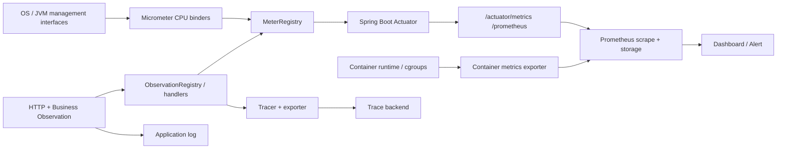
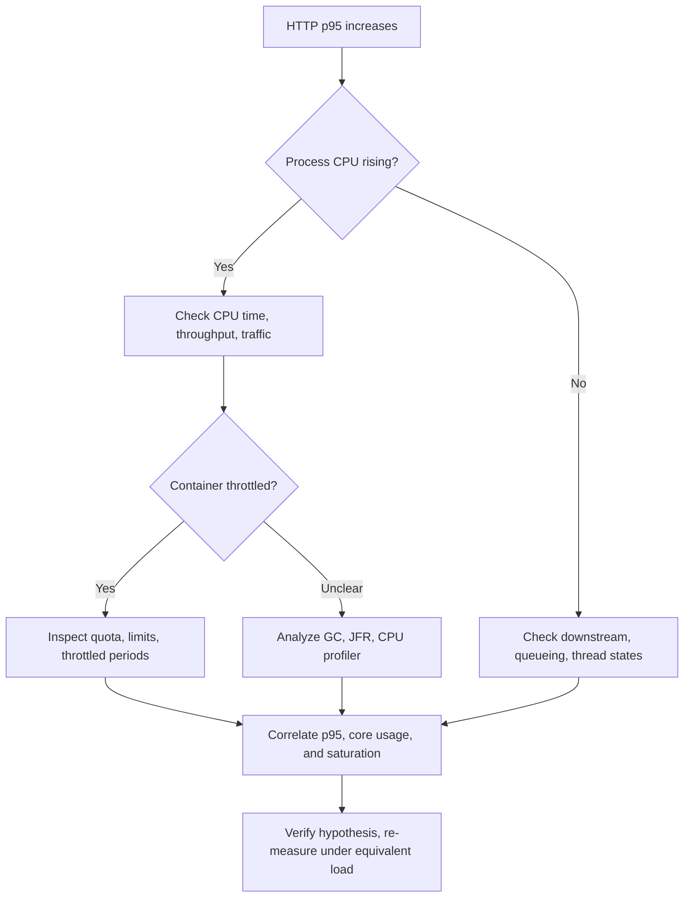

# CPU Metrics in Spring Boot: Measuring Utilization and Finding Causes of Overload

A Spring Boot API may slow down significantly after a deployment, even when heap memory and garbage collection (GC) counts barely change. The dashboard shows high process CPU, yet operators still need to answer: **is the application genuinely computing more, being CPU-throttled inside a container, or waiting on another resource?** Looking only at a number like "90% CPU" is rarely enough.

The **CPU metrics** lesson belongs to the **Application metrics** chapter of the `SPRING_BOOT_OBSERVABILITY` module. The module focuses on setting up observability with Micrometer Observation, metrics, logs, and distributed tracing; understanding context propagation, tags/cardinality, exporters, sampling, and combining signals to investigate errors, latency, and application behavior in real environments. In this lesson, we focus on Java process, system, and container CPU measurements, how they are exposed through Spring Boot Actuator/Micrometer, and how to use them together with HTTP metrics and traces to isolate incidents.

> **Learning outcomes:** Distinguish CPU utilization from CPU time, load average, and throttling; read common meters accurately; build Prometheus charts by service/instance; correlate high CPU with latency and errors; and avoid false conclusions from container limits or high-cardinality labels.

## 1. What do CPU metrics measure?

**CPU utilization** describes how much CPU is being used relative to a reference processing capacity over a period of time. **CPU time** is the actual CPU time spent executing a process's threads, which can accumulate across multiple cores. The two metrics are related but **not identical**.

In the Spring Boot 3.x and Micrometer ecosystem, common meters include:

| Logical meter | Type | Unit/meaning | Scope to understand |
| --- | --- | --- | --- |
| `process.cpu.usage` | Gauge | Usually a normalized CPU utilization ratio, roughly 0–1 when supported | JVM process |
| `process.cpu.time` | Function counter or cumulative CPU time meter | CPU time consumed by the process | JVM process; not wall-clock uptime |
| `system.cpu.usage` | Gauge | System CPU utilization ratio reported by JVM/OS | System visible to the JVM |
| `system.cpu.count` | Gauge | Logical processor count reported by JVM/binder, when available | Reference capacity; may depend on container awareness |
| `system.load.average.1m` | Gauge | 1-minute load average on supported platforms | Load metric, **not CPU %** |
| `process.uptime` | Gauge | Time the process has been running | Helps spot restarts, not CPU time |

Metric names, base units, availability, and tag sets depend on Spring Boot, Micrometer, JDK, OS, deployment, and exporter versions. A meter may be absent or return an unavailable value on some platforms. Do not treat this table as a guarantee that every application exposes every measurement.

### 1.1. CPU-bound, I/O-bound, and waiting

Request latency can increase due to:

- **CPU-bound:** heavy computation, serialization, compression, encryption, or data processing keeping CPU busy.
- **I/O-bound:** threads waiting on a database, HTTP service, filesystem, or network.
- **Contention:** threads waiting on locks, connection pools, executor queues, or shared resources.
- **Runtime overhead:** GC, JIT, safepoints, instrumentation, or data processing pipelines adding cost.
- **Infrastructure limits:** container CPU throttling or host node resource contention.

Low CPU **does not mean fast requests**: a request can wait 2 seconds on a database while using almost no CPU. High CPU **does not automatically prove an error**: a batch-processing service running at healthy capacity can use high CPU while throughput, latency, and SLOs remain healthy.

## 2. CPU time vs. wall time

Suppose a Java task runs for 2 seconds on the wall clock:

| Scenario | Wall time | Approximate CPU time | Meaning |
| --- | ---: | ---: | --- |
| One thread computing continuously | 2 s | 2 CPU-s | One core is nearly busy continuously |
| One thread mostly waiting on network | 2 s | 0.1 CPU-s | Waiting dominates total time |
| Two threads computing across two cores | 2 s | 4 CPU-s | Total CPU time across cores can exceed wall time |
| Task queued for 1 s then computing for 1 s | 2 s | Roughly 1 CPU-s | Queueing is not CPU execution |

A **CPU-second** represents one second of utilizing one equivalent logical core. A multi-threaded process can accumulate multiple CPU-seconds within a single wall-clock second.

For `process.cpu.time`, if the cumulative value grows from 100 CPU-s to 110 CPU-s over 5 wall-clock seconds, the process consumed on average:

\[
\frac{110-100}{5}=2\ \text{equivalent CPU cores}.
\]

In other words, the rate of CPU time increase over time has units of **CPU-seconds/second**, commonly interpreted as **average CPU cores in use**. This is not directly a percentage: to compute a utilization percentage, you must know whether the denominator is host logical CPUs, CPUs visible to the JVM, or the container's effective CPU quota.

### 2.1. What percentage is `process.cpu.usage`?

In many environments, the JVM/Micrometer reports a normalized value between 0 and 1. You can display 0.65 as 65%, **provided you state clearly what the denominator of that 65% is**.

A conceptual mental model (not a guaranteed formula for every JVM) is:

\[
\text{Process CPU utilization}
\approx
\frac{\Delta \text{CPU time}}
{\Delta \text{wall time}\times N},
\]

where \(N\) is the number of available processors used by the measurement API for normalization. For instance, if a process consumes an average of 2 CPU cores against a scope of 4 logical processors, the ratio is roughly 0.5, or 50%.

In VMs, Kubernetes, or containers, that scope can differ from physical host cores and from the container's CPU quota. **Do not multiply 0.65 by a guessed core count to infer absolute CPU.** Verify your JDK, JVM container-awareness, and infrastructure metrics when exact figures are required.

## 3. Distinguishing process CPU, system CPU, and load average

### 3.1. Process CPU

`process.cpu.usage` and `process.cpu.time` focus on the **JVM process**, capturing CPU consumed by its threads. They are helpful when multiple services share a node and you need to determine whether the Java application is the main CPU consumer.

These do not measure CPU per controller, endpoint, or method. To find which code path consumes CPU, use profiling/JFR and correlate with business observations.

### 3.2. System CPU

`system.cpu.usage` describes CPU across the system scope visible to the JVM/OS. In some environments that is the host; in container-aware environments, reporting depends on the JDK and platform. If a node hosts multiple processes, high `system.cpu.usage` alongside low `process.cpu.usage` may point to load from another process; verify scope and node/container metrics before concluding.

### 3.3. Load average is not CPU usage

`system.load.average.1m` typically reflects runnable work and, on some operating systems, uninterruptible I/O-waiting work over the averaging window. A value of 4 **does not mean 4% CPU**. Interpreting it requires knowing logical processor counts and OS semantics.

| CPU usage | Load average | Initial interpretation |
| --- | --- | --- |
| High | High | Likely many compute tasks competing for CPU |
| Low | High | Likely I/O waiting or many tasks queued |
| High | Low or moderate | A few CPU-heavy threads or measurement window differences |
| Low | Low | Likely idle, though an endpoint could still be slow due to downstreams |

On unsupported platforms, load average may be missing or carry an invalid sentinel value. Do not turn `-1` into "negative 100% load."

## 4. Flow of collecting CPU metrics in Spring Boot



Conceptually, binders read JVM/OS info, register meters in `MeterRegistry`, and the registry exposes them through Actuator or exporters. **Standard CPU metrics do not require creating custom Observations per request.** They are process/system-level measurements.

Container CPU usage and throttling usually come from infrastructure monitoring such as cAdvisor/Prometheus or equivalent solutions; **adding Actuator alone does not guarantee cgroup/quota/throttling metrics**. Correlate JVM and container sources by instance/pod and timestamp.

Traces and logs help pinpoint specific code paths or requests to investigate, while process-level CPU metrics do not carry a per-sample `traceId`. Correlation typically uses **service, instance, and time window**, followed by selecting matching traces/logs.

## 5. Setting up Spring Boot Actuator and Prometheus

Example using Spring Boot 3.x, Java 17+, and Maven; dependency versions are managed by the Spring Boot BOM/parent.

```xml
<dependencies>
    <dependency>
        <groupId>org.springframework.boot</groupId>
        <artifactId>spring-boot-starter-web</artifactId>
    </dependency>
    <dependency>
        <groupId>org.springframework.boot</groupId>
        <artifactId>spring-boot-starter-actuator</artifactId>
    </dependency>
    <dependency>
        <groupId>io.micrometer</groupId>
        <artifactId>micrometer-registry-prometheus</artifactId>
    </dependency>
</dependencies>
```

Actuator with compatible meter binders typically provides standard CPU metrics without manually querying `OperatingSystemMXBean`. The Prometheus registry is needed to export metrics in Prometheus format for scraping.

```yaml
spring:
  application:
    name: report-service

management:
  endpoints:
    web:
      exposure:
        include: health,metrics,prometheus
  metrics:
    tags:
      application: report-service
```

In this setup, `application` is a stable common tag separating services in the backend. Labels like `instance`, `pod`, and `namespace` can be attached by the scrape system. Check carefully to avoid duplicate labels or uncontrolled dynamic tags.

When the application runs on port 8080:

```bash
curl -s http://localhost:8080/actuator/health
curl -s http://localhost:8080/actuator/metrics
curl -s http://localhost:8080/actuator/metrics/process.cpu.usage
curl -s http://localhost:8080/actuator/metrics/process.cpu.time
curl -s http://localhost:8080/actuator/metrics/system.cpu.usage
curl -s http://localhost:8080/actuator/metrics/system.load.average.1m
curl -s http://localhost:8080/actuator/prometheus
```

If a metric name is absent from `/actuator/metrics`, check the actual meter list, JDK/Micrometer version, metric enable/disable configuration, platform support, and exporter settings. Do not create a custom metric with the same name before checking how the existing binder behaves.

**Security:** `management.endpoints.web.exposure.include` only controls which endpoints are exposed over HTTP; it does not replace authentication, authorization, or network restrictions. Secure management endpoints with Spring Security/gateways and monitoring network controls, and avoid exposing sensitive operational data to the Internet.

## 6. Reading CPU values from Actuator

A `/actuator/metrics/process.cpu.usage` response may look like (**illustrative example**, not measured data):

```json
{
  "name": "process.cpu.usage",
  "measurements": [
    {
      "statistic": "VALUE",
      "value": 0.42
    }
  ],
  "availableTags": []
}
```

If your runtime reports a normalized 0–1 ratio, 0.42 can be interpreted as roughly 42% of the **measured reference CPU scope**. It does not prove the process consumes "42% of the entire node" in every container environment.

For `process.cpu.time`, some registries/Actuator expose a cumulative value with a time base unit. **A rising cumulative value does not mean CPU is overloaded**: a process running long enough accumulates ever-larger CPU time even while nearly idle. To measure CPU consumption rate, measure the counter's increase over a time window.

If the output shows `VALUE`, `COUNT`, or `TOTAL`, understand the meter type and base unit before calculating. Cumulative CPU time and instantaneous CPU utilization cannot be read the same way.

### Things to verify before trusting a number

1. Has the process been running long enough for the sampler to have data? Some CPU metrics require a short window to stabilize.
2. Does the JVM support the measurement on that OS? Is the value unavailable or the metric absent?
3. Is the JVM container-aware, and how many logical processors does it see?
4. Is there a CPU limit/quota that differs from the visible logical CPU count?
5. Does the value come from the exact instance, or did a dashboard sum/aggregate multiple instances?

## 7. CPU in Kubernetes/containers: quota vs. usage

When running on Kubernetes, distinguish at least four quantities:

| Concept | Description | Appropriate question |
| --- | --- | --- |
| CPU request | CPU amount used for scheduling/relative guarantees in Kubernetes | How much capacity was the pod scheduled for? |
| CPU limit/quota | Maximum CPU allowed within a quota period, if configured | How tightly can the workload be capped? |
| CPU usage | CPU actually consumed | How many cores is the pod using on average? |
| CPU throttling | Time/periods during which the workload was CPU-capped by quota | Is work being delayed even while tasks are ready to run? |

**Example:** a container is capped at 0.5 CPU. If it continuously tries to run at 1 full core, the system throttles it so average consumption stays within quota. Operators may then see container usage near 0.5 cores and sharp latency spikes even while **node-wide** CPU is well below 100%.

A 0.5 CPU quota does not mean "half of a fixed physical core" for one thread. The CPU scheduler allocates time slices per quota, and throttling depends on quota period, burstiness, and runtime configuration.

### 7.1. Why `system.cpu.usage` can be misleading

Some JVM metrics come from OS APIs and may reflect the host or whatever scope the runtime sees. Inside a container, they do not necessarily match the container's own usage or quota. Different JDK releases have varying levels of cgroup/container awareness.

When investigating CPU saturation on Kubernetes, cross-check:

- `process.cpu.usage` and `process.cpu.time` from the application;
- `container_cpu_usage_seconds_total` or equivalent metric from the container exporter;
- CPU limit/quota from Kubernetes/cgroup;
- throttling metrics like `container_cpu_cfs_throttled_periods_total` if provided by monitoring;
- application latency, throughput, queue depth, and error rates.

Do not assume a specific cAdvisor metric must exist in every cluster; names, labels, and availability vary by exporter version, cgroup v1/v2, and monitoring pipeline.

### 7.2. CPU throttling is not a default JVM metric

`process.cpu.usage` may not clearly distinguish an idle process from one **wanting to run but getting throttled** at a given instant. Thus, if requests are slow while process CPU usage does not rise as expected, do not overlook a low quota or CPU scheduler throttling.

A high throttled-periods ratio is a signal worth investigating; it does not convert directly into "percentage of request slowdown time." Correlate it with throttling duration, SLOs, and quota settings.

## 8. Querying CPU metrics with Prometheus

The expressions below are **PromQL templates**, assuming the application has common label `application="report-service"` and Prometheus attaches `instance`. Actual exported names depend on the registry/naming convention; inspect `/actuator/prometheus` before using. Common examples: `process.cpu.usage` exports as `process_cpu_usage`, and `process.cpu.time` may become a time counter series like `process_cpu_time_seconds_total`.

### 8.1. Process CPU utilization per instance

```promql
100 * avg by (application, instance) (
  process_cpu_usage{application="report-service"}
)
```

This converts the 0–1 ratio into a percentage **as normalized by the metric**. Do not call this "% of container quota" unless you have verified the denominator actually matches that quota.

Gauges can fluctuate over short intervals, so inspect over a wide enough window and compare against a baseline under similar load. You can use `avg_over_time(process_cpu_usage[5m])` per series to smooth out instantaneous spikes.

### 8.2. CPU time consumed in equivalent cores

If your exporter provides the counter `process_cpu_time_seconds_total`:

```promql
sum by (application, instance) (
  rate(process_cpu_time_seconds_total{
    application="report-service"
  }[5m])
)
```

The result is in **CPU-seconds/second**, i.e., average equivalent CPU cores consumed by the process. For example, 1.4 means the process used roughly 1.4 cores over the 5-minute window; it is not "140% of quota" unless the reference frame is defined that way.

CPU time counters can reset on process restarts. `rate` generally handles counter resets better than manually subtracting two samples; still check `instance`/`pod` labels and scrape reliability.

### 8.3. Container CPU usage

If infrastructure telemetry publishes `container_cpu_usage_seconds_total` with matching labels:

```promql
sum by (namespace, pod, container) (
  rate(container_cpu_usage_seconds_total{
    namespace="production",
    container="report-service"
  }[5m])
)
```

The result is average equivalent container cores over the window, **not automatically a percentage**. Label sets may differ in real clusters; avoid accidentally mixing infrastructure sidecar containers or duplicate series from multiple scrape targets. To compute % of CPU quota, divide by the actual CPU limit in the same unit and ensure a valid denominator.

### 8.4. Ratio of throttled periods

If infrastructure exports both CFS quota counters:

```promql
sum by (namespace, pod, container) (
  rate(container_cpu_cfs_throttled_periods_total{
    namespace="production",
    container="report-service"
  }[5m])
)
/
sum by (namespace, pod, container) (
  rate(container_cpu_cfs_periods_total{
    namespace="production",
    container="report-service"
  }[5m])
)
```

This expression computes **the fraction of CFS periods throttled**, not lost CPU percentage and not percentage of impacted requests. If there is no CPU limit or the exporter lacks these counters, the query may return no data. Never treat missing data as "no throttling" without checking the source.

### 8.5. Comparing against HTTP latency

If histograms are configured for `http.server.requests` and the backend has `http_server_requests_seconds_bucket`, you can compute p95:

```promql
histogram_quantile(
  0.95,
  sum by (le, uri, method) (
    rate(http_server_requests_seconds_bucket{
      application="report-service"
    }[5m])
  )
)
```

Histograms must be enabled for the meter, for example when supported by your Spring Boot/Micrometer version:

```yaml
management:
  metrics:
    distribution:
      percentiles-histogram:
        http.server.requests: true
```

Having an HTTP Timer does not automatically mean `_bucket` series exist. Histograms add series cost across routes, statuses, methods, and buckets; manage tags/cardinality to avoid excessive monitoring cost.

## 9. Combining CPU metrics with custom Observations, logs, and tracing

Process-level CPU metrics do not know which request caused the load. To understand business code, instrument meaningful boundaries, such as report generation:

```java
import io.micrometer.observation.Observation;
import io.micrometer.observation.ObservationRegistry;
import org.springframework.stereotype.Service;

@Service
public class ReportService {
    private final ObservationRegistry registry;
    private final ReportEngine engine;

    public ReportService(ObservationRegistry registry, ReportEngine engine) {
        this.registry = registry;
        this.engine = engine;
    }

    public ReportResult generate(ReportRequest request) {
        String mode = "full".equals(request.mode()) ? "full" : "basic";

        return Observation.createNotStarted("report.generate", registry)
            .contextualName("generate-report")
            .lowCardinalityKeyValue("report.mode", mode)
            .observe(() -> engine.generate(request));
    }
}

record ReportRequest(String mode) {}
record ReportResult(String content) {}

interface ReportEngine {
    ReportResult generate(ReportRequest request);
}
```

This example assumes the application has a Spring bean implementation of `ReportEngine` and invokes `ReportService.generate` from a controller or adapter. This Observation measures **synchronous** operation duration; it is **not a measurement of the method's own CPU time**. If the engine waits on I/O for two seconds, the Observation will last two seconds even with minimal CPU usage.

When a Micrometer Observation metrics handler is active, `report.generate` creates a business Timer. With a tracing bridge, tracing handler, exporter, and backend, the operation can produce a span. With logging correlation configured, logs inside the scope can carry `traceId` and `spanId`.

### 9.1. What is correlated and what is not?

| Signal | Scope | Used to answer |
| --- | --- | --- |
| `process.cpu.usage` | JVM process | Roughly how much relative CPU is the service using? |
| `process.cpu.time` | JVM process | How many equivalent CPU cores are consumed over time? |
| Container CPU/throttling | Container/pod | Is quota capping the workload? |
| `report.generate` Timer | One type of business operation, aggregated by tag | Is report generation slow, and for which mode? |
| HTTP Timer | Endpoint, method, status | Which route is affecting users? |
| Distributed trace | One recorded and retained request | Which step spent the time, which downstreams were called? |
| Logs | Timestamped and correlated events | Were there exceptions, timeouts, retries, or queueing? |

**Never attach `traceId`, `requestId`, or user IDs to CPU metric tags.** CPU metrics are process-level samples; per-request identifiers cause unbounded series growth without identifying CPU cost for an individual request.

### 9.2. Trace sampling and context propagation

Traces are only stored when tracing integration, exporter/collector, sampling, and backend are working. A request whose trace was not saved in the backend still contributes to HTTP metrics, business Timers, and process CPU consumption.

When work crosses from a Servlet thread to an executor, `@Async`, `CompletableFuture`, or Reactor, proper context propagation is needed to preserve trace/span and log correlation. Having an `ObservationRegistry` bean alone does not guarantee traces cross threads or outbound HTTP requests automatically. Use compatible instrumentation and propagation formats, typically W3C Trace Context over the network.

## 10. Real-world scenario: p95 spikes, process CPU near 100%

Suppose `report-service` sees HTTP p95 jump from 150 ms to 1.2 s. Dashboards show `process.cpu.usage` climbing from ~0.3 to 0.95 over the same period.



An evidence-based investigation workflow:

1. **Assess incident scope:** did HTTP latency rise across all routes or only `/reports`? Did request rate, 5xx ratio, or concurrent requests climb?
2. **Verify CPU scope:** what scope does `process.cpu.usage` normalize against? How many equivalent cores did CPU time rise by? How many instances are serving?
3. **Check quota:** if a pod has a 0.5 CPU limit and usage nears 0.5 cores, inspect throttling. Low node CPU does not rule out container throttling.
4. **Rule out GC or contention:** inspect `jvm.gc.pause`, heap, thread states, connection pools, and queue depth. High process CPU can include GC overhead.
5. **Inspect sample traces:** inspect `report.generate` and child spans, plus downstream wait times; search logs with matching `traceId`/`spanId` if retained.
6. **Profile in an appropriate environment:** if CPU-bound behavior is suspected, capture Java Flight Recorder (JFR) or CPU profiles safely to spot hot methods. Span duration alone cannot identify which method burns the most CPU.
7. **Verify the outcome:** after optimizing code, adjusting quotas, or reducing contention, compare throughput, p95, CPU time, throttling, and error rates under comparable load.

### Three easily confused scenarios

| Observation | Hypothesis to test | Next evidence |
| --- | --- | --- |
| High process CPU, high CPU time/cores, no throttling | CPU-bound logic or GC | JFR/CPU profile, GC metrics, request mix |
| Container usage near CPU limit, rising throttled periods, rising p95 | CPU quota capping execution | Cgroup/quota stats, latency over time, controlled quota test |
| Low process CPU, rising p95, many waiting/blocked threads | I/O, lock contention, queueing | Thread dumps, pool metrics, downstream traces/logs |

These signals **suggest hypotheses**, not proven causation. For example, a traffic spike can raise both CPU and p95 even with zero code bugs; analyze capacity and actual traffic.

## 11. Tags/cardinality, units, and operational cost

Process CPU metrics rarely need many business tags. The most useful dimensions are:

| Tag | Example | Reason |
| --- | --- | --- |
| `application` | `report-service` | Distinguish applications |
| `environment` | `prod`, `staging` | Distinguish environments |
| `instance` | Attached by scraper | Investigate a specific process |
| `namespace`, `pod` | Kubernetes metadata | Correlate with quota/throttling |

Never add `url`, `orderId`, `customerId`, `threadId`, or `traceId` as CPU metric tags. Large value sets explode time series; since CPU metrics carry no per-request breakdown, adding request IDs lacks measurement meaning too.

Pay attention to **units**:

- `process.cpu.usage`: typically a dimensionless ratio; display as percentage by multiplying by 100 when on a 0–1 scale.
- `process.cpu.time`: cumulative CPU time; its rate is usually interpreted as equivalent CPU cores.
- `container_cpu_usage_seconds_total`: cumulative CPU seconds; its rate is also equivalent cores.
- `system.load.average.1m`: load figure, not CPU percent.
- Container CPU quota/request: usually expressed in cores or millicores, not directly equal to a usage gauge.

Do not label a metric `unit=percent` while recording 0–1 sometimes and 0–100 other times. Pick one consistent contract, verify base units and exporter conversions, and let the dashboard handle display formatting.

## 12. When CPU metrics are missing or charts look strange

| Symptom | Possible cause | What to check |
| --- | --- | --- |
| `process.cpu.usage` missing in Actuator | Missing binder, metric disabled, unsupported JDK/OS, different name | Inspect `/actuator/metrics` and config/versions |
| CPU usage is 0 or near 0 despite requests | I/O-bound workload, too short measurement window, different scope | Cross-check CPU time rate, traffic, traces, and container usage |
| CPU usage empty or negative | Value unavailable from JDK/OS | Check runtime/binder; avoid coercing missing data to 0 |
| Prometheus has no series | Not scraped, missing registry, endpoint error, renamed metric | Check `/actuator/prometheus`, scrape targets, and labels |
| Gauge jumps erratically per point | Too short sampling window or bursty traffic | Inspect time-averaged trends and baselines |
| Dashboard CPU % differs from `top` | Different denominator, unit, window, or container/host scope | Compare CPU seconds/cores and explicit quotas |
| Node CPU low but pod slow | Likely quota/throttling or I/O wait | Check cgroup CPU/throttling and downstreams |
| Process CPU high, traces don't point to hot method | Traces measure duration, not CPU profiling | Use JFR/CPU profiler with safe oversight |
| CPU metric shifts after changing image/JDK | JDK/container detection, GC, or workload changed | Compare runtime flags, JDK, quota, and traffic |
| Summing CPU usage across instances shows "300%" | Summing ratios without a shared denominator | Prefer per-instance view or standardized aggregate CPU cores |

For containerized workloads, verify data sources: the same process may be observed by both the JVM binder and a container exporter, yet the two measure different scopes. Do not merge them into one series merely because their names look similar.

## 13. Hands-on exercise: distinguishing CPU-bound work from I/O wait

Run in a test or staging environment with safe load limits:

1. **Start Spring Boot:** add Actuator and the Prometheus registry, configuring the common tag `application=report-service` as in Section 5 (or use your actual service name).
2. **Explore CPU meters:** query `/actuator/metrics` and inspect `process.cpu.usage`, `process.cpu.time`, `system.cpu.usage`, and load average if available. Note meter types, base units, and initial values.
3. **Create two controlled workloads:** one moderately compute-intensive operation and one simulated I/O/latency wait. Ensure equal request counts and bounded timeouts—never run infinite loops or overload shared systems.
4. **Compare metrics:** how much did CPU time rise over the same window? How did HTTP/business Timers change? Which thread states shifted?
5. **Run in a test container:** set explicit CPU limits and requests, and observe `container_cpu_usage_seconds_total` alongside throttling if provided by infrastructure. Adjust quota in a controlled environment and compare results under the same load.
6. **Build a dashboard:** plot process CPU usage per instance, CPU cores from CPU time rate, request throughput, p95 latency, and HTTP 5xx rate.
7. **Correlate tracing/logs:** create a custom Observation such as `report.generate`, enable an appropriate tracing bridge/exporter and log correlation. Use traces to spot waiting spans; use a profiler when locating hot code.
8. **Safety check:** restrict Actuator exposure, omit per-request IDs from CPU metric tags, and review exporter/scrape setup, series cardinality, and retention.

### Self-check questions

1. How does `process.cpu.time` differ from `process.uptime`? Why can CPU time of a multi-threaded process increase by more than one second in one wall-clock second?
2. Does a `process.cpu.usage` of 0.8 always mean the container used 80% of its CPU quota?
3. Why does `system.load.average.1m = 4` not mean the system is using 4% CPU?
4. Can a pod capped at 0.5 CPU experience throttling while the host node still has plenty of idle CPU? Which metrics should you inspect?
5. If HTTP p95 climbs while process CPU remains low, which waiting sources should you check?
6. Why does an 800 ms span not prove the code consumed 800 ms of CPU?
7. When should you use `rate(process_cpu_time_seconds_total[5m])` instead of looking at a single absolute CPU time value?

## 14. CPU metrics operational checklist

- Verify actual metric names, meter types, units, and support on your target JDK/OS.
- Clarify the scopes of process CPU, system CPU, and container CPU before comparing them.
- Distinguish CPU utilization ratio, CPU time, CPU cores, load average, and CPU quota.
- Attach stable application, instance, and infrastructure labels; never put dynamic IDs in CPU tags.
- Monitor CPU alongside throughput, p95, error rates, GC, thread states, and queue/pool metrics.
- Cross-check quota/throttling on Kubernetes; never conclude from node CPU alone.
- Use `rate` for counter-based CPU time, and appropriate smoothing windows for gauges.
- Never read a span or log duration as CPU time; use JFR/profilers to pinpoint hot methods.
- Check context propagation, sampling, and exporters before concluding a request trace was lost.
- Secure management endpoints and tune scrape intervals/retention to backend capacity and SLOs.
- After any code/quota/JDK change, compare under equivalent load on the exact same instance or deployment group.

## Conclusion

**CPU metrics** are a foundational part of Application metrics in Spring Boot, but they are only valuable when their scope and units are properly understood. `process.cpu.usage` observes JVM CPU utilization, `process.cpu.time` lets you compute equivalent CPU cores over time, while `system.cpu.usage`, load average, and container metrics provide the infrastructure view. High CPU does not automatically mean an error, low CPU does not rule out slow requests, and container throttling can cause latency even when the node has spare capacity. Combining these measurements with HTTP/business observations, metrics, logs, distributed tracing, context propagation, exporters, and sampling enables operations teams to test hypotheses and resolve incidents with evidence rather than relying on a single CPU percentage.
